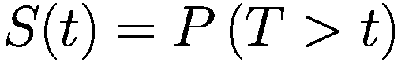
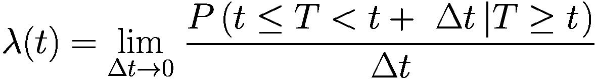
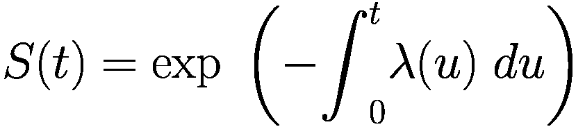
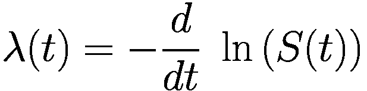
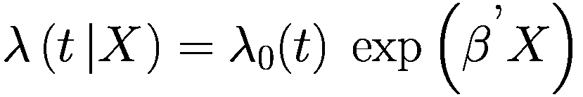
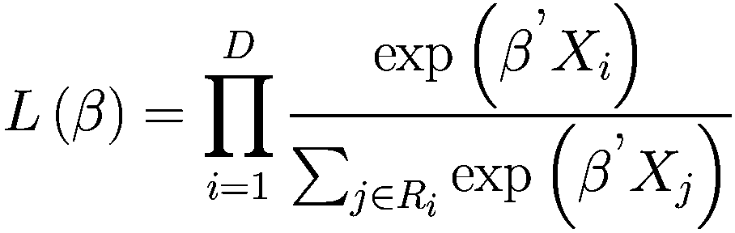
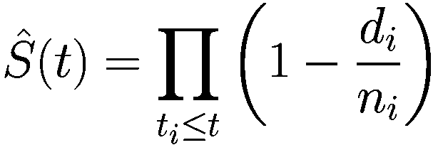
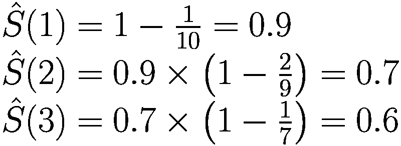

# 设置将混洗文件写入磁盘的缓冲区大小
sparkSession.conf.set("spark.shuffle.file.buffer", "1m")
```

如果您不设置这些配置，可能会未充分利用您的 Spark 资源。

### 使用最优格式

Spark 支持多种格式，包括 CSV、JSON、XML、parquet、orc 和 Avro。性能最佳的格式是使用 snappy 压缩的 parquet，这是 Spark 2.x 或更高版本的默认格式。Parquet 以列式格式存储数据，并且针对 Spark 中的高效数据处理进行了高度优化。

### 数据序列化

Spark 作业是分布式的，因此适当的数据序列化对于获得最佳性能至关重要。Spark 有两种序列化选项：

- Java 序列化是默认选项。
- Kryo 序列化是一种较新的格式，可以比 Java 实现更快、更紧凑的序列化。Kryo 要求您在程序中注册类，并且它不支持所有 Serializable 类型。

## 总结

- 您了解了实验的整体流程。
- 您学习了假设检验的概述和不同的采样技术。
- 您学习了一些常见的技巧和优化方法，这些方法可以在日常活动中节省时间。
- 您还对一些性能调优技术有了概览。

干得漂亮！祝您 PySpark 愉快！！


# 11. 建模框架

预测建模已成为企业在当今数据驱动格局中争夺竞争优势的不可或缺工具。通过利用历史数据预测未来结果，公司可以做出明智决策，提升客户满意度、优化营销策略，并最终推动增长。然而，预测模型的真正力量在于其集成与堆叠能力，从而构建出能够为利益相关者提供可操作洞察和显著价值的综合框架。

本章旨在深入探讨如何集成各类预测模型，以构建应对关键业务挑战的稳健框架。通过理解并应用这些框架，组织能够改进决策流程，进而提升效率、盈利能力和客户留存率。

## 客户生命周期价值

客户生命周期价值（CLV）是商业与营销领域的基础概念，用于量化一家公司从单个客户账户在整个关系存续期间预期产生的总收入。在客户获取与留存对长期成功至关重要的当今竞争激烈的商业环境中，这一指标变得愈发重要。通过理解并利用 CLV，企业可以就资源分配、营销策略和客户留存工作做出明智决策，最终推动盈利能力和可持续增长。

### 理解客户生命周期价值（CLV）

从核心来看，CLV 代表一家公司从客户与其业务关系的整个周期中预期获得的净利润。它涵盖了来自该客户的所有收入流，包括首次购买、重复购买，以及通过推荐或口碑营销带来的任何附加价值。CLV 是一种前瞻性指标，可帮助企业预测未来收入流，并基于客户的长期价值做出战略决策。

计算 CLV 的基本公式如下：

```
CLV = (平均购买价值) * (购买频率) * (客户生命周期)
```

其中：

- `平均购买价值` 是客户每笔交易的平均花费金额。该值可通过将客户产生的总收入除以其交易次数计算得出。
- `购买频率` 是客户在每个时间段（如每年或每月）的平均购买次数。该指标可通过分析历史购买数据并识别客户行为模式得出。
- `客户生命周期` 是客户持续从企业购买的平均时长。可根据历史数据、行业基准或考虑客户流失率和留存策略等因素的预测模型进行估算。

这一基本公式提供了计算 CLV 的简化方法，而更复杂的模型可能会纳入额外因素以提高准确性。这些因素可包括客户获取成本、毛利率、考虑货币时间价值的折现率，以及客户特定变量（如人口统计特征、购买历史和参与度水平）。

### CLV 的重要性

客户生命周期价值对企业而言至关重要，原因如下：

1. **资源分配**  
   CLV 通过识别高价值客户，帮助企业更有效地分配资源。通过专注于留存这些客户，公司可以最大化投资回报率（ROI），并确保持续的收入流。这在客户获取成本高昂的行业中尤为重要，因为留存现有客户比获取新客户更具成本效益。

2. **客户留存**  
   理解 CLV 使企业能够制定有针对性的留存策略。由于获取新客户通常比留存现有客户成本更高，提升 CLV 可显著降低营销和销售成本。通过识别并满足高价值客户的需求，企业可以培养忠诚度并减少客户流失，最终提高整体盈利能力。

3. **营销策略**  
   CLV 为营销活动的有效性提供了洞察。通过比较不同客户群体的 CLV，企业可以调整营销工作，以吸引和留存最有利可图的客户。这种数据驱动的方法可确保营销资源得到高效分配，并优化活动以实现最大影响。

4. **财务预测**  
   CLV 是财务预测的宝贵工具。通过估算现有客户的未来收入流，企业可以做出更准确的预测，并就预算、投资和资源分配做出明智决策。这种长期视角对于战略规划和确保企业财务可持续性至关重要。

5. **客户细分**  
   通过分析 CLV，企业可以将客户群划分为不同的价值层级。这种细分允许实施个性化的营销和客户服务策略，从而提升客户满意度和忠诚度。高价值客户可享受优质产品与个性化体验，而低价值群体则可采用更具成本效益的策略进行接触。


### CLV 的类型

虽然 `CLV` 的概念很直接，但计算和分析这一指标有多种方法，每种方法都有其独特的优势和适用场景。以下是几种最常见的 `CLV` 类型：

1.  **历史 CLV**

`历史 CLV` 根据客户过去的交易来衡量其产生的总收入。这种 `CLV` 类型有助于理解现有客户的价值，并构建理想客户的画像。通过分析历史数据，企业可以识别出最有价值客户的特征和模式，从而为未来的获客和留存策略提供参考。

然而，`历史 CLV` 在预测未来收入方面存在局限性，因为它没有考虑客户行为、市场状况或企业自身策略的变化。它提供的是回顾性视角，可能无法准确反映客户未来的潜在价值。

2.  **预测性 CLV**

`预测性 CLV` 利用历史数据和预测分析来估算客户未来的价值。这种方法考虑了客户获取成本、购买频率和业务开销等因素，以提供更准确的未来收入预测。`预测性 CLV` 对于长期战略规划尤其有用，因为它能帮助企业预测未来的现金流，并就资源分配和投资做出明智决策。

预测模型可以纳入多种变量，包括客户人口统计信息、购买历史、参与度水平，以及市场趋势和经济状况等外部因素。通过利用机器学习和人工智能等高级分析技术，企业可以不断优化其预测模型，提高 `CLV` 估算的准确性。

3.  **同期群分析**

同期群分析根据客户首次购买的时间段对其进行分组，并追踪其随时间变化的行为。这种方法有助于识别客户行为模式，并比较不同客户群的 `CLV`。通过分析同期群，企业可以深入了解客户获取、留存和收入趋势，从而相应地优化其策略。

例如，企业可以分析通过不同营销渠道或在特定促销期间获取的客户的 `CLV`。这些信息可以帮助他们了解哪些获客策略在吸引高价值客户方面最有效，从而指导其营销策略的调整和优化。

4.  **基于留存的 CLV**

这种方法侧重于重复购买次数、平均购买价值和客户留存率。它对于客户留存是关键指标的订阅制企业尤其有用。通过分析留存率和回头客产生的收入，企业可以识别提升客户忠诚度的机会，并最大化其客户群的终身价值。

基于留存的 `CLV` 模型通常包含客户流失率、续订率以及留存策略对客户行为的影响等因素。这种方法有助于企业理解留住客户的长期价值，并优先考虑那些能培养客户忠诚度、降低流失率的举措。

5.  **RFM 分析**

`RFM`（最近一次购买时间、购买频率、消费金额）分析考虑了三个因素：客户最近一次购买的时间、购买频率以及消费金额。这种方法有助于企业识别高价值客户，并相应地调整其营销策略。

通过根据客户的 `RFM` 评分对其进行细分，企业可以优先安排工作并更有效地分配资源。例如，对于最近购买时间近且购买频率高的客户，可以针对性地推出忠诚度计划或个性化优惠；而对于评分较低的客户，则可能需要开展激活活动或赢回策略。

`RFM` 分析在客户流失率高的行业中尤其有用，因为它能帮助企业识别有流失风险的客户，并采取主动措施来留住他们。

### 不同商业模式中的 CLV

虽然 `CLV` 的概念适用于各行各业，但其具体实施和考量因素可能因商业模式而异。以下是 `CLV` 在不同业务场景中的应用方式：

1.  **电子商务**

在电子商务中，`CLV` 帮助企业了解客户的长期价值，并优化其营销支出。通过关注高 `CLV` 客户，电商企业可以提高重复购买率和客户忠诚度。电商面临的主要挑战之一是与在线广告和营销活动相关的高昂客户获取成本。通过识别并留住高价值客户，电商企业可以抵消这些成本，并最大化其盈利能力。

电商中的 `CLV` 分析通常涉及追踪客户在多个渠道的行为，包括网站访问、电子邮件互动和社交媒体参与。这些数据可用于根据客户的购买历史、浏览模式和参与度水平对其进行细分，从而实现精准营销和个性化体验。此外，电商企业可以利用预测性 `CLV` 模型来识别具有高潜在价值的客户，并相应地调整其获客和留存策略。这可能包括提供个性化推荐、忠诚度计划或针对性促销，以鼓励重复购买并提高客户终身价值。

2.  **订阅制模式**

对于订阅制企业而言，`CLV` 对于理解经常性收入的价值至关重要。它有助于这些企业优化定价策略、降低流失率并提高客户留存率。在订阅模式中，`CLV` 通常根据每用户平均收入（`ARPU`）、客户获取成本和客户流失率来计算。通过分析这些因素，企业可以确定最佳的定价和留存策略，以最大化其客户群的终身价值。

例如，订阅制企业可能会为承诺更长订阅期的客户提供折扣或激励，因为这可以通过降低流失率并确保持续的经常性收入流来提高其 `CLV`。此外，订阅企业可以利用 `CLV` 分析来识别高价值客户，并优先考虑留存工作。通过了解其最有价值客户的特征和行为，这些企业可以制定有针对性的留存策略，例如个性化沟通、独家优惠或增强客户支持。

3.  **B2B（企业对企业）**

在 `B2B` 行业中，由于交易规模更大、销售周期更长，`CLV` 可能显著更高。`B2B` 公司利用 `CLV` 来优先处理高价值客户，并有效分配资源以维护这些关系。`B2B` 环境中的 `CLV` 通常涉及分析合同价值、续约率和交叉销售机会等因素。通过了解客户账户的潜在终身价值，`B2B` 企业可以就资源分配、客户管理和客户支持做出明智决策。

例如，`B2B` 公司可能会为其 `CLV` 最高的客户优先分配客户管理资源，确保这些宝贵的关系获得专门的支持和关注。此外，他们可以制定有针对性的交叉销售策略，通过提供互补产品或服务来增加这些账户的终身价值。`B2B` 公司还可以利用 `CLV` 分析来识别账户扩展或追加销售的机会。通过了解客户的需求和潜在价值，他们可以调整其产品和销售策略，以最大化收入和盈利能力。

4.  **SaaS（软件即服务）**


# 面向 SaaS 公司

对于 SaaS 公司而言，`CLV`是理解其订阅模式盈利能力的关键指标。它帮助这些公司优化客户获取成本，并制定策略以提升客户留存率、把握追加销售机会。

在 SaaS 行业，`CLV`通常基于月度经常性收入（`MRR`）、客户获取成本、流失率以及升级或降级率等因素进行计算。通过分析这些指标，SaaS 公司可以确定最优的定价策略、客户获取渠道和留存举措，从而最大化客户群的整体生命周期价值。

SaaS 公司可以利用`CLV`分析，根据客户的潜在价值对其进行细分，并相应地调整产品和服务。例如，可以为高`CLV`客户提供高级支持、额外功能或个性化引导，以确保其长期满意度和留存率。此外，SaaS 企业还可以利用`CLV`数据来优化产品路线图和开发工作。通过了解哪些功能和特性能够驱动客户留存和追加销售机会，他们可以优先进行产品增强，以满足最有价值客户的需求。

## 零售业

在零售业，`CLV`帮助企业了解客户的购买行为，并制定有针对性的营销活动。通过聚焦高`CLV`客户，零售商可以提升客户忠诚度，推动长期收入增长。零售业的`CLV`分析通常涉及追踪客户在实体店、电商平台和会员计划等多个渠道的购买历史、购物篮大小和参与度。这些数据可用于根据客户的消费模式、偏好和生命周期价值进行客户细分。

零售商可以利用`CLV`数据来制定有针对性的忠诚度计划、个性化促销活动和定制化营销活动。例如，高`CLV`客户可能会收到独家优惠、新品抢先体验机会，或基于其购买历史的个性化推荐。此外，`CLV`分析还能帮助零售商优化库存管理和商品陈列策略。通过了解最有价值客户的偏好和购买行为，零售商可以确保库存正确的商品，并有效分配货架空间，以最大化销售额和盈利能力。

### 实施 CLV 的挑战与考量

尽管`CLV`对企业来说是一个强大的指标，但其实施和有效利用可能面临若干挑战：

### 1. 数据质量与可用性

准确的`CLV`计算依赖于高质量的数据，包括客户购买历史、人口统计信息和参与度指标。企业在从多个来源（如销售点系统、电商平台和客户关系管理（`CRM`）系统）收集和整合数据时可能面临挑战。

不完整或不准确的数据可能导致有缺陷的`CLV`计算和潜在的误导性洞察。为应对这一挑战，企业必须投资于稳健的数据管理系统，并实施流程以确保各个接触点的数据质量和一致性。

### 2. 客户行为的变化

客户行为是动态的，可能因市场趋势、经济状况和个人情况等多种因素而随时间变化。仅依赖历史数据的`CLV`模型可能无法捕捉这些变化，从而导致预测不准确和次优决策。

为缓解这一挑战，企业应持续监控客户行为，并相应更新其`CLV`模型。这可能涉及纳入外部数据源，如经济指标或市场研究，以考虑可能影响客户行为的更广泛趋势和因素。

### 3. 客户获取成本的核算

虽然`CLV`计算通常侧重于收入流，但为了准确评估盈利能力，考虑客户获取成本（`CAC`）至关重要。未能核算`CAC`可能导致`CLV`被高估，尤其是在客户获取成本较高的行业。

企业应仔细追踪和分配客户获取成本，包括营销费用、销售佣金及其他相关支出。通过将`CAC`纳入`CLV`计算，企业可以更全面地了解客户关系的真实盈利能力。

### 4. 短期与长期战略的平衡

`CLV`是一个关注客户生命周期价值的长期指标。然而，企业也必须考虑短期目标，例如达成季度或年度收入目标。在短期和长期战略之间取得适当平衡可能具有挑战性，因为对客户留存和忠诚度的投资可能不会立即产生回报。

为应对这一挑战，企业应制定一种整体方法，使短期策略与长期`CLV`目标保持一致。这可能涉及设定适当的关键绩效指标（`KPIs`），以平衡即时收入目标与客户生命周期价值指标，并根据需要持续监控和调整策略。

### 5. 组织协调与认同

实施有效的`CLV`策略需要跨职能协作以及组织内各利益相关方的认同。市场、销售、客户服务和产品团队必须协同工作，以确保在客户获取、留存和价值最大化方面采取一致且连贯的方法。

实现组织协调可能具有挑战性，因为不同部门可能存在相互竞争的优先级或各自为政的工作方式。为克服这一挑战，企业应培养以客户为中心的文化，建立清晰的沟通渠道，并提供培训和教育，以确保整个组织对`CLV`及其重要性有共同的理解。


### 利用 CLV 的最佳实践

为了有效利用`CLV`并推动业务成功，企业应考虑以下最佳实践：

1. **将 CLV 融入决策流程**

   `CLV`应成为营销活动、产品开发、定价策略和资源分配等各项业务决策的关键考量因素。通过将`CLV`融入决策流程，企业可以确保其行动与最大化客户生命周期价值和长期盈利能力保持一致。

2. **持续监控并优化 CLV 模型**

   客户行为和市场状况不断变化，因此需要定期监控和优化`CLV`模型。企业应建立流程，定期审查和更新`CLV`计算，纳入新的数据源、不断变化的客户偏好以及新兴趋势。

3. **投资客户数据管理**

   准确的`CLV`计算依赖于高质量的客户数据。企业应投资建设稳健的数据管理系统和流程，以确保数据在不同接触点的完整性、一致性和可访问性。这可能涉及实施客户关系管理（`CRM`）系统、数据仓库解决方案和数据治理框架。

4. **培养以客户为中心的文化**

   最大化`CLV`需要整个组织具备以客户为中心的思维。企业应培养一种优先考虑客户满意度、忠诚度和长期价值创造的文化。这可以通过员工培训、激励计划以及清晰传达组织以客户为中心的愿景和价值观来实现。

5. **利用高级分析和预测建模**

   随着`CLV`模型日益复杂，企业应利用高级分析技术和预测建模来增强洞察力和决策能力。这可能涉及运用机器学习算法、人工智能和预测分析工具来识别模式、预测客户行为，并优化最大化`CLV`的策略。

6. **与跨职能团队协作**

   有效的`CLV`管理需要营销、销售、客户服务和产品开发等多个部门的协作。企业应建立跨职能团队或工作组，以分享见解、协调策略，并确保在客户获取、留存和价值最大化方面采取一致的方法。

7. **衡量并优化客户体验**

   理解`CLV`有助于企业识别促成积极客户体验的因素。通过关注这些因素，公司可以改善整体客户旅程，从而提高满意度和忠诚度。个性化体验、及时的客户支持以及相关的产品推荐是提升`CLV`的一些方法。

### CLV 模型的类型

客户生命周期价值（`CLV`）是企业的一项关键指标，它衡量的是公司在一个客户账户的整个关系存续期内，可以预期从该账户获得的总收入。准确计算并利用`CLV`可以显著影响公司的盈利能力、客户留存率和整体业务战略。有多种类型的`CLV`模型可供选择，每种模型都有其独特的方法、优势和劣势。在这份全面的回答中，我们将深入探讨不同类型的`CLV`模型、它们的公式以及计算方法，从而提供对这一重要指标的详细理解。

#### 简单 CLV 模型

简单`CLV`模型是计算`CLV`最基本的方法。它简单直接，易于实施，是数据或资源有限的企业的一个良好起点。然而，它在准确性和预测能力方面存在显著局限性。

公式：

`CLV = 平均客户收入 × 平均客户生命周期`

说明：

- **平均客户收入：** 这是客户在特定时期内（通常为一年）产生的平均收入。计算方法是将所有客户的总收入除以客户数量。
- **平均客户生命周期：** 这是客户与企业保持活跃关系的平均时长。计算方法是将所有客户的生命周期总和除以客户总数。

计算步骤：

1. 确定要计算平均客户收入的时间段（例如，一年）。
2. 计算该时间段内所有客户产生的总收入。
3. 将总收入除以客户数量，得到平均客户收入。
4. 将所有客户的生命周期相加，再除以客户总数，得到平均客户生命周期。
5. 将平均客户收入乘以平均客户生命周期，得到简单`CLV`。

优点：

- 易于计算和理解。
- 所需数据最少。
- 提供客户价值的快速估算。

缺点：

- 假设收入和流失率恒定，这在现实场景中很少见。
- 未考虑货币的时间价值或客户行为随时间的变化。
- 未考虑获取和保留客户的成本。
- 与更高级的模型相比，提供的`CLV`估算准确性较低。

虽然简单`CLV`模型是一个良好的起点，但对于需要更准确、更全面理解客户价值的企业来说，它往往过于简单。需要更高级的模型来考虑客户行为的复杂性和货币的时间价值。

#### 历史 CLV 模型

历史`CLV`模型基于过去的客户数据计算`CLV`。它汇总客户产生的所有历史收入，而不试图预测未来行为。该模型适用于希望了解现有客户基础价值，而不对未来行为做出假设的企业。

公式：

`CLV = ∑(t=0 到 T) 收入(t)`

说明：

- **收入(t)：** 客户在时间 *t* 产生的收入。
- **T：** 计算所考虑的总时间段。

计算步骤：

1. 确定要计算历史`CLV`的时间段（例如，客户的生命周期或特定年数）。
2. 对于每个客户，汇总指定时间范围内每个时间段 `t` 产生的收入。
3. 所得总和即为该客户的历史`CLV`。

优点：

- 简单直接。
- 基于实际历史数据，对于过去的表现相对准确。
- 有助于理解现有客户的价值。

缺点：

- 不预测未来的客户行为。
- 忽略潜在的未来收入和客户行为的变化。
- 对于希望预测未来收入流的企业没有帮助。
- 未考虑货币的时间价值或获取和保留客户的成本。

虽然历史`CLV`模型为现有客户的价值提供了宝贵的见解，但它并未提供客户生命周期价值的完整图景。希望预测未来收入并优化客户获取和留存策略的企业需要考虑更高级的预测模型。


#### 预测性客户生命周期价值模型

预测性客户生命周期价值模型运用统计技术和机器学习来预测未来的客户行为，并更准确地估算客户生命周期价值。这些模型更为复杂，但能提供对客户价值更全面的理解，因此对于希望优化客户策略并最大化盈利的企业至关重要。

1. 回归模型

回归模型利用各种客户属性和交易历史来预测未来的客户行为并估算客户生命周期价值。

公式：

`CLV = β0 + β1 X1 + β2 X2 + ... + βn Xn`

解释：

*   `β0`：截距项。
*   `βi`：每个预测变量 `Xi` 的系数。
*   `Xi`：预测变量，例如客户人口统计信息、购买历史和参与度指标。

计算步骤：

1.  收集客户属性和交易历史数据，包括人口统计信息、购买行为和参与度指标等预测变量。
2.  将数据拆分为训练集和测试集。
3.  使用训练数据拟合回归模型，估算每个预测变量 `Xi` 的系数 `βi`。
4.  评估模型在测试数据上的表现，并进行必要的调整。
5.  对于每位客户，将其预测变量值代入回归方程，计算其客户生命周期价值。

优点：

*   可以纳入多个变量以提高准确性。
*   灵活，可适应不同的业务场景。
*   提供对影响客户行为和客户生命周期价值因素的洞察。

缺点：

*   需要大量数据进行训练。
*   实施和解释可能较为复杂。
*   假设预测变量与客户生命周期价值之间存在线性关系，但实际情况可能并非总是如此。

回归模型示例：

假设一家公司希望根据客户的年龄、平均订单价值和购买频率来预测客户生命周期价值。回归模型可能如下所示：

`CLV = 100 + 2.5 × 年龄 + 50 × 平均订单价值 + 75 × 购买频率`

在此示例中，模型表明年龄较大、平均订单价值较高以及购买频率较高的客户通常具有更高的客户生命周期价值。

1. 概率模型

概率模型使用概率分布来模拟客户行为。最著名的概率模型之一是帕累托/NBD（负二项分布）模型。

帕累托/NBD 模型：

该模型假设客户购买行为遵循泊松过程，并且流失率遵循伽马分布。

公式：

`CLV = (p × λ) / μ`

解释：

*   `p`：客户活跃的概率。
*   `λ`：购买率。
*   `μ`：流失率。

计算步骤：

1.  收集客户购买历史和流失行为的数据。
2.  使用最大似然估计或其他技术估算参数 `p`、`λ` 和 `μ`。
3.  将估算的参数值代入帕累托/NBD 公式，计算每位客户的客户生命周期价值。

优点：

*   提供客户行为的概率估计。
*   能够处理不同的购买频率和流失率。
*   考虑了客户行为的异质性。

缺点：

*   需要很好地理解概率分布。
*   计算量可能很大。
*   可能无法捕捉客户行为的所有方面，例如营销活动的影响或客户偏好的变化。

帕累托/NBD 模型示例：

假设一家公司为其客户群估算了以下参数：

*   `p = 0.8`：随机选择的客户仍然活跃的概率。
*   `λ = 2`：活跃客户每年的平均购买次数。
*   `μ = 0.2`：流失率，即客户在给定年份内变为不活跃的概率。

使用帕累托/NBD 公式，该客户群的客户生命周期价值为：

`CLV = (0.8 × 2) / 0.2 = 8`

这表明，平均而言，每位客户预计将产生相当于平均购买金额 8 倍的终身价值。

1. 机器学习模型

机器学习模型，例如决策树、随机森林和神经网络，可用于预测客户生命周期价值。这些模型能够处理大型数据集和变量之间的复杂关系，非常适合拥有丰富客户数据的企业。

计算步骤：

1.  收集客户属性、交易历史和其他相关变量的数据。
2.  将数据拆分为训练集和测试集。
3.  选择合适的机器学习算法（例如随机森林、神经网络），并在训练数据上训练模型。
4.  评估模型在测试数据上的表现，并进行必要的调整。
5.  使用训练好的模型，根据每位客户的输入变量预测其客户生命周期价值。

优点：

*   能够捕捉变量之间的非线性关系和交互作用。
*   在数据充足且调优得当的情况下，准确性很高。
*   能够处理大型和复杂的数据集。

缺点：

*   需要大量的计算资源。
*   可能是一个“黑箱”，导致结果难以解释。
*   如果未进行适当的正则化或验证，容易过拟合。

机器学习模型示例：

假设一家公司希望使用随机森林模型预测客户生命周期价值。该模型可能会考虑以下变量：

*   客户人口统计信息（年龄、性别、位置）
*   购买历史（频率、平均订单价值、产品类别）
*   参与度指标（网站访问量、邮件打开率、社交媒体互动）
*   营销活动响应

随机森林模型将从训练数据中学习这些变量与客户生命周期价值之间的模式和关系，从而能够为具有变化行为的新客户或现有客户做出准确的预测。


## 生存分析模型

生存分析模型，也称为“事件时间”模型，对于基于订阅的业务尤其有用。这些模型会考虑删失数据（在分析时仍活跃的客户），并估算客户随时间推移保持活跃（生存）的概率。

### 生存函数

生存函数 `S(t)` 表示客户在时间 `t` 之后仍保持活跃的概率：



其中 `T` 是流失时间。该函数随时间递减，在 `t = 0` 时从 1 开始，当 `t` 趋近于无穷大时趋近于 0。

### 风险函数

风险函数 `lambda(t)` 是在时间 `t` 的瞬时流失率，前提是客户已存活至时间 `t`：



风险函数提供了在任何给定时间点流失风险的洞察。

### 生存函数与风险函数的关系

生存函数和风险函数通过以下方程相关联：





### 常见的生存分析模型

#### Cox 比例风险模型

一种半参数模型，用于估算在特定时间发生事件的风险。



其中：

- `lambda_0(t)` 是基线风险函数。
- `beta` 是协变量 `X` 的系数向量。

Cox 模型的偏似然函数为：



其中：

- `D` 是已发生事件的个体集合。
- `R_i` 是在时间 `t_i` 的风险集。

#### Kaplan-Meier 估计量

一种非参数统计量，用于根据生存数据估算生存函数。



其中：

- `t_i` 是第 i 个事件发生的时间。
- `d_i` 是在时间 `t_i` 发生的事件（流失）数量。
- `n_i` 是在时间 `t_i` 之前处于风险中的客户数量。

计算示例：

假设我们有以下流失数据：

Kaplan-Meier 生存函数的计算如下：



#### Weibull 模型

一种参数模型，假设事件时间服从 Weibull 分布。

### 计算步骤

1.  收集客户生命周期、删失指示符以及相关协变量（例如，人口统计信息、使用模式和营销活动）的数据。
2.  将生存分析模型（例如，Cox 比例风险模型）拟合到数据中，估算每个协变量的系数 `βi`。
3.  使用拟合模型估算每个客户在不同时间点的生存概率。
4.  通过对生存概率随时间进行积分，并考虑与每个客户相关的预期收入和成本，来计算 CLV。

### 优势

-   能够处理删失数据，使其适用于持续的客户关系。
-   提供影响客户生存因素的洞察。
-   可以纳入随时间变化的协变量。
-   适用于具有经常性收入流的业务。

### 劣势

-   需要专业知识来实施和解释。
-   计算量可能很大。
-   假设比例风险或事件时间服从特定分布，但这并非总是成立。

### 生存分析模型示例

假设一家基于订阅的公司希望使用 Cox 比例风险模型来估算 CLV。该模型可能包含以下协变量：

-   客户存续期
-   订阅计划
-   使用模式（例如，登录次数、功能使用情况）
-   营销活动曝光度

该模型将根据这些协变量，估算客户在任何给定时间点流失（变为不活跃）的风险。然后，可以使用随时间变化的生存概率来计算预期的未来收入，并最终计算每个客户的 CLV。

## 传统 CLV 模型

传统 CLV 模型适用于客户收入不随时间保持恒定的业务。它考虑了客户生命周期内发生的变化，例如不同的收入流以及留住客户的相关成本。

### 公式

`CLV = (GML × 留存率) / (1 + 折现率 - 留存率)`

### 解释

-   **GML：** 每个客户生命周期的毛利润。
-   **留存率：** 在设定时间段内留存在企业的客户百分比。
-   **折现率：** 用于考虑通货膨胀的百分比，通常设为 10%。

### 计算步骤

1.  通过从客户在其生命周期内产生的总收入中减去获取和服务该客户的相关成本，来确定每个客户生命周期的毛利润 (`GML`)。
2.  通过将特定时间段内留存的客户数量除以该时间段开始时的客户总数，来计算留存率。
3.  选择合适的折现率，以考虑货币的时间价值和通货膨胀。
4.  将计算出的值代入传统 CLV 公式。

### 优势

-   考虑了货币的时间价值以及留住客户的相关成本。
-   考虑了客户收入随时间的变化。
-   与简单 CLV 模型相比，提供了更全面的 CLV 估算。

### 劣势

-   假设留存率和折现率随时间保持不变，但这可能并不总是准确。
-   不考虑单个客户的特征或行为。
-   需要准确估算毛利润率和留存率，而这可能难以获得。

### 传统 CLV 模型示例

假设一家公司拥有以下数据：

-   每个客户生命周期的毛利润 (`GML`) = 1,000 美元
-   留存率 = 80%（即每年留存 80% 的客户）
-   折现率 = 10%

使用传统 CLV 公式，CLV 将为：

`CLV = (1,000 × 0.8) / (1 + 0.1 - 0.8) = 800 / 0.3 = 2,666.67 美元`

这表明，考虑到货币的时间价值和留住客户的相关成本，平均而言，预计每个客户将为公司带来 2,666.67 美元的生命周期价值。


#### 加速失效时间（AFT）模型

加速失效时间（AFT）模型是一种用于生存分析的参数模型，旨在估计协变量对受试者生存时间的影响。与假设协变量对风险函数产生乘法效应的 Cox 比例风险模型不同，AFT 模型假设协变量以一个恒定因子加速或延缓事件的生命进程。这使得 AFT 模型在比例风险假设可能不成立的情况下特别有用。

**模型设定：**

在 AFT 模型中，生存时间的对数被建模为协变量的线性函数。AFT 模型的一般形式可以指定为：

`log(T) = β0 + β1 X1 + β2 X2 + ... + βp Xp + ε`

其中：

*   `T` 是生存时间。
*   `β0` 是截距项。
*   `βi` 是协变量 `Xi` 的系数。
*   `ε` 是误差项，它遵循特定的分布（例如，正态分布、逻辑分布、威布尔分布）。

该模型也可以用生存函数 `S(t|θ)` 和风险函数 `λ(t|θ)` 来表示：

`S(t|θ) = S0(θ t)`

`λ(t|θ) = θ λ0(θ t)`

其中 `θ = exp(-[β1 X1 + ... + βp Xp])`。

**AFT 模型的优点：**

1.  **无需比例风险假设：** 与 Cox PH 模型不同，AFT 模型不需要比例风险假设，该假设认为协变量不同水平之间的风险比随时间恒定。这一假设在现实数据中经常被违反。
2.  **直接解释：** AFT 模型中的系数直接量化了协变量对生存时间的影响，使得解释更加直观。这些系数代表了生存时间的加速或延缓。
3.  **更高效的估计：** 基于渐近结果，AFT 模型可以比 Cox PH 模型产生更高效的参数估计，尤其是在样本量较小时。
4.  **洞察基线风险：** 当有足够的经验信息可用时，AFT 模型可以提供对基线风险函数形式的洞察，而半参数的 Cox PH 模型则无法做到这一点。
5.  **处理删失数据：** 与 Cox PH 模型一样，AFT 模型可以处理删失的生存数据。
6.  **可压缩性：** AFT 模型是可压缩的，这意味着系数的边际估计和条件估计是相同的。这一特性对于因果推断非常有用。

**AFT 模型的缺点：**

1.  **分布假设：** AFT 模型需要对生存时间做出特定的分布假设（例如，威布尔分布、对数逻辑分布、对数正态分布），这在实践中可能并不总是成立。
2.  **对异常值敏感：** AFT 模型可能对数据中的异常值或极端值敏感，这会影响参数估计。
3.  **模型选择困难：** 为 AFT 模型选择合适的分布可能具有挑战性，不同的分布可能导致不同的结果。
4.  **时变效应的解释：** 虽然 AFT 模型可以处理时变协变量，但对其效应的解释可能比 Cox PH 模型更复杂。
5.  **软件可用性有限：** 与广泛可用的 Cox PH 模型相比，一些统计软件包对 AFT 模型的支持或实现可能有限。

#### 示例 11.1

此示例创建合成数据以生成 RFM 细分，展示如何使用 PySpark 实现 RFM 细分的概念：

```
