# 停止 Spark 会话
`spark.stop()`

## 示例 11.2

我们再次使用合成数据，通过 PySpark 的 AFT 库生成 CLV 值。

### 导入必要的库
```python
from pyspark.sql import SparkSession
from pyspark.sql.functions import col, count, sum, max, lit, datediff, when, min, udf
from pyspark.sql.types import DateType, FloatType
from pyspark.ml.feature import VectorAssembler
from pyspark.ml.regression import AFTSurvivalRegression
from pyspark.ml.evaluation import RegressionEvaluator
import datetime
import random
```

### 初始化 Spark 会话
```python
spark = SparkSession.builder.appName("基于 AFT 模型的 CLV 生存分析").getOrCreate()
```

### 生成模拟数据
```python
num_customers = 100
num_transactions = 1000
customers = [f"customer_{i}" for i in range(1, num_customers + 1)]
transaction_dates = [datetime.date.today() - datetime.timedelta(days=random.randint(1, 365)) for _ in range(num_transactions)]
transaction_amounts = [random.uniform(10.0, 1000.0) for _ in range(num_transactions)]
churn_dates = [random.choice([datetime.date.today() - datetime.timedelta(days=random.randint(30, 365)), None]) for _ in range(num_customers)]
transaction_data = [(random.choice(customers), transaction_dates[i], transaction_amounts[i]) for i in range(num_transactions)]
churn_data = [(customers[i], churn_dates[i]) for i in range(num_customers)]
transaction_columns = ["CustomerID", "TransactionDate", "Amount"]
churn_columns = ["CustomerID", "ChurnDate"]
```

### 创建 DataFrame
```python
transaction_df = spark.createDataFrame(transaction_data, transaction_columns)
churn_df = spark.createDataFrame(churn_data, churn_columns)
```

### 展示数据
```python
transaction_df.show(5)
churn_df.show(5)
```

### 计算最近一次消费时间、消费频率和消费金额
```python
current_date = datetime.date.today()
```

### 添加当前日期列
```python
transaction_df = transaction_df.withColumn("CurrentDate", lit(current_date).cast(DateType()))
```

### 计算最近一次消费时间
```python
recency_df = transaction_df.groupBy("CustomerID").agg(datediff(max("CurrentDate"), max("TransactionDate")).alias("Recency"))
```

### 计算消费频率
```python
frequency_df = transaction_df.groupBy("CustomerID").agg(count("TransactionDate").alias("Frequency"))
```

### 计算消费金额
```python
monetary_df = transaction_df.groupBy("CustomerID").agg(sum("Amount").alias("Monetary"))
```

### 合并 RFM 值
```python
rfm_df = recency_df.join(frequency_df, "CustomerID").join(monetary_df, "CustomerID")
```

### 将 RFM 数据与流失数据合并
```python
rfm_churn_df = rfm_df.join(churn_df, "CustomerID")
```

### 将空值的流失日期填充为未来日期，表示未流失
```python
future_date = current_date + datetime.timedelta(days=365)
rfm_churn_df = rfm_churn_df.withColumn("ChurnDate", when(col("ChurnDate").isNull(), lit(future_date)).otherwise(col("ChurnDate")))
```

### 计算客户生命周期（首次交易到流失日期的天数）
```python
tenure_df = transaction_df.groupBy("CustomerID").agg(min("TransactionDate").alias("FirstTransactionDate"))
rfm_churn_df = rfm_churn_df.join(tenure_df, "CustomerID")
rfm_churn_df = rfm_churn_df.withColumn("Tenure", datediff(col("ChurnDate"), col("FirstTransactionDate")))
```

### 计算事件（是否流失）
```python
rfm_churn_df = rfm_churn_df.withColumn("Event", when(col("ChurnDate") < lit(current_date), 1).otherwise(0))
```

### 为 AFT 模型组装特征
```python
assembler = VectorAssembler(inputCols=["Recency", "Frequency", "Monetary"], outputCol="features")
rfm_churn_df = assembler.transform(rfm_churn_df)
```

### 将数据拆分为训练集和测试集
```python
train_df, test_df = rfm_churn_df.randomSplit([0.8, 0.2], seed=12345)
```

### 拟合 AFT 生存回归模型
```python
aft = AFTSurvivalRegression(featuresCol="features", labelCol="Tenure", censorCol="Event")
aft_model = aft.fit(train_df)
```

### 预测测试集的生存概率
```python
predictions = aft_model.transform(test_df)
```

### 展示预测结果
```python
predictions.select("CustomerID", "features", "Event", "Tenure", "prediction").show(5)
```

### 计算平均月收入
```python
rfm_churn_df = rfm_churn_df.withColumn("AvgMonthlyRevenue", col("Monetary") / (col("Tenure") / 30))
```

### 使用生存分析计算 CLV 的函数
```python
def calculate_clv(rfm_churn_df, predictions):
    # 将预测结果与原始 DataFrame 合并
    rfm_churn_df = rfm_churn_df.join(predictions.select("CustomerID", "prediction"), "CustomerID")
    # 计算 CLV
    rfm_churn_df = rfm_churn_df.withColumn("PredictedCLV", col("AvgMonthlyRevenue") * col("prediction") / 30)  # 将天数转换为月数
    return rfm_churn_df
```

### 应用 CLV 计算
```python
clv_df = calculate_clv(rfm_churn_df, predictions)
```

### 使用实际流失日期计算实际 CLV
```python
clv_df = clv_df.withColumn("ActualCLV", col("AvgMonthlyRevenue") * (col("Tenure") / 30))
```

### 确保评估所需的列可用
```python
clv_df_eval = clv_df.select("PredictedCLV", "ActualCLV")
```

### 展示最终的 CLV 数据
```python
clv_df.select("CustomerID", "Recency", "Frequency", "Monetary", "Tenure", "AvgMonthlyRevenue", "prediction", "PredictedCLV", "ActualCLV").show(10)
```

### 评估 CLV 预测的准确性
```python
evaluator_mae = RegressionEvaluator(labelCol="ActualCLV", predictionCol="PredictedCLV", metricName="mae")
mae = evaluator_mae.evaluate(clv_df_eval)
print(f"平均绝对误差 (MAE): {mae}")

evaluator_mse = RegressionEvaluator(labelCol="ActualCLV", predictionCol="PredictedCLV", metricName="mse")
mse = evaluator_mse.evaluate(clv_df_eval)
print(f"均方误差 (MSE): {mse}")

evaluator_rmse = RegressionEvaluator(labelCol="ActualCLV", predictionCol="PredictedCLV", metricName="rmse")
rmse = evaluator_rmse.evaluate(clv_df_eval)
print(f"均方根误差 (RMSE): {rmse}")
```

### 停止 Spark 会话
```python
spark.stop()
```

# 营销投资回报率 (`ROMI`)

营销投资回报率 (`ROMI`) 是企业衡量营销活动效果的关键指标。它量化了营销活动产生的收入与所投入成本之间的关系，帮助企业优化营销支出。在当今数据驱动的世界中，准确计算 `ROMI` 需要利用多种数据科学模型和技术，以捕捉消费者行为和营销影响的复杂性。

## `ROMI` 的基本公式

`ROMI` 的基本公式为：


其中：

- `增量收入`：营销活动带来的额外收入。
- `营销成本`：营销活动的总成本。

该公式提供了 `ROMI` 的宏观视角，但在实践中，计算过程更为复杂，需要结合各种数据科学技术以确保准确性和可靠性。

## 使用数据科学模型计算 `ROMI` 的分步方法

### 第一步：数据收集与准备

*数据收集*是计算 `ROMI` 的第一步。它涉及从各种来源收集数据，以全面了解营销活动及其对收入的影响。这包括：

- **客户数据：** 人口统计信息、购买历史和行为数据。
- **营销数据：** 营销活动的详细信息，包括成本、展示次数、点击次数和转化次数。
- **销售数据：** 交易记录、订单金额和日期。
- **网站分析数据：** 网站流量、用户交互和转化率。

每个数据源都提供了宝贵的见解，有助于全面理解营销效果。

*数据准备*涉及清洗、转换和合并这些数据源，以创建一个适合分析的统一数据集。

- **数据清洗：** 删除重复项、处理缺失值并纠正错误，以确保数据质量。
- **数据转换：** 将数据转换为适合分析的格式。这可能涉及将每日数据汇总为月度数据、标准化数值或对分类变量进行编码。
- **数据合并：** 将来自不同来源的数据组合成一个包含所有相关信息的单一数据集。

**示例：** 一家电商零售商从其 `CRM` 系统、营销自动化平台、电商网站和网站分析工具收集数据。这些数据经过清洗、转换和合并，以创建一个用于分析的全面数据集。

### 第二步：客户细分

客户细分涉及根据共同特征将客户划分为不同的群体。这有助于针对不同的客户群体定制营销策略，并确定不同群体对营销活动的反应。

客户细分技术：

- **`K-Means` 聚类：** 一种流行的算法，根据客户的相似性将其划分为 `K` 个聚类。
- **层次聚类：** 通过合并或拆分现有聚类来构建聚类的层次结构。
- **`DBSCAN`（基于密度的噪声应用空间聚类）：** 根据密度识别不同形状和大小的聚类。

客户细分的目的：

- 为不同的客户群体定制营销策略。
- 分析营销活动对不同客户群体的影响。
- 识别高价值群体，以便集中营销工作。

**示例：** 使用 `K-Means` 聚类，一家电商零售商根据最近一次购买时间、频率和货币价值（`RFM`）对客户进行细分。这有助于零售商了解哪些群体更有可能对特定营销活动做出反应，并据此分配预算。

### 第三步：归因建模

归因建模用于确定哪些营销渠道和接触点促成了转化。准确的归因对于理解营销活动的真实影响和优化未来的营销活动至关重要。

归因模型类型：

1. **单触点归因：**
    - **首次触点归因：** 将全部转化价值归因于第一个接触点。
    - **末次触点归因：** 将全部转化价值归因于最后一个接触点。

2. **多触点归因：**
    - **线性归因：** 将转化价值平均分配给所有接触点。
    - **时间衰减归因：** 将更多价值分配给更接近转化的接触点。
    - **基于位置的归因：** 为首次和末次接触点分配更高的价值，剩余价值在中间接触点之间分配。

3. **算法归因：** 使用机器学习模型，根据每个接触点的实际影响来分配转化价值。与基于规则的模型相比，这种方法更复杂，能提供更准确的见解。

归因建模的目的：

- 了解每个营销渠道对转化的贡献。
- 更有效地分配营销预算。
- 识别哪些接触点和渠道在推动转化方面最有效。

**示例：** 一家电商零售商使用线性归因模型，将转化价值平均分配给所有接触点。通过这样做，零售商可以深入了解每个营销渠道（例如，电子邮件、社交媒体、搜索引擎）如何促进整体转化，从而做出更明智的预算分配决策。

### 第四步：增量收入预测建模

预测建模使用历史数据来预测营销活动的收入影响。这涉及应用回归分析和机器学习算法，根据过去的行为预测未来的结果。

常见的预测模型：

- **线性回归：** 对因变量（例如，收入）和自变量（例如，营销支出）之间的关系进行建模。
- **时间序列分析：** 诸如 `ARIMA`（自回归积分滑动平均模型）和指数平滑等技术，根据过去的数据预测未来值。
- **机器学习模型：** 决策树、随机森林、梯度提升和神经网络等算法可以捕捉复杂关系并做出准确预测。

预测建模的目的：

- 预测未来营销活动的收入影响。
- 根据预测结果优化营销支出。
- 识别收入的关键驱动因素，并将营销工作集中在高影响力的活动上。

**示例：** 一家电商零售商使用梯度提升回归器来预测营销活动产生的增量收入。该模型使用历史数据进行训练，并使用均方误差等指标评估其性能。这有助于零售商预测未来活动的潜在收入影响，并就营销支出做出数据驱动的决策。

### 第五步：客户生命周期价值（`CLV`）分析

客户生命周期价值（`CLV`）是企业期望从单个客户在其整个生命周期中获得的总收入。它是理解营销活动长期影响和定制策略以最大化客户价值的关键指标。

`CLV` 分析的目的：

- 了解通过营销活动获取的客户的长期价值。
- 定制营销策略以最大化 `CLV`。
- 识别高价值客户，并将留存工作重点放在他们身上。

**示例：** 一家电商零售商计算历史 `CLV` 和预测 `CLV`，以了解营销活动的长期影响。预测模型根据客户特征和行为估算未来的 `CLV`，帮助零售商定制营销策略以最大化客户价值。

### 第六步：营销成本计算

营销成本包括与开展营销活动相关的所有费用。这包括广告支出等直接成本，以及人员和技术等间接成本。

营销成本的组成部分：

# ROMI 计算与产品参与度

## 营销成本计算

- **广告支出：** 与在线和离线广告渠道相关的成本。
- **人员成本：** 营销人员的薪资和福利。
- **技术成本：** 营销自动化平台、分析工具和其他技术的成本。
- **创意成本：** 与创建营销内容相关的成本，如图形设计和视频制作。

营销成本计算的目的：

- 准确核算所有营销费用。
- 计算营销活动产生的净利润。
- 确保全面了解营销活动的总投资。

**示例：** 一家电商零售商汇总了所有营销成本，包括广告支出、人员成本、技术成本和创意成本。通过准确核算这些费用，零售商确保`ROMI`计算能够反映营销活动的真实投资。

### 第 7 步：ROMI 计算

在完成所有组件的准备后，最后一步是使用前述公式计算 ROMI：

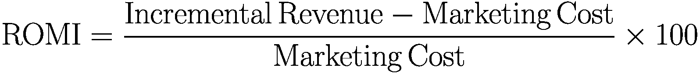

ROMI 计算的目的：

-   评估营销活动的有效性。
-   基于 ROMI 分析的洞察，优化未来的营销工作。
-   就营销支出和策略做出数据驱动的决策。

**示例：** 一家电商零售商计算了接触营销活动的客户所产生的增量收入，并与未接触的客户进行了比较。通过使用 ROMI 公式，该零售商确定了营销投资的回报，并深入了解了该活动的有效性。

## 高级技术与考量

### 高级归因模型

可以通过高级技术增强归因模型，以更准确地洞察营销活动的影响。

1.  **沙普利值归因：**
    -   一种合作博弈论方法，公平地将转化价值分配给所有接触点。
    -   它考虑了每个接触点对整体转化的边际贡献，从而更准确地反映每个渠道的影响。

2.  **马尔可夫链归因：**
    -   使用转移概率来模拟客户旅程，并据此分配转化。
    -   它捕捉了客户交互的概率性质，并提供了对转化路径中最具影响力接触点的洞察。

**目的：**

-   提高归因模型的准确性。
-   更深入地了解每个营销渠道的贡献。
-   基于更精确的归因数据优化营销支出。

**示例：** 一家电商零售商使用沙普利值归因，公平地将转化价值分配给客户旅程中的所有接触点。这种方法更准确地反映了每个渠道的影响，使零售商能够优化预算分配。

### 用于预测建模的机器学习

机器学习模型可用于增强 ROMI 计算的预测建模。这些模型能够捕捉复杂关系并提供更准确的预测。

常见的机器学习模型：

-   **神经网络：** 捕捉数据中复杂的非线性关系，以实现更准确的预测。
-   **集成方法：** 结合多个模型以提高预测准确性和稳健性。例如随机森林和梯度提升。

**目的：**

-   提高预测模型的准确性。
-   捕捉传统模型可能遗漏的复杂关系。
-   为增量收入和 `CLV` 提供更可靠的预测。

**示例：** 一家电商零售商使用神经网络来预测营销活动产生的增量收入。该模型捕捉了数据中的复杂关系，提供了更准确的预测，并帮助零售商优化营销支出。

### 实时数据处理

实时数据处理框架能够基于最新数据持续更新 ROMI 计算。这使得企业能够做出更及时、更明智的决策。

**技术：**

-   **流式分析：** 使用 `Apache Kafka` 和 `Apache Spark Streaming` 等实时数据处理框架，在数据到达时进行处理。
-   **实时仪表盘：** 实施实时仪表盘以可视化 ROMI 及其他关键指标，从而实现快速决策。

**目的：**

-   提供关于营销活动有效性的最新洞察。
-   基于实时数据，能够及时调整营销策略。
-   提高对客户行为和市场条件变化的响应能力。

**示例：** 一家电商零售商实施了实时仪表盘，以持续监控 ROMI 及其他关键指标。通过实时处理数据，该零售商可以根据最新洞察快速调整营销策略。

### 实验与 A/B 测试

A/B 测试等实验框架有助于隔离特定营销活动的影响，并提供更准确的增量收入估算。

**技术：**

-   **A/B 测试：** 将客户随机分配到对照组和测试组，以隔离特定营销活动的影响。比较两组之间的结果，以估算营销活动产生的增量收入。
-   **多臂老虎机：** 一种自适应实验框架，平衡探索与利用以优化营销策略。它根据实时表现数据，动态地将资源分配给最有前景的营销活动。

**目的：**

-   隔离特定营销活动的影响。
-   提供更准确的增量收入估算。
-   基于实验结果优化营销策略。

**示例：** 一家电商零售商进行 A/B 测试，以评估一项新电子邮件营销活动的影响。客户被随机分配到对照组（未接触）和测试组（接触活动）。通过比较两组之间的结果，零售商估算了该活动产生的增量收入，并计算了 ROMI。

### ROMI 结论

使用数据科学模型计算营销投资回报率 (`ROMI`) 涉及多种技术的结合，以准确地将收入归因于营销工作、预测未来收入并了解客户的长期价值。通过利用高级模型和方法，企业可以更深入地了解其营销活动的有效性，并做出数据驱动的决策来优化营销策略。

总之，使用数据科学模型计算 `ROMI` 的关键步骤包括：

1.  **数据收集与准备：** 从各种来源收集和准备数据，以创建统一的数据集。
2.  **客户细分：** 将客户划分为不同的群体，以定制营销策略并了解特定细分市场的反应。
3.  **归因建模：** 使用高级归因模型确定每个营销渠道对转化的贡献。
4.  **增量收入预测建模：** 使用机器学习模型预测营销活动的收入影响。
5.  **客户生命周期价值 (`CLV`) 分析：** 了解客户的长期价值，并定制营销策略以最大化 `CLV`。
6.  **营销成本计算：** 准确核算所有营销费用，以计算营销活动产生的净利润。
7.  **ROMI 计算：** 使用 ROMI 公式评估营销活动的有效性，并就营销支出做出数据驱动的决策。

通过整合这些步骤并利用高级数据科学模型，企业可以准确计算 `ROMI`，优化营销工作，并最终推动营销投资获得更高回报。

# 产品参与度评分

`产品参与度评分` 是用于量化用户如何与产品交互的指标。这些评分提供了对用户行为、产品性能和整体用户满意度的洞察。它们对于了解产品的健康状况和指导业务决策至关重要。

## 产品参与度评分的重要性

产品参与度评分至关重要，原因如下：

1.  **用户留存**：高参与度通常与更好的用户留存率相关。了解参与度有助于识别那些能吸引用户回访的功能。
2.  **功能改进**：通过分析参与度评分，公司可以确定哪些功能最受欢迎，哪些需要改进。
3.  **个性化**：参与度评分可用于个性化用户体验，根据个人用户偏好定制内容和功能。
4.  **市场营销与销售**：参与度高的用户更有可能转化为付费客户。参与度指标有助于优化营销策略。
5.  **产品开发**：从参与度评分中获得的洞察可以为产品开发提供信息，确保新功能符合用户需求和偏好。

## 示例 1：流媒体平台

参与度指标：

1.  **观看时长**：观看内容的总时间。
2.  **会话频率**：特定时间段内每个用户的会话次数。
3.  **内容互动**：对内容的点赞、评论、分享及其他互动次数。
4.  **流失率**：停止使用平台的用户百分比。
5.  **订阅率**：转化为付费订阅的用户百分比。

### 计算参与度评分

假设一个流媒体平台收集用户交互数据，包括观看时长、会话频率和内容互动。你可以通过组合这些指标来创建一个综合参与度评分。标准化通常涉及将每个指标缩放到一个公共范围，例如 0 到 1。

#### 步骤 1：标准化指标

首先，你需要对指标进行标准化，以确保它们处于同一尺度。

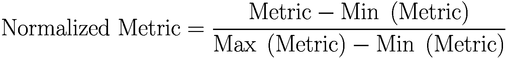

#### 步骤 2：分配权重

接下来，根据每个指标的重要性为其分配权重。例如：

- 观看时长：40%
- 会话频率：30%
- 内容互动：30%

#### 步骤 3：计算综合评分

最后，计算综合参与度评分。

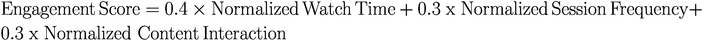

计算示例：

假设某用户的标准化指标如下：

- 标准化观看时长：0.8
- 标准化会话频率：0.6
- 标准化内容互动：0.7

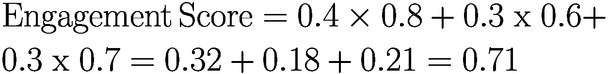

## 示例 2：软件应用

以下是参与度指标：

### 计算参与度评分

对于软件应用，你可以采用与流媒体平台类似的方法。

#### 步骤 1：标准化指标

对指标进行标准化，以确保它们处于同一尺度。


#### 步骤 2：分配权重

根据每个指标的重要性为其分配权重。例如：

- 活跃天数：25%
- 功能使用量：25%
- 会话时长：20%
- 错误率：10%
- 留存率：20%

#### 步骤 3：计算综合评分

计算综合参与度评分。

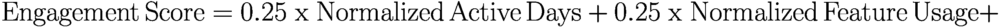

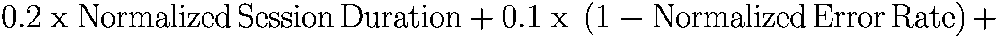

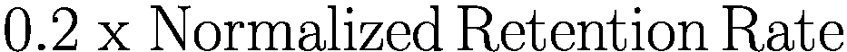

> **注意**：错误率从 1 中减去，因为更高的错误率意味着更低的参与度。

计算示例：

假设某用户的标准化指标如下：

- 标准化活跃天数：0.9
- 标准化功能使用量：0.7
- 标准化会话时长：0.8
- 标准化错误率：0.2
- 标准化留存率：0.85

![$$ {\displaystyle \begin{array}{l}\mathrm{参与度评分}=0.25\;\mathrm{x}\;0.9+0.25\;\mathrm{x}\;0.7+0.2\;\mathrm{x}\;0.8+0.1\;\mathrm{x}\;\left(1-0.2\right)+\\ {}0.2\;\mathrm{x}\;0.85\left]\right\mathrm{参与度评分}=0.225+0.175+0.16+0.08+0.17=0.81\end{array}} $$

#### 注意事项

-   **错误率解读**：确保错误率的解读与其对参与度的影响一致。
-   **标准化一致性**：对所有指标（包括错误率）使用一致的标准化方法。
-   **权重调整**：根据每个指标的相对重要性以及错误率对整体参与度的影响来调整权重。
-   **验证**：使用真实数据验证修订后的参与度评分公式，以确保其在捕捉用户参与度方面的有效性。

#### 利用参与度评分进行决策

**流媒体平台：**

1.  **内容推荐**：使用参与度评分推荐能保持用户参与度的内容。
2.  **流失预测**：识别参与度评分低的用户，并针对他们采取留存策略。
3.  **营销活动**：根据用户参与度定制营销活动，以最大化效果。
4.  **产品开发**：专注于开发能推动更高参与度的功能和内容。

**软件应用：**

1.  **功能优先级排序**：使用参与度评分确定哪些功能对用户最重要，并优先开发。
2.  **用户引导**：为参与度评分低的用户优化引导流程，以改善其体验。
3.  **错误修复**：专注于降低高参与度功能的错误率，以维持用户满意度。
4.  **留存策略**：为参与度评分下降的用户制定有针对性的留存策略。

## 产品参与度评分的重要性

1.  **客户洞察：** 参与度评分提供了关于客户行为和偏好的宝贵见解，使企业能够做出明智的决策。
2.  **产品改进：** 通过识别哪些功能推动了参与度，公司可以集中精力改进和扩展这些功能。
3.  **收入增长：** 更高的参与度通常会提高客户留存率和转化率，从而推动收入增长。
4.  **竞争优势：** 有效监控并响应参与度指标的企业，可以通过持续提升用户体验来保持领先于竞争对手。
5.  **资源分配：** 参与度评分通过突出需要关注和投入的领域，帮助有效分配资源。

使用数据科学和数学技术计算产品参与度评分，可以量化衡量用户与产品的互动方式。这些评分对于理解用户行为、指导产品开发以及做出明智的业务决策至关重要。通过利用参与度指标，企业可以提高用户满意度、增加留存率，并最终推动增长。

总之，流媒体平台和软件应用程序的参与度评分可以通过结合标准化指标和加权平均值来计算。这些评分提供了关键洞察，可用于个性化用户体验、优化营销策略、改进产品功能以及有效分配资源。理解和利用参与度评分对于任何希望在当今竞争激烈的环境中蓬勃发展的企业都至关重要。

# 提升建模

提升建模（也称为增量建模或真实提升建模）是一种用于预测某项干预（例如营销活动）对个体行为增量影响的数据科学技术。与预测给定输入结果的传统预测模型不同，提升建模预测的是接受干预组与未接受干预组之间的结果差异。

## 提升建模的重要性

1.  **精准营销：** 提升建模有助于识别更有可能对干预做出积极响应的个体，从而实现更有效、更高效的营销策略。
2.  **成本效益：** 通过仅针对那些可能受干预影响的个体，企业可以降低营销成本并提高投资回报率。
3.  **客户留存：** 提升建模可用于识别有流失风险、且在接受激励后更有可能留存的客户。
4.  **个性化：** 提升建模能够实现个性化的干预策略，提高客户满意度和忠诚度。

## 提升建模的理论

提升建模涉及创建两个模型：

1.  **干预模型：** 预测接受干预个体的结果。
2.  **对照组模型：** 预测未接受干预个体的结果。

这两个模型预测结果之间的差值即为提升量。

## 提升建模的基本步骤

1.  **数据收集：** 收集接受干预和未接受干预个体的数据，包括可能影响其行为的特征。
2.  **特征工程：** 创建能够捕捉个体特征的相关特征。
3.  **模型构建：** 分别为干预组和对照组构建模型。
4.  **提升量计算：** 通过从干预模型的预测结果中减去对照组模型的预测结果来计算提升量。
5.  **评估：** 使用适当的指标（如 `Qini` 系数或提升曲线）评估提升模型。

在提升建模中，根据干预的潜在影响，个体可以被划分为四个关键类别。这些类别通常使用一个二乘二矩阵（象限）来可视化，其中坐标轴代表在有干预和无干预情况下做出积极响应的可能性。这些类别如下：

1.  **可说服者**
    -   **定义：** 可能对干预做出积极响应的个体。
    -   **特征：** 没有干预时他们不会采取期望行动，但有干预时会。
    -   **影响：** 正向提升。
    -   **示例：** 只有收到促销邮件才会购买产品的客户。

2.  **确定者**
    -   **定义：** 无论是否接受干预都会采取期望行动的个体。
    -   **特征：** 无论是否接受干预，他们的行为都不会改变。
    -   **影响：** 无提升（中性）。
    -   **示例：** 无论是否收到促销邮件都会购买产品的客户。

3.  **无望者**
    -   **定义：** 无论是否接受干预都不太可能采取期望行动的个体。
    -   **特征：** 无论是否接受干预，他们都不会做出积极回应。
    -   **影响：** 无提升（中性）。
    -   **示例：** 无论是否收到促销邮件都不会购买产品的客户。

4.  **勿扰者**
    -   **定义：** 可能对干预产生负面反应的个体。
    -   **特征：** 没有干预时他们可能会采取期望行动，但由于干预，他们这样做的可能性降低了。
    -   **影响：** 负向提升。
    -   **示例：** 可能因促销邮件感到厌烦，并因此决定不购买产品的客户。

### 使用提升象限矩阵

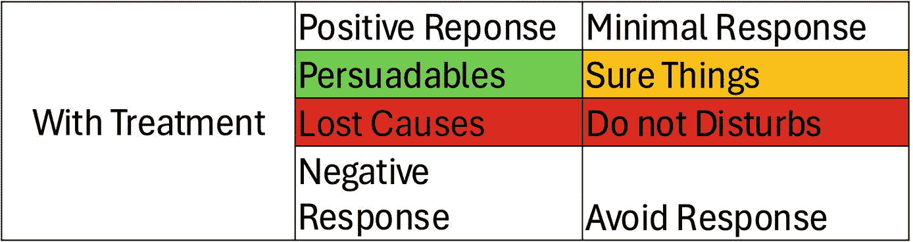

定位策略：

-   **可说服者：** 将资源集中用于这些个体，因为他们能带来最高的增量收益。
-   **确定者：** 不要在这些个体上花费资源，因为他们无论如何都会采取期望行动。
-   **无望者：** 避免针对这些个体，因为他们不太可能做出积极回应。
-   **勿扰者：** 将这些个体排除在干预之外，以避免潜在的负面反应。

## 实际应用

假设你正在为一个新产品开展营销活动。在构建并应用你的提升模型后，你发现以下情况：

- **可说服者：** 2,000 名客户
- **确定者：** 1,500 名客户
- **无望者：** 3,000 名客户
- **勿扰者：** 500 名客户

### 示例：零售业务的提升建模

假设一家零售企业希望实施提升模型，以提高旨在增加客户购买量的促销活动的效果。

模拟数据：

1. **客户数据：** 包括客户人口统计信息、购买历史和参与度指标。
2. **处理数据：** 指示客户是否收到了促销优惠。
3. **结果数据：** 表示客户在活动期间是否进行了购买。

以下是一小部分模拟数据示例：

| `CustomerID` | `Age` | `Gender` | `Purchase History` | `EngagementScore` | `Treatment` | `Purchase` |
| --- | --- | --- | --- | --- | --- | --- |
| 1 | 25 | F | 5 | 80 | 1 | 1 |
| 2 | 34 | M | 2 | 60 | 0 | 0 |
| 3 | 45 | F | 10 | 90 | 1 | 1 |
| 4 | 30 | M | 3 | 50 | 0 | 1 |
| 5 | 50 | F | 8 | 85 | 1 | 0 |

- **`CustomerID`：** 每个客户的唯一标识符。
- **`Age`：** 客户的年龄。
- **`Gender`：** 客户的性别。
- **`Purchase History`：** 客户过去的购买次数。
- **`Engagement Score`：** 代表客户与品牌互动程度的分数。
- **`Treatment`：** 指示客户是否收到了促销优惠（1 表示已处理，0 表示对照组）。
- **`Purchase`：** 指示客户在活动期间是否进行了购买（1 表示是，0 表示否）。

### 提升建模的逐步流程

#### 第 1 步：数据收集与准备

收集已处理和未处理客户的数据，包括其人口统计信息、购买历史和参与度指标。确保数据干净且一致。

#### 第 2 步：特征工程

创建能够捕捉客户特征的特征。例如，可以创建年龄与参与度分数之间的交互项，或者购买历史与处理状态之间的交互项。

#### 第 3 步：模型构建

为处理组和对照组分别构建模型。这些模型用于预测每组客户的购买可能性。

1. **处理模型：** 使用收到促销优惠的客户数据。
2. **对照模型：** 使用未收到促销优惠的客户数据。

#### 第 4 步：提升值计算

通过从处理模型的预测值中减去对照模型的预测值，计算每个客户的提升值。


#### 第 5 步：评估

使用 Qini 系数或提升曲线等指标评估提升模型。这些指标衡量模型在识别最有可能对处理产生积极反应的客户方面的有效性。

### 详细示例

#### 第 1 步：数据收集与准备

假设您已经收集了 1,000 名客户的数据，包括人口统计信息、购买历史、参与度分数、处理状态和购买结果。

#### 第 2 步：特征工程

您创建了以下特征：

- **`Age`：** 客户的年龄。
- **`Gender`：** 客户的性别（编码为 0 表示男性，1 表示女性）。
- **`Purchase History`：** 过去的购买次数。
- **`Engagement Score`：** 客户参与度分数。
- **`Treatment`：** 指示客户是否收到促销优惠的二元变量。

#### 第 3 步：模型构建

您将数据分为处理组和对照组，并为每组构建逻辑回归模型。

处理模型：

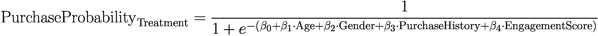

对照模型：

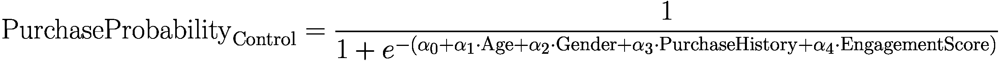

#### 第 4 步：提升值计算

对于每个客户，您使用两个模型计算预测的购买概率，并计算提升值。


计算示例：

对于具有以下特征的客户：

- `Age`：30
- `Gender`：男性
- `Purchase History`：3
- `Engagement Score`：70

假设处理模型预测的购买概率为 0.6，对照模型预测的购买概率为 0.4。

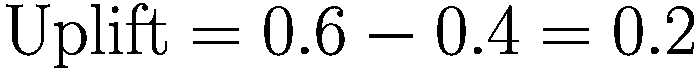

#### 第 5 步：评估

您使用 Qini 系数评估提升模型，该系数衡量作为目标客户累计数量函数的累计增量响应。

Qini 曲线：

- 在 y 轴上绘制累计增量响应，在 x 轴上绘制目标客户的累计数量。
- Qini 系数是 Qini 曲线与基线之间的面积。

### 示例：电子邮件营销活动

假设您在一家在线零售公司工作，希望开展一次电子邮件营销活动以增加销售额。您有 10,000 名客户的名单，需要决定哪些人应该收到这封邮件。

1. **定义处理组和对照组**
    - **处理组：** 5,000 名客户将收到营销邮件。
    - **对照组：** 5,000 名客户不会收到营销邮件。
2. **开展活动**
    - 向处理组发送邮件。
    - 等待一段时间（例如一个月），然后衡量结果（例如，客户是否进行了购买）。
3. **收集数据**
    - 收集处理组和对照组的购买数据。
    - 假设数据显示如下：
        - **处理组：** 5,000 名客户中有 1,000 名进行了购买。
        - **对照组：** 5,000 名客户中有 800 名进行了购买。
4. **计算提升值**
    - 提升值是处理组和对照组响应率之间的差异。
    - 处理组的响应率：`1000/5000 = 20%`
    - 对照组的响应率：`800/5000 = 16%`
    - 提升值：`20% - 16% = 4%`
5. **开发提升模型**
    - 使用机器学习技术（例如决策树、随机森林）构建一个提升模型，用于预测邮件对每个客户的增量影响。
    - 该模型将使用过去的购买行为、人口统计信息、浏览历史等特征来估算每个客户的提升值。
6. **细分客户**
    - **可说服者：** 预测具有正向提升值的客户（更有可能因为邮件而购买）。
    - **确定购买者：** 预测无论是否收到邮件都会购买的客户。
    - **无动于衷者：** 预测无论是否收到邮件都不会购买的客户。
    - **勿扰客户：** 预测具有负面响应的客户（更不可能因为邮件而购买）。
7. **优化活动**
    - 将邮件活动重点放在可说服者身上，以最大化投资回报率 (ROI)。
    - 避免向确定购买者（无额外收益）、无动于衷者（浪费精力）和勿扰客户（潜在的负面影响）发送邮件。

#### 提升建模的优势

- **精准营销**：通过识别可被说服的客户，你可以将营销精力集中在最可能受影响的群体上，从而提高营销活动的效率。
- **降低成本**：避免向“铁定购买者”、“无动于衷者”和“反感打扰者”进行营销，从而减少资源浪费，并最大程度降低潜在的负面影响。
- **改善客户体验**：避免发送不必要或可能引起反感的沟通信息，有助于与客户保持积极的关系。

总之，提升建模能帮助企业将营销重点放在最可能因营销活动而受到积极影响的个体上，从而带来更好的成果和更高效的资源利用。

提升建模是一项强大的技术，它通过锁定最可能对营销干预产生积极反应的个体，帮助企业优化营销策略。借助数据科学和机器学习模型，企业可以准确预测营销活动的增量影响，从而实现更高效、更具成本效益的营销活动。

在零售业务的示例中，我们演示了如何收集和准备数据、创建相关特征、构建实验组和对照组模型、计算提升值，并使用 Qini 系数评估模型。这套全面的方法使企业能够做出数据驱动的决策，提升客户参与度，并最大化投资回报率。

### 总结

总之，本章讨论了多种框架，包括以下内容：

1. **客户生命周期价值 (CLV)**
    客户生命周期价值 (CLV) 是一项关键指标，用于估算客户在整个关系存续期间为企业带来的总价值。通过预测 CLV，企业可以识别高价值客户，并据此调整营销策略。

2. **营销投资回报率 (ROMI) 框架**
    有效的营销对业务增长至关重要，但理解营销投资回报率 (ROMI) 同样关键。预测模型可用于衡量 ROMI，帮助企业更高效地分配营销预算。通过叠加预测模型，企业可以预测营销活动的影响、优化支出并最大化回报。

3. **衡量产品参与度**
    产品参与度指标能揭示客户如何与产品互动，这对产品开发和客户满意度至关重要。通过理解这些指标，企业可以提升用户体验并推动产品改进。

4. **提升建模**
    提升建模专注于识别那些能因特定干预措施而受到积极影响的个体。通过预测营销活动的增量影响，企业可以锁定最可能做出积极回应的客户，从而提高留存率并最大化营销效率。

### 结论

通过将预测模型叠加成综合框架，企业可以解锁更深入的洞察，并制定更有效的策略。本章旨在深入阐述这些模型如何协同工作以创造价值，并为利用预测分析实现业务目标提供实用指导。通过探索客户生命周期价值、营销投资回报、产品参与度指标以及提升建模框架，你将掌握在自己的组织中应用这些强大工具所需的知识。

# 索引

## A

- A/B 测试
- 加速失效时间（AFT）模型
    - 优势
    - 劣势
- 累加器
- 准确率
- 激活函数
    - 带泄露修正线性单元/参数化修正线性单元函数
    - 线性激活
    - 修正线性单元函数
    - S 型函数
    - Softmax 函数
    - Swish 函数
    - 双曲正切函数
- 自适应梯度（AdaGrad）优化器
- 自适应矩估计（Adam）优化器
- AFT 模型（参见加速失效时间（AFT）模型）
- 凝聚层次聚类
- 聚合函数
- 算法函数
- ALS（参见交替最小二乘法（ALS））
- ALS 矩阵分解
- 备择假设
- 交替最小二乘法（ALS）
- Anaconda
- 分析函数
- 分析学
- ANNs（参见人工神经网络（ANNs））
- Apache Spark
- `approxQuantile` 函数
- 人工神经网络（ANNs）
- 自动化机器学习
- 自动化机器学习流水线
    - 银行数据集
    - PySpark
- 自动化模型
- 自动化模型构建工具
- 自动化模型 ROC 曲线
- 自动化流水线框架
- 自动化框架

## B

- Bagging
- 基线模型
- 基本操作
    - 访问数据
    - 计算圆周率
    - 上传数据
- 批量归一化
- 贝叶斯定理
    - 贝叶斯演示案例
    - 后验概率
- 大数据环境
- 二分类模型
- 二元目标
- 二分 k-means
- 自助聚合
- `Broadcast` 函数
- B2B（参见企业对企业（B2B））
- 企业对企业（B2B）

## C

- CAC（参见客户获取成本（CAC））
- 缓存
- 基数
- 笛卡尔坐标
- Catalyst 优化器
- 分类变量
- 质心连接
- 切比雪夫距离
- `ChiSq` 选择器
- 卡方
- 卡方值
- 经典聚类技术
- 分类指标
- 聚类
    - 凝聚与分裂步骤
    - 层次聚类的类型
- 聚类技术
- 聚类演示
- CLV（参见客户生命周期价值（CLV））
- CLV 模型
    - AFT 模型
    - 历史模型
    - 预测模型（参见预测性 CLV 模型）
    - 简单模型
    - 生存分析（参见生存分析模型）
    - 传统 CLV 模型
- `coalesce` 函数
- 同期群分析
- 协同过滤
    - 基于物品
    - 基于用户
- `collect_list` 函数
- `colRegex` 函数
- 组合指标
- 混淆矩阵
- 列联表
- 连续目标
- 对照组
- 基于转化的指标
- `countDistinct` 函数
- Cox 比例风险模型
- 信用卡数据集
- CRISP–DM（参见跨行业数据挖掘标准流程（CRISP–DM））
- 跨行业数据挖掘标准流程（CRISP–DM）
- 自定义变量选择过程
    - 自定义转换器
    - 信息价值与 WOE
        - 优势
        - 计算
        - 连续变量，单调分箱
        - 单调分箱，斯皮尔曼相关性
        - 预测能力
        - 斯皮尔曼相关性
        - 斯皮尔曼相关性值指南
        - 值
    - 变量转换与选择
    - 基于投票的选择
- `customcorrelation.py`
- 客户获取成本（CAC）
- 客户生命周期价值（CLV）
    - 计算 ROMI 的方法
    - 平均购买价值
    - 基本公式
    - 最佳实践，利用 CLV
    - 业务与营销
    - 在商业模式中
        - B2B 公司
        - 电子商务零售
        - SaaS 公司
        - 订阅制模式
    - 实施与利用中的挑战
        - 考虑 CAC
        - 平衡短期与长期策略
        - 客户行为变化
        - 数据质量与可用性
        - 组织协调与认同
    - 常见类型
        - 同期群分析
        - 历史 CLV
        - 预测性 CLV
        - 基于留存率的 CLV
        - RFM 分析
    - 客户生命周期
    - 客户留存
    - 客户细分
    - 财务预测
    - 营销策略
    - 购买频率
    - 推荐/口碑营销
    - 资源分配
    - 模型类型（参见 CLV 模型）
- 自定义转换器类
    - `DataFrame`
    - `Estimator`
    - 面向对象编程概念
        - 抽象
        - 类
        - 继承
        - 方法
        - 多态
    - 参数
    - 流水线
    - `RandomForest` 代码
    - `RandomForestClassifier`
    - 转换器

## D

# D

## DAG（参见有向无环图（DAG））
## Databricks 社区版
### 云服务提供商
### 集群创建
### 创建账户
### Databricks 选项
### 数据文件，导入说明
### 笔记本
## 数据压缩
## DataFrames
## 数据本地性
## 数据操作
### 变量类型转换
### 数据类型函数
### 概览已识别变量并迭代列
#### `agg` 函数
#### 预算与流行度
#### 自定义 DataFrame
#### 删除/重命名
#### 公式
#### `lit` 函数
#### `mean_popularity`
#### Python 函数
#### `StructField`
#### `StructType`
#### 用户自定义函数
#### 变量
#### 方差计算
#### `when` 函数
#### `withColumn` 函数
### 计数记录
### DataFrames 描述性统计
### 过滤列
#### `like` 表达式
#### 匹配
#### 元字符
#### 量词
#### 正则表达式
### 元数据
### 缺失值
### 单变量频数
### 过滤输出
### 排序
### 从文件读取数据
### 从 Hive 表读取数据
### 字符串函数
### 子集列/视图
### 概览
### 唯一/不同值及其计数
### 窗口函数（参见窗口函数）
## 数据操作
## 数据运算
## 数据科学
## 数据科学家
## 数据序列化
## 数据集
## 数据类型
## 数据可视化
### 分类数据
### 电影数据集，1960/1970
### 过滤
### 直方图函数
### 包
### 流行度数据
## 十分位划分
## 决策树
### 算法规范
### 信用卡审批数据集
### 熵
### 特征重要性
### 基尼不纯度
### 信息增益
#### 年龄变量
#### 最终树
#### 首次分裂公式
#### 观测值
#### 第二次分裂
### 叶节点
### 数值变量
### 剪枝
### PySpark 代码
#### 分类
#### 回归
### 根/父节点
## 有向无环图（DAG）
## 狄利克雷分布
### 教育与环境
### 狄利克雷表示
## 距离度量
### 欧几里得距离
## 分裂聚类
## 基于 Docker 的部署
### 容器
### 创建 Docker 并执行评分代码
### 目录结构
### `Dockerfile` 文件
### 更快的软件交付周期
### `helper.py` 文件
### 微服务架构
### 可移植性与
### `requirements.txt` 文件
## 基于 Docker 的安装
### Docker
### Docker 镜像
### PySpark Docker
### PySpark Docker 命令
#### 建立端口
#### 外部文件
#### 交互式/bash 模式
#### 运行命令
#### 标签，空间优化
### `docker-compose` 文件
### `docker-compose.yml` 文件
## `dropDuplicates`
## Dropout

# E

## EDA（参见探索性数据分析（EDA））
## 基于 EDA 的变量选择
## 特征值
## 工程团队
## 熵
## 误差函数
## 欧几里得距离
## 评估连续模型性能
## 实验
### 持续改进
### 数据驱动决策
### 揭示因果关系
## 实验过程
## 解释方差
## 探索性数据分析（EDA）
### 基数
### 房价数据集
### 缺失值（参见缺失值，EDA）
### 变量选择过程

# F

## F1 分数
## 容错
## 特征
## `features_df` DataFrame
## `fillna()`
## `float` 值
## 公式分解
## 四折交叉验证

# G

## 吉布斯采样
## 基尼不纯度
## GitHub 账户
## GitHub Codespaces
### `file_location`
### 笔记本
### 包验证
### Python 和 Jupyter 扩展，微软
### Python 环境
### Python 版本
### 测试
### VS Code 起始页
### VS Code 终端
## 金发姑娘点
## “拟合优度”
## 梯度提升
## 梯度下降
## GraphX

# H

## `helper.py` 文件
## `histogram` 函数
## 历史 CLV
## 历史 CLV 模型
## 留出数据集
## 房屋类型变量
## 超参数调优
## 假设
## 假设检验
### A/B 测试
### 使用 PySpark 进行 A/B 测试
### 备择假设
### 早餐示例
### 主张
### 效应量
### 零假设
### p 值
### 用于实验的 PySpark
### PySpark 统计包
### 样本数据
### 来自 Kaggle 的样本数据
### 错误类型

# I

## `InferSchema`
## 信息隐藏
## 基于物品的协同过滤

# J

## 杰卡德演示
## Java 序列化
## Java 版本
## 连接
### 广播 DataFrames
### 全外连接
### ID
### 内连接
### 左反连接
### 左/左外连接
### 左半连接
### 元数据
### 右/右外连接
### 类型
## 连接，Spark 程序
### 广播连接
### 混洗哈希连接
### 排序合并连接
## Jupyter Notebook

# K

## K 折交叉验证
## k-means
## 柯尔莫哥洛夫-斯米尔诺夫（KS）
### 十分位
### 统计量
### 统计值
## 柯尔莫哥洛夫-斯米尔诺夫统计量
## 柯尔莫哥洛夫-斯米尔诺夫检验
## Kryo 序列化
## KS（参见柯尔莫哥洛夫-斯米尔诺夫（KS））

# L

## `landing_page` 分配
## 拉普拉斯平滑
## 潜在狄利克雷分配（LDA）
### 应用
### 组合
### 演示
### 实现
### 超参数设置
### tf–idf 值
### 主题分配
## LDA（参见潜在狄利克雷分配（LDA））
## 数据泄露
### 自助法
### 目标类型变体
## 带泄露修正线性单元/参数化修正线性单元函数
## 留一组交叉验证
## 留一法交叉验证
## 提升图
## 有限内存 BFGS
## 线性激活函数
## 线性回归
### 系数
### 概念
### 方程
### 解释
### 最小二乘法/最小二乘回归
### 多重共线性
### 多元线性回归
### 表示
### 简单线性回归
### 平方误差
### 用途
### 变量
## 本地安装，Anaconda
### Apache Spark，下载/解压
### 代码环境创建
### Java 8
### Jupyter notebook 扩展
### Mac/Linux 用户
### 运行 PySpark
### Windows 用户
## 逻辑回归
### 二元变量解释
### 二元 vs. 多项分类
### 连续变量解释
### 方程
### 最大似然估计
### PySpark 代码
### vs. 对数几率尺度
### vs. 对数几率尺度
## `LogisticRegression`
## 损失函数
### 绝对误差损失
### 平方误差损失
### 函数类型

# M

## 机器生成文档
## 机器学习
### 分类
### 数据类型
### 监督学习
#### 分类算法
#### 回归算法
### 无监督学习
#### 聚类
## 机器学习算法
### 分类模型
### 推荐系统
### 回归模型
### 强化学习
### 半监督算法
### 起始代码
### 监督学习
### 无监督学习
## 机器学习生命周期
## 机器学习运维（MLOps）
## Mac/Linux 用户
## MapReduce
## 营销成本
### 广告支出
### 计算
### 创意成本
### 电子商务零售商
### 人员成本
### 技术成本
## 马尔可夫链归因
## 矩阵分解
## 矩阵分解
## 最大对数似然估计（MLE）
## 平均绝对误差（MAE）
## 均值分布
## 均方误差（MSE）
### PySpark
## 元数据
## 指标计算
## `MinMaxScaler`
## 误分类率
## 随机缺失（MAR）
## 完全随机缺失（MCAR）
## 非随机缺失（MNAR）
## 缺失值，EDA
### 组装特征
### 基数检查
### 识别变量类型
### 插补
### MAR
### MCAR
### 缺失信息片段
### 缺失值检查
### MNAR
### `StringIndexer` 应用于字符列
### `StringIndexer` 应用于目标列
## MLflow
### 代码变更
### 组件
### 机器学习代码
### 模型选项卡
### 设置步骤
### 跟踪变量
### 运行结果 UI 对比
### UI 对比窗口
### UI 模型信息
### UI 运行窗口
### 用户界面
#### 自动日志记录
#### KS 统计量
### 机器学习生命周期
## MLOps（参见机器学习运维（MLOps））
## 模型评估指标
## 基于模型的特征选择
## 模型构建
### 算法函数
### 指标
### 模型定义
### 伪评分代码
### 验证 zip 文件模块
## 模型复杂度
### 偏差与方差图
### 分类
### 泛化性能
## 使用 Docker 进行模型部署（参见基于 Docker 的部署）
## 使用 HDFS 进行模型部署
### 对象和 pickle 文件
### 配置选项
### `run.py` 和 `helper.py` 文件
### `run.py` 脚本
## `Model deployment.ipynb` 文件
## 模型对象
### `assembleModel`
### `char_labels`
### `clf_model`
### `features_list`
## 模型训练
## 模型训练过程
## 模型验证技术
### 测试集
### 训练/测试
### 训练/测试分割
## `mono_bin()` 函数
## 单调
## 单调 vs. 非单调
## 多臂老虎机
## 多类指标
## 多项分类模型
## 多项目标

# N

## 朴素贝叶斯分类器
## 神经网络
### 反向传播
### 偏置与权重
### 前馈步骤
### 超参数调优
### 输出
### PySpark 代码
### 样本数据
### S 型函数
## 神经网络测试
## 非单调
## 非概率技术
## 零假设

# O

## 面向对象编程（OOP）
## `o64.cacheTable`
## `o206.ShowString`
## `OneHotEncoder`
## 一对多分类器
## OOP（参见面向对象编程（OOP））
## 最优参数
## 优化器
### AdaGrad 优化器
### Adam 优化器
### 梯度下降
#### 条件
#### 方程
#### 初始模型训练阶段
#### 学习率
#### 局部最小值 vs. 全局最小值
#### 模型训练时间
#### 小批量
#### 优化器
#### 动量
### RMSprop 优化器
### SGD 优化器
## 有序分类
## 过拟合

# P

## PaaS（参见平台即服务（PaaS））
## `partitionBy` 函数
## `pcaFeatures`
## 皮尔逊相关性
## 皮尔逊卡方检验
## 排列重要性
## 持久化函数
## 平台即服务（PaaS）
## 群体稳定性指标（PSI）
### 计算
### 留出/超时值
## 阳性预测值
## Postman 应用
## Postman API
## 精确率
## 精确率-召回率曲线
## 预测分析
## 预测性 CLV
## 预测性 CLV 模型
### 机器学习模型
### 概率模型
### 回归模型
## 预测建模
## 主成分分析（PCA）
### 识别大型数据集中的模式
### 机制
#### 汽车满意度数据
#### 带坐标轴的汽车满意度数据
#### 特征值
#### `features_list` 变量
#### `pcaFeatures`
#### PCA 线投影
#### PySpark 实现，代码示例数据
#### 碎石图
#### 平方距离
#### `StandardScaler`
#### 解释方差
## 概率技术
## 产品参与度评分
### 功能改进
### 营销与销售
### 参与度指标
### 个性化
### 产品开发
### 软件应用
#### 分配权重
#### 竞争优势
#### 综合评分
#### 客户洞察
#### 用于决策的参与度评分
#### 错误率解释
#### 参与度指标
#### 归一化一致性
#### 归一化指标
#### 产品改进
#### 资源分配
#### 收入增长
#### 验证
#### 权重调整
### 流媒体平台
#### 分配权重
#### 综合参与度评分
#### 归一化指标
#### 用户留存
## PSI（参见群体稳定性指标（PSI））
## PySpark
### 空值特征
### DataFrames
### 优化策略与 Python
### 常见函数冲突
### 连接，Spark 程序（参见连接，Spark 程序）
### 采样
## PySpark Docker 版本
## PySpark Flask
## PySpark ML 调优包
## PySpark 会话
## `pyspark.sql.functions`
## PySpark 统计包
## Python
## Python 文件
## Python 版本

# Q

## Qini 系数
## 定性数据
## 定量数据

# R

## 随机森林
## 基于随机森林的特征选择
## `RandomForestClassifier`
## 随机森林
### Bagging
### 集成
### 特征重要性
### 超参数调优过程
### PySpark 代码
### 要求
## 随机模型
## 随机值生成器
## 排名函数
## 秩相关
## RDDs（参见弹性分布式数据集（RDDs））
## `real_time_scoring`
## 实时评分 API
### 更新后的 `docker-compose.yml` 文件
### Dockerfile 内容
### Flask API 就绪
### Flask 脚本
### 停止 Docker 服务
### Postman 应用
### Postman API
### `real_time_scoring`
### 使用 Streamlit 构建 UI
### `streamlitapi` 目录
### Streamlit API
### 使用 Postman API 测试实时功能
## 接收者操作特征（ROC）
### 度量
### 精确率-召回率曲线
### 灵敏度值
## 最近、频率、金额（RFM）分析
## 推荐系统
### 算法
## 修正线性单元（ReLu）函数
## 回归评估
## 正则化
## 正则化参数
## 强化学习
## ReLu 函数（参见修正线性单元（ReLu）函数）
## `repartition` 函数
## `requirements.txt` 文件
## 弹性分布式数据集（RDDs）
## 基于留存率的 CLV
## 营销投资回报率（ROMI）
### A/B 测试
### 计算 ROMI 的方法
### 归因建模
### CLV 分析
### 客户细分
### 数据收集
### 数据准备
### 预测建模
### 归因建模
### 基本公式计算
### 机器学习模型，预测建模
### 营销成本计算
### 马尔可夫链归因
### 实时数据处理
### 沙普利值归因
### 计算 ROMI 的步骤
### 使用数据科学模型
## 评论文本列
## RFM 分析（参见最近、频率、金额（RFM）分析）
## `rlike` 函数
## RMSE（参见均方根误差（RMSE））
## RMSprop 优化器（参见均方根传播（RMSprop）优化器）
## ROC（参见接收者操作特征（ROC））
## ROMI（参见营销投资回报率（ROMI））
## 均方根误差（RMSE）
## 均方根传播（RMSprop）优化器
## R 平方

# S

# S

*   SaaS（参见软件即服务（SaaS））
*   加盐
*   抽样、探索、建模、修改和评估（SEMMA）
*   采样
    *   `coalesce` 和 `repartition` 函数
    *   方法
    *   参数
    *   总体
    *   PySpark 随机采样
    *   `sampleBy` 函数
    *   样本量
    *   简单随机抽样
    *   分层抽样
    *   技术
*   采样偏差
*   `saveAsTable` 函数
*   保存数据
*   评分代码
    *   `final_scores_df` DataFrame
    *   `helper.py` 脚本
    *   `Model deployment.ipynb`
    *   `run.py` 和 `helper.py` 文件
    *   任务
*   评分函数
*   细分
    *   业务规则
    *   聚类
    *   地理位置
    *   调查数据变量
*   半监督算法
*   SEMMA（参见抽样、探索、建模、修改和评估（SEMMA））
*   SGD 优化器（参见随机梯度下降（SGD）优化器）
*   沙普利值归因
*   `ShowString` 错误
*   S 型函数
*   简单 CLV 模型
*   简单随机抽样（SRS）
    *   数据点
    *   留出概念
    *   留出数据集
    *   采样方法
*   单连接
*   奇异值分解（SVD）
*   Softmax 函数
*   软件即服务（SaaS）
*   Spark
    *   内置组件
    *   集群管理器
    *   集群模式
    *   概念与属性
    *   DAG
    *   生态系统库
    *   MapReduce
    *   Pandas API
        *   最佳实践
        *   csv
        *   `DataFrame` 类
        *   数据框
        *   数据转换
        *   数据类型
        *   列索引
        *   方法
        *   `pyspark.pandas.frame.DataFrame` 类
        *   模式
        *   类型转换
        *   类型提示风格
    *   Py4J 库
    *   Scala
    *   速度
    *   SQL
    *   存储级别
    *   存储类型
    *   版本
*   Spark 程序
*   Spark SQL
*   斯皮尔曼相关性
*   平方距离/误差（SSE）
*   流处理
*   SSE（参见平方距离/误差（SSE））
*   标准化
*   `StandardScaler`
*   起始代码
*   随机梯度下降（SGD）优化器
*   分层抽样
*   `streamlit`
*   `streamlitapi` 目录
*   字符串函数
*   `StringIndexer`
*   订阅制模式
*   平方和（SSE）
*   监督学习
*   监督机器学习算法
*   支持向量机（SVM）
    *   分类误差
    *   特征空间分离
    *   间隔误差
    *   PySpark 代码
    *   总误差
*   生存分析模型
    *   优势
    *   Cox 比例风险模型
    *   劣势
    *   风险函数
    *   Kaplan-Meier 估计量
    *   生存函数
    *   作为“时间至事件”模型
    *   Weibull 模型
*   SVD（参见奇异值分解（SVD））
*   SVM（参见支持向量机（SVM））
*   Swish 函数
*   对称矩阵

## T

*   双曲正切函数
*   测试数据集
*   三折交叉验证
*   时间序列验证
*   `toPandas()` 函数
*   主题出现次数
*   传统 CLV 模型
*   传统预测建模
*   训练数据集
*   训练 *vs.* 留出数据集
*   基于树的方法

## U

*   欠拟合
*   无监督学习
*   提升建模
    *   控制模型
    *   成本效益
    *   成本节约
    *   客户留存
    *   数据收集
    *   不打扰
    *   评估
    *   特征工程
    *   改善客户体验
    *   作为增量/真实提升建模
    *   无望客户
    *   模型构建
    *   个性化
    *   可说服客户
    *   确定客户
    *   定向营销
    *   处理模型
    *   提升计算
    *   使用提升象限矩阵
        *   数据收集与准备
        *   评估
        *   特征工程
        *   邮件营销活动
        *   模型构建
        *   零售业务的实际应用
        *   逐步提升建模过程
        *   定向策略
        *   提升计算
*   基于用户的协同过滤
*   用户自定义函数（UDFs）
    *   数据序列化
    *   最优格式
    *   持久化/取消持久化
    *   混洗分区
    *   偏斜
    *   使用缓存

## V

*   变量/方法
*   变量选择
    *   自定义（参见自定义变量选择过程）
    *   EDA
    *   带目标变量的特征
        *   `ChiSq` 选择器
        *   特征重要性图
        *   基于模型的特征选择
    *   无目标变量的特征
        *   PCA
        *   SVD
*   方差膨胀因子（VIF）
*   VIF（参见方差膨胀因子（VIF））
*   基于投票的选择

## W, X, Y, Z

*   沃德方法
*   证据权重（WOE）
*   窗口函数
    *   `agg` 函数
    *   `alias` 函数
    *   `DataFrame`
    *   十分位流行度
    *   十分位划分
    *   `denseRank`
    *   `ntile` 函数
    *   `orderBy`
    *   `rangeBetween` 函数
    *   `rank` 函数
    *   收入差异
    *   类型
    *   `window.partitionBy` 函数
*   Windows 用户
*   WOE（参见证据权重（WOE））