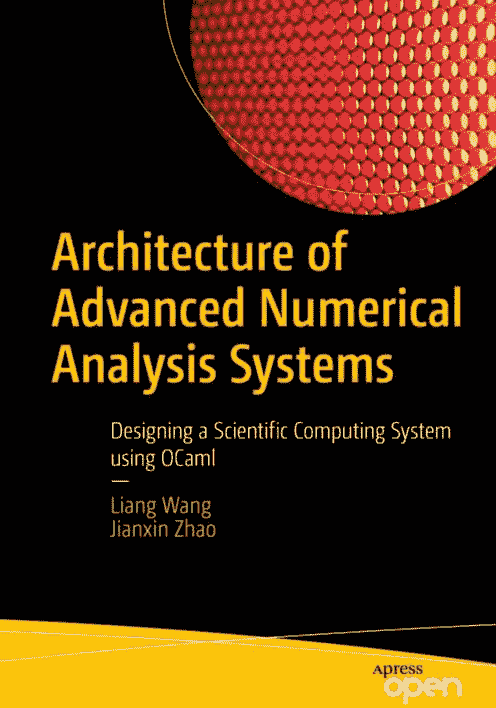

 《高级数值分析系统架构》书籍封面  
王亮 芬兰赫尔辛基 赵建新 中国北京  
  
ISBN 978-1-4842-8852-8 电子书 ISBN 978-1-4842-8853-5  
[`doi.org/10.1007/978-1-4842-8853-5`](https://doi.org/10.1007/978-1-4842-8853-5)  
© 王亮, 赵建新 2023

本书是开放获取出版物。

**开放获取** 本书根据知识共享署名 4.0 国际许可协议 ([`creativecommons.org/licenses/by/4.0/`](http://creativecommons.org/licenses/by/4.0/)) 进行许可，允许在任何媒介或格式中使用、共享、改编、分发和复制，前提是你给予原始作者和来源适当的署名，提供知识共享许可协议的链接，并标明是否进行了修改。

本书中的图片或其他第三方材料均包含在本书的知识共享许可协议中，除非在材料的来源行中另有说明。如果材料未包含在本书的知识共享许可协议中，且你的预期用途不被法律法规允许或超出允许范围，你将需要直接获得版权所有者的许可。

本作品受版权保护。出版商保留所有权利，涉及材料的全部或部分，特别是翻译、重印、重用插图、朗诵、广播、微缩胶片复制或任何其他物理方式，以及信息存储和检索的传输、电子改编、计算机软件，或现在已知或以后开发的类似或不同方法。本出版物中使用的通用描述性名称、注册商标名称、商标、服务标志等，即使没有明确声明，也不意味着这些名称免于相关保护性法律和法规的约束，因此可供一般使用。出版商、作者和编辑假定本书中的建议和信息在出版之日是真实准确的。出版商、作者或编辑均不对本文所含材料或可能存在的任何错误或遗漏提供明示或暗示的保证。出版商在已出版地图和机构附属机构的管辖权主张方面保持中立。

本 Apress 印记由注册公司 APress Media, LLC（斯普林格自然出版社的一部分）出版。

注册公司地址为：1 New York Plaza, New York, NY 10004, U.S.A.

*献给我的妻子玛丽亚、我们的女儿玛蒂尔达和索菲亚，以及我深爱的家人。*

*——王亮*

*献给我的父母和姐妹；献给他们不屈的爱与支持。献给所有为自由与正义而战、对抗从地狱释放的邪恶之人。“Namárië, ar nai aistalë Eldar ar Atani ar ilyë Léralieron hilya le. Eleni sílar antalyannar.”*

*——赵建新*

