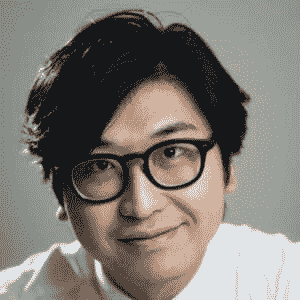
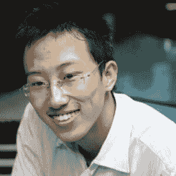

# 关于作者

## 王亮

王亮的照片。

现任诺基亚首席 AI 架构师、iKVA 首席科学官、剑桥大学高级研究员、英特尔软件创新者。他在人工智能、机器学习、操作系统、计算机网络、优化理论及图论领域拥有广泛的研究兴趣。

## 赵建新

赵建新的照片。

剑桥大学博士毕业生。其研究兴趣包括数值计算、人工智能、去中心化系统及其在现实世界中的应用。

# 脚注

© 作者 2023  
L. Wang, J. Zhao  
《高级数值分析系统架构》  
[`doi.org/10.1007/978-1-4842-8853-5_1`](https://doi.org/10.1007/978-1-4842-8853-5_1)