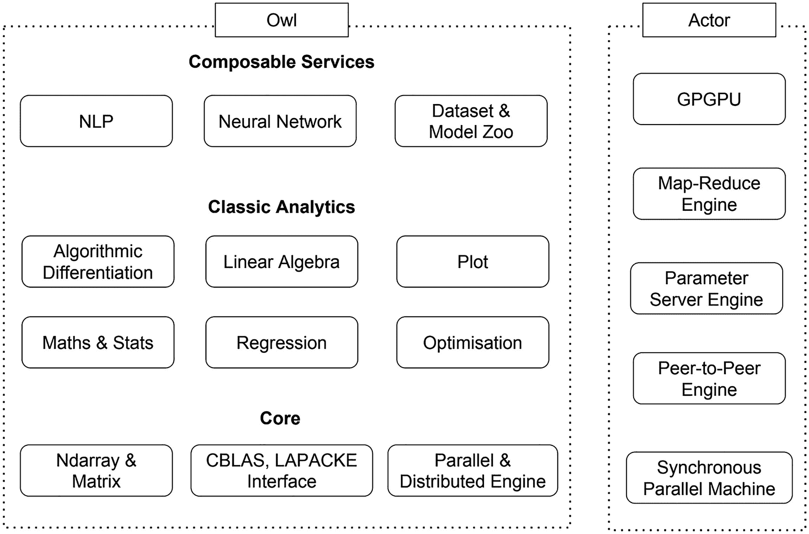

# 1. 引言

王亮^(1) 和赵建新^(2)  
(1) 芬兰赫尔辛基  
(2) 中国北京

本书介绍 Owl，一个我们多年来持续开发和维护的数值库。我们开发 Owl 是为了在 OCaml 语言中进行科学和工程计算。它专注于提供一套全面的高级数值函数，使开发者能够快速构建任何数据分析应用。经过多年的密集开发和持续优化，Owl 已发展成为一个功能强大的软件系统，其性能可与主流数值库相媲美。同时，Owl 的整体架构保持简洁和优雅。其紧凑的代码库可以由一个小型开发者团队轻松管理。

在本书中，我们将从设计者的角度介绍 Owl 的设计与架构。目标读者是对以下内容感兴趣的人：不仅是如何在数值应用中使用数学函数，还包括这些函数是如何从头开始设计、组织和实现的。不过，需要具备一些先决条件。我们假设读者熟悉 OCaml 语言的基本语法。我们推荐[38]作为这方面的一本优秀参考书。另请注意，本书专注于介绍 Owl 代码库的核心部分，例如各种关键模块的实现和设计。如果你对如何使用 Owl 提供的功能来解决数值问题（例如基础数学计算、线性代数、统计学、信号处理等）更感兴趣，请参考我们的书籍《OCaml 科学计算：数据科学与人工智能中的函数式编程》[26]。

## 1.1 OCaml 中的数值计算

*科学计算*是一个快速发展的多学科领域，它利用先进的计算能力来理解和解决现实世界中的复杂问题。该领域广泛应用于研究与工业的各个领域，例如生物学和物理学中的模拟、天气预报、金融领域的收益优化等。当前科学计算中最热门的话题之一是机器学习。得益于机器学习和深度神经网络的最新进展，对各类数值工具和函数库的需求巨大，以便帮助学术研究人员和产业开发者快速构建模型原型并测试新想法，进而大规模开发和部署分析应用。

以深度神经网络为例；谷歌大力投资`TensorFlow`，而脸书则推广其`PyTorch`。除了这些专注于特定数值计算任务的库之外，对像`Python`和`Julia`这类通用工具的兴趣也迅速增长。Python 一直是开发者快速构建分析应用原型的流行选择之一。其中一个重要原因是`SciPy`和`NumPy`库，它们与绘图等其他高级功能紧密集成，提供了一个强大的环境，让开发者能够编写非常简洁的代码来完成复杂的数值任务。因此，大多数框架都提供 Python 绑定，以便利用`NumPy`和`SciPy`中现有的数值基础设施。

另一方面，在`Owl`被开发之前，`OCaml`对基础科学计算的支持相当零散。此前已有一些初步尝试（例如`Lacaml`、`Oml`、`Pareto`等），但它们的 API 要么过于底层，无法提供令人满意的生产力，要么设计过度局限于特定问题领域。此外，不一致的数据表示和过度使用抽象类型使得不同库之间的数据交换变得困难。因此，开发者往往需要编写大量样板代码才能完成相当简单的数值任务。在`OCaml`生态系统中，严重缺乏一个通用的数值库。然而，我们认为`OCaml`是开发此类通用数值库的绝佳候选，这基于两个重要原因：

-   我们可以编写像`Python`中那样简洁、且具有类型安全性的函数式代码。
-   `OCaml`代码的性能通常远超`Python`和`Julia`这类动态语言。

## 1.2 架构

设计和开发一个功能完备的数值库并非易事，尽管`OCaml`已广泛用于如`MirageOS`等系统编程中。两者之间的关键区别是根本性且有趣的：系统库提供一套精炼的 API 来抽象复杂且异构的物理硬件，而数值库则在一小套抽象数值类型之上提供一套丰富的函数。

当`Owl`项目于 2016 年启动时，我们立即面临一系列基本问题，例如：“基本数据类型应该是什么”，“核心数据结构应该是什么”，“应该设计哪些模块”等。在随后的开发和性能优化过程中，我们还解决了众多不同主题的研究和工程挑战，包括软件工程、语言设计、系统和网络编程等。因此，`Owl`是一个相当复杂的库，可以说是用`OCaml`开发的最复杂的数值软件系统之一。它包含了约 269K 行`OCaml`代码、142K 行`C`代码以及超过 6500 个函数。我们力求模块化设计，以确保系统灵活且可扩展。

我们在图 1-1 中简要展示了`Owl`的架构。它包含两个子系统。左侧的子系统是`Owl`的数值子系统。该子系统包含的模块分为四类：

-   **核心模块**包含基本数据结构，即 N 维数组，包括基于 C 和基于 OCaml 的实现，以及符号表示。
-   **经典分析**包含基础数学和统计函数、线性代数、信号处理、常微分方程等，以及与其他库（例如`CBLAS`和`LAPACKE`）的外部函数接口。
-   **高级分析**，例如算法微分、优化、回归、神经网络、自然语言处理等。
-   **服务组合与部署**到多个后端，例如通过计算图部署到浏览器、容器、虚拟机和其他加速器。

一个示意图被分为两个模块，`Owl`和`Actor`。`Owl`模块包含 3 个子模块：可组合服务、经典分析和核心。

**图 1-1** 整个系统可分为两个子系统。左侧的子系统处理数值计算，而右侧的子系统处理分布式和并行计算环境中的相关任务，包括同步、调度等。

在本章的其余部分，我们将简要介绍`Owl`中的这些不同组件，并为本书设定路线图。

### 使用 Owl 进行基础计算与分析

在诸如`NumPy`、`MATLAB`、`TensorFlow`和`Owl`这类数值库或软件中，*N*维数组（ndarray）是构建科学计算应用最基础的数据类型。在大多数此类应用中，仅使用标量值是不够的。矩阵和向量都是 ndarray 的特例。`Owl`提供了`Ndarray`模块，其可用性和性能对整个`Owl`架构至关重要。在第 2 章中，我们将介绍该模块，包括其设计方式以及性能优化。

`Owl`支持多种经典的数值分析方法，包括基础数学函数、统计学、线性代数、常微分方程和信号处理。每个领域的函数都包含在相应的模块中。它们的设计与`Ndarray`模块类似，主要与`C`代码中的现有工具（如`OpenBLAS`）进行接口交互。`Ndarray`模块部分依赖这些函数，尤其是那些对标量进行操作的函数。例如，`Ndarray`提供了一个`sin`函数。它实际上做的是调用`Maths`模块中的标量版本`sin`函数，并将其映射到所有元素上。由于本书主要关注`Owl`的架构设计，我们将不会详细介绍如何在这些领域中应用`Owl`；相反，我们将在附录 A 中简要给出一些示例。

### Owl 中的高级分析

我们在前文介绍了 `Owl` 所支持的各类经典分析领域。而真正让 `Owl` 更加强大的，是一系列高级分析功能。其核心在于算法微分（`AD`），这将在第 3 章中介绍。执行微分对于现代数值应用至关重要，几乎无处不在。此外，事实证明，`AD` 能提供不受数值误差影响的高效且精确的微分计算。

得益于 `AD` 强大能力的重要分析技术之一是优化（第 4 章），它旨在寻找函数的最小值或最大值。虽然优化方法不一定需要计算微分，但它往往是高效优化方法的关键要素。最常用的优化方法是梯度下降法，它通过小步长迭代地对复杂目标函数进行优化，直至其满足某个标准而达到最小化。这正是另一类高级应用——回归——的工作方式。回归涵盖了多种方法，包括线性回归、逻辑回归等。每种方法可应用于不同场景，并可通过多种方法求解，但它们都共享一种相似的求解方法，即迭代优化。

根据应用的不同，`AD` 产生的计算可能相当复杂。它们通常形成一个有向无环图，这可以被称为计算图。基于计算图，我们可以执行各种优化来提升执行速度、降低内存占用等。计算图在我们的系统中扮演着关键角色，我们将在第 6 章中介绍它。

最后，神经网络，无论其架构多么复杂，本质上也是回归的一种扩展，因此同样通过迭代优化进行训练。我们在第 5 章中讨论这个主题。随着机器学习和神经网络的普及，这一系列高级分析技术，尤其是核心的 `AD` 技术，在现代数值分析库栈中变得越来越重要。在本书中，我们将简要介绍这些主题及其在 `Owl` 中的设计架构。

### 硬件与部署

在下一部分，我们将在第 7 章中讨论 `Owl` 所执行的运行时后端。我们考虑的第一个重要后端是硬件加速器，例如 GPU。科学计算通常涉及密集计算，而 GPU 通过在其海量核心上进行并行计算来加速这些计算，这一点至关重要。此外，还有越来越多的硬件加速器类型。例如，谷歌开发了张量处理单元（`TPU`），专门用于神经网络机器学习。它在使用 `TensorFlow` 时针对大批量处理进行了高度优化。为了提升像 `Owl` 这样的数值库的性能，支持多种硬件平台是必要的。

一种思路是“搭便车”利用那些已经支持多种硬件平台的现有库。我们认为，计算图是实现不同库之间互操作性的一个合适的中间表示（`IR`）。沿着这个思路，我们开发了一个原型符号层系统，用户可以使用它在 `Owl` 中定义计算，然后将其转换为 `ONNX` 结构，该结构可以在许多不同的平台（如 `TensorFlow`）上执行。通过使用符号层，我们展示了系统工作流程，以及如何将 `Owl` 的强大功能（如算法微分）应用于 `TensorFlow` 中。

除了追求加速器上的极致性能外，有时数值库也旨在广泛的环境中运行，例如，在基于 JavaScript 的网页浏览器上执行，以便于大量最终用户访问。此外，随着边缘计算和物联网的趋势，数值库支持在计算资源受限的设备上运行也变得至关重要。一种方法是构建 *unikernel*（特有内核），这是一种专门的最小化虚拟机镜像，只包含支持应用程序所需的必要库和模块。在本书中，我们还将介绍 `Owl` 对此类环境下执行的支持。

### 关于 Owl 的研究

在本书的最后部分，我们将介绍 `Owl` 中的两个组件：*Zoo*（用于服务组合与部署）和 *Actor*（用于分布式计算）。这两章的重点是展示两项基于 `Owl` 的研究。

在第 9 章中，我们介绍 `Zoo` 子系统。它最初是为了共享 OCaml 脚本而开发的。众所周知，我们可以像使用 Python 一样将 OCaml 用作脚本语言（这会有一定的性能代价，因为代码会被编译成字节码）。尽管推荐为生产环境编译成本地代码，但脚本化仍然有用且方便，尤其是在轻量部署和快速原型开发中。实际上，大多数 `Owl` 脚本中的性能损失几乎察觉不到，因为最繁重的数值计算部分仍然交给了运行本地代码的 `Owl`。在设计 `Owl` 时，我们的目标始终是使整个生态系统开放、灵活且可扩展。程序员可以编写自己的“小型”脚本，并方便地与他人共享，这样他们就不必等待这些功能被实现在 `Owl` 的主分支中，或者向 `OPAM` 提交某些“重量级”内容。基于这些基本功能，我们扩展了 `Zoo` 系统以解决计算服务组合与部署问题。

接下来，我们讨论分布式计算的主题。分布式和并行计算模块的设计从根本上将 `Owl` 与其他主流数值库区分开来。对于大多数库而言，分布式和并行计算的能力通常作为第三方库实现，用户必须处理底层消息传递接口。然而，`Owl` 通过其 `Actor` 子系统实现了这种能力。分布式计算包括通过网络连接多台机器、共享数据和协调进度的技术。随着数据量和它们所需的处理能力的快速增长，分布式计算在当前各个领域的智能应用中扮演着重要角色。其应用在多个领域极为普遍，例如联合提供大规模计算能力、容错数据库、文件系统、Web 服务以及管理大规模网络等。

在第 10 章中，我们将对这个主题进行一个简要的宏观概述。具体来说，我们介绍一个基于 OCaml 的分布式计算引擎——`Actor`。它实现了三种主流的编程范式：参数服务器、MapReduce 和对等网络。与这些范式正交，`Actor` 还实现了所有四种类型的同步屏障。我们将介绍当前系统中常用的四种不同类型的同步方法或“屏障”。我们进一步阐述这些屏障是如何设计的，并从理论角度提供图示说明。最后，我们通过评估来展示使用不同屏障时的性能权衡。

### 1.3 本章小结

本章介绍了本书的主题，即围绕我们一直在开发的数值库 `Owl` 的设计展开。我们简要讨论了为何选择基于 `OCaml` 语言构建 `Owl`。随后，我们为全书规划了路线图，可划分为四个部分：基础构建模块、高级分析、多种环境下的执行，以及基于 `Owl` 的研究课题。希望您能享受这段旅程！

**开放获取** 本章遵循知识共享署名 4.0 国际许可协议 ([`creativecommons.org/licenses/by/4.0/`](http://creativecommons.org/licenses/by/4.0/)) 的条款授权。只要您给予原作者和来源适当的署名，提供指向知识共享许可协议的链接，并注明是否作了修改，您就可以在任何媒介或格式中使用、共享、改编、分发和复制本章内容。

本章中的图片或其他第三方材料均包含在本章的创作共用许可协议中，除非在材料的署名行中另有说明。如果材料未包含在本章的创作共用许可协议中，并且您的预期使用不被法律法规允许或超出允许范围，您将需要直接从版权所有者处获得许可。

© 作者 2023 王亮，赵建新
《先进数值分析系统架构》
[`doi.org/10.1007/978-1-4842-8853-5_2`](https://doi.org/10.1007/978-1-4842-8853-5_2)

