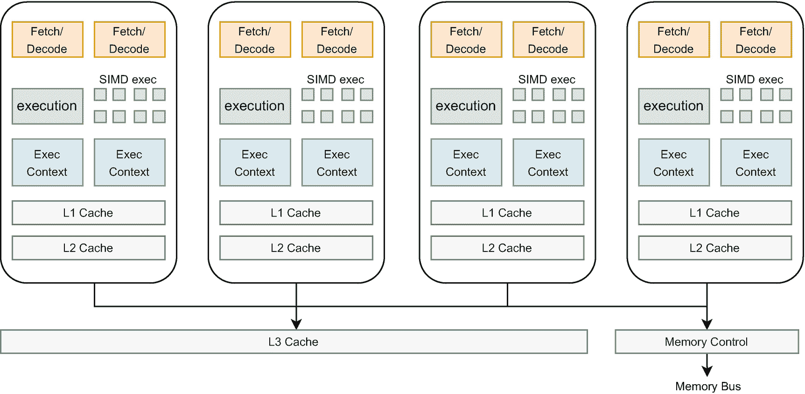
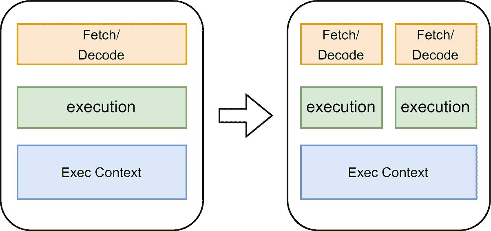
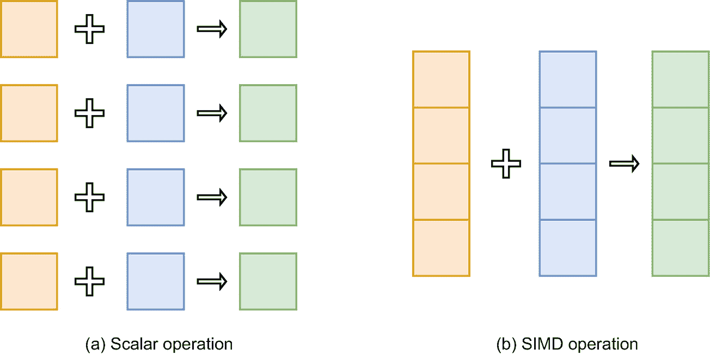
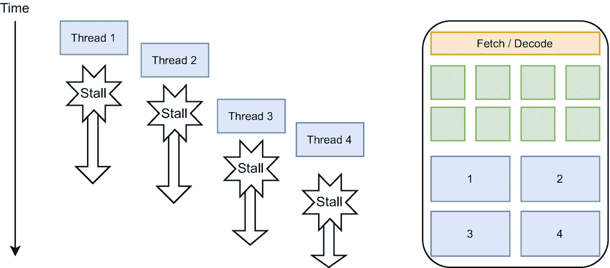
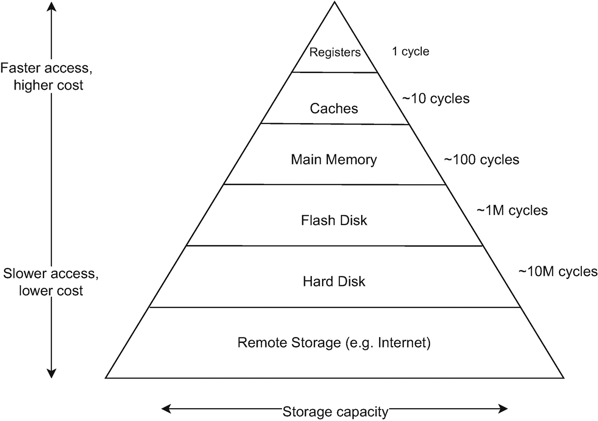
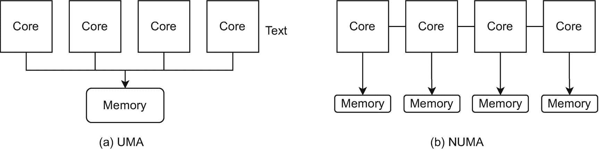
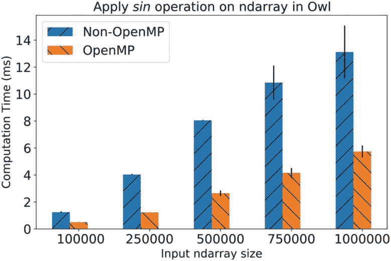
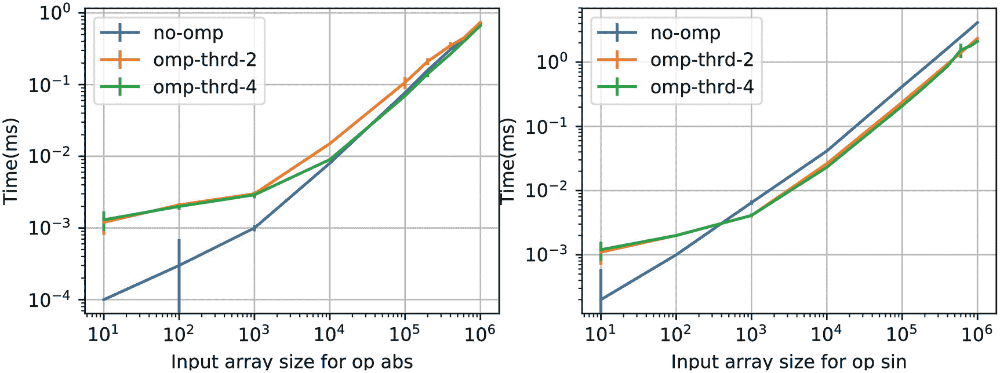
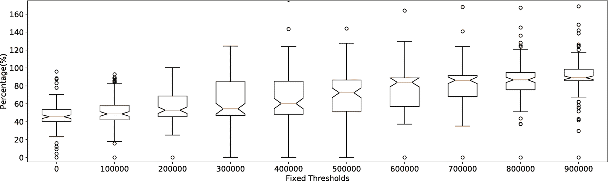

# 2. 核心优化

王亮^(1) 和赵建新^(2)
(1) 芬兰，赫尔辛基 (2) 中国，北京

数值库或软件中一个最重要的问题或许是："如何让它运行得更快？" 任何科学计算程序，都不会因为运行速度太快或占用内存太少。当然，这也是我们在设计 `Owl` 时首要考虑的问题。本章将讨论 `Ndarray` 模块的优化，该模块是 `Owl` 中几乎所有计算的核心模块。我们首先介绍该模块及其与 C 代码的接口方式。接着，简要介绍数值代码优化的基本原理，包括一些常用技巧。然后，我们将使用 `Owl` 中的代码示例来展示这些技巧是如何在 `Owl` 中应用的。最后，我们将简要探讨数值库中的自动性能调优这一主题。

## 2.1 Owl 中的 N 维数组

`Owl` 的数值函数组织在多个模块中，例如线性代数、信号处理、统计学、优化等。然而，在实际应用中，用户很少只处理数据分析中的标量值。在线性代数中，矩阵是一种常见的数据对象。在神经网络中，输入图像通常用三维数组表示，每个元素的取值范围在 [0, 255] 之间。确实，一个高效的 n 维数组（或称 `ndarray`）实现是任何工业级数值库（如 `NumPy`、`Julia`、`MATLAB` 等）的核心所在。

`Ndarray` 模块在 `Owl` 中提供了这种核心数据结构。它依赖于 `OCaml` 提供的 `Bigarray` 模块。与普通的 `OCaml` 数组相比，`Bigarray` 在大小上不受限制，最多支持 16 个维度，并且存储空间效率更高。下面是 `Ndarray` 类型的定义：

```ocaml
type ('a, 'b) t = ('a, 'b, c_layout) Genarray.t
```

此处，GADT 类型 `'b` 是元素类型，例如单精度（32 位）浮点数、8 位整数等。类型 `'a` 表示可以写入 `Bigarray` 或从中读出的 `OCaml` 值的类型。`Bigarray` 可以包含多种类型，在 `Ndarray` 中我们主要支持四种：

```ocaml
type ('a, 'b) kind =
  | Float32 : (float, float32_elt) kind
  | Float64 : (float, float64_elt) kind
  | Complex32 : (Complex.t, complex32_elt) kind
  | Complex64 : (Complex.t, complex64_elt) kind
```

也就是说，`Owl` 主要支持单精度浮点数 (S)、双精度浮点数 (D)、单精度复数 (C) 和双精度复数 (Z)。支持复数数据类型对于使用傅里叶变换的信号处理等应用至关重要。

除了 `('a, 'b)` 部分，定义中还包含一个 `c_layout` 参数。`Bigarray` 支持两种不同的内存布局。在 `Owl` 中，我们坚持使用 C 风格的数据布局，这意味着索引从 0 开始，并且采用行主序格式。最初，`Owl` 旨在支持两种布局，但很快发现这只会打开潘多拉魔盒而收益甚微。

例如，如果需要创建一个形状为 2x3 的 `ndarray`，其元素均为单精度浮点类型的 0，我们可以使用：

```ocaml
Dense.Ndarray.S.ones [|2;3|]
```

在此模块命名中，`Dense` 表示数据是密集存储的，而非使用稀疏结构。`Owl` 也支持 `Sparse` `ndarray` 类型，其 API 与密集类型非常相似，同样包含前面提到的四种不同数据类型。实际上，如果你调用 `Dense.Ndarray.S.ones [|2;3|]`，你会得到稀疏存储的零值 `ndarray`。存储稀疏矩阵有两种常用格式：压缩稀疏列（CSC）格式和压缩稀疏行（CSR）格式。`Owl` 使用压缩稀疏行格式。与密集的 `ndarray` 相比，稀疏 `ndarray` 的定义包含一些额外信息：

```ocaml
type ('a, 'b) t =
  { mutable s : int array
  ; mutable h : (int array, int) Hashtbl.t
  ; mutable d : ('a, 'b, c_layout) Array1.t
  }
```

在本章中，我们重点讨论密集 `ndarray` 结构的优化，不再深入讨论稀疏 `ndarray` 的细节。

名称的第二部分是 `Ndarray`，这当然是本章的主题，但需要注意的是，我们也支持矩阵数据类型。`Matrix` 基于 `Ndarray` 实现，支持仅对矩阵进行操作的函数，例如 `row_num`，并且在维度为二维时可以与 `ndarray` 互操作。例如，我们可以执行：

```ocaml
let x = Dense.Ndarray.S.ones [|2;3|];;
let a = Dense.Matrix.S.row_num x;;
```

除了核心数据结构的实现，`Ndarray` 模块的重要性还在于它支持的各种操作。这些操作可以分为多种类型：

*   生成密集数据结构的创建函数，例如 `empty`、`create`、`zeros` 和 `ones`。这些函数返回指定形状和内容的 `ndarray`。
*   数学运算。其中许多可归纳为三种通用运算模式：`map`、`fold` 和 `scan`。例如，`map` 函数通过将提供的函数应用于原始 `ndarray` 中的每个元素，将一个 `ndarray` 转换为另一个，像 `sin` 和 `log` 这样的运算就属于这种模式。
*   切片操作，用于根据特定的切片定义提取 `ndarray` 或矩阵的一部分。该定义是一个索引列表，指示对于被切片的每个维度，应访问哪些索引以及按什么顺序访问。在任何数值库中，索引和切片可能是最重要的 `ndarray` 函数。
*   其他计算或操作函数：比较、`tile`（平铺）或重复一个 `ndarray`、序列化、遍历所有元素等。

持续提升这些操作的性能始终是一个好主意，尤其是数学函数。与许多人对函数式语言的印象相反，OCaml 实际上相当快。^(³) 话虽如此，声称仅使用 OCaml 就能满足数值计算的所有性能要求也是不合理的。在很多时候，我们仍然需要依赖 C 或 FORTRAN 的强大能力，就像许多其他数值计算库（如 `NumPy`）所做的那样。

因此，在 `Owl` 中，我们将大多数 `ndarray` 操作通过接口对接到了 C 实现。在接下来的几节中，我们首先解释如何将 OCaml 代码接口到 C，然后详细介绍常用于优化计算性能的原理和技术。

## 2.2 将 OCaml 接口到 C

为了确保性能，我们在 `Ndarray` 模块中的核心计算主要用 C 语言实现，然后通过接口将其连接到 OCaml。本节简要介绍这是如何完成的。相应的代码主要包含在源代码的 `/path/to/src/owl/core/` 目录中。我们以 `Ndarray` 模块中的正弦函数为例。这个 OCaml 函数是另一个 OCaml 函数 `_owl_sin` 的封装：

```ocaml
let _owl_sin : type a b. (a, b) kind -> int ->
  (a, b) owl_arr -> (a, b) owl_arr -> unit =
  fun k l x y ->
    match k with
    | Float32   -> owl_float32_sin l x y
    | Float64   -> owl_float64_sin l x y
    | Complex32 -> owl_complex32_sin l x y
    | Complex64 -> owl_complex64_sin l x y
```

该函数充当不同正弦函数实现的入口。正如我们介绍的，`Owl` 提供了四种数据类型：`float`、`double`、`complex float` 和 `complex double`。此函数接收一个数据类型作为输入，并对输入数组 `x` 中的 `l` 个元素应用正弦函数，输出存储在数组 `y` 中。其中一个被调用的函数，例如 `owl_float32_sin`，被声明为一个外部函数，用于连接 OCaml 外部，即一个名为 `"float32_sin"` 的 C 函数。

```ocaml
external owl_float32_sin : int
  -> (a, b) owl_arr
  -> (a, b) owl_arr -> unit = "float32_sin"
```

我们没有直接实现 C 函数 `float32_sin`，因为我们注意到四种不同类型正弦函数的实现基本相同。因此，我们使用了 C 宏。以下是可用于实现一系列数学函数的模板（`FUN4`）：

```c
#ifdef FUN4
CAMLprim value FUN4(value vN, value vX, value vY) {
  CAMLparam3(vN, vX, vY);
  int N = Long_val(vN);
  INIT;
  struct caml_ba_array *X = Caml_ba_array_val(vX);
  NUMBER *X_data = (NUMBER *) X->data;
  struct caml_ba_array *Y = Caml_ba_array_val(vY);
  NUMBER *Y_data = (NUMBER *) Y->data;
  NUMBER *start_x, *stop_x;
  NUMBER *start_y;
  caml_release_runtime_system();  /* 允许其他线程 */
  start_x = X_data;
  stop_x = start_x + N;
  start_y = Y_data;
  while (start_x != stop_x) {
    NUMBER x = *start_x;
    *start_y = (MAPFN(x));
    start_x += 1;
    start_y += 1;
  };
  caml_acquire_runtime_system();  /* 禁止其他线程 */
  CAMLreturn(Val_unit);
}
#endif /* FUN4 */
```

这个 C 函数必须满足特定的规范。`float32_sin` 的返回值必须是 `CAMLprim value` 类型，其参数为 `value` 类型。可以使用一些宏将这些 `value` 类型转换为原生的 C 类型。这些宏包含在 `<caml/mlvalues.h>` 头文件中。例如，我们使用 `Long_val` 将参数转换为整数值，使用 `Caml_ba_array_val` 将 OCaml `Bigarray` 类型转换为数字数组。最后，计算本身很简单：在 for 循环中对数组 `x` 中的每个元素应用函数 `MAPFN`，输出保存在数组 `y` 中。由于 OCaml 函数 `_owl_sin` 的返回值是 `unit`，因此这个 C 函数也需要返回宏 `Val_unit`。

注意，我们还没有在这个模板中指定几个宏：数字类型和要应用于数组的函数。为此，我们使用：

```c
#define FUN4 float32_sin
#define NUMBER float
#define MAPFN(X) (sinf(X))
#include OWL_NDARRAY_MATHS_MAP
```

这里，我们指定了一个名为 `float32_sin` 的函数，它使用了上述模板，其中数字类型为 `float`，应用于输入数组中每个元素的函数是来自标准 C 库 `<math.h>` 的 `sinf`。我们可以轻松地更改这里的宏，以使用其他函数来获取其他精度的正弦函数或其他数学函数，如 `exp`、`log` 等。

总结一下，当我们在 `Owl` 中调用 `Dense.Ndarray.S.sin x` 时，它最终会对 `x` 中的所有浮点数调用 `sinf` 函数。在这种设计中，我们可以选择其他库的实现，例如 Intel 数学核心函数库 (MKL)，它在基于 Intel 的机器上可以实现卓越的性能。实际上，这正是我们在其他许多模块中所做的。我们没有手工编写所有高度复杂的线性代数函数等，而是将它们的实现接口连接到诸如 OpenBLAS（线性代数例程）、SMTF（随机数生成器）、FFTPack（快速傅里叶变换）、Cephes（特殊数学函数）等库。但我们尽量将第三方依赖库的数量减少到最低，同时避免重复造轮子。

除了我们介绍的接口机制外，我们还可以利用外部函数接口从 OCaml 调用另一种编程语言的例程。在《Real World OCaml》[38] 中对这种方法进行了很好的解释。推荐任何想在 OCaml 领域深入挖掘的人阅读本书。

实现核心代码带来了多种优化可能性：单指令多数据流 (SIMD)、多核硬件上的并行处理 [4]、循环展开、使用 tile（平铺）技术提高缓存效率 [48] 等。此外，我们还可以构建系统，自动在 Owl 系统中选择合适的参数，以适应其运行的硬件/软件平台。我们将在本章的其余部分详细讨论这些主题。

## 2.3 计算核心优化

自从计算机诞生以来，一个问题总会不时浮现：“如何提高一段代码的性能？”在计算机早期，使用计算机是一种特权，用户必须充分利用有限的机时。而如今，每个电脑游戏玩家都渴望高质量的画面效果。更不用说那些科研人员了，如果他们的模拟程序运行时间能缩短一半，他们会欣喜若狂。

在美好的旧时光里，答案很简单。我们可以简单地搭上摩尔定律的顺风车：“密集集成电路中的晶体管数量大约每两年翻一番。”许多相关领域也呈现出类似的指数增长。随着 CPU 时钟速度的提高，任何代码都能自动运行得更快，更不用说内存和存储容量的急剧增加了。你所要做的就是等待。

然而，免费的午餐结束了，时钟速度已经停滞多年。^(⁴) 面对这种情况，程序员需要以根本不同的方式在现代硬件上实现性能提升。这通常包括两个方面：利用处理器提供的并行计算机制，以及减少从慢速存储介质访问数据。

图 2-1 展示了一个经过极大简化但非常全面的四核 CPU 架构示意图。^(⁵) 它展示了处理器中的一些核心组件。CPU 遵循“取指-译码-执行”的循环来处理指令。其基本过程如下所述。当程序计数器指示下一条要执行的指令时，取指/译码单元从内存中获取指令值，并将其译码成计算机能理解的操作。接着，调用算术逻辑单元（ALU）来执行所需的计算操作。此过程重复执行，直到程序停止。在此过程中，执行上下文包含必要的状态信息，例如计算结果、程序计数器、寄存器等。除了这些部分，CPU 还包含几级缓存，这些缓存最终连接到内存。这个模型能很好地近似真实的 CPU。在本节的剩余部分，我们将详细解释这些不同部分以及它们如何有利于计算性能。


*一幅图示展示了四核 CPU 的详细架构。前三个模块指向 L3 缓存，第四个模块指向连接到内存总线的内存控制器。*

**图 2-1** 四核 CPU 的架构示意图


*一幅模型图展示了多个取指和译码模块之间的处理器并行性。*

**图 2-2** 处理器并行性：多个取指和译码模块

### CPU 对并行计算的支持

#### 指令级并行

程序由一串指令流组成。在基本处理器模型中，每个时钟周期执行一条指令。但指令之间并非严格按顺序依赖。相反，其中一些指令可以在不受干扰的情况下并行执行。利用这种指令级并行（ILP）的架构被称为超标量架构，其历史可以追溯到 20 世纪 60 年代。它可以通过同时分派多条指令在每个时钟周期内执行多条指令。因此，处理器包含多个取指/译码和 ALU 模块，如图 2-2 所示。指令流中的并行性由硬件在执行过程中自动动态发现，因此对程序员不可见。


*一幅图展示了传统计算方法与单指令多数据方法的比较。*

**图 2-3** 传统计算与 SIMD 的对比

### 向量化

ALU 还有潜力在一个时钟周期内提供多条数据。*单指令多数据*（`SIMD`）指的是一种使用单条指令处理多个数据的计算方法。它与每个操作（如加载、加法等）只处理一条数据的传统计算方法形成对比。这两种方法的比较如图 2-3 所示。在此示例中，一条指令同时处理四个浮点数。

`SIMD` 现在被广泛支持在各种硬件架构上。早在 1996 年，英特尔的 `MMX` 指令集就是第一个广泛部署的 `SIMD`，它能够同时处理四个 16 位数字。随后它被扩展到更多的指令集，包括 `SSE`、`AVX`、`AVX2` 等。在 `AVX2` 中，用户每个周期可以处理 16 个 16 位数字。类似地，ARM 架构提供了 `NEON` 来实现 `SIMD`。下面是一个利用英特尔 `AVX2` 指令将一组八个整数与另一组八个整数相加的简单示例：

```c
#include <immintrin.h>
int main(int argc, char* argv[]) {
    __m256i a = _mm256_set_epi32(1, 2, 3, 4, 5, 6, 7, 8);
    __m256i b = _mm256_set_epi32(10, 20, 30, 40, 50, 60, 70, 80);
    __m256i c = _mm256_add_epi32(a, b);
    return 0;
}
```

要使用 `AVX` 指令，程序员需要使用包含在头文件（如 `immintrin.h`）中的英特尔内部函数。这里，`_mm256_set_epi32` 将八个 32 位整数打包成一个组，`_mm256_add_epi32` 对打包的 32 位整数进行加法运算。如果你查看这个简单程序的汇编代码，部分内容看起来像：

```asm
...
vpunpcklqdq   %xmm3, %xmm0, %xmm0
vpunpcklqdq   %xmm2, %xmm1, %xmm1
vinserti128   $0x1, %xmm1, %ymm0, %ymm0
vmovdqa       %ymm0, 8(%rsp)
vmovdqa       -24(%rsp), %ymm0
vmovdqa       %ymm0, 72(%rsp)
vmovdqa       8(%rsp), %ymm0
vmovdqa       %ymm0, 104(%rsp)
vmovdqa       72(%rsp), %ymm1
vmovdqa       104(%rsp), %ymm0
vpaddd        %ymm0, %ymm1, %ymm0
...
```



此图说明了在多个线程之间进行上下文切换以隐藏执行延迟并提高总体吞吐量的过程。

**图 2-4** 基于硬件线程的上下文切换以隐藏延迟

可以看出，`AVX2` 没有使用像 `add` 这样的普通指令，而是使用 `vpaddd` 来对打包的双字整数进行加法运算，并且使用了像 `ymm0` 等特殊寄存器。总的来说，使用 `SIMD` 可以显著提高计算的性能。

### 上下文切换

正如我们所解释的，处理器中的执行上下文在执行指令时包含必要的状态信息。但这并不意味着一个处理器只能有一个执行上下文。例如，英特尔 Core i9-9900K 包含两个执行上下文，或称“硬件线程”。这提供了并发处理的可能性。具体来说，一个核心可以应用 `上下文切换` 技术，在一个上下文中存储执行状态，同时（如果可能的话）在另一个上下文中运行指令。

请注意，与我们之前介绍的方法不同，`上下文切换` 并不能在完全相同的时钟周期内实现并行处理；一个核心仍然只有一个 ALU 单元来处理指令。相反，在每个时钟周期，核心可以选择在可用的上下文上运行一条指令。这对于处理包含高延迟操作（如内存读取或写入）的指令流尤其有用。如图 2-4 所示，当一条指令正在执行（或许在长时间等待从内存读取数据）时，核心可以切换到另一个上下文并运行另一组指令。通过这种方式，执行延迟被隐藏，从而提高了总体吞吐量。

#### 多核处理器

我们目前介绍的内容都集中在单个核心上。但另一种提升计算性能的思路对更广泛的受众来说更为直接：`多核处理器`。这意味着在一个处理器上集成多个处理单元（即核心），并实现同时并行处理的可能性。处理器的发展趋势是在一个处理器中集成越来越多的核心。例如，Apple M1 包含八个核心，其中四个高性能核心和四个高能效核心。Intel Core i9-12900HX 处理器包含 16 个核心。

与之前的机制类似，仅仅因为处理器提供了并行处理的可能性，并不意味着代码本身就能神奇地自动提升性能。挑战在于如何从操作系统和应用程序的角度，正确地利用多核心的能力。程序员有多种方法可以利用多核处理器提供的功能。例如，在 Unix 系统上，IEEE `POSIX` 1003.1c 标准规定了一种标准编程接口，其在不同硬件上的实现被称为 POSIX 线程，或 Pthreads。它管理线程，例如线程的创建和连接，并提供同步原语，如互斥锁、条件变量、锁、屏障等。OCaml 语言也正在增加对多核的原生支持，包括通过共享内存并行方法实现的并行性和并发性。它将在 OCaml 5.0 版本中得到官方支持。



一个三角形图展示了内存层级方法。它从上到下分为 6 层，分别是：寄存器、缓存、主存、闪存、硬盘和远程存储。

**图 2-5**
内存层级

### 内存

除了处理器架构，另一个核心组件——内存——也在程序性能中扮演着关键角色。在本节的剩余部分，我们将介绍一些利用内存特性的通用原则。关于这个主题的更详细知识，我们极力推荐 U. Drepper [18] 的文章。

理想情况下，如冯·诺依曼架构所示，一个处理单元只需要访问一个统一的内存。然而，这样一个通用的内存很难满足各种现实需求：持久存储、快速访问速度、廉价等等。因此，现代内存设计采用了“`内存层级`”方法，将内存划分为若干层，每一层都是不同类型的存储器，如图 2-5 所示。广义上讲，它包含两类：(1) 处理器可直接访问的内部存储器，包括 CPU 寄存器、缓存和主存；(2) 处理器通过 I/O 模块可访问的外部存储器，包括闪存、传统磁盘等。随着层级的下降，存储容量增加，但访问速度和成本也显著降低。

寄存器离计算机处理器最近。例如，Intel Xeon Phi 处理器包含 16 个通用寄存器和 32 个浮点寄存器，每个 64 位大小。它还包含用于 `AVX` 指令的 32 个寄存器，每个大小为 256 或 512 位。对寄存器的访问速度在内存层级中最快，仅需一个处理器周期。下一级是不同级别的缓存。在图 2-1 中，我们已经看到处理器核心如何直接连接到不同级别的缓存。在 Intel Core i9-9900K 上，缓存大小分别为 64KB（L1，每个核心）、256KB（L2，每个核心）和 16MB（共享）。其访问速度大约为十个周期，其中 L1 最快。

#### 缓存

由于与内存相比缓存访问速度更快，利用缓存是提升计算性能的关键。想象一下，如果程序的所有数据访问都直接来自缓存，其性能将达到几个数量级的提升。在达不到这个理想状况时，一个原则是尽可能利用缓存。具体来说，我们需要利用程序中数据访问的*局部性*，这意味着程序倾向于重用那些“贴近”它已使用过的数据。“贴近”有两层含义：首先，最近使用的数据很可能在不久的将来再次被使用，这称为*时间局部性*；其次，地址相近的数据也很有可能在近期被使用。稍后，我们将讨论基于这些原则的技术。

顺便提一下，由于缓存的重要性，了解你计算机上的缓存大小是必要的。你当然可以查阅其手册或规格说明文档，或者使用诸如 `lscpu` 之类的命令。在 Owl 代码库中，我们采用了与 Eigen ^（⁶）相同的方法，即使用 x86 架构上提供的 `cpuid` 指令。它可以用来检索 CPU 信息，例如处理器类型以及是否包含 `AVX` 等特性。总的来说，`query_cache_size` 程序首先检查当前 CPU 厂商是否是 x86 或 x64 架构。如果不是，则意味着可能不支持 `cpuid`，它仅返回一个保守的猜测。否则，它会根据厂商是 AMD 还是 Intel 来检索信息。这里，宏 `OWL_ARCH_x86_64` 和 `OWL_ARCH_i386` 通过检查诸如 `__x86_64__`、`_M_X64`、`__amd64`、`__i386` 等预定义系统宏是否在编译器中定义来实现。`CPUID` 宏则使用汇编代码利用 `cpuid` 指令来实现。

```
void query_cache_sizes(int* 11p, int* 12p, int* 13p) {
  if (OWL_ARCH_i386 || OWL_ARCH_x86_64) {
    int cpuinfo[4];
    CPUID(cpuinfo, 0x0, 0);
    if (cpu_is_amd(cpuinfo)) {
      query_cache_sizes_amd(11p, 12p, 13p);
      return;
    }
    int highest_func = cpuinfo[1];
    if (highest_func >= 4)
      query_cache_sizes_intel(11p, 12p, 13p);
    else {
      *11p = 32 * 1024;
      *12p = 256 * 1024;
      *13p = 2048 * 1024;
    }
  } else {
    *11p = 16 * 1024;
    *12p = 512 * 1024;
    *13p = 512 * 1024;
  }
}
OWL_INLINE void query_cache_sizes_intel(int* 11p, int* 12p, int* 13p) {
  int cpuinfo[4];
  int 11 = 0, 12 = 0, 13 = 0;
  int cache_id = 0;
  int cache_type = 0;
  do {
    cpuinfo[0] = cpuinfo[1] = cpuinfo[2] = cpuinfo[3] = 0;
    CPUID(cpuinfo, 0x4, cache_id);
    cache_type = (cpuinfo[0] & 0x0F) >> 0;
    if(cache_type == 1 || cache_type == 3) {
      int cache_level = (cpuinfo[0] & 0xE0) >> 5;
      int ways        = (cpuinfo[1] & 0xFFC00000) >> 22;
      int partitions  = (cpuinfo[1] & 0x003FF000) >> 12;
      int line_size   = (cpuinfo[1] & 0x00000FFF) >>  0;
      int sets        = (cpuinfo[2]);
      int cache_size = (ways + 1) * (partitions + 1)
        * (line_size + 1) * (sets + 1);
      switch(cache_level) {
        case 1: 11 = cache_size; break;
        case 2: 12 = cache_size; break;
        case 3: 13 = cache_size; break;
        default: break;
      }
    }
    cache_id++;
  } while(cache_type > 0 && cache_id < 16);
  if (11 == 0) 11 = 32 * 1024;
  if (12 == 0) 12 = 256 * 1024;
  if (13 == 0) 13 = 2048 * 1024;
  *11p = 11; *12p = 12; *13p = 13;
  return;
}
```

#### 预取

为了缓解内存的长加载时间，预取是另一种流行的方法。顾名思义，处理器在数据被请求之前就将其加载到缓存中，这样在实际使用时，数据可以直接从缓存中访问。预取可以通过两种方式触发：通过某些硬件事件或软件的显式请求。

自然，预取面临两方面的挑战。首先是知道应该从内存中预取什么内容。缓存非常宝贵，我们不想预加载无用的内容，这会导致时间和资源的浪费。其次，知道何时进行预取同样重要。例如，过早地获取内容可能会在数据被使用之前就被从缓存中移除。

对于硬件预取，处理器会监控内存访问，并根据某些模式（例如一系列缓存未命中）来预测要获取的内容。预测的内存地址被放入队列中，预取操作看起来就像是对内存的正常 READ 请求。现代处理器通常有不同的预取策略。一种常见的策略是获取接下来的 *N* 行数据。类似地，它也可以遵循步幅模式：如果当前程序使用地址 `x` 处的数据，那么预取 `x+k`、`x+2k`、`x+3k` 等位置的数据。

与硬件方法相比，软件预取允许程序员进行控制。例如，GCC 内建函数就是为此目的而设的：`void __builtin_prefetch (const void *addr, ...)`

它包含三个参数。第一个是要预取的数据地址；第二个是一个编译时整数，指示预取是为从内存读取还是写入做准备；第三个参数指示所取数据的时间局部性，以决定在访问后是否应将其从缓存中逐出。

如果程序员预期相应数据很快会被访问，可以在代码中插入 `__builtin_prefetch`。该内建函数将通过编译器编译成数据预取指令。如果在访问前的适当时刻执行预取，理想情况下所需数据在使用时已经存在于缓存中。以下代码是一个简单示例，展示了它在 C 代码中如何工作：

```
for (i=0; i < n; ++i)
  for (j=0; j < m; ++j) {
    __builtin_prefetch(&x[i+1][j]);
    c += x[i][j]
  }
```

还有其他用于软件控制预取的方法，例如来自 Intel `SSE` 指令集的 `_mm_prefetch (char const* p, int i)` 内建函数。它将包含地址 `p` 的一行数据从内存预取到缓存层次结构中的某个位置；参数 `i` 指示缓存数据的局部性级别。

然而，正确使用预取仍然棘手；有时不当的预取甚至会使执行变慢。一方面，我们通常很难确切知道应该提前多远获取数据，尤其是在不规则访问内存的应用程序中。频繁的早期预取实际上会降低缓存命中准确性。此外，不同数据块的局部性模式对于程序员来说也难以管理。这就是为什么这种方法应谨慎使用的原因。



图中的两部分展示了在统一内存访问和非统一内存访问设计中，核心处理器在内存访问方面的差异。

**图 2-6** 从统一内存访问到非统一内存访问的转变

#### NUMA

最后，我们简要讨论非统一内存访问（NUMA），因为它展示了提高内存访问效率的硬件层面。我们之前提到了处理器的多核设计。虽然这提高了处理器的并行性，但也给内存性能带来了挑战。当应用程序在多个核心上处理时，由于它们统一访问单个内存实体，一次只能有一个核心访问计算机内存。在内存密集型应用程序中，这会导致共享内存的争用和瓶颈。缓解此问题的一种方法是非统一内存访问（NUMA）设计。与我们介绍的统一访问模型相比，NUMA 为每个处理器分离内存，从而每个处理器可以以相当低的成本访问自己的那部分内存，如图 2-6 所示。然而，NUMA 的性能取决于正在执行的任务。如果一个处理器需要频繁访问其他处理器的内存，则会导致不理想的性能。

### 2.4 优化技术

计算优化是计算机科学中的一个经典话题，学术界和工业界仍有许多相关工作。即使仅详细解释其中一部分也需要一整本书的篇幅。相反，在本节中，我们将给出一些优化技术示例，以展示前面章节中的原则是如何实现的。

### 硬件并行化

利用多核是提高计算性能的直接方法，尤其是对于包含大量元素的数组上的复杂计算。除了我们介绍过的 `Pthread`，Open Multi-Processing（OpenMP）是另一个广泛使用的工具。OpenMP 是一个库，提供 API 以支持在许多平台上使用 C/FORTRAN 语言进行共享内存多处理编程。OpenMP 程序在其并行部分使用多个线程，并且在开始时设置顺序执行部分的环境。并行部分由 OpenMP 指令 `omp pragma` 标记。每个线程执行并行部分，然后在完成后合并。以下是一个示例：

```
#include <omp.h>
int main(int argc, char **argv) {
    int x[200000];
    #pragma omp parallel for
    for (int i = 0; i < 100000; i++) {
        x[i] = sinf(i);
    }
    return 0;
}
```

这里，在一个包含 200000 个元素的大数组中，我们对每个元素计算其索引值的 `sin` 函数。为了应用多核计算，我们只需在 `for` 循环上添加一行指令。在不指定线程数的情况下，它将整个工作负载（即数组）分配到所有可用的核心上。

在 Owl 中，我们也应用了 OpenMP 来提升计算性能。例如，我们引入了模板来将单个函数映射到数组中的所有元素。我们现在可以按如下方式更改模板的一部分。这里，`caml_release_runtime_system` 释放调用线程中的主锁，使其他线程能够与当前线程的执行并行运行代码：

```
  ...
  caml_release_runtime_system();
  start_x = X_data;
  stop_x = start_x + N;
  start_y = Y_data;
  #pragma omp parallel for schedule(static)
  for (int i = 0; i < N; i++) {
    NUMBER x = *(start_x + i);
    *(start_y + i) = (MAPFN(x));
  }
  caml_acquire_runtime_system();
  ...
```

我们也可以从 SIMD 中受益。例如，我们可以实现自己的 SIMD 版本数学函数，而不是接口到标准 C 数学库函数。不幸的是，这并不像添加一行指令那么简单，因为 SIMD 内建函数不包含复杂计算。例如，即使对于一个正弦函数，我们也需要仔细地使用各种现有的内建函数来实现基于泰勒展开的算法。更不用说我们还需要始终考虑不同版本的 SIMD：SSE、AVX2、AVX512 等，或不同硬件供应商。总之，使用 SIMD 来提升性能需要大量的工程工作。

### 缓存优化

缓存优化技术数不胜数，但大多数都遵循同一个主题：改善数据局部性（包括空间局部性和时间局部性）以及对代码和数据进行对齐。如果你将某些内容放入缓存，最好能让它物尽其用：尽可能多地重用缓存数据。接下来，我们将以矩阵乘法为例。矩阵乘法是科学计算中的核心部分之一，其基本算法很简单：

```
for (i = 0; i < N; ++i)
  for (j = 0; j < N; ++j)
    for (k = 0; k < N; ++k)
      r[i][j] += mul1[i][k] * mul2[k][j];
```

数据读取的顺序是从左到右：`(0, 0)`、`(0,1)`、……、`(0, n)`、`(1, 0)`、`(1, 1)`、……、`(1, n)`、……。当元素 `(0, 0)` 被加载时，其后的几个元素也会同时存入缓存，因此 `(0, 1)`、`(0, 2)` 等元素都直接从缓存中加载，而非从内存中读取。然而，`mul2` 中的元素访问方式并非如此。在 `(0, 1)` 之后，需要访问的是 `(1, 0)`、`(2, 0)` 等元素。这意味着缓存中的元素全部被浪费了。

解决这个问题的一种方法是在乘法运算前对 `mul2` 进行转置：

```
double tmp[N][N];
for (i = 0; i < N; ++i)
  for (j = 0; j < N; ++j)
    tmp[i][j] = mul2[j][i];
for (i = 0; i < N; ++i)
  for (j = 0; j < N; ++j)
    for (k = 0; k < N; ++k)
      r[i][j] += mul1[i][k] * tmp[j][k];
```

另一种方法能更好地利用 L1 缓存。首先，它将一个大矩阵“切割”成多个较小的方阵。这样的小方阵的每一行都能放入 L1 缓存中。这些多个小矩阵的乘法运算在外层循环中迭代。这种技术有时被称为*分块（tiling）*。该算法可以用图 2-7 来展示。在一个小矩阵乘法 *ab* = *c* 中，*a* 的一行被存储在 L1 缓存中（步骤 ➀）。然后在矩阵 *b* 中移动列号，计算 *c* 中对应的输出（步骤 ➁）。只有在此步骤之后，缓存行才会被驱逐，*a* 中的新一行才被取入缓存（步骤 ➂）。*a* 中之前的行将不再被使用。该算法实现如下。其中，`E` 是小矩阵每一行的元素个数：``

一个由三部分组成的示意图说明了使用 L1 缓存的矩阵乘法算法。

**图 2-7** 利用 L1 缓存的矩阵乘法算法图示

```
for (i = 0; i < N; i += E)
  for (j = 0; j < N; j += E)
    for (k = 0; k < N; k += E)
      for (ii = 0, rr = &r[i][j],
           am = &mul1[i][k]; ii < E;
           ++ii, rr += N, am += N)
        for (kk = 0, bm = &mul2[k][j];
             kk < E; ++kk, bm += N)
          for (jj = 0; jj < E; ++jj)
            rr[jj] += am[kk] * bm[jj];
```

另一种利用缓存的技术是**循环合并（loop merging）**。我们可以将遍历数据的连续循环合并为一个循环，以便重用缓存中的数据，从而减少内存访问。以下代码展示了一个简单示例：

```
for (i = 0; i < N; i++) {
    x[i] = buf[i]
}
for (i = 0; i < N; i++) {
    y[i] = i * x[i] + bias
}
```

显然，这两个循环可以融合成一个单一的循环：

```
for (i = 0; i < N; i++) {
    x[i] = buf[i]
    y[i] = i * x[i] + bias
}
```

通过将两个循环融合为一个，`x` 元素的访问顺序发生了改变，从而增加了时间局部性。它还可以使用我们之前提到的并行计算技术等技术来进一步加速。

对于某些无法直接应用循环合并的情况，*循环对齐（loop alignment）* 技术可能会有所帮助。例如，以下两个 `for` 循环

```
for (i=0; i<n; i++) {
    x[i] = y[i] + a
}
for (i=0; i<n; i++) {
    z[i] = x[i+1] + b
}
```

可以在对齐 `x` 和 `z` 数组后融合：

```
x[0] = y[0] + a
for (i=1; i<n; i++) {
    x[i] = y[i] + a
    z[i-1] = x[i] + b
}
z[n-1] = x[n] + b
```

### 其他技术

除了处理器并行性和缓存利用之外，还有很多技术可以提升代码性能。本部分我们仅对其中一些进行简要介绍。

编译器无疑对代码性能有着巨大影响。例如，`LLVM` 或 `GCC` 等编译器可以配置大量选项和标志。选择最合适的选项实际上可能是一项具有挑战性的任务。此外，程序员可以在 C 代码中添加内联汇编代码，以进一步提高执行速度。

另一种优化技术，*循环展开（unrolling）*，部分也在于理解编译器的工作原理。例如，我们可以将 `for` 循环展开为八部分：

```
for(i=0;i<n;i++) {
    a[i] = b[i] + 1
}

for(i=0; i<n; i+=8) {
    a[i] = b[i] + 1
    a[i] = b[i+1] + 1
    a[i] = b[i+2] + 1
    a[i] = b[i+3] + 1
    a[i] = b[i+4] + 1
    a[i] = b[i+5] + 1
    a[i] = b[i+6] + 1
    a[i] = b[i+7] + 1
}
```

它能使编译器减少条件分支的数量，从而降低潜在的分支预测错误和条件评估次数。

尽管我们解释了这么多，但请注意，缓存并不总是有益的。有时，数据被放入缓存，但在短时间内不会被再次使用。这意味着缓存只是在毫无读取的情况下浪费时间进行写入。在这种情况下，有必要绕过缓存阶段。处理器支持非时间性（nontemporal）写入直接到内存。SIMD 也提供了相应的内建函数来实现这一点，例如以下内建函数：``

一幅图展示了卷积算法。它有核 2, 2, 3, 3，输入 1, 4, 4, 3，等于卷积参数步长 1 和填充 0。表格有 10 列和 9 行，包含数字。

**图 2-8** 卷积算法图示

```
#include <ammintrin.h>
void _mm_stream_sd(double *p, __m128d a);
void _mm_stream_ss(float *p, __m128 a);
```

## 2.5 示例：卷积

卷积是一系列数学运算，可以说是深度神经网络中最重要的运算。它构成了大多数深度神经网络架构的主干，并在训练和推理过程中占据大量计算资源。根据输入形状，卷积运算可分为一维、二维和三维卷积。根据在前向或反向传播阶段的使用方式，又可分为标准卷积、核反向卷积和输入反向卷积。此外还有转置卷积、空洞卷积等特殊运算，但它们的实现原理十分相似。由于卷积运算的重要性，相关优化工作不胜枚举[55]。即便只实现其中一部分，也需要投入大量的工程精力。本节以二维卷积操作`Conv2D`为例，展示我们如何在`Owl`中对卷积运算应用各种优化技术。

卷积运算以两个`ndarray`数组作为输入：图像（`I`）和核（`F`）。在二维卷积中，这两个`ndarray`数组均为四维。图像`ndarray`包含`B`个批次；每个图像尺寸为`H` × `W`，并拥有`IC`个通道。核`ndarray`有`R`行、`C`列，具有相同的输入通道数`IC`和输出通道数`K`。卷积运算可表示为公式 2.1。

```
$$ {CONV}_{b,h,w,k}=\sum \limits_{ic=1}^{IC}\sum \limits_{r=1}^R\sum \limits_{c=1}^C{I}_{b,h+r,w+c, ic}{F}_{r,c, ic,k}. $$ (2.1)
```

卷积运算最初在`Owl`中通过调用`Eigen`库实现，`TensorFlow`在 CPU 上的卷积实现也使用了该库。但事实证明，与这个 C++ 库的接口存在诸多问题，导致大量安装故障。正因如此，我们转而手工打造卷积运算。这些运算包括三类：`Conv`、`ConvBackwardKernel` 和 `ConvBackwardInput`。其中`Conv`根据输入图像和核计算输出；类似地，`ConvBackwardKernel`根据输入和输出`ndarray`计算核，而`ConvBackwardInput`则根据核和输出数据生成输入`ndarray`。后两种运算主要用于 DNN 训练的反向传播阶段，但三者共享相似的计算算法。

一种朴素的卷积算法是通过嵌套`for`循环实现公式 2.1。显而易见，这种方式无法利用任何并行化优势，因此不适用于生产环境代码。

下一版本的实现采用了`im2col`算法。该算法如图 2-8 所示。在此示例中，我们从一张形状为`4x4`的输入图像和三个输出通道开始。每个通道由不同颜色表示。此外，图中还显示了每个元素的索引。卷积核形状为`2x2`，并且与输入图像一样具有三个输入通道。每个通道的颜色与输入图像的对应通道颜色相同。两个输出通道在图中通过不同的透明度层级来区分。根据卷积运算的定义，我们使用卷积核在输入图像上逐步滑动，在每个位置执行逐元素乘法。在本示例中，我们使用步长为`1`和有效填充。第一步，卷积核起始于第一个输入通道中元素索引为`[1,2,5,6]`的位置，第二个输入通道中为`[17,18,21,22]`，第三个输入通道中为`[33,34,37,38]`。逐元素相乘的结果被填入输出`ndarray`中的相应位置。移动到第二个位置时，输入索引变为`[2,3,6,7,18,19,22,23,34,35,38,39]`，依此类推。结果表明，这个过程可以简化为一次矩阵乘法。第一个矩阵就是展平后的卷积核。第二个矩阵基于输入`ndarray`，每一列是一个与卷积核的一个通道大小相同的展平子块。这种方法就是`im2col`算法的基本思想。由于矩阵乘法在诸如`OpenBLAS`等线性代数库中是经过高度优化的操作，因此该算法可以高效执行。下面我们展示其实现代码：

```
CAMLprim value FUN_NATIVE (spatial) (
    value vInput_ptr, value vKernel_ptr, value vOutput_ptr,
    value vBatches, value vInput_cols, value vInput_rows, value vIn_channel,
    value vKernel_cols, value vKernel_rows,
    value vOutput_cols, value vOutput_rows, value vOut_channel,
    value vRow_stride,  value vCol_stride,
    value vPadding, value vRow_in_stride, value vCol_in_stride
  ) {
    struct caml_ba_array *IN = Caml_ba_array_val(vInput_ptr);
    struct caml_ba_array *KE = Caml_ba_array_val(vKernel_ptr);
    struct caml_ba_array *OU = Caml_ba_array_val(vOutput_ptr);
    TYPE *input_ptr  = (TYPE *) IN->data;
    TYPE *kernel_ptr = (TYPE *) KE->data;
    TYPE *output_ptr = (TYPE *) OU->data;
    int batches       = Long_val(vBatches);
    int input_cols    = Long_val(vInput_cols);
    int input_rows    = Long_val(vInput_rows);
    int in_channel    = Long_val(vIn_channel);
    int kernel_cols   = Long_val(vKernel_cols);
    int kernel_rows   = Long_val(vKernel_rows);
    int output_cols   = Long_val(vOutput_cols);
    int output_rows   = Long_val(vOutput_rows);
    int out_channel   = Long_val(vOut_channel);
    int row_stride    = Long_val(vRow_stride);
    int col_stride    = Long_val(vCol_stride);
    int padding       = Long_val(vPadding);
    int row_in_stride = Long_val(vRow_in_stride);
    int col_in_stride = Long_val(vCol_in_stride);
    const int input_cri  = in_channel  * input_rows  * input_cols;
    const int input_ri   = in_channel  * input_rows;
    const int output_cri = out_channel * output_rows * output_cols;
    const int output_cr  = output_rows * output_cols;
    const int output_crb = output_rows * output_cols * batches;
    const int kernel_cri = kernel_cols * kernel_rows * in_channel;
    const int kernel_cr  = kernel_cols * kernel_rows;
    const int kernel_ri  = kernel_rows * in_channel;
    memset(output_ptr, 0, batches * output_cri * sizeof(TYPE));
    INIT;
    int pr = 0, pc = 0;
    if (padding != 1) {
      pr = (row_stride * ( output_rows - 1) + kernel_rows - input_rows) / 2;
      pc = (col_stride * ( output_cols - 1) + kernel_cols - input_cols) / 2;
      if (pr < 0) pr = 0;
      if (pc < 0) pc = 0;
    }
    TYPE *inpt2d = (TYPE *) calloc(mat_size, sizeof(TYPE));
    if (inpt2d == NULL) exit(1);
    ...
```

代码首先定位输入（`input`和`kernel`）的起始指针以及关于输入的各种元数据：输入通道、行列数、输出通道、步长、填充大小等。此外，还为输出和中间缓冲区分配了内存空间。接下来，代码实现了我们前面介绍的内容。通过三个`for`循环，填充中间输入缓冲区`inpt2d`（即一个矩阵），并使用`OpenBLAS`提供的`GEMM`例程将其与卷积核矩阵相乘。

```
    ...
    for (int i = 0; i < output_crb; ++i) {
      int bt = i / output_cr;
      int cr = i % output_cr;
      int c = cr / output_rows;
      int r = cr % output_rows;
      const int cstart = c * col_stride - pc;
      const int rstart = r * row_stride - pr;
      const int cend = cstart + kernel_cols;
      const int rend = rstart + kernel_rows;
      const int input_idx_base = bt * input_cri;
      int cnt = 0;
      for (int a = cstart; a < cend; ++a) {
        for (int b = rstart; b < rend; ++b) {
          for (int h = 0; h < in_channel; ++h) {
            if (a < input_cols && a >= 0 &&
                b < input_rows && b >= 0) {
              int input_idx =
                 input_idx_base + a * input_ri + b * in_channel + h;
              inpt2d[i * kernel_cri + cnt] = input_ptr[input_idx];
            }
            ++cnt;
          }
        }
      }
    }
    GEMM(CblasRowMajor, CblasNoTrans, CblasNoTrans,
      output_crb, out_channel, kernel_cri, ALPHA,
      inpt2d, kernel_cri, kernel_ptr, out_channel,
      BETA, output_ptr, out_channel);
    free(inpt2d);
    return Val_unit;
  }
```

然而，该算法需要生成一个巨大的临时中间矩阵。根据输入图像的尺寸，在诸如 FST 等应用中，这个矩阵可能占用数 GB 的内存。如果仔细观察这个中间矩阵，你会发现其中包含大量冗余信息。像内存高效卷积 [11] 这类算法旨在减小这个中间矩阵的尺寸，但在输入或卷积核尺寸较大时仍然无法奏效。

为了减少内存使用，我们采用了文献[25]中提出的方法，该方法将矩阵切割成小块，以适应 CPU 的 L1/L2 缓存，从而在进行高性能计算的同时减少内存占用，无论输入大小如何。两个矩阵的乘法可以被分解为多个小块矩阵的乘法。它仍然大致遵循之前的矩阵乘法方法，但不是生成整个中间矩阵，而是每次将输入矩阵和核矩阵切割成小块，从而无论输入和核有多大，内存使用都受到限制。接下来，我们展示代码：

```
int mat_size = kernel_cri * output_crb;
if (mat_size / kernel_cri == output_crb && mat_size < IM2COL_THRESHOLD) {
    // if generated input matrix is small enough, use im2col implementation
}
int mc = output_crb;
int kc = kernel_cri;
int nc = out_channel;
compute_block_sizes(&kc, &nc, &mc, sizeof(TYPE));
```

可以根据输入大小选择合适的实现。这里，我们使用中间矩阵的大小来决定是否需要采用内存高效的实现。如果它足够小，我们就使用之前的`im2col`实现。对于小输入大小，这种方法仍然简单且快速。否则，我们按照[25]中的方法计算合适的小块大小。

```
#if defined(AVX_PSIZE) && defined(_WIN32)
    int fast_flag = (in_channel % AVX_PSIZE == 0);
    TYPE *temp_mk = _aligned_malloc(mc * kc * sizeof(TYPE), ALIGN_SIZE);
    if (temp_mk == NULL) exit(1);
#elif defined(AVX_PSIZE)
    int fast_flag = (in_channel % AVX_PSIZE == 0);
    TYPE *temp_mk = NULL;
    if (posix_memalign((void**) &temp_mk, ALIGN_SIZE, mc * kc * sizeof(TYPE)))
        exit(1);
#else
    TYPE *temp_mk = (TYPE *) calloc(mc * kc, sizeof(TYPE));
    if (temp_mk == NULL) exit(1);
#endif
TYPE *temp_kn = (TYPE *) calloc(nc * kc, sizeof(TYPE));
if (temp_kn == NULL) exit(1);
TYPE *temp_mn = (TYPE *) calloc(mc * nc, sizeof(TYPE));
if (temp_mn == NULL) exit(1);
```

为了进一步提高性能，我们在从输入`ndarray`填充临时矩阵时使用了 SIMD 内联函数。一方面，根据输入通道是否能被 SIMD 支持的数据长度`AVX_PSIZE`（例如，对于 AVX 的 8 个浮点数）整除，我们提供了两组用于填充临时块的实现。然后我们为那些可以适配到缓存中的小块分配空间。

```
...
for (int m = 0; m < `output_crb`; m += `mc`) {
    int `actual_mc` = `fminf`(`m` + `mc`, `output_crb`) - `m`;
    for (int k = 0; k < `kernel_cri`; k += `kc`) {
        `memset`(`temp_mk`, 0, `mc` * `kc` * sizeof(`TYPE`));
        int `actual_kc` = `fminf`(`k` + `kc`, `kernel_cri`) - `k`;
        #ifdef `AVX_PSIZE`
        int `kc_strip` = (`actual_kc` / `AVX_PSIZE`) * `AVX_PSIZE`;
        #endif
        // iterate along each row of the generated input matrix.
        ...
        int `idx_kn_base` = `k` * `out_channel`;
        for (int n = 0; n < `out_channel`; n += `nc`) {
            int `actual_nc` = `fminf`(`n` + `nc`, `out_channel`) - `n`;
            `idx_kn_base` += `n`;
            // fill in the kernel matrix
            int `cnk` = 0;
            for (int ik = 0; ik < `actual_kc`; ik++) {
                for (int jn = 0; jn < `actual_nc`; jn++) {
                    int `index_kn` = `idx_kn_base` + `ik` * `out_channel` + `jn`;
                    `temp_kn`[`cnk`++] = `kernel_ptr`[`index_kn`];
                }
            }
            `GEMM`(`CblasRowMajor`, `CblasNoTrans`, `CblasNoTrans`,
                `actual_mc`, `actual_nc`, `actual_kc`, `ALPHA`,
                `temp_mk`, `actual_kc`, `temp_kn`, `actual_nc`,
                `BETA`, `temp_mn`, `actual_nc`);
            int `cmn` = 0;
            for (int ix = 0; ix < `actual_mc`; ix++) {
                for (int iy = 0; iy < `actual_nc`; iy++) {
                    int `index_mn` = (`ix` + `m`) * `out_channel` + (`iy` + `n`);
                    `output_ptr`[`index_mn`] += `temp_mn`[`cmn`++];
                }
            }
        }
    }
}
`free`(`temp_mk`);
`free`(`temp_kn`);
`free`(`temp_mn`);
return `Val_unit`;
}
```

接下来的代码遵循与之前方法类似的模式：填充输入矩阵和核矩阵，然后将它们相乘以得到输出。不同之处在于，这里需要更详细的控制以获取更小的矩阵来适配缓存。具体来说，以下是获取输入矩阵的代码：

```
int cmk = 0;
for (int im = 0; im < actual_mc; im += 1) {
    int b  = (m + im) / output_cr;
    int cr = (m + im) - b * output_cr;
    int c = cr / output_rows;
    int r = cr - c * output_rows;
    const int cstart = c * col_stride - pc;
    const int rstart = r * row_stride - pr;
    const int idx_base = b * input_cri;
    // fill in the sub input matrix
    #ifdef AVX_PSIZE
    if (fast_flag) {
        ACX_FUN_LOAD (load_sub_matrix_fast, spatial) (
            input_ptr, temp_mk, &cmk, kc_strip, k, kernel_ri, input_ri,
            in_channel, idx_base, cstart, rstart, input_cols, input_rows, 0);
    }
    else {
        ACX_FUN_LOAD (load_sub_matrix, spatial) (
            input_ptr, temp_mk, &cmk, kc_strip, actual_kc,
            k, kernel_ri, input_ri, in_channel, idx_base,
            cstart, rstart, input_cols, input_rows, kernel_rows, 0);
    }
    #else
    for (int ik = 0; ik < actual_kc; ik += 1) {
        int kc  = (k + ik) / kernel_ri;
        int kri = (k + ik) - kc * kernel_ri;
        int kr  = kri / in_channel;
        int ki  = kri - kr * in_channel;
        int input_col = kc + cstart;
        int input_row = kr + rstart;
        if (input_col < input_cols && input_col >= 0 &&
            input_row < input_rows && input_row >= 0) {
            int input_index = idx_base + input_col * input_ri
                + input_row * in_channel + ki;
            temp_mk[cmk] = input_ptr[input_index];
        }
        cmk++;
    }
    #endif
}
```

为了最大化缓存性能，我们需要使内存访问尽可能连续。根据输入通道是否能被 SIMD 支持的数据长度（例如，对于 AVX 的 8 个浮点数）整除，我们提供了两组用于填充临时块的实现。如果输入通道能被数据长度整除，则可以使用 AVX 内联函数以数据长度为步长连续加载输入矩阵；否则，我必须在矩阵的局部区域使用较少的 AVX 内联函数来构建临时矩阵块，然后处理边缘情况。在将数据从输入`ndarray`加载到这些矩阵块时，我们还使用了诸如`_mm256_load_ps`之类的 AVX 内联函数来提升性能。

```
#define FUN_NATIVE(dim) stub_float32_ndarray_conv ## _ ## dim  ## _ ## native
#define FUN_BYTE(dim) stub_float32_ndarray_conv ## _ ## dim  ## _ ## bytecode
#define TYPE float
#define INIT
#define ALPHA 1.
#define BETA 0.
#define GEMM cblas_sgemm

#ifdef OWL_AVX
    #define AVX_PSIZE 8
    #define AVX_TYPE __m256
    #define ACX_FUN_LOAD(prefix, dim) prefix ## _ ## float32 ## _ ## dim
    #define AVX_STOREA _mm256_store_ps
    #define AVX_STOREU _mm256_storeu_ps
    #define AVX_LOADA  _mm256_load_ps
    #define AVX_LOADU  _mm256_loadu_ps
    #define AVX_ADD    _mm256_add_ps
#endif
#include "owl_ndarray_conv_impl.h"
#undef GEMM
#undef BETA
#undef ALPHA
#undef INIT
#undef TYPE
#undef FUN_BYTE
#undef FUN_NATIVE

#ifdef OWL_AVX
    #undef AVX_PSIZE
    #undef AVX_TYPE
    #undef ACX_FUN_LOAD
    #undef AVX_STOREA
    #undef AVX_STOREU
    #undef AVX_LOADA
    #undef AVX_LOADU
    #undef AVX_ADD
#endif
```

最后，我们通过应用模板来降低实现复杂度，抽象化诸如函数名、要使用的 SIMD 函数、`GEMM`例程等元素。然后，这些实现可以轻松扩展到三维和一维的情况。此外，转置卷积和空洞卷积仅是普通卷积的变体，代码只需稍作改动。在这个 C 语言实现层之上，还提供了可变卷积操作，以便通过利用现有的内存空间进一步提高性能。

## 2.6 软件自动化经验优化

到目前为止，我们已经介绍了各种优化技术，它们共同构成了一个非常庞大的优化空间。例如，我们可以在利用某些缓存技术的同时，应用多核和`SIMD`并行。我们需要考虑许多不同的应用方法，每种方法都有大量可调参数。有时，这些技术甚至会相互冲突，例如，每种技术都试图占用尽可能多的处理器资源。更糟糕的是，由于硬件设备的异构性，在一台机器上“最优”的配置可能导致性能下降。因此，对于一个数值库来说，在其支持的所有设备上提供良好的性能至关重要。例如，`ATLAS`和最新的英特尔数学核心库都为科学和工程计算提供了优化的数学例程。它们被广泛应用于许多流行的顶级平台，如`Matlab`和`TensorFlow`。这些库能够提供良好性能的原因之一是它们采用了*软件自动化经验优化*（`AEOS`）的范式。也就是说，库会为在给定平台上执行所需操作选择最佳的方法和参数。一个高度优化的例程可能比一个朴素实现的例程快得多。优化的代码通常是平台和硬件相关的，因此在一台机器上优化的例程可能在另一台机器上表现糟糕。尽管`Owl`目前不打算改进其所依赖的底层库，但作为在`Owl`中应用`AEOS`范式的初步尝试，一个理想的调优点是`Owl`中使用的`OpenMP`参数。


一幅双柱状图展示了在`Owl`中对`ndarray`应用正弦函数，使得`OpenMP`版本比非`OpenMP`版本的执行时间更短。

**图 2-9** 使用`OpenMP`在`ndarray`上并行执行`sin`操作


两条折线图展示了`abs`操作的时间（毫秒）随输入数组大小的变化，另一张图展示了`sin`操作随输入数组大小的变化。这是`OpenMP`版本与非`OpenMP`版本在正弦操作和`abs`操作中，随着输入大小增加的性能对比。

**图 2-10** 比较使用`OpenMP`时`abs`和正弦函数的行为

目前，许多计算机都包含共享内存多处理器。`OpenMP`被用于`Eigen`和`MKL`等库的关键操作中。`Owl`也在许多数学操作中使用了`OpenMP`，通过线程化计算来提升性能。例如，图 2-9显示，当我们在`Owl`中对一个`ndarray`应用正弦函数时，在 4 核 CPU 的`MacBook`上，`OpenMP`版本的执行时间仅为非`OpenMP`版本的三分之一左右。

然而，性能提升并非没有代价。使用`OpenMP`的开销来自于将工作块调度到每个线程所花费的时间、管理临界区锁的时间、创建线程的启动时间等。因此，当输入的`ndarray`足够小时，这些开销可能会超过线程化带来的好处。

那么，适合使用`OpenMP`的输入大小是多少呢？如果每个操作都有一个单一的合适输入大小阈值，这个问题就会很容易解决，但实际情况并非如此。在一个小实验中，我们比较了`abs`（绝对值）和`sin`两个操作在三种情况下的性能：不使用`OpenMP`、使用两线程`OpenMP`、以及使用四线程`OpenMP`。

图 2-10中的结果显示，随着输入大小的增长，对于正弦操作，`OpenMP`版本在输入大小小于 1000 时就优于非`OpenMP`版本；但使用`abs`操作时，这个交叉点大约在 1,000,000 处。数学运算的复杂度差异巨大，在不同机器上比较它们的性能时，这种差异甚至更加明显。注意，两个坐标轴都使用了对数刻度，这就是为什么当输入数组很小时，图中看起来会有较小偏差的原因。

在真实应用（如`DNN`）中，这个问题变得更加复杂，因为用户需要处理复杂度和输入大小差异巨大的操作。因此，为多个操作设置一个固定的阈值并非理想解决方案。考虑到这些因素，我们需要一种细粒度的方法来为每个操作决定合适的`OpenMP`阈值。

为此，我们在`Owl`中实现了`AEOS`模块。其想法是在编译和安装`Owl`之前添加一个调优阶段，以便每个操作根据输入大小学习一个合适的阈值参数，来决定是否使用`OpenMP`。参数调优的核心思想很简单。我们为每个操作实现了两个版本，一个使用`OpenMP`，另一个不使用。然后，我们测量它们在不同输入大小下的执行时间。每次测量都会重复多次，为了减少异常值的影响，只使用落在第一和第三四分位数范围内的值。去除异常值后，进行回归分析以找到合适的输入大小阈值。根据我们的初步实验，此处使用线性回归来估计`OpenMP`参数。由于此调优阶段在编译`Owl`之前执行，`AEOS`模块独立于`Owl`，并且所有必要的实现都单独编码，以确保`Owl`未来的更改不会影响`AEOS`模块本身。

然后，调优后的参数需要传递给`Owl`。当`OpenMP`开关打开时，`AEOS`模块会生成一个`C`头文件，其中包含宏的定义，每个宏为一个操作定义一个阈值。当此头文件未生成时，则使用预定义的默认宏值。之后，`Owl`会使用此头文件进行编译，并在其数学操作中使用这些调优后的参数。调优阶段仅在每台机器的安装过程中执行一次。

`AEOS`模块的设计侧重于保持调优的简单、有效和灵活。每个操作都实现为一个单独的`OCaml`模块，以便可以轻松添加对新操作的支持。此类模块的接口如下所示。我们期望调优不仅仅局限于`OpenMP`参数，并且未来可以使用不同的回归方法。例如，在必要时可以插入`Theil-Sen`估计器进行参数估计。在每个模块中，只要满足接口要求，就可以插入任意的调优过程。

```
module Sin = struct
  (** 调优器类型定义。 *)
  type t = {
      mutable name  : string;
      mutable param : string;
      mutable value : int;
      mutable input : int array array;
      mutable y     : float array
  }
  val make : unit -> t (** 创建调优器。 *)
  val tune : t -> unit (** 调优过程。 *)
  val save_data : t -> unit (** 将调优后的数据保存到 csv 文件以供后续分析。 *)
  val to_string : t -> string (** 将调优后的参数转换为字符串以便写入文件。 *)
end
```

`AEOS`模块的实现方式使其对主`Owl`库的干扰很小。代码可以在此次拉取请求中查看，并且已合并到`Owl`的主分支。您只需在`dune`文件中将`ENABLE_OPENMP`标志从 0 切换为 1，即可试用此功能。

为了评估调整后的`OpenMP`阈值的性能，我们需要一个度量标准来比较它们。这里提出了一种比较两个阈值的度量标准。我生成了一系列 `ndarray`，其大小按固定步长增长，直到达到给定的最大值，例如实验中使用的 1,000,000。请注意，只选择落在两个阈值之间的输入大小。然后，我计算这些选定 `ndarray` 上`OpenMP`版本函数相对于非`OpenMP`版本函数的性能提升比率。将这些比率相加，然后除以 `ndarray` 的总数。在本文中，我使用这个平均比率作为性能度量。表 2-1

使用`AEOS`模块调整参数

| 平台 | `tan` | `sqrt` | `sin` | `exp` | `sigmoid` |
| --- | --- | --- | --- | --- | --- |
| 笔记本 | 1632 | `max_int` | 1294 | 123 | 1880 |
| 树莓派 | 1189 | 209 | 41 | 0 | 0 |



一个柱状图展示了使用固定阈值的性能提升百分比。每个柱表示调整后的阈值与选定阈值的比率。

图 2-11

应用参数调整后平方根运算的性能提升

表 2-1展示了在配备 1.1GHz Intel Core m3 CPU 的`MacBook`和树莓派 3B 上五种运算的调整后阈值。我们可以看到，这些阈值因运算和机器的计算复杂度不同而变化。例如，在`MacBook`上，调整结果是“`max_int`”，这意味着对于相对简单的平方根计算，不应使用`OpenMP`，但在树莓派上情况并非如此。另外，注意性能较弱的树莓派倾向于得到更低的阈值。

我们还将调整后的阈值与一系列常规阈值进行了比较。具体来说，对于每个运算，我们以固定间隔选择十个不同的阈值：0、100000、200000…、900000。对于每个生成的阈值，我们使用 0 到 1E6 之间的 100 个数字作为 `ndarray` 大小。这些数字也是以固定间隔生成的。然后，将每个阈值在给定大小 `ndarray` 上的执行时间与调整后的阈值进行比较，并将这两个数组之间的逐元素比率绘制为每个阈值的柱状图。例如，`MacBook`上平方根运算的比较如图 2-11所示。这里，每个柱表示调整后的阈值与选定阈值的比率。100% 表示两者对性能的影响相同，百分比越低意味着调整后的阈值导致更快的执行时间。该图表明，无论选择何种固定阈值，调整后的参数总能导致`AEOS`模块中运算的相同或更好的执行时间。

请注意，我们不能声称调整后的参数总是最优的，因为该图显示，在少数情况下，当提升百分比为负值时，随机找到的值确实表现更好。此外，结果似乎表明，无论运算类型如何，`AEOS`都能在性能提升方面提供一个特定的界限，尽管是一个宽松的界限。

## 2.7 总结

在本章中，我们重点关注了`Owl`中核心 `ndarray` 运算的优化。我们首先介绍了`Owl`中的 `Ndarray` 模块及其在数值库中的关键作用，然后介绍了如何将`OCaml`代码与`C`语言进行接口对接。本章其余部分主要关注`C`语言层面的优化。作为一个重要的背景，我们解释了优化科学计算代码的原则，例如利用处理器的并行性和缓存的局部性。接下来，我们简要介绍了一些基于这些原则的技术。作为一个例子，我们演示了如何应用其中的一些技术来优化深度神经网络中最重要的运算之一：卷积。最后，我们以`Owl`上的多核并行计算为例，简要介绍了跨平台优化库性能的自动调优方法。


**开放获取** 本章根据知识共享署名 4.0 国际许可协议（[`creativecommons.org/licenses/by/4.0/`](http://creativecommons.org/licenses/by/4.0/)）获得许可，该协议允许在任何媒介或格式中使用、共享、改编、分发和复制，前提是您给予原作者和来源适当的署名，提供指向知识共享许可协议的链接，并指出是否进行了修改。

本章中的图像或其他第三方材料包含在本章的知识共享许可协议中，除非在材料的署名行中另有说明。如果材料未包含在本章的知识共享许可协议中，并且您计划中的使用未得到法定法规的允许或超出了允许的使用范围，您将需要直接获得版权持有人的许可。

脚注 1   2   3   4  © The Author(s) 2023 L. Wang, J. Zhao, *Architecture of Advanced Numerical Analysis Systems*, [`doi.org/10.1007/978-1-4842-8853-5_3`](https://doi.org/10.1007/978-1-4842-8853-5_3)