# 3. 算法微分

Liang Wang(1  ) and Jianxin Zhao(2)（1）芬兰，赫尔辛基 （2）中国，北京

微分是许多科学应用的关键，包括最大化或最小化函数、求解常微分方程系统、物理模拟等。在现有方法中，算法微分（或称 `AD`）是一种对计算机友好的微分技术，既高效又精确。`AD` 是 Owl 架构设计的核心组件。在本章中，我们将通过实际操作示例展示如何在 Owl 中设计和实现 `AD` 引擎。`AD` 将在其他一些章节中使用，以展示其在优化和机器学习中的应用。

## 3.1 引言

假设一个物体在时间 `Δt` 内移动了距离 `Δs`，则该物体在此期间的平均速度可以定义为 `Δs` 与 `Δt` 之比。当这两个值都变得越来越小时，我们可以得到瞬时速度：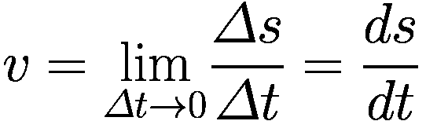 (3.1)

术语 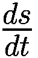 被称为“`s` 对 `t` 的**导数**”。

“微分”是数学中寻找导数的过程。它研究变量之间的函数关系，即当一个变量的值变化时，另一个变量变化多少。微分有许多重要应用，例如，寻找函数的最小值和最大值、计算数量的变化率、计算函数的线性近似以及求解微分方程组。它在这些关键数学领域中的关键作用意味着它被广泛应用于各个领域。一个例子是在经济学中计算边际成本和收入。

在计算机科学中，微分也扮演着关键角色。机器学习技术，如深度神经网络，已经获得了越来越多的关注。训练深度神经网络模型中最重要的一步被称为“反向传播”，其本质是计算一个非常复杂函数的梯度。

### 三种微分方法

如果我们要支持像深度神经网络这样大规模的微分运算，仅靠微积分 101 课程中基于链式法则的手工计算是远远不够的。为此，我们需要自动化的力量，而这正是计算机所擅长的。目前，计算微分有三种方法：数值微分、符号微分和算法微分。

第一种方法是**数值微分**。数值微分直接源于定义，它使用一个小步长 `δ` 来计算极限的近似值，如公式 3.2 所示。
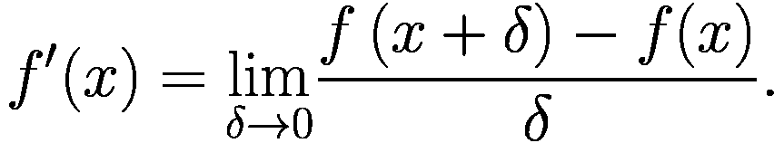 (3.2)

通过将函数 `f` 视为黑盒，只要 `f` 可以被求值，这种方法实现起来就很简单。然而，这种方法不幸地会受到多种类型误差的影响，例如舍入误差。这是由于在数值计算中，数字只能用有限精度表示所致。舍入误差可能大到让计算机认为 `f(x + δ)` 和 `f(x)` 是相同的。

第二种方法是**符号微分**。通过操控底层的数学表达式，符号微分利用数学导数规则，无需数值逼近即可获得解析结果。例如，考虑函数 `f(x[0], x[1], x[2]) = x[0] * x[1] * x[2]`。通过符号方式计算 `∇f`，我们得到：
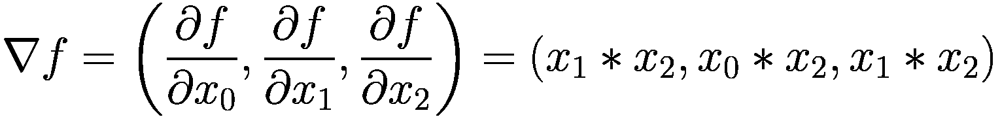

这个过程完全消除了数值误差的影响，但随着表达式变得复杂，符号操作的复杂性会迅速增长。试想一下计算简单函数 `f(x) = ∏(x_i)`（其中 `i` 从 `0` 到 `n-1`）的导数：其结果即使不复杂，也会极其冗长。因此，符号微分很容易消耗大量的计算资源，最终变得慢得不可行。此外，与数值微分不同，使用符号微分时，我们必须了解函数是如何构造的。

最后是**算法微分**（AD）。这是一种基于链式法则的技术，用于计算计算机程序中定义的函数关于输入变量的导数。算法微分也被称为自动微分，尽管严格来说它并未完全自动化微分过程，有时会导致代码效率低下。总的来说，AD 结合了两者的优点：一方面，它能高效地生成精确结果，因此在许多实际应用中高度适用；另一方面，它不依赖于列出所有中间结果，其计算过程可以很高效。因此，它是许多数值计算工具和库的主流实现方式，例如 Julia 中的 `JuliaDiff`、Python 中的 `ad`、`ADMAT` 等。本章其余部分主要关注算法微分。

### Algodiff 模块架构

`Algodiff` 模块在整个 Owl 库栈中扮演着关键角色。它统一了 Owl 中的各种基本数据类型，是服务于回归、神经网络等高级分析功能的最重要组件。由于其设计得益于 OCaml 强大的模块系统，因此非常优雅。

在本章中，我们假设您熟悉微分的数学原理，这样我们就可以专注于介绍 Owl 中 AD 模块的设计与实现细节。但首先，让我们看一个简单示例，了解如何在 Owl 中使用 AD 模块。在这个例子中，我们简单地计算 `tanh` 函数的一阶和二阶导数。

```
module AD = Algodiff.D 
let f x = AD.Maths.(tanh x);; 
let f1 = AD.diff f;; 
let f2 = AD.diff f1;; 
let eval_flt h x = AD.(pack_flt x |> h |> unpack_flt);; 
let r1 = eval_flt f1 1. 
let r2 = eval_flt f2 1.
```

整个过程就是这样。我们定义函数，然后对其应用 `diff` 以获取其一阶导数，接着可以直接对该一阶导数应用 `diff` 函数来获取二阶导数。然后，我们在这两个导数函数上求值，得到它们在点 `x = 1` 处的函数值。

图 3-1 展示了 AD 模块中的各个组件。让我们考察它们是如何融入上述示例代码的。首先，我们不能直接使用 `ndarray` 和浮点数等基本数据类型。相反，它们需要先被“打包”成 AD 模块能够理解的数据类型。在本例中，`pack_flt` 用于将普通的浮点数包装成 AD 浮点类型。计算完成后，假设我们仍然得到一个 AD 浮点类型作为输出，则应使用 `unpack_flt` 函数将其解包为普通的浮点数。**类型系统**是 AD 中最基础的构建块。其次，为了在 AD 系统中构建计算，我们需要使用**运算符**，例如本例中使用的 `tanh`。AD 提供了丰富的运算符集，这些运算符由 `op_builder` 模块生成。通过堆叠运算符构建计算图后，AD 引擎会让输入数据在该图中“流动”或“传播”两次：一次向前，一次向后。负责此过程的关键函数是 **reverse** 函数。基于上述过程，我们可以计算各种类型的微分。为简化编码，构建了一系列**高级 API**。本例中使用的 `diff` 函数就是这样一个 API。它对一个接受浮点数输入并输出浮点数的函数应用微分。这些高级 API 使代码极其优雅。如本例所示，我们可以简单地迭代地在原始 `tanh` 函数上应用微分函数，以获取其一阶、二阶以及任意高阶导数。在接下来的几节中，我们将详细解释这些构建块，以及这些不同部分是如何组装成一个强大的 AD 模块的。

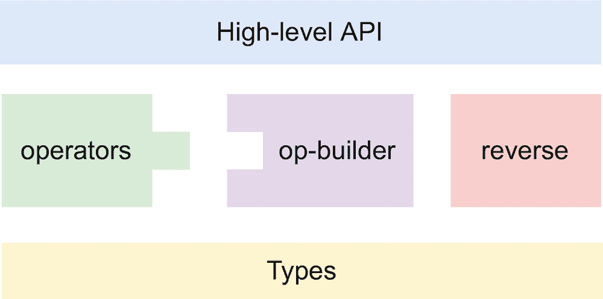

**图 3-1** AD 模块架构

## 3.2 类型

我们从类型定义开始。AD 中的数据类型定义在 `owl_algodiff_types.ml` 文件中，如下所示。即使您熟悉 OCaml 的类型系统，它可能看起来仍然有些令人困惑。AD 类型的本质是表达前向和反向微分模式。因此，我们首先通过一个例子来演示这两种 AD 模式是如何工作的。

```
module Make (A : Owl_types_ndarray_algodiff.Sig) = struct 
  type t = 
    | F   of A.elt 
    | Arr of A.arr 
    | DF  of t * t * int 
    | DR  of t * t ref * op * int ref * int * int ref 
  and adjoint = t -> t ref -> (t * t) list -> (t * t) list 
  and register = t list -> t list 
  and label = string * t list 
  and op = adjoint * register * label 
end
```

### 前向模式与反向模式

在这一部分，我们将通过一个基于以下简单函数的例子来说明两种微分模式：

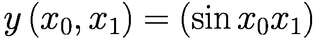 (3.3)

该函数接受两个输入，我们的目标是计算 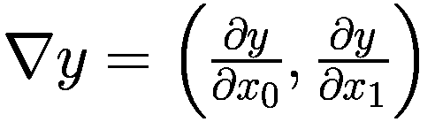。计算过程可以用图 3-2 所示的图形来表示。每个节点代表一个输入/输出，或由相应数学函数生成的中间变量。每个节点被命名为 `v[i]`。其中，输入 `v[0] = x[0]`，`v[1] = x[1]`。输出 `y = v[4]`。

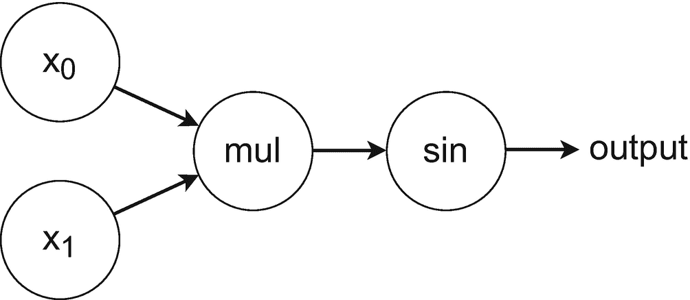

图示包含四个圆圈，分别是 `x0`、`x1`、`mul` 和 `sin`。`x0` 和 `x1` 是 `mul` 的输入，`mul` 是 `sin` 的输入，而 `sin` 则给出输出。

**图 3-2** 示例计算中的计算图

前向模式和反向模式都依赖于基本规则来计算微分。一方面，存在导数的基本形式，例如 `d/dx sin(x) = cos(x)`、`d/dx u(x)v(x) = u'(x)v(x) + u(x)v'(x)` 等。另一方面，则是*链式法则*。该法则指出，假设我们有函数 `f` 和 `g`，它们可以复合生成函数 `F(x) = f(g(x))`，那么 `F` 的导数可以计算为：

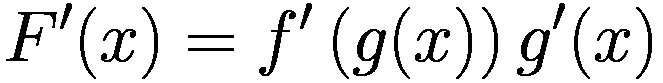 (3.4)

问题在于如何在微分系统中实现这些规则。

#### 前向模式

让我们来看第一种计算导数的方法，即“前向”模式。我们最终希望计算 `∂y/∂x0`（以及 `∂y/∂x1`，可以用类似方式计算）。我们从计算一些将证明有用的中间结果开始。使用标签 `v[i]` 来指代中间计算，由于 `v[0] = x[0]` 且 `v[1] = x[1]`，我们立即得到 `∂v0/∂x0 = 1` 和 `∂v1/∂x0 = 0`。

接下来，考虑 `∂v2/∂x0`，这需要我们使用乘法导数规则。这稍微复杂一些，需要使用链式法则：

`∂v2/∂x0 = (∂x0x1)/∂x0 = x1 * (∂x0/∂x0) + x0 * (∂x1/∂x0) = x1`

计算完 `∂v2/∂x0` 后，我们继续计算 `v[4]` 的偏导数，这正是我们要找的最终结果 `∂y/∂x0`。这个过程从输入变量开始，到输出变量结束，这就是“前向微分”名称的由来。我们可以通过令 `v'_i = ∂vi/∂x0` 来简化符号。`v'_i` 被称为函数 `vi` 关于输入变量 `x[0]` 的*切线*，而函数在每个中间点的求值结果被称为*原始值*。

让我们计算当设定 `x[0] = 2` 和 `x[1] = 2` 时的 `y'`。完整的前向微分计算过程如表 3-1 所示，其中在两个计算列中同时进行了两个计算过程：原始计算列仅按照计算图进行计算；切线计算列则给出每个中间变量关于 `x[0]` 的导数。

**表 3-1** 前向微分的计算过程（结果保留三位有效数字）

| | 原始计算 | 切线计算 |
| --- | --- | --- |
| 0 | `v[0] = x[0] = 2` | `v'_0 = 1` |
| 1 | `v[1] = x[1] = 2` | `v'_1 = 0` |
| 2 | `v[2] = v[0] * v[1] = 4` | `v'_2 = v0 * v'_1 + v1 * v'_0 = 2*0 + 2*1 = 2` |
| 3 | `v3 = sin(v2) = -0.757` | `y' = v'_3 = cos(v2) * v'_2 = -0.654 * 2 = -1.308` |

在此计算过程中需要注意两点。首先，在算法微分中，与符号微分不同，计算是逐步进行的，而不是在按照链式法则将整个计算展开成一个大型公式后进行的。其次，在每个步骤中，我们只需保留两个值：**原始值**和**切线**。此外，用图论的术语来说，每个步骤只需访问其“父节点”。例如，要计算 `v[2]` 和 `v'_2`，我们需要知道 `v[0]` 和 `v[1]` 的原始值和切线；要计算 `v3` 的原始值和切线，则需要知道 `v[2]` 的原始值和切线；依此类推。这些观察结果是我们实现的关键。

#### 反向模式

现在让我们从另一个方向重新思考这个问题：从输出到输入。问题本身保持不变，仍然是计算 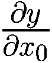。我们依旧遵循之前前向模式中相同的“逐步”流程。唯一的区别在于，这次我们按照反向顺序进行计算。例如，在我们的例子中 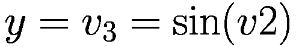，因此只要我们知道了 ，我们就可以向目标解前进一步。

我们首先观察到 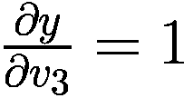，因为 `y` 和 `v[3]` 是同一个变量。接着，我们应用链式法则计算 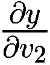：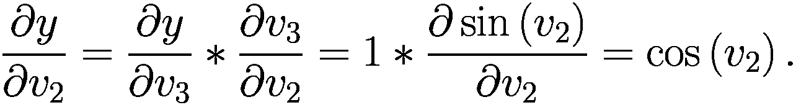 (3.5)

我们可以通过引入替换来简化它：

定义 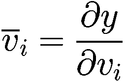 为输出变量 `y` 关于中间节点 `v[i]` 的导数。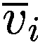 被称为“变量 `v[i]` 关于输出变量 `y` 的伴随”。使用这种表示法，等式 3.5 可以重写为 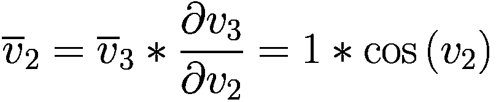

请注意切线与伴随之间的区别。在前向模式中，我们知道 `v̇₀` 和 `v̇₁`，然后计算 `v̇₂`、`v̇₃`，……直到得到目标。在反向模式中，我们从 `v̄ₙ = 1` 开始，计算 `v̄ₙ₋₁`、`v̄ₙ₋₂`，……直到得到目标 `v̄₀ = ∂y/∂v₀ = ∂y/∂x₀`。在这个例子中，`v̇₃ = v̄₀`，因为当我们使用 `v̇₃` 时，所讨论的是关于 `x[0]` 的导数。因此，反向模式也被称为伴随模式。

按照这个流程，我们现在可以执行完整的反向模式微分。请注意与前向模式相比的一个主要区别。在表 3-1 中，我们可以在一次传递中同时计算原始值和切线，因为计算其中一个并不依赖于另一个。然而，如上文分析所示，计算 `v̄₂` 可能需要 `v[2]` 的值以及可能的其他先前原始值。因此，首先需要进行一次前向传递^(⁷)，如表 3-2 所示，以计算所需的中间值。这些值实际上与表 3-1 的“原始值计算”列中的值完全相同。我们在此再次列出它们，是为了强调这个独立的前向计算过程的重要性。

**表 3-2** 反向模式中的前向传递

|   | 原始值计算 |
|---|------------|
| 0 | `v[0] = x[0] = 2` |
| 1 | `v[1] = x[1] = 2` |
| 2 | `v[2] = v[0] * v[1] = 4` |
| 3 | `y = sin(v[2]) = v[0] v[1] = -0.757` |

表 3-3 展示了反向微分过程中的反向传递，从最终结果开始，一路计算回起点。简要总结：要使用反向模式计算微分，我们需要一次前向传递来计算**原始值**，然后进行一次反向传递来计算**伴随**。

**表 3-3** 反向模式中的反向传递

|   | 伴随计算 |
|---|----------|
| 4 | `v̄₃ = 1` |
| 5 | `v̄₂ = v̄₃ * ∂v₃/∂v₂ = v̄₃ * ∂(sin(v2))/∂v₂ = 1 * cos(v₂) = -0.654` |
| 6 | `v̄₁ = v̄₂ * ∂v₂/∂v₁ = v̄₂ * ∂(v₀v₁)/∂v₁ = -0.654 * v₀ = -1.308` |
| 7 | `v̄₀ = v̄₂ * ∂v₂/∂v₁ = v̄₂ * ∂(v₀v₁)/∂v₀ = -0.654 * v₁ = -1.308` |

前向模式和反向模式在计算微分方面是等价的。那么你可能会想，既然前向模式看起来更直接，为什么不一直使用它呢？请注意，在计算 `∂y/∂x₀` 的同时，我们“免费”得到了 `∂y/∂x₁`。但在前向模式中，要计算关于另一个输入的导数，我们必须重新计算所有中间结果。因此，反向模式最显著的优势之一在于：无论有多少个输入，只需一次反向传递，就能得到所有输入的导数。

这一特性在神经网络中极其有用。神经网络中构建的计算图通常非常复杂，且往往有多个输入。使用自动微分的目标是找到输出（可能是损失函数的标量值）关于输入的导数。因此，使用反向模式自动微分效率更高。

好的，作为高级文档工程师和翻译员，我将遵循您的注意事项和示例，将给定的英文文本翻译成中文。

### 数据类型

现在我们已经了解了计算导数的基本要素，接下来我们将转向自动微分系统中使用的数据类型。它建立在两种基本类型之上：标量数字 `F` 和 ndarray 数组 `Arr`。它们分别是 `A.elt` 和 `A.arr` 类型。这里的 `A` 表示一个接口，其功能与 ndarray 模块非常相似。这意味着它们的具体类型，如单精度或双精度、C 实现或基础实现等，都取决于这个 `A` ndarray 模块。因此，自动微分模块无需处理所有底层细节。我们将在本章后面讨论自动微分模块如何与其他模块交互。现在，只需将它们理解为例如单精度浮点数和以单精度浮点数为元素的 ndarray，以便更好地掌握自动微分的核心思想。

```
module Make (A : Owl_types_ndarray_algodiff.Sig) = struct
  type t =
    | F   of A.elt
    | Arr of A.arr
    (* primal, tangent, tag *)
    | DF  of t * t * int
    (* primal, adj accu, op, fanout, tag, tracker *)
    | DR  of t * t ref * op * int ref * int * int ref
  and adjoint = t -> t ref -> (t * t) list -> (t * t) list
  and register = t list -> t list
  and label = string * t list
  and op = adjoint * register * label
end
```

另外两种是复合类型，每种代表一种微分模式。`DF` 类型包含三个部分，其中最重要的是前两个：原值（primal）和切线（tangent）。`DR` 类型包含六个部分，其中最重要的是第一个（原值）和第三个（`op`）。`op` 本身由三个部分组成：`adjoint`、`register` 和 `label`，其中 `adjoint` 是最重要的组成部分。`DR` 类型还包含一个伴随累加器（第二个参数）、一个扇出标志和一个追踪器标志。累加器是引用类型，因为它在传播过程中需要更新。`DF` 和 `DR` 类型都包含一个整数类型的标签。稍后，我们将讨论这些额外部分如何在自动微分引擎中工作。为了聚焦于自动微分的核心思想，现在我们将介绍最重要的元素：原值、切线和伴随。

本质上，自动微分中的计算图是通过构建一个列表来构造的。该列表的每个元素包含两个部分：偏导数计算和原始类型 `t` 数据。在数据类型中，伴随（adjoint）是一个函数。对于每个 `t` 类型的数据，它指定了如何构建这个列表。尽管不同算子的导数计算规则各不相同，但伴随通常可以归为几种模式。例如，下面是一个操作/函数（如 `sin`, `exp` 等）的伴随函数的样子，该函数接受一个输入并产生一个输出。

```
let r a =
  let adjoint cp ca t = (dr (primal a) cp ca, a) :: t in
  let register t = a :: t in
  let label = S.label, [ a ] in
  adjoint, register, label
```

在这里，`r` 函数返回一个 `op` 类型，它由 `adjoint` 函数、`register` 函数和 `label` 元组组成。首先，让我们看看 `adjoint` 函数。前两个变量 `cp` 和 `ca` 将在导数函数 `dr` 中使用。我们将在后面的章节 3.3 中讨论它。目前，我们只需要知道反向导数计算 `dr` 会计算出某些结果；我们将其与原始输入算子 `a` 一起放入一个元组中，并将其添加到现有列表 `t`（第三个参数）中。另外两个组件是辅助性的。`register` 函数实际上是一个不计算实际伴随的伴随函数；它只是堆叠一个原始算子列表。第三个组件 `label` 将一个字符串（例如 "sin" 或 "exp"）与输入算子组合在一起。

接下来，让我们看看另一个接受多个输入的算子的例子，例如 `add`、`mul`（乘法）等。这个稍微复杂一些：

```
let r_d_d a b =
  let adjoint cp ca_ref t =
    let abar, bbar = dr_ab (primal a) (primal b) cp ca_ref in
    (abar, a) :: (bbar, b) :: t
  in
  let register t = a :: b :: t in
  let label = S.label ^ "_d_d", [ a; b ] in
  adjoint, register, label
```

不同之处在于，这样的算子需要将两个项推入列表。所以这里的 `dr_ab` 仍然是一个反向计算导数的函数，它返回其两个父节点的导数，用 `abar` 和 `bbar` 表示，这两个都被推入伴随列表。`register` 和 `label` 遵循类似的模式。实际上，在具有多个输入的算子中，我们还应考虑其他情况，即其中一个输入只是一个常量元素。在这种情况下，列表中只应放入一个元素：

```
let r_d_c a b =
  let adjoint cp ca_ref t = (S.dr_a (primal a) b cp ca_ref, a) :: t in
  let register t = a :: t in
  let label = S.label ^ "_d_c", [ a; b ] in
  adjoint, register, label
```

### 自动微分类型的操作

在理解了自动微分中定义的数据类型后，让我们看看可以对其应用哪些类型的操作。它们定义在 `owl_algodiff_core.ml` 文件中。最值得注意的是“获取”函数，这些函数从自动微分类型数据中检索某些信息，例如其原值、切线（tangent）和伴随值（adjoint value）。在下面的代码中，`primal'` 是一个“深度”函数，它会递归地查找浮点数或 ndarray 格式的原值。

```
let primal = function
  | DF (ap, _, _)          -> ap
  | DR (ap, _, _, _, _, _) -> ap
  | ap                     -> ap

let rec primal' = function
  | DF (ap, _, _)          -> primal' ap
  | DR (ap, _, _, _, _, _) -> primal' ap
  | ap                     -> ap

let tangent = function
  | DF (_, at, _) -> at
  | DR _          -> failwith "error: no tangent for DR"
  | ap            -> zero ap

let adjval = function
  | DF _                   -> failwith "error: no adjval for DF"
  | DR (_, at, _, _, _, _) -> !at
  | ap                     -> zero ap
```

而 `zero` 函数将所有元素重置为零状态：

```
let rec zero = function
  | F _                    -> F A.(float_to_elt 0.)
  | Arr ap                 -> Arr A.(zeros (shape ap))
  | DF (ap, _, _)          -> ap |> primal' |> zero
  | DR (ap, _, _, _, _, _) -> ap |> primal' |> zero
```

另一组重要的操作是将自动微分类型与普通类型（如浮点数和 ndarray）进行相互转换的操作：

```
let pack_elt x = F x
let unpack_elt x =
  match primal x with
  | F x -> x
  | _   -> failwith "error: AD.unpack_elt"
let pack_flt x = F A.(float_to_elt x)
let _f x = F A.(float_to_elt x)
let pack_arr x = Arr x
let unpack_arr x =
  match primal x with
  | Arr x -> x
  | _     -> failwith "error: AD.unpack_arr"
```

还有一些提供实用辅助功能的操作。其中之一是我们已经见过的 `zero`，还有一些显示类型信息的函数：

```
let shape x =
    match primal' x with
    | F _    -> [||]
    | Arr ap -> A.shape ap
    | _      -> failwith "error: AD.shape"
```

## 3.3 算子

计算图由一系列算子构建而成，这些算子既可用于处理自动微分类型数据，也可用于构建可微分的计算图。它们被划分为子模块：`Maths` 是最重要的组件，它包含一组完整的数学函数，用于构建各种计算图；`Linalg` 包含一部分线性代数函数；`NN` 包含用于神经网络的函数，例如二维卷积、dropout 等；`Mat` 专门用于矩阵运算，例如生成单位矩阵的 `eye`；而 `Arr` 为 ndarray 提供诸如 `shape` 和 `numel` 之类的函数。

如图 3-1 所示，一个操作的实现可以抽象为两个部分：(a) 它的导数和计算规则是什么；(b) 这些规则如何应用于自动微分系统。第一部分定义在 `owl_algodiff_ops.ml` 中，第二部分定义在 `owl_algodiff_ops_builder.ml` 中。

### 计算规则

让我们先看一些例子，了解这些计算规则是什么，以及它们如何在 OCaml 中表达。我们可以使用 `sin` 函数为例。它接收一个输入并计算其正弦值作为输出。该模块指定了四条计算规则，每条规则对应一种类型的自动微分数据。这里，模块 `A` 是底层的“普通”ndarray 模块，它实现了对 ndarray 和标量值操作的函数。它可以是单精度或双精度，使用 OCaml 或 C 实现。

对于 `F` 标量类型，`ff_f` 指定使用 `A` 的 `Scalar` 子模块中的 `sin` 函数。如果数据是自动微分 ndarray，`ff_arr` 规定应通过使用 `A.sin` 函数对所有元素应用正弦函数。接下来，如果数据类型是 `DF`，则使用 `df` 函数。如表 3-1 中的示例所示，它计算*切线 (`at`) * 原始值的导数 (`ap`)*。对于 `sin` 函数，它计算 `at * cos ap`。最后，`dr` 计算我们在表 3-3 中展示的内容。它计算*伴随 (`!ca`) * 原始值的导数 (`a`)*。因此，这里计算的是 `!ca * cos a`。使用取值引用运算符 `!ca` 是因为 `DR` 类型中的伴随值是一个可以被更新的引用。

```
module struct
  let label = "sin"
  let ff_f a = F A.Scalar.(sin a)
  let ff_arr a = Arr A.(sin a)
  let df _cp ap at = at * cos ap
  let dr a _cp ca = !ca * cos a
end
```

类似的模板可以应用于其他接收一个输入并产生一个输出的运算符，例如平方根（`sqrt`），如下一个模块所示。平方根的导数规则为 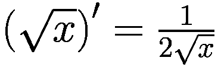。

```
module struct
  let label = "sqrt"
  let ff_f a = F A.Scalar.(sqrt a)
  let ff_arr a = Arr A.(sqrt a)
  let df cp _ap at = at / (pack_flt 2. * cp)
  let dr _a cp ca = !ca / (pack_flt 2. * cp)
end
```

然而，一旦操作符需要处理多个输入，事情就变得更复杂了。问题在于，对于这四条计算规则中的每一条，我们都需要考虑多种可能的情况。以除法运算为例。对于一个简单的原始值计算，我们需要考虑四种情况：两个输入都是标量、两个都是 ndarray、以及其中一个为 ndarray 另一个为标量。这对应了四条规则：`ff_aa`、`ff_bb`、`ff_ab` 和 `ff_ba`。对于关于 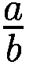 的切线的前向计算，我们还需要考虑三种情况：

* `df_da` 对应第二个输入为常数时的导数：

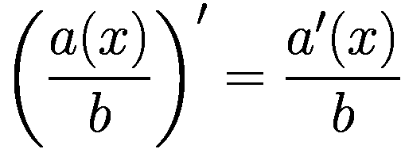 (3.6)

* 在代码中，它是 `at / bp`。这里，`at` 是第一个输入 *a*′(*x*) 的切线，而 `bp` 是第二个输入 *b* 的原始值。

* `df_db` 对应第一个输入为常数时的导数：

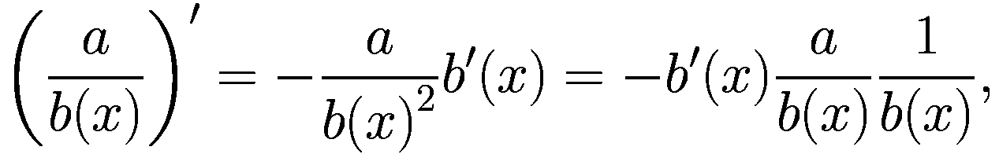 (3.7)

* 因此，它可以表示为 `neg bt * cp / bp`。这里，`neg` 是取反运算符，`cp` 代表原始输入 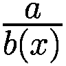。

* `df_dab` 适用于两个输入都是非常量自动微分类型的情况，即 `DF` 或 `DR`。因此它计算

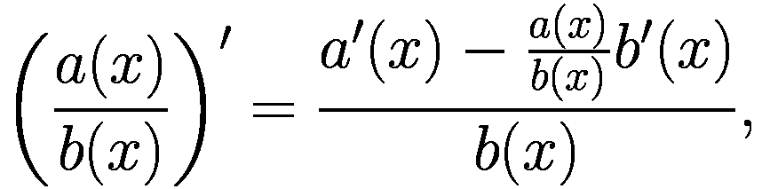 (3.8)

* 对应的代码是 `(at - (bt * cp)) / bp`。

表达逆向模式的计算规则更为直接。如果两个输入 *a* 和 *b* 都是非常量，那么函数 `dr_ab` 计算 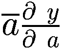 和 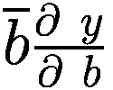，其中 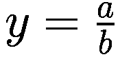。因此，`dr_ab` 返回两个值；第一个是 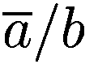（`!ca / b`），第二个是 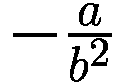（`!ca * (neg a / (b * b))`）。在代码中，`_squeeze_broadcast x s` 是一个内部辅助函数，用于压缩数组 `x` 使其形状为 `s`。如果其中一个输入是常数，那么我们可以直接省略对应的结果，如 `dr_a` 和 `dr_b` 所示。

```
module struct
  let label = "div"
  let ff_aa a b = F A.Scalar.(div a b)
  let ff_ab a b = Arr A.(scalar_div a b)
  let ff_ba a b = Arr A.(div_scalar a b)
  let ff_bb a b = Arr A.(div a b)
  let df_da _cp _ap at bp = at / bp
  let df_db cp _ap bp bt = neg bt * cp / bp
  let df_dab cp _ap at bp bt = (at - (bt * cp)) / bp
  let dr_ab a b _cp ca =
    ( _squeeze_broadcast (!ca / b) (shape a)
    , _squeeze_broadcast (!ca * (neg a / (b * b))) (shape b) )
  let dr_a a b _cp ca = _squeeze_broadcast (!ca / b) (shape a)
  let dr_b a b _cp ca = _squeeze_broadcast
    (!ca * (neg a / (b * b))) (shape b)
end
```

一个类似的例子是执行 *a*^(*b*) 计算的 `pow` 运算符。它实现了与 `div` 类似的计算规则。

```
module struct
  let label = "pow"
  let ff_aa a b = F A.Scalar.(pow a b)
  let ff_ab a b = Arr A.(scalar_pow a b)
  let ff_ba a b = Arr A.(pow_scalar a b)
  let ff_bb a b = Arr A.(pow a b)
  let df_da _cp ap at bp = at *
    (ap ** (bp - pack_flt 1.)) * bp
  let df_db cp ap _bp bt = bt * cp * log ap
  let df_dab cp ap at bp bt =
    ((ap ** (bp - pack_flt 1.)) * (at * bp)) +
      (cp * bt * log ap)
  let dr_ab a b cp ca =
    ( _squeeze_broadcast (!ca *
      (a ** (b - pack_flt 1.)) * b) (shape a)
    , _squeeze_broadcast (!ca * cp * log a) (shape b) )
  let dr_a a b _cp ca =
    _squeeze_broadcast (!ca *
      (a ** (b - pack_flt 1.)) * b) (shape a)
  let dr_b a b cp ca = _squeeze_broadcast
    (!ca * cp * log a) (shape b)
end
```

#### 将计算规则泛化为构建器模板

到目前为止，我们已经讨论了计算规则，但还有一个问题：如何利用这些规则来构建我们在第 3.2 节中描述的类型为 `t` 的算子。为此，我们需要使用 OCaml 中函子的强大功能。在 Owl 的 `AD` 模块中，算子根据输入和输出的数量进行分类，每个类别都有其自身的模板。

我们以“单输入单输出”（`SISO`）算子（例如正弦函数）为例。该模板接收一个类型为 `Siso` 的模块作为输入，如下所示。请注意，上一节中展示的正弦函数的计算规则正好构成了这样一个模块。

```
module type Siso = sig
  val label : string
  val ff_f : A.elt -> t
  val ff_arr : A.arr -> t
  val df : t -> t -> t -> t
  val dr : t -> t -> t ref -> t
end
```

最终，我们需要构建一个 `sin : t -> t` 算子，它接收一个 AD 类型为 `t` 的数据，并返回类型为 `t` 的输出。这个函数正是我们需要的：

```
let op_siso ~ff ~fd ~df ~r a =
  match a with
  | DF (ap, at, ai) ->
    let cp = fd ap in
    DF (cp, df cp ap at, ai)
  | DR (ap, _, _, _, ai, _) ->
    let cp = fd ap in
    DR (cp, ref (zero cp), r a, ref 0, ai, ref 0)
  | ap -> ff ap
```

这些名字可能看起来有些神秘。这里，`fd x` 函数计算 `x` 的主值。`ff x` 对两种基本类型（标量和多维数组）执行前向计算。`df cp ap at` 函数计算前向模式下的切线值。最后，函数 `r` 计算该类型中的算子部分，它“记住”了如何以列表形式构建计算图。

总而言之，这个函数的基本逻辑如下：

- 如果输入是 `DF` 类型，则在前向模式下计算主值和切线后，生成一个新的 `DF` 类型。
- 如果输入是 `DR` 类型，则生成一个新的 `DR` 类型，其中包含了关于如何计算伴随值和如何构建列表的信息。
- 否则，输入是基本类型（标量或多维数组），则对其执行简单的前向计算。

请注意，新构建的 `DR` 类型，除了其主值和算子部分被更新外，其余值（包括伴随值、标签等）均被设置为 0。这是因为计算图是在前向传播过程中构建的，而伴随值的计算并不在此步骤中进行。

那么下一个问题是：对于正弦函数，我们如何获得 `fd`、`ff` 等函数呢？幸运的是，根据之前指定各种计算规则的 `Siso` 模块，我们已经拥有了所需的所有成分。假设我们将这个 `Siso` 正弦模块命名为 `S`，那么我们对两种基本类型的前向计算如下：

```
let ff = function
  | F a   -> S.ff_f a
  | Arr a -> S.ff_arr a
  | _     -> error_uniop label a
```

而 `r` 函数看起来就像我们在第 3.2 节中介绍的那样，它使用模块 `S` 中的 `dr` 函数来指定如何构建列表。

```
let r a =
  let adjoint cp ca t = (S.dr (primal a) cp ca, a) :: t in
  let register t = a :: t in
  let label = S.label, [ a ] in
  adjoint, register, label
```

所以现在我们有了这个函数：

```
let rec f a =
  let open S in
  (* 如上所述定义 ff 和 r *)
  let fd a = f a in
  op_siso ~ff ~fd ~df:S.df ~r a
```

将它们组合在一起，就得到了最终接收一个模块并构建算子的函数：

```
let build_siso =
  (* 定义 op_siso *)
  fun (module S : Siso) ->
    (* 定义 f *)
    f
```

要构建一个 `sin` 算子，我们使用以下代码：

```
let sin = build_siso (
  module struct
    let label = "sin"
    let ff_f a = F A.Scalar.(sin a)
    let ff_arr a = Arr A.(sin a)
    let df _cp ap at = at * cos ap
    let dr a _cp ca = !ca * cos a
  end : Siso)
```

这段代码简洁、易读，并且不容易出现各种编码错误。要构建另一个 `siso` 算子，例如平方根，我们只需要更改规则：

```
let sqrt = build_siso (
  module struct
    let label = "log"
    let ff_f a = F A.Scalar.(log a)
    let ff_arr a = Arr A.(log a)
    let df _cp ap at = at / ap
    let dr a _cp ca = !ca / a
  end : Siso)
```

这里，我们仅以最简单的 `SISO` 类型构建器模板为例。我们还包括了其他模板：

- **`SIPO`**：单输入双输出，例如用于 QR 分解的线性代数运算 `qr`
- **`SITO`**：单输入三输出，例如 SVD 分解
- **`SIAO`**：单输入数组输出，例如将输入的多维数组拆分为多个的 `split` 函数
- **`PISO`**：双输入单输出，例如 `add` 和 `mul`
- **`AISO`**：数组输入单输出，例如 `concatenate`（`split` 的逆运算）

这些模板可能会变得相当复杂。例如，在构建 `add` 函数时，为了从可能的输入类型的不同组合中进行选择，构建器函数可能复杂到：

```
op_piso ~ff ~fd ~df_da ~df_db ~df_dab ~r_d_d ~r_d_c ~r_c_d a b
```

但原理是相同的。

### 3.4 API

上一节介绍了 AD 算子，它们是构建 AD 计算图的基本模块。接下来我们需要的是一个“引擎”来启动微分过程。为此，我们首先介绍 `AD` 模块提供的几个底层 API，并解释如何使用它们来构建用户友好的高级 API，例如 `diff` 和 `grad`。

### 底层 API

我们区分两种微分模式：前向模式和反向模式。如上一节所述，如果输入`x`的类型是`DF`，那么通过应用诸如`sin x`之类的操作，就会构建一个计算图，并且主值和切线值也会在此过程中计算出来。我们所需要做的就是在该过程完成后检索所需的值。

要启动前向模式微分，我们需要创建一个`DF`类型的数据作为初始输入，使用主值、初始切线（等于 1）和一个整数标签作为参数：

```ocaml
let make_forward p t i = DF (p, t, i)
```

例如，如果我们要计算 *f* = *sin* (*x*²) 在 *x* = 2 处的导数，我们可以先创建一个初始点：

```ocaml
let x = make_forward (pack_flt 2.) (pack_flt 1.) 1
let y = Maths.(pow x (pack_flt 2.) |> sin)
let t = tangent y
```

就是这样。一旦构建了计算`y`，我们就可以使用`tangent`函数直接检索切线值。

反向模式稍微复杂一些。记住它包含两个过程：一个前向过程和一个反向过程。从上一节中，我们知道一旦构建了计算图，主数据就被计算出来了，但所有伴随值都被设置为零。因此，我们需要一些额外的机制来将计算流反向推动，以计算伴随值。以下是使用底层 API 在反向模式下计算导数的示例：

```ocaml
open AD
let f x = Maths.(pow x (pack_flt 2.) |> sin)
let x = 2.;
let x' = make_reverse x (tag ());
let y = f x';
let _ = reverse_prop (F 1.) y;
let y' = adjval x';;
```

要解决的问题仍然是相同的：计算 *f* = *sin* (*x*²) 在 *x* = 2 处的导数；唯一的区别是这次我们使用反向模式。让我们逐行解释这个示例。

首先，我们仍然需要使用`make_reverse`构建一个初始算子。

```ocaml
let make_reverse p i =
  let adjoint _cp _ca t = t in
  let register t = t in
  let label = "Noop", [] in
  DR (p, ref (zero p), (adjoint, register, label), ref 0, i, ref 0)
```

`make_reverse`函数使用给定的主值构建一个`DR`类型的数据。它的其余字段都设置为零。它做两件事：首先，它将输入`x`包装成`Algodiff`可以处理的`t`类型的值；其次，它为输入生成一个唯一的标签，以便可以嵌套输入数字。

接下来，调用`f x'`会构建`f`的计算图，将主值以及关于如何计算伴随值的知识都捕获在`DR`类型的数据`y`中。

接下来，`reverse_prop`将误差反向传播到输入：

```ocaml
let reverse_prop v x =
    reverse_reset x;
    reverse_push v x
```

它包含两个步骤：首先，将该计算图中的所有值重置为初始状态（`reverse_reset`）；其次，执行反向传播（`reverse_push`）。这两个步骤都遵循递归过程。

```ocaml
let reverse_reset x =
    let rec reset xs =
      match xs with
      | []     -> ()
      | x :: t ->
        (match x with
        | DR (_cp, aa, (_, register, _), af, _ai, tracker) ->
          aa := reset_zero !aa;
          af := !af + 1;
          tracker := succ !tracker;
          if !af = 1 && !tracker = 1 then reset (register t) else reset t
        | _ -> reset t)
    in
    reset [ x ]
```

下一个函数是`reverse_push`，它是驱动反向传播过程的核心引擎。其核心思想很简单。它维护一个由（伴随值，AD 值）对组成的栈`t`。在每次迭代中，`push`函数从栈顶取出一对。将伴随值`v`添加到`DR`类型节点`|x|`中的伴随累加器`aa`中。该节点还指定一个伴随函数，该函数知道如何以一个或多个（伴随值，AD 值）对的形式计算其父节点的伴随值。该过程从只有一个对开始，即整个计算的输出`DR`类型值。当栈`t`为空时结束。

```ocaml
let reverse_push =
    let rec push xs =
      match xs with
      | []          -> ()
      | (v, x) :: t ->
        (match x with
        | DR (cp, aa, (adjoint, _, _), af, _ai, tracker) ->
          aa := reverse_add !aa v;
          (af := Stdlib.(!af - 1));
          if !af = 0 && !tracker = 1
          then push (adjoint cp aa t)
          else (
            tracker := pred !tracker;
            push t)
        | _ -> push t)
    in
    fun v x -> push [ v, x ]
```

经过此步骤，`f`的梯度存储在`x'`的伴随值中，我们可以使用`adjval`函数检索该值。

### 高级 API

基于基本的低级 API，我们能够构建更高级且易于访问的微分函数。用于微分的最常用函数是`AD`模块中的`diff`。给定一个将标量值映射到另一个标量值的函数`f`，我们可以通过`diff f x`计算其在点`x`处的导数。例如，对于三角函数`tanh`，我们可以很容易地计算其在点* x * = 0.1 处的导数，如下所示：

```ocaml
open Algodiff.D
let f x = Maths.(tanh x);;
let d = diff f (F 0.1);;
```

其使用前向模式低级 API 的实现非常简单：

```ocaml
let diff' f x =
    if not (is_float x) then
      failwith "input must be a scalar";
    let x = make_forward x (pack_flt 1.) (tag ()) in
    let y = f x in
    primal y, tangent y
let diff f x = diff' f x |> snd
```

接下来，我们可以将标量函数的导数推广到多元函数的梯度。对于一个将向量输入映射到标量的函数，`grad`函数计算其给定点的梯度。例如，在三维空间中，曲面上每个点的梯度由三个元素组成，分别代表沿 *x*、*y* 和 *z* 轴的偏导数。该向量指示函数变化幅度最大的方向。其实现使用标准反向模式：

```ocaml
let grad' f x =
    let x = make_reverse x (tag ()) in
    let y = f x in
    assert (is_float y);
    reverse_reset y;
    reverse_push (pack_flt 1.) y;
    primal y, x |> adjval
let grad f x = grad' f x |> snd
```

梯度的一个重要应用是梯度下降法，这是一种广泛用于寻找函数最小值的技术。我们将在第 4 章中更详细地讨论它。

正如梯度将导数从标量推广到向量一样，*Jacobian* 函数将梯度从向量推广到矩阵。换句话说，`grad`应用于将向量映射到标量的函数，而`jacobian`应用于将向量映射到向量的函数。如果我们假设函数`f`接受一个长度为 *n* 的输入向量并产生一个长度为 *m* 的输出向量，那么 Jacobian 定义为 ![$$ \textbf{J}(y)=\left[\begin{array}{cccc}\frac{\partial {y}_0}{\partial {x}_0}&amp; \frac{\partial {y}_0}{\partial {x}_1}&amp; \dots &amp; \frac{\partial {y}_0}{\partial {x}_{n-1}}\\ {}\frac{\partial {y}_2}{\partial {x}_0}&amp; \frac{\partial {y}_2}{\partial {x}_1}&amp; \dots &amp; \frac{\partial {y}_2}{\partial {x}_{n-1}}\\ {}\vdots &amp; \vdots &amp; \dots &amp; \vdots \\ {}\frac{\partial {y}_{m-1}}{\partial {x}_0}&amp; \frac{\partial {y}_{m-1}}{\partial {x}_1}&amp; \dots &amp; \frac{\partial {y}_{m-1}}{\partial {x}_{n-1}}\end{array}\right] $$](OEBPS/images/510309_1_En_3_Chapter/510309_1_En_3_Chapter_TeX_Eque.png) Jacobian 背后的直觉与梯度类似。在目标函数定义域中的特定点，Jacobian 显示了输出向量如何随输入向量的微小变化而变化。其实现如下：

```ocaml
let jacobianv' f x v =
    if shape x <> shape v
    then failwith "jacobianv': vector not the same dimension as input";
    let x = make_forward x v (tag ()) in
    let y = f x in
    primal y, tangent y
let jacobianv f x v = jacobianv' f x v |> snd
```

这些高级 API 支持便捷的组合，并可用于构建更复杂的 API。例如，函数 *f* 的二阶导数可以实现为`g = f |> diff |> diff`。另一个例子是`hessian` API。给定一个将 *n* 个输入变量映射到一个标量的多元函数，该函数计算其作为矩阵的二阶导数。其实现基于 Jacobian：

```ocaml
let hessian f x = (f |> grad |> jacobian) x
```

在大多数应用中，我们使用这些高级 API 来支持更高级的应用，例如优化、回归、神经网络等。一个很好的例子是实现牛顿法以求函数的最小值。牛顿法不是仅仅沿着梯度的方向移动，而是结合梯度和函数的二阶梯度，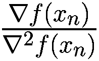，从随机位置开始迭代，直到根据公式 3.9 收敛。其在 OCaml 中的实现如下所示：

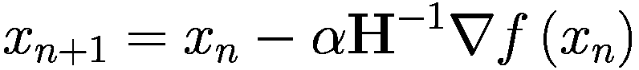 (3.9)

```ocaml
open Algodiff.D
let rec newton ?(eta=F 0.01) ?(eps=1e-6) f x =
  let g = grad f x in
  let h = hessian f x in
  if (Maths.l2norm' g |> unpack_flt) < eps then x
  else newton ~eta ~eps f Maths.(x - eta * g *@ (inv h))
```

例如，我们可以将此方法应用于一个二维三角函数，从一个随机初始点开始，以寻找局部最小值。注意，`newton`函数接受一个向量作为输入，并输出一个标量。

```ocaml
let _ =
  let f x = Maths.(cos x |> sum') in
  newton f (Mat.uniform 1 2)
```

除了我们提到的内容之外，Owl 还实现了其他高级微分函数，例如`laplacian`，它计算拉普拉斯算子 ∇²*f*，即 Hessian 矩阵的迹。本质上，它们都构建在一组简洁的低级 API 或其他高级 API 之上。我们将在后续章节中看到更多关于`AD`模块的应用。

## 3.5 更多实现细节

除了我们目前提到的主要结构外，还有一些其他细节需要提及，以构建一个工业级的`AD`模块。我们在本节中介绍它们。

### 扰动混淆与标签

我们已经解释了`DR`类型中的部分字段，但还有一个尚未涉及：类型为`int`的`tag`字段。它用于解决在前向与反向模式嵌套计算高阶导数时遇到的特定问题，该问题被称为*扰动混淆*。正确处理此问题对 AD 引擎的正常运行至关重要。此处我们仅浅涉其皮毛。来看一个例子。假设我们要计算 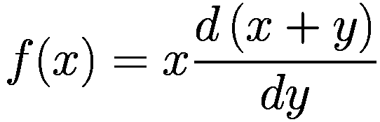 的导数，即一个包含另一个导数函数的函数。这乍看起来很简单，甚至无需借助计算机：由于 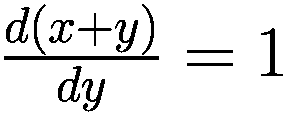，所以 *f*^′(*x*) = *x*^′ = 1。然而，应用不带标签的简单实现会导致错误答案。

```ocaml
# let diff f x = 
    match x with 
    | DF (_, _)    -> 
      f x |> tangent 
    | DR (_, _, _) -> 
      let r = f x in 
      reverse_push [(1., r)]; 
      !(adjoint x);;
val diff : (t -> t) -> t -> float = <fun>
# let f x = 
    let g = diff (fun y -> add_ad x y) in 
    mul_ad x (make_forward (g (make_forward 2. 1.)) 1.);;
val f : t -> t = <fun>
# diff f (make_forward 2. 1.);;
- : float = 4.
```

在点(2, 2)处的计算结果是 4，但我们之前计算过，结果在任何点都应为 1。哪里出了问题？答案有些微妙。注意 `x=DF(2,1)`。其正切值等于 1，这意味着 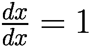。现在，如果我们继续在变量为 `y` 的函数 `g` 中使用同样的 `x` 值，AD 引擎可能会将同一个 `x=DF(2,1)` 错误地解释为 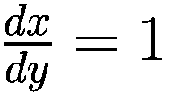。因此，在函数 `g` 内部使用时，`x` 实际上应被视为 `DF(2,0)`。这正是标签发挥作用之处。它通过为导数运算符的每次使用分配唯一标签来区分导数计算及其关联的附加参数，从而解决了嵌套导数问题。

### 惰性求值

我们已经看到，将构建模板与操作定义分离如何使添加新操作变得便捷，简化代码并提高生产力。但这需要付出效率的代价。想象一个包含数千个操作的大型计算，其中某个操作被重复执行多次。在使用 AD 处理神经网络时，这种情况非常常见，因为会创建大型的计算图，其中诸如 `add` 和 `mul` 之类的函数会被调用成百上千次。采用前面描述的 Builder 方法，每次使用操作都会被重新创建，这相当低效。幸运的是，我们可以简单地利用 OCaml 的惰性求值机制来执行缓存。

```
val lazy: 'a -> 'a lazy_t
module Lazy : sig
  type 'a t = 'a lazy_t
  val force : 'a t -> 'a
end
```

OCaml 提供了一个内置函数 `lazy`，它接受一个类型为 `'a` 的输入，并返回一个类型为 `'a lazy_t` 的值，其中类型 `'a` 值的计算被延迟了。这个惰性表达式在被 `Lazy.force` 调用之前不会被求值，并且首次调用时，表达式会被求值并缓存结果。后续的 `Lazy.force` 应用将简单地返回缓存的结果，而无需再次求值。以下是 OCaml 中惰性求值的一个例子：

```
# let x = Printf.printf "hello world!"; 42
hello world!
val x : int = 42
# let lazy_x = lazy (Printf.printf "hello world!"; 42)
val lazy_x : int lazy_t = <lazy>
# let _ = Stdlib.Lazy.force lazy_x
hello world!
- : int = 42
# let _ = Stdlib.Lazy.force lazy_x
- : int = 42
# let _ = Stdlib.Lazy.force lazy_x
- : int = 42
```

在这个例子中，我们可以看到构建 `lazy_x` 并不会对内容进行求值，这被延迟到了第一次 `Lazy.force`。此后，每次调用 `force` 时，仅返回值；`x` 本身，包括 `printf` 函数，都不会被求值。现在回到 Owl 中的 AD 模块。想象一下，我们需要增加对 `sin` 操作的支持。`sin` 的定义保持不变：

```
open Algodiff.D
module Sin = struct
  let label = "sin"
  let ff_f a = F A.Scalar.(sin a)
  let ff_arr a = Arr A.(sin a)
  let df _cp ap at = Maths.(at * cos ap)
  let dr a _cp ca = Maths.(!ca * cos (primal a))
end
```

然而，我们可以转而使用惰性求值来实际构建实现，并受益于其缓存机制带来的效率提升。

```
let _sin_ad = lazy Builder.build_siso (module Sin : Builder.Siso);;
let new_sin_ad = Lazy.force _sin_ad;;
```

通过这种方式，无论 `sin` 函数在一个庞大的计算图中被调用多少次，`Builder.build_siso` 过程只会被求值一次。

### 扩展 AD

前面描述的模块设计的一个显著优势是，通过提供代表新函数的模块可以轻松地进行扩展。例如，假设 AD 系统不支持自然对数 `sin x`，其导数为 `sin' x = cos x`。包含此函数只需要在一个模块中定义计算原始值、正切值和伴随值所需的函数，并应用 `Builder` 模块中的相关函数——本例中为用于构建“单输入单输出”函数的 `build_siso`。

```
open Algodiff.D
module Sin = struct
  let label = "sin"
  let ff_f a = F A.Scalar.(sin a)
  let ff_arr a = Arr A.(sin a)
  let df _cp ap at = Maths.(at * cos ap)
  let dr a _cp ca = Maths.(!ca * cos (primal a))
end
let new_sin_ad = Builder.build_siso (module Sin : Builder.Siso)
```

我们可以直接使用这个新的运算符，就像它是 AD 模块中的原生操作一样。例如：

```
# let f x1 x2 = 
    let x1 = F. x1 in 
    let x2 = F. x2 in 
    Maths.(div (cos x1) (new_sin_ad x2);;
val f : t -> t = <fun>
```

### 图工具函数

虽然不是核心功能，但各种工具函数为用户提供了便利，例如用于可视化 AD 构建的计算图的工具。在调试或尝试理解 AD 工作原理时，它们非常有用。可视化功能的核心是一个递归遍历程序：

```
let _traverse_trace x = 
    let nodes = Hashtbl.create 512 in 
    let index = ref 0 in 
    (* local function to traverse the nodes *)
    let rec push tlist = 
      match tlist with 
      | []       -> () 
      | hd :: tl -> 
        if Hashtbl.mem nodes hd = false 
        then ( 
          let op, prev = 
            match hd with 
            | DR (_ap, _aa, (_, _, label), _af, _ai, _) -> label 
            | F _a -> Printf.sprintf "Const", [] 
            | Arr _a -> Printf.sprintf "Const", [] 
            | DF (_, _, _) -> Printf.sprintf "DF", [] 
          in 
          (* check if the node has been visited before *)
          Hashtbl.add nodes hd (!index, op, prev); 
          index := !index + 1; 
          push (prev @ tl)) 
        else push tl 
    in 
    (* iterate the graph then return the hash table *)
    push x; 
    nodes
```

`_traverse_trace` 及其相关函数用于将反向模式生成的计算图转换为人类可读的格式。它初始化用于追踪节点和索引的变量，然后遍历图并将所需信息放入哈希表中。通过一些额外的代码，解析后的信息可以显示在终端上，或转换为其他适合可视化的格式，例如 Graphviz 的 `dot` 格式。

### 3.6 `AD` 如何基于 `Ndarray` 构建

我们一直在说 `AD` 不需要处理计算实现的细节，因此可以专注于微分逻辑。在之前的示例中，我们假设 `A` 模块是任意一个 `Ndarray` 模块。在本章的最后一节，我们将解释 `AD` 模块是如何基于 `Ndarray` 模块构建的。我们希望以此说明函子系统在促进模块化风格系统设计方面的强大能力。

首先，`AD` 模块中使用的 `Ndarray` 模块并非纯粹是第 2 章中介绍的 `Ndarray`，它还包含其他几个模块，包括标量函数，以及那些专用于矩阵和线性代数的函数。它们统称为 `Owl_algodiff_primal_ops` 模块。根据所包含模块的具体精度，它还划分了 `S` 和 `D` 子模块。例如，以下是 `Owl_algodiff_primal_ops.S` 的组成部分：

```
module S = struct
  include Owl_dense_ndarray.S
  module Scalar = Owl_maths
  module Mat = struct
    let eye  = Owl_dense_matrix_s.eye
    let tril = Owl_dense_matrix_s.tril
    let triu = Owl_dense_matrix_s.triu
    ...
  end
  module Linalg = struct
    include Owl_linalg_s
    let qr a =
      let q, r, _ = qr a in
      q, r
      ...
  end
end
```

通过将其中的单精度模块（例如 `Owl_dense_ndarray.S` 和 `Owl_dense_matrix_s`）替换为对应的双精度模块，我们可以得到 `Owl_algodiff_primal_ops.D` 模块。此外，通过将它们替换为基本的 `Ndarray` 模块（例如 `Owl_base_dense_ndarray.S`），我们可以获得计算基于纯 `OCaml` 的 `AD` 模块。实际上，实现并不局限于这些类型。`Owl_algodiff_primal_ops` 模块的接口在 `Owl_types_ndarray_algodiff.Sig` 模块中指定。只要一个模块实现了所有必需的函数和模块，它就可以被插入到 `AD` 中。例如，我们可以利用 `Owl` 中的计算图模块，并构建一个符号化的 `Ndarray` 模块。基于此模块构建的 `AD` 模块可以提供强大的符号计算功能。这意味着前向和反向两种微分模式的执行都可以受益于各种优化机会，例如图和内存优化。我们将在第 6 章中解释计算图模块。

要构建一个 `AD` 模块，我们使用类似如下的代码：

```
module S = Owl_algodiff_generic.Make (Owl_algodiff_primal_ops.S)
module D = Owl_algodiff_generic.Make (Owl_algodiff_primal_ops.D)
```

所以接下来，让我们看看 `Owl_algodiff_generic.Make` 这个函子。它包含了我们目前介绍过的所有现有子模块：核心模块、运算符以及诸如 `make_forward` 和 `diff` 等微分 API 函数，如下所示：

```
module Make (A : Owl_types_ndarray_algodiff.Sig) = struct
  module Core = Owl_algodiff_core.Make (A)
  include Core
  module Ops = Owl_algodiff_ops.Make (Core)
  include Ops
  let make_forward p t i = DF (p, t, i)
  let make_reverse p i = ...
  let diff f x = ...
  let grad f x = ...
end
```

这些组件都依赖于基础计算模块 `A`。`Core` 模块本身是通过函子构建的，其参数是 ndarray 模块。它的接口在 `Owl_algodiff_core_sig.ml` 中指定，如下所示。它包含了类型的基本类型定义以及可以应用于这些类型的操作。

```
module type Sig = sig
  module A : Owl_types_ndarray_algodiff.Sig
  include Owl_algodiff_types_sig.Sig
    with type elt := A.elt and type arr := A.arr
  val primal  : t -> t
  val tangent : t -> t
  val adjref  : t -> t ref
  ...
end
```

接下来，诸如 `sin` 等运算符是使用 `Core` 模块作为参数构建的。正如我们之前解释的，首先，`Builder` 模块作为一个工厂，通过提供不同的模板（例如 `siso`）来组装各种运算符，其中包括模板的类型定义和构建运算符的函数。

```
module Make (Core : Owl_algodiff_core_sig.Sig) = struct
  open Core
  module type Siso = sig
    val label : string
    val ff_f : A.elt -> t
    val ff_arr : A.arr -> t
    val df : t -> t -> t -> t
    val dr : t -> t -> t ref -> t
  end
  let build_siso =
    ...
```

然后在运算符模块中，基于 `Core` 和 `Builder`，该模块包含了所有由构建函数构建的运算符。它们被归类到不同的模块中，例如 `Maths` 和 `Linalg`。

```
module Make (Core : Owl_algodiff_core_sig.Sig) = struct
  open Core
  module Builder = Owl_algodiff_ops_builder.Make (Core)
  open Builder
  module Maths = struct
    let cos = (build_siso
      (module struct
        let label = "cos"
        let ff_f a = F A.Scalar.(cos a)
        let ff_arr a = Arr A.(cos a)
        let df _cp ap at = neg (at * sin ap)
        let dr a _cp ca = !ca * neg (sin a)
      end : Siso))
    and sin = (build_siso ...)
    ...
  end
  module Linalg = struct
  ...
  end
  module NN = struct
  ...
  end
  ...
end
```

### 3.7 本章小结

在本章中，我们讨论了 `Owl` 的核心模块之一：算法微分模块的设计。我们从其基本理论和三种微分类型之间的区别开始。然后，我们介绍了 `Owl` 中 `AD` 模块的总体架构。我们在以下小节中详细解释了几个部分：该系统中的类型定义、运算符，以及基于现有机制构建的 API。我们还讨论了在构建工业级 `AD` 引擎时需要注意的一些更微妙的问题，例如避免扰动混淆问题、使用惰性求值来提升性能、图可视化等。最后，我们解释了 `AD` 系统是如何在 `Owl` 的 `Ndarray` 模块之上构建的。


**开放获取** 本章根据知识共享署名 4.0 国际许可证 ([`creativecommons.org/licenses/by/4.0/`](http://creativecommons.org/licenses/by/4.0/)) 的条款授权，该许可证允许在任何媒介或格式中使用、共享、改编、分发和复制，只要您适当注明原作者和来源，提供指向知识共享许可证的链接，并指出是否进行了修改。

本章中的图像或其他第三方材料包含在本章的知识共享许可证中，除非在材料的署名行中另有说明。如果材料未包含在本章的知识共享许可证中，并且您的预期使用未得到法定法规的许可或超出允许的使用范围，您将需要直接从版权所有者处获得许可。

脚注 1 © 作者 2023 L. Wang, J. Zhao 高级数值分析系统架构 [`doi.org/10.1007/978-1-4842-8853-5_4`](https://doi.org/10.1007/978-1-4842-8853-5_4)