# 4. 数学优化

王亮^(1) 和赵建新^(2)
(1) 芬兰赫尔辛基 (2) 中国北京

数学优化是基于特定度量标准，从一组参数中搜索最优值的过程。其形式化定义如下：

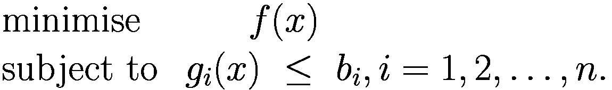 (4.1)

其中，向量 `x` = {`x[1]`, `x[2]`, … , `x[n]`} 是优化变量，函数 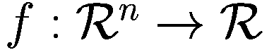 是目标函数。函数 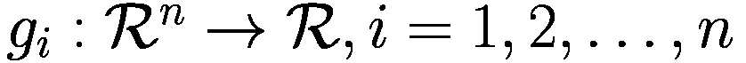 是约束条件，常数 `b[i]` 为约束边界。求解优化问题的目标是找到使 `f` 最小化的 `x*`。

优化问题旨在寻找使某个量最小化的解，因此它广泛应用于金融、工程、计算机科学等诸多领域。例如，在金融行业的投资组合管理中，需要最优解将给定总资本分配到 `n` 类投资中，其中 `x[i]` 是投资于金融资产 `i` 的资本金额。目标可能是最大化预期收益或最小化风险，而约束条件可能要求最小收益大于某个预定义值等。

优化问题可分为多种类型。公式 4.1 中的通用形式包含若干约束条件。如果没有约束条件，该问题称为*无约束优化*；否则称为有约束优化问题。从另一个角度看，有些优化目标是寻找全局最小点（例如，最小化 `f(x) = x²`），而其他优化问题只需在特定范围内找到最优解（例如，在 `[0, 2π]` 范围内最小化 `f(x) = sin(x)`）。在本章以及 Owl 实现的模块中，我们主要关注无约束和局部优化问题。具体而言，我们实现了最重要的优化方法之一：梯度下降法。

## 4.1 梯度下降法

梯度下降法是最常用的一类迭代优化过程。其基本思想是从一个初始值开始，沿着函数下降方向寻找一个搜索方向，按一定步长逐步减小函数值，直到收敛到局部最小值。因此，我们可以将下降法的第 *n* 次迭代描述如下：

1.  计算下降方向 `d`。
2.  选择步长 `μ`。
3.  更新位置：`x[n+1] = x[n] + μ d`。

重复此过程，直到满足停止条件（例如，更新量小于一个阈值）。在各类下降法中，*梯度下降法*是执行优化最广泛使用的算法之一，也是优化神经网络最常用的方法。基于前述下降过程，梯度下降法利用函数梯度确定其方向 `d`，可描述如下：

1.  计算下降方向 `-∇f(x[n])`。
2.  选择步长 `μ`。
3.  更新位置：`x[n+1] = x[n] + μ∇f(x[n])`。

其中，`∇` 表示梯度。沿特定方向的步长 `μ` 也称为本次迭代的*学习率*。在梯度下降过程中，当搜索最小值时，它总是遵循与负梯度表示的方向相反的方向。梯度可基于我们在第 3 章介绍的算法微分模块计算。这也是整个优化模块建立在 `Algodiff` 之上的原因。

根据这一定义实现梯度下降法已经足够清晰。例如，对于某个具有唯一全局最小点的可微函数 `f`，以下简单的 Owl 代码即可实现：

```ocaml
module n = Dense.Ndarray.D open Algodiff.D let _ = 
  for i = 1 to n - 1 do 
    let u = grad f !x |> unpack_arr in 
    x := N.(sub !x (scalar_mul alpha u)) 
  done;;
```

这基本上是对前述过程的逐行翻译。你应该熟悉 AD 模块中的函数，例如用于计算梯度的 `grad` 和将 AD 类型 ndarray 转换为普通 ndarray 的 `unpack_arr`。然而，要实现一个鲁棒的梯度下降法，有许多细节需要注意，例如学习率应如何变化、其他变体方法应如何集成等。接下来，我们将介绍该方法的几个构建模块以及 Owl 中 `Optimise` 模块的结构。

## 4.2 组件

Owl 中 `Optimise` 模块的核心抽象了梯度下降法在实际应用中的几个方面：学习率、梯度方法、动量等。每个方面都表示为一个子模块。这些模块中的所有计算都依赖于 AD 模块。以下代码展示了该优化模块的框架。它被设计为一个以 AD 模块为参数化的函子。在本节中，我们将介绍其中一部分子模块以及它们如何实现不同的方法。

```ocaml
module Make (Algodiff : Owl_algodiff_generic_sig.Sig) = struct 
  module Algodiff = Algodiff 
  open Algodiff 
  module Learning_Rate = struct 
    ... 
  end 
  module Gradient = struct 
    ... 
  end 
  ... end
```


### 学习率

在训练机器学习模型时，学习率可以说是影响训练速度和质量的最重要的超参数。它指定了根据每轮训练中估计的误差，模型权重应被改变多少。过大的学习率可能会导致次优解和不稳定的训练过程，而过小的学习率则可能导致训练时间过长。这就是为什么在模型训练中选择一个合适的学习率既关键又具有挑战性。

存在多种确定学习率的方法，我们已将它们整合在 `Learning_rate` 模块中，如下所示：

```
module Learning_Rate = struct
    type typ =
      | Adagrad   of float
      | Const     of float
      | Decay     of float * float
      | RMSprop   of float * float
    let run = function
      | Adagrad a -> fun _ _ c ->
        Maths.(_f a / sqrt (c.(0) + _f 1e-32))
      | Const a -> fun _ _ _ -> _f a
      | Decay (a, k) -> fun i _ _ ->
        Maths.(_f a / (_f 1. + (_f k * _f (float_of_int i))))
      | RMSprop (a, _)   -> fun _ _ c ->
        Maths.(_f a / sqrt (c.(0) + _f 1e-32))
    let default = function
      | Adagrad _   -> Adagrad 0.01
      | Const _     -> Const 0.001
      | Decay _     -> Decay (0.1, 0.1)
      | RMSprop _   -> RMSprop (0.001, 0.9)
    let update_ch typ g c =
      match typ with
      | Adagrad _ -> [| Maths.(c.(0) + (g * g)); c.(1) |]
      | RMSprop (_, k) -> [| Maths.(
        (_f k * c.(0)) + ((_f 1. - _f k) * g * g)); c.(1) |]
      | _ -> c
    let to_string = function,
      | Adagrad a      -> Printf.sprintf "adagrad %g" a
      | Const a        -> Printf.sprintf "constant %g" a
      | Decay (a, k)   -> Printf.sprintf "decay (%g, %g)" a k
      | RMSprop (a, k) -> Printf.sprintf "rmsprop (%g, %g)" a k
end
```

此模块包含学习率方法的类型定义以及可应用于其上的函数。`Learning_Rate.typ` 包含四种不同类型的算法。^(⁸) 对于每种类型，它都指定了其所需的参数。

让我们看看这些方法是如何实现的，以便更好地理解代码。`Const` 方法最为直接：在整个训练过程中仅使用一个恒定的学习率值。在 `typ` 中，其唯一参数就是这个学习率的浮点数。接下来，`run` 函数接收一个学习率类型作为输入，并返回一个接受三个输入的函数：迭代次数 `i`、梯度 `g`，以及该方法中使用的参数 `c`（一个浮点数数组）。该函数规定了学习率应如何改变。对于 `Const` 方法，学习率不变，因此它简单地返回之前的学习率本身。回忆第 3 章，`_f` 将一个浮点数包装成 AD 标量类型。`default` 和 `to_string` 是辅助函数。前者生成一个带有默认参数的学习率方法，后者打印给定方法的参数信息。

`Adagrad` 方法稍微复杂一些。顾名思义，它自适应地改变学习率：对于与不频繁特征相关的参数，更新步长较大，否则学习率较小。其参数在第 *t* 次迭代时的更新遵循以下规则：

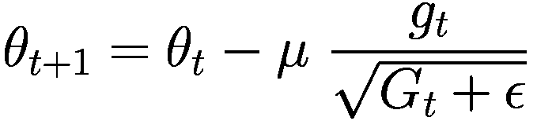 (4.2)

这里，*G* 是到时间步 *t* 为止，相应梯度 *g*[*t*] 的平方和。该方程由两部分组成。第一部分是学习率应如何更新，这在 `run` 函数中指定。下面的代码：

```
fun _ _ c ->
  Maths.(_f a / sqrt (c.(0) + _f 1e-32))
```

对应于 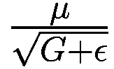。`c` 数组包含用于更新 *μ* 的参数，在这里 *μ* 就是 *G*。第二部分是如何更新这个参数，这在 `update_ch` 函数中指定。在这种情况下，更新规则是 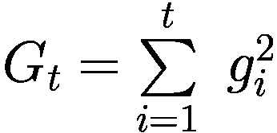，或者 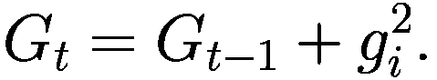 因此，在每次迭代中，代码为 `[| Maths.(c.(0) + (g * g)); c.(1) |]`。该数组中的第二个元素并未使用，因此保持不变。

`RMSprop` 方法是由 Geoff Hinton 提出的一种自适应学习率方法，它是 `Adagrad` 的扩展。它遵循公式 4.2 中的更新规则，只是此处的

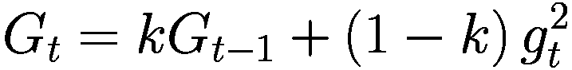 (4.3)

请注意，*k* 是一个通常设置为 0.9 的因子。因此，`run` 函数保持不变；`RMSprop` 的 `update_ch` 函数变为：

```
(_f k * c.(0)) + ((_f 1. - _f k) * g * g)
```

与 `Adagrad` 相比，通过使用先前梯度的衰减移动平均，`RMSprop` 能够遗忘早期梯度，并专注于最近观察到的梯度。

为了演示这个看似简单的框架如何容纳更复杂的方法，让我们考虑一下 Adam 优化器的实现 [33]。其参数是两个衰减率 *β*[1] 和 *β*[2]。更新其学习率需要两个值：梯度的估计均值 *m*[*t*] 和非中心化方差 *v*[*t*]。它们根据以下规则更新：

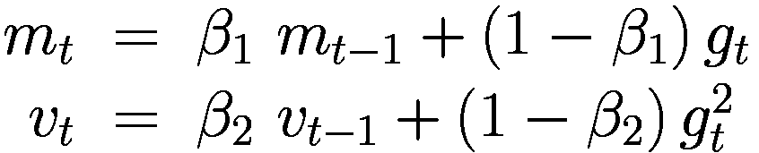

相应地，其 `update_ch` 可以实现为：

```
let update_ch typ g c =
  match typ with
  | Adam (_, b1, b2) ->
    let m = Maths.((_f b1 * c.(0)) + ((_f 1. - _f b1) * g)) in
    let v = Maths.((_f b2 * c.(1)) + ((_f 1. - _f b2) * g * g)) in
    [| m; v |]
  | ...
```

请注意，这里的 `c` 的含义与 `Adagrad` 和 `RMSprop` 方法中的不同。

接下来要指定如何更新学习率。Adam 的更新规则是：

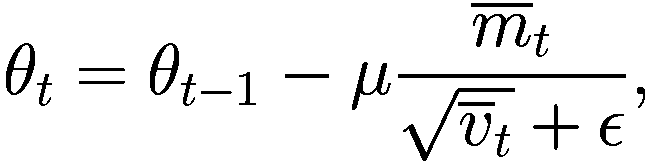 (4.4)

其中，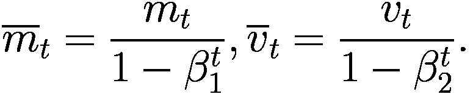

因此，Adam 的 `run` 函数返回一个利用所有三个参数的函数：

```
let run = function
  | Adam (a, b1, b2) ->
    fun i g c ->
      Maths.(
        let m = c.(0) /
          (_f 1. - (_f b1 ** _f (float_of_int i))) in
        let v = c.(1) /
          (_f 1. - (_f b2 ** _f (float_of_int i))) in
        (_f a) * m / (sqrt v + _f 1e-8)
        / (g + _f 1e-32))
  | ...
```

请注意最后的项 `/ (g + _f 1e-32)`。你可能会注意到这一项并不在公式 4.4 中。我们将其放在这里的原因是我们的框架遵循以下更新模式：

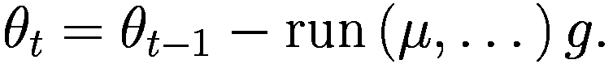

但最后的 *g* 乘法项不在公式 4.4 的末尾。这就是为什么我们在 `run` 函数中将它除回去。

到目前为止，我们已经介绍了学习率方法的多个方面，最显著的是 `run` 和 `update_cn`，但尚未解释它们将如何在优化过程中被使用。我们将在下一节中展示这一点。现在，让我们继续讨论优化的另一个方面：梯度下降算法。


#### 梯度

我们在第 4.1 节中已提供了梯度方法的框架。然而，梯度下降算法有许多变体。它们包含在 `Gradient` 模块中。代码如下所示。其结构与 `Learning_rate` 类似。`typ` 包含所有支持的梯度方法；这些方法不带类型参数。`to_string` 函数为每种方法打印辅助信息。

```
module Gradient = struct
    type typ =
      | GD (* 经典梯度下降 *)
      | CG (* Hestenes 和 Stiefel 1952 *)
      | CD (* Fletcher 1987 *)
      | NonlinearCG (* Fletcher 和 Reeves 1964 *)
      | DaiYuanCG (* Dai 和 Yuan 1999 *)
      | NewtonCG (* 牛顿共轭梯度 *)
      | Newton
    let run = function
      | GD          -> fun _ _ _ _ g' -> Maths.neg g'
      | CG          ->
        fun _ _ g p g' ->
          let y = Maths.(g' - g) in
          let b = Maths.(sum' (g' * y) / (sum' (p * y) + _f 1e-32)) in
          Maths.(neg g' + (b * p))
      | CD          ->
        fun _ _ g p g' ->
          let b = Maths.(l2norm_sqr' g' / sum' (neg p * g)) in
          Maths.(neg g' + (b * p))
      | NonlinearCG ->
        fun _ _ g p g' ->
          let b = Maths.(l2norm_sqr' g' / l2norm_sqr' g) in
          Maths.(neg g' + (b * p))
      | DaiYuanCG   ->
        fun _ _ g p g' ->
          let y = Maths.(g' - g) in
          let b = Maths.(l2norm_sqr' g' / sum' (p * y)) in
          Maths.(neg g' + (b * p))
      | NewtonCG    ->
        fun f w _ p g' ->
          let hv = hessianv f w p |> Maths.transpose in
          let b = Maths.(hv *@ g' / (hv *@ p)) in
          Maths.(neg g' + (p *@ b))
      | Newton      ->
        fun f w _ _ _ ->
          let g', h' = gradhessian f w in
          Maths.(neg (g' *@ inv h'))
    let to_string = function
      | GD          -> "梯度下降"
      | CG          -> "共轭梯度"
      | CD          -> "共轭下降"
      | NonlinearCG -> "非线性共轭梯度"
      | DaiYuanCG   -> "Dai 与 Yuan 共轭梯度"
      | NewtonCG    -> "牛顿共轭梯度"
      | Newton      -> "牛顿"
  end
```

关键组件是 `run` 函数。请记住，下降优化方法的核心过程是：`x_{n+1} = x_n + \mu d_n`，它指明了下一步的探索方向。`run` 函数定义了 `d[n]` 的形式。以经典的梯度下降法为例，其方向就是梯度的反方向。因此，`d[n] = -g[n]`，于是 `run` 函数返回另一个函数：`fun _f _w _g _p g' -> Maths.neg g'`。该函数接收五个参数作为输入，最后一个参数是当前梯度，也是本案例中唯一使用的参数。

**共轭梯度下降：** 梯度下降的一个问题是，它在某些类型的函数上可能表现不佳。例如，如果函数陡峭且狭窄，那么梯度下降会需要许多非常小的步长才能达到最小值，来回振荡，即使函数是二次形式也是如此。这个问题可以通过共轭梯度（CG）方法解决，该方法由 Hestenes 和 Stiefel [29] 首次提出。CG 方法类似于梯度下降，但每一步的新方向并不完全遵循新梯度，而是与旧梯度及所有先前经过的方向构成某种共轭关系。如果两种方法从同一位置出发，梯度下降会沿着下降方向前进，由于该函数陡峭，这个方向可能比较迟钝。而共轭方法则会更倾向于稍微保留之前的动量。因此，共轭方法会沿着介于两者之间的方向前进。新方向比梯度下降方法能更高效地找到最小值。

共轭梯度下降也是一类优化方法的统称。它们并不直接使用梯度的反方向 `-∇f(x[n])` 作为方向，而是在第 `n` 次迭代中遵循以下步骤：

1. 计算最陡方向，即负梯度 `-g[n] = -∇f(x[n])`。
2. 计算某个参数 `β[n]`；该参数在不同的共轭梯度方法中各不相同。
3. 应用共轭方向 `d[n] = -g[n] + β d[n-1]`。
4. 更新优化过程 `x[n] = x[n-1] + μ[n] d[n]`，其中 `μ[n]` 是本次迭代 `n` 的学习率。

基于此框架，我们可以看看返回函数中的五个参数：`fun f w g p g' -> ...`。这里，`g` 和 `p` 是上一轮的梯度和方向向量；`g'` 是当前轮的梯度。`f` 是待优化的函数本身，输入数据为 `w`。因此，CG 过程可以实现为 `fun _f _w g p g' -> let b = ... in Maths.(neg g' + (b * p))`。在经典的 CG 方法中：`β_n = (g_n^T (g_n - g_{n-1})) / (-d_{n-1}^T (g_n - g_{n-1}))`。这里，`g[n]`、`d[n]` 等均假定为向量。请注意此参数和 CG 方法框架如何利用来自上一次迭代的信息（`g[n-1]` 和 `d[n-1]`），如梯度和方向。我们可以将式 (4.5) 实现为 `let b = let y = Maths.(g' - g) in Maths.(sum' (g' * y) / (sum' (p * y) + _f 1e-32))`。它使用 `sum'` 函数执行向量乘法，并添加了一个额外的极小值 `1e-32` 以确保分母不为零。

在非线性共轭方法（`NonlinearCG`）[21] 中，`β_n = (g_n^T g_n) / (g_{n-1}^T g_{n-1})`。因此，它可以实现为 `let b = Maths.(l2norm_sqr' g' / l2norm_sqr' g)`。这里，`l2norm_sqr' g` 计算 `g` 中所有元素的 l2 范数（或欧几里得范数）的平方，即 `g^T g`。类似地，在 Dai 和 Yuan [16] 提出的共轭梯度方法（`DaiYuanCG`）中，`β_n = -(g_n^T g_n) / (d_n (g_n - g_{n-1}))`。相应的代码是 `let b = let y = Maths.(g' - g) in Maths.(l2norm_sqr' g' / sum' (p * y))`。

**牛顿法** 是另一种寻找最优值的迭代下降方法。它遵循如下所示的更新序列：`x_{n+1} = x_n - α H^{-1} ∇f(x_n)`。这里，`H` 是 `f` 的黑塞矩阵，即 `f` 的二阶梯度。代码是该方程的直接翻译：`fun f w _ _ _ -> let g', h' = gradhessian f w in Maths.(neg (g' *@ inv h'))`。这里，`Algodiff.gradhessian` 函数返回函数 `f` 在点 `w` 处的梯度与黑塞矩阵。`*@` 运算符是矩阵乘法的别名，`inv` 是矩阵的逆。与仅沿梯度方向移动不同，牛顿法将梯度与函数的二阶梯度相结合，从随机位置开始迭代直至收敛。牛顿法保证二次收敛，前提是 `f` 在利普希茨连续黑塞矩阵条件下是强凸的，且初始点 `x[0]` 足够接近原始点 `x^*`。注意，不要将此方法误认为是旨在寻找函数零点的牛顿法。


#### 动量

通过动量机制，可以进一步增强基本的梯度下降过程。它在选择优化搜索方向时允许一定的“惯性”，利用了先前的方向信息。这有助于减少在搜索方向上反复振荡的噪声梯度下降。

动量模块的代码如下所示。其关键组件是`run`函数。

```
module Momentum = struct
    type typ =
      | Standard of float
      | Nesterov of float
      | None
    let run = function
      | Standard m -> fun u u' -> Maths.((_f m * u) + u')
      | Nesterov m -> fun u u' ->
        Maths.((_f m * _f m * u) + ((_f m + _f 1.) * u'))
      | None       -> fun _ u' -> u'
    let default = function
      | Standard _ -> Standard 0.9
      | Nesterov _ -> Nesterov 0.9
      | None       -> None
    let to_string = function
      | Standard m -> Printf.sprintf "standard %g" m
      | Nesterov m -> Printf.sprintf "nesterov %g" m
      | None       -> Printf.sprintf "none"
end
```

回顾梯度下降的基本结构，在第 *n* 次迭代中，值 *x* 的变化量为

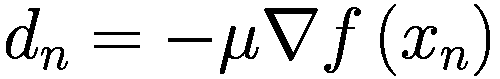

引入动量后，这个过程被修改为

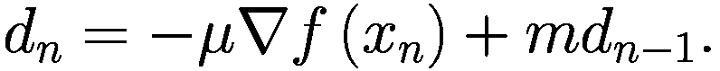 (4.7)

浮点数 *m* 是动量参数，表示前一次迭代中方向信息的影响。

此模块中的 `run` 函数返回一个接收两个输入的函数：前一次方向 `u` 和当前方向 `u'`（使用学习率和梯度方法的任意组合计算得出）。因此，前面描述的动量方法可以简单地实现为 `Maths.((_f m * u) + u')`。这是标准的动量方法。如果我们决定不使用任何动量（`None`），则它直接返回当前方向 `u'`。

该模块也支持*涅斯捷罗夫加速梯度*（`Nesterov`）方法[40]。它对公式 4.7 中的标准动量做了一个简单的修改：首先将动量项应用于参数本身，然后计算梯度 ∇*f*，最后再次加上动量项：

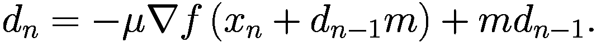

在此模块中，我们实现了 Bengio 等人提出的解法。

#### 批处理

还有一个子模块需要提及：Batch 模块。它涉及到如何将输入数据分成多个块，然后馈送到训练过程中。根据之前关于梯度下降的介绍，您可能会认为该函数接受标量作为输入。然而，在许多应用中，我们应该考虑对向量 **x** 进行优化。这意味着在计算梯度时，我们需要考虑使用一组数据点，而不仅仅是一个。

从计算的角度来看，两者没有太大区别，我们仍然可以使用所有数据来计算梯度。然而，这种优化方法的一个主要应用领域是回归，或者更广泛地说，是机器学习，其中可能有数百万个数据点仅仅是为了寻找最优解。我们将在第 4.4 节讨论回归。在实践中，由于计算机内存大小等硬件因素的限制，使用大量输入数据进行优化计算可能不可行。因此，对此类问题的优化通常会重复执行多轮，每一轮称为一个*周期*。在每个周期中，给定的输入数据被分成多个批次。每个批次可以选择使用一种批处理策略，如下面的 `run` 函数代码所示：

```
  module Batch = struct
    type typ =
      | Full
      | Mini       of int
      | Sample     of int
      | Stochastic
    let run typ x y i =
      match typ with
      | Full       -> x, y
      | Mini c     -> Utils.get_chunk x y i c
      | Sample c   -> Utils.draw_samples x y c
      | Stochastic -> Utils.draw_samples x y 1
    let batches typ x =
      match typ with
      | Full       -> 1
      | Mini c     -> Utils.sample_num x / c
      | Sample c   -> Utils.sample_num x / c
      | Stochastic -> Utils.sample_num x
    let to_string = function
      | Full       -> Printf.sprintf "%s" "full"
      | Mini c     -> Printf.sprintf "mini of %i" c
      | Sample c   -> Printf.sprintf "sample of %i" c
      | Stochastic -> Printf.sprintf "%s" "stochastic"
  end
```

`Full` 策略使用所有提供的数据。`Mini c` 和 `Sample c` 策略每次都使用 `c` 个数据点；前者按顺序选择数据，后者则是随机选择。最后，`Stochastic` 方法只从现有数据点中随机选择一个。

#### 检查点

到目前为止，我们已经介绍了学习率、梯度和动量模块如何返回利用先前迭代的梯度或方向等信息的函数。但是这些信息存储在哪里呢？答案就在 Checkpoint 模块中。它在优化过程中存储所有信息以供后续使用，并在需要时将它们作为文件保存到硬盘上。其代码如下所示：

```
module Checkpoint = struct
  type state = {
    mutable current_batch : int;
    mutable batches_per_epoch : int;
    mutable epochs : float;
    mutable batches : int;
    mutable gs : t array array;
    mutable ps : t array array;
    mutable us : t array array;
    mutable ch : t array array array
    mutable stop : bool;
  }
  type typ =
    | Batch  of int (* 默认在每指定批次间隔时的检查点 *)
    | Epoch  of float (* 默认  *)
    | Custom of (state -> unit) (* 每批次调用的自定义检查点 *)
    | None
  .... end
```

`state` 类型包含了我们到目前为止介绍过的字段。`ch` 用于学习率模块，包含要从先前迭代更新的参数。`gs` 是先前迭代的梯度，`ps` 是先前迭代的方向，两者都用于梯度方法。`us` 表示先前迭代的方向更新，是在动量方法中使用的参数。除了存储这些信息之外，还有一个布尔值 `stop`，如果设置为 `true`，则表示优化停止。它还包含其他信息，包括当前批处理的迭代进度、每个周期的批次数以及要运行的总周期数。


`typ`决定检查点应在何时执行。`Batch`表示在每个指定的批次间隔处进行检查点操作；`Epoch`表示在每个指定的周期间隔处进行检查点操作。除了这两种模式，用户还可以构建自定义函数，该函数以`state`类型作为输入，以决定针对特定应用何时是最合适的检查点时机。

```
let init_state batches_per_epoch epochs =
  let batches = float_of_int batches_per_epoch *. epochs
    |> int_of_float in {
      current_batch = 1
      ; batches_per_epoch
      ; epochs
      ; batches
      ; stop = false
      ; gs = [| [| _f 0. |] |]
      ; ps = [| [| _f 0. |] |]
      ; us = [| [| _f 0. |] |]
      ; ch = [| [| [| _f 0.; _f 0. |] |] |]
    }

let default_checkpoint_fun save_fun =
  let file_name =
    Printf.sprintf "%s/%s.%i" (Sys.getcwd ())
      "model" (Unix.time () |> int_of_float)
  in
  Owl_log.info "checkpoint => %s" file_name;
  save_fun file_name

let to_string = function
  | Batch i  -> Printf.sprintf "per %i batches" i
  | Epoch i  -> Printf.sprintf "per %g epochs" i
  | Custom _ -> Printf.sprintf "customised f"
  | None     -> Printf.sprintf "none"
```

`init_state`返回`state`中各字段的初始值。用户需要在优化中指定周期数量（`epochs`）和一个周期内的输入数据批次数量（`batches_per_epoch`）。`default_checkpoint_fun`执行一个函数，将特定内容保存到文件中。这个保存函数（`save_fun`）应由用户定义。与之前的模块类似，`to_string`方法提供了一个便捷的打印函数，用于显示本模块的配置信息。最后，`run`函数决定合适的检查点间隔，并执行检查点函数——可以是默认的，也可以是用户提供的自定义函数。

```
let run typ save_fun current_batch current_loss state =
  state.loss.(current_batch) <- primal' current_loss;
  state.stop <- state.current_batch >= state.batches;
  let interval =
    match typ with
    | Batch i  -> i
    | Epoch i  -> i *.
      float_of_int state.batches_per_epoch |> int_of_float
    | Custom _ -> 1
    | None     -> max_int
  in
  if state.current_batch mod interval = 0 &&
    state.current_batch < state.batches then (
      match typ with
      | Custom f -> f state
      | _        -> default_checkpoint_fun save_fun) end
```

### Params

`Params`子模块是将所有其他子模块整合在一起的关键。它为用户提供了访问优化各个方面的入口点。代码如下所示：

```
module Params = struct
  type typ =
    { mutable epochs : float
    ; mutable batch : Batch.typ
    ; mutable gradient : Gradient.typ
    ; mutable learning_rate : Learning_Rate.typ
    ; mutable momentum : Momentum.typ
    ; mutable checkpoint : Checkpoint.typ
    ; mutable verbosity : bool
    }
```

`Params.typ`类型包含了其他子模块的类型，例如`Gradient.typ`。它还包括一些其他字段，如周期数量（`epochs`）和一个布尔标志`verbosity`，用于指示在优化过程中是否应打印参数的完整信息。

```
  let default () =
    { epochs = 1.
    ; batch = Batch.Sample 100
    ; gradient = Gradient.GD
    ; learning_rate = Learning_Rate.(default (Const 0.))
    ; momentum = Momentum.None
    ; checkpoint = Checkpoint.None
    ; verbosity = true
    }

  let config ?batch ?gradient ?learning_rate
      ?momentum ?checkpoint ?verbosity epochs
    =
    let p = default () in
    (match batch with
    | Some x -> p.batch <- x
    | None   -> ());
    (match gradient with
    | Some x -> p.gradient <- x
    | None   -> ());
    (match learning_rate with
    | Some x -> p.learning_rate <- x
    | None   -> ());
    (match momentum with
    | Some x -> p.momentum <- x
    | None   -> ());
    (match checkpoint with
    | Some x -> p.checkpoint <- x
    | None   -> ());
    (match verbosity with
    | Some x -> p.verbosity <- x
    | None   -> ());
    p.epochs <- epochs;
    p

  let to_string p =
    Printf.sprintf "--- Training config\n"
    ^ Printf.sprintf "epochs: %g\n" p.epochs
    ^ Printf.sprintf "batch: %s\n" (Batch.to_string p.batch)
    ^ Printf.sprintf "method: %s\n" (Gradient.to_string p.gradient)
    ^ Printf.sprintf
        "learning rate: %s\n"
        (Learning_Rate.to_string p.learning_rate)
    ^ Printf.sprintf "momentum: %s\n" (Momentum.to_string p.momentum)
    ^ Printf.sprintf "checkpoint: %s\n"
      (Checkpoint.to_string p.checkpoint)
    ^ Printf.sprintf
        "verbosity: %s\n"
        (if p.verbosity then "true" else "false")
    ^ "---"
end
```

另外三个函数的功能很直接。`default`为每个参数赋予默认值；`config`使用给定的输入设置参数值；`to_string`打印现有的参数值。

## 4.3 梯度下降实现


综合前述所有子模块，我们现在可以着手实现一个稳健的梯度下降优化方法。在 `Optimise` 模块中，我们实现了 `minimise_fun`，并对其代码进行如下说明：

```
let minimise_fun params f x =
  let open Params in
  let grad_fun = Gradient.run params.gradient in
  let rate_fun = Learning_Rate.run params.learning_rate in
  let momt_fun = Momentum.run params.momentum in
  let upch_fun = Learning_Rate.update_ch params.learning_rate in
  let chkp_fun = Checkpoint.run params.checkpoint in
  let optz_fun = f in
  ...
```

该函数接受三个输入：函数 `f`、初始输入 `x` 以及优化参数 `params`。它首先从各个子模块中定义运行函数。

```
let iterate xi =
  let loss, g = grad' optz_fun xi in
  loss |> primal', g, optz_fun
in
...
```

`iterate` 定义了第 *i* 次迭代中的操作。它利用 `Algodiff` 模块计算在 `xi` 点评估 `optz_fun` 的原始值 `loss`，以及该点对应的梯度 `g`。

```
let state = Checkpoint.init_state 1 params.epochs
let x = ref x in
while Checkpoint.(state.stop = false) do
  ...
done;
state, !x
```

上述代码展示了优化过程的大纲。首先，初始化优化过程的新状态。此处，我们将其设置为每周期一个批次。接着，代码在 while 循环体内持续更新状态，直到停止状态被设为 true。最终返回优化结果 `x` 和状态。如前所述，状态中包含各种历史信息。while 循环的每次迭代包含以下步骤：

```
let loss', g', optz' = iterate !x in
chkp_fun (fun _ -> ())
  Checkpoint.(state.current_batch) loss' state;
```

首先，执行 `iterate` 获取梯度。我们可以定义当前进度的检查点；这里，我们提供了一个空的保存函数，这意味着无需将当前状态保存到文件中。

```
let p' = Checkpoint.(grad_fun optz' !x
  state.gs.(0).(0) state.ps.(0).(0) g') in
Checkpoint.(state.ch.(0).(0)
  <- upch_fun g' state.ch.(0).(0));
```

接下来，我们使用 `grad_fun` 基于梯度 `g'` 计算梯度下降方向 `p'`。同时，学习率参数 `ch` 也需要更新。

```
let u' =
  Checkpoint.(Maths.(p' * rate_fun
    state.current_batch g' state.ch.(0).(0)))
in
let u' = momt_fun Checkpoint.(state.us.(0).(0)) u' in
```

然后，优化方向被调整，首先基于学习率，然后基于动量。

```
x := Maths.(!x + u') |> primal';
```

接着，根据方向 `u'` 更新最优值。

```
(if params.momentum <> Momentum.None then
  Checkpoint.(state.us.(0).(0) <- u'));
Checkpoint.(state.gs.(0).(0) <- g');
Checkpoint.(state.ps.(0).(0) <- p');
Checkpoint.(state.current_batch <- state.current_batch + 1);
```

最后，本次迭代中计算得到的值（如梯度、方向等）被保存在状态中以供后续使用。以上就是一次迭代的全部内容。

让我们来看一个使用梯度下降进行优化的示例。这里，我们使用 Himmelblau 函数；该函数常被用作优化问题的性能测试。此函数包含两个输入，其定义如式 4.8 所示。

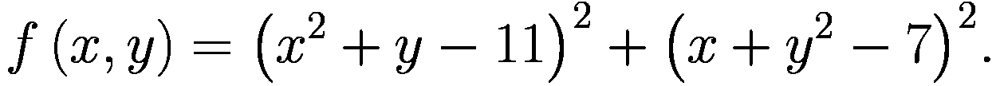 (4.8)

其定义可使用 Owl 代码表示为：

```
open Algodiff.D
module N = Dense.Ndarray.D

let himmelblau a =
  let x = Mat.get a 0 0 in
  let y = Mat.get a 0 1 in
  Maths.(x ** (F 2.) + y - (F 11.) ** (F 2.) +
    (x + y ** (F 2.) - (F 7.)) ** (F 2.) |> sum')
```

首先，让我们看看如果不使用 `Optimise` 模块，代码会是什么样子。让我们根据第 4.1 节中的定义应用梯度下降法。

```
let v = N.of_array [|-2.; 0.|] [|1; 2|]
let traj = ref (N.copy v)
let a = ref v
let eta = 0.0001
let n = 2000;;
```

这里，我们使用初始起点 `[-2., 0.]`。步长 `eta` 设置为 `0.0001`，迭代次数为 `2000`。然后我们可以执行迭代下降过程。

```
let _ =
  for i = 1 to n - 1 do
  let u = grad himmelblau (Arr !a) |> unpack_arr in
  a := N.(sub !a (scalar_mul eta u));
  traj := N.concatenate [|!traj; (N.copy !a)|]
  done;;
```

我们将 `Algodiff` 模块中的 `grad` 方法迭代地应用于 Himmelblau 函数，并将更新后的数据 `a` 存储在 `traj` 数组中。

利用 Owl 中的 `Plot` 模块，我们可以通过以下代码可视化该函数及优化轨迹：

```
let plot () =
  let a, b = Dense.Matrix.D.meshgrid (-4.) 4. (-4.) 4. 50 50 in
  let c = N.(add
    (sub_scalar (add (pow_scalar a 2.) b) 11.)
    (pow_scalar (sub_scalar (add a (pow_scalar b 2.)) 7.) 2.)
  ) in
  let h = Plot.create ~m:1 ~n:2 "plot_himm.pdf" in
  Plot.subplot h 0 0;
  Plot.(mesh ~h ~spec:[ NoMagColor ] a b c);
  Plot.subplot h 0 1;
  Plot.contour ~h a b c;
  let vx = N.get_slice [[]; [0]] !traj in
  let vy = N.get_slice [[]; [1]] !traj in
  Plot.plot ~h vx vy;
  Plot.output h
```

生成的图形如图 4-1 所示。

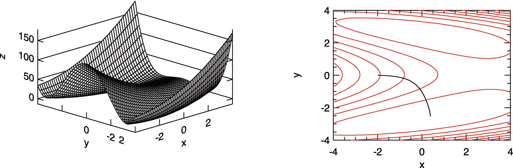

图 a 描绘了在多模态 Himmelblau 函数上，沿 x、y 和 z 轴进行梯度下降优化的三维网格结构过程。图 b 描绘了沿 x 轴和 y 轴实现梯度下降优化方法的过程。

**图 4-1** 在多模态 Himmelblau 函数上进行梯度下降的优化过程

为了解决相同的问题，我们也可以使用前一节介绍的 `minimise_fun` 函数。首先，设置参数：

```
let p = Owl_optimise.D.Params.default ()
let _ = p.epochs <- 10.
let _ = p.gradient <- Owl_optimise.D.Gradient.GD;;
```

只需简单地将迭代限制 `epochs` 设置为 10 或 20 次迭代即可。然后，我们将梯度方法设置为经典的梯度下降法，并从相同的初始值开始执行代码：

```
let init_value = N.of_array [|-2.;0.|] [|1;2|] |> pack_arr
let _ = Owl_optimise.D.minimise_fun p himmelblau init_value;;
```

此函数会输出执行日志以跟踪中间结果，部分内容如下所示。它展示了函数值如何从初始点处的 2926，在仅 10 步内通过梯度下降迅速减少至约 2.5。这体现了梯度下降法在寻找最优值方面的效率。

```
... 10:46:49.805 INFO : T: 00s | E: 1.0/10 | B: 1/10 | L: 2026.000
10:46:49.806 INFO : T: 00s | E: 2.0/10 | B: 2/10 | L: 476.1010
10:46:49.807 INFO : T: 00s | E: 3.0/10 | B: 3/10 | L: 63.83614
10:46:49.807 INFO : T: 00s | E: 4.0/10 | B: 4/10 | L: 37.77679
10:46:49.808 INFO : T: 00s | E: 5.0/10 | B: 5/10 | L: 21.39686
10:46:49.809 INFO : T: 00s | E: 6.0/10 | B: 6/10 | L: 11.74234
10:46:49.809 INFO : T: 00s | E: 7.0/10 | B: 7/10 | L: 6.567733
10:46:49.809 INFO : T: 00s | E: 8.0/10 | B: 8/10 | L: 4.085909
10:46:49.810 INFO : T: 00s | E: 9.0/10 | B: 9/10 | L: 3.016714
10:46:49.810 INFO : T: 00s | E: 10.0/10 | B: 10/10 | L: 2.5943
...
```


## 4.4 回归

本节我们将介绍一个高度依赖优化的广阔领域：*回归*。回归是统计建模和机器学习中的一个重要主题。它涉及对包含一个或多个变量（也称为“特征”或“预测变量”）的问题进行建模，并要求我们根据预测变量的先前值对另一个变量（“输出变量”）进行预测。回归分析包含广泛的模型，从线性回归到保序回归，每种模型都有不同的理论背景和应用。本节中，我们以最广泛使用的线性回归为例，来展示优化在解决回归问题中扮演的关键角色。

### 线性回归

线性回归使用线性模型来建模输入特征与输出变量之间的关系。它是最广泛使用的回归模型。不失一般性，我们来看一个模型中仅包含单个变量的例子。这样的线性回归问题可以非正式地表述如下。假设我们有一系列 (`x`, `y`) 数据点：

----------------------------  
|x| 5.16 | 7.51 | 6.53 | ...  
----------------------------  
|y| 0.36 | 5.84 | 16.9 | ...  
----------------------------

假设这两个量之间的关系为 `y ≈ h[θ(x)]`，其中 `hθ = θ[0] + θ[1] x`，我们能否找到尽可能贴合观测数据点的 `θ[0]` 和 `θ[1]` 值？这个问题稍后会进一步形式化。将 `x` 和 `y` 的列表记为两个向量 `x` 和 `y`。假设我们有一个函数 `C` 用于衡量 `x` 和 `y` 之间的距离：`Cθ`。目标是找到合适的参数 `θ`，使得这个距离最小化。这就是优化发挥作用的地方。

### 损失函数

那么下一个问题是：如何在数学上表示这个距离？一个不错的选择是使用欧几里得距离。这意味着目标是最小化函数：

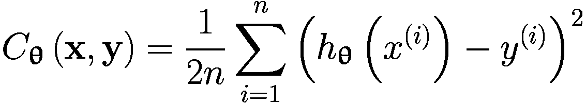 (4.9)

这里，`x^(i)` 表示向量 `x` 中的第 `i` 个元素。因子 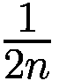 用于归一化距离。其他形式的距离也可以在此应用。由于它的重要性，这个距离被称为损失函数，并在优化模块中被抽象为 `Loss` 子模块。其代码如下所示：

```
module Loss = struct
    type typ =
      | Hinge
      | L1norm
      | L2norm
      | Quadratic
      | Cross_entropy
      | Custom        of (t -> t -> t)
    let run typ y y' =
      match typ with
      | Hinge         -> Maths.(sum' (max2 (_f 0.) (_f 1. - (y * y'))))
      | L1norm        -> Maths.(l1norm' (y - y'))
      | L2norm        -> Maths.(l2norm' (y - y'))
      | Quadratic     -> Maths.(l2norm_sqr' (y - y'))
      | Cross_entropy -> Maths.(cross_entropy y y')
      | Custom f      -> f y y'
    ...
    end
```

它包含多种计算两个值 `y` 和 `y'` 之间距离或损失的方法。我们刚才描述的是 `Quadratic` 方法。它也支持 l1 或 l2 范数：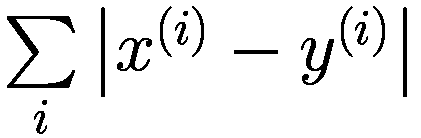 和 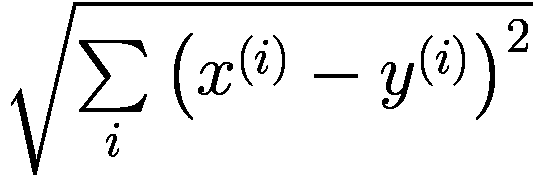。交叉熵衡量分类模型的性能，其输出是介于 0 和 1 之间的概率值。它的计算公式为 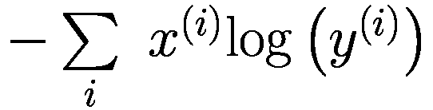。交叉熵损失在训练神经网络中最为常用，我们将在第 5 章中展示。

### 线性回归的实现

在 Owl 的源代码中，`owl_regression_generic.ml` 文件列出了所有几种回归方法，它们都基于一个核心的线性回归实现。该函数优化一般回归问题中的参数 `w` 和 `b`：最小化 `lw, b w + b − y)`。这里，每个数据点 `x` 可以是与 `T` 长度相同的向量，因为可能涉及比公式 (4.9) 中更多的参数。代码如下所示：

```
module Make (Optimise : Owl_optimise_generic_sig.Sig) = struct
  module Optimise = Optimise
  open Optimise
  open Optimise.Algodiff

  let _linear_reg bias params x y =
    let s = A.shape x in
    let l, m = s.(0), s.(1) in
    let n = A.col_num y in
    let o = if bias = true then m + 1 else m in
    let x = if bias = true then A.concatenate
      ~axis:1 [| x; A.ones [| l; 1 |] |] else x in
    let r = 1. /. float_of_int o in
    let p = Arr A.(uniform ~a:(float_to_elt
      (-.r)) ~b:(float_to_elt r) [| o; n |]) in
    ...
end
```

回归模块是一个函子，它以 `Optimise` 模块为参数。`_linear_reg` 函数将 `x` 和 `y` 值以及优化参数作为输入。参数 `bias` 是一个布尔标志，指示是否应该训练参数 `b`。这个偏置就是我们之前看到的 `θ[0]` 参数，它不与 `x` 相乘。如果要将其包含在优化中，参数矩阵的形状应相应改变，如代码所示。这里，`p` 是随机生成的初始参数矩阵。

```
    let f w x =
      let w = Mat.reshape o n w in
      Maths.(x *@ w) in
```

`f` 是要最小化的函数。它通过单个矩阵乘法来表示 `xw + b`。

```
    let w =
      minimise_weight params f (Maths.flatten p) (Arr x) (Arr y)
      |> snd
      |> Mat.reshape o n
      |> unpack_arr
    in
    match bias with
    | true  -> A.split ~axis:0 [| m; 1 |] w
    | false -> [| w |]
  ...
end
```

此回归函数的核心步骤是使用给定的参数对函数 `f` 应用优化，并进行适当的形状变换。如果偏置包含在优化目标中，则返回的结果被分割成两部分，第一部分是 `w`，第二部分是 `b`。

注意，我们之前介绍过用于优化的 `minimise_fun`，但这里使用的是 `minimise_weight`。这两个函数在实现上实际上非常相似，但有一个关键区别。在 `minimise_fun f x` 中，它持续计算关于输入 `x` 的梯度，并相应地改变 `x`，直到达到一个最小化 `f(x)` 的点。而在 `minimise_weight f w x` 中，它持续计算关于函数自身参数 `w` 的梯度，并相应地改变 `w`，直到达到一个最小化 `fw` 的点。输入数据 `x` 在每轮优化中保持不变。

基于这个函数，可以通过选择合适的优化参数来实现线性回归：

```
  let ols ?(i = false) x y =
    let params =
      Params.config
        ~batch:Batch.Full
        ~learning_rate:(Learning_Rate.Adagrad 1.)
        ~gradient:Gradient.GD
        ~loss:Loss.Quadratic
        ~verbosity:false
        ~stopping:(Stopping.Const 1e-16)
        100.
    in
    _linear_reg i params x y
```

在线性回归中，我们在一次迭代或一个周期（完整批处理模式）中利用所有输入数据。我们使用 `Adagrad` 学习法、经典的梯度下降法以及欧几里得距离作为损失函数。优化过程持续 100 次迭代，直到损失值小于 `1e-16`。`Stopping` 是优化模块中的一个辅助模块，它接受一个阈值，使得优化过程可以提前退出。


### 其他类型的回归

尽管线性回归功能强大且应用广泛，但线性模型并不能解决所有问题。许多数据遵循线性模式以外的其他模式。例如，有时特征`x`与输出变量之间的关系可以用关于特征`x`的*n*次多项式来建模：`h(x) = θ₀ + θ₁x + θ₂x² + θ₃x³...` (4.10)。这被称为*多项式*回归。Owl 在`Regression`模块中提供了一个`poly`函数来获取模型参数。前两个参数仍然是`x`和`y`，第三个参数限制了多项式模型的阶数。其实现也可以简洁地使用`_linear_reg`来表达：

```
  let poly x y n =
    let z =
      Array.init (n + 1) (fun i -> A.(pow_scalar x
        (float_of_int i |> float_to_elt)))
    in
    let x = A.concatenate ~axis:1 z in
    let params =
      Params.config
        ~batch:Batch.Full
        ~learning_rate:(Learning_Rate.Const 1.)
        ~gradient:Gradient.Newton
        ~loss:Loss.Quadratic
        ~verbosity:false
        ~stopping:(Stopping.Const 1e-16)
        100.
    in
    (_linear_reg false params x y).(0)
```

关键在于首先处理数据，使得每个数据点`x`可以投影到一系列新特征`z`上，从而满足`z[i] = x^(i)`。公式 4.10 然后变成了一个多变量线性回归：`h(z) = θ₀ + θ₁z₁ + θ₂z₂ + θ₃z₃...`。

另一种重要的回归类型是*逻辑回归*，其中数据`y`包含表示不同数据类别的整数，而不是实数。因此，它最适合分类任务，例如“年龄组”、“国籍”等。逻辑回归将其目标优化函数替换为`C(x, y) = (1/m) Σ g(h(x(i)), y(i))` (4.11)，其中`m`是输入数据`x`和`y`中数据点的总数；函数`g`定义为`g(h(x), y) = -log(h(x)) if y=1, -log(1-h(x)) if y=0` (4.12)。逻辑梯度可以通过使用交叉熵损失函数来实现：

```
  let logistic ?(i = false) x y =
    let params =
      Params.config
        ~batch:Batch.Full
        ~learning_rate:(Learning_Rate.Adagrad 1.)
        ~gradient:Gradient.GD
        ~loss:Loss.Cross_entropy
        ~verbosity:false
        ~stopping:(Stopping.Const 1e-16)
        1000.
    in
    _linear_reg i params x y
```

### 正则化

有一件事我们需要理解：回归归根结底不仅仅是优化。其目的是创建一个适合给定数据的模型，而且通常，这个模型应该用于预测未来输入的输出。因此，如果一个模型*过于*贴合给定的数据，它可能会失去对未来数据的泛化能力。这就是*正则化*概念的由来。这种技术可以防止模型过度针对特定数据集进行调整，从而避免无法很好地预测未来的观测值。

思考一下多项式回归。正则化技术倾向于简单且低阶的模型。它修改了优化目标函数以惩罚高阶参数，使得较大的参数值导致更高的成本。因此，通过最小化目标函数，我们使不需要的参数保持相对较小。这可以通过在原始目标函数的末尾添加一个额外的项来实现。

Owl 在`Regularisation`子模块中支持多种类型的此类正则化项，该子模块也属于`Optimiser`模块。其核心函数`run`如下所示：

```
let run typ x =
  match typ with
  | L1norm a -> Maths.(_f a * l1norm' x)
  | L2norm a -> Maths.(_f a * l2norm' x)
  | Elastic_net (a, b) ->
    Maths.((_f a * l1norm' x) + (_f b * l2norm' x))
  | None -> _f 0.
```

`L2norm`正则化函数添加了`θ`的 L2 范数作为惩罚项：`λ Σ θ²`。`L1norm`成本函数类似，添加参数的 L1 范数或绝对值作为惩罚：`λ Σ |θ|`。这种差异意味着`L1norm`允许系数为零，这对于特征选择非常有用。使用这两种正则化技术的回归有时分别称为岭回归和套索回归。`Elastic_net`方法结合了前两者的惩罚项：`λ ((1-a)/2 Σ θ² + a Σ |θ|)`，

其中`a`是一个超参数，用于平衡前两者。该方法旨在使特征选择不那么依赖于输入数据。

我们可以通过简单地将优化参数更改为以下值来创建一个带正则化的新多项式回归：

```
Params.config
  ~batch:Batch.Full
  ~learning_rate:(Learning_Rate.Const 1.)
  ~gradient:Gradient.Newton
  ~loss:Loss.Quadratic
  ~regularisation:(Regularisation.L2norm 0.5)
  ~verbosity:false
  ~stopping:(Stopping.Const 1e-16)
  100.
```

## 4.5 总结

在本章中，我们介绍了优化及其在 Owl 中的实现。我们重点介绍了最广泛使用的优化方法之一——梯度下降法，并讨论了其各个方面，例如梯度方法、学习率、动量等。这些共同构成了一个强大而稳健的实现。作为一个重要的例子，我们进一步介绍了回归，这是一种严重依赖优化的机器学习技术。我们展示了如何使用优化模块高效地构建各种回归方法。


**开放获取** 本章根据知识共享署名 4.0 国际许可协议 ([`creativecommons.org/licenses/by/4.0/`](http://creativecommons.org/licenses/by/4.0/)) 进行许可，该协议允许以任何媒介或格式使用、共享、改编、分发和复制，前提是您给予原始作者和来源适当的署名，提供指向知识共享许可协议的链接，并指出是否进行了修改。

本章中的图片或其他第三方材料包含在本章的知识共享许可协议中，除非在材料的署名行中另有说明。如果材料未包含在本章的知识共享许可协议中，且您计划中的使用未得到法定法规的允许或超出了允许的使用范围，您将需要直接获得版权持有人的许可。

脚注 1  © 作者 2023 L. Wang, J. Zhao《高级数值分析系统架构》[`doi.org/10.1007/978-1-4842-8853-5_5`](https://doi.org/10.1007/978-1-4842-8853-5_5)


