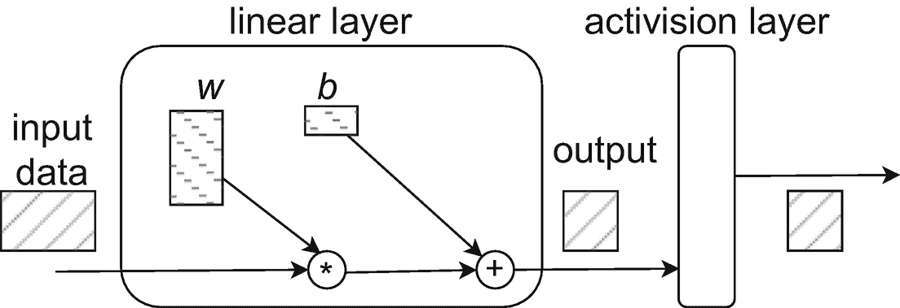
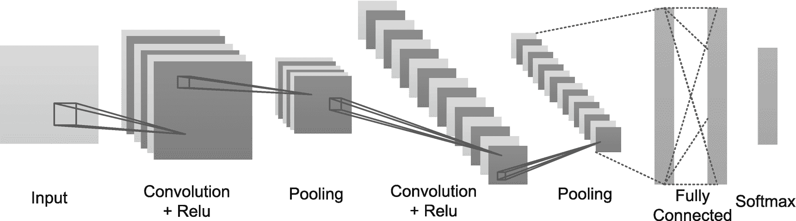
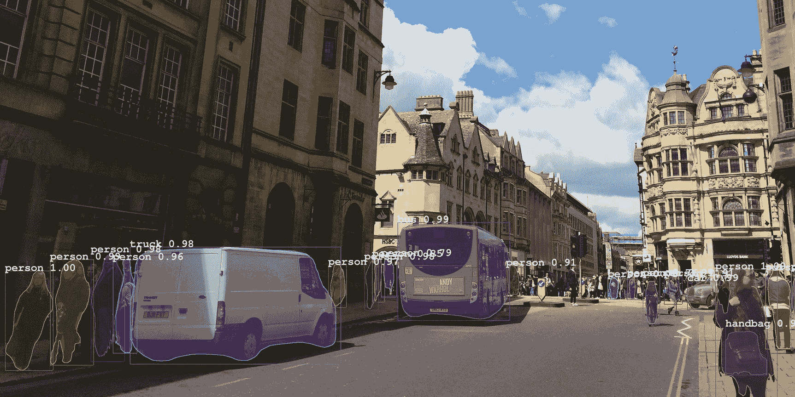

# 5. 深度神经网络

王亮^(1) 与 赵建鑫^(2)  
（1）芬兰，赫尔辛基 （2）中国，北京  

市面上有很多文章教人们如何使用不同框架（如 `TensorFlow`、`PyTorch` 等）构建智能应用。然而，除了那些非常专业的研究论文外，很少有文章能让我们全面理解如何开发这些框架。本章中，我们并非仅仅停留在“施展魔法”的层面，而是着重解释如何让这些魔法首先运作起来。我们将剖析 `Owl` 中的深度神经网络模块，然后演示如何组装不同的构建模块，以搭建一个可用的框架。`Owl` 的神经网络模块是一个功能完备的深度神经网络（DNN）框架。借助 `OCaml` 的表达能力，你可以用一种非常紧凑且优雅的方式来定义神经网络。基于 `Owl` 构建的深度神经网络应用能够实现一流的性能表现。

## 5.1 模块架构

用通俗的话来解释，你可以把神经网络想象成一个通信网络：数据从一个节点流向另一个节点，且流程中没有环路。这些节点被称为神经元。每当数据经过一个神经元时，数据都会根据该神经元的类型以不同方式被处理。神经元之间的连接代表了数据的非线性变换。神经元可以通过多种方式进行连接，以形成专注于不同任务的各种架构。在训练阶段，数据被输入神经网络，使其掌握特定模式的知识。在推理阶段，神经网络则可以将之前学到的知识应用于输入数据。

构建深度神经网络框架的目的是让我们能够定义网络结构，并编排其学习和推理任务。这个框架是一个包含众多技术的复杂产物。然而，从高级系统视角来看，一个框架必须实现的核心功能是有限的。让我们来看看 `Owl` 的神经网络模块所需的关键功能：

- **神经元**模块定义了特定类型神经元的功能。尽管深度神经网络可以直接且等价地表示为计算图，但这种图通常非常复杂。手动构建和维护这种定义都很困难。使用封装了复杂内部处理逻辑的高级神经元，可以显著简化网络定义。
- **网络**模块允许我们定义神经网络的计算图结构，并提供一组函数来操作网络、编排训练和推理。对于大多数用户而言，此模块通常是系统的入口点。
- **优化**模块是训练神经网络的驱动程序。该模块允许我们配置和编排训练过程，并控制数据如何输入系统。我们已在第 4 章中介绍过此模块。
- **算法微分**模块是优化的底层技术。该模块提供了强大的机制，能够自动计算任意给定函数的导数，以便其他模块可以利用这些导数进行各种优化。我们已在第 3 章中详细介绍过此模块。
- **神经网络编译器**模块通过优化底层计算图来提升神经网络的性能。该模块 heavily 依赖于 `Owl` 的计算图模块，我们将在第 6 章中进行介绍。

在本章的剩余部分，我们将深入探讨这些模块的内部机制。优化和算法微分模块并非深度神经网络所独有的，我们暂时跳过；其实现已在之前章节中详细阐述。

## 5.2 神经元

神经元以模块的形式实现。每种类型的神经元都对应一个特定的模块。这些模块共享许多通用函数，例如 `mktag`、`mkpar`、`update` 等，但其具体实现可能略有不同。每个神经元都有自己专属的 `neuron_typ`，用于指定该神经元输入和输出的形状。

```
module Linear : sig
  type neuron_typ =
    { mutable w : t
    ; mutable b : t
    ; mutable init_typ : Init.typ
    ; mutable in_shape : int array
    ; mutable out_shape : int array
    }
  val create : ?inputs:int -> int -> Init.typ -> neuron_typ
  val connect : int array -> neuron_typ -> unit
  val init : neuron_typ -> unit
  val reset : neuron_typ -> unit
  val mktag : int -> neuron_typ -> unit
  val mkpar : neuron_typ -> t array
  val mkpri : neuron_typ -> t array
  val mkadj : neuron_typ -> t array
  val update : neuron_typ -> t array -> unit
  val copy : neuron_typ -> neuron_typ
  val run : t -> neuron_typ -> t
  val to_string : neuron_typ -> string
  val to_name : unit -> string
end
```

`neuron_typ` 还包含了与该神经元相关的所有参数。例如，上述代码展示了 `Linear` 神经元的签名，它针对输入 `x` 执行 `wx + b` 操作。如你所见，字段 `w` 和 `b` 用于存储该线性函数的权重和偏置。


### 核心函数

记录类型`neuron_typ`通过在构建网络时调用`create`函数创建。
```
let create ?inputs o init_typ =
  let in_shape =
    match inputs with
    | Some i -> [| i |]
    | None   -> [| 0 |]
  in
  { w = Mat.empty 0 0
  ; b = Mat.empty 0 0
  ; init_typ
  ; in_shape
  ; out_shape = [| o |]
  }
```
参数已被创建，但其值需要在`init`函数中进行初始化。偏置参数被设为零，而权重的初始化取决于`init_typ`。
```
let init l =
  let m = l.in_shape.(0) in
  let n = l.out_shape.(0) in
  l.w <- Init.run l.init_typ [| m; n |] l.w;
  l.b <- Mat.zeros 1 n
```
权重的初始化方式对训练过程影响重大。若权重初始化不当，训练网络所需时间将大大增加；更糟的情况下，训练可能无法收敛。`Init`模块提供了多种初始化权重的方式，由不同的类型构造器指定。某些初始化方法需要额外参数。例如，如果我们希望用高斯分布随机初始化权重，就需要指定均值和方差。正如 X. Glorot 在文献[24]中所讨论的，初始化方法对模型训练性能有着不可忽视的影响。除了此处支持的方法外，用户还可以使用`Custom`来实现自己的初始化方法。
```
module Init = struct
  type typ =
    | Uniform       of float * float
    | Gaussian      of float * float
    | Standard
    | Tanh
    | GlorotNormal
    | GlorotUniform
    | LecunNormal
    | Custom        of (int array -> t)
end
```
当一个神经元被添加到网络中时，会调用`connect`函数来验证输入形状是否与输出形状一致。
```
let connect out_shape l =
  assert (Array.(length out_shape = length l.in_shape));
  l.in_shape.(0) <- out_shape.(0)
```
以下函数用于获取参数及其对应的原始值和伴随值。这些函数主要在训练阶段使用。当训练过程中需要更新参数时，优化引擎可以调用`update`函数来完成。
```
let mkpar l = [| l.w; l.b |]
let mkpri l = [| primal l.w; primal l.b |]
let mkadj l = [| adjval l.w; adjval l.b |]
let update l u =
  l.w <- u.(0) |> primal';
  l.b <- u.(1) |> primal'
```
`run`函数是该模块中最重要的函数。该函数定义了输入数据应如何处理，并在评估阶段由网络调用。让我们看看线性神经元的`run`函数。这个函数非常简单，只包含一行代码，精确计算了`wx + b`。
```
let run x l = Maths.((x *@ l.w) + l.b)
```
大多数神经元的`run`函数都只有一行代码；之所以如此简洁，是因为 Owl 实现了一套非常全面的数值函数。

### 激活模块

我们能够仅堆叠线性神经元就构建深度神经网络的一个原因，在于其*非线性*特性，这是由激活神经元引入的。非线性在我们的模型中是一个很有用的属性，因为大多数真实世界的数据都表现出非线性特征。如果没有非线性，所有线性神经元都可以简化为一个矩阵。激活函数被聚合在一个名为`Activation`的模块中。与其他神经元模块类似，`Activation`也拥有`neuron_typ`和许多类似的函数。
```
module Activation = struct
  type typ =
    | Elu (* 指数线性单元 *)
    | Relu (* 修正线性单元 *)
    | Sigmoid (* 逐元素 S 型函数 *)
    | HardSigmoid (* S 型函数的线性近似 *)
    | Softmax of int (* 沿指定轴的 Softmax *)
    | Softplus (* 逐元素 Softplus *)
    | Softsign (* 逐元素 Softsign *)
    | Tanh (* 逐元素双曲正切 *)
    | Relu6 (* 逐元素 Relu6 *)
    | LeakyRelu of float (* 带泄露的修正线性单元 *)
    | TRelu of float (* 带阈值的修正线性单元 *)
    | Custom of (t -> t) (* 逐元素自定义激活函数 *)
    | None
  type neuron_typ =
    { mutable activation : typ
    ; mutable in_shape : int array
    ; mutable out_shape : int array
    }
  ... end
```
目前，该模块中实现了 12 种激活函数。我们需要根据要解决的预测问题类型，为输出层选择合适的激活函数。例如，ReLU 是隐藏层最常用的激活函数。为了可视化到目前为止介绍的内容，图 5-1 展示了一个线性层和一个激活层，这是许多神经网络架构中一种常见的组合方式。



模型示意图展示了神经网络的线性层和激活层。输入数据经过线性层，产生输出，该输出再经过激活层。

**图 5-1** 神经网络中线性层与激活层的示意图


## 5.3 网络

本质上，神经网络是一个计算图。节点表示神经元，它聚合了比普通计算图节点更复杂的数据处理逻辑。以下代码呈现了节点的类型定义。一个节点可以有一个用于引用的`name`。`prev`字段用于链接前驱节点，`next`字段用于链接后继节点。`output`字段用于存储计算的输出。

节点本身不包含任何数据处理逻辑。相反，节点引用的是对数据执行实际数值运算的神经元。这种设计的动机在于将网络的机制与神经元的逻辑分离开来。`network`字段引用当前节点所属的网络。注意，训练阶段和推理阶段的网络结构不一定相同。在推理阶段，某些节点可能会被丢弃，例如`dropout`。`train`字段用于指定节点是否仅用于训练目的。

```
type node =
  { mutable name : string
  ; mutable prev : node array
  ; mutable next : node array
  ; mutable neuron : neuron
  ; mutable output : t option
  ; mutable network : network
  ; mutable train : bool
  }
```

网络可以通过连接节点来构建。查看类型定义，我们可以看到神经网络可以通过唯一的 ID `nnid`来标识。`size`字段用于跟踪网络中节点的数量。`roots`字段指数据输入，而`outputs`指网络的输出。`topo`是按拓扑顺序排序的所有节点的列表；在评估网络时，可用于迭代节点。

```
and network =
  { mutable nnid : string
  ; mutable size : int
  ; mutable roots : node array
  ; mutable outputs : node array
  ; mutable topo : node array
  }
```

正如我们所看到的，这些类型定义与计算图类似。尽管它们包含一些特定的神经网络相关字段，但类型定义并不比通用计算图复杂。

为了构建网络，大多数时候我们使用那些构建一个节点并将其连接到现有节点堆栈的函数。例如：

```
let conv2d ?name ?(padding = SAME) ?(init_typ = Init.Tanh)
      ?act_typ kernel stride input_node =
    let neuron = Conv2D (Conv2D.create padding kernel stride init_typ) in
    let nn = get_network input_node in
    let n = make_node ?name [||] [||] neuron None nn in
    add_node ?act_typ nn [| input_node |] n
```

此函数首先使用各种参数创建一个`Conv2D`神经元，并使用`make_node`函数将其封装到一个节点中。然后我们使用`add_node`函数将`n`连接到其父节点。这一步使用了神经元的`connect`函数，并在连接过程中更新了子节点的输入和输出形状。借助网络图 API，我们可以编写简洁的代码来构建网络，例如：

```
open Owl
open Neural.S
open Neural.S.Graph

let make_network input_shape =
  input input_shape
  |> conv2d [|1;1;1;6|] [|1;1|] ~act_typ:Activation.Relu
  |> max_pool2d [|2;2|] [|2;2|]
  |> conv2d [|5;5;6;16|] [|1;1|] ~act_typ:Activation.Relu
  |> max_pool2d [|2;2|] [|2;2|]
  |> fully_connected 120 ~act_typ:Activation.Relu
  |> linear 84  ~act_typ:Activation.Relu
  |> linear 10 ~act_typ:Activation.(Softmax 1)
  |> get_network
```

网络定义总是以输入层开始，并以`get_network`函数结束，该函数最终确定并返回构建好的网络。我们也可以看到数据的形状，只要`input_shape`被确定，参数后续就会被推断出来。我们只需要在输入节点中提供数据形状，网络就可以自动推断其他节点中的形状。

我们已经涵盖了构建神经网络所需的大部分元素。例如，图 5-2 展示了一个基本的 LeNet 风格神经网络的结构，它结合了卷积层、池化层、线性层、激活层等。这个网络简单而强大，完全能够准确执行手写数字识别任务。但要做到这一点，网络首先需要被训练。



一张图表说明了基础神经网络的结构。它从输入开始，并结合卷积层和池化层，形成全连接网络。

**图 5-2** 基础神经网络的结构

## 5.4 训练

训练是一个复杂、耗时且计算密集的过程。有许多参数可以用来配置神经网络框架中的不同组件以控制这个过程。以下函子定义可以让我们很好地理解需要配置哪些内容。幸运的是，`Optimise`模块完成了所有繁重的工作；它实现了多个用于不同优化任务的引擎。

```
module Flatten (Graph : Owl_neural_graph_sig.Sig) = struct
  module Graph = Graph
  ...
  module Params = Graph.Neuron.Optimise.Params
  module Batch = Graph.Neuron.Optimise.Batch
  module Learning_Rate = Graph.Neuron.Optimise.Learning_Rate
  module Loss = Graph.Neuron.Optimise.Loss
  module Gradient = Graph.Neuron.Optimise.Gradient
  module Momentum = Graph.Neuron.Optimise.Momentum
  module Regularisation = Graph.Neuron.Optimise.Regularisation
  module Clipping = Graph.Neuron.Optimise.Clipping
  module Stopping = Graph.Neuron.Optimise.Stopping
  module Checkpoint = Graph.Neuron.Optimise.Checkpoint
end
```

我们已经在第 4 章介绍了这些优化模块。训练的主要逻辑编码在`train_generic`函数中。除了要训练的网络`nn`、输入`x`和带标签的数据`y`之外，该函数还接受可选参数，如`state`（如果我们想恢复之前的训练）。

```
let train_generic ?state ?params ?(init_model = true) nn x y =
  if init_model = true then init nn;
  let f = forward nn in
  let b = backward nn in
  let u = update nn in
  let s = save nn in
  let p =
    match params with
    | Some p -> p
    | None   -> Optimise.Params.default ()
  in
  Optimise.minimise_network ?state p f b u s x y
```

我们需要指定四个重要的函数：前向评估函数、反向传播函数、权重更新函数和保存网络函数。这四个函数作为参数传递给`minimise_network`函数，该函数是专门用于将神经网络作为函数进行优化的引擎。我们在第 4 章中介绍了`minimise_fun`，并使用它来寻找最优的`x*`以最小化`f(x)`。`minimise_network`函数的工作方式类似，实现方式也类似，但有一个细微差别。该函数不是为了输入`x`，而是针对给定的输入`x`，旨在找到最优的`θ*`来最小化`fθ`。在优化神经网络的情况下，`θ`表示权重参数。


### 前向传播与反向传播

评估神经网络可以从两个方向进行。从输入到输出的方向称为*前向传播*，而从输出到输入的反方向称为*反向传播*。推理只需要前向传播，但训练需要在多次迭代中同时进行前向和反向传播。

前向函数只有两个步骤。第一次调用`mktag`是算法微分所必需的步骤，这样我们才能在随后的反向传播中使用`AD`来计算导数。对于推理而言，这一步不是必需的。`run`函数将数据`x`推入网络`nn`，并遍历所有神经元的计算。`mkpar nn`返回网络的所有参数，例如权重。

```
let forward nn x =
  mktag (tag ()) nn;
  run x nn, mkpar nn
```

`run`函数的核心逻辑是按拓扑顺序遍历所有神经元。对于每个神经元，首先从其祖先节点的输出中收集输入，然后触发神经元的激活函数来处理这些输入。神经元的输出保存在其宿主节点中。最后，收集并返回整个网络的输出。

```
let run x nn =
  Array.iter
    (fun n ->
      (* collect the inputs from parents' output *)
      let input =
        match n.neuron with
        | Input _ -> [| x |]
        | _       -> collect_output n.prev
      in
      (* process the current neuron, save output *)
      let output = run input n.neuron in
      n.output <- Some output)
    nn.topo;
  (* collect the final output from the tail *)
  let sink = [| nn.topo.(Array.length nn.topo - 1) |] in
  (collect_output sink).(0)
```

反向传播比前向传播复杂得多，即使`backward`函数中的代码看起来和前向函数一样简单。实际的复杂性隐藏在`reverse_prop`中，它是`AD`模块的核心函数。反向传播的目的是将误差从输出反向传播到输入。通过这样做，路径上的神经元可以利用这个误差信息来调整其参数，并希望能最小化未来的误差。

导数也可以在前向传播中计算，例如使用对偶数，那么为什么我们在实现中使用反向传播呢？原因在于，典型的神经网络输入参数远多于输出参数。在这种场景下，反向传播需要的计算量要少得多。

```
let backward nn y =
  reverse_prop (_f 1.) y;
  mkpri nn, mkadj nn
```

这里，`mkpri`和`mkadj`返回所有参数的原始值和伴随值。

## 5.5 神经网络编译器

如果我们将神经网络视为一个复杂的函数，那么训练这个神经网络就是一个优化函数的迭代过程。在每次迭代中，优化引擎首先运行函数的前向传播，然后调用算法微分模块来获取导数函数，最后运行反向传播来更新权重。正如我们所看到的，每次迭代中会动态创建两个计算图：一个用于前向传播，另一个用于反向传播。事实上，对于一个固定的神经网络，两个计算图的结构是相同的。这一观察结果构成了进一步优化训练过程的基础。优化包括三个部分：

- 我们通过预运行神经网络来推导前向和反向传播的计算图。在后续的迭代过程中，我们重用这些计算图，而不是重新生成它们。
- 我们优化图结构以提升计算性能和内存使用效率。
- 在评估计算图时，我们用惰性求值替换即时求值，这可以进一步优化性能。

`Owl_neural_compiler`函子旨在自动化这些步骤。与直接使用优化引擎相比，由`Owl_neural_compiler`编译的神经网络可以训练得更快，并且内存占用更少。让我们创建一个类似 VGG 的卷积神经网络来说明。VGG 神经网络用于图像分类任务，例如使用`CIFAR10`数据集。网络结构由以下代码定义：

```
let make_network input_shape =
  input input_shape
  |> normalisation ~decay:0.9
  |> conv2d [|3;3;3;32|] [|1;1|] ~act_typ:Activation.Relu
  |> conv2d [|3;3;32;32|] [|1;1|] ~act_typ:Activation.Relu ~padding:VALID
  |> max_pool2d [|2;2|] [|2;2|] ~padding:VALID
  |> dropout 0.1
  |> conv2d [|3;3;32;64|] [|1;1|] ~act_typ:Activation.Relu
  |> conv2d [|3;3;64;64|] [|1;1|] ~act_typ:Activation.Relu ~padding:VALID
  |> max_pool2d [|2;2|] [|2;2|] ~padding:VALID
  |> dropout 0.1
  |> fully_connected 512 ~act_typ:Activation.Relu
  |> linear 10 ~act_typ:Activation.(Softmax 1)
  |> get_network
```

下面的函数首先创建网络，然后配置训练过程，最后通过调用`Graph.train`来训练网络。实际上，`Graph.train`函数调用了我们上一节刚介绍的`train_generic`函数。`train_generic`直接将神经网络及其配置传递给优化引擎，以启动优化过程。

```
let train () =
  let x, _, y = Dataset.load_cifar_train_data 1 in
  let network = make_network [|32;32;3|] in
  Graph.print network;
  let params = Params.config
    ~batch:(Batch.Mini 100) ~learning_rate:(Learning_Rate.Adagrad 0.005)
    ~checkpoint:(Checkpoint.Epoch 1.) ~stopping:(Stopping.Const 1e-6) 10.
  in
  Graph.train ~params network x y
```

然而，从程序员的角度来看，如果我们使用神经编译器，唯一需要改变的是`train`函数。网络定义保持不变。

```
let train network =
  let x, _, y = Dataset.load_cifar_train_data 1 in
  let x = CGCompiler.Engine.pack_arr x |> Algodiff.pack_arr in
  let y = CGCompiler.Engine.pack_arr y |> Algodiff.pack_arr in
  let params = Params.config
    ~batch:(Batch.Mini 100) ~learning_rate:(Learning_Rate.Adagrad 0.005) 10.
  in
  CGCompiler.train ~params network x y
```

除了繁琐的打包和解包参数之外，最显著的变化是现在我们使用`CGCompiler.train`来训练网络。`CGCompiler.train`是在神经编译器函数中实现的。那么这个函数包含什么内容呢？让我们看看它的实现。

```
let train ?state ?params network x y =
  let params =
    match params with
    | Some p -> p
    | None   -> Params.default ()
  in
  let network_name = Graph.get_network_name network in
  Owl_log.info "compile network %s into static graph ..." network_name;
  (* compile network into static graph *)
  let x_size = (unpack_arr x |> Engine.shape).(0) in
  let loss, xt, yt, cgraph = compile_deep params network x_size in
  let eval = make_eval_fun loss xt yt cgraph in
  let update = make_update_fun cgraph in
  let save _fname = () in
  (* Optimise graph structure *)
  Engine.save_graph cgraph (network_name ^ "_raw.cgd");
  Engine.optimise cgraph;
  Engine.save_graph cgraph (network_name ^ "_opt.cgd");
  Owl_log.info "start training %s ..." network_name;
  Optimise.minimise_compiled_network ?state params eval update save x y
```

与`train_generic`函数相比，`CGCompiler.train`看起来更复杂，但逻辑是直截了当的。该实现包含三个步骤。首先，函数获取训练参数，如果未提供则创建默认值。其次，神经网络被编译成静态图。创建了两个高阶函数`eval`和`update`，分别用于评估计算图和更新网络权重。第三，使用计算图模块中定义的函数优化图结构。第四，优化引擎启动迭代过程以最小化损失函数。


### CGCompiler 核心逻辑

`CGCompiler.train`的核心是`compile_deep`，这里是奇迹发生的地方。然而，`compile_deep`是一个相当冗长且复杂的函数。与其将`compile_deep`作为一个整体函数来研究，不如将其分解成许多更小的部分，并分别检查它们：

```
let loss_fun = Loss.run params.loss in
let grad_fun = Gradient.run params.gradient in
let rate_fun = Learning_Rate.run params.learning_rate in
let regl_fun = Regularisation.run params.regularisation in
let momt_fun = Momentum.run params.momentum in
let upch_fun = Learning_Rate.update_ch params.learning_rate in
let clip_fun = Clipping.run params.clipping in
...
```

第一部分只是从网络配置中创建一些高阶函数。其目的是简化以下代码：

```
let batch =
  match params.batch with
  | Full       -> full_size
  | Mini n     -> n
  | Sample n   -> n
  | Stochastic -> 1 in
let network_shape = Graph.input_shape network in
let input_shape = Array.append [| batch |] network_shape in
...
```

因为`compile_simple`需要预运行网络，它需要知道输入的形状。输入形状取决于训练是如何配置的。对于小型数据集，我们可以在每次迭代中输入整个数据集，因此形状将是全尺寸的。对于较大的数据集，我们可能希望使用不同的逻辑来选择一批数据作为输入，甚至每次迭代只使用一个样本。我们可以从`params.batch`参数计算出大小。

```
(* 初始化网络权重 *)
Graph.init network;
Graph.mkpar network
  |> Owl_utils.aarr_map (fun v ->
       let v = Algodiff.unpack_arr v in
       Engine.eval_arr [| v |];
       let u = Engine.var_arr "" ~shape:(Engine.shape v) in
       Engine.(assign_arr u (unpack_arr v));
       Algodiff.pack_arr u)
  |> Graph.update network;
...
```

然后神经网络被初始化，权重被更新。这一步之后，所有预运行的准备工作就完成了。

```
(* 在前向模式下推导计算图 *)
let x = Engine.var_arr "x" ~shape:input_shape |> pack_arr in
let y' = Graph.forward network x |> fst in
let output_shape = unpack_arr y' |> Engine.shape in
let y = Engine.var_arr "y" ~shape:output_shape |> pack_arr in
let loss = loss_fun y y' in
let loss = Maths.(loss / _f (Mat.row_num y |> float_of_int)) in
...
```

最关键的一步是推导出反向传播的计算图。在此之前，我们需要先运行前向传播。前向传播的结果`y`和真实值`y'`被输入到损失函数`loss_fun`中，该函数包含了前向传播的计算图。

```
let ws = Owl_utils_array.flatten (Graph.mkpri network) in
let reg =
  match params.regularisation <> Regularisation.None with
  | true  -> Array.fold_left
    (fun a w -> Maths.(a + regl_fun w)) (_f 0.) ws
  | false -> _f 0. in
let loss = Maths.(loss + reg) in
(* 为损失变量分配名称 *)
Owl_graph.set_name (unpack_elt loss |> Engine.elt_to_node) "loss";
...
```

然后，我们通过添加正则化项（如果需要）进一步调整损失值，并为其分配一个合适的名称。

```
(* 在反向模式下推导计算图 *)
let z = Graph.(backward network loss) in
let ws = Owl_utils_array.flatten (fst z) in
let gs' = Owl_utils_array.flatten (snd z) in
...
```

`Graph.backward`函数创建了反向传播的计算图，包含在`z`中。该计算图也是网络损失函数的导数。我们还将权重`ws`及其相邻梯度值`gs'`从`z`中分离出来。这一步之后，有一段非常冗长的代码，用于进一步计算和调整梯度，包括剪裁、动量等。

```
(* 构建具有输入和输出的计算图 *)
let network_name = Graph.get_network_name network in
...
let output = Array.append param_o
  [| unpack_elt loss |> Engine.elt_to_node |] in
let cgraph = Engine.make_graph
  ~input:param_i ~output network_name in
...
loss, x, y, cgraph
```

最终的计算图与损失函数、输入和输出一起返回。

## 5.6 案例研究：目标检测

作为一个案例研究，展示我们如何在现实世界应用中应用 Owl 的`Neural`模块，在最后这一节中，我们将展示如何使用`Mask R-CNN`网络执行实例分割。它既提供了复杂的网络结构，又是一个有趣的应用。目标检测是最常见的深度神经网络任务之一，它接收某个物体的图像作为输入，并推断出这是什么物体。然而，如果神经网络应用于包含多个物体的图像，它很容易混淆。为此，**目标检测**是另一个经典的计算机视觉任务。给定一张包含多个物体的图像，它旨在对单个物体进行分类，并使用边界框定位每个物体。类似地，**语义分割**任务要求将图像中的像素分类到不同的类别中。每个片段由一个覆盖整个物体的“遮罩”识别。所有可能的物体都使用不同的遮罩显示，但它不对这些物体是什么进行分类。**Mask R-CNN**（基于区域的掩码卷积神经网络）架构于 2017 年提出，旨在解决上述所有问题。经过充分训练，它可以一次性解决这些问题：检测图像中的物体，标记每个物体，并为图像提供一个二进制遮罩，以确定哪些像素属于哪个物体。这个任务被称为**实例分割**。

作为一个初步示例并为了视觉上的启发，图 5-3 展示了该网络生成的结果。在此示例中，一张普通的街景图片由预训练的`Mask R-CNN（MRCNN）`网络处理，图像中的物体（人、羊、包、汽车、公交车等）被从输入图像中分割出来，并通过一个介于 0 和 1 之间的概率值进行识别。图像分割有许多重要的应用，包括医学成像（定位肿瘤、检测癌细胞等）、交通控制系统、定位卫星图像中的物体等。在本节的其余部分，我们将解释如何使用`Neural`模块在 OCaml 中构建这个复杂的网络。完整的代码在[GitHub 仓库](https://github.com/owlbarn/owl_mask_rcnn)[.](https://github.com/owlbarn/owl_mask_rcnn)中提供。



**图 5-3** 图像分割示例：牛津街景

### 目标检测网络架构

为了提供一些背景知识，在解释`Mask R-CNN`的细节之前，我们简要介绍一下用于目标检测和实例分割的深度网络架构是如何发展的。

#### R-CNN 架构

使用卷积神经网络增强目标检测任务的想法最初在[23]中提出。该论文提出了一种“具有 CNN 特征的区域”（R-CNN）目标检测系统。它分为几个阶段。第一阶段是定位输入图像中可能感兴趣的目标。R-CNN 没有使用滑动窗口，而是采用了一种称为“区域”的不同方法：对于每个输入图像，它首先生成若干（例如，2000 个）**区域建议**，这些建议与所使用的目标类别无关。它们是图像中不同纵横比和大小的矩形区域。然后检查每个区域中的内容，看是否包含任何感兴趣的目标。每个区域建议随后由卷积神经网络处理，以获得一个 4096 维的特征向量。这个卷积神经网络接收固定大小（227×227）的输入，因此每个区域无论其形状如何，在被卷积神经网络处理之前都会被变形为此固定尺寸。至于输出特征向量，它由一个训练过的 SVM 模型处理，以分类到可接受的结果中。


好的，作为高级文档工程师和翻译员，我将遵循您的注意事项，将给定的英文文本翻译成中文。


#### Fast R-CNN 架构

与之前的最先进技术相比，R-CNN 将平均精度均值提高了 30% 以上。然而，它存在几个问题。首先，R-CNN 流程由多个部分组成，因此训练需要多个阶段，包括 CNN、SVM 模型等的训练。此外，训练在空间和时间上都很昂贵。另外，由于需要对所有区域提议执行 CNN 推理过程，整个目标检测过程很慢。

为了缓解这些问题，Girshick 等人提出了*Fast R-CNN*方法。与 R-CNN 类似，首先基于输入图像生成区域提议。但为了降低训练成本，Fast R-CNN 由一个可以在单阶段训练的 CNN 网络组成。此外，它不需要对每个区域提议执行前向传播。相反，它首先为整个输入图像计算一个卷积特征图，然后将感兴趣区域（RoI）从输入图像投影到这个特征图上，决定应该提取它的哪一部分。特征图上的这样一个区域由一个“RoI 池化”层池化成一个固定大小的更小特征图，然后通过几个全连接层将其转化为一个特征向量。

接下来，特征向量被送入一个分支。该分支的一个输出包含该区域内目标的分类结果及其置信度。另一个输出指定目标的矩形位置，由四个实数值编码。该分支的输出包含此任务中所有目标类别的这样一个四元组。与 R-CNN 相比，此方法不需要大量空间来缓存特征，并且证明在训练上快约 9 倍，在推理上快 213 倍。

#### Faster R-CNN 架构

然而，Fast R-CNN 也并不完美。区域提议首先基于输入图像生成，然后使用卷积特征图和区域提议执行目标检测。请注意，抽象表示输入图像特征的特征图，可能已经包含足够的信息，不仅可以执行目标检测，还可以找到目标可能所在的区域。这一重要观察导致了*Faster R-CNN*方法的发展。

这种方法基于 Fast R-CNN 网络开发。它引入了一个新的网络结构：*区域提议网络*（RPN）。这个额外的网络在 Fast R-CNN 中 CNN 生成的特征图上运行，生成区域提议并将其传递给 RoI 池化步骤以进行后续检测。RPN 在特征图上使用滑动窗口。在每个滑动窗口位置，检查以该位置为中心的九个不同提议，以确定它们的坐标（由四个实数值表示）以及给定区域中存在目标的概率。每个这样的提议被称为一个*锚点*。在 Faster R-CNN 中，作者训练了 RPN 并使用生成的提议来训练 Fast R-CNN；然后使用训练好的网络来初始化 RPN，依此类推。因此，这两个部分是迭代训练的，所以不需要使用外部方法来生成区域提议。所有操作都在一个统一的网络中进行，以完成目标检测任务。

#### Mask R-CNN 架构

基于这些现有工作，提出了 Mask R-CNN 来执行目标检测和语义分割的任务。它保留了 Faster R-CNN 的架构，仅在 RoI 特征层的最后阶段添加了一个额外的分支。以前输出包括目标分类和位置，现在第三个分支包含了 RoI 中被检测目标的掩码信息。因此，Mask R-CNN 可以在一次前向传播中，为任何 RoI 检索矩形边界、分类结果、分类可能性以及该目标的掩码。在下一节中，我们将详细介绍 Mask R-CNN 架构。

### Mask R-CNN 的实现

本节概述了 Mask R-CNN 架构的主要部分，解释了它与前代架构的不同之处。如需更详细的解释，请参考原始论文 [27]。推理模型的 OCaml 实现在代码仓库中提供。^(⁹)

#### 构建 Mask R-CNN

在简要介绍了 MRCNN 及其发展之后，让我们看看代码以了解它是如何构建的：

```ocaml
open Owl
module N = Dense.Ndarray.S
open CGraph
open Graph
open AD
module RPN = RegionProposalNetwork
module PL = ProposalLayer
module FPN = FeaturePyramidNetwork
module DL = DetectionLayer
module C = Configuration

let image_shape = C.get_image_shape () in
let inps = inputs
    ~names:[|"input_image"; "input_image_meta"; "input_anchors"|]
    [|image_shape; [|C.image_meta_size|]; [|num_anchors; 4|]|] in
let input_image = inps.(0) and input_image_meta = inps.(1) and input_anchors = inps.(2) in
```

该网络接受三个输入，分别代表图像、元数据和锚点数量（矩形区域）。`Configuration` 模块包含一组在构建网络时将使用的常量。

#### 特征提取器

图像首先被送入卷积神经网络以提取图像特征。前几层检测图像的底层特征，例如边缘和基本形状。随着你深入网络，这些简单的特征会被组合成更高级的特征，例如“人”和“汽车”。这些不同大小（包括高层和底层）的五个层（称为“特征图”）然后被传递到后续部分。此实现使用微软的 ResNet101 网络作为特征提取器。

```ocaml
let tdps = C.top_down_pyramid_size in
let str = [|1; 1|] in
let p5 = conv2d [|1; 1; 2048; tdps|] str
  ~padding:VALID ~name:"fpn_c5p5" c5 in
let p4 = add ~name:"fpn_p4add"
  [|upsampling2d [|2; 2|] ~name:"fpn_p5upsampled" p5;
    conv2d [|1; 1; 1024; tdps|]
      str ~padding:VALID ~name:"fpn_c4p4" c4|] in
let p3 = add ~name:"fpn_p3add"
  [|upsampling2d [|2; 2|] ~name:"fpn_p4upsampled" p4;
    conv2d [|1; 1; 512; tdps|]
      str ~padding:VALID ~name:"fpn_c3p3" c3|] in
let p2 = add ~name:"fpn_p2add"
  [|upsampling2d [|2; 2|] ~name:"fpn_p3upsampled" p3;
    conv2d [|1; 1; 256; tdps|]
      str ~padding:VALID ~name:"fpn_c2p2" c2|] in
let conv_args = [|3; 3; tdps; tdps|] in
let p2= conv2d conv_args str ~padding:SAME ~name:"fpn_p2" p2 in
let p3= conv2d conv_args str ~padding:SAME ~name:"fpn_p3" p3 in
let p4= conv2d conv_args str ~padding:SAME ~name:"fpn_p4" p4 in
let p5= conv2d conv_args str ~padding:SAME ~name:"fpn_p5" p5 in
let p6= max_pool2d [|1; 1|] [|2; 2|]
  ~padding:VALID ~name:"fpn_p6" p5 in
let rpn_feature_maps = [|p2; p3; p4; p5; p6|] in
let mrcnn_feature_maps = [|p2; p3; p4; p5|]
```

这些特征是通过结合 ResNet101 和特征金字塔网络提取的。ResNet 提取图像特征（早期层提取底层特征；后期层提取高层特征）。特征金字塔网络自上而下创建第二个特征图金字塔，使得每个特征图都能访问到高层和底层特征。这种组合在准确性和速度上都取得了优异的提升。


好的，作为一名高级文档工程师和翻译员，我将严格遵守您提供的注意事项和示例格式，将给定的英文文本翻译成中文。


#### 提案生成

为了尝试定位物体，会生成约 250,000 个重叠的矩形区域或锚点。

```
let nb_ratios = Array.length C.rpn_anchor_ratios in
let rpns = Array.init 5 (fun i ->
    RPN.rpn_graph rpn_feature_maps. (i)
    nb_ratios C.rpn_anchor_stride
    ("_p" ^ string_of_int (i + 2))) in
let rpn_class = concatenate 1 ~name:"rpn_class"
                (Array.init 5 (fun i -> rpns. (i).(0))) in
let rpn_bbox = concatenate 1 ~name:"rpn_bbox"
                (Array.init 5 (fun i -> rpns. (i).(1)))
```

单一的 RPN 图应用于 `rpn_features_maps` 中的不同特征，这些网络的输出结果被连接起来。对于图像上的每个边界框，RPN 返回其包含物体的可能性（称为 *物体性*）以及一个对锚点的修正；这两者都由秩为 3 的 ndarray 表示。

接下来，在提案层中，会根据物体性选择最佳的 1000 个锚点。彼此重叠过多的锚点会被消除，以避免多次检测到同一个物体。每个被选中的锚点也会被修正，以防其未能完美地围绕物体居中。

```
let rpn_rois =
    let prop_f = PL.proposal_layer
      C.post_nms_rois C.rpn_nms_threshold in
    MrcnnUtil.delay_lambda_array [|C.post_nms_rois; 4|]
      prop_f ~name:"ROI"
      [|rpn_class; rpn_bbox; input_anchors|] in
```

在 `rpn_rois` 中，提案层基于非极大值抑制和锚点得分，从 RPN 输出中挑选出排名靠前的锚点。

#### 分类

来自上一层的所有锚点提案都被调整到给定的固定尺寸，并输入到一个十层神经网络中。该网络为每个提案分配其属于每个类别的概率。该网络是在固定类别上预训练的；更改类别集需要重新训练整个网络。请注意，这一步对每个锚点所花费的时间远不及像 Inception 这样的成熟图像分类器，因为它复用了来自特征金字塔网络预先计算好的特征图。因此，无需回溯到原始图片。每个提案会选择概率最高的类别，并且得益于类别预测，锚点提案会得到进一步的修正。被分类为背景类别的提案将被删除。最终，只保留物体性超过某个阈值的提案，我们就得到了最终的检测结果，每个结果都包含一个边界框和一个标签。这个过程可以用以下代码描述：

```
let mrcnn_class, mrcnn_bbox = FPN.fpn_classifier_graph rpn_rois
  mrcnn_feature_maps input_image_meta
  C.pool_size C.num_classes C.fpn_classif_fc_layers_size in
let detections = MrcnnUtil.delay_lambda_array
  [|C.detection_max_instances; 6|]
  (DL.detection_layer ()) ~name:"mrcnn_detection"
  [|rpn_rois; mrcnn_class; mrcnn_bbox; input_image_meta|] in
let detection_boxes = lambda_array
  [|C.detection_max_instances; 4|]
  (fun t -> Maths.get_slice [[]; []; [0;3]] t.(0))
  [|detections|]
```

特征金字塔网络分类器为每个提案关联一个类别，并进一步修正该类别的边界框。剩下的工作就是为每个物体生成一个二进制掩码。这是由一个小型卷积神经网络处理的，它为每个检测到的边界框生成一个介于 0 和 1 之间的小型方形数值矩阵。这个方阵通过双线性插值调整到边界框的原始大小，值大于 0.5 的像素被标记为物体的一部分。

```
let mrcnn_mask = FPN.build_fpn_mask_graph
  detection_boxes mrcnn_feature_maps
  input_image_meta C.mask_pool_size C.num_classes
```

最后，输出包含来自先前步骤的检测结果和掩码。

```
outputs ~name:C.name [|detections; mrcnn_mask|]
```

在了解了 MRCNN 架构的内部原理之后，我们现在可以运行代码来查看它的工作效果。核心代码如下所示：

```
open Mrcnn
let src = "image.png" in
let fun_detect = Model.detect () in
let Model.({rois; class_ids; scores; masks}) = fun_detect src in
let img_arr = Image.img_to_ndarray src in
let filename = Filename.basename src in
let format = Images.guess_format src in
let out_loc = out ^ filename in
Visualise.display_masks img_arr rois masks class_ids;
let camlimg = Image.img_of_ndarray img_arr in
Visualise.display_labels camlimg rois class_ids scores;
Image.save out_loc format camlimg;
Visualise.print_results class_ids rois scores
```

一个关键的步骤是在输入图像上应用 `Model.detect` 函数，该函数返回感兴趣的区域、每个区域中物体的分类结果 ID、分类的置信度得分，以及显示该物体在区域内轮廓的掩码。有了这些信息，`Visualise` 模块会对原始图像进行三次处理：第一次用于添加边界框和物体掩码，第二次用于在边界框附近添加编号，最后用于输出前两步处理的结果图像。在本示例中，提供了在 80 类常见物体上预训练的权重，这些权重是从前面提到的 TensorFlow 实现转换而来的。关于执行速度，在一台中档笔记本电脑上，处理一张 1024 × 1024 像素的图像需要 10 到 15 秒。

### 总结

在本章中，我们深入探讨了 Owl 中的神经网络模块。得益于算法微分和优化的坚实基础实现，Neural 模块简洁且富有表现力。我们解释了该模块中的神经元和网络组件，然后展示了如何在 Owl 中进行网络训练。本章还涵盖了如何实现神经网络编译器以自动优化网络结构和内存使用。最后，我们详细介绍了一个推动 Owl 计算图模块发展的 DNN 应用——实例分割。


**开放获取** 本章根据知识共享署名 4.0 国际许可协议 (<http://creativecommons.org/licenses/by/4.0/>) 的条款获得许可，该许可允许在任何媒介或格式中使用、共享、改编、分发和复制，前提是您给予原作者和来源适当的署名，提供指向知识共享许可协议的链接，并指明是否进行了修改。

本章中的图像或其他第三方材料均包含在本章的 Creative Commons 许可中，除非在材料的署名行中另有说明。如果材料未包含在本章的 Creative Commons 许可中，并且您的预期使用未得到法定法规的允许或超出了允许的使用范围，您将需要直接获得版权持有者的许可。

脚注 1  © 作者 2023 L. Wang, J. Zhao《高级数值分析系统架构》[`doi.org/10.1007/978-1-4842-8853-5_6`](https://doi.org/10.1007/978-1-4842-8853-5_6)

