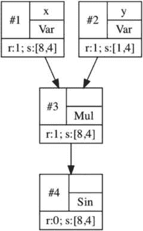
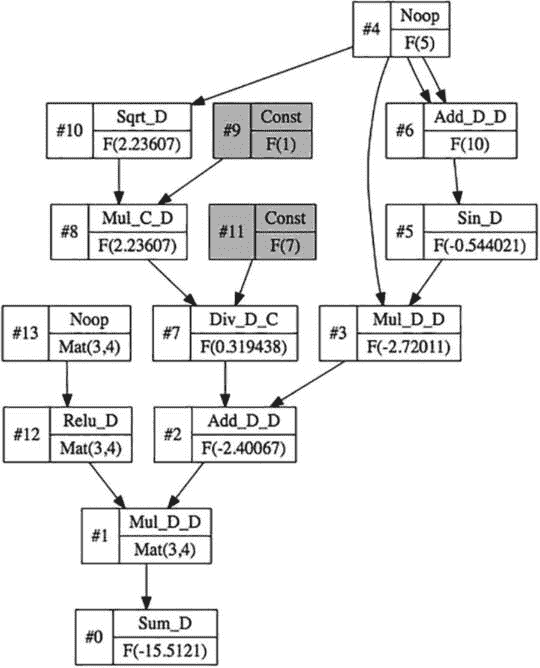
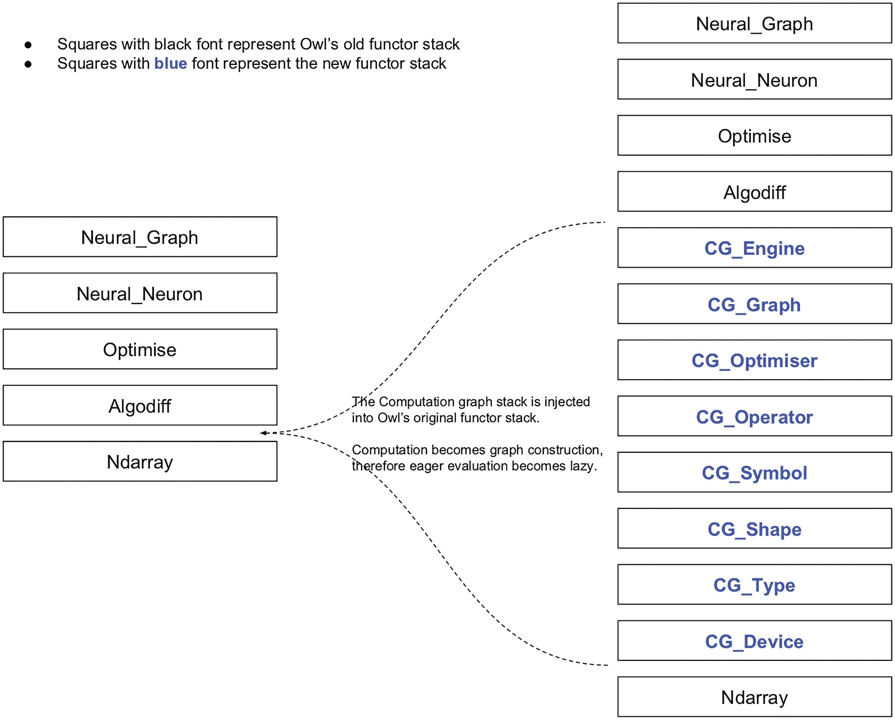
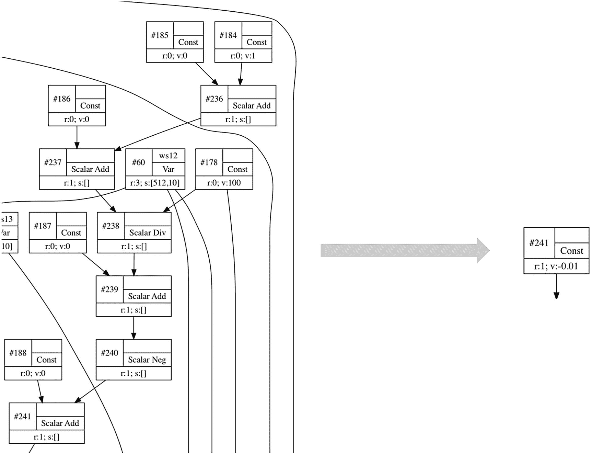
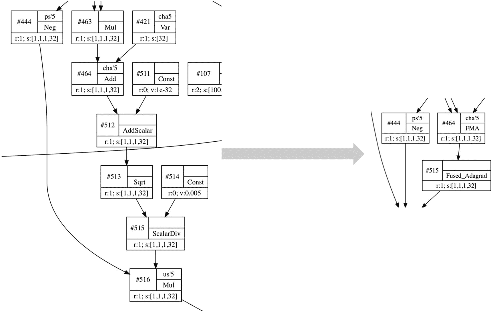
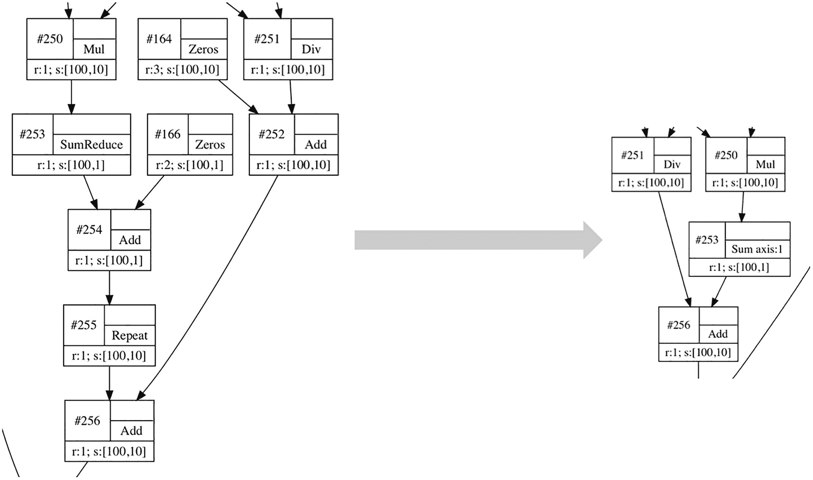
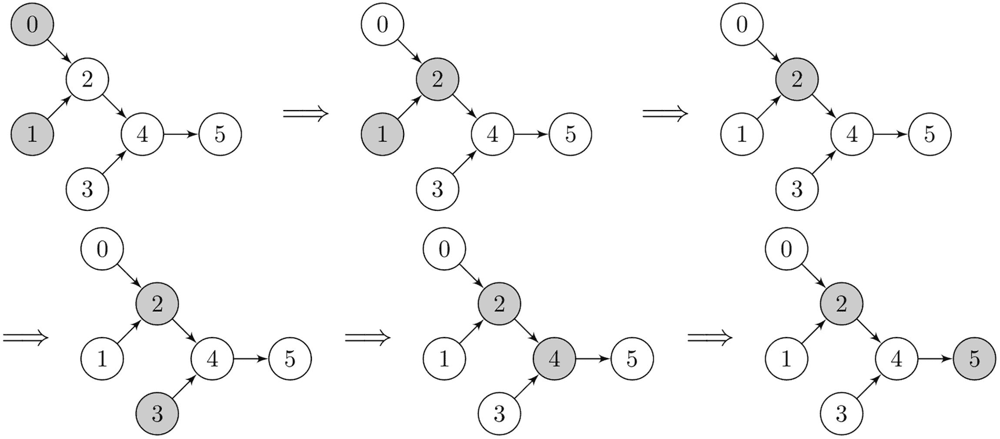
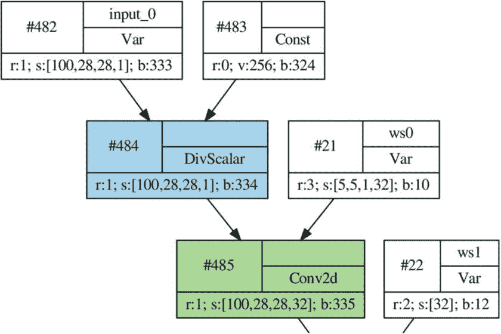

# 6. 计算图

梁望^(1  ) 和 赵建新^(2)
(1) 芬兰，赫尔辛基
(2) 中国，北京

计算图是现代深度学习库所依赖的基本理论工具。它也是 Owl 中的一个重要组成部分。本章首先对 Owl 中的计算图及其在计算中的重要性进行概述。然后，我们将通过一些示例演示如何在 Owl 中使用它。接着，我们将继续介绍计算图模块的设计与实现细节，以及它如何融入 Owl 的函子栈中。

## 6.1 计算图的定义

作为一名函数式程序员，一个基本常识是：函数接收输入并产生输出。一个函数的输入可以是另一个函数的输出，由此便形成了依赖关系。如果我们将函数视为图中的一个节点，其输入和输出分别视为指向其他函数的入边和出边，那么随着计算的进行，这些函数会串联起来，形成一个`有向无环图`（DAG）。这样的 DAG 通常被称为计算图。



有向无环图解释了 `sin(x * y)` 的计算过程。该运算涉及 4 个阶段：`x`、`y` 进入 `mul`，最后以 `sin` 结束。

**图 6-1** 简单函数 `sin(x*y)` 的计算图

图 6-1 展示了计算函数 `sin(x * y)` 的一个示例图。^(¹⁰) 该计算图包含多条对调试应用程序至关重要的信息，包括节点索引、操作类型、引用计数器、数据形状等。例如，在图 6-1 中，在 `Mul` 操作中，形状为 `[1; 4]` 的行向量 `y` 被广播到了形状为 `[8; 4]` 的矩阵 `x` 上。

### 动态图与静态图

计算图既可以在代码中隐式构建，也可以显式声明。隐式图构建通常通过运算符重载实现，并在运行时构建图；而显式声明则可能使用`领域特定语言`（DSL）在编译阶段构建一个结构固定的图。这两种方法产生了两种不同类型的计算图：`动态图`和`静态图`；它们各有优缺点。

动态图是在运行时构建的。由于`运算符重载`，其构建过程可以自然地与语言的原生结构（例如 `if ... else ...` 和 `for` 循环）融合，这赋予了其最大的灵活性和表现力。通过使用动态计算图，用户甚至可以为每个训练样本自由构建不同的网络。另一方面，静态图需要使用特定的 DSL 进行声明，这往往有较陡峭的学习曲线，并且在训练中仅定义一次。由于图的结构在编译阶段就已经确定，因此存在很大的优化空间。然而，在与原生代码配合使用时，有时很难用静态图来表达条件和循环。

动态图的灵活性是以性能较低为代价的。Facebook 的 `PyTorch` 和 Google 的 `TensorFlow` 分别是动态图和静态图的典型代表。许多程序员需要在两者之间做出选择。一种常见的做法是“在家用 `PyTorch`，在公司用 `TensorFlow`”。换句话说，`PyTorch` 更适合原型开发，而 `TensorFlow` 是生产环境中的理想选择。^(¹¹)

为了兼得两者之优，`Owl` 采取了与上述两者略有不同的方式。`Owl` 通过在运行时将动态图转换为静态图来实现这一点。其动机基于一个观察：在许多情况下，计算图在构建之后会被持续重新评估，尤其是对于那些迭代优化算法而言。因此，我们只需在每次迭代中更新图的某些输入即可。

如果我们知道每次迭代中图的结构保持不变，那么可以不在每次迭代中都重新构建，而是在迭代评估之前将其转换为静态图。这正是 `Owl` 所做的。通过这种方式，程序员既能享受通过运算符重载构建动态图带来的灵活性，同时又能获得静态图的最佳性能。

与 `TensorFlow` 相比，`Owl` 将图转换和优化的时间开销推迟到了运行时。`Owl` 使用在程序执行期间进行的`即时编译`（JIT）。由于图编译发生在运行时，JIT 编译器可以利用动态运行时信息，从而实现更好的优化。您可能会担心性能问题，想知道它是否会拖慢您炫酷的深度神经网络应用。事实上，即使对于大型复杂的图，这种 JIT 编译和优化也通常非常快速。

例如，在一个使用 `Owl` 构建的 LSTM 网络中，^(¹²) 有 15,105 个节点和 21,335 条边。`Owl` 能够在 230 毫秒内编译该图，并在 210 毫秒内优化其结构。优化后的图仅包含 8,224 个节点和 14,444 条边，运行速度快得多。请注意，这仅在训练前执行一次。对于较小的网络，通常只需要几毫秒。为了实现这一点，`CGraph` 模块实现了多种图优化技术，这些技术将在第 6.3 节讨论。

从技术上讲，在 `Owl` 的架构中实现 JIT 非常直接。给定一个深度神经网络，`Owl` 首先进行前向传播和反向传播。由于计算图的存在，计算变得符号化，我们可以获得用于计算神经网络损失和梯度的完整计算图。然后，它会将这个静态图传递给优化引擎。

### 在计算中的重要性

现在您已经了解了计算图的基本概念，可能会问它为何重要。实际上，计算图在任何机器学习框架中都扮演着核心角色。`TensorFlow` [1] 和 `PyTorch` [42] 这两个最流行的深度学习库都将计算图作为核心数据结构。计算图使许多事情变得简单。以下是其潜在优势的不完全列表：

*   在急切求值的语言中模拟惰性求值
*   增量计算（也称自适应计算）
*   通过优化图结构来降低计算复杂度
*   通过预分配空间来降低内存管理开销
*   通过重用已分配的内存空间来减少内存占用
*   天然支持并行和分布式计算
*   天然支持异构计算
*   天然支持符号数学

其中有些优势非常明显。如果图结构固定且预先知道输入形状，内存使用肯定能得到优化。一种优化是重用先前分配的内存，这对于那些涉及大型 `ndarray` 计算的应用尤其有用。实际上，这种优化也可以由编译器通过跟踪已分配内存的引用数量来实现，这项技术被称为`线性类型` [50]。有些优势乍一看可能不那么明显。例如，我们可以将一个计算图分解成多个独立的`子图`，每个子图可以在不同的核心甚至不同的计算机上并行求值。维护图结构还可以通过天然支持回滚机制来提高容错性。

计算图提供了一种抽象计算流程的方法；因此，它能够连接高级应用程序和底层各种硬件设备的机制。这就是它天然支持异构计算的原因。

计算图对科学计算系统的可扩展性和安全性有着更深远的影响。由于为每个节点分配的内存量是可变的，在评估大型复杂图时，算法微分变得更具可扩展性。同时，可变变换由 `Owl` 在内部处理，因此程序员仍然可以编写安全的函数式代码。

## 6.2 计算系统内部的应用

在深入探讨计算图模块的设计细节之前，本节先展示一些使用 `CGraph` 模块的示例，并说明如何将计算转换为惰性求值。

### 基本数值运算

我们先从一个简单的操作开始：将一个 `ndarray` 与一个标量相加。通常，使用 `Ndarray` 模块时，我们会这样做：

```
module N = Dense.Ndarray.D
let x = N.ones [|2;2|];;
let y = 2.;;
let g = N.add_scalar x y;;
```

现在，我们将这个函数转化为一个可由 `CGraph` 惰性求值的计算图：

```
module N = Owl_computation_cpu_engine.Make (Owl_algodiff_primal_ops.D)
```

这里的 `Make` 函数实际上是一个`函子`（functor）。对于那些不熟悉函子概念的读者，它是 OCaml 中用于构建通用代码和组织大型系统的强大工具。通俗地说，函子是一个从模块创建模块的函数。正如我们将在第 6.3 节中解释的那样，计算图被设计成一个`函子栈`。计算图的不同方面，例如内存管理和图优化，都是通过在现有模块基础上逐层创建新模块来添加到 `CGraph` 中的。

目前，我们只需知道函子创建了一个模块 `N`，它提供了完全相同的 `ndarray` 操作，区别在于所有操作都是在`符号`上执行的，这些符号代表了 ndarray，而不是内存中分配的真实对象。

```
let x = N.var_arr ~shape:[|2;2|] "x";;
let y = N.var_elt "y";;
let g = N.add_scalar x y;;
```

接下来，我们定义两个变量。第一个 `x` 是一个 `ndarray`（`arr`），而 `y` 是一个标量（`elt`）。此时，我们仅仅将它们定义为占位符，并没有包含真实数据。也就是说，我们并不关心这两个变量具体是哪个 ndarray 或标量。然后我们使用 `add_scalar` 函数来得到另一个惰性求值的 ndarray `g`。这就完成了惰性计算。到目前为止，我们只知道 `g` 是通过 `x` 和 `y` 相加计算得到的，但并不知道它们的具体值是什么。要获取惰性表达式 `g` 的值，我们首先需要给 `x` 和 `y` 赋值：

```
let x_val = Dense.Ndarray.D.ones [|2;2|];;
let y_val = 2.;;
let _ = N.assign_arr x x_val;;
let _ = N.assign_elt y y_val;;
```

这里，`x` 被赋值为一个全为 1 的双精度 ndarray，`y` 是浮点数 2。请注意 ndarray 和标量两种不同的赋值方法。最后，我们可以对 ndarray `g` 进行求值：

```
# N.eval_arr [|g|]
- : unit = ()
# N.unpack_arr g
- : Owl_algodiff_primal_ops.D.arr =
   C0 C1
R0  3  3
R1  3  3
```

`eval_arr` 函数会求值整个图，但不会返回结果。要提取计算结果，我们需要使用 `unpack_arr` 或 `unpack_elt` 函数。结果是一个 2x2 的 ndarray，所有值都是 3，正如预期的那样。

那么计算是在哪里发生的呢？请记住，`CGraph` 模块 `N` 是基于双精度类型 `Owl_algodiff_primal_ops` 模块构建的。正如我们在第 3 章中解释的那样，该模块实际上是一个 `Ndarray.D` 模块，并附带了一些额外的矩阵和线性代数操作。因此，在这个例子中，`g` 是基于 C 语言的 ndarray 计算得到的。如果我们把基础模块从 `Ndarray` 切换到 `Owl_base_ndarray`，那么计算就会使用原生 OCaml 来执行。

### 使用 CGraph 进行算法微分

在实际应用中，我们常常需要处理在算法微分过程中构建的 `CGraph`。下面是一个使用稠密 ndarray 模块计算函数梯度的示例：

```
include Owl_algodiff_generic.Make (Owl_algodiff_primal_ops.D)

let f x y =
  Maths.((x * sin (x + x) + ((pack_flt 1.) * sqrt x)
    / (pack_flt 7.)) * (relu y) |> sum')

let x = Dense.Ndarray.D.ones [|2;2|] |> pack_arr
let y = pack_elt 2.
let z = (grad (f x)) y |> unpack_elt
```

基于链式法则，`Algodiff` 模块会自动构建一个计算输入函数 `f` 梯度的图。结果包含在标量 `z` 中。然而，这个图是内部构建的，但有时我们需要访问这个图并应用优化。显然，让用户手动构建计算函数 `f` 梯度的计算图是极其困难的。

请注意，`Algodiff` 模块也是使用函子构建的。它的基础模块遵循 `Ndarray` 接口。通过将其从 `Ndarray` 模块改为 `CGraph` 模块，我们可以使 `z` 成为一个计算图而不是一个标量值，如下面的代码片段所示：

```
module G = Owl_computation_cpu_engine.Make (Owl_algodiff_primal_ops.D)
include Owl_algodiff_generic.Make (G)

let f x y =
    Maths.((x * sin (x + x) + ((pack_flt 1.) *
    sqrt x) / (pack_flt 7.)) * (relu y) |> sum')

let x = G.var_arr ~shape:[|2;2|] "x" |> pack_arr
let y = G.var_elt "y" |> pack_elt
let z = (grad (f x)) y
```

大部分代码保持不变。请注意 `CGraph` 模块是如何被视为 `Ndarray` 模块的替代品来构建 AD 模块的，因为它们遵循其基础模块所需的 `Algodiff` 模块的同一套接口。这决定了 AD 模块是使用常规求值还是惰性求值。执行这段代码后，结果 `z` 包含一个由执行算法微分时的反向传播过程构建的计算图。

接下来我们需要做的是给输入赋值并计算 `z`。这需要基于输入和输出来构建一个图，如下面的代码所示：

```
let inputs  = [| unpack_arr x |> G.arr_to_node; unpack_elt y |> G.elt_to_node |]
let outputs = [| unpack_elt z |> G.elt_to_node |]
let g = G.make_graph inputs outputs "graph"
```

要构建一个图，我们需要指定输入和输出`节点`。这可能会有点令人困惑，因为这里有两层打包和解包：第一层是从 AD 节点到 `CGraph` 元素，第二层是从 `CGraph` 元素到 ndarray 或标量。我们需要使用 `AD.unpack_arr` 和 `AD.unpack_elt` 来将 AD 类型数据（ndarray 和标量）解包为 `CGraph` 的 ndarray 和标量值。然后，要构建显式的计算图，我们需要使用 `G.arr_to_node` 和 `G.elt_to_node` 函数先将它们转换为图节点。最后，可以使用 `make_graph` 函数构建一个显式的计算图。

构建图 `g` 之后，我们就可以给计算图分配真实的数据值了。请注意，在赋值之前，我们需要先将 `Algodiff` 值解包为 `CGraph` 值：

```
let x_val = Dense.Ndarray.D.ones [|2;2|];;
let y_val = 2.;;
let _ = G.assign_arr (unpack_arr x) x_val;;
let _ = G.assign_elt (unpack_elt y) y_val;;
```

最后，我们可以通过简单地调用 `G.eval_graph g;;` 来对整个图进行求值。由于整个图被求值，输出 ndarray `z` 也就被求值了。我们可以先将其从 `Algodiff` 值解包为普通的 `CGraph` ndarray，然后再通过另一层解包获取其值：

```
# unpack_elt z |> G.unpack_elt
- : float = 4.20861827873129801
```



一个计算图描述了简单数学函数的计算过程。计算从 `mul_D_D` 开始，并经过各种函数处理，最终到达值为 3、4 的 `noop_mat` 输出。

**图 6-2**. 一个简单数学函数的计算图

你可能想知道，既然可以直接求值变量`z`，为什么还要费尽心思通过层层打包和解包来构建计算图。一个主要原因是，在执行计算图之前，可以对其进行各种优化，我们将在后续章节中解释这一点。另一个原因是，求值并不总是目标。例如，我们经常需要可视化生成的计算图。计算图在调试和理解数值计算特性方面非常有帮助。`Owl`提供了`graph_to_dot`函数，方便你生成计算图。它将计算图转换为[dot](https://www.graphviz.org/doc/info/lang.html)格式字符串。dot 文件可以使用[Graphviz](https://www.graphviz.org/)等工具进行可视化。例如，以下代码为我们在本例中构建的计算图生成了一个 dot 文件，该图如图 6-2 所示。

```
let s = G.graph_to_dot g
let _ = Owl_io.write_file "cgraph.dot" s
```

# 深度神经网络

由于优化和神经网络模块构建在算法微分模块之上，它们同样可以受益于计算图的能力。假设我们有一个基于 `CGraph` 的神经网络 `nn` 构建的网络，那么我们可以使用 `forward` 和 `backward` 函数，通过 `CGraph` 的 `ndarray` 变量，从神经网络图模块中获取前向推理和反向传播的计算图。实际上，为了方便访问，`Owl` 提供了另一个函子，用于基于 `CGraph` 模块构建神经网络模块：

```ocaml
module CPU_Engine = Owl_computation_cpu_engine.Make
  (Owl_algodiff_primal_ops.S)
module CGCompiler = Owl_neural_compiler.Make (CPU_Engine)
open CGCompiler.Neural
open CGCompiler.Neural.Graph
open CGCompiler.Neural.Algodiff

let make_network input_shape =
  input input_shape
  |> lambda (fun x -> Maths.(x / pack_flt 256.))
  |> conv2d [|5;5;1;32|] [|1;1|] ~act_typ:Activation.Relu
  |> max_pool2d [|2;2|] [|2;2|]
  |> dropout 0.1
  |> fully_connected 1024 ~act_typ:Activation.Relu
  |> linear 10 ~act_typ:Activation.(Softmax 1)
  |> get_network ~name:"mnist"
```

基于 `CGraph` 构建的神经网络模块在构建 CNN 时除了头部引用外，不需要修改任何代码。构建普通神经网络时，我们使用 `Neural` 模块，而现在我们只需将其改为 `CGCompiler.Neural` 模块。这里，`owl_neural_compiler` 函子将 DNN 定义和训练配置编译成一个与设备相关的静态图。作为其输出，`CGCompiler` 是一个由计算图驱动的神经网络编译器模块。`CGCompiler` 也提供了训练函数。请注意，数据需要在原始 `ndarray` 周围进行适当的打包。

```ocaml
let pack x = CGCompiler.Engine.pack_arr x
  |> Algodiff.pack_arr

let train network =
  let x, _, y = Dataset.load_mnist_train_data_arr () in
  let x = pack x in
  let y = pack y in
  CGCompiler.train network x y
```

类似地，可以使用 `CGCompiler.model` 函数进行推理。要将现有的 DNN 程序转换为惰性求值版本，我们只需要更新头部引用，并正确地对数据进行打包/解包即可。

`CGraph` 对神经网络的关键性能改进之一在于其图形和内存优化能力。为了激励你更深入地了解 `CGraph` 模块的设计和优化，这里有一个示例。让我们基于 MNIST 数据集训练一个类似 LeNet 的 DNN，分别使用普通版本 [mnist_cnn.ml](https://github.com/owlbarn/owl/blob/master/examples/mnist_cnn.ml) 和由 CGraph 驱动的版本 [lazy_mnist.ml](https://github.com/owlbarn/owl/blob/master/examples/lazy_mnist.ml)。^(¹³) 与前面的示例代码类似，两个脚本都对同一个卷积神经网络进行了 60 次迭代训练。在我们对一台普通笔记本电脑的评估中，`mnist_cnn.ml` 需要 30 秒完成，大约消耗 4GB 内存；而 `lazy_mnist.ml` 仅需 5 秒，消耗约 0.75GB 内存。这种性能提升令人惊叹。如果这些数字让你对魔法如何发生感兴趣，请继续阅读下一节。我们将揭示 `Owl` 计算图的底层机制。

## 6.3 计算图模块的设计

`Owl` 以一种非常独特且有趣的方式实现了计算图。让我们首先看看我们在设计和开发此模块时遵循的几个原则：

- **非侵入性**：原有的函子栈应保持原样工作。
- **对程序员尽可能透明**。
- **同时支持立即求值和惰性求值**。
- **足够灵活，以便将来扩展到其他设备**。

计算图在一个独立的栈中实现。我们设计了一种方式将其“注入”到 `Owl` 原有的函子栈中。如果这听起来太抽象，请查看图 6-3 中的最终产品。



Owl 在独立栈中实现计算图的示意图。

**图 6-3**
Owl 中的计算图函子栈

左图显示了 `Owl` 原始函子栈的一部分，右图显示了注入后当前栈的样子。在最初的设计中，`Ndarray` 实现了一组基础的 n 维数组操作，然后 `Algodiff` 定义了用于微分的抽象数学操作，最后 `Optimise` 引擎将底层数学与高层深度神经网络应用结合起来。整个栈由 `Ndarray` 中的数值类型抽象参数化：

- **`Ndarray`**：提供数值类型抽象并实现基础的数值操作。
- **`Algodiff`**：实现算法微分。
- **`Optimise`**：利用导数信息构建优化引擎。
- **`Neural_Neuron`**：实现各种可优化的神经元函数。
- **`Neural_Graph`**：将神经元连接起来形成网络，以便训练有用的模型。

基于此架构，整个计算图的函子栈可以被插入到 `Ndarray` 和 `Algodiff` 模块之间。设计原则是*数值系统的函子栈应由数值类型和设备类型共同参数化*。数值类型提供了数据表示（实数或复数、单精度或双精度、行优先或列优先布局等），决定了数学结构应如何构建和操作。设备类型提供了硬件表示（CPU、GPU、FPGA 等），决定了计算应如何在特定设备上执行。

以下列表总结了 `CGraph` 栈中每个函子的功能。这些函子的顺序和命名可以让你大致了解其设计方式：

- **`Device`**：设备抽象，包含与设备相关的类型和函数。
- **`Type`**：各种（数学）操作的类型定义。
- **`Shape`**：在图中提供*形状推断*函数。
- **`Symbol`**：提供用于操作符号的各种通用函数。
- **`Operator`**：实现数学运算符（`+`、`-`、`*`、`/` 等），决定符号如何连接以形成图。
- **`Optimiser`**：通过搜索和优化各种模式来优化给定图的结构。
- **`Graph`**：在高层操作计算图，例如可视化、连接输入和输出。
- **`Engine`**：在特定设备上评估计算图。

简而言之，注入的计算图栈提供了一个类似于符号数学的抽象层。在不注入计算图的情况下，如果你计算 `1+1`，OCaml 返回 `2`；现在它返回一个包含多个节点的图。因此，原来的立即求值变成了符号操作和纯图操作，并且该图可以被惰性求值。

### 形状推断与引擎

形状推断功能能够根据输入推断图中每个节点的数据形状。这使得 `Owl` 可以计算评估图所需的内存量，并预先分配该空间。`Owl` 还能进一步追踪每个函数节点的引用计数，并尽可能重用已分配的内存，从而降低内存占用和垃圾回收（GC）开销，显著提升计算速度。

引擎函子位于堆栈顶层，这是计算图最终执行的地方。引擎函子包含两个子模块：一个用于初始化图，另一个用于评估图。我们可以尝试在诸如 `utop` 的 OCaml REPL 中运行以下代码片段。这两个片段都为深度神经网络应用生成一个模块；区别在于，第一个使用了旧堆栈，而第二个使用了包含计算图的新堆栈。

```ocaml
module M =
    Owl_neural_generic.Flatten (
      Owl_neural_graph.Make (
        Owl_neural_neuron.Make (
          Owl_optimise_generic.Make (
            Owl_algodiff_generic.Make (
              Dense.Ndarray.S)))));;
```

至于包含计算图函子的新堆栈，我们可以看到它的层级确实更深。

```ocaml
module M =
    Owl_neural_generic.Flatten (
      Owl_neural_graph.Make (
        Owl_neural_neuron.Make (
          Owl_optimise_generic.Make (
            Owl_algodiff_generic.Make (
              Owl_computation_engine.Flatten (
                Owl_computation_cpu_engine.Make_Nested (
                  Owl_computation_graph.Make (
                    Owl_computation_optimiser.Make (
                      Owl_computation_operator.Make (
                        Owl_computation_symbol.Make (
                          Owl_computation_shape.Make (
                            Owl_computation_type.Make (
                              Owl_computation_cpu_device.Make (
                                Dense.Ndarray.S))))))))))))));;
```

我们已经介绍了计算图模块的不同组件。接下来，我们将深入探讨该模块核心功能的实现：图的构建、图结构的优化、评估、执行过程中的内存优化等。

### 计算设备

计算图是一种用于表达函数逻辑的抽象结构。为了计算函数的结果，计算图需要在物理设备上进行评估。只要设备具备执行数值运算的能力（例如 CPU、GPU 等），它就可以作为计算设备。为了在新的设备上扩展 `Owl`，我们只需要创建一个新的设备模块，并定义基本操作在该设备上的执行方式。由于 `CGraph` 模块的大部分内容与设备无关，因此设备层变得非常轻量，这进一步使得 `Owl` 易于扩展。

以下函子定义了一个 CPU 设备。该函子的输入是将在设备上处理的数据类型。在我们的示例中，这些数据类型是 `ndarray` 或标量值。如果你熟悉计算机体系结构，这非常容易理解。数据在不同架构的设备上通常以不同的方式存储和处理。创建一个新设备，本质上就是要在 OCaml 中创建一个抽象记录类型。另外两个函数则用于将数据打包和解包成设备能够处理的类型。

```ocaml
module Make (A : Ndarray_Mutable) = struct
  module A = A
  type device =
    { device_type : device_type
    ; initialised : bool
    }
  type value =
    | ArrVal of A.arr
    | EltVal of A.elt
  let make_device () = { device_type = CPU; initialised = false }
  let arr_to_value x = ArrVal x
  let value_to_arr = function
    | ArrVal x -> x
    | _        -> failwith "Owl_computation_device: value_to_arr"
  ...
end
```

例如，OpenCL 是一个用于开发跨平台程序的框架；这些程序可以在由 CPU、GPU、DSP、FPGA 以及其他处理器或硬件加速器组成的异构平台上执行。以下代码定义了一个兼容 OpenCL 的设备。与 CPU 设备相比，OpenCL 设备最显著的区别在于值的表示方式差异很大。数据可以存储在 CPU 附带的存储器中，也可以存储在 GPU 附带的存储器中。为了性能考虑，数据常常需要在两个独立的存储系统之间进行传输。此外，在 GPU 上执行的计算是由基于类 C 的领域特定语言编写的内核定义的。不同的计算单元通过事件进行通信。

```ocaml
module Make (A : Ndarray_Mutable) = struct
  module A = A
  type device =
    { device_type : device_type
    ; initialised : bool
    }
  type cpu_mem = A.arr
  type value =
    { mutable cpu_mem : cpu_mem array
    ; mutable gpu_mem : cl_mem array
    ; mutable kernel : cl_kernel array
    ; mutable events : cl_event array
    }
  let make_device () = { device_type = OpenCL; initialised = false }
  let arr_to_value x =
    let cpu_mem = [| x |] in
    let gpu_mem = [||] in
    let kernel = [||] in
    let events = [||] in
    { cpu_mem; gpu_mem; kernel; events }
  let value_to_arr x =
    if Array.length x.cpu_mem > 0
    then x.cpu_mem.(0)
    else failwith "value_to_arr: not evaluated yet"
  ...
end
```

在 OpenCL 设备上，一个值与存储、计算和通信相关的四个属性：用于存储的 CPU 内存和 GPU 内存、用于计算的内核，以及用于计算单元间通信的事件。

### 操作类型

`Owl_computation_type` 函子接收一个设备模块作为输入，然后指定给定设备上所有可能的操作。每当我们需要扩展操作集时，就需要将新操作对应的构造器添加到总和类型 `op` 中。当前的操作集涵盖了广泛的单目和双目数值函数，例如 `Abs`、`Neg`、`Add`，以及用于神经网络的函数，例如 `MaxPool3d`。

```ocaml
module Make (Device : Owl_types_computation_device.Sig) = struct
  module Device = Device
  open Device
  type state =
    | Valid
    | Invalid
  type t = attr Owl_graph.node
  and block =
    { size : int
    ; block_id : int
    ; mutable active : t option
    ; mutable memory : value
    ; mutable nodes : t list
    }
  and attr =
    { mutable op : op
    ; mutable freeze : bool
    ; mutable reuse : bool
    ; mutable state : state
    ; mutable shape : int array option array
    ; mutable value : value array
    ; mutable block : block array option
    }
  and arr = Arr of t
  and elt = Elt of t
  and op =
    | Noop
    | Var
    | Const
    | Abs
    | Neg
    | Add
    ...
end
```

在这里，`attr` 是一个记录类型，包含操作的属性。这些属性将用于初始化图，并优化其内存使用和评估性能。例如，`reuse` 字段指定与该操作关联的内存是否可以与其他操作共享。`block` 类型存储了内存以及所有共享该内存的操作。

## 形状推断

数据在计算图中流经不同节点时，其形状可能会发生变化。形状信息对于调试和优化非常有价值。当给定函数的所有输入都已知时，输出的形状就可以确定；因此，计算图的形状信息也就变得可用。`Owl_computation_shape`仿函数（functor）正是为自动化形状推断而创建的。该仿函数的核心函数是`infer_shape`，它通过模式匹配来调用对应运算符的形状推断函数。

```
module Make (Type : Owl_computation_type_sig.Sig) = struct
  module Type = Type

  let infer_shape operator args =
    let input_shapes = Array.map (fun a -> (Owl_graph.attr a).shape) args in
    match operator with
    | Noop          -> _infer_shape_01 input_shapes
    | Create shape  -> [| Some shape |]
    ...
    | Scalar_Add    -> _infer_shape_00 input_shapes
    | Scalar_Sub    -> _infer_shape_00 input_shapes
    ...
    | Abs           -> _infer_shape_01 input_shapes
    | Neg           -> _infer_shape_01 input_shapes
    ...
    | Add           -> _infer_shape_03 input_shapes
    | Sub           -> _infer_shape_03 input_shapes
    ...
    | Conv1d (padding, stride) -> _infer_shape_11 input_shapes padding stride
    | Conv2d (padding, stride) -> _infer_shape_12 input_shapes padding stride
    | Conv3d (padding, stride) -> _infer_shape_13 input_shapes padding stride
    ...
end
```

这里定义了超过 30 个形状推断函数。我们可以仔细看看那些常用的函数。例如，像`Scalar_Add`这样的标量运算符不需要形状信息，因此其推断函数仅返回一个空数组。之所以使用数组的数组作为返回类型，是因为一个运算符可能生成多个 ndarray 作为输出。

```
let _infer_shape_00 _input_shapes = [| Some [||] |]
```

`_infer_shape_01`模式是为一元运算符（如`Abs`）定义的，此类运算符只有一个输入和一个输出。这些运算符不会改变数据的形状；输入和输出的形状完全相同。因此，推断函数直接返回输入的形状作为输出的形状。

```
let _infer_shape_01 input_shapes =
  match input_shapes.(0).(0) with
  | Some s -> [| Some Array.(copy s) |]
  | None   -> [| None |]
```

如果输入形状相同，像`Add`这样的二元运算符将生成相同形状的输出。但是，如果输入的形状不同，则必须考虑广播（broadcasting）才能正确计算输出形状。幸运的是，可以轻松地从`Ndarray`模块中用于形状推断的广播规则中整理出这些广播规则。

```
let _infer_shape_03 input_shapes =
  let s0 = input_shapes.(0).(0) in
  let s1 = input_shapes.(1).(0) in
  match s0, s1 with
  | Some s0, Some s1 -> [| Some Owl_utils_infer_shape.(broadcast1 s0 s1) |]
  | _, _             -> [| None |]
```

我们在此并未涵盖所有的形状推断模式。如果你感兴趣，建议读者阅读`Owl`的源代码以了解更多信息。当图的形状已知时，我们可以利用这些信息来计算总内存消耗、发现优化机会、验证输入和输出的一致性、识别潜在的 Bug 等。

## 创建和链接节点

现在我们进入一个更高层次的抽象：图本身。对于计算图中的输入、输出和运算符，我们需要创建它们对应的节点。由于数值运算具有可组合性，一个函数的输出可以成为其他函数的输入。我们还需要根据节点的输入和输出依赖关系来链接它们。为此开发了`Owl_computation_symbol`和`Owl_computation_operator`仿函数。`Owl_computation_symbol`的输入是一个形状模块，因此该仿函数在构建图时可以自动推断形状。最基础的函数如`arr_to_node`和`node_to_arr`用于将 ndarray 打包到`CGraph`节点或从节点解包。

```
module Make (Shape : Owl_computation_shape_sig.Sig) = struct
  module Shape = Shape

  let node_to_arr x = Arr x
  let arr_to_node = function
    | Arr x -> x

  let node_to_elt x = Elt x
  let elt_to_node = function
    | Elt x -> x
  ...
end
```

创建节点的一般函数是`make_node`。该函数利用`Owl_graph`模块中定义的节点类型，该类型提供了一套全面的图操作函数。

```
let make_node ?name ?value ?shape ?freeze ?reuse ?state op =
  let shape =
    match shape with
    | Some s -> s
    | None   -> [| None |]
  in
  let state =
    match state with
    | Some s -> s
    | None   -> Invalid
  in
  let reuse =
    match reuse with
    | Some s -> s
    | None   -> true
  in
  let freeze =
    match freeze with
    | Some s -> s
    | None   -> false
  in
  let value =
    match value with
    | Some v -> v
    | None   -> [||]
  in
  let attr = { op; freeze; reuse; state; shape; value; block = None } in
  let node = Owl_graph.node ?name attr in
  if value <> [||] then make_value_block value.(0) node;
  node
```

由于`Owl_graph`模块是为通用图操作而设计的，例如构建、迭代、搜索、剪枝等，节点属性保持最小化且可扩展。正如在其定义中所见，节点类型有一个类型参数；因此，我们可以将操作的相关属性附加到节点上。

```
type 'a node =
  { mutable id   : int
  ; mutable name : string
  ; mutable prev : 'a node array
  ; mutable next : 'a node array
  ; mutable attr : 'a
  }
```

输入需要连接到运算符以产生输出。如果输出成为另一个运算符的输入，那么计算就会被链接在一起。`make_node`仅创建节点，而`make_then_connect`负责链接工作。`make_then_connect`函数在内部首先调用`make_node`来创建一个子节点，然后将父节点的输出连接到子节点的输入。如果父节点中存在重复项，需要特别注意，例如，在`y = x + x`的情况下。

```
let make_then_connect ?shape op parents =
  let shape =
    match shape with
    | Some s -> s
    | None   -> infer_shape op parents
  in
  let child = make_node ~shape op in
  connect_ancestors parents [| child |];
  let uniq_parents = Owl_utils_array.unique parents in
  Array.iter
    (fun parent ->
      if (attr parent).freeze = false
      then connect_descendants [| parent |] [| child |])
    uniq_parents;
  child
```

对于简单的 ndarray 创建函数，如`empty`、`zeros`等，`make_node`就足够了，因为这些函数除了自身的形状信息外，不需要任何父节点提供输入。

```
module Make (Symbol : Owl_computation_symbol_sig.Sig) = struct
  module Symbol = Symbol

  let empty shape = make_node ~shape:[| Some shape |] (Empty shape)
                    |> node_to_arr
  let zeros shape = make_node ~shape:[| Some shape |] (Zeros shape)
                    |> node_to_arr
  ...
end
```

对于确实需要父节点输出的一元运算符，会调用`make_then_connect`将父节点的输出连接到运算符的输入。父节点的输出从`arr`类型中解包出来，而子节点的输出则打包回`arr`类型。

```
let abs x = make_then_connect Abs [| arr_to_node x |] |> node_to_arr
let neg x = make_then_connect Neg [| arr_to_node x |] |> node_to_arr
```

二元运算符的工作方式类似。唯一的区别是与一元运算符相比，输入来自两个父节点而非一个。

```
let add x y = make_then_connect Add [| arr_to_node x; arr_to_node y |]
              |> node_to_arr
let sub x y = make_then_connect Sub [| arr_to_node x; arr_to_node y |]
              |> node_to_arr
let mul x y = make_then_connect Mul [| arr_to_node x; arr_to_node y |]
              |> node_to_arr
let div x y = make_then_connect Div [| arr_to_node x; arr_to_node y |]
              |> node_to_arr
```

利用这些基本函数，我们可以构建非常复杂的计算图。通常情况下，底层计算图可能比代码中定义的实际函数更为复杂；神经网络应用就是很好的例子。

### 图结构的优化

`Optimiser` 函子负责管理图结构的操作。它会搜索图中的各种结构模式，然后执行多种优化操作，例如移除不必要的计算、融合计算节点等。所有这些模式都在 `Owl_computation_optimiser` 函子中定义。

我们先来看看这个函子的核心，即 `_optimise_term` 函数，如下所示。该函数从叶子节点开始，递归地向其祖先节点回溯，寻找特定的模式进行优化。该函子能够识别的模式被编码在各种 `pattern_*` 函数中，这些函数会相互递归调用。源代码的组织方式使得插入更多模式以扩展优化器的能力变得非常直接。

```
module Make (Operator : Owl_computation_operator_sig.Sig) = struct
  module Operator = Operator
  let rec _optimise_term x =
    Owl_log.debug "optimise %s ..." (node_to_str x);
    if is_valid x = false
    then (
      (match get_operator x with
      | Noop -> pattern_003 x
      | Empty _shape -> pattern_000 x
      | Zeros _shape -> pattern_000 x
      ...
      | Add -> pattern_001 x
      | Sub -> pattern_000 x
      | Mul -> pattern_019 x
      | Div -> pattern_007 x
      ...
      | Scalar_Add -> pattern_010 x
      | Scalar_Sub -> pattern_010 x m
      ...
      | Dot (_transa, _transb, _alpha, _beta) -> pattern_005 x
      | Fused_Adagrad (_rate, _eps) -> pattern_000 x
      | _ -> failwith "Owl_computation_optimiser:_optimise_term");
      validate x)
end
```



**图 6-4.** 一个计算图演示了图优化中的常量折叠模式。计算图中的优化技术：常量折叠

在本部分，我们将解释三种最常用的图优化模式：常量折叠、操作融合和移除零值。常量折叠是一种非常基础的模式，用于减小图的大小。在计算图中，常常会看到涉及大量常量。因此，一些子图可以预先计算。图 6-4 就展示了这样一个例子。在这个子图中，节点 #241 依赖的要么是常量，要么是对常量的操作。因此，节点 #241 的值已经确定。我们可以在评估整个图之前，将这个子图折叠成一个单一的节点。

从 `_optimise_term` 函数的定义中，我们可以看到 `Scalar_Add` 运算符会触发 `pattern_010` 函数。这个函数首先尝试优化父节点，然后检查两个父节点是否都是常量。如果是，该函数会根据当前运算符计算表达式，为结果创建一个新的常量节点，然后移除当前节点及其父节点。通过这样做，所有能在这一阶段计算的表达式都将被折叠成一个常量，这可以在图评估阶段节省大量时间。



**图 6-5.** 一个计算图展示了图优化中的融合操作模式。计算图中的优化技术：融合操作

```
and pattern_010 x =
  let parents = parents x in
  let a = parents.(0) in
  let b = parents.(1) in
  _optimise_term a;
  _optimise_term b;
  match get_operator a, get_operator b with
  | Const, Const ->
      let a_val = node_to_elt a |> elt_to_float in
      let b_val = node_to_elt b |> elt_to_float in
      let c_val = pattern_011 (get_operator x) a_val b_val in
      set_parents x [||];
      set_reuse x false;
      set_operator x Const;
      freeze x;
      set_value x [| float_to_elt c_val |> unpack_elt |> elt_to_value |]
  | _            -> ()
```

下一个模式是融合操作，它会在适用时将多个操作合并为一个。例如，在图 6-5 中，节点 #421、#463 和 #464 被融合成一个 `fma` 节点（即融合乘加操作）。`Owl` 还能识别复杂的模式，例如，由节点 #511–#515 构成的模式在使用 Adagrad（自适应次梯度）训练方法的 DNN 训练中大量出现。将所有操作融合成一个单一操作可以提高计算效率和数值精度。此外，这种优化还能有效减少内存访问次数，在处理大型 ndarray 时可以节省大量时间。

在源代码中，融合 FMA 操作依赖于 `pattern_004` 函数。该函数首先检查当前运算符是否为 `Add`，然后检查其中一个输入是否来自乘法运算符。如果两个条件都满足，则该模式被识别。`refnum` 是一个计数器，用于跟踪一个运算符的输出被其他表达式引用了多少次。如果 `refnum` 大于 1，我们就不能融合该运算符，因为它的输出被另一个运算符用作输入。



**图 6-6.** 一个计算图展示了图优化中的加零模式。计算图中的优化技术：加零

```
and pattern_004 x =
  if get_operator x = Add
  then (
    let x_parents = parents x in
    let a = x_parents.(0) in
    let b = x_parents.(1) in
    if get_operator a = Mul && refnum a = 1
    then (
      let new_parents = Owl_utils_array.(parents a @ [| b |]) in
      set_parents x new_parents;
      replace_child a x;
      set_operator x FMA;
      remove_node a)
    else if get_operator b = Mul && refnum b = 1
    then (
      let new_parents = Owl_utils_array.(parents b @ [| a |]) in
      set_parents x new_parents;
      replace_child b x;
      set_operator x FMA;
      remove_node b))
```

接下来，加零模式在图中的表现很直观。如果一个节点加上另一个全零节点，那么这个全零节点可以被安全地移除。在图 6-6 所示的例子中，节点 #164 和 #166 被移除，其他节点被折叠。此外，用于重复操作的节点 #255 也被移除，因为加法操作已经支持广播操作。移除 #255 可以在评估时节省一些运行时内存。

`pattern_002` 函数可以检测 `x` + 0 和 0 + `x` 两种模式。其实现很直观。识别出 `Add` 运算符后，该函数检查其中一个输入是否为 0。如果是，则移除零节点，并将当前的 `Add` 运算符替换为 `Noop` 运算符。

```
and pattern_002 x =
  let x_parents = parents x in
  let a = x_parents.(0) in
  let b = x_parents.(1) in
  if get_operator x = Add
  then (
    match get_operator a, get_operator b with
    | Zeros _, _ ->
      set_operator x Noop;
      remove_edge a x;
      _optimise_term x
    | _, Zeros _ ->
      set_operator x Noop;
      remove_edge b x;
      _optimise_term x
    | _, _       -> ())
```

还有其他专注于特定计算的模式，例如乘法、除法、重复、求和归约等。如果你感兴趣，请参考源代码。为了展示 `Optimiser` 的有效性，我们再次使用之前在 MNIST 数据集上训练的类 LeNet CNN 作为示例。原始网络有 201 个节点和 239 条边；在应用了 `Optimiser` 中的图优化后，整个计算图仅由 103 个节点和 140 条边组成。

优化图结构以提升评估性能是一个高级话题。但正如你在之前的分步演示中所见，高级功能可以被分解为一组识别特定模式的简单函数，并使用典型的“分而治之”方法进行局部优化。TensorFlow 中的图优化遵循了类似的路径。TensorFlow 中的计算图首先使用 Python 前端构建，然后通过 C API 层转换为 C++后端能识别的格式。之后，图会使用多种技术进行优化，包括公共子表达式消除、常量折叠、移除恒等节点、移除死节点等。如果你查看 TensorFlow 的源代码，这部分功能由核心引擎的通用运行时模块负责。

### 计算引擎

现在我们终于到达了`CGraph`函子栈的顶层：**计算引擎**。由于计算图必须在硬件上执行，每种类型的设备都必须实现自己的计算引擎。以下代码展示了 CPU 设备的引擎。核心函数`eval_gen`包含两个步骤。第一步是通过调用`_init_terms`来初始化图。第二步是通过调用`_eval_terms`来评估图。

```
module Make_Nested (Graph : Owl_computation_graph_sig.Sig) = struct
  module Graph = Graph
  module CG_Init = Owl_computation_cpu_init.Make (Graph)
  module CG_Eval = Owl_computation_cpu_eval.Make (Graph)
  let eval_gen nodes =
    CG_Init._init_terms nodes;
    CG_Eval._eval_terms nodes
  let eval_elt xs = Array.map elt_to_node xs |> eval_gen
  let eval_arr xs = Array.map arr_to_node xs |> eval_gen
  let eval_graph graph =
    Graph.invalidate_rvs graph;
    Graph.get_outputs graph |> eval_gen
end
```

作为对比，我们再来创建 OpenCL 设备的计算引擎。`OpenCL`计算引擎的函子结构几乎相同，除了`eval_gen`函数。该函数的代码稍多一些，因为在**OpenCL 兼容设备**上设置计算环境比在 CPU 设备上复杂得多。这个过程包括许多步骤，如指定上下文、加速器、**命令队列**、**内核程序**等。评估输出也需要显式地从**GPU 内存**复制到**CPU 内存**以便进一步处理。

```
let eval_gen dev_id nodes =
  let ctx = Owl_opencl_context.(get_opencl_ctx default) in
  let dev = Owl_opencl_context.(get_dev default dev_id) in
  let cmdq = Owl_opencl_context.(get_cmdq default dev) in
  let prog = Owl_opencl_context.(get_program default) in
  let param = ctx, cmdq, prog in
  CG_Init.init_nodes nodes param;
  Array.iter
    (fun y ->
      CG_Eval._eval_term y param;
      let y_val = (get_value y).(0) in
      CG_Eval.gpu_to_cpu_copy param y_val |> ignore)
    nodes;
  Owl_opencl_base.CommandQueue.finish cmdq
```

`_eval_terms`函数由许多`_eval_map_*`函数组成，用于执行实际计算。让我们看看 CPU 设备的一个简单函数`_eval_map_00`。这个函数用于具有单个输入和单个输出的运算符。`_eval_map_00`只是将运算符的函数`f`应用于其输入`x`，然后返回结果。

```
and _eval_map_01 x f =
  _eval_terms (parents x);
  let inputs = Array.map (fun parent ->
    value_to_arr (get_value parent).(0)) (parents x) in
  let out = value_to_arr (get_value x).(0) in
  f ~out inputs
```

另一方面，OpenCL 设备上的类似函数更为复杂。由于计算发生在加速器上，我们需要设置用于通信的命令队列和用于同步计算单元的**事件队列**。我们还需要为计算逻辑指定合适的内核。这些内核在运行时动态编译，然后复制到加速器的计算单元。当输出最终准备好时，我们必须显式地分发事件以通知依赖项。

```
and _eval_map_01 x param =
  Array.iter (fun parent -> _eval_term parent param) (parents x);
  let _, cmdq, _ = param in
  let kernel = (get_value x).(0).kernel.(0) in
  let items = [ node_numel x ] in
  let wait_for = aggregate_events (parents x) |> Array.to_list in
  let event = Owl_opencl_base.Kernel.enqueue_ndrange ~wait_for cmdq kernel 1 items in
  Device.append_events (get_value x).(0) [| event |]
```

对 GPU 进行编程非常类似于对计算机集群进行编程。并行计算的优势伴随着不可避免的同步和通信开销。因此，GPU 计算仅在计算复杂度足以消除其他开销时才有意义。

当将计算卸载到 GPU 时，我们应避免在主机和设备内存之间来回传输数据，因此急切求值在此上下文中并不理想，因为性能会受到复制操作的瓶颈限制。这就是 CPU 计算与采用急切求值的语言之间的差距。计算图本质上填补了`Owl`与 GPU 计算之间的差距，仅仅是因为现在我们能够模拟惰性求值。

从实现角度来看，我们只需要为 GPU 设备编写一个新的引擎函子来评估图即可；所有其他部分保持不变。与 CPU 引擎相比，`OpenCL`引擎会为每个节点在主机和设备上维护分配的内存，仅在必要时进行复制，并且设备上分配的内存会尽可能被重用。

## 6.4 优化计算图中的内存使用

在前几节中，我们已经介绍了 `CGraph` 栈。在本章结束之前，我们想展示为减少 `CGraph` 模块内存使用所做的优化。在开发 `Owl` 过程中，我们一直遵循的原则是始终以实际应用为驱动力。除了图像识别示例，我们还构建了一个图像分割应用，这对 `Owl` 而言是一个具有挑战性且有趣的用例。为了提升该应用的性能，我们设法进一步优化了 `CGraph` 模块的设计。我们将在第 5 章介绍这个深度神经网络 `Mask R-CNN`。本节内容主要基于 Pierre Vandenhove 在 `OCaml Labs` [49] 实习期间对 `Owl` 所做的工作。

在 `Owl` 中构建完名为 `Mask R-CNN`（简称 `MRCNN`）的网络后，遇到的第一个问题是其在推理模式下的内存使用量巨大。该网络有超过 400 层。对于这个网络，合理的输入图像尺寸是 1024 像素宽的正方形。为了避免每张图片都重新初始化网络，一个好的做法是保持其输入尺寸固定，而将所有图像缩放到该尺寸。不幸的是，处理一张这种尺寸的图像需要超过 11GB 的 RAM，这对于普通笔记本电脑来说太多了。这显然还有很大的改进空间。

我们首先尝试应用上一节提到的图结构优化。`Mask R-CNN` 网络的节点数从 4095 降到了 3765，但这对内存减少的效果有限。为此，我们需要在 `CGraph` 函子栈中添加另一个重要的层：内存管理。具体来说，我们需要能够为每个节点预分配内存空间，以降低整体内存消耗并减少垃圾回收器的开销。关键在于找到图中不再需要的内存块，并将其分配给其他有需要的节点。

内存操作功能是在栈中的 `Engine` 函子中实现的。关键的数据结构是我们在第 6.3 节中提到的 `block` 类型。`block` 类型是一个记录，它维护着一个共享同一内存的节点列表。在 `Owl` 的计算图模块中，为节点 `u` 分配内存的初始策略很简单：在可能的情况下，直接复用具有与 `u` 相同输出形状的直接前驱节点的内存。例如，如果我们对两个形状相同的 `ndarray` 进行加法运算，输出的 `ndarray` 可以复用其中一个的内存块。这一优化将 `Mask R-CNN` 的内存消耗从 11GB 降到了 7GB。这个 36% 的降幅看起来相当可观，但我们能否做得更好呢？

为了描述在计算图中分配内存的过程，首先回顾一下 1973 年引入的用于解释寄存器分配的*卵石游戏*[45]会很有意思。卵石游戏是在一个有向无环图上进行的。每个节点最多可以存放一个卵石。游戏开始时，所有节点上都没有卵石。每一步，玩家可以执行以下操作之一：

1. 如果顶点 `v` 没有前驱节点，玩家可以在 `v` 上放置一个卵石。
2. 如果顶点 `v` 的所有前驱节点都已经有卵石，玩家可以在 `v` 上放置一个卵石，或者从其某个前驱节点滑动一个卵石到 `v`。
3. 玩家可以移除顶点上的任何卵石（之后可重复使用该卵石）。

游戏的目标是至少在图中某些固定的输出顶点上放置一次卵石。图 6-7 展示了使用之前计算图（灰色节点为已有卵石）的一个最优卵石策略示例，通过操作序列 1 -> 2 -> 3 -> 1 -> 2 -> 2 实现。我们假设目标是为节点 5 放置卵石。

如果我们把卵石看作是用来存储节点输出值的内存块，那么这个游戏就与计算图的内存分配相关。我们假设输入值是已知的（操作 1）。只有当顶点 `v` 的所有前驱节点同时存储在内存中时，我们才能计算该顶点的值（操作 2）。*滑动*操作意味着一个节点的内存可以在其计算过程中被其后继节点覆盖（*就地复用*）。我们总是可以复用来自任何其他节点的内存块（操作 3）。因此，给定一个图，思路就是找到一种策略，使用最少数量的卵石来为其放置卵石，换句话说，就是使用尽可能少的内存。



一幅图展示了在 3 个阶段中使用最优卵石策略对计算图进行建模。部分圆圈被着色以突出显示已有卵石的节点。

**图 6-7** 将计算图内存优化问题建模为卵石游戏

我们还希望避免对任何节点进行两次卵石放置，以便尽可能保持较短的执行时间，因为这意味着我们要两次计算同一个节点。遗憾的是，在这些约束条件下，找到使用最少卵石的策略是 NP 完全问题[45]。由于计算图可能有数千个节点，我们实现了一个快速的启发式算法，而不是精确算法。

现在，我们可以将卵石游戏过程应用到我们的内存分配过程中。我们建议在满足以下条件的节点之间共享内存：(1) 不一定具有父子关系，(2) 不要求输出尺寸相同（通过一次分配一大块内存，而不必一直全部使用）。为了高效地做到这一点，我们首先必须确定一个评估顺序（实践中，任何拓扑顺序都可以）。给定这个顺序，我们可以通过维护每个节点被使用次数的计数器来准确定位其内存何时变得无用。当节点的所有子节点都使用过它之后，我们就可以回收其内存。然后，为了给一个节点分配内存，我们只需检查哪些块可用，并选择尺寸最接近的那个（以免浪费过多内存）。如果没有可用块，我们就分配一个新的。这可以在 `O(n * log (n))` 时间内执行，与评估图的实际成本相比可以忽略不计。

请注意，某些操作在计算过程中不能覆盖其输入（禁止卵石游戏中的*滑动*操作），并且出于实际目的，某些节点不能被覆盖，典型的有常量节点或神经网络权重。当按正确顺序评估时，计算图所需的内存块远小于未经优化的版本。例如，图 6-8 展示了一个优化后的计算图的部分内容。每种颜色对应一个内存块，而白色节点则需要始终保留在内存中。

`add_node_to_block` 中的代码说明了引入新节点的步骤。如果父节点的内存块可复用，该函数会检查该内存是否足够容纳当前运算符的输出。如果是，该节点会将当前运算符添加到共享同一内存块的节点列表中。此外，内存会根据输出形状进行重塑。

```
let add_node_to_block x block =
  let dst_shp = node_shape x in
  let dst_numel = node_numel x in
  let src_val = value_to_arr (_get_value_block block) in
  let dst_val = arr_to_value
    (A.reshape (A.sub_left src_val 0 dst_numel) dst_shp) in
  block.nodes <- x :: block.nodes;
  _set_block x [| block |];
  (attr x).value <- [| dst_val |]
```



一幅图说明了优化内存分配的功能。

**图 6-8** 优化后的内存分配

有效实施这一方法后，对于一张 1024x1024 的图片，`Mask R-CNN` 的内存消耗从 7GB 降低至 1GB。表 6-1 展示了更多统计数据，说明了采用这种新算法的计算图所达到的效果。这些实验在一台配备 `Intel i5-6300HQ` 处理器和 8GB 内存的笔记本电脑上运行。在此评估中，`InceptionV3` 和 `ResNet50` 网络使用 299x299 的图像进行测试，而 `Mask R-CNN` 则使用 768x768 的图像进行测试。MNIST 行指的是我们在第 6.2 节中使用的小型类 `LeNet` 神经网络。最终结果取 30 次评估的平均值，使用计算图时不重用预先计算的节点。构建图阶段包括图的构建、优化和内存初始化。

表 6-1 使用不同 DNN 架构对 `CGraph` 内存优化效果的评估

| 架构 | 无计算图时间 (秒) | 有计算图时间 (构建 + 评估) (秒) | 无计算图内存 (MB) | 有计算图内存 (MB) |
| --- | --- | --- | --- | --- |
| `InceptionV3` | 0.565 | 0.107 + 0.228 = 0.335 | 625.76 | 230.10 |
| `ResNet50` | 0.793 | 0.140 + 0.609 = 0.749 | 1309.9 | 397.07 |
| `MNIST` (训练) | 20.422 | 0.144 + 10.920 = 11.064 | 3685.3 | 895.32 |
| `Mask R-CNN` | 11.538 | 0.363 + 8.379 = 8.742 | 6483.4 | 870.48 |

该评估结果显示了 `CGraph` 模块的影响。一方面，通过图结构优化，神经网络的执行时间显著减少。这种减少对于像 `Mask R-CNN` 这样的大型网络的推理或模型训练来说尤为明显。另一方面，内存减少的效果也令人印象深刻，使用 `Mask R-CNN` 网络进行推理时，内存最多可减少 10 倍以上。

## 6.5 总结

在本章中，我们介绍了 Owl 中的核心计算图模块。我们首先对数值计算中的计算图以及为何在 Owl 中构建它进行了概括性介绍。接着，我们用了几个示例来演示计算图模块在 Owl 中的使用方式。随后介绍了该模块的内部设计，其中最重要的是 `CGraph` 栈及其在 Owl 架构中的位置。计算图创造了一个广阔的优化空间，在本章中，我们详细介绍了其中两种优化。第一种是图结构优化，第二种是优化计算图中的内存分配。计算图是一个重要的研究课题，我们相信该模块在性能提升方面仍有很大潜力。


**开放获取** 本章采用知识共享署名 4.0 国际许可协议 ([`creativecommons.org/licenses/by/4.0/`](http://creativecommons.org/licenses/by/4.0/)) 进行许可。只要您给予原作者和来源适当的署名，提供指向知识共享许可协议的链接，并指明是否进行了修改，即可在任何媒介或格式中复制、分享、改编、分发和复制本章内容。

除非在材料的署名行中另有说明，否则本章中的图像或其他第三方材料均包含在本章的知识共享许可协议中。如果材料未包含在本章的知识共享许可协议中，并且您的预期使用未得到法律法规的允许或超出了允许的范围，您需要直接向版权所有者获取许可。

脚注 1 2 3 4 © The Author(s) 2023 L. Wang, J. Zhao Architecture of Advanced Numerical Analysis Systems [`doi.org/10.1007/978-1-4842-8853-5_7`](https://doi.org/10.1007/978-1-4842-8853-5_7)