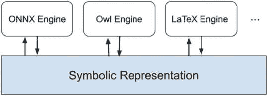

# 7. 性能加速器

梁望^(1) 和 赵建新^(2) (1) 芬兰，赫尔辛基 (2) 中国，北京

## 7.1 硬件加速器

图形处理单元（`GPU`）已成为最重要的硬件加速器类型之一。它专为渲染 3D 图形和视频而设计，至今仍是游戏行业的核心。除了创造令人惊叹的视觉效果外，程序员还利用`GPU`在并行处理方面的优势，在健康数据分析、物理模拟、人工智能等多个领域执行计算密集型任务。

回顾第 2 章中典型`CPU`的架构。`GPU`核心的架构与此有些类似。图 7-1 展示了`Nvidia GTX 1080`的一个核心，该芯片包含 20 个这样的核心。与`CPU`核心相比，它包含更多的多线程单元，包括更多的单指令多数据（`SIMD`）功能单元，并且在`GPU`中包含更多核心。`GPU`的另一个特点是缓存小。该`GPU`仅包含两级缓存（此图仅显示一级缓存；二级缓存由所有 20 个核心共享），每一级都比典型的`CPU`缓存小。此外，`GPU`还专注于吞吐量，因此其核心与内存之间的带宽远大于`CPU`。


一个具有 3 层的 GPU 核心架构图。顶层包含 4 个模块，每个模块有 32 个正方形，并有 2 个获取或解码框。执行内容和 L1 缓存是第二层和第三层。

图 7-1 `GPU` 核心架构示意图

近年来备受关注的另一种加速器是张量处理单元（`TPU`）。2016 年，`Google`宣布了其专用集成电路`TPU`，并表示`TPU`已部署在`Google`的数据中心，用于加速神经网络计算。

`TPU`的设计基于这样一个事实：矩阵乘法在神经网络相关计算中占主导地位，并将此操作作为基本操作。在`CPU`中，基本计算单元是标量，因此我们可以在一个周期内使用一条指令来相加两个整数。而`GPU`则广泛利用多线程，因此用户可以在一个周期内相加两个向量。`TPU`进一步提出在一个周期内完成矩阵运算。

一个`TPU v2`核心包含一个矩阵乘法单元（`MXU`）和一个向量处理单元（`VPU`）。前者专长于矩阵乘法，后者负责所有其他类型的任务，例如激活函数。`MXU`利用脉动阵列架构来实现单时钟周期矩阵运算。因此，它可以在一个周期内执行多达 128K 次运算。`Google`报告称，与同时代的`CPU`和`GPU`相比，`TPU`提供了 15–30 倍的性能提升和 30–80 倍的每瓦性能提升。此外，由于神经网络对误差的容忍度，`TPU`还执行量化操作，通过将连续的浮点数转换为离散值来压缩计算。

### 利用加速器

毫无疑问，数值计算严重依赖于硬件加速器：`TensorFlow`、`PyTorch`、`Julia`、`MATLAB` 等。它们都支持多种类型的设备，至少包括`CPU`和`GPU`。通常，有两种实现方式。

第一种也是应用最广泛的方式，是直接对硬件提供支持。以`GPU`为例，在对`GPU`进行编程时，`Nvidia CUDA`是一个广泛使用的选择。`CUDA`是一个用于在`Nvidia` GPU 上进行计算的并行计算平台和编程模型。在`TensorFlow`中，计算图首先在前端用 Python 表达，然后相应地用 C++ 后端构建。该图会进一步被优化并划分到多个设备上，这些设备可以是`CPU`、`GPU`或`TPU`。每个设备调用相应的执行器，在其子图上运行分配的计算任务。对于`TPU`设备的执行，`TensorFlow`集成了一个编译器和软件栈，用于将`TensorFlow`计算图中的 API 调用转换为`TPU`指令。在`Julia`中，对`Nvidia` GPU 的支持由其`CUDA.jl`包提供。该包基于`CUDA`工具包构建，既支持直接与`CUDA` API 交互，也支持编写 CUDA 内核。`NumPy`不支持`GPU`，但在庞大的 Python 生态中，有许多支持`GPU`的替代方案，例如`Numba`、`CuPy` 等。

与`CUDA`相比，开放计算语言（`OpenCL`）是一个跨平台并行编程的开源标准，并且不仅限于`Nvidia` GPU。因此，一些数值计算库和软件也支持它运行在非`Nvidia` GPU 上。`TensorFlow`用于在`GPU`设备上处理计算任务的`StreamExecutor`实际上是对`CUDA`和`OpenCL`运行时环境的统一封装。

近年来，随着深度学习框架数量的增长，以及同样增长的硬件加速器平台数量，一种新方法是利用中间表示。例如，深度学习编译器获得了快速发展。深度学习编译器接受深度学习框架中描述的模型定义，并生成针对特定目标硬件的高效实现。`TVM` [10] 就是一个流行的深度学习编译器，可与广泛的框架和硬件设备协同工作。一个密切相关的方法是开放神经网络标准，该标准可以与各种框架互相转换，并且可以在各种硬件上编译和执行。其中一个例子是开放神经网络交换（`ONNX`）格式。总之，一个日益增长的趋势是，可以将计算的定义分离出来，由底层编译器来处理优化、代码生成等任务，以追求最佳的计算性能。我们可以将深度学习编译器和开放标准看作是连接两个生态系统之间鸿沟的沙漏颈。在本章的剩余部分，我们将基于后一种方法，提出`owl_symbolic`，它将`Owl`的计算转换为`ONNX`格式，并能在各种硬件加速器上执行。

## 7.2 设计

除了要在加速器上执行的需求之外，`owl_symbolic`库的开发还源于其他几个因素。一方面，科学计算可以认为由两大类组成：数值计算和符号计算。`Owl`在前者上奠定了坚实的基础，但对后者尚未提供支持，而后者在许多领域中被大量使用。

此外，诸如计算可视化等任务也需要某种形式的中间表示（IR）。如第 6 章所述，`Owl`已经提供了一个计算图层来分离计算的定义和执行以提升性能，但它并非执行前述各种不同任务的 IR 层。为此，我们开始开发计算的中间符号表示，并基于这种符号表示来促进各种任务。

需要指出的是，不要将我们的符号表示误解为经典的符号计算（或计算机代数系统），后者以符号方式操作数学表达式，类似于传统的手工计算。追求用`Owl`进行符号计算确实是我们核心动机之一。目前，我们提供了一个符号表示层，作为迈向该目标的第一步。在未来的版本开发中，随着`Owl`对符号数学的支持，将会有更多讨论。

`owl_symbolic`库分为两部分：构建符号图的核心符号表示，以及基于该图执行不同任务的各类引擎。该系统的架构设计如图 7-2 所示。



图 7-2 符号系统架构

核心抽象是一个独立的符号表示层。基于这一层，我们构建了多种可以与该符号表示进行相互转换的引擎。目前，我们支持三种引擎：`ONNX`二进制格式、`Owl`中的计算图以及`LaTeX`字符串。CAS 引擎目前仍是一个正在进行的研究项目，我们设想，一旦完成，该引擎可用于预处理符号表示，使其在由其他引擎处理之前具有一个简化的规范形式。

### 核心抽象

核心部分的设计力求精简，仅包含必要信息。目前，它已涵盖了多种常见的计算类型，例如数学运算、张量操作，以及神经网络特有的操作，如卷积、池化等。符号图中的每个符号都执行特定的操作。符号图的输入可以是常量，例如整数、浮点数、复数和张量。输入也可以是具有特定形状的变量。空的形状表示一个标量值。用户可以在符号图构建完成后，为变量提供具体的值。

### 符号

符号表示主要定义为一个符号数组。每个符号都是一个图节点，其属性类型为`Owl_symbolic_symbol.t`。这意味着我们可以从任意一个符号开始遍历整个图。除了符号之外，`name`字段是图的名称，`node_names`则包含了该图中所有节点的名称。

```ocaml
type symbol = Owl_symbolic_symbol.t Owl_graph.node
type t =
  { mutable sym_nodes : symbol array
  ; mutable name : string
  ; mutable node_names : string array
  }
```

让我们看看`Owl_symbolic_symbol.t`。它定义了符号表示中包含的所有操作：

```ocaml
type t =
  | NOOP
  | Int                   of Int.t
  | Complex               of Complex.t
  | Float                 of Float.t
  | Tensor                of Tensor.t
  | Variable              of Variable.t
  | RandomUniform         of RandomUniform.t
  | Sin                   of Sin.t
  | Cos                   of Cos.t
  | Exp                   of Exp.t
  | ReduceSum             of ReduceSum.t
  | Reshape               of Reshape.t
  | Conv                  of Conv.t
  ....
```

我们的符号表示总共包含大约 150 个操作。每个操作都被实现为一个模块。这些模块共享一些通用属性，例如名称、输入操作名称和输出形状，然后每个模块包含零个或多个自身特有的属性。例如，`Sin`操作模块的实现如下：

```ocaml
module Sin = struct
  type t =
    { mutable name : string
    ; mutable input : string array
    ; mutable out_shape : int array option array
    }
  let op_type = "Sin"
  let create ?name x_name =
    let input = [| x_name |] in
    let name = Owl_symbolic_utils.node_name ?name op_type in
    { name; input; out_shape = [| None |] }
end
```

该模块提供了诸如`op_type`之类的属性和诸如`create`之类的函数，后者返回`Sin.t`类型的对象。`name`、`input`和`out_shape`是操作模块中的通用属性。

在实现所支持的操作时，我们遵循`ONNX`中使用的分类方式。这些操作通常可以分为以下几类：

*   **生成器 (Generators)**：不接收输入，用于生成数据的操作。例如，`Int`、`Float`、`Tensor`、`Variable`等。
*   **逻辑 (Logical)**：逻辑操作，例如`Xor`。
*   **数学 (Math)**：数学运算。这类操作占据了所支持操作的大部分。
*   **神经网络 (Neural network)**：与神经网络相关的操作，例如卷积和池化。
*   **目标检测 (Object detection)**：同样用于神经网络，但与目标检测应用密切相关的操作，包括`RoiAlign`和`NonMaxSuppression`。
*   **规约 (Reduction)**：规约（或折叠）数学运算，例如求和规约。
*   **RNN (RNN)**：循环神经网络相关操作，例如`LTSM`。
*   **张量 (Tensor)**：常规张量操作，例如包含在`Ndarray`模块中的操作，如`concat`、`reshape`等。
*   **序列 (Sequence)**：将多个张量作为一个称为序列的单一对象，并对序列类型数据提供不同的相应函数，例如`SequenceInsert`、`SequenceLength`等。

基于这些操作模块，我们在`Owl_symbolic_symbol.t`类型上提供了几个函数：

*   `name`：获取操作的名称
*   `op_type`：获取操作类型字符串
*   `input`：获取操作的输入节点名称
*   `set_input`：更新输入节点名称
*   `output`：获取操作的输出节点名称
*   `set_output`：更新输出节点名称

还有一些函数仅适用于特定类型的操作。生成器类型的操作都需要指定其支持的数据类型。因此，我们使用`dtype`函数来检查它们的数据类型。另一个例子是`output`属性。对于大多数操作来说，它们只有一个输出，因此其名称就是其输出名称。然而，对于像`MaxPool`这样包含多个输出的操作，我们需要另一个函数：`output`。

### 类型检查

`owl_symbolic`支持的类型如下所示：

```ocaml
type number_type =
  | SNT_Noop
  | SNT_Float
  | SNT_Double
  | SNT_Complex32
  | SNT_Complex64
  | SNT_Bool
  | SNT_String
  | SNT_Int8
  | SNT_Int16
  | SNT_Int32
  | SNT_Int64
  | SNT_Uint8
  | SNT_Uint16
  | SNT_Uint32
  | SNT_Uint64
  | SNT_Float16
  | SNT_SEQ of number_type
```

这个类型列表涵盖了大多数数字和非数字类型。此外，`SNT_SEQ`类型用于与这些基本类型组合，以表示浮点数列表、布尔值列表、字符串列表等。

### 操作符

所有这些操作对用户是不可见的。用户实际使用的是操作符。要构建一个图，我们首先需要将所需的属性构建到一个操作中，然后将其放入一个图节点中。这就是操作符所做的工作。以`sin`操作符为例：

```ocaml
let sin ?name x =
  let xn = Owl_symbolic_graph.name x in
  let s = Owl_symbolic_ops_math.Sin.create ?name xn in
  make_node (Owl_symbolic_symbol.Sin s) [| x |]
```

在这里，`sin`操作符接收其父节点`x`作为输入，将其名称作为输入属性，然后使用`make_node`函数创建一个符号节点。这个函数接收一个操作和一个父符号数组，然后创建一个符号作为返回。它的主要工作是使用给定的操作作为节点属性创建一个子节点，更新子节点的输入和输出形状，然后在返回子节点之前将子节点与父节点连接起来。连接是双向的：

```ocaml
connect_ancestors parents [| child |];
let uniq_parents = Owl_utils_array.unique parents in
Array.iter (fun parent ->
  connect_descendants [| parent |] [| child |]) uniq_parents
```

因此，用户可以使用操作符来构建一个图表示。以下是一个示例：

```ocaml
open Owl_symbolic
open Op
open Infix
let x = variable "x_0"
let y = exp ((sin x ** float 2.) + (cos x ** float 2.))
    + (float 10\. * (x ** float 2.))
    + exp (pi () * complex 0\. 1.)
```

这里，我们从`variable`操作符开始，它为后续传入的数据创建一个占位符。您可以使用`~shape`参数指定变量的形状。如果未指定，则默认为标量。您也可以选择用张量来初始化这个变量，这样即使您没有向变量馈送任何数据，也会使用默认的张量值。`owl-symbolic`中的张量定义如下：

```ocaml
type tensor =
  { mutable dtype : number_type
  ; mutable shape : int array
  ; mutable str_val : string array option
  ; mutable flt_val : float array option
  ; mutable int_val : int array option
  ; mutable raw_val : bytes option
  }
```

一个张量具有特定的数据类型，并且包含值：字符串数组、浮点数数组、整数数组或字节。这些字段中只能使用一个。如果使用张量初始化，变量将采用与该张量相同的数据类型和形状。

### 命名

目前，我们采用全局命名方案，即在每个节点类型后添加递增的索引号。例如，如果图中有一个 `Add` 符号、一个 `Div` 符号和另一个 `Add` 符号，那么每个节点将被命名为 `add_0`、`div_1` 和 `add_1`。一个例外是变量，用户在创建变量时必须显式命名。当然，用户也可以选择为图中的任意节点命名，但系统会检查以确保每个节点名称唯一。符号图包含 `node_names` 字段，该字段包含图中所有节点的名称。

## 形状推断

符号核心需要执行的任务之一是形状检查和形状推断。形状推断在 `make_node` 函数中执行，因此每次用户使用某个运算构建符号节点并将其与先前的节点连接时，都会执行形状推断。它假设当前节点的父节点是已知的。

```
let (in_shapes : int array option array array)=
  Array.map (fun sym_node ->
    Owl_graph.attr sym_node |> Owl_symbolic_symbol.out_shape
  ) parents
  in let (shape : int array option array) =
  Owl_symbolic_shape.infer_shape in_shapes sym ...
```

如代码所示，对于每个节点，我们首先找到其父节点的输出形状。`in_shape` 的类型是 `int array option array array`。你可以这样理解：`int array` 是一个形状数组；`int array option` 表示该形状可能为 `None`。然后 `int array option array` 是来自前一个父节点的完整输入，因为一个父节点可能包含多个输出。最后，`int array option array array` 包含了所有父节点的输出。主函数 `Owl_symbolic_shape.infer_shape` 随后推断当前节点的输出形状，并将其保存到该符号的 `out_shape` 属性中。

`infer_shape` 函数本身会检查符号类型，然后匹配特定的实现。例如，大量的运算实际上只接受一个父节点并保持其输出形状：

```
let infer_shape input_shapes sym =
  | Sin _ -> infer_shape_01 input_shapes
  | Exp _ -> infer_shape_01 input_shapes
  | Log _ -> infer_shape_01 input_shapes
....
let infer_shape_01 input_shapes =
  match input_shapes.(0).(0) with
  | Some s -> [| Some Array.(copy s) |]
  | None   -> [| None |]
```

这种 `infer_shape_01` 模式涵盖了这些运算。它仅接受输入形状并返回相同的形状。

输入形状为 `None` 有两个可能的原因。首先，每个节点会初始化为输出形状为 `None`。在形状推断过程中，在某些情况下，输出形状取决于输入节点的运行时内容，而不仅仅是输入节点的形状和当前节点的属性。在这种情况下，输出形状被设置为 `None`。一旦输入形状包含 `None`，此后形状推断的结果都将为 `None`，这意味着输出形状无法在编译时确定。

## 多输出

大多数运算符实现起来都很直接，但有些运算符会返回多个符号。在这种情况下，运算返回的不是一个节点，而是一个元组，或者当输出数量不确定时，返回一个节点数组。例如，`MaxPool` 运算返回两个输出：一个是常规的最大池化结果，另一个是包含池化期间所选值索引的对应张量。或者我们有 `Split` 运算，它沿着指定轴将张量分割成一个张量列表。它返回一个符号数组。

## 引擎

基于这个简单的核心抽象，我们使用不同的引擎来提供功能：与其他计算表达式格式相互转换、打印成人类可读的格式、图优化等。正如我们所说，核心部分保持最小化。如果引擎需要核心提供之外的信息，每个符号都有一个 `attr` 属性作为扩展点。所有引擎必须遵循以下签名：

```
type t
val of_symbolic : Owl_symbolic_graph.t -> t
val to_symbolic : t -> Owl_symbolic_graph.t
val save : t -> string -> unit
val load : string -> t
```

这意味着每个引擎都有自己的核心类型 `t`（无论是字符串还是其他格式的图），并且需要将 `t` 与核心符号图类型相互转换，或者将类型 `t` 的数据结构保存/加载到文件中。除了这四个函数之外，一个引擎还可以包含额外的函数。现在我们已经解释了 `owl_symbolic` 的设计，在接下来的几节中，让我们看看一些引擎的细节。

### 7.3 ONNX 引擎

ONNX 引擎是目前 `owl_symbolic` 开发的焦点。[ONNX](https://onnx.ai/) 是一种广泛采用的开放神经网络交换格式。一个在 ONNX 中定义的神经网络模型，可以通过合适的转换器，在不同的框架以及硬件加速器上运行。ONNX 的主要目标是促进神经网络和机器学习模型的可互换性，但值得注意的是，该标准涵盖了科学计算中的许多基本运算，例如幂、对数、三角函数等。因此，ONNX 引擎因其覆盖的运算范围而成为一个良好的起点。

将一个符号图作为输入，ONNX 引擎将如何生成 ONNX 模型？我们使用 `ocaml-protoc`（一个用于 OCaml 的 protobuf 编译器）作为工具。ONNX 规范在 `onnx.proto` 文件中定义，`ocaml-protoc` 可以将这些 protobuf 文件编译成 OCaml 类型，以及用于多种编码的序列化函数。例如，`onnx.proto` 中的顶级消息类型是 `ModelProto`，定义如下：

```
message ModelProto {
  optional int64 ir_version = 1;
  repeated OperatorSetIdProto opset_import = 8;
  optional string producer_name = 2;
  optional string producer_version = 3;
  optional string domain = 4;
  optional int64 model_version = 5;
  optional string doc_string = 6;
  optional GraphProto graph = 7;
  repeated StringStringEntryProto metadata_props = 14;
};
```

生成的 OCaml 类型和序列化函数如下：

```
open Owl_symbolic_specs.PT
type model_proto =
  { ir_version : int64 option
  ; opset_import : operator_set_id_proto list
  ; producer_name : string option
  ; producer_version : string option
  ; domain : string option
  ; model_version : int64 option
  ; doc_string : string option
  ; graph : graph_proto option
  ; metadata_props : string_string_entry_proto list
  }
val encode_model_proto : Onnx_types.model_proto -> Pbrt.Encoder.t -> unit
```

除了诸如模型版本、IR 版本等元信息之外，一个模型主要是一个图，其中包含输入/输出信息和一个节点数组。一个节点指定了运算符类型、输入和输出节点名称，以及其自身的属性，例如归约运算中的轴属性。

因此，我们需要的只是从属性到节点、图再到模型，逐步构建一个 `model_proto` 数据结构。然后可以使用 `encode_model_proto` 对其进行序列化，生成一个 protobuf 格式的文件，这就是我们想要的 ONNX 模型。

除了构建模型之外，在引擎中需要执行的另一项任务是类型检查和类型推断。例如，正弦函数只能接受浮点或双精度数字类型的输入，并生成与输入类型相同的输出。每种类型的运算符都有其自己的类型检查和推断规则。从必须包含特定类型信息的输入节点开始，这个推断链就可以验证整个计算是否满足每个节点的类型约束，然后产生整个图的最终输出类型。类型检查在引擎端而不是核心中执行的原因是，每个引擎可能对运算符有不同的类型约束和类型推断规则。

#### 示例 1：基本操作

让我们先看几个使用 ONNX 引擎的示例，从一个简单的开始：

```
open Owl_symbolic
open Op
open Infix
let x = variable "X"
let y = variable "Y"
let z = exp ((sin x ** float 2.) + (cos x ** float 2.)) + (float 10. * (y ** float 2.))
let g = SymGraph.make_graph [| z |] "sym_graph"
let m = ONNX_Engine.of_symbolic g
let _ = ONNX_Engine.save m "test.onnx"
```

在引入必要的库组件之后，前三行代码使用符号操作符（如 `sin`、`pow` 和 `float`）创建了一个符号表示 `z`。`x` 和 `y` 是接受用户输入的变量。随后，这个表示被用来创建一个符号图。这一步主要检查节点名称是否存在重复。然后，ONNX 引擎中的 `of_symbolic` 函数将符号图作为输入，并生成一个 `model_proto` 数据结构，该结构可以进一步保存为名为 `test.onnx` 的模型。

要使用这个 ONNX 模型，我们可以使用任何支持 ONNX 的框架。这里，我们以基于 Python 的 ONNX Runtime 为例。我们准备了一个简单的 Python 脚本，如下所示：

```
import numpy as np
import math
import onnxruntime as rt

sess = rt.InferenceSession("test.onnx")
input_name_x = sess.get_inputs()[0].name
input_name_y = sess.get_inputs()[1].name
x = np.asarray(math.pi, dtype="float32")
y = np.asarray(3., dtype="float32")
pred_onx = sess.run(None, {input_name_x: x, input_name_y: y})[0]
print(pred_onx)
```

这个脚本非常简单：它加载了我们刚刚创建的 ONNX 模型，然后获取两个输入变量，并在 `sess.run` 命令中为它们分配了两个值。用户需要预先知道的是这个 ONNX 模型中有两个输入变量。请注意，我们不仅可以在 `owl_symbolic` 中定义标量类型的输入，还可以定义张量类型的变量，并在评估时为它们分配一个 NumPy 数组。

#### 示例 2：变量初始化

我们可以用张量值初始化变量，这样即使没有传入数据，也会使用这些默认值。示例如下：

```
open Owl_symbolic
open Op

let _ =
  let flt_val = [| 1.; 2.; 3.; 4.; 5.; 6. |] in
  let t = Type.make_tensor ~flt_val [| 2; 3 |] in
  let x = variable ~init:t "X" in
  let y = sin x in
  let g = SymGraph.make_graph [| y |] "sym_graph" in
  let z = ONNX_Engine.of_symbolic g in
  ONNX_Engine.save z "test.onnx"
```

这个计算过程很简单：获取一个输入变量 `x`，然后对其应用 `sin` 操作。让我们看看 Python 端：

```
import numpy as np
import onnxruntime as rt

sess = rt.InferenceSession("test.onnx")
pred_onx = sess.run(None, input_feed={})
print(pred_onx[0])
```

预期输出为：

```
[[ 0.84147096  0.9092974   0.14112   ]
 [-0.7568025  -0.9589243  -0.2794155 ]]
```

请注意，初始化器在用户未通过 `input_feed` 字典提供任何输入时是如何工作的。当然，用户仍然可以向此计算过程提供自己的数据，但机制可能略有不同。例如，在 `onnx_runtime` 中，这次使用 `sess.get_inputs()` 会返回一个空集。相反，你应该使用 `get_overridable_initializers()`：

```
input_x = sess.get_overridable_initializers()[0]
input_name_x = input_x.name
input_shape_x = input_x.shape
x = np.ones(input_shape_x, dtype="float32")
pred_onx = sess.run(None, {input_name_x: x})
```

#### 示例 3：神经网络

ONNX 标准的主要目的是表达神经网络模型，而我们之前已经涵盖了构建神经网络所需的大部分常见操作。然而，直接从现有的 `owl_symbolic` 操作构建神经网络模型需要处理大量细节，例如输入形状或创建额外节点。例如，如果我们想直接使用操作符构建一个神经网络，我们需要编写如下代码：

```
let dnn =
  let x = variable ~shape:[| 100; 3; 32; 32 |] "X" in
  let t_conv0 = conv ~padding:Type.SAME_UPPER x
      (random_uniform ~low:(-0.138) ~high:0.138 [| 32; 3; 3; 3 |]) in
  let t_zero0 =
    let flt_val = Array.make 32 0. in
    let t = Type.make_tensor ~flt_val [| 32 |] in
    tensor t
  in
  let t_relu0 = relu (t_conv0 + t_zero0) in
  let t_maxpool0, _ = maxpool t_relu0
                            ~padding:VALID
                            ~strides:[| 2; 2 |]
                            [| 2; 2 |] in
  let t_reshape0 = reshape [| 100; 8192 |] t_maxpool0 in
  let t_rand0 = random_uniform ~low:(-0.0011) ~high:0.0011 [| 8192; 512 |] in
  ....
```

显然，用户需要处理的信息太多了。为了让用户更轻松，我们在现有符号操作的基础上创建了一个神经网络层。这个轻量级层只有大约 180 行代码，但它为用户构建神经网络提供了类似 Owl 的简洁语法。例如，我们可以构建一个 MNIST-DNN 模型：

```
open Owl_symbolic_neural_graph

let nn =
  input [| 100; 3; 32; 32 |]
  |> normalisation
  |> conv2d [| 32; 3; 3; 3 |] [| 1; 1 |]
  |> activation Relu
  |> max_pool2d [| 2; 2 |] [| 2; 2 |] ~padding:VALID
  |> fully_connected 512
  |> activation Relu
  |> fully_connected 10
  |> activation (Softmax 1)
  |> get_network

let _ =
  let onnx_graph = Owl_symbolic_engine_onnx.of_symbolic nn in
  Owl_symbolic_engine_onnx.save onnx_graph "test.onnx"
```

除了这个简单的 DNN，我们还创建了诸如 ResNet、InceptionV3、SqueezeNet 等复杂架构。它们都是从现有的 Owl DNN 模型改编而来，只需进行少量修改。生成的 ONNX 模型的执行方式类似：

```
import numpy as np
import onnxruntime as rt

sess = rt.InferenceSession("test.onnx")
input_name_x = sess.get_inputs()[0].name
input_name_shape = sess.get_inputs()[0].shape
input_x = np.ones(input_name_shape, dtype="float32")
pred_onx = sess.run(None, {input_name_x: input_x})[0]
```

为简单起见，我们为此模型的执行/推理阶段生成了一个虚拟输入。当然，目前我们的模型中的权重数据并未经过训练。模型的训练应在 TensorFlow 等框架上完成。将训练好的权重数据合并到 ONNX 模型中仍然是未来的工作。

此外，通过使用诸如 `js_of_ocaml` 之类的工具，我们可以将这两个示例都转换为 JavaScript；执行它们可以创建 ONNX 模型，这些模型又可以使用利用 WebGL 的 ONNX.js 在浏览器上执行。总之，使用 ONNX 作为跨平台交换计算的中间格式，开辟了许多有前景的方向。

## 7.4 LaTeX 引擎

LaTeX 引擎将符号表示作为输入，生成 LaTeX 字符串，然后可以使用不同的工具进行可视化。它的设计很简单，主要是匹配符号类型并将其映射到正确的实现。让我们再看一个例子，它构建了一个计算的符号表示 ``：

```
open Owl_symbolic
open Op
open Infix

let make_expr0 () =
  let x = variable "x_0" in
  let y =
    exp ((sin x ** float 2.) + (cos x ** float 2.))
    + (float 10. * (x ** float 2.))
    + exp (pi () * complex 0. 1.)
  in
  SymGraph.make_graph [| y |] "sym_graph"
```

这个表达式可以转换为对应的 LaTeX 字符串：

```
# let () = make_expr0 ()
    |> LaTeX_Engine.of_symbolic
    |> print_endline
\exp(\sin(x_0) ^ 2 + \cos(x_0) ^ 2) + 10 \times x_0 ^ 2 + \exp(\pi \times 1.00i)
```

仅仅将其以原始字符串形式呈现对可视化帮助不大。我们在该引擎中构建了一个利用 KaTeX 的 Web UI，它可以直接在浏览器中渲染 LaTeX 字符串。下面，我们使用引擎提供的 `html` 函数，借助其功能在 Web UI 上展示此字符串：

```
# let () =
    let exprs = [ make_expr0 () ] in
    LaTeX_Engine.html ~dot:true ~exprs "example.html"
```

生成的 `example.html` 网页是一个独立的页面，包含所有必需的脚本。在浏览器中打开后，它看起来如图 7-3 所示。对于每个表达式，Web UI 包含其渲染后的 LaTeX 形式和相应的计算图。下图展示了 Owl 符号计算 LaTeX 引擎的用户界面。它包含一个加法计算图和一个复制 LaTeX 选项。`exp of the sin of x subscript zero whole square plus cos of x subscript 0 whole square plus 10 into x subscript zero square plus exp of pie cross 1 point 0 0 i`。

**图 7-3** LaTeX 引擎的用户界面

## 7.5 Owl 引擎

Owl 引擎可以实现 Owl 计算图与符号表示之间的相互转换。因此，符号图可以受益于 Owl 中简洁的语法和强大的功能，例如算法微分。Owl CGraph 与符号表示之间的转换是直接的，因为两者都是图结构。我们只需要确保这两个系统之间的运算映射正确即可。

```
let cnode_attr = Owl_graph.attr node in
match cnode_attr.op with
| Sin -> Owl_symbolic_operator.sin ~name sym_inputs.(0)
| Sub -> Owl_symbolic_operator.sub ~name sym_inputs.(0) sym_inputs.(1)
| SubScalar -> Owl_symbolic_operator.sub ~name sym_inputs.(0) sym_inputs.(1)
| Conv2d (padding, strides) ->
    let pad =
      if padding = SAME then
        Owl_symbolic_types.SAME_UPPER
      else
        Owl_symbolic_types.VALID
    in
    Owl_symbolic_operator.conv ~name
                             ~padding:pad
                             ~strides
                             sym_inputs.(0)
                             sym_inputs.(1)
```

基本思路很简单：在 `CGraph` 中找出符号类型及其输入节点，然后映射到符号表示。对于大多数数学运算符，例如 `sin`，映射是一一对应的，但并非所有情况都如此。对于某些运算，例如减法，根据输入类型我们有 `Sub`、`SubScalar`、`ScalarSub` 等，但它们都可以映射到符号表示中的 `sub` 运算符。或者对于卷积运算，我们需要在映射之前首先以合适的方式转换参数。

让我们看一个使用 Owl 引擎的例子：

```
open Owl_symbolic
module G = Owl_computation_cpu_engine.Make (Owl_algodiff_primal_ops.S)
module AD = Owl_algodiff_generic.Make (G)
module OWL_Engine = Owl_symbolic_engine_owl.Make (G)

let make_graph () =
  let x = G.ones [| 2; 3 |] |> AD.pack_arr in
  let y = G.var_elt "y" |> AD.pack_elt in
  let z = AD.Maths.(sin x + y) in
  let input = [| AD.unpack_elt y |> G.elt_to_node |] in
  let output = [| AD.unpack_arr z |> G.arr_to_node |] in
  G.make_graph ~input ~output "graph"

let g = make_graph () |> OWL_Engine.to_symbolic
```

这里，我们使用 Owl 中的算法微分模块构建了一个简单的计算图。然后通过调用 `OWL_Engine.to_symbolic` 执行转换。我们还可以将多个引擎串联起来。例如，我们可以使用 Owl 引擎将 Owl 中定义的计算转换为符号图，然后该符号图可以转换为 ONNX 模型并在多个框架上执行。下面是一个示例。通过 `make_graph()` 创建的简单计算图由两个串联的引擎处理后生成一个 ONNX 模型。

```
let _ =
  let k = make_graph ()
          |> OWL_Engine.to_symbolic
          |> ONNX_Engine.of_symbolic
  in
  ONNX_Engine.save k "test.onnx"
```

而这个 `test.onnx` 文件可以像上一节介绍的那样，进一步使用 Python 代码处理。

## 7.6 总结

在本章中，我们简要讨论了在 Owl 中支持硬件加速器的话题。为了提高计算性能，有必要利用硬件加速器（如 GPU、TPU 等）的能力。将计算的定义与执行分离是一个日益增长的趋势。为此，我们基于 Owl 构建了一个符号表示，以方便将计算导出到其他支持多种硬件加速器的框架。这种表示可以由多个后端引擎执行。目前，它支持 ONNX、LaTeX 和 Owl 自身作为引擎。本章介绍了这种符号表示的设计，并使用多个示例演示了 Owl 中的计算如何在其他框架上执行或进行可视化。


**开放获取** 本章依据知识共享署名 4.0 国际许可协议 ([`creativecommons.org/licenses/by/4.0/`](http://creativecommons.org/licenses/by/4.0/)) 进行许可，该协议允许在任何媒介或格式中复制、发行、改编、分发和复制本作品，前提是您适当标注原作者和来源，提供指向知识共享许可协议的链接，并注明是否进行了修改。如果未在材料的致谢行中另有说明，本章中的图像或其他第三方材料均包含在本章的知识共享许可协议中。如果材料未包含在本章的知识共享许可协议中，并且您的预期使用未得到法律法规允许或超出允许范围，您将需要直接从版权所有者处获得许可。

© 作者(s) 2023 L. Wang, J. Zhao  
高级数值分析系统架构  
[`doi.org/10.1007/978-1-4842-8853-5_8`](https://doi.org/10.1007/978-1-4842-8853-5_8)