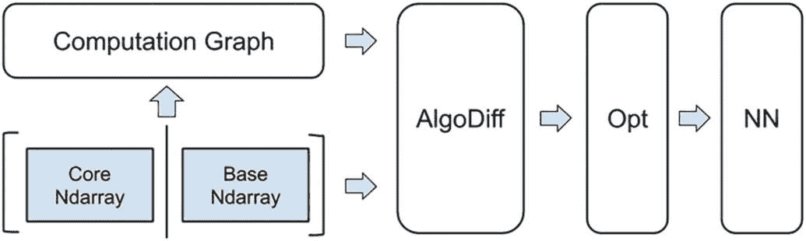
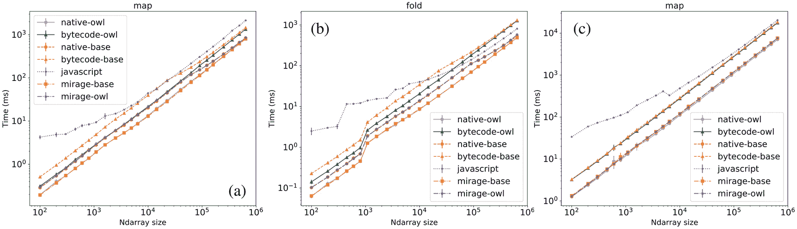

# 8. 编译器后端

梁王^([1]) 和赵建新^([2])  
(1) 芬兰赫尔辛基 (2) 中国北京  

对于一个数值库来说，扩展到多个执行后端总是既有益又富有挑战性。我们已经看到如何通过利用符号表示和诸如 ONNX 这样的计算图标准来支持 GPU 等加速器。在本章中，我们将介绍如何在更多面向边缘的后端（包括 JavaScript 和 unikernel）上使用 Owl。


## 8.1 基础库

在开始之前，我们需要了解 Owl 如何通过提供不同的实现来支持编译到多个后端。Owl 及其许多外部库实际上分为两部分：*基础*库和*核心*库。基础库使用纯 OCaml 实现。对于某些后端（如 JavaScript），我们只能使用 OCaml 实现的函数。

你可能好奇基础库会对我们造成多大的限制。幸运的是，Owl 中最先进的模块通常是用纯 OCaml 实现的，它们位于基础库中，包括我们在前几章中介绍的模块：算法微分、优化，甚至神经网络等。图 8-1 展示了 Owl 中核心函子栈的结构。

正如我们在第 2 章中介绍的，`Ndarray` 模块是 Owl 的核心构建模块。基础库旨在实现核心库 `Ndarray` 模块所需的所有功能。该栈的实现方式使得用户可以在不涉及更高层模块的情况下，在这两种不同的实现之间切换。在 Owl 函子栈中，`Ndarray` 用于支持计算图模块，以提供惰性求值功能。这里，我们使用了 `Owl_base_algodiff_primal_ops` 模块，它只是基础 `Ndarray` 模块的一个封装。它还包含少量矩阵和线性代数函数。通过提供这个封装而不是直接使用 `Ndarray` 模块，我们可以避免将所有函数混合在 `Ndarray` 模块中，使其变成一个臃肿的巨兽。

接下来，算法微分可以基于普通的 ndarray 或其惰性版本构建其计算模块。例如，你可以创建一个依赖普通单精度基础 ndarray 模块的 AD：

```
module AD = Owl_algodiff_generic.Make (Owl_base_algodiff_primal_ops.S)
```

或者，它可以构建在双精度惰性求值的核心 `Ndarray` 模块之上：

```
module CPU_Engine = Owl_computation_cpu_engine.Make (Owl_algodiff_primal_ops.D)
module AD = Owl_algodiff_generic.Make (CPU_Engine)
```



一个流程图，其标签分别为计算图、核心 N d 数组、基础 N d 数组、Algo diff、opt 和 N N。

**图 8-1** Owl 中的核心函子栈

再往上走，我们有更高级的优化和神经网络模块。它们都基于 AD 模块。例如，以下代码展示了如何通过基础 `Ndarray` 的多层函子构建一个神经图模块：

```
module G = Owl_neural_graph.Make
            (Owl_neural_neuron.Make
              (Owl_optimise_generic.Make
                (Owl_algodiff_generic.Make
                  (Owl_base_algodiff_primal_ops.S))))
```

通常情况下，用户无需关心这些模块是如何逐层构建的，但理解函子栈和类型仍然是有益的，尤其是在你创建依赖于基础 ndarray 模块的新模块时。

这些示例表明，一旦我们使用核心 `Ndarray` 模块构建了应用程序，就可以无缝地将其切换到基础 `Ndarray` 模块，而无需更改其他任何内容。这意味着我们目前看到的所有代码和示例都可以直接用于需要纯实现的不同后端。

基础库仍在开发中，还有很多工作要做。虽然 `Ndarray` 模块是基础库中的主要部分，但还有其他模块也需要用 OCaml 重新实现，例如线性代数模块。我们需要添加更多函数，如 SVD 分解。即使对于 `Ndarray` 本身，我们也尚未完全覆盖所有函数。

我们的策略是逐步添加基础 `Ndarray` 函数。我们将大部分签名文件放在基础库中，而核心库的签名文件则包含来自基础库的对应签名文件，外加当前核心库特有的函数。目标是实现完全覆盖，使核心库和基础库提供完全相同的函数。

可以预见，纯 OCaml 实现的性能通常不如 C 代码实现的版本。例如，对于卷积操作，在没有 OpenBLAS 等优化例程的帮助下，我们只能提供包含多个 for 循环的朴素实现。其性能比核心库版本慢几个数量级。目前，我们的优先事项是实现函数本身，而不是关心函数优化，也不打算用纯 OCaml 实现超越 C 代码的性能。

## 8.2 后端：JavaScript

乍一看，JavaScript 与高性能科学计算几乎毫无关联。我们将其纳入 Owl 的一个重要原因是，网络浏览器可以说是各种边缘设备（例如手机、平板电脑、笔记本电脑等）上最广泛部署的技术。越来越多的功能正从数据中心迁移到边缘，以减少延迟、提高隐私和安全性。而在浏览器中运行的 JavaScript 应用程序正变得越来越复杂和强大。此外，JavaScript 解释器也在不断优化，即使是相对复杂的计算任务也能以合理的性能运行。

本章将使用两个简单示例，演示如何将 Owl 应用程序编译成 JavaScript 代码，从而让你能够使用原生 OCaml 代码和 Facebook Reason 将分析代码部署到浏览器中。这还需要使用专为 OCaml/Reason 项目设计的构建系统 `dune`。正如你将看到的，这将使编译到 JavaScript 变得轻而易举。


### 原生 OCaml

我们依赖 `js_of_ocaml` 工具将原生 OCaml 代码转换成 JavaScript。`Js_of_ocaml` 是一个将 OCaml 字节码程序编译为 JavaScript 的编译器。因此，该过程可分为两个阶段：首先，将 OCaml 源代码编译为字节码可执行文件，然后对其应用 `js_of_ocaml` 命令。它支持大多数 OCaml 标准库中的核心 `Bigarray` 模块。然而，由于 `Sys` 模块未被完全支持，我们需小心避免在基础库中使用该模块的函数。

我们已经阐述了算法微分（AD）如何在 Owl 生态系统中扮演核心角色，因此现在用一个 AD 示例来演示如何将数值程序转换为 JavaScript 代码并执行。该示例是关于优化数学函数 `sin` 的。第一步，我们将应用程序编写为如下的 OCaml 代码，然后将其保存到文件 `demo.ml` 中。

```
module AlgodiffD = Owl_algodiff_generic.Make
    (Owl_base_algodiff_primal_ops.D)
open AlgodiffD
let rec desc ?(eta=F 0.01) ?(eps=1e-6) f x =
    let g = (diff f) x in
    if (unpack_flt g) < eps then x
    else desc ~eta ~eps f Maths.(x - eta * g)
let _ =
    let f = Maths.sin in
    let y = desc f (F 0.1) in
    Owl_log.info "argmin f(x) = %g" (unpack_flt y)
```

代码非常简单：`desc` 定义了一个梯度下降算法，然后我们使用 `desc` 来计算 `Maths.sin` 函数的最小值。最后，我们使用 `Owl_log` 模块的 `info` 函数打印结果。请注意，我们将基础的 `Ndarray` 模块传递给了 AD 函子，以创建一个相应的 AD 模块。

在第二步中，我们需要创建一个如下的 `dune` 文件。该文件将指示 OCaml 代码如何首先被编译成字节码，然后通过调用 `js_of_ocaml` 转换为 JavaScript。

```
(executable
  (name demo)
  (modes byte js)
  (libraries owl-base))
```

将这两个文件放在同一文件夹中，我们就可以在终端中运行以下命令：

`dune build demo.bc && js_of_ocaml _build/default/demo.bc`

或者更佳的做法是，由于 `js_of_ocaml` 被 `dune` 原生支持，我们可以简单地执行：

`dune build`

该命令会构建应用程序，并在 `_build/default/` 文件夹中生成一个 `demo.bc.js` 文件。最后，我们可以使用 Node.js 来运行这个 JavaScript（或者通过适当的 HTML 页面加载到浏览器中）。

`node _build/default/demo.bc.js`

结果，我们应该能看到输出结果，该结果显示出了一个最小化 `sin` 函数的值，应该类似于 `argmin f(x) = -1.5708`。

尽管我们在此展示了一个简单的例子，但该基础库可用于生成更复杂且更具交互性的浏览器应用程序。

### Facebook Reason

Facebook Reason 利用 OCaml 作为后端来提供类型安全的 JavaScript。它正在获得发展势头，并成为开发 Web 应用程序的热门选择。实际上，它使用了另一个工具 `BuckleScript` 来将 Reason/OCaml 代码转换为 JavaScript。由于 Reason 本质上是构建在 OCaml 之上的语法层，因此在 Reason 中使用 Owl 来开发高级数值应用程序非常直接。

在这个例子中，我们使用 Reason 代码来操作多维数组，这是 Owl 中的核心数据结构。首先，我们将以下代码保存到一个名为 `demo.re` 的 Reason 文件中。请注意，现在的后缀是 `*.re`。代码包含了 Owl 中的几个基本数学运算和 `Ndarray` 操作。

```
open! Owl_base;
/* 计算数学函数 */
let x = Owl_base_maths.sin(5.);
Owl_log.info("Result is %f", x);
/* 创建随机 ndarray 然后打印 */
let y = Owl_base_dense_ndarray.D.uniform([|3,4,5|]);
Owl_base_dense_ndarray.D.set(y,[|1,1,1|],1.);
Owl_base_dense_ndarray.D.print(y);
/* 获取一个切片 */
let z = Owl_base_dense_ndarray.D.get_slice([[],[],[0,3]],y);
Owl_base_dense_ndarray.D.print(z);
```

上述代码很简单。它创建了一个随机的 ndarray，获取一个切片，然后将它们打印出来。Owl 库可以在 Reason 中无缝使用。接下来，我们没有使用 Reason 自带的通过 `bucklescript` 转换前端语法的方式，而是再次求助于 `js_of_ocaml`。让我们看看 `dune` 文件，它与前一个示例中的文件相同：

```
(executable
   (name demo)
   (modes js)
   (libraries owl-base))
```

与上一个示例一样，你可以使用以下命令编译并运行代码：

`dune build`

`node _build/default/demo.bc.js`

如你所见，除了代码使用不同的语言编写外，由于 `js_of_ocaml` 和 `dune` 的存在，这两个示例中的其余步骤完全相同。

### 后端：MirageOS

除了 JavaScript，我们旨在支持的另一后端选择是 MirageOS。它是一种构建 *unikernel*（单内核）的方法。unikernel 是一种专门的、单一地址空间的机器镜像，由库操作系统构建而成。与普通的虚拟机不同，它仅包含一个应用程序所需的最精简库集。它可以直接在虚拟机监控程序或硬件上运行，而无需依赖 Linux 和 Windows 等操作系统。因此，unikernel 简洁、安全，并且无论是在云端还是边缘设备上，其分发和执行都极其高效。

MirageOS 是构建 unikernel 的一种解决方案。它利用高级语言 OCaml 和一个运行时环境来为操作系统功能提供 API。在使用 MirageOS 时，用户可以将 [Xen 虚拟机监控程序](https://xenproject.org/) 视为一个稳定的硬件平台，而无需担心诸如设备之类的硬件细节。此外，由于 Xen 虚拟机监控程序被广泛应用于 Amazon EC2 和 Rackspace Cloud 等平台，使用 MirageOS 构建的 unikernel 可以轻松地部署在这些平台上。除了得益于其高效性和安全性，MirageOS 还旨在成为 Nymote/MISO 工具栈的核心组成部分，以驱动物联网。


### 示例：梯度下降法

由于 MirageOS 基于 OCaml 语言，我们可以安全地将 `Owl` 库与其集成。为了演示如何将 MirageOS 作为后端使用，我们再次采用之前基于算法微分的优化示例。在开始之前，请确保已按照 [安装指南](https://mirage.io/docs/install) 完成 MirageOS 的安装。

让我们来看看代码：

```
module A = Owl_algodiff_generic.Make
  (Owl_algodiff_primal_ops.S)
open A
let rec desc ?(eta=F 0.01) ?(eps=1e-6) f x =
  let g = (diff f) x in
  if (unpack_flt (Maths.abs g)) < eps then x
  else desc ~eta ~eps f Maths.(x - eta * g)
let main () =
  let f x = Maths.(pow x (F 3.) - (F 2.) * 
    pow x (F 2.) + (F 2.)) in
  let init = Stats.uniform_rvs ~a:0. ~b:10. in
  let y = desc f (F init) in
  Owl_log.info "argmin f(x) = %g" (unpack_flt y)
```

这部分代码与之前基本相同。通过应用算法微分模块的 `diff` 函数，我们使用梯度下降法来找到使函数 *x*³ − 2*x*² + 2 取最小值的变量。

然后，我们需要添加一些不同的内容：

```
module GD = struct
  let start = main (); Lwt.return_unit
end
```

这里，`start` 是单体内核（unikernel）的入口点。它执行常规的 OCaml 函数 `main`，然后返回一个将被解析为单位的 `Lwt` 线程。`Lwt` 是 OCaml 中的一个并发编程库。它提供了“承诺”（promise）数据类型，该类型可以在未来某个时刻被确定。

上述所有代码被写入一个名为 `gd_owl.ml` 的文件中。要构建一个单体内核，接下来我们需要定义其配置。在同一目录下，我们创建一个名为 `configure.ml` 的文件：

```
open Mirage
let main =
  foreign
    ~packages:[package "owl"]
    "Gd_owl.GD" job
let () =
  register "gd_owl" [main]
```

这并不复杂。首先，我们需要打开 `Mirage` 模块。然后，我们声明一个值 `main`（你也可以将其命名为其他任何名称）。它调用 `foreign` 函数来指定配置。首先，在 `package` 参数中，我们声明该单体内核需要 `Owl` 库。下一个字符串参数 `"Gd_owl.GD"` 指定了实现文件的名称以及该文件中包含 `start` 入口点的模块 `GD`。第三个参数 `job` 声明了单体内核所需的设备类型，例如网络接口、网络栈、文件系统等。由于这里我们只进行计算，不需要额外的设备，因此第三个参数是 `job`。最后，我们使用 `main` 配置值注册单体内核的入口文件 `gd_owl`。

编码部分就是这些。现在我们来看看编译部分。MirageOS 本身支持多种后端。关键的一步是在开始时通过 `mirage configure` 决定使用哪一个。在存放上述两个文件的目录中，运行 `mirage configure -t unix`，它会配置将单体内核构建为一个可以直接执行的 Unix ELF 二进制文件。或者，你也可以使用 `mirage configure -t xen`，这样生成的单体内核将使用像 Xen 或 KVM 这样的虚拟机管理程序后端。无论哪种方式，单体内核在启动后都会作为虚拟机运行。在这个例子中，我们选择使用 Unix 作为后端。因此，我们运行：

```
mirage configure -t unix
```

该命令会根据配置信息生成一个 `Makefile`，其中包含了所有构建规则。接下来，为了确保所有依赖项都已安装，我们需要运行：

```
make depend
```

最后，我们可以简单地通过运行 `make` 来构建单体内核，它会调用 `mirage build` 命令。结果，当前目录现在包含 `_build/gd_owl.native` 可执行文件，这就是我们想要的单体内核。执行它会得到与之前类似的结果：

```
argmin f(x) = 1.33333
```

### 示例：神经网络

作为一个更复杂的示例，我们还构建了一个简单的神经网络，用于在 MirageOS 上执行 MNIST 手写数字识别任务：

```
module N  = Owl_base_algodiff_primal_ops.S
module NN = Owl_neural_generic.Make (N)
open NN
open NN.Graph
open NN.Algodiff
let make_network input_shape =
  input input_shape
  |> lambda (fun x -> Maths.(x / F 256.))
  |> fully_connected 25 ~act_typ:Activation.Relu
  |> linear 10 ~act_typ:Activation.(Softmax 1)
  |> get_network
```

该神经网络有两个隐藏层，权重大小较小（146KB），并且在测试中表现良好（准确率 92%）。我们可以将权重写入一个文本文件。该文件名为 `simple_mnist.ml`，与上一个示例类似，我们可以在该文件中添加一个单体内核入口点函数：

```
module Main = struct
  let start = infer (); Lwt.return_unit
end
```

这里，`infer` 函数创建了一个神经网络，加载权重，然后对输入图像执行推理。我们还需要一个配置文件。同样，它大部分是相同的：

```
open Mirage
let main =
  foreign
    ~packages:[package "owl-base"]
    "Simple_mnist.Main" job
let () =
  register "Simple_mnist" [main]
```



三个折线图：图 a 表示 map 操作，时间（毫秒）与 ndarray 大小的关系。图 b 表示 fold 操作，时间（毫秒）与 ndarray 大小的关系。图 c 表示 map 操作，时间（毫秒）与 ndarray 大小的关系。每个折线图包含 7 条线，均呈现上升趋势，伴有小幅波动。

一旦通过 Unix 后端编译为 MirageOS 单体内核，生成的二进制文件大小为 10MB。你也可以尝试将此应用程序编译为 JavaScript。

通过这些示例，我们展示了 `Owl` 库可以很容易地通过 MirageOS 部署到单体内核中。其数值计算功能能极大地增强潜在 OCaml-MirageOS 应用程序的表达能力。当然，这里无法涵盖关于 MirageOS 的所有重要主题；更多信息请参考 [MirageOS](https://mirage.io/) 和 [Xen Hypervisor](https://xenproject.org/) 的文档。


## 8.4 性能评估

在本节中，我们主要比较不同后端的性能表现。具体而言，我们观察了三组具有代表性的操作：(1) 对 ndarray 执行 map 和 fold 操作；(2) 使用梯度下降这一常见数值计算子程序，求取特定函数的 *极小值点*；(3) 对复杂深度神经网络（包括 SqueezeNet 和类 VGG 卷积网络）进行推理。所有评估均在搭载 Ubuntu 16.04 操作系统的 ThinkPad T460S 笔记本上进行，该设备配备 Intel Core i5-6200U CPU 和 12GB 内存。

OCaml 编译器可生成两种可执行文件：字节码和原生代码。原生可执行文件针对特定架构编译，通常运行速度更快；而字节码可执行文件则具有可移植性的优势。

对于 JavaScript，我们采用前文所述的 `js_of_ocaml` 方法。为方便起见，我们将纯 OCaml 实现以及 OCaml 与 C 的混合实现分别称为 `base-lib` 和 `owl-lib`，但事实上它们都包含在 Owl 库中。针对 Mirage 编译，我们同时使用了这两个库。

图 8-2 展示了 ndarray 上 map 和 fold 操作的性能。我们对一维（大小 < 1, 000）和二维数组使用了简单的加法与乘法函数。ndarray 总大小与各操作耗时之间呈对数-线性关系，保持线性趋势。对于这两种操作，`owl-lib` 均快于 `base-lib`，且原生可执行文件性能优于字节码。Mirage 可执行文件的性能接近原生代码。总体而言，JavaScript 运行最慢，但随着 ndarray 规模增大，JavaScript 与其他后端之间的性能差距逐渐缩小。对于 fold 操作，当规模足够大时，JavaScript 甚至比字节码运行得更快。

需要注意的是，对于 fold 操作，当输入规模达到约 10³ 时，耗时出现明显增加，而 map 操作则无此变化。这是因为在该规模下，我将输入从一维 ndarray 切换为二维 ndarray。这一变化不会影响 map 操作，因为它将任意维度的输入均视为一维向量。相比之下，fold 操作会考虑维度因素，因此其性能受此变化影响。

在图 8-3 中，我们旨在探究上述观察结果在更复杂的数值计算中是否仍然成立。我们选择使用梯度下降算法来寻找函数的局部最小值点，并在 [0, 10] 区间内随机选取初始值。对于 `sin(x)` 和 `x³ − 2*x² + 2` 两个函数，我们均发现 JavaScript 运行最慢，但本次实验中 `base-lib` 略优于 `owl-lib`。

我们进一步比较了需要大量计算的深度神经网络的性能，对比了 SqueezeNet 和类 VGG 卷积网络。两者在网络权重规模和结构复杂度上均有所不同。

表 8-1 显示，尽管 `owl-lib` 与 `base-lib` 的性能差异不显著，但前者明显更优。同样，`base-lib` 的原生代码与字节码之间也存在类似差距。JavaScript 仍然是最慢的。DNN 推理所需的核心计算是卷积操作，其实现效率是造成这些差异的关键。目前，我们正在致力于改进 `base-lib` 中卷积操作的实现。

条形图展示了对于函数 `f` 的两个方程，梯度下降算法在不同环境下的时间性能。对于两者，`js` 条形图均为最高。

**图 8-3** 函数 `f` 上梯度下降算法的性能

**表 8-1** 深度神经网络推理速度

| 耗时 (ms) | VGG | SqueezeNet |
| --- | --- | --- |
| `owl-native` | 7.96 (± 0.93) | 196.26(± 1.12) |
| `owl-byte` | 9.87 (± 0.74) | 218.99(± 9.05) |
| `base-native` | 792.56(± 19.95) | 14470.97 (± 368.03) |
| `base-byte` | 2783.33(± 76.08) | 50294.93 (± 1315.28) |
| `mirage-owl` | 8.09(± 0.08) | 190.26(± 0.89) |
| `mirage-base` | 743.18 (± 13.29) | 13478.53 (± 13.29) |
| `JavaScript` | 4325.50(± 447.22) | 65545.75 (± 629.10) |

我们还在 Raspberry Pi 3 Model B 上进行了相同的评估实验。图 8-2c 展示了 ndarray 上 fold 操作的性能。除了所有后端运行速度均比在笔记本上慢一个数量级外，之前的观察结果仍然成立。该图还表明，在 Raspberry Pi 等资源受限设备上，对于该操作，主要性能差异源于原生代码与字节码之间，而非 `owl-lib` 与 `base-lib` 之间。

最后，我们还简要比较了不同后端生成的可执行文件大小。以 SqueezeNet 为例，结果如表 8-2 所示。可以看出，与 `base-lib` 相比，`owl-lib` 生成的可执行文件更大，而 JavaScript 代码的文件大小最小。对于所有这些后端，并不存在一种占主导地位的部署方法。因此，根据部署环境选择合适的后端至关重要。

**表 8-2** 各后端生成的可执行文件大小

| 大小 (KB) | 原生代码 | 字节码 | Mirage | JavaScript |
| --- | --- | --- | --- | --- |
| Base | 2437 | 4298 | 4602 | 739 |
| Native | 14,875 | 13,102 | 16,987 | - |

## 8.5 本章小结

Owl 的基础库从核心模块中分离出来，主要是为了适应多种可能的执行后端。本章首先介绍了基础模块的工作原理，然后展示了两个可能的后端：JavaScript 和单内核虚拟机。这两个后端都有助于将 Owl 的应用扩展到更多设备。最后，我们通过几个示例演示了这些后端的使用方法及其性能表现。


**开放获取** 本章根据知识共享署名 4.0 国际许可协议 ([`creativecommons.org/licenses/by/4.0/`](http://creativecommons.org/licenses/by/4.0/)) 授权，允许在任何媒介或格式中使用、共享、改编、分发和复制，前提是您需给予原作者和来源适当的署名，提供指向知识共享许可协议的链接，并指明是否进行了修改。

除非在材料的署名行中另有说明，本章中的图像或其他第三方材料均包含在本章的知识共享许可协议中。如果材料未包含在本章的知识共享许可协议中，且您的预期使用未得到法定法规许可或超出许可范围，您将需要直接向版权所有者获取许可。

© 作者 2023 L. Wang, J. Zhao《先进数值分析系统架构》[`doi.org/10.1007/978-1-4842-8853-5_9`](https://doi.org/10.1007/978-1-4842-8853-5_9)

