# 10. 分布式计算

梁王 ^(1  ) 和赵建新 ^(2) (1) 芬兰，赫尔辛基 (2) 中国，北京

分布式计算在当前各个领域的智能应用中一直扮演着重要角色。在本章中，我们首先简要地鸟瞰这一主题，介绍各种编程范式。接着，我们介绍 Actor，一个基于 OCaml 的分布式计算引擎，以及它如何与 Owl 协同工作。然后，我们关注分布式计算中的一个关键要素：同步。我们介绍了当前系统中常用的四种不同类型的同步方法或“屏障”。接下来，我们详细阐述这些屏障是如何设计的，并从理论角度进行说明。最后，我们通过评估来展示使用不同屏障时的性能权衡。

## 10.1 分布式机器学习

机器学习在图像识别、语言处理、游戏产业、产品管理、医疗保健等多个领域取得了显著的突破。机器学习的强大之处在于利用不断增长的训练数据和模型规模来实现高精度。随着移动和边缘设备（智能家居、手机、可穿戴设备等）产生海量数据，许多应用都需要在多个节点上并行训练机器学习模型。在分布式学习中，模型是通过多个工作节点的协作来训练的。

最常用的训练方法之一是随机梯度下降（`SGD`），它通过沿着目标的梯度方向迭代优化给定的目标函数，直到其收敛。在 `SGD` 的每次迭代中，通常使用一批训练数据计算下降梯度，然后沿梯度方向以一定步长更新模型参数。执行分布式机器学习主要有三种范式：参数服务器（`PS`）、全规约（`All-Reduce`）和去中心化方法（或点对点）。

参数服务器[34]（`PS`）是一种常用的分布式训练架构。服务器保存模型参数；工作节点`拉取`参数，计算梯度，并将它们`推送`回服务器进行聚合。它通常实现为键值存储。另一种范式是全规约。在这种范式中，每个计算节点期望每个参与的进程提供一个大小相等的张量，共同对所有进程输入的张量应用指定的算术运算，并将相同的结果张量返回给每个参与者。一个简单的实现可以让每个进程向所有同伴广播其输入张量，然后独立地应用算术运算。环形全规约架构将工作节点组织成环形结构，以有效利用带宽。`Horovod`框架提供了全规约的高性能实现。

除了这两种架构，去中心化架构也引起了更多关注。它允许节点之间根据通信图进行点对点通信。点对点方法可以有效解决通信瓶颈、信息集中导致的不公平等问题，并为优化提供了更多机会。P2P 训练范式中最常用的算法之一是去中心化并行 `SGD`（`D-PSGD`）[36]，其中每个节点拥有自己的一组参数，并且仅与图中的相邻节点同步。随着时间推移，训练过程中的局部信息会逐渐传播到整个图。在去中心化系统中训练出性能良好的模型，仍有许多挑战需要解决。

这些训练范式（或许部分地）得到了各种流行的学习框架的支持，例如 `TensorFlow`、`PyTorch` 等。通常，它们依赖高性能计算后端来在这些范式中提供高效的通信。例如，`NCCL` 是一个独立的 GPU 标准通信例程库，实现了多种通信模式，并经过优化以实现高带宽。另一个通信后端是英特尔 `MPI` 库，这是一个实现开源 `MPICH` 规范的多结构消息传递库。其目标是创建、维护和测试那些在高性能计算集群上表现更优的高级复杂应用。

新兴的分布式训练范式之一是联邦学习[6]。联邦学习允许在不要求数据集中化的情况下执行机器学习任务。这背后有多种动机，例如通过防止个人向他人泄露个人数据来维护隐私，或通过允许数据处理更接近数据生成的地点和时间来降低延迟。由于这些原因，它在各个研究和应用领域越来越受欢迎。联邦学习强调训练数据并不总是独立同分布的。也就是说，设备的本地数据不能简单地被视为从整体分布中抽取的样本。数据分布对模型训练有着巨大影响。一些研究工作提供了针对非独立同分布数据分布式训练的理论分析。一些工作被提出以解决数据不平衡问题。除了数据增强，其策略还包括根据数据偏差程度，在更新中结合顺序更新和 BSP（批量同步并行）的方法。

## 10.2 Actor 分布式引擎

`Actor` 是一个基于 OCaml 语言的分布式数据处理系统。它被开发用于支持 Owl 中上述的分布式计算范式。它实现了 `Map-Reduce` 和参数服务器引擎的核心 `API`。`Map-Reduce` 和参数服务器引擎都需要一个（逻辑上的）中心实体来协调所有节点的进度。我们还将参数服务器引擎扩展到了点对点（`P2P`）引擎。`P2P` 引擎可用于实现数据和模型并行应用；数据和模型参数（尽管不是必须）都可以分成多个部分，然后分布到不同的节点上。与这些范式正交的是，`Actor`还实现了所有四种类型的同步屏障。

每个引擎都有自己的一套 `API`。例如，`Map-Reduce` 引擎包括 `map`、`reduce`、`join`、`collect` 等，而点对点引擎提供了四个主要 `API`：`push`、`pull`、`schedule` 和 `barrier`。值得注意的是，所有引擎共享一个函数，即 `barrier` 函数，它实现了各种屏障控制机制。接下来，我们将介绍 `Actor` 的这三种不同类型的引擎。

### Map-Reduce 引擎

遵循 `MapReduce` 编程模型，节点可以按任务划分：要么是映射，要么是规约。`map` 函数处理一个键/值对以生成一组中间键/值对，`reduce` 函数聚合所有具有相同键的中间键/值对。该模型的执行可以自动并行化。映射器并行计算，而规约器接收所有映射器的输出并合并以产生累积结果。然后此参数更新会广播到所有节点。集群中诸如分布式调度、数据划分和通信等细节对程序员来说大多是透明的，因此他们可以专注于映射器和规约器在大型分布式系统中解决问题的逻辑。这种简单的函数式风格可以应用于极其广泛的应用中。例如，以下代码展示了使用 `Map-Reduce` 引擎实现经典单词计数任务的示例：

```
module Ctx = Actor.Mapre
let print_result x = List.iter (fun (k,v) ->
    Printf.printf "%s : %i\n" k v) x
let stop_words = ["a";"are";"is";"in";"it";"that";
    "this";"and";"to";"of";"so"; "will";"can";"which";
    "for";"on";"in";"an";"with";"the";"-"]
let wordcount () =
  Ctx.init Sys.argv.(1) "tcp://localhost:5555";
  Ctx.load "unix://data/wordcount.data"
  |> Ctx.flatmap Str.(split (regexp "[ \t\n]"))
  |> Ctx.map String.lowercase_ascii
  |> Ctx.filter (fun x -> (String.length x) > 0)
  |> Ctx.filter (fun x -> not (List.mem x stop_words))
  |> Ctx.map (fun k -> (k,1))
  |> Ctx.reduce_by_key (+)
  |> Ctx.collect
  |> List.flatten |> print_result;
  Ctx.terminate ()
let _ = wordcount ()
```

### 参数服务器引擎

参数服务器模块与之类似。节点分为服务器和工作节点，服务器持有对最新模型参数的共享全局视图，而每个工作节点持有自己的模型视图并执行训练。工作节点与服务器之间以键值对格式进行通信。它主要为用户提供四个 `API`：

- `schedule`：决定在此步骤中应计算哪些模型参数以进行更新。这既可以是一个本地决策，也可以是一个中心决策。
- `pull`：从某处检索模型参数的更新，然后将其应用到本地模型。此外，将基于计划的模型参数计算本地更新。
- `push`：将更新发送到模型平面。根据所使用的引擎（例如，`Map-Reduce`、参数服务器或点对点），更新可以发送到中央服务器或单个节点。
- `barrier`：决定是否推进本地步骤。可以实现多种同步方法。除了经典的 `BSP`、`SSP` 和 `ASP` 以外，我们还在此接口内实现了提出的 `PSP`。

以下代码展示了参数服务器引擎的接口：

```
open Actor_types
type barrier =
  | ASP    (* 异步并行 *)
  | BSP    (* 整体同步并行 *)
  | SSP    (* 陈旧同步并行 *)
  | PSP    (* 概率同步并行 *)
(** 参数服务器的核心接口 *)
val register_barrier : ps_barrier_typ -> unit
val register_schedule : ('a, 'b, 'c) ps_schedule_typ -> unit
val register_pull : ('a, 'b, 'c) ps_pull_typ -> unit
val register_push : ('a, 'b, 'c) ps_push_typ -> unit
val register_stop : ps_stop_typ -> unit
val get : 'a -> 'b * int
val set : 'a -> 'b -> unit
val keys : unit -> 'a list
val start : ?barrier:barrier -> string -> string -> unit
val worker_num : unit -> int
```

该接口直观明了。它在 `get`、`set` 和 `keys` 函数中实现了参数服务器的键值机制。用户可以在 `register_*` 函数中定义屏障函数、调度器、在主机端执行的拉取函数以及在工作节点端执行的推送函数。这种设计提供了一个灵活的分布式计算框架。

基于这些接口，以下是一个简单示例，它使用参数服务器引擎将随机数作为任务分配给系统中参与的工作节点：

```
module PS = Actor_param
let schedule workers =
  let tasks = List.map (fun x ->
    let k, v = Random.int 100, Random.int 1000 in (x, [(k,v)])
  ) workers in tasks
let push id vars =
  let updates = List.map (fun (k,v) ->
    Owl_log.info "working on %i" v;
    (k,v) ) vars in
    updates
let test_context () =
  PS.register_schedule schedule;
  PS.register_push push;
  PS.start Sys.argv.(1) Actor_config.manager_addr;
  Owl_log.info "do some work at master node"
let _ = test_context ()
```

一个结构图展示了 owl 和 actor 框架不同模块的组合，并用粗箭头标出。

图 10-1 组合 Owl 和 Actor 框架

### 将 Actor 与 Owl 组合

`Actor` 最显著的优势之一在于它可以与 Owl 组合。Owl 中的并行和分布式计算是通过将 Owl 核心库中不同的数据结构与 `Actor` 系统中的特定引擎组合来实现的。

如图 10-1 所示，所有三个分布式引擎都可以用来与 Owl 中的 `Ndarray` 模块组合。而且这种组合非常直接：

```
module M = Owl.Parallel.Make (Dense.Ndarray.S) (Actor.Mapre)
```

仅此而已。通过使用 Owl 提供的函子，它构建了一个分布式版本的 n 维数组模块。在此函子中，我们选择使用单精度稠密 `Ndarray` 模块和 `MapReduce` 引擎作为参数。使用这个分布式的 `Ndarray` 模块也很容易。以下代码展示了一个示例。你可以看到，组合后的 `Ndarray` 模块提供了所有标准的 ndarray 操作，包括初始化、映射、折叠、求和、切片、加法等。并且这些计算是在分布式集群上执行的。

```
module M1 = Owl_parallel.Make_Distributed (Owl.Dense.Ndarray.D) (Actor.Mapre)
let test_owl_distributed () =
  Actor.Mapre.init Sys.argv.(1) "tcp://localhost:5555";
  let y = M1.init [|2;3;4|] float_of_int in
  let _ = M1.set y [|1;2;3|] 0. in
  let y = M1.add x y in
  Owl.Dense.Ndarray.D.print (M1.to_ndarray y); flush_all ();
  let x = M1.ones [|200;300;400|] in
  let x = M1.map (fun a -> a +. 1.) x in
  let a = M1.fold (+.) x 0. in
  let b = M1.sum x in
  Owl_log.info "fold vs. sum ===> %g, %g" a b;
  Owl_log.info "start retrieving big x";
  let x = M1.to_ndarray x in
  Owl_log.info "finsh retrieving big x";
  Owl_log.info "sum x = %g" (Owl.Arr.sum' x)
```

类似地，这种组合也适用于更高级、更复杂的数据结构，例如神经网络。请记住，`Ndarray` 是 Owl 中的核心数据结构，神经网络模块依赖于它。因此，我们可以使用相同的函子创建一个分布式版本的神经网络模块：

```
module M = Owl.Parallel.Make (Owl.Neural.S.Graph) (Actor.Param)
```

这里，我们使用单精度神经网络图模块和参数服务器分布式引擎来参数化新模块。它支持在计算机集群上进行并行训练。以下代码展示了一个示例。大部分代码保持不变。唯一需要的是使用 `M2.train` 函数代替原来的函数来训练网络。

```
module M2 = Owl_neural_parallel.Make (Owl.Neural.S.Graph) (Actor.Param)
let test_neural_parallel () =
  let open Owl.Neural.S in
  let open Graph in
  let nn =
    input [|32;32;3|]
    |> normalisation ~decay:0.9
    |> conv2d [|3;3;3;32|] [|1;1|] ~act_typ:Activation.Relu
    |> conv2d [|3;3;32;32|] [|1;1|] ~act_typ:Activation.Relu ~padding:VALID
    |> max_pool2d [|2;2|] [|2;2|] ~padding:VALID
    |> dropout 0.1
    |> conv2d [|3;3;32;64|] [|1;1|] ~act_typ:Activation.Relu
    |> conv2d [|3;3;64;64|] [|1;1|] ~act_typ:Activation.Relu ~padding:VALID
    |> max_pool2d [|2;2|] [|2;2|] ~padding:VALID
    |> dropout 0.1
    |> fully_connected 512 ~act_typ:Activation.Relu
    |> linear 10 ~act_typ:Activation.(Softmax 1)
    |> get_network
  in
  let x, _, y = Owl.Dataset.load_cifar_train_data 1 in
  let chkpt state =
    if Checkpoint.(state.current_batch mod 1 = 0) then (
      Checkpoint.(state.stop <- true);
    )
  in
  let params = Params.config
    ~batch:(Batch.Sample 100)
    ~learning_rate:(Learning_Rate.Adagrad 0.001)
    ~checkpoint:(Checkpoint.Custom chkpt)
    ~stopping:(Stopping.Const 1e-6) 10.
  in
  let url = Actor_config.manager_addr in
  let jid = Sys.argv.(1) in
  M2.train ~params nn x y jid url
```

## 10.3 同步：屏障控制方法

分布式和联邦机器学习系统的一个关键组成部分是屏障同步：参与节点在迭代分布式计算中进行协调的机制。如前所述，机器学习的统计和迭代特性意味着错误会从系统中逐步消除。为了实现完全的一致性，即每个节点一起进入下一次迭代，可能会降低吞吐量。放宽一致性可以在不最终牺牲准确率的前提下提升系统性能。这种权衡体现在屏障控制机制中。在本章的剩余部分，我们将重点关注分布式计算中的这一方面。

在并行计算中，屏障用于同步。如果在源代码中对一组线程或进程应用了屏障，那么在该点，一个线程或进程必须等到所有其他线程或进程完成它们在屏障之前的工作负载后才能继续执行。这样就能保证某些计算已经完成。例如，以下代码展示了 `OpenMP` 中的屏障 `#pragma` 指令，`OpenMP` 是一个支持共享内存多处理器编程的应用程序编程接口。这里，计算被分配到多个线程中并行执行，但在其他线程计算出自己的 `x` 值之前，`y` 的计算无法进行。屏障点之后的执行继续并行进行。

```c
#pragma omp parallel {
    x = some_calculation();
#pragma omp barrier
    y = x + 1
}
```

前面的例子展示了一种严格的屏障方法。在分布式训练中，存在多种用于同步的屏障控制方法。当前的屏障控制机制可分为四种类型，将在后面详细讨论。这些屏障方法在系统性能和模型准确率之间提供了不同的权衡。它们可以应用于我们在前一节讨论过的各种分布式机器学习系统中，包括参数服务器、点对点系统等。在本节的剩余部分，我们将对它们进行介绍。

**批量同步并行（BSP）**是最严格的方法，要求所有工作节点步调一致地前进，只有当所有工作节点都准备好时才进入下一次迭代。**BSP** 是一种确定性方案，工作节点在中央服务器的控制下先执行计算阶段，然后执行同步/通信阶段来交换更新 [54]。BSP 程序通常是可序列化的，也就是说，如果分布式算法的数据和模型被适当地调度，它们就等同于顺序计算，这使得 BSP 成为最强的屏障控制方法 [30]。BSP 存在许多变体，例如，允许一个工作节点在一个周期内执行多次迭代 [14]。联邦学习也使用 BSP 来进行其分布式计算 [6]。此外，BSP 需要集中式协调。

**异步并行（ASP）** [41] 是最不严格的屏障控制，因为它允许每个工作节点按自己的速度前进，无需等待其他节点。**ASP** 采取了与 BSP 相反的方法，通过让所有工作节点完全异步运行，使计算尽可能快地执行 [41]。ASP 可以带来快速的收敛，因为它允许尽可能高的迭代速率 [54]。然而，缺乏任何协调意味着更新是基于旧的模型状态计算的，从而导致准确率下降。算法是否能收敛没有理论保证。[41] 中提出的 `Hogwild` 方案有许多局限性，例如，它要求凸函数和稀疏更新。许多工作试图在应用和理论分析中扩展这些限制 [35]。这些研究通常会导致在训练中对步长进行精细调整。[59] 提出了一种延迟补偿的 `SGD`，通过补偿在参数服务器处接收到的梯度来缓解 ASP 中的延迟更新。[32] 引入了另一种特别适用于广域网的 ASP 变体：由于通信是主导因素，它主张在 `WAN` 中允许不重要的更新无限期延迟。

表 10-1

不同系统使用的同步方法分类

| 系统 | 同步约束 | 屏障方法 |
| --- | --- | --- |
| `MapReduce` [17] | 要求在 `reduce` 之前完成 `map` | `BSP` |
| `Hogwild!` [41] | `ASP` 但有系统级的延迟上限 | `ASP`, `SSP` |
| 参数服务器 [34] | 可替换的同步方法 | `BSP`, `ASP`, `SSP` |
| `Hadoop` [46], `Spark` [57] | 任务完成后聚合更新 | `BSP` |
| `Yahoo! LDA` [2] | 检查点 | `SSP`, `ASP` |
| `SSP` [30] | 更新最多延迟 *N* - 1 步 | `SSP` |
| `Gaia` [32] | 本地累积权重 | `BSP`, `SSP` |
| `Astraea` [19] | 结合顺序更新 | `BSP` |
| `Owl+Actor` [51] | 可替换的同步方法 | `BSP`, `ASP`, `SSP`, `PSP` |

第三种方法是**陈旧同步并行（SSP）** [30]，它放宽了 BSP，允许工作节点在所有工作节点的迭代次数彼此相差在特定限度内时，继续进入下一次迭代。**SSP** 是一种有界异步模型，在 BSP 和 ASP 之间取得平衡。它不要求所有工作节点一起进入下一次迭代，而只要求系统中任意两个工作节点的迭代次数之差不超过 *s*，*s* 是预定义的*陈旧度*界限。陈旧度参数限制了错误，并使 SSP 能够提供确定性的收敛保证 [30, 15, 54]。在 SSP 的基础上，[58] 研究了 *n-softsync*，这是一种同步方法，使参数服务器在从任意工作节点收集到特定数量的更新后更新其权重。[9] 提出移除少量"长尾"工作节点或添加少量备份节点来缓解这种影响，同时避免异步噪声。

最后一种方法是**概率同步并行（PSP）**。其基本思想是在系统中引入采样原语，并使用被采样的参与工作节点子集来估计整个系统的进展。PSP 为此权衡引入了第二个维度：在进入下一次迭代之前，必须从多少个节点接收更新。通过将我们的采样原语与传统的屏障控制相结合，我们获得了一系列更适合在异构网络中支持迭代学习的屏障控制方法。

### PSP 的核心思想

`PSP` 背后的核心思想简单而强大：我们只要求工作节点中的一部分（而非全部）在进度上保持同步。这里的“进度”指的是客户端侧推送到服务器的更新次数，以及服务器侧收集到的更新总数。在集中式训练框架中，服务器根据系统信息（例如节点当前的本地进度）来构建训练节点的这个子集。这个子集可以通过多种方法进行采样。一种常见且直观的方法是，在所有工作节点中随机采样。

因此，`PSP` 中的参数——采样大小——控制了这种估计的精确程度。假设这个随机子集相对于节点的性能是无偏的，那么服务器可以利用由此产生的分布，来估计通过某个给定进度的节点所占的百分比。正如将在第 10.4 节中讨论的那样，这个估计取决于子集内部所使用的具体方法。相应地，服务器可以决定是否允许训练器通过屏障并推进其本地进度。

图 10-2 展示了这四种屏障之间的区别。在这里，计算进度通过超步或迭代次数来衡量。通信可能在屏障处发生，以确保通过全局状态实现一致性。同时可能还需要一个中央服务器来维护全局状态，用时钟符号表示。

表 10-1 总结了不同机器学习系统所使用的屏障同步方法。你可以看到，无论是经典系统还是新系统，屏障同步一直是系统中的重要组成部分。

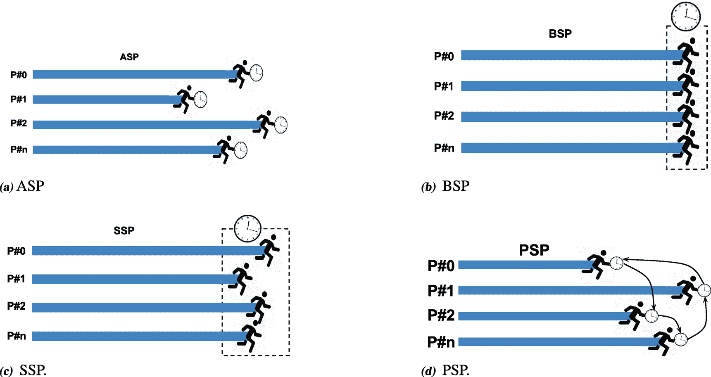

*针对 `ASP`、`BSP`、`SSP` 和 `PSP` 的分布式机器学习系统中，4 种屏障控制机制的示意图。在 `BSP` 中，工作节点在 `p = 0`、`1`、`2` 和 `n` 时处于同一水平。*

**图 10-2** 各种屏障控制方法的示意图

## 10.4 系统设计空间与参数

在前一节中，我们介绍了现有的屏障控制方法。在本节中，我们将进一步解释这些方法是如何设计的，以及它们之间的关系。

在使用迭代学习算法的分布式训练系统中，主要目标是实现更快的收敛，即损失保持在训练最终值附近的误差范围内。训练的收敛速度与两个因素正相关：*一致性* 和 *迭代速率*。一致性是指分布式训练系统中多个节点为了达成收敛而保持一致。它可以通过各节点训练迭代次数之间的差异来体现。弱一致性可能会损害模型每次迭代的更新质量。另一方面，迭代速率是指训练过程的速度。这种关系可以用公式 10.1 来表示。

```
收敛速度 ∝ 一致性 × 迭代速率
```

(10.1)

`BSP` 和 `ASP` 是说明这两个因素的绝佳例子。在 `BSP` 中，工作节点必须等待其他节点完成一轮训练，所有工作节点的进度相同。因此，在所有屏障方法中，`BSP` 能在每次更新中提供最佳的一致性和最高的精度。`BSP` 是一种确定性算法。其代价是，如果训练节点中存在*掉队者*，则系统进度将受限于最慢的节点。另一方面，`ASP` 允许节点尽可能快地执行，无需考虑其他节点的进度。结果，`ASP` 实现了可能达到的最高迭代速率。然而，缺乏任何协调意味着更新是基于过时的模型状态计算的，从而导致一致性降低。

`SSP` 的设计清楚地显示了在这两个极端之间的良好权衡。如图 10-3 所示，`SSP` 试图通过限制参与节点之间的迭代次数差异来利用这种权衡。一方面，它不像 `BSP` 那样要求所有节点具有完全相同的进度，从而提高了其迭代速率。另一方面，它的陈旧性界限比 `ASP` 为节点提供了更严格的一致性界限。因此，它在两端之间取得了平衡，从而实现了更高的收敛速率。参数陈旧性覆盖了这个一维调优空间的整个谱系。

但是，这就是屏障控制方法的设计空间了吗？让我们再次深入审视当前的模型。我们首先可视化迭代更新过程，如图 10-4 所示。

这个模型很简单。一系列更新被应用于初始全局状态 `x[0]`。这里，`u(p,t)` 表示 `update(node id, timestamp)`，即所有节点在其每个时钟周期都会生成更新。在这个例子中，有三个节点。理想情况下，在时钟周期 `t[i]` 中，我们期望有三个更新：`u(0, t[i])`、`u(1, t[i])` 和 `u(2, t[i])`。然而，由于嘈杂的环境，这些更新被分成了两组。确定性更新是指，如果一切按上述正常进行，我们所期望的更新。概率性更新则是那些由于丢包、网络延迟、节点故障等原因而乱序的更新。尽管这个模型很简单，但它可以代表大多数迭代学习算法。

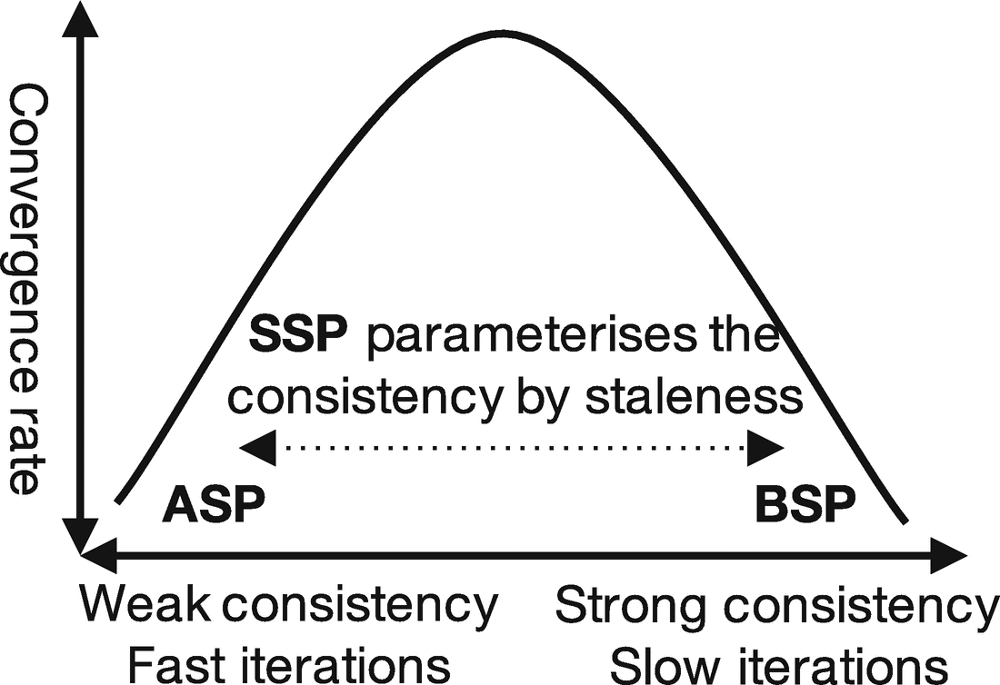

*一张图展示了 `ASP`、`SSP` 和 `BSP` 之间的权衡。收敛速率与弱一致性、强一致性之间绘制的曲线呈抛物线形状。*

**图 10-3** `ASP`、`SSP` 和 `BSP` 之间的权衡

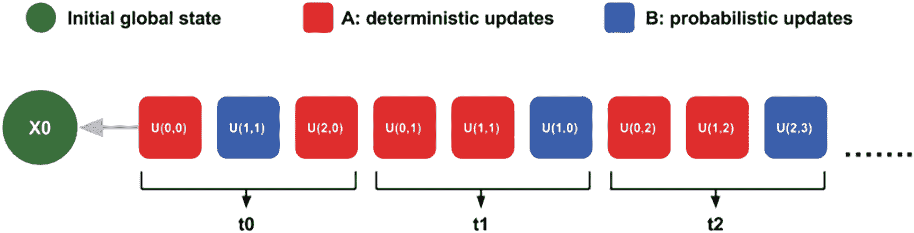

*一个模型图说明了分布式学习系统中的迭代更新过程。*

### 图 10-4

分布式学习中迭代更新过程的分析模型

随后，我们利用该分析模型将每种障碍方法表示为图 10-5 所示的形式。左侧部分处理一致性。`+=` 运算符是服务器逻辑，用于说明如何将提交至中央服务器的更新合并到全局状态中。右侧部分处理同步问题；计算机之间相互通信，或联系中央服务器以协调其进度。如前所述，右侧可划分为两种更新类型：确定性更新和概率性更新。

从系统设计的角度来看，该公式揭示了一些非常有趣的结构。对于 `BSP` 和 `SSP`，中央服务器*耦合*了一致性与同步性的控制逻辑。也就是说，如果你选择严格一致性，你也必须通过逻辑中央服务器选择全局同步控制。对于 `BSP` 和 `SSP`，会分配一个逻辑服务器来更新模型参数，并协调迭代学习算法中所有节点的进度。在分布式系统中，这往往是瓶颈和单点故障。`ASP` 通过完全放弃同步和一致性来避免这种耦合。

然而，`PSP` 解耦了一致性和同步性。它通过发现障碍方法的设计空间中存在另一个维度——*完整性*——来实现这一点。注意，对于前三种障碍方法，一致性程度是对全体节点强制实施的。所有参与节点具有同等的一致性。

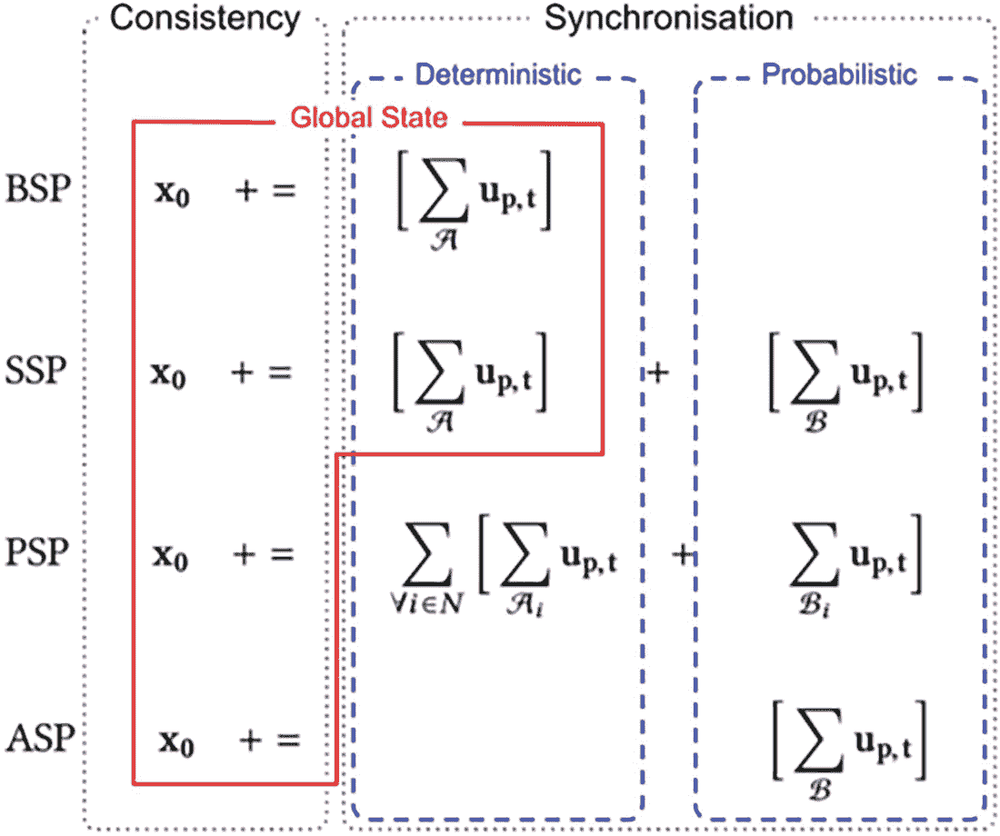

一个模型图示展示了一致性和同步性的解耦。左侧的两种更新分别为确定性更新和概率性更新。全局状态包含在一致性和确定性之中。

### 图 10-5

解耦一致性与同步性

`PSP` 利用了样本中完整性程度的这一维度，由此产生了一致性程度的分布。在 `PSP` 中，每台计算机与一小群其他计算机同步，并且一致性仅在该群组内实施。完整性体现了节点间的协调水平。通过改变样本大小，该维度从完全完整（所有工作节点均被视为同步）到不完整（每个节点被单独考虑）变化。

`PSP` 的采样策略对障碍控制方法的设计具有深远影响。通过添加这个额外维度，收敛性现在受到三个因素的影响，公式 10.1 变为：


(10.2)

在公式 10.2 中，一致性因此被进一步分解为样本内的一致程度和该样本的完整性。

因此，`PSP` 展示了一个包含了所有其他障碍方法的调优空间。如图 10-6 和 10-7 所示，在这个精炼的设计空间中，`ASP` 位于左下角，因为它显示了最弱的一致性（对其他节点的进度无控制）和完整性（每个节点仅考虑自身）。另一方面，`BSP` 和 `SSP` 显示了完全的完整性，因为它们需要一个中央服务器来同步所有节点的进度。类似于图 10-3，它们显示了一致性的不同层级。

### 兼容性

作为一个更通用的框架，`PSP` 的一个显著优势在于它能直接兼容现有的同步方法，从而提供一致性的调优维度。在经典的 `BSP` 和 `SSP` 中，它们的障碍控制机制由中央服务器调用，以测试给定输入下的同步条件。对于 `BSP` 和 `SSP` 使用*采样*原语，它们只需要在评估障碍控制条件时使用采样后的状态，而非全局状态。然后，可以在每个采样子集内应用这些传统机制。因此，用户可以轻松推导出 `BSP` 和 `SSP` 的概率版本，即 `pBSP` 和 `pSSP`。例如，图 10-8 展示了 `PSP` 可以作为一个高阶函数应用于其他同步机器，以推导出概率版本。

形式上，在障碍控制点，一个工作节点从 *P* 个工作节点中无放回地采样 *β* 个节点。如果某个节点落后于当前工作节点的更新数超过 *s*，则该工作节点等待。如果延迟参数 *s* = 0，这个过程是 `pBSP`（基于 `BSP`）；如果 *s* > 0，则是 `pSSP`（基于 `SSP`）。如果 *s* = ∞，则 `PSP` 退化为 `ASP`。

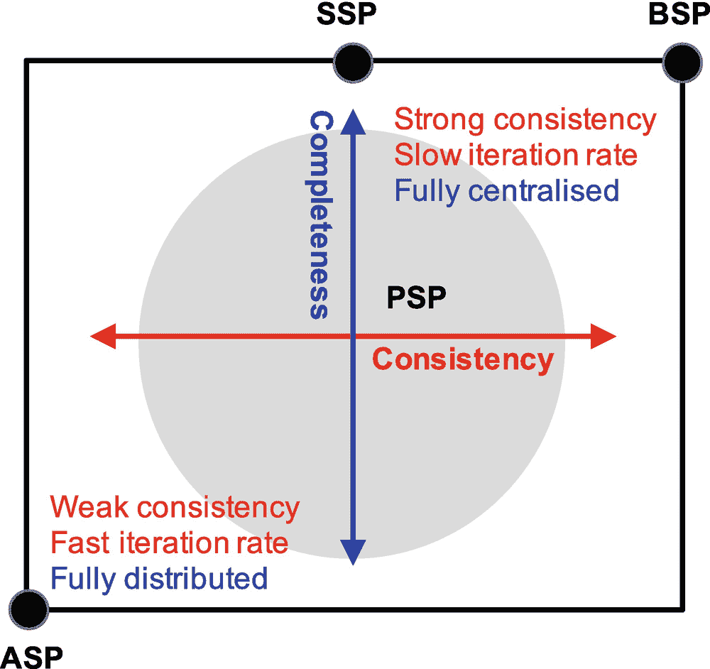

四种障碍控制方法设计中的两个维度模型。象限图左下角的 `ASP` 表示弱一致性、快迭代速率和完全分布式。中上方的 `SSP` 和右上方的 `BSP` 表示强一致性、慢迭代速率和完全中心化。

### 图 10-6

障碍控制方法设计中的两个维度

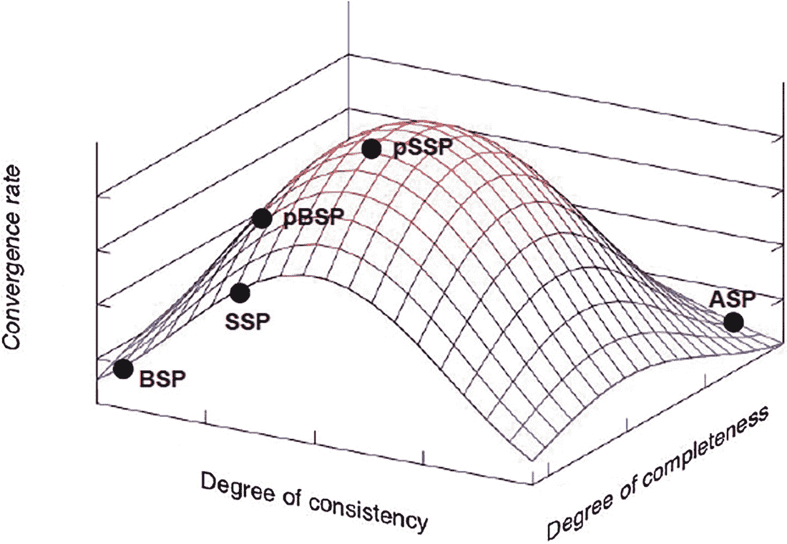

一个关于庞大设计空间的图示，旨在简化在障碍方法之间找到良好权衡的过程。三个维度分别是收敛速率、一致程度和完整程度。

### 图 10-7

这一新维度使我们能够探索更大的设计空间，从而进一步有可能找到更好的权衡，以实现更优的收敛速率。

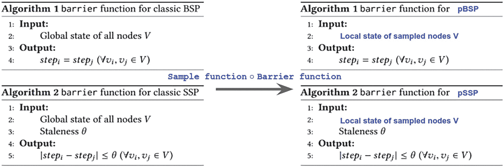

`BSP`、`pBSP`、`SSP` 和 `pSSP` 的障碍函数算法表。提供了每种算法的输入和输出函数。

### 图 10-8

`PSP` 可以作为一个高阶函数应用于其他同步机器，以进一步推导出完全分布式的版本。

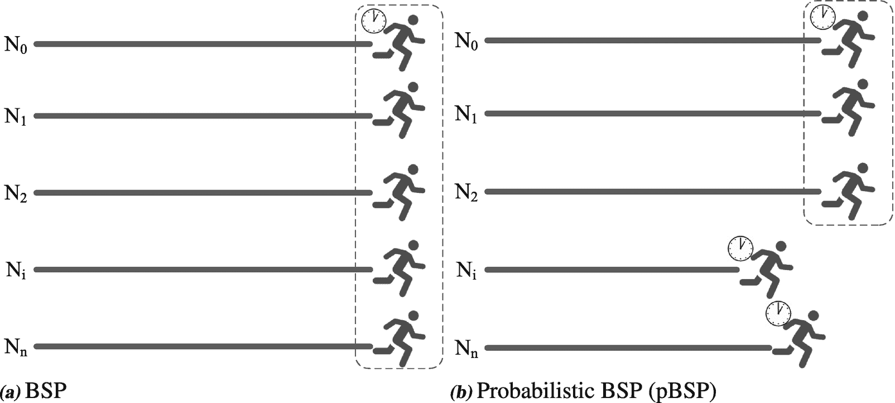

`BSP` 与 `PSP` 组合的示意图。

### 图 10-9

将 `PSP` 与批量同步并行（`BSP`）组合

作为说明，图 10-9 描绘了如何将 `BSP` 与 `PSP` 组合，即选择所有节点的一个子集，然后在子集内应用 `BSP`（`pBSP`）。`PSP` 与 `SSP`（`pSSP`）的组合遵循相同的理念。

除了现有的障碍控制方法，`PSP` 还与集中式和去中心化两种训练方法兼容。如前所述，额外的完整性维度解耦了一致性和同步性。其他全完全同步控制方法需要一个中心化节点来持有全局状态。通过使用采样原语，它们可以被转化为完全分布式的解决方案。在去中心化环境下，基于从邻居节点收集到的信息，一个训练节点可以决定通过推进其本地进度来通过障碍控制，或者等待直到达到阈值。

### 探索二维设计空间的好处

探索这种二维设计空间因此具有诸多好处。首先，它能构建更易于扩展的完全分布式屏障控制机制。如图 10-2d 所示，每个节点仅依赖其他几个节点来决定自身的屏障，而非依赖所有其他节点。其次，它允许探索能够实现更好收敛性的屏障。为了能够不受惩罚地忽略其他工作节点的状态，它依赖于这样一个事实：在实践中，许多迭代学习算法在收敛到最终答案的过程中可以容忍一定程度的误差[12]。通过控制采样方法和大小，`PSP` 减少了落后节点的影响，同时也限制了因节点基于过时信息返回更新而引入的误差。第三，在不可靠的环境中，使用采样原语可以通过概率性地从全体工作节点中选择一个子集作为估计值，从而最小化异常值和掉队者的影响。总之，通过仔细调整采样大小和过时参数，所生成的屏障控制方法既能抵御掉队者的影响，同时也能在算法推进过程中确保迭代之间的一定程度的一致性。我们将在第 10.6 节更详细地研究其性能。

### 符号表

表 10-2

| 符号 | 说明 |
| --- | --- |
| `f` (`r`) | 节点落后 `r` 步的概率 |
| `F` (`r`) | `f` (`r`) 的累积分布函数 |
| `R` [`X`] | 最优状态与含噪声状态之间的差异 |
| `a` | `F` (`r`)^(`β`)，其中 `β` 为样本大小 |
| `γ`[`t`] | 长度为 `t` 时的序列不一致性 |
| `T` | 更新序列的总长度 |
| `L` | `Lipschitz` 常数 |
| `σ` | 初始学习率，常量 |
| `N` | 工作节点总数，常量 |

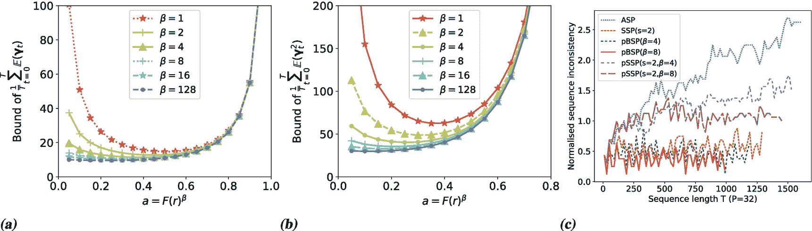

三个图表。图 a 和图 b 展示了作为 `F` of `r` 上标 `β` 函数的采样分布均值和方差的界限。图 c 展示了经验训练中的序列不一致性。

### 图 10-10

(a–b) 作为 `F`(`r`)^(`β`) 函数的采样分布均值和方差的界限。过时度 `r` 设为 4，`T` 等于 10000。(c) 经验训练中观察到的序列不一致性。

## 10.5 收敛性分析

在本节中，我们对 `PSP` 进行理论分析，并展示它如何影响机器学习算法（分析中使用的 `SGD`）的收敛性。该分析主要表明：(1) 在 `PSP` 下，算法不收敛的概率很小，并且该概率的上限随训练迭代次数的增加而减小；(2) 有证据表明，无需选择较大的采样大小，较小的采样大小就足以提供良好的性能。以下分析中使用的符号列于表 10-2 中。

该分析基于图 10-4 所示的模型。在分布式机器学习过程中，这 `N` 个工作节点持续生成更新，并利用这些更新持续更新共享模型。我们通过首先在一次迭代中遍历所有工作节点，然后遍历所有迭代来对这些更新进行计数。在此过程中，每个更新都通过整数 `t` 进行增量索引。此更新序列的总长度为 `T`。我们应用了与文献[15]类似的分析框架。在每个屏障控制点，每个工作节点 `A` 从 `N` 个工作节点中无放回地采样 `β` 个节点。如果这些被采样的工作节点中有一个落后工作节点 `A` 超过 `s` 步，则它会等待。节点落后 `r` 步的概率来自一个分布，该分布具有概率质量函数 `f(r)` 和累积分布函数 (CDF) `F(r)`。不失一般性，我们将过时度 `r` 和样本大小 `β` 参数均设为常数。

理想情况下，在诸如 `BSP` 之类的完全确定性的屏障控制系统中，此序列中更新的顺序应该是确定性的。我们称之为*真实序列*。然而，在现实中，我们得到的往往是*含噪声序列*，其中更新由于偶发性和随机性的网络及系统延迟而变得不规则地重排序。这两个序列长度相同。我们将*序列不一致性*定义为这两个序列之间索引差异的数量，并用 `γ[t]` 表示。它表明一系列更新与理想情况偏离的程度。如果序列不一致性有界，则意味着无论更新的顺序如何，真实序列在一定时间内能达到的效果，含噪声序列也能达到。因此，该度量是在理论上证明异步屏障方法收敛性质的关键工具。

设 `R[X] = sum_t^T f_t(x̃_t) - f_t(x^⋆)`。这是函数最优值与在给定含噪声状态下的当前值之间差异的总和。简而言之，它显示了“如果我们接收到的所有参数更新都处于完美理想顺序时我们得到的计算结果”与“在现实世界中使用例如 `PSP` 屏障时我们得到的计算结果”之间的差异。现在我们证明含噪声系统状态 `x̃_t` 的期望依概率收敛于最优状态 `x^⋆`。具体来说，由于 `R[X]` 随时间累积，为了得到一个与时间无关的度量，我们需要证明 `R[X] / T` 的值是有界的。

### 定理：PSP 下的 SGD，依概率收敛

设 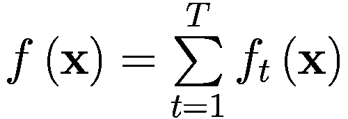 是一个凸函数，其中每个 `f[t] ∈ R` 也是凸函数。设 `x^⋆ ∈ R^d` 是该函数的最小值点。假设 `f[t]` 是 `L`-利普希茨连续的，并且两点 `x` 和 `x'` 之间的距离有界：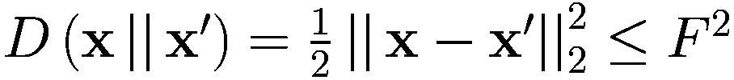，其中 `F` 是常数。设更新量由 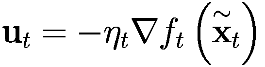 给出，学习率由 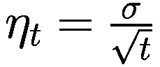 给出。我们有如下界限：

![$$ P\left(\frac{R\left[X\right]}{T}-\frac{1}{\sqrt{T}}\left(\sigma {L}²-\frac{2{F}²}{\sigma}\right)-q\ge \delta \right)\le {e}^{-\frac{T{\delta}²}{c+\frac{b\delta}{3}}}, $$](OEBPS/images/510309_1_En_10_Chapter/510309_1_En_10_Chapter_TeX_Equ3.png) (10.3)

其中 `δ` 是一个常数，`b ≤ 4NTLσ`。这里的 `b` 项是从滞后分布 `f(r)` 中抽取的随机变量的上界。`q` 和 `c` 是与 `γ[t]` 的均值和方差相关的两个值。如果我们假设 `0 < a < 1`，那么可以证明 `q` 和 `c` 都是有界的。此外，如果我们假设以概率 `Φ` 对 ∀`t` 有 `4NLσγ[t] < O(T)`，那么 `b < O(T)`。这意味着 ![$$ \frac{R\left[X\right]}{T} $$](OEBPS/images/510309_1_En_10_Chapter/510309_1_En_10_Chapter_TeX_IEq8.png) 依概率 `Φ` 收敛到 `O(T^(−1/2))`，并具有随时间增加而递减的指数尾界。

换句话说，该定理断言，只要含噪声的更新序列与理想序列之间的差异有界，并且系统中的节点不会落后太多，那么 `PSP` 就能保证（以一定的概率）我们得到的结果与最优结果之间的差异会随着更多更新的生成和追加而减小。该定理的正式证明可见 [52]。

### 采样的有效性

证明前述定理的一个关键步骤是证明序列不一致性 `γ[t]` 是有界的。我们已经证明了向量 `γ[t]` 的均值和方差都是有界的。具体来说，平均不一致性（按序列长度 `T` 归一化）由下式界定：

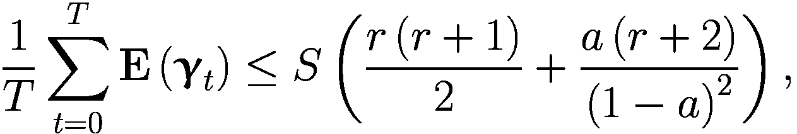 (10.4)

方差也有类似的界限：

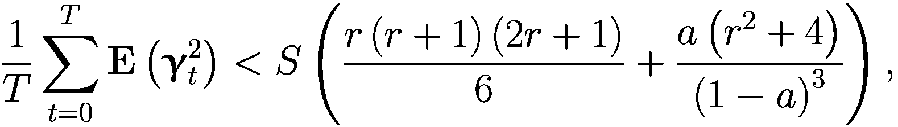 (10.5)

其中

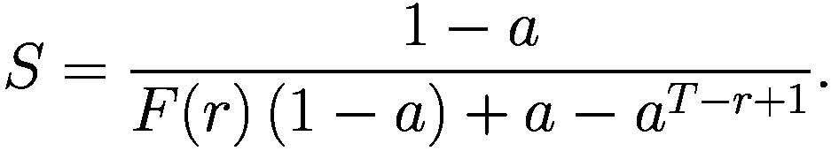 (10.6)

尽管这些界限看起来令人生畏，但对于固定的 `a`、`T`、`r` 和 `β` 值，它们都可以被视为常数。它们提供了一种量化 `PSP` *采样*原语影响的方法，并提供了比 `ASP` 更强的收敛性保证，如图 10-11 所示。它们不依赖于整个滞后分布。

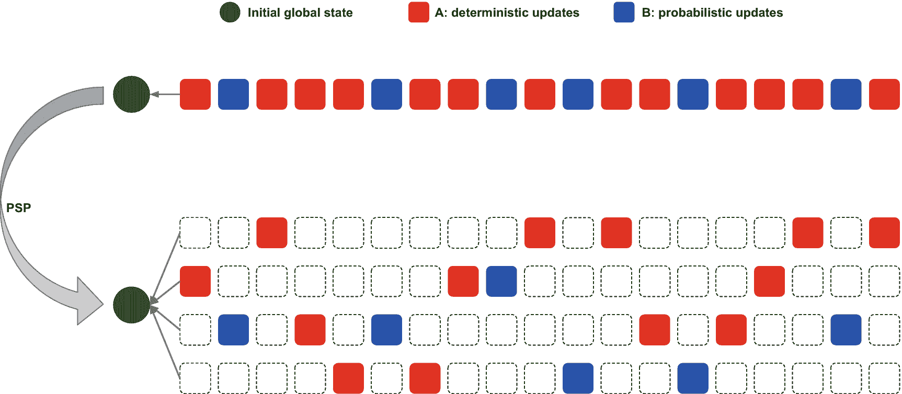

**图 10-11** 采样原语将原始序列分解为多个采样过程（为简单起见，假设无放回），每个过程都拥有原始序列的部分视图。样本量越小，产生的采样过程越多；每个过程对原始序列的视图就越不完整（即完整性更低），从而进一步降低了同步水平。

公式 10.4 和公式 10.5 提供的直观理解是，当应用 `PSP` 时，我们得到的更新序列与真实序列在差异的均值和方差方面相差不大。为了定量展示*采样*原语对界限的影响，图 10-10a 和 10-10b 显示了增加采样数量 `β`（从 1 到 128，在右侧用不同颜色线条标记）如何产生更紧的界限。值得注意的是，只需要采样少量节点就能得到接近最优的界限。这一结果对于论证在大型分布式学习系统中使用采样原语的有效性具有重要意义。这将在评估部分得到进一步验证。

在 `a = 0` 和 `a = 1` 处的不连续性反映了屏障方法控制行为的边缘情况。具体来说，当 `a = 0` 时，初始的 `r` 步中没有概率质量，因此如果系统要求 `β > 0` 个工作节点在最快速节点的 `r` 步之内，则无法取得任何进展。如果 `a = 1` 且 `β = 0`，则系统以 `ASP` 模式运行，因此预期界限会很大。然而，这些界限过于宽松。更好的界限是均值为 `O(T)`，方差为 `O(T²)`，我们在证明中给出了这些界限。当 `a = 1` 且 `β ≠ 0` 时，系统永远不应等待，工作节点可以任意落后，只要它们在下一次采样点之前返回到 `r` 步之内即可。

除了理论分析之外，序列不一致性 `γ[t]` 的直观可视化如图 10-10c 所示。我们使用不同的屏障方法运行了一个分布式训练实验，持续 100 秒，并在整个过程中以固定间隔测量真实序列与含噪声序列之间的差异数量。结果表明，使用 `ASP` 时序列不一致性持续线性增长，而在 `SSP` 中，它在一个由陈旧性参数决定的特定范围内增减。将采样应用于 `SSP` 会放松该界限，但与 `ASP` 不同，使用 `pSSP` 时的不一致性随序列长度呈亚线性增长。图中省略了 `BSP`，因为它的真实序列与含噪声序列始终相同。即使仅有 5% 的采样率，`pBSP` 也显示出紧密的界限（约 0.5）。

### 实现技术

如表 10-1 所示，屏障控制方法已被广泛应用于现有系统，例如参数服务器、`Hadoop` 等。实际上，在许多系统中 `PSP` 尚未得到广泛应用，这意味着同步方法设计中完整性维度无法直接利用。好消息是，引入这一额外设计维度所需的改动极少。要在当前数据分析框架之上实现 `PSP`，开发者只需添加一个新的原语：采样。如 10.4 节所示，在分布式系统中组合现有的屏障方法十分直接。

默认情况下，我们随机选择训练器。有多种方法可以保证随机采样，例如，将节点组织成结构化覆盖网络，如分布式哈希表（`DHT`）。随机采样的依据是节点标识符在命名空间中均匀分布。节点可以根据命名空间中已分配的 `ID` 密度来估算总体大小。

样本的选择对 `PSP` 的性能有很大影响。`PSP` 的采样提供了对所有工作节点进度总体分布的估计。在最坏的情况下，如果采样子集恰好全是掉队节点，则该子集无法对所有工作节点进行非常有效的估计。在某些场景下，可以使用不同的采样策略。

例如，我们可以改变分布式计算过程中样本变化的频率。或者，我们可以根据工作节点先前的计算时间来选择它们。具体来说，在每一轮中，所有工作节点根据其每次迭代的历史计算时间被分为两组：一组慢速，一组快速，然后从两组中各选择相等数量的工作节点组成目标子集。我们可以使用聚类算法，例如 `K-Means`。

## 10.6 评估

在本节中，我们通过实验研究各种屏障控制方法的性能及其权衡。我们重点关注评估屏障策略的两个常见指标：精度和系统进度。利用这些指标，我们探讨了在联邦学习系统中，不同样本设置和掉队节点影响下的各种屏障控制方法。此外，我们还使用了一个名为 `progress inconsistency` 的新指标作为训练精度的度量，但该指标不受特定应用超参数的影响。

### 实验设置

我们在真实数据集 `FEMNIST` 上进行了大量实验，该数据集是 `LEAF` 的一部分。`LEAF` 是一个用于联邦设置下学习的模块化基准测试框架，并包含一套开源联邦数据集 [8]。与 `MNIST` 类似，`FEMNIST` 数据集用于图像分类任务，但它包含 62 个不同的类别（10 个数字、26 个小写字母和 26 个大写字母）。每张图像的大小为 28×28 像素。该数据集总共包含 805,263 个样本。样本数量在不同类别之间均匀分布。

为了更好地研究所提方法在联邦学习中非独立同分布数据分布下的性能，我们遵循 [7] 中的数据划分设置。我们首先按类别标签对数据进行排序，将其划分为 `2*n*` 个分片，然后为每个 `*n*` 个工作节点分配 2 个分片。这种病理性的非独立同分布划分使得不同工作节点上的训练数据重叠尽可能少。验证集占总数据的 10%。此外，我们对其进行了预处理，使得验证集在每个类别中大致平衡。至于训练超参数，我们使用的批大小为 128，使用 `Adam` 优化器，学习率为 0.001，系数为 (0.9, 0.999)。

我们的实验在一台配备 56 个 Intel(R) Xeon(R) CPU E5-2680 v4 和 256G 内存的服务器上进行。在本节剩余部分，除非另有说明，我们默认使用 16 个工作节点。此外，额外使用一个工作节点用于模型验证以计算其精度。在本节剩余部分，我们旨在展示采样参数所实现的广泛调优空间，以及如何将现有的屏障方法整合到 `PSP` 中。

#### 准确度

我们在非独立同分布（non-IID）的 `FEMNIST` 数据集上，使用每种方法执行了约八个周期的训练过程。结果如图 10-12 所示。子图以时间为横轴，展示了约 10,000 秒内训练模型准确度的变化。该图比较了 `ASP`、`BSP` 和 `pBSP`（即 `PSP` 与 `BSP` 的组合），其中采样大小等于 4。

这里首先需要注意的是，尽管 `ASP` 的性能在初期看起来最优，因为它能快速积累来自不同工作节点的更新，但它的性能很快恶化并无法收敛。与 `ASP` 不稳定的性能相比，`BSP` 则稳定地收敛。随后，`pBSP` 在模型准确度方面明显优于前两者，尤其是在训练的后期。由于其概率特性，`pBSP` 的曲线比 `BSP` 呈现出更大的抖动，但同样遵循 `BSP` 稳定收敛的总体趋势。

`PSP` 的优势在于它结合了现有方法的优点。在图 10-12 下方的子图中，我们使用参数服务器已接收到的累计更新总数作为横轴，来比较 `ASP`、`SSP` 和 `pSSP` 中更新的“效率”。此处 `SSP` 和 `pSSP` 的陈旧度参数均设为 4。我们可以看到，随着更新的累积，尽管采用了采样，`pSSP` 的准确度提升与 `SSP` 相似。

同时，在更新进度或更新在参数服务器上的累积速率方面，`pSSP` 比 `SSP` 快得多。图 10-13 显示了服务器端更新数量随时间的变化（此处我们仅展示评估开始阶段的结果）。可以看出，在任何给定时间，`pBSP` 和 `pSSP` 的进度分别快于 `BSP` 和 `SSP`。当然，`ASP` 的进度最快，因为它不需要在工作节点之间进行任何同步，但其不收敛的更新使得这一优势变得毫无意义。

更新数量的差异可以直接理解为通信成本，因为每次更新都意味着服务器与客户端之间权值和梯度的传输。例如，在大约 600 秒时，`pSSP` 产生的流量比 `SSP` 多 35%；而 `pBSP` 的流量甚至是 `BSP` 的两倍。在我们的实验中，`PSP` 能够在不牺牲最终模型准确度的情况下降低通信开销。

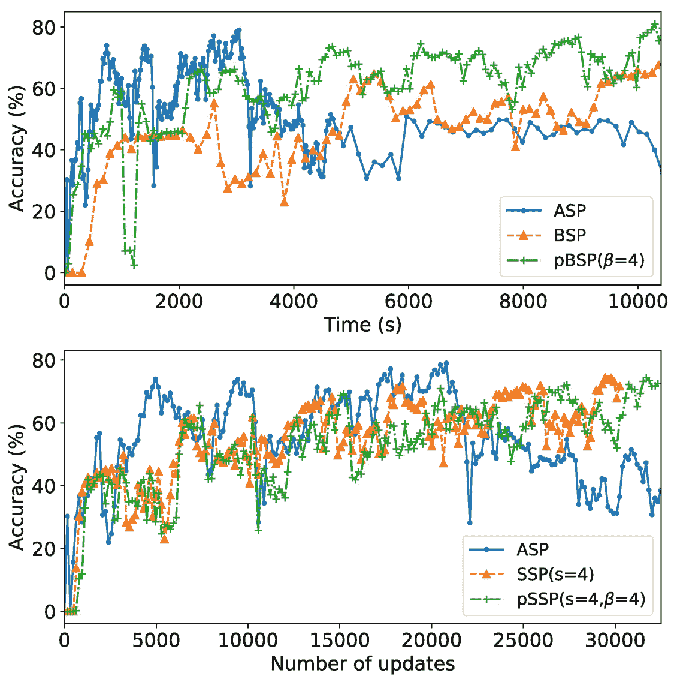

两个图表。图 a 绘制了 `ASP`、`BSP` 和 `pBSP` 的准确度随时间变化的曲线。图 b 绘制了 `ASP`、`SSP` 和 `pSSP` 的准确度随更新次数变化的曲线。两条图中的曲线均持续波动。

**图 10-12** 不同同步方法的性能比较

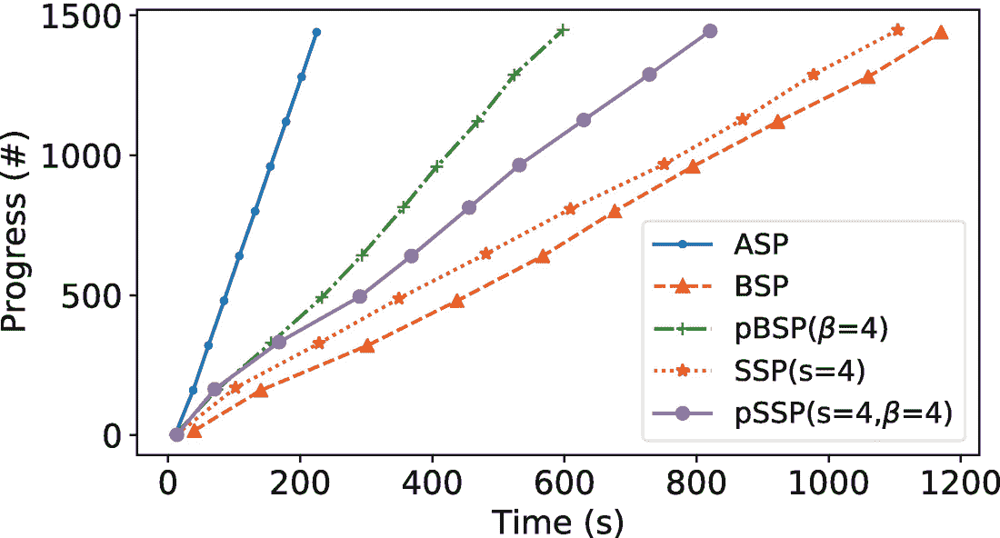

一个折线图绘制了 `ASP`、`BSP`、`pBSP`、`SSP` 和 `pSSP` 的进度。所有线条均呈上升趋势。

**图 10-13** 不同屏障方法下参数服务器累积的更新数量

`PSP` 兼具两者的优点。一方面，它具有与 `SSP` 和 `BSP` 相似的更新效率；另一方面，它实现了与 `ASP` 相似的更快更新进度。因此，它优于现有的屏障控制方法。

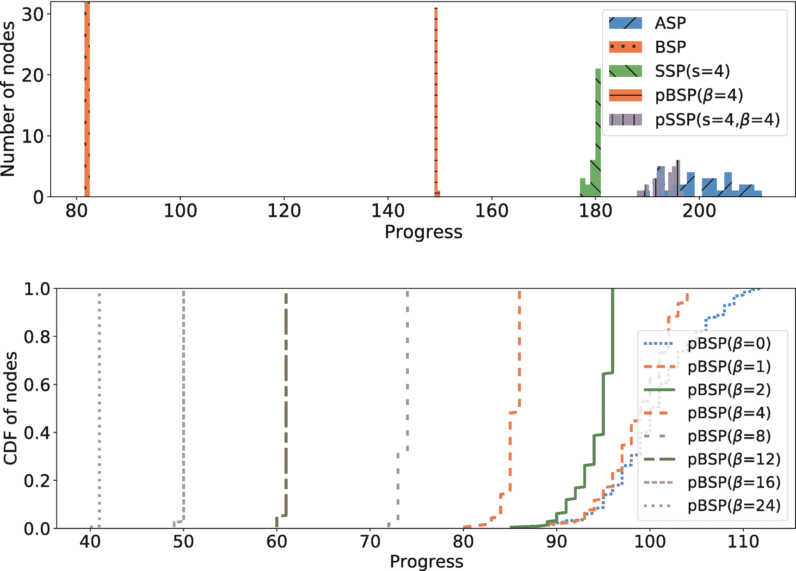

两个图表。图 a 描述了 `ASP`、`BSP`、`SSP`、`pBSP` 和 `pSSP` 的节点数量随进度变化的柱状图。图 b 描绘了以不同采样大小为参数的 `pBSP` 的节点累积分布函数（CDF）随进度变化的曲线。

**图 10-14** (a) 系统进度分布；(b) 以不同采样大小（从 0 到 24）为参数的 `pBSP`。增加采样大小会使曲线从右向左移动，同时分散程度减小，覆盖了从最宽松的 `ASP` 到最严格的 `BSP` 的整个区间。

#### 系统进度

在本节中，我们使用 32 个工作节点，并运行了 400 秒的评估。图 10-14a 显示了评估结束时所有节点进度的分布。

正如预期，最严格的`BSP`导致了一个紧密有界的进度分布，但同时，使用`BSP`使得所有节点进度缓慢。在实验结束时，所有节点仅推进到大约第 80 次更新。作为对比，使用`ASP`则导致更快的进度，大约为 200 次更新。但其代价是分布非常松散，显示节点之间完全没有同步。`SSP`允许一定的陈旧度（在我们的实验中为 4），介于`BSP`和`ASP`之间。

`PSP`展示了性能调优的另一个维度。我们将采样大小 *β* 设为 4，即采样率仅为 12.5%。结果表明，`pBSP`几乎与`BSP`一样紧密有界，同时比`BSP`本身快得多。比较`pSSP`和`SSP`时也是如此。在两种情况下，`PSP`都在限制分散程度的同时提高了迭代效率。

为了进一步研究采样大小的影响，我们将重点放在`BSP`上，并选择不同的采样大小。在图 10-14b 中，我们将采样大小从 0 变化到 24。随着采样大小的增加，曲线开始从右向左移动，且分散程度越来越紧密，表明节点进度的方差更小。当采样大小为 0 时，`pBSP`的表现与`ASP`完全相同；随着采样大小的增加，`pBSP`开始变得更像`SSP`和`BSP`，对同步的要求更严格。

另一个值得注意的重要观察是，当采样大小非常小，例如 1 或 2 时（即每个节点上的通信成本非常小），与`ASP`相比，`pBSP`已经可以有效地同步大部分节点。由掉队者（stragglers）引起的尾部效应可以通过使用更大的采样大小进一步削减。这一观察结果证实了我们在 10.5 节中的理论分析，该分析明确指出，即使对于大规模系统而言，较小的采样大小也能有效地将概率收敛保证推向最优，这进一步表明了所提出解决方案的卓越可扩展性。

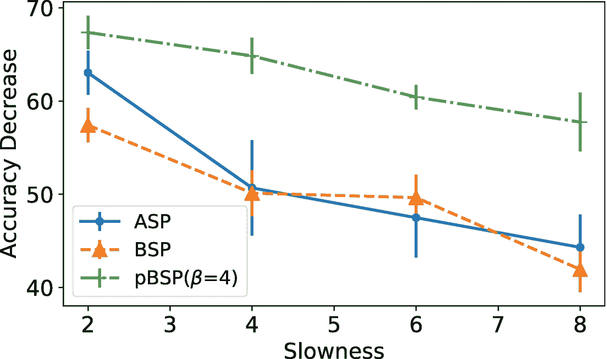

一个折线图，展示了`ASP`、`BSP`和`pBSP`的准确度下降与缓慢程度的关系。三条线均描绘了下降趋势。

图 10-15 掉队者影响系统性能和模型更新的准确度。通过采样原语实现的概率同步控制能够减轻此类影响。

当与`BSP`组合时，`PSP`可以将`BSP`的系统进度提升约 85%，同时保持几乎相同的紧密进度分布界限。此外，通过调整采样大小，评估结果表明，在一个拥有 32 个工作节点的系统中，像 2 或 4 这样的小采样大小就能有效地提供紧密的收敛保证。

##### 对掉队节点的鲁棒性

掉队节点在传统分布式训练中并不少见，并且在联邦学习的工作节点中普遍存在。在本节中，我们展示了掉队节点对系统性能和模型更新准确性的影响，以及如何通过`PSP`的概率同步控制来减轻此类影响。

如前所述，我们通过将每个慢速训练器的训练时间增加至原来的 *n* 倍来建模系统掉队节点，即平均而言，它们完成一次迭代所花费的时间是正常节点的 *n* 倍。这里的参数 *n* 是系统的“缓慢程度”。在图 10-15 所示的实验中，我们保持慢速节点的比例固定，并将缓慢程度从 2 增加到 8。然后，我们测量在训练结束时使用特定屏障控制方法的准确性。更确切地说，我们选择结束前一段时间的结果，并针对每个观测点使用其平均值和标准差。

图 10-15 绘制了由掉队节点导致的模型准确性下降与掉队节点缓慢程度的函数关系。正如我们所见，`ASP`和`BSP`都对掉队节点敏感，当缓慢程度从 2 倍增加到 8 倍时，两者的准确性均下降约 20%，而`pBSP`的准确性仅下降不到 10%。对于`BSP`，这主要是因为掉队节点严重降低了训练更新进度；对于`ASP`，这可以解释为其异步特性的结果，即来自慢速工作节点的更新被延迟。非独立同分布数据加剧了这个问题，在这些数据中，不同工作节点之间的数据重叠有限（即使并非完全没有）。再一次地，`PSP`集两者之长。正如我们之前所示，其概率采样减轻了数据分布的影响，并且也不易受到由掉队节点引起的进度降低的影响。

`PSP`不易受到系统中掉队节点的影响。当缓慢程度从 2 倍增加到 8 倍时，`ASP`和`BSP`都对掉队节点敏感，两者准确性均下降约 20%，而`pBSP`的准确性仅下降不到 10%。

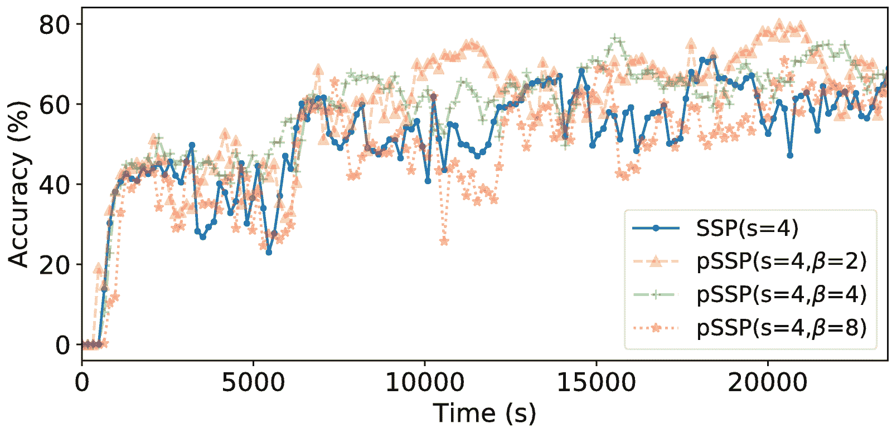

一张准确性与时间的图表。所有线条均呈上升趋势并伴有波动。

图 10-16

`pSSP`中变化的样本大小

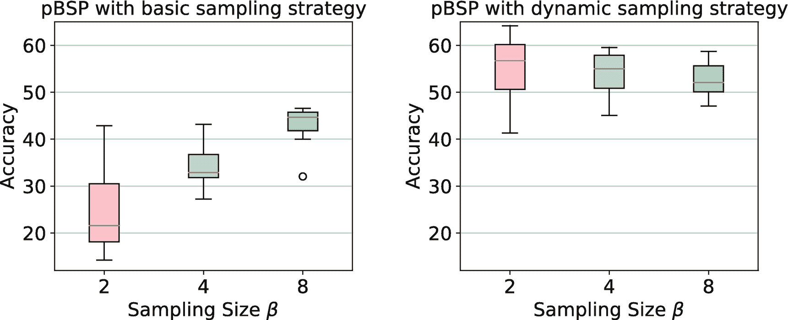

两张箱线图，比较了采用基本采样策略的`pBSP`和采用动态采样策略的`pBSP`。图 a 中的最大准确率为 40，图 b 中的最大准确率介于 50 到 60 之间。

图 10-17

比较`PSP`中不同的采样策略

### 采样设置

在第 10.6 节中，我们研究了采样大小的选择如何影响`PSP`的进度。随之而来的一个问题是：如何选择合适的样本大小？正如第 10.5 节所指出的，从我们的理论证明中可以推导出的一个重要观察结果是，少量采样可以达到与使用大量采样相似的性能。

为了在评估中证明这一点，我们在一个包含 16 个工作节点的训练中选择不同的采样大小（从 2 到 8），并将它们与`SSP`进行比较。对于所有使用的方法，训练持续固定时间。在图 10-16 中，我们可以看到，**即使样本数量发生变化，`pSSP`的性能仍然接近`SSP`**。在这种情况下，选择较小的采样数会带来比其他方法更好的性能，这是由于其快速的更新进度。然而，总是使用小样本大小并非一个经验法则。在`PSP`提供的巨大调优空间中选择合适的参数是一项艰巨的任务，我们将在未来的工作中致力于阐明这个具有挑战性的问题。

在第 10.4 节中，我们讨论了三种不同的采样策略。第一种是基本策略，即选择一定数量的工作节点作为子集，并使用它们来估计所有工作节点的训练进度。第二种是*动态采样*策略，它动态地重新选择这个子集，而不是保持固定。第三种是分组策略，即根据执行速度将工作节点预先聚类成两组，然后从两组中均等地选择`T`个样本。

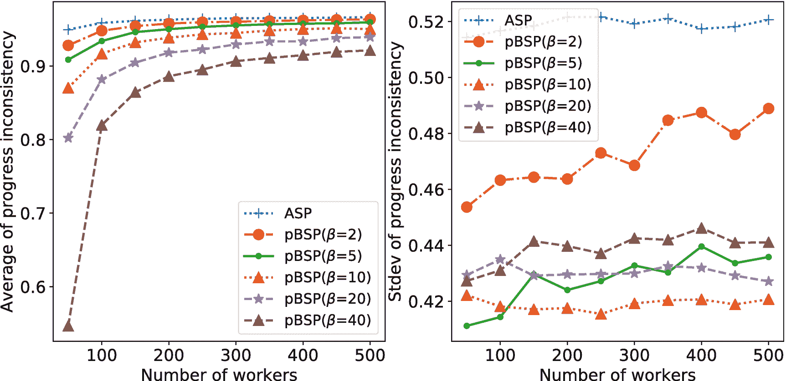

两张图表显示了`ASP`和不同`pBSP`样本的进度不一致性的平均值和方差，其中工作节点数量有所变化。在部分 a 中，所有线条呈上升趋势，在部分 b 中，所有线条均有波动。

图 10-18

`PSP`中关于样本大小的归一化进度不一致性的平均值和方差（总共 100 个节点）

为了比较这些策略，我们使用 24 个工作节点，并设置其中 6 个为掉队节点（计算反向传播慢 1 倍）。我们使用`pBSP`，并将其采样大小从 2 增加到 8。两次训练使用相同的轮数。结果如图 10-17 所示。每个箱线图显示了每次训练接近结束时模型准确性数值的分布；本实验使用了最后十个结果。

结果表明，与基本策略相比，动态策略可以有效地提高`PSP`的效率。对于不同的采样大小，效率提升范围从约 25% 到两倍。基本策略的低准确性表明它往往会导致更多的异步训练，这更类似于`ASP`而非`BSP`。

分组策略取得了与动态策略相似的结果，但箱线图的偏差更小，这意味着训练曲线更平滑（由于篇幅限制，结果图已省略）。此外，在动态策略中，采样大小不会明显影响模型准确性，这意味着可以使用较小的样本大小来提高系统进度，而不会牺牲模型准确性。还要注意，在这两种情况下，较大的采样大小导致较小的偏差。这也与前面几节中展示的`PSP`设计和分析一致。

我们在本节中了解到两点。首先，通过在使用 16 个工作节点的情况下将`pSSP`中的采样大小设置从 2 变化到 8，可以看出，就模型准确性而言，较小的采样大小仍能达到较大的采样大小的效果。其次，动态和分组采样策略都可以有效提升性能。与基本策略相比，两者都能有效提高`PSP`的效率。对于不同的采样大小，效率提升范围从约 25% 到两倍。

### 进度不一致性

在上一节中，我们评估了屏障控制方法对三种不同模型精度的影响。然而，训练精度不仅受到控制训练不一致性的屏障方法的影响，还受到学习率等超参数的影响。不同应用对训练误差的容忍度也差异巨大。为了更好地理解屏障在训练过程中对模型一致性的影响，而不考虑这些因素的作用，我们采用进度不一致性作为比较不同屏障的指标。

在分布式训练中，对于一个工作节点，从它从服务器拉取模型到更新自身本地模型之间，服务器很可能已经接收到了来自其他工作节点的多次更新。这些更新正是训练不一致性的来源。我们将进度不一致性定义为：在一个工作节点对应的读取与更新操作之间，所发生的此类更新的次数。在本实验中，我们收集每个节点在训练过程中每一步的进度不一致性数值。

我们研究了节点数量与`pBSP`不一致性之间的关系。所有执行均运行 100 秒，并且我们将工作节点数量从 50 增加到 500。我们测量了进度不一致性的平均值和方差，两者均通过工作节点数量进行了归一化，如图 10-18 所示。`ASP`的平均不一致性基本不受规模影响。在样本量较小时，`pBSP`的平均不一致性会接近`ASP`，但需要注意的是，仅有初始的网络规模增长会产生显著影响。当样本量固定而网络规模增长时，平均不一致性呈亚线性增长，这是一个理想的特性。至于`pBSP`的标准差值，无论网络规模如何，它们基本保持稳定。

根据这些观察，我们可以看到，对于`PSP`，无论是平均训练不一致性（以均值表示）还是噪声（以方差表示），对于不同的样本量，它们都朝着某个由`ASP`和`BSP`/`SSP`所限定的极限呈亚线性增长。

## 10.7 总结

在本章中，我们探讨了 Owl 中分布式计算的主题，重点关注同步屏障这一话题。我们展示了基于 OCaml 的分布式计算引擎`Actor`，它实现了三种不同的计算范式，即：Map-Reduce、参数服务器和对等计算。与此正交的是，它还实现了四种不同类型的屏障控制方法。

我们提出了概率同步并行算法（`PSP`），该算法适用于部署在大型、不可靠的分布式系统中的数据分析应用。它通过概率性地控制从分布式工作节点采样数据的方式，在迭代学习算法的效率和精度之间取得了良好的平衡。在`Actor`中，我们使用“*采样*”这一核心系统原语实现了`PSP`。我们展示了*采样*原语可以与现有的屏障控制方法结合，从而推导出完全分布式的解决方案。随后，我们评估了各种屏障控制方法的性能。`PSP`在不同应用场景下的有效性取决于合适的参数，即样本大小。与数值计算中的性能调优类似，我们建议借助先验知识和经验测量来进行参数调优，并将其视为未来探索的挑战。


开放获取 本章采用知识共享署名 4.0 国际许可协议（[`creativecommons.org/licenses/by/4.0/`](http://creativecommons.org/licenses/by/4.0/)）进行许可，该协议允许在任何媒介或格式中复制、发行、改编、传播和复制本作品，前提是您要注明原作者和来源，提供指向知识共享许可协议的链接，并指出是否做了修改。

除非在材料的致谢行中另有说明，否则本章中的图像或其他第三方材料均包含在本章的知识共享许可协议范围内。如果材料不包含在本章的知识共享许可协议中，并且您的预期使用不被法定法规允许或超出了允许的使用范围，您将需要直接从版权所有者处获得许可。

© 作者 2023 王亮，赵建新 高级数值分析系统架构 [`doi.org/10.1007/978-1-4842-8853-5_11`](https://doi.org/10.1007/978-1-4842-8853-5_11)