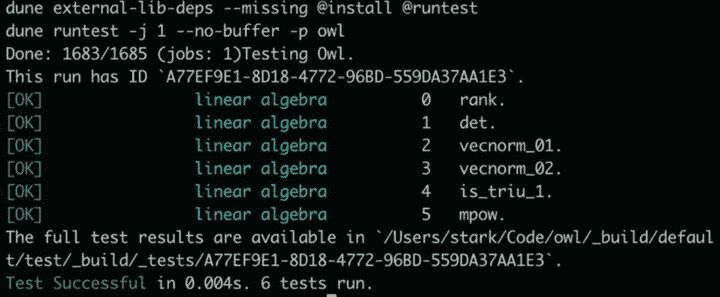
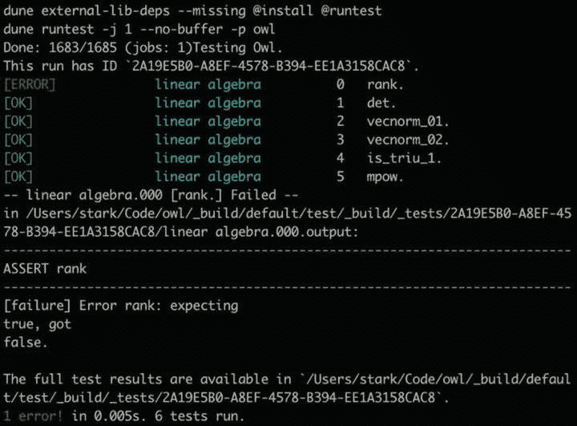

# 11. 测试框架

王亮 ^(1) 和赵建新 ^(2)
(1) 芬兰，赫尔辛基
(2) 中国，北京

每个合格的软件都需要测试，Owl 亦是如此。我们屡次发现，测试能够帮助我们发现在开发过程中未能注意到的潜在错误。在本章中，我们将简要介绍 Owl 的测试理念、我们用于执行单元测试的工具，以及演示如何编写单元测试的示例。本章还将讨论诸如在测试中使用函子以及为 Owl 编写测试代码时需要注意的其他问题等。

## 11.1 单元测试

有多种方法可以对代码进行测试。一种常见的方法是在代码中使用断言或捕获/抛出错误。这类测试很有用，但测试代码与函数代码本身混杂在一起，而我们需要的是独立的测试模块，用于检查函数实现是否符合预期行为。

在 Owl 中，我们尽可能应用*单元测试*来确保数值例程的正确性。单元测试是一种软件测试方法，用于检查代码中单个单元的行为。在我们这里，“单元”通常指一个单一的数值函数。

有一种软件开发方法被称为*测试驱动开发*，即在实现待测函数之前甚至就编写测试代码。虽然我们不强制要求采用这种方法，但在 Owl 的开发过程中，我们遵循某些测试原则。例如，我们通常不信任未经测试的代码，因此在 GitHub 的拉取请求中，在`test/`目录下伴随你的实现提供一个单元测试始终是一个好的做法。此外，尽量保持函数短小精悍，以便测试用例可以专注于某个特定方面。

我们在 Owl 中使用`alcotest`框架进行测试。它是一个接口简单的轻量级测试框架。它公开了一个简单的`TESTABLE`模块类型、一个用于断言测试谓词的`check`函数，以及一个用于执行`unit -> unit`测试回调列表的`run`函数。


## 11.2 示例

让我们来看一个在 `Owl` 中使用 `alcotest` 的示例。假设你在线性代数模块中实现了一些函数，包括 `rank`、`determinant`、`inversion` 等函数，并希望在提交拉取请求之前对其进行测试。测试代码可以包含在一个测试单元中，每个单元由四个主要部分组成。

第一部分中，我们定义一些将在该单元中使用的工具函数和公共常量。对于这个示例，我们指定了所需的精度和一些预定义的输入数据。这里，我们使用 `1e-6` 作为精度阈值。如果两个 ndarray 的差异总和小于 `1e-6`，则认为它们相同，如 `mpow` 中所示。预定义的输入数据也可以在每个测试用例中定义，例如 `is_triu_1` 中那样。

```
open Owl
open Alcotest
module M = Owl.Linalg.D
(* 第一部分 *)
let approx_equal a b =
  let eps = 1e-6 in
  Stdlib.(abs_float (a -. b) < eps)
let x0 = Mat.sequential ~a:1. 1 6
```

第二部分是核心部分。它包含实际的测试逻辑，例如，`det` 函数能否正确计算给定矩阵的行列式。`To_test` 模块中定义的每个测试函数都有独立的逻辑来验证目标函数的实现。

```
(* 第二部分 *)
module To_test = struct
  let rank () =
    let x = Mat.sequential 4 4 in
    M.rank x = 2
  let det () =
    let x = Mat.hadamard 4 in
    M.det x = 16.
  let vecnorm_01 () =
    let a = M.vecnorm ~p:1. x0 in
    approx_equal a 21.
  let vecnorm_02 () =
    let a = M.vecnorm ~p:2. x0 in
    approx_equal a 9.539392014169456
  let is_triu_1 () =
    let x = Mat.of_array [| 1.; 2.; 3.; 0.;
      5.; 6.; 0.; 0.; 9. |] 3 3 in
    M.is_triu x = true
  let mpow () =
    let x = Mat.uniform 4 4 in
    let y = M.mpow x 3. in
    let z = Mat.(dot x (dot x x)) in
    approx_equal Mat.(y - z |> sum') 0.
end
```

`Owl` 中最常用的测试函数类型是 `unit -> bool`。其思想是每个测试函数将函数的某个方面与预期结果进行比较。如果同一个函数有多个测试用例，例如 `vecnorm` 中的情况，我们倾向于构建不同的测试用例，而不是使用一个大的测试函数来包含所有情况。这些函数的常见模式可以总结为：

```
let test_func () =
    let expected = expected_value in
    let result = func args in
    assert (expected = result)
```

需要理解的关键点是，等号并不一定意味着两个值必须完全相同；实际上，如果涉及到浮点数（这是相当常见的情况），我们只需要这两个值在某个误差范围内近似相等即可。如果是这种情况，你需要注意所使用的精度：是双精度还是单精度。对于单精度浮点数来说足够好的阈值，对于双精度计算来说可能仍然会是一个较大的误差。

第三部分主要包含一些模板代码，用于向测试框架通知两个重要信息。第一个是测试函数的名称，以便测试框架将其记录在日志中用于后续分析。第二个是预期结果，测试框架将使用它来检查测试函数的输出结果。如果输出结果与预期结果不匹配，则测试失败，并且失败信息将被记录。

在这里，我们期望所有测试函数返回 `true`，尽管 `alcotest` 也支持测试返回许多其他类型，例如 `string`、`int` 等。请参考其[源文件](https://github.com/mirage/alcotest/blob/master/src/alcotest/alcotest.mli)了解更多详情。

```
(* 第三部分 *)
let rank () =
  Alcotest.(check bool) "rank" true (To_test.rank ())
let det () =
  Alcotest.(check bool) "det" true (To_test.det ())
let vecnorm_01 () =
  Alcotest.(check bool) "vecnorm_01" true (To_test.vecnorm_01 ())
let vecnorm_02 () =
  Alcotest.(check bool) "vecnorm_02" true (To_test.vecnorm_02 ())
let is_triu_1 () =
  Alcotest.(check bool) "is_triu_1" true (To_test.is_triu_1 ())
let mpow () =
  Alcotest.(check bool) "mpow" true (To_test.mpow ())
```

现在我们来看测试单元的最后一个部分。

```
(* 第四部分 *)
let test_set =
  [ "rank", `Slow, rank
  ; "det", `Slow, det
  ; "vecnorm_01", `Slow, vecnorm_01
  ; "vecnorm_02", `Slow, vecnorm_02
  ; "is_triu_1", `Slow, is_triu_1
  ; "mpow", `Slow, mpow
```

在最后一部分，我们将第三部分的函数放入一个测试集列表中。测试集指定了测试的名称和模式。测试模式可以是 `Quick` 或 `Slow`。`Quick` 测试会在测试套件的任何调用中运行。`Slow` 测试用于压力测试，仅偶尔运行，通常是在发布前或重大更改之后。我们可以进一步指定这些测试函数的执行顺序。

完成这一步后，整个文件被命名为 `unit_linalg.ml` 并放在 `test/` 目录下，与所有其他单元测试文件一起。现在剩下的唯一一件事就是将它添加到 `test_runner.ml` 中：

```
let () =
  Alcotest.run
    "Owl"
    [ "stats_rvs", Unit_stats_rvs.test_set
    ; "maths", Unit_maths.test_set
    ; "linear algebra", Unit_linalg.test_set
    ...
    ; "conv3d_mec", Unit_conv_mec_naive.Conv3D_MEC.test_set
    ; "conv2d_naive", Unit_conv_mec_naive.Conv2D_NAIVE.test_set
    ; "conv3d_naive", Unit_conv_mec_naive.Conv3D_NAIVE.test_set
    ; "dilated_conv2d", Unit_dilated_conv2d.test_set
    ; "dilated_conv3d", Unit_dilated_conv3d.test_set
    ; "base: algodiff diff", Unit_base_algodiff_diff.test_set
    ; "base: algodiff grad", Unit_base_algodiff_grad.test_set
    ; "base: slicing basic", Unit_base_slicing_basic.test_set
    ; "base: pooling2d", Unit_base_pool2d.test_set
    ; "base: pooling3d", Unit_base_pool3d.test_set
    ... ]
```

仅此而已。现在你可以尝试运行 `make test` 并检查函数是否实现良好。编译结果如图 11-1 所示。它显示所有测试都成功了。



一张显示所有测试通过的图片，表示运行了一组代码，输出是测试成功。

**图 11-1** 所有测试通过

如果某个测试函数没有通过会怎样？让我们故意制造一个失败的测试，例如，在 `rank` 测试中断言矩阵的秩等于 `1` 而不是正确的答案 `2`，然后再次运行测试。

如图 11-2 所示，失败被检测到并直接记录到标准输出上。



一张图片显示了运行一组检测测试失败的代码，并通过显示错误信息来体现。

**图 11-2** 测试中的错误

## 11.3 可能出问题的地方

*“谁来监督监督者？”* 请注意，测试代码本身仍然是代码，因此也可能出错。我们在实现测试代码时需要小心。有些情况你可能需要检查。


### 边界情况

边界情况涉及发生在正常操作参数之外的情形。这在卷积操作的测试中尤为明显。作为深度神经网络的核心操作，卷积十分复杂：它包含输入、卷积核、步长、填充等参数。因此，像 `1x1` 卷积核、不同高度和宽度的步长等特殊情况，会与不同的输入数据进行各种组合测试。

```ocaml
module To_test_conv2d_back_input = struct
    (* conv2D, 1x1 kernel *)
    let fun00 () =
      let expected =
        [| 30.0; 36.0; 42.0; 66.0; 81.0; 96.0; 102.0
         ; 126.0; 150.0; 138.0; 171.0; 204.0
         ; 174.0; 216.0; 258.0; 210.0; 261.0; 312.0 |]
      in
      verify_value test_conv2d
        [| 1; 2; 3; 3 |] [| 1; 1; 3; 3 |] [| 1; 1 |]
        VALID expected
    (* conv2D, 1x2 kernel, stride 3. width 5 *)
    let fun01 () =
      let expected =
        [| 2271.0; 2367.0; 2463.0
         ; 2901.0; 3033.0; 3165.0 |]
      in
      verify_value test_conv2d
        [| 1; 2; 3; 3 |] [| 2; 2; 3; 3 |] [| 1; 1 |]
        VALID expected
    (* conv2D, 1x2 kernel, stride 3, width 6 *)
    let fun02 () = ...
    (* conv2D, 1x2 kernel, stride 3, width 7 *)
    let fun03 () = ...
    (* conv2D, 2x2 kernel, padding: Same *)
    let fun04 () = ...
    ...
    (* conv2D, 2x2 kernel, stride 2, padding: Same *)
    let fun09 () = ...
```

### 测试覆盖率

另一个问题是测试覆盖率。它指的是存在关联测试的代码所占的百分比。虽然我们目前不追求严格的 100% 覆盖率，但更广泛的测试覆盖率始终是一件好事。例如，在我们对 `repeat` 操作的实现中，根据给定的轴包含一个整数还是多个整数，实现方式会有所不同。因此，在测试函数中，覆盖这两种情况至关重要。

## 11.4 使用函子

请注意，我们仍然可以利用 OCaml 的所有强大功能，例如函子。例如，在测试卷积操作时，我们希望同时测试核心库（用 C 实现）和基础库（纯 OCaml）中的实现。显然，没有必要为这两组实现编写两次相同的单元测试代码。为了解决这个问题，我们有一个测试文件 `unit_conv2d_genericl.ml`，其中包含一个包含前面所有四个部分的大型模块：

```ocaml
module Make (N : Ndarray_Algodiff with type elt = float) = struct
    (* Section #1 - #4 *)
    ... end
```

而在用于核心实现的具体测试文件 `unit_conv2d.ml` 中，它只包含一行代码：

```ocaml
include Unit_conv2d_generic.Make (Owl_algodiff_primal_ops.S)
```

或者，在基础库的测试文件 `unit_base_conv2d.ml` 中：

```ocaml
include Unit_conv2d_generic.Make (Owl_base_algodiff_primal_ops.S)
```

## 11.5 性能测试

对于一个数值计算库来说，能够计算出正确的结果是不够的。函数计算的速度同样重要；实际上，在现代实时数据分析中，速度至关重要，它在金融、机器人、飞行控制等许多领域都有广泛的应用。除了正确性之外，Owl 测试框架还包含了性能测试。以下简单的通用函数会运行目标函数一定次数，然后计算平均速度：

```ocaml
(* test one operation c times, output the mean time *)
let test_op s c op =
  let ttime = ref 0. in
  for i = 1 to c do
    Gc.compact ();
    let t0 = Unix.gettimeofday () in
    let _ = op () in
    let t1 = Unix.gettimeofday () in
    ttime := !ttime +. (t1 -. t0)
  done;
  ttime := !ttime /. (float_of_int c);
  Printf.printf "| %s :\t %.8fs \n" s !ttime;
  flush stdout
```

这个用于测试每个操作的函数类似，但会在每次迭代中更积极地打印出追踪信息：

```ocaml
(* test one operation c time, output the used time in each evaluation *)
let test_op_each c op =
  Printf.printf "| test some fun %i times\n" c;
  let ttime = ref 0. in
  for i = 1 to c do
    Gc.compact ();
    let t0 = Unix.gettimeofday () in
    let _ = op () in
    let t1 = Unix.gettimeofday () in
    Printf.printf "| #%0i\t:\t %.8fs \n" i (t1 -. t0);
    flush stdout;
    ttime := !ttime +. (t1 -. t0)
  done;
  ttime := !ttime /. (float_of_int c);
  Printf.printf "| avg.\t:\t %.8fs \n" !ttime
```

有了这两个通用函数，我们可以很快地编写出一系列测试。以下是一个测试各种矩阵操作执行时间的示例：

```ocaml
let _ =
  Random.self_init ();
  let m, n = 5000, 20000 and c = 1 in
  print_endline (String.make 60 '+');
  Printf.printf "| test matrix size: %i x %i    exps: %i\n" m n c;
  print_endline (String.make 60 '-');
  let x, y = (M.uniform Float64 m n), (M.uniform Float64 m n) in
  test_op "empty             " c (fun () -> M.empty Float64 m n);
  test_op "zeros             " c (fun () -> M.zeros Float64 m n);
  test_op "col               " c (fun () -> M.col x (n-1));
  test_op "row               " c (fun () -> M.row x (m-1));
  test_op "cols              " c (fun () -> M.cols x [|1;2|]);
  test_op "rows              " c (fun () -> M.rows x [|1;2|]);
  test_op "map               " c (fun () -> M.map (fun y -> 0.) x);
  ...
```

## 11.6 总结

在本章中，我们简要介绍了在现有 Owl 代码库中如何使用 `alcotest` 框架进行单元测试。我们以 Owl 中线性代数模块的一段测试代码为例，展示了 Owl 测试代码的通用结构。随后，我们讨论了一些我们认为在编写测试时很有用的技巧，例如考虑边界情况、测试覆盖率以及使用函子简化测试代码。在实践中，我们发现单元测试在开发中确实非常方便，而且我们总希望它们能多多益善。


**开放获取** 本章遵循知识共享署名 4.0 国际许可协议 ([`creativecommons.org/licenses/by/4.0/`](http://creativecommons.org/licenses/by/4.0/)) 的条款进行许可，该协议允许在任何媒介或格式中使用、分享、改编、分发和复制，前提是您要适当标注原作者和来源，提供指向知识共享许可协议的链接，并指出是否进行了修改。

除非在材料的署名行中另有说明，否则本章中的图片或其他第三方材料均包含在本章的知识共享许可协议范围内。如果材料未包含在本章的知识共享许可协议中，并且您的预期用途未被法律法规允许或超出了允许的使用范围，您需要直接向版权所有者获取许可。


