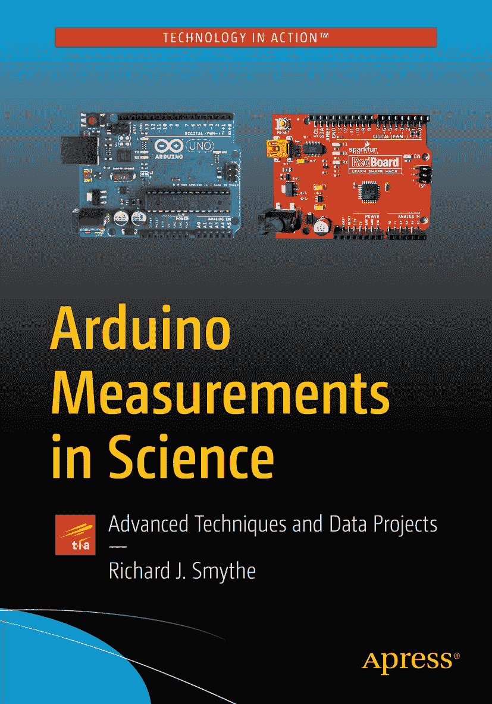

ISBN 978-1-4842-6780-6 电子版 ISBN 978-1-4842-6781-3 [`doi.org/10.1007/978-1-4842-6781-3`](https://doi.org/10.1007/978-1-4842-6781-3)  
© 理查德·J·史密斯 2022  
本作品受版权保护。所有权利均由出版商独家授权，涉及材料的全部或部分内容，特别是翻译、重印、重新使用插图、朗诵、广播、以缩微胶片或任何其他物理形式复制、传输或信息存储与检索、电子改编、计算机软件，或目前已知或以后开发的其他类似或不同方法的使用权。  
在本出版物中使用通用描述性名称、注册商标、商标、服务标志等，即使未作特别声明，也不意味着这些名称不受相关保护性法律和法规的约束，因此可自由使用。  
出版商、作者和编辑假定本书中的建议和信息在出版之日是真实准确的。出版商、作者或编辑对本文所含材料或可能存在的任何错误或遗漏不作任何明示或暗示的保证。出版商对已出版地图中的管辖权主张和机构归属保持中立。

本 Apress 印记由注册公司 APress Media, LLC（Springer Nature 的一部分）出版。  
注册公司地址为：1 New York Plaza, New York, NY 10004, U.S.A.

## 本书练习前言

#### 引言

本书并非旨在作为数据收集的入门读物。虽然有动力或热情的调查者可以直接投入并尝试在实践中获取所需的知识和技能，但本指南面向的是那些至少对电子硬件和计算机软件有一定经验的读者。基本熟悉简单电子学以及使用诸如 `Python` 或 `C++` 这类结构化语言进行基础编程，将缩短实施本书中任何测量技术所需的时间。

本指南中提及的大多数数据收集硬件的制造商文献，都提供了指导性和基础性活动，以帮助新用户熟悉其实现方法。在线资源也可以提供许多使用现有硬件的实际应用。

本书致力于使用从现成组件和物理计算系统组装的设备进行实验性物理化学测量。本书提供了书面方法，使实验人员能够使用电子、光电和简单机械系统进行基本测量。书中描述了一系列针对基本参数单位（如温度、距离、光强度、声频、相对湿度等）的实验测量程序，以及为实验机制供电和控制的方法。

对单个感兴趣基本单位的测定或测量，是单元操作，可以组合起来测量或控制更复杂的实验研究。以下技术代表了可组装在实验装置中的单元操作，用于测量任何科学学科中监控的基本参数。

## 项目管理

以下是开发监督控制和数据采集/监控项目建议的通用程序。

1.  在准备创建一个实验开发项目时，无论是为了进行本书中的练习还是为了一个新概念，你都应该查阅最新的可用信息。收集与你项目相关的已发表作品，如果这能增加你的知识深度并帮助你避免不必要的重复劳动。应将粗略笔记和图纸收集在一个笔记本中（纸质或电子格式均可）。

2.  在流程图或过程图中将想法安排成合乎逻辑的开发顺序。常见的电子表格软件和文字处理程序都包含流程图绘制功能。在流程图中，将主要流程保持在图表中央向下流动，向前分支向左或向右，向后分支则到相反一侧。

3.  修改流程图/过程图，直到得出最终版本。

4.  从项目中最简单的单元操作开始，组装硬件/电子设备及相应的软件，调试各个模块并验证运行状态，直到整个项目按设计功能运行。

在所有科学报告中，文档必须完整到任何其他研究人员都能重现原始实验工作并确认所报告观察结果的程度。软件代码必须附有充分的注释，以便试图重复所描述工作的人员以及研究人员修改代码以实现更高效的运行，或适应正在开发的机电系统的更改。

要重复他人的工作，必须存在清晰的单位定义。在阅读原理图和尝试重复组装时需要谨慎。分立元件和集成电路的物理尺寸不断减小，或被更新技术所取代。尺寸的减小意味着元件上的标识标记也越来越小。

电阻器和电容器的标记可能以数字和字母组合的多种格式出现，有时数量级符号会取代小数点。表面贴装技术采用三位数字代码，其中前两位数字是元件值，第三位是数值乘数的 10 的幂。

-   电阻以欧姆 (Ω) 为单位测量。
-   兆欧 (MΩ) 是 10⁶ 或 1,000,000 欧姆；典型标识可能是，例如，1.5M 或 1M5。
-   千欧 (kΩ) 是 10³ 或 1,000 欧姆；典型标识可能是，例如，1.2K 或 1K2。
-   R 是 10⁰ 或 1 或 1 欧姆单位；例如，100 R 或 100，因为没有小数点需要替换。
-   毫欧 (m) 是 1/1000 或 10^(–3) 欧姆；例如，0.052 Ω 写作 52 mΩ。

在较早期的作品中，电容器单位主要限于微法和皮法标识。当前大多数电容器符号的使用似乎遵循下面列出的三个主要分数标识，但最近已扩展到包含法拉，以便在描述超电容器和超级电容器设备时避免在微级术语中使用千和百万。

-   电容以法拉 (F) 为单位测量。
-   微法 (μ) 是百万分之一 (10^(–6)) 法拉。
-   纳法 (nF) 是十亿分之一 (10^(–9)) 法拉。
-   皮法 (pF) 是百万分之一微法，或 (10^(–12)) 法拉。

在挑选组装实验装置所需的组件时，必须格外谨慎，以确保最终构造的装置适用于预期的测量。一个典型的例子，即使是在创建像线性变化电压值这样简单的东西时也能体现。现代电子技术提供了两种简单的方法来生成电压斜坡，使电压值随时间在低电压值和高电压值之间线性变化。在线性系统中，电位可被视为“斜坡上升”或“斜坡下降”。

如果使用 4 位数模转换器，则可以生成从 0 到 2⁴（即 0 到 15，共 16 个数字值）的增量电压。因此，施加到数模转换器（`DAC`）的 16V 信号，可以提供一系列介于 0V 和 15V 之间、步长约为 1V 的离散阶梯电压。这 1 伏特的步长对于将机器人或镜子定位在 16 个可能位置中的任何一个来说可能足够，但可能无法用于电化学应用。

在化学反应的某些场景中，几种金属会在几个不同的、非整数的外加电压下从溶液中沉积出来。此时，可能需要一个平滑的电压波形，其电压值在所需电平之间连续斜坡变化。这种连续变化电压值的平滑过渡，就是模拟波形。它必须通过特殊方法生成，其中一种方法是使用恒流源对电容器充电，以在电容器极板两端产生线性电压变化。

尽管微积分表明，通过选择足够多且足够小的阶梯步长，我们可以用数字信号来模拟模拟信号，但数字信号可能无法提供当前应用所需的确切值。因此，可能需要一种基于恒流源的、连续可变的电容器充电方法。为某个问题选择使用哪种电压变化技术，取决于所需的电压分辨率以及所需电子元件的可获得性。

当处理来自传感器或实验装置的电信号时，请确保输出电压电平不超过处理该信号的电子元件的输入电压能力。大多数分立式集成电路的供电电压限制在 5V。某些运算放大器的工作电压可高达 18V。大多数表面贴装技术元器件的工作电压标称为 3.3V。

与所有科学研究一样，应遵循从简单到复杂的逻辑推进过程。为项目开发软件时，应从连接设备与计算和显示电路所需的代码开始。

最简单的电信号传输形式，对模拟和数字信号都采用串行连接。

模拟电压信号通常直接连接到集成电路的输入引脚，这些集成电路提供某种形式的信号处理。数字信号则连接到用于检测信号高低电平的引脚上。大部分传感器的输出都是基于电压的，但在某些传感器测量中也会使用电流检测。

计算电路通常通过串行端口访问外部数据。该串行端口通常是计算机内存中一个特定的可寻址位置，它根据特定的编码（称为*协议*）接收传入的数字数据。协议规定了构成数字信号的高到低或低到高转换的含义，这些转换用于时序、数据值和信号处理控制参数。有许多为特定应用而设计和优化的科学及工业串行传输协议。

大多数实践练习都局限于系统和扩展板。串行通信协议已经嵌入在组件固件中，开箱即可使用。

测量技术使用了`DAQFactory`脚本语言、`Python`以及`Arduino`编程中使用的`C`语言变体。这三种编程语言都有保留的关键字，不能用作变量名。请遵循所用语言相应文档中的变量命名规则建议来命名。

通过遵循传统的`C`语言风格来创建有意义的名称，例如`MySignificantName`、`MySgnfcntNme`或`My_Significant_Name`。不要使用专有词汇，如`temperature`或`Temperature`，或任何可能作为`Python`、`DAQFactory`脚本、`C`或`C++`编程代码中内置词汇的词。有些脚本作者为了“清晰”而使用专有词汇作为变量名或通道名，结果导致脚本无法运行并产生令人费解的输出。而当将这些专有词汇重新输入为独特的大小写混合字符后，脚本却突然完美运行了。请遵循软件内置的正确形式化方法。

在`DAQFactory`软件中，创建通道可以让你填充一个智能的通道、变量和常量列表，从而减少易出错的输入。在所有针对编写好的但无法运行的编码系统进行的故障排除步骤中，首要步骤是检查所有拼写。变量名是区分大小写的。

详细记录正在进行的操作，写下计算过程，绘制原理图和粗略的机械图纸。毕竟，这就是科学。机械系统和电子电路的绘图惯例可以在一些参考著作中找到^(¹)。鼓励你遵循这些惯例。

从`HMI`的软件控制到面包板上的电路布线，在组装测量系统的过程中，要测试每个环节。工作要整洁；将导线平行于面包板插座上的引脚线和排排列。导线交叉时要成直角，并且只能用手将细铜线弯成直角，以获得相对较大的曲率半径。记住，铜虽然具有延展性，但会“加工硬化”，因此尽可能使用新导线，或者确保一根导线重新弯曲成较大半径和缓和的曲率，次数不要超过六次。

对于一个多组件组成但无效的测量系统，其基本逻辑排查方法并不总是显而易见的。采用单元操作测试的理念，往往能使一个看似棘手的难题变得易于处理。

你应该设置或配置`DAQFactory`软件来激活一个通道。该通道可以分配一个硬接线连接到相应的输入，或者通过软件配置到相应的输入。当传感器被激活时，带有时间戳的数据应出现在通道表中。我们测试程序的第一步，就是验证`DAQFactory`程序中是否出现了带时间戳的数据。如果通道表中没有数据流入，那么错误的来源必定是系统三个组件之一：传感器、`DAQFactory`配置或传输协议。

必须检查系统的每个组件，并从基本电源到输出信号逐步验证其运行情况。必须追踪输出信号的路径，验证其正确性，并确认其已传递到下一环节。假设系统所有组件都工作正常，那么整个系统就能正常工作。请记住，这仅仅是一个假设！

