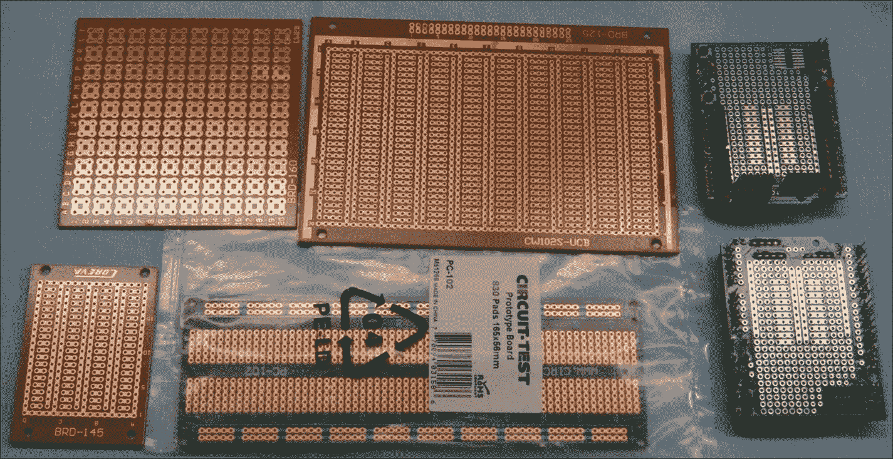
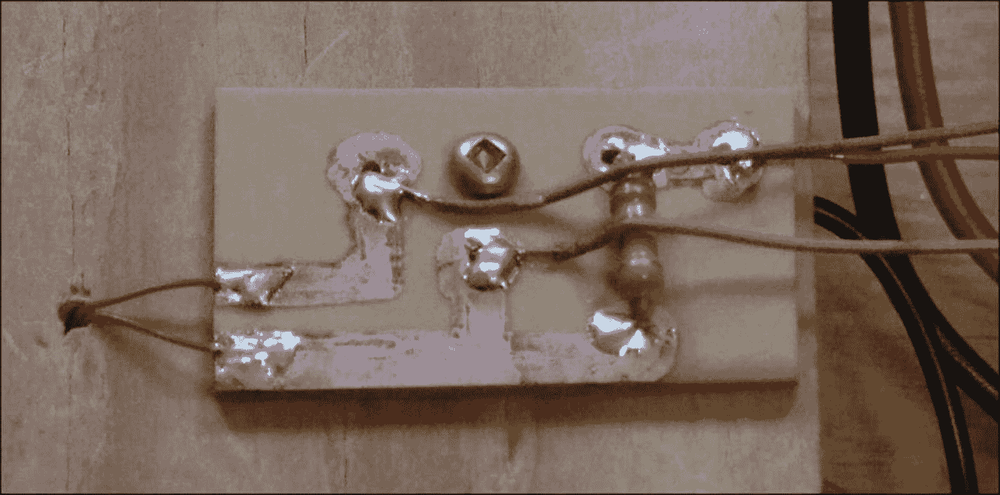

# 集成电路与表面贴装技术（SMT）

## 传统方法与现代挑战

传统上，实验者会在测试和项目开发期间购买元器件用于面包板上的插接。成功搭建的面包板电路随后可转化为具有单面或双面蚀刻图案的印制电路板。双面电路板通常使用钻孔来连接电路板的两面。然而，随着集成电路变得越来越小、功耗更低、速度更快、灵敏度显著提高，如今许多这类微型 IC 既无法手动操作，普通研究人员也无法将其与电路进行电气连接。

## SMT 的优势与适配器

更小的 IC 尺寸催生了更小的元器件面积和表面贴装技术（SMT），这反过来又使电路板变得更小、更易于制造且成本更低。物理尺寸的减小和 SMT 的发展为实验者增加了一层复杂性。要利用缩小集成电路物理尺寸所带来的优势，就需要使用适配器将 SMT 元器件转换为兼容的面包板插接格式。

通过 IC 制造商数据手册创建的印制电路板适配器，SMT 可用于开发项目。适配器通常称为分线板，可由多家商业供应商提供。Proto-Advantage 提供的产品选择较为广泛之一。除了大量的适配器产品，该公司还提供组装服务，并使用 SMT 技术将 IC 安装到您的分线板适配器上。

从 SMT 到面包板的转换，是通过将微芯片安装在一个小型印制电路适配板上来实现的，该适配板将 IC 连接到一系列排针上。然后使用这些方形或圆形的排针，配合绕线或插座，为 IC 与正在开发的实验之间提供电源和 I/O 所需的电气连接。

## SMT 封装类型

许多 SMT 元器件有多种不同的安装方式，这些方式通常在产品数据手册末尾的详细图纸中定义和描述。以下是一些用于描述 SMT 器件的缩写术语。

SMT 电容器的尺寸由其四位数字代码指定，表示以十分之一英寸为单位的长和宽（例如 1210 表示长 0.12 英寸，宽 0.10 英寸）。

- **CQFP**：陶瓷多层 QFP
- **LCC**：无引线芯片载体（直接焊接到电路板上且无引脚的封装）
- **PLCC**：带引线塑料芯片载体
- **PQFP**：塑料四方扁平封装
- **QFP**：四方扁平封装（一种四边都有引脚的矩形 IC）

电阻器遵循与电容器相同的惯例。

- **SOIC**：小外形集成电路（通常后跟封装引脚数，有时进一步缩写为 `SO-8`，例如）
- **SOP**：小外形封装（有多种变体：塑料小外形封装（PSOP）、薄型小外形封装（TSOP）和薄型缩小小外形封装（TSSOP））
- **TQFP**：薄型 QFP

更详细的尺寸信息始终能在产品的数据手册中找到。在决定某个特定原型或项目所需的元器件和分线板之前，应仔细审阅这些信息。SMT 是一个快速发展的领域，新的生产方法使得过时成为研究人员经常遇到的问题。然而，功能更强、采用更新更小型封装的等效集成电路几乎每天都有新产品上市。您必须研究文献，以确定给定原型所需电路的最新形式。

## 原型开发与电路板制作

原型开发面包板、跳线或电缆以及集成电路通常是开发和测试或“验证”一个工作测量系统所使用的格式。在本书后续部分遇到的几项练习和测量技术中，您作为研究者/实验者会发现，需要使用印制电路板来将一个工作面包板电路封装在屏蔽金属外壳内。

预制的印制电路板，例如图 RE-1 中所示的那些，可用于将电路组装成固定、安全且紧凑的格式。最右侧的两块板实际上是原型开发板的顶层和底层，它们直接安装在 Arduino 微处理器板上，以便在微控制器占地空间内容纳测试电路或永久布线电路。所有 I/O 和电源引脚都从下方的微控制器板传导至上方的电路板。这些板通常称为扩展板，可由多家制造商提供。

所展示的蚀刻万用板可在电子元器件商店和网上购买。铜迹线间距为 0.1 英寸（2.45 毫米），与标准双列直插封装引脚间距相匹配。

*图 RE-1：原型开发电路板*

多家电路板制造商提供或能够使用标准化的电路板设计软件来制造少量或大量的复杂电路板。多层板和多引脚 SMT 元器件最好由商业制造商生产。偶尔，您可能需要为特殊应用设计并制作一两块简单的印制电路板，例如安装特殊元器件。图 RE-2 描绘了一对小的 1 英寸 × 1½ 英寸（2.45 厘米 × 4 厘米）手绘 PCB，用于安装一对 30 kΩ 热敏电阻和 33 kΩ 电阻，以测量热电冷却板测试单元的热侧和冷侧。

*图 RE-2：用于安装和连接传感器的手绘 PCB*

基本的电路板尺寸和固定元器件所需的铜迹线简单轮廓，基本上定义了要制造的电路板尺寸。在图 RE-2 所示的 PCB 中，需要一对电路板——测试单元每侧各一块——并且蚀刻了一块具有两条铜迹线的单板，进行钻孔，然后切成两半（参见第 3 章的图 3-35），以方便蚀刻和钻孔过程中的处理。一个小型黄铜圆头安装螺钉固定 PCB 的布线。其安装的热敏电阻传感器位于双腔测试单元壁的外表面。

仔细观察铜迹线，会发现蚀刻铜图案的形状和表面纹理都较粗糙。这种粗糙反映了手绘以及形成抗蚀刻“掩膜”层的记号笔墨水非常薄的性质。通过使用多层记号笔墨水或使用密度更高的抗蚀材料（如彩色的化妆品指甲油），可以获得更均匀、更致密的铜图案。彩色指甲油更容易观察，并且可以在蚀刻后用洗甲水或丙酮去除。

有几种配方可用于从覆盖环氧树脂的空白板上蚀刻掉多余的铜，从而形成所需的图案，而作者使用氯化铁溶液一直能获得稳定的成功效果。

> **注意**
> 浓缩的氯化铁溶液具有腐蚀性！在处理任何能够从电路板上去除铜的蚀刻剂时，请佩戴护目镜和耐化学腐蚀手套。

商业化的氯化铁蚀刻剂（250 毫升瓶装）足以制作小型电路板，在室温下半到一小时即可完成蚀刻。电路板在蚀刻前必须清洁，因为指纹如果不移除，会起到抗蚀作用。使用肥皂和水或温和的厨房研磨剂（如 Vim）可以在施加抗蚀层和蚀刻之前对电路板进行处理。将一个浅塑料盘中的蚀刻剂作为蚀刻槽。加热蚀刻剂溶液会缩短蚀刻所需的时间。

需要钻孔的 PCB 应预先打中心冲眼。用于制作与电气或电子连接兼容的孔的精细小钻头，应安装在高速旋转工具（如 Dremel）中，用于钻削铜箔或环氧树脂板。

为项目准备好 PCB 后，需测试新板上所有迹线的导通性。

有一些套件使用激光打印机从照片创建复杂电路板。激光打印的图案必须热压或熨烫到空白电路板上，以转印塑料抗蚀图案，这是一个更复杂的过程，您可以在必要时使用。

