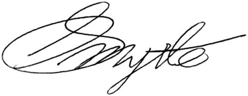

# 免责声明

-   110 伏特电流可致命并引发火灾。
-   烙铁的温度足以造成严重烧伤。
-   本书仅用于教育目的，并展示通过实验形式演示的概念。这些设置未经鲁棒性测试，并非设计或意图用于任何形式的现场实施。

这些概念仅为教育基础。它们旨在成为进一步研发仪器方法以监控实验科学装置、收集数据或进行物理测量的起点。

-   本书的构思源自 20 世纪 60 年代中期。在此后的岁月里，各部分内容随技术发展而逐步成型。

尽管本书的正式编纂始于 2008 年，使用了当时的集成电路、物理计算和互联网信息资源，但文档在编写过程中，随着新集成电路、物理计算软件和在线信息源的出现而不断发展。软件或机电硬件的持续可用性从未得到保证，因此，这门科学或任何科学的实践者都必须掌握“变通”的艺术。