# 1. 电容与电荷

用绝缘体将两个导电板隔开，就形成了一种称为电容器的器件。在实验科学中，电容器的众多传统用途包括：存储或收集电荷、阻断直流电流、滤波电子信号，以及产生电压斜坡和定时。具有非常大电容值的器件常被用于存储电能作为内存备份，或在摄影记录期间为“闪光灯”的强光输出提供快速释放的高压功率脉冲。

电容，以法拉为单位测量，用符号`C`表示，可以用电荷`Q`和电压`V`来表达，写作：
`C = Q / V` -- (1)

绝缘体被称为电介质。电容器的电容由几个参数决定：绝缘电介质的化学性质`ɛ[r]`、真空介电常数`ɛ[0]`、电容器极板的面积，以及电介质的厚度或极板间的距离。
`C = ɛ[0] × ɛ[r] × A / d` 法拉 -- (2)

真空介电常数为每米`8.84 × 10^(–12)`法拉。以空气或真空为电介质的电容值计算通常以微法拉（μF）为单位表示。

介电常数表可在诸如大卫·莱德（CRC 出版社，2003 年）编写的《CRC 化学与物理手册》第 84 版等参考资料中找到。纸张等材料的介电常数在 2.5 到 3.5 之间变化。玻璃的介电常数范围从 3 到 10。云母等矿物的范围是 5 到 7。木材的范围是 3 到 8。金属氧化物粉末的范围是 6 到 20。不同类型的电介质可以制造出不同类型的电容器器件。在某些电容器中，使用化学溶液来在相对紧凑的器件内创建具有高电容的大表面积。

没有哪种电介质是完美的绝缘体。因此，所有电容器都存在跨极板的泄漏电流，并且电介质在存储电荷电压下被击穿之前能够承受的电压也有限制。超过电容器的安全工作电压可能会因极板间电弧放电而损坏器件。

如果考虑`Q`为电容器存储的电荷，并回顾电流是电荷流动的速率，则可以写出下式。
`C = i × t / V` – 其中`i`是电流，`t`是时间 -- (3)

如果充电电流是恒定的，随着时间的推移，电流和时间的乘积会在电容器上产生一个线性增长的`Q`。为了保持`C`恒定，电压`V`的值必须线性增加。通过用恒定电流对电容器充电或放电，可以在电容器极板两端观察到线性电压斜坡。

由恒定电压源充电的电容器，其极板两端的电压变化呈指数形式。图 1-1 显示，闭合开关使电压源迫使电流通过电阻流入电容器。直流电流不穿过电容器的绝缘介质。因此，上极板变得缺乏电子而带正电，而下极板则带负电。

对于包含电阻和电容器串联的电路，一个重要的数值是`RC`乘积，通常特别用`Ƭ`（tau）表示。电路的`RC`乘积被称为时间常数，是电容器上的电压上升到其最终值的大约三分之二，或衰减到其初始值的三分之一所需的时间。在 555 定时器、无稳态振荡应用中，这些点就是您熟悉的充放电电压值。

一个电容器在经过五个时间常数后，即被完全充电或放电。

由于电子无法自由穿过电介质，随着电荷量的增加，每个极板上积累的静电荷需要越来越大的能量才能改变其数值。可以证明，当电容器上的电压接近其最终值时，电压变化率呈指数形式，如图 1-1 所示。

由于一个极板上积累的电荷类型反转，其大小在另一个极板上镜像出现，因此一个变化的电信号会反转，但仍能通过电容。

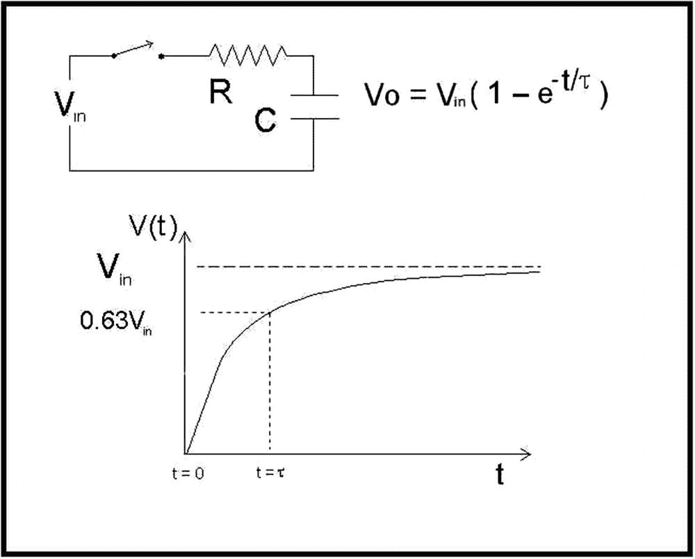

图 1-1
电容器电压随时间变化，其中 

电路时间常数是电阻值（以欧姆为单位）与电容值（以法拉为单位）的乘积，以秒表示。
`τ = R × C` -- (4)

`τ`表示电容器充放电过程中的一个可测量点。对于一个完全放电的电容器，其电压在秒内上升至 0.632V[in]。相反，一个完全充电的电容器在秒内放电至 0.368V[out]。从数学上讲，建立这三个可测量量之间的关系，使得能够通过任意两个量来测量第三个量。

电容器在直流系统中是一种储能元件，在交流电路中则构成频率敏感的电阻。电容的基本单位是法拉，即存储容量，能够在 1 伏特电压下容纳 1 库仑的电荷。1 库仑的电荷相当于 1 安培的电流流过 1 秒钟。法拉曾被认为是一个很大的单位。

电容器的存储能力取决于极板的面积、电介质材料的性质以及极板之间的距离。用于制造电容器的结构材料决定了其性能和缺陷。如果电容器用于电路中的定时，应选择漏电最小的电介质。塑料薄膜电容器最适合低泄漏应用。

电解电容器具有相对较大的存储容量，最适合用于电源中滤波或抑制电压振荡，其漏电流通常与器件电容成正比。有关各种电容器的结构、特性和最佳用途的信息，可在多种文献中找到，包括《*Building Scientific Apparatus*》，第 4 版，（剑桥大学出版社），《*The Art of Electronics*》，第 2 版，（剑桥大学出版社），以及《*Practical Electronics for Inventors*》，第 3 版，（麦格劳-希尔集团）。

虽然传统上认为法拉是一个很大的单位，但如今已能制造出由颗粒活性炭和金属凝胶制成的电容器，其存储容量以法拉计量。法拉级单元，称为超级电容和超级电容器，能够快速存储和释放能量，作为存储电路或高放电率应用（例如相机闪光灯照明）的备用电源。高速充放电速率、巨大的重复充电循环能力，以及器件制造的轻质材料，使得“超级”电容器相比可充电电池拥有众多优势。

电容器的电荷存储能力范围广泛，大致对应器件的物理尺寸，如图 1-2 所示。

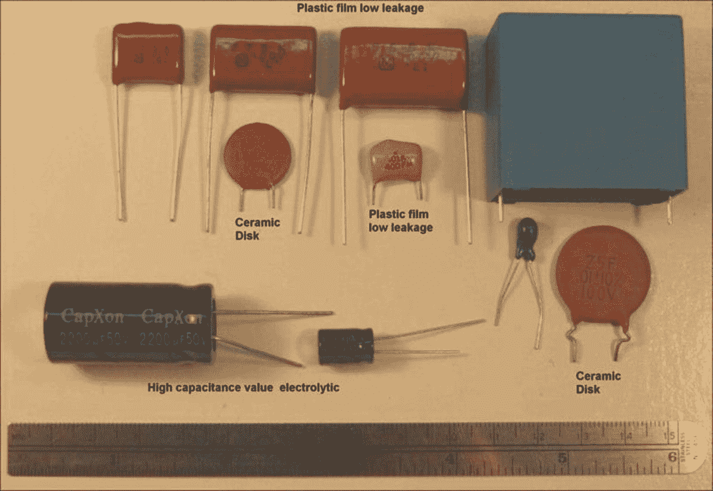

图 1-2
各种类型的电容器

总之，视野左上方的三个棕色矩形器件是金属化塑料薄膜型、低泄漏电容器，电容值分别为 1.2 μF、2.7 μF 和 5.6 μF。视野右上方的蓝色大型矩形器件是一个低泄漏的 15 μF 塑料薄膜电容器。顶行器件的价格通常从个位数到十位数递增，与其物理尺寸和电容值的增大成正比。

塑料薄膜器件都具有相同尺寸的元件引线，并且是无极性的。绿色泪滴形和黑色圆柱形电容器具有不同长度的电气连接引线，并且是有极性的。有极性器件的电容值比无极性的要大，因为绿色泪滴形是基于钽的器件，电容为 22 μF，而蓝色大型薄膜电容器为 15 μF。有极性电容器在安装时必须保证长引线的电位高于短引线。有极性电容器通常比无极性器件的极板间漏电流大得多。小型黑色圆柱体是一个 1 μF 400 V 的单元，而大型圆柱体是一个 2200 μF 50 V 的器件。

陶瓷圆盘电容器是相对便宜、稳定的单元，采用金属氧化物电介质，额定值通常在微法和皮法范围内。氧化物电介质可以封装在小型器件中，能够承受较高电压，并且在温度、电压和信号频率变化时保持电容值恒定。

跨越几个数量级的电容范围不易用单一的测量技术来评估。因此，需要研究几种方法来确定器件的电容值。

大量电子电路使用电容与电阻串联，形成称为时间常数的电路特性。时间常数，常用符号表示，是电容与电阻的乘积，以秒为单位，常用于调整电子电路的性能特性。

图 1-3 是一个放大的诺模图，描绘了电阻-电容时间常数值与非稳态配置的 555 定时器 IC 芯片输出振荡频率之间的理论关系。

在非稳态配置中，定时器 IC 输出一个方波，其频率由其定时元件网络中的 RC 时间常数决定。如果在时间常数网络中使用一个确定值的电阻，并以电容作为第二个时间常数元件，则输出信号频率的值与电容成正比。

当使用像 555 定时器这样的 IC 器件作为传感器，将电容值转换为可变频率的方波以便测量时，应尽量使测量的频率范围保持在读出设备的能力之内。对于由代码清单 1-1 生成的、用于图形屏幕显示实际充放电过程，由于绘图仪显示需要大量的软件开销，因此需要相对较低的数据采集和显示速率。

如果使用数值输出显示，则可通过更快的硬件计数器（例如 LabJack 和 Arduino 设备上可用的计数器）收集频率数据，这些计数器可以将实时数据流式传输到数值计数器显示屏上。

在射频工作中通常会遇到更高的频率，最好使用示波器类型的显示器进行观察。

# 电容测量与监测

本次电容测量/监测练习分为四个部分。其中三个部分使用`DAQFactory`中的图形用户界面，将电容值显示为旋转模拟指针式仪表、数字万用表式数值读数或连续显示条带图记录。

将电容值的测量与显示划分为这些独立的部分，是由于记录和显示系统受限于电容设备宽动态范围而造成的。

第四种电容测量技术使用Arduino微控制器及其串口读数，构成一个自动量程电容计，测量范围从微法拉到皮法拉。有两种程序可将该微控制器用作更高分辨率的连续电容测量仪表。

列表1-2中主要的连续显示程序几乎无需布线。它利用杂散输入电容校准和Arduino微控制器板载的内部“上拉”输入电阻，生成被测设备(DUT)一系列相当准确的电容值。

第二种连续读数程序需要一些外部元件和布线，以实现对电容DUT的精确连续测量，将在第10章中介绍。

第二种程序使用精确测量的时间段和已知电阻值来确定DUT的电容值。通过使用微控制器芯片内部的比较器、基于晶振的定时器以及操作系统中断序列，实现了显著的计时精度，从而获得精确且可重复的时间值。

使用诸如Arduino之类的微控制器来测量DUT的电容，其优势在于允许实验者在测量系统中嵌入一些数字信号处理功能（例如移动平均），以提高系统的信噪比。

在线论坛中有大量练习展示了电容现象在组装触摸板方面的常见用途，例如用Arduino微控制器激活LED。

电容器中的电荷通过描述电容与电压关系的基本公式计算得出。非电容性的静电荷在第8章中讨论。

## 电容器特性

电容器有多种电荷存储容量和介电特性。电容器的特性主要由填充在器件导电板之间的介电材料决定。通常，高电荷存储容量的器件具有较大的漏电流，这使得它们不适用于定时应用。

## 漏电流

理论上，电容器是一种电荷存储器件。其导电板之间具有高极化性绝缘电介质，因此可以存储更多能量，或在给定存储容量下体积更小。然而，充电时，极板间的电压会导致电流流过电介质，最终使电容器放电。电容器的漏电流主要由电介质的化学成分决定。

电解电容器使用金属氧化物绝缘层作为器件的电介质。氧化铝和氧化钽形成具有高介电常数的薄膜，但电解器件也表现出更高的漏电流。

漏电流的测量使用基于跨阻放大器(TIA)的电流静电计，如图2-2（第2章）所述。TIA配置也应用于第7章图7-4所述的漏电流测量。本练习仅检查低压或线电压兼容的电容器，因为高压大电流系统超出了本书的入门性质。

运放TIA静电计的高输入阻抗可以测量极低水平的电流。电容器的漏电流可以直接从测量电路的稳定电池激励电压中测得。

在测量已放电电容器中非常小的漏电流时必须小心。只有当器件在电池提供的全测试电压下达到稳态平衡时，才能进行测量。

如第2章所述，测量非常小的电流需要特殊技术和仪器。

第2章的表2-4显示了在不同电容器上测得的典型漏电流。

漏电流有时被认为对电容器的定时应用不利。在定时电路中，漏电流应尽可能小，以确保定时操作的可重复性。使用塑料薄膜作为电介质的电容器，如聚乙烯、聚酯薄膜（聚对苯二甲酸乙二醇酯薄膜）和聚苯乙烯，因其塑料薄膜电介质的高电阻或低导电性而具有极小的漏电流。然而，大多数塑料薄膜无法存储显著的电荷。这种分子结构的非极化特性限制了在尺寸合理的器件中可制造的电容值。图1-2右上角看到的蓝色大块是一个15 μF的聚苯乙烯电容器。

用于滤除整流交流电源纹波的电容器，其漏电流比电容器所平滑的电流低数个数量级，且对平滑操作几乎没有影响。

陶瓷电容器是漏电流相对较低的器件，通常以微法分数和纳法数值供应。

## 实验A：低电容值（< 10 μF）的连续显示

### 电路：一个基于`555`定时器的简易电容计

在大多数应用中，`555`定时器会生成固定或可变占空比的矩形波输出。通过在非稳态工作模式下，用可变电阻或电位器替换两个固定电阻之一，即可获得可变的占空比。若两个充电电阻的阻值固定为10:1的比例，则输出信号为近似50%占空比的方波，其频率`f`仅由电容值决定。

```
f = 1.44 / (Ra + 2Rb) * C -- (5)
```

```
C = 1.44 / (Ra + 2Rb) * f -- (6)
```

通过测量频率或一秒钟内产生的方波脉冲数量，即可确定电容值。

由传统双极型晶体管`555`定时器集成电路组装而成的非稳态振荡器，其振荡频率仅限于几百千赫或几兆赫的低频范围。采用CMOS工艺制造的定时器集成电路可在兆赫兹范围内振荡。三种常见器件的最大输出频率列于表1-1中。

**表1-1 555定时器高频限制**

| 制造商 | 器件编号 | 最高振荡频率 |
| --- | --- | --- |
| Intersil | `IMC7555` | 1 MHz |
| Texas Instruments | `TLC555` | 2 MHz |
| TI (National) | `LMC555` | 3 MHz |

图1-3与Intersil公司`IMC 7555`数据手册中的图1-4类似，描绘了不同定时网络RC元件组合下的定时器输出频率。两张定时电阻组合的曲线图表明，如果`(R[a] + 2R[b])`为1 kΩ，则通过测量1/10 Hz至3 MHz之间的振荡器输出频率，应该可以测量1 pF至10 mF（10,000 μF或1/1000 F）范围内的电容值。测量应基于遵循前述公式的电容-频率数据线性部分进行，这些数据是可复现且可预测的。低于100 pF的低电容值可能需要使用1 MΩ电阻网络进行单独校准，以确保合理的精度。

1 kΩ、10 kΩ、100 kΩ和1 MΩ的电阻总和应能覆盖常规电路中遇到的电容范围。（注意：某些`555`变体在RC网络电阻低于1 kΩ时不会振荡。）

由于希望保持10:1的电阻比以使输出保持合理对称，你可以写出`(R[a] + 2R[b]) = 1K = (R[b]/10 + 2R[b])`，并求解出`R[b]`为500 Ω，从而`R[a]`为50 Ω。在实际实现中，可以使用47 Ω和470 Ω或56 Ω和560 Ω的标准规格，但必须根据所选用的`555`定时器类型来测试总电阻低于1千欧的情况。

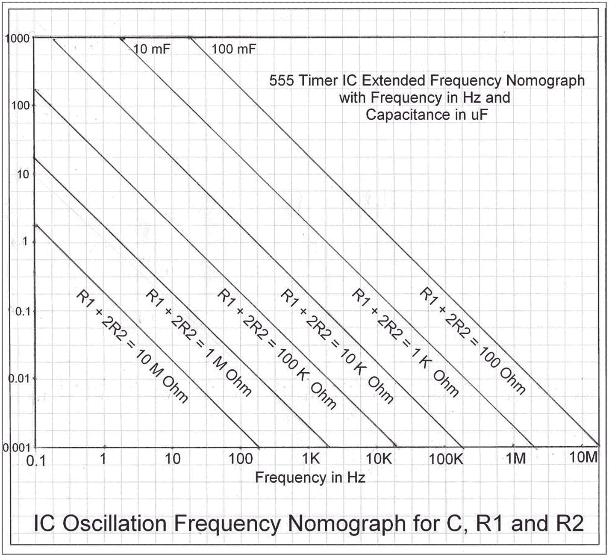

**图1-3 来自Intersil数据手册的图14**

图1-3中的曲线图形成了一个有点直观的概念：充电速度很快的小电容与高频振荡相关联。充电缓慢的大电容与大阻值限流电阻相关联，对应较低的振荡频率。

查看LabJack的计数器文档可知，当检测到下降沿后紧接着上升沿时，计数器会记录一次事件。矩形输出波的每个周期都有一个下降沿/上升沿对。如果电阻值精确已知，则可以根据测量到的频率计算出电容值。

#### 电路原理图

图1-4所示的定时器电路可由LabJack提供的5V电源供电。原理图中未显示电阻值，因为不同测量量程使用了不同规格的电阻，如表1-2所列。（请回忆：电容单位符号F表示法拉；μF或10^(–6) F表示微法；nF或10^(–9) F表示纳法；pF或10^(–12) F表示皮法。）

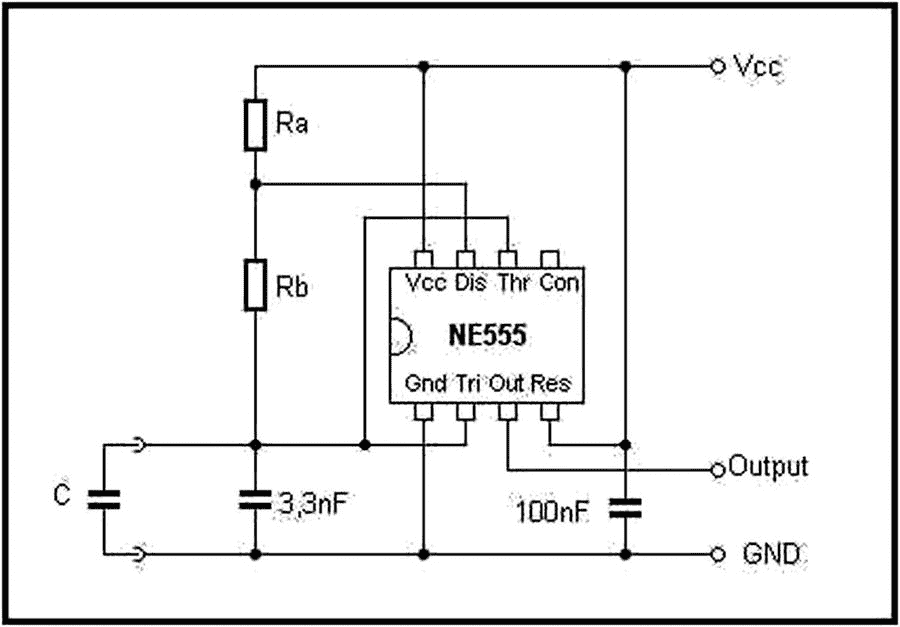

**图1-4 555 IC电容测量电路**

**表1-2 555定时器振荡频率的RC常数范围**

| 电容值范围 | 电阻值 (欧姆) `R1-R2` | 555频率 |
| --- | --- | --- |
| 1 mF 至 10 μF | 0.1 kΩ 至 1 kΩ | < 6.86 Hz |
| 10 μF 至 0.01 μF | 1 kΩ 至 10 kΩ | 6.86 Hz 至 6860 Hz |
| 10 nF 至 1000 pF | 10 kΩ 至 100 kΩ | 686 Hz 至 6860 Hz |
| 1000 pF 至 10 pF | 100 kΩ 至 1 MΩ | 686 Hz 至 686K Hz |

表1-2是设计指南。任何符合所列范围的元件都可使用。请记住，必须关注计数器的低频计数能力，以及低定时电阻值所带来的功耗增加问题。

## 软件

最初，使用DAQFactory的二维图形和双变量值组件开发了电容测量屏幕。结合图1-4中的`555`定时器电路，LabJack计数器通过标有`FreqCnt`的计数器通道确定了DAQFactory中监测的输出频率。

图1-5中Y表达式框内的公式在图形和变量值显示中均被用于将频率转换为电容的测量值。开发过程中，使用“Counts/sec:”（计数/秒）或频率和电容值的数值显示进行调试。

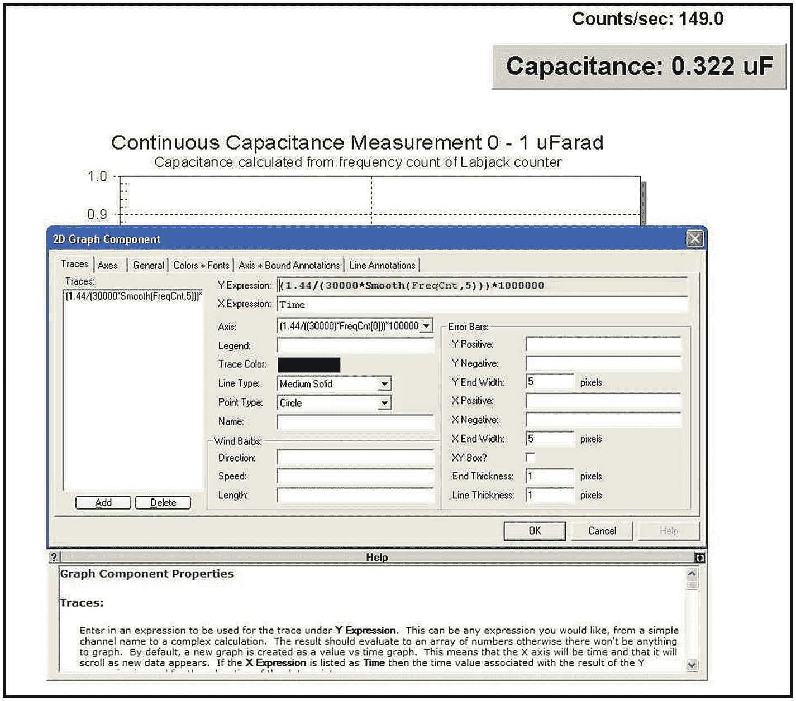

**图1-5 DAQFactory二维图形组件显示配置窗口**

使用传统双极型`555`定时器RC定时网络进行电容测量时，受到芯片偏好的RC网络电阻不小于1 kΩ且不大于1 MΩ的限制。通过使用略超出优选范围的电阻（例如，对于100 μF量程使用47 Ω和470 Ω），可以略微扩展测量范围。不同的定时芯片，如CMOS器件，可以提供更宽的测试范围。

全屏条图记录仪输出被用来开发测量过程。后来，组装了一个带有数字读数模拟表盘和微型连续记录仪读数的仪表，以提供读数漂移趋势的视觉图像。

表盘式仪表和漂移记录器如图1-6所示。

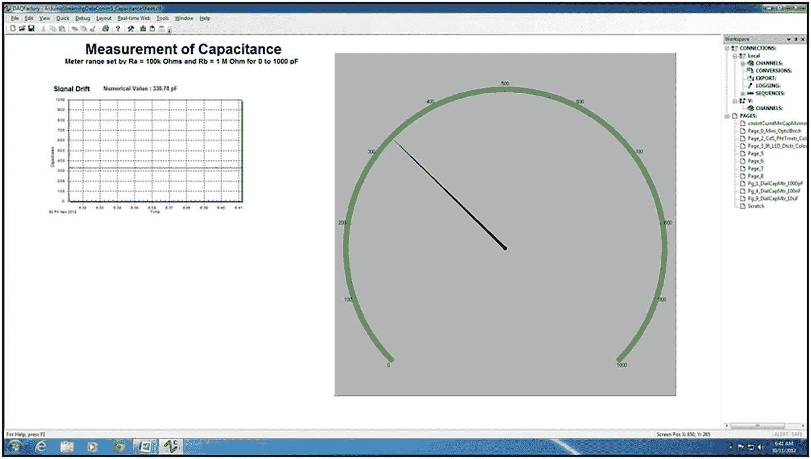

**图1-6 DAQFactory仪表和微型SCR显示**

如果你需要一个电容测量仪器，可以将电路组装在一块万能板上，安装在一个配有量程开关和测试引线的通用盒中，然后与笔记本电脑、平板电脑或台式电脑配合使用。

小电容必须通过大电阻充电，以保持`555`的振荡频率在硬件和软件的能力范围内。用`555`定时器测试大电容需要小电阻和更大的电流消耗，这最终会超出LabJack或USB的供电能力。为了测试由液态电解系统作为介电介质产生的大电容值，通常需要以电池或稳压电源形式提供的外部电源。随着电流供应增加，你必须注意`555`定时网络中阻值更小的电阻的额定功率。

# 实验 B：大电容值（>1000 μF 或 mF）的测量

通常，电容值小于 10 μF 的电容是固态器件，而大于 10 μF 的则是电化学器件。低容值的固态器件与电化学电容器之间的显著差异在于“漏电流”或器件电阻。

电化学器件的大电容值会产生以分钟、小时甚至更长时间为单位衡量的时间常数。这些器件在极板之间也会产生更大的漏电流。在某些情况下，同一器件可能因其近期的“使用中”充放电历史而表现出不同的电容值。

在给定恒定电流下，大电容值电化学器件中的电荷累积速度比固态系统慢得多，并且可以通过图形显示轻松追踪。`555`定时器的循环能力会产生一个电压波形，该波形会由`DAQFactory`的图形记录显示进行追踪，从而可以测量被测器件（`DUT`）在充电和放电阶段的电容值。

电解电容的测量值可能受到其历史状态的影响。通过使被测器件经历一个标准化或统一的充放电循环，可以最大程度地减少历史状态的影响。如果搭建一个非稳态`555`定时器电路，并配合一个用于给器件充电的恒流源，然后通过一个已知的固定电阻进行放电，那么就可以监控该器件在两个功能阶段的表现。

## 电路

在图 1-7 中，振荡器电路本质上是一个采用非稳态振荡器配置的`555`定时器集成电路，但其充电和放电电压波形有所不同。

一个电流镜电路向电容被测器件（`DUT`）提供恒定电流。一旦电容充电至`V[cc]`的三分之二，`555`定时器就会改变状态，已充电的电容则通过一个 1%精度的金属膜电阻放电。恒定电流在电容上产生一个线性电压斜坡，而放电则形成指数衰减曲线，两者共同产生了循环但非对称的波形输出。

由于电化学电荷存储器件可能受其历史状态的影响，因此通过器件的充放电功能循环应能重建电解层。这会形成一个可重现的器件，进而可以测量其电容。可重复的充放电记录器追踪可以建立并验证器件的电解膜恢复状态。

为了产生具有合理信号周期性的非对称振荡器波形，需要高充电电流但低电压。电池或稳压电源可以提供所需的电流，从而在`DUT`极板两端产生具有合理电压变化率（斜率）的图形显示。你还必须确保`555`定时器 IC 在振荡期间的峰值电压（即 2/3 `V[cc]`）低于`DUT`的介电击穿最大电压限值。例如，钽电容的工作电压范围较低。

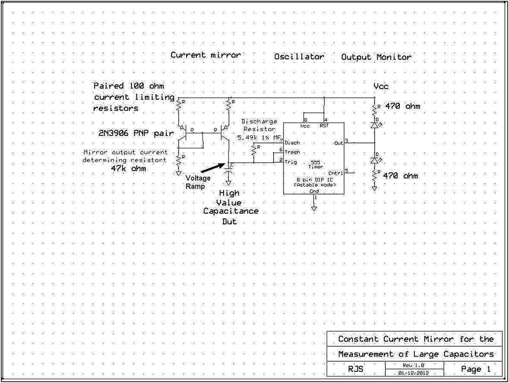

图 1-7

大电容的恒流充电电路

## 软件

当电容值上升至 10 μF 以上范围时，产生的`RC`时间常数会很大，而确定大电容值的方法必须根据所需的补偿电流大小进行改变。如图 1-8 和 1-9 中黑色迹线所示，电容充电时间可能变得非常长。如图 1-9 中记录在 9:20 的迹线所示，红色的放电电压迹线需要长达一分钟才能完成。

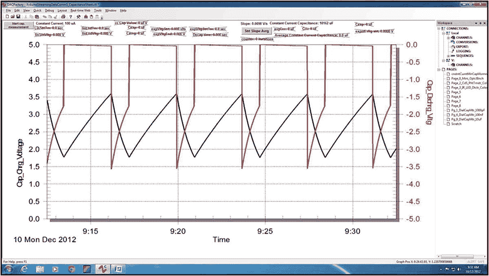

图 1-9

电容充放电电压波形（每刻度 5 分钟）

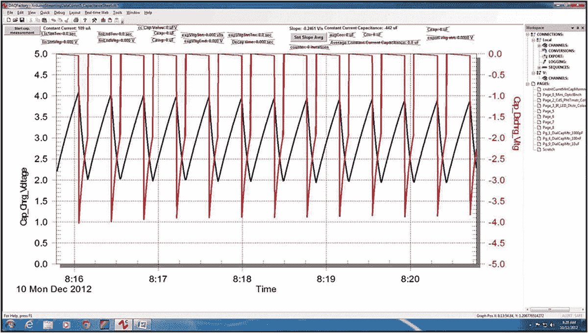

图 1-8

电容充放电电压波形（每刻度 1 分钟）

图 1-8 和 1-9 中的波形（黑色）是使用图 1-7 所示的电路获得的。图 1-10 描绘了一个流程图，概述了将开发为`DAQFactory`脚本代码以追踪电压波形并计算充电和放电电容平均值的逻辑。

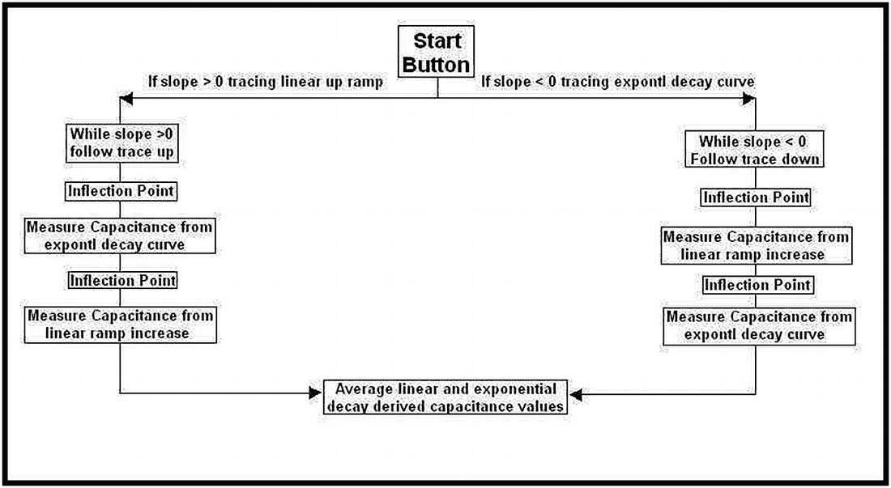

图 1-10

软件流程图

用于大电容器件测量的代码见本章末尾的代码清单 1-1。

如图 1-11 所示，可以配置一个`DAQFactory`控制屏幕，包含图形显示、启动按钮和变量数值读数。

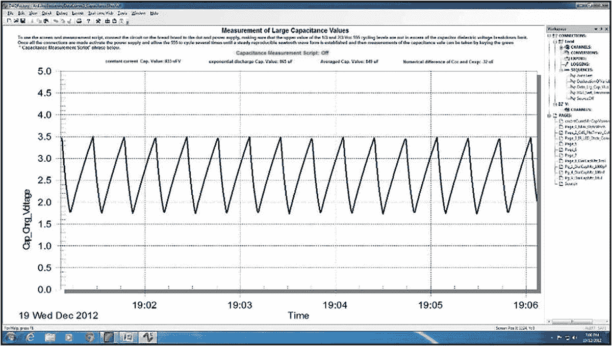

图 1-11

`DAQFactory`大电容测量

### 观测结果

图 1-12 展示了`555`定时器芯片电容测量屏幕对被测标称电容值的响应。

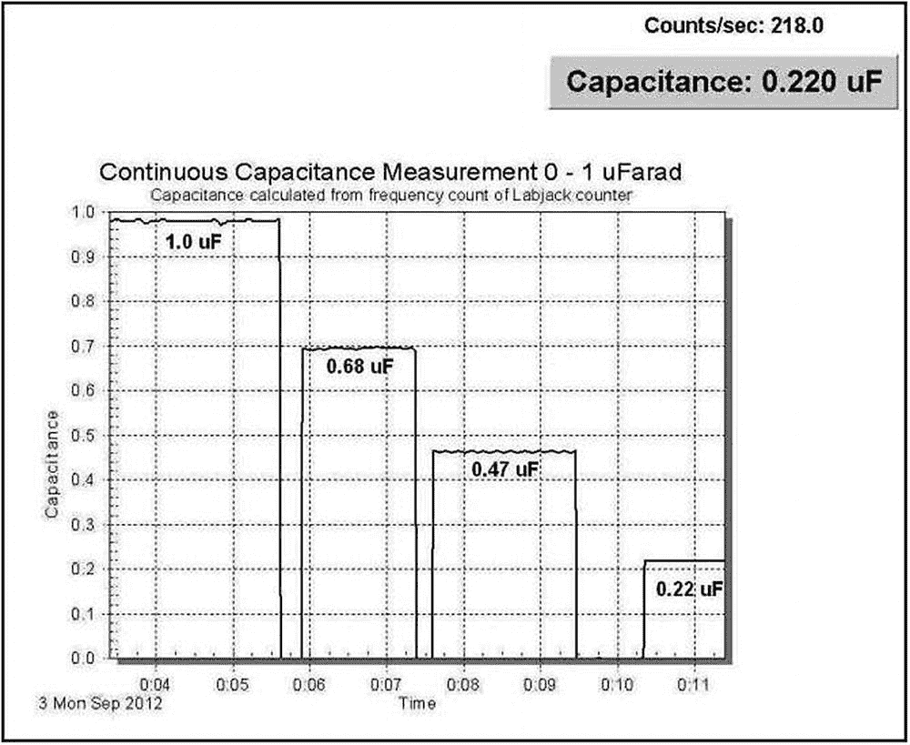

图 1-12

标称电容值与测量电容值对比

# 实验 C：电容自动量程测量

## 引言

有几种技术可以使用 Arduino 微控制器作为电容计。早期的技术是通过一个精确已知的外部充电电阻对器件进行充电，然后确定电容充电达到 5 V 充电电压的 66%所需的时间，以计算 `C` 的值。后期版本的测量技术使用已知电容值来校准 Arduino 板的内部上拉电阻和内部寄生电容。当使用内部寄生电阻/电容值时，无需任何外部元件即可对较小的电容器件进行相当准确的电容测量。为本书修改的原始代码的更新版本位于 `https://wordpress.codewrite.co.uk/pic/2014/01/21/cap-meter-with-arduino-uno/` 和 `https://wordpress.codewrite.co.uk/pic/2014/01/25/capacitance-meter-mk-ii/`。

### Arduino Uno 的软件代码

清单 1-2 是根据 mk-ii 版本发布的原始程序修改而成，以便在我的 Windows 7 系统上运行。

每个 Arduino Uno 板都不同，其内部杂散电容和实际“上拉”电阻都会有细微差异，因此需要进行设备校准才能达到合理的精度。系统校准需要使用已知精确值的电容器来评估杂散电容和内部“上拉”电阻值。图 1-13 展示了电容器充电电路的代表性电路原理图。描述被测器件 (DUT) 电压的数学公式，以及对杂散电气效应的合理假设，可以在前面提到的网页中找到。

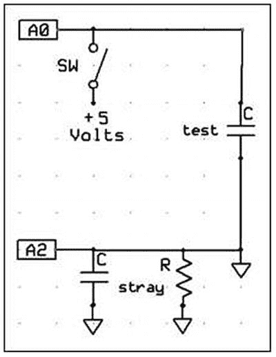

**图 1-13** Arduino 内部组件电容测量电路

应使用已知电容值的低漏电介质器件（如聚酯薄膜、聚酯或聚苯乙烯电容器）来校准系统。当用于连续、自动量程电容测量的程序代码在 Arduino 上成功运行，并且将低漏电测试电容器插入 `A0` 和 `A2` 后，串行监视器上显示电容值时，就可以开始校准实验了。

清单 1-2 允许对杂散电容和杂散电阻进行调整。我成功地使用了杂散电阻调整，发现 35.9 到 37.0 之间的值可以使大多数实验设置达到合理的精度。您可以先使用清单 1-2 中的默认值开始校准过程，然后少量增加或减少该值，观察这个变化对已知标准值测量结果的影响。我只调整了三到四次，就使系统达到了合理的精度。

系统应在尽可能接近实际操作的预期点范围内进行校准。如果只有电解电容器可用于在您所需的操作范围内进行校准，请务必小心。

### 观测结果

对一组不同标称值的电容器进行测量，结果汇总于表 1-3。

**表 1-3** 电容测量误差

| 电容值 | 测量值 |
| --- | --- |
| 10 pF | 10.5 pF |
| 1 nF | 0.69 nF |
| 1 μF | 0.989 μF |
| 22 μF | 25.6 μF / 2-3 秒 |
| 470 μF | 475.4 μF / 3 秒 |

22 μF 和 470 μF 器件的数据在串行监视器上显示缓慢，这可能是由于电压达到测量三分之二点所需的充电时间较长。

## 讨论

从 pF 到 F 的电容测量涵盖十二个数量级的动态范围。在实验工作中，跨越这个范围内 12 个数量级的测量，可能最好使用几种不同的技术来测量，这些技术更适合于较窄的关注范围。

pF 到 nF 的范围非常适合 Arduino 的自动量程程序，因为在这个范围内，电容器充电时间可以在“一秒以内”的时限内实现。高于 1 μF 的电容值在测量过程中表现出更长的充电时间，可能通过更大的充电电流以及根据数据图形记录进行的计算来获得更精确的确定。

诸如用于电路板中的电容器件，大致可分为固态和液态电解电介质器件两类。钽、铝和碳是主要的液态电化学电荷存储器件。来自 USB 总线或 LabJack 类型设备的可用电流不足以在合理时间内对大型电容器件充电。然而，随着电容值的增加，可以施加在电介质上的电压会降低。考虑到可以施加在其离子层上的电压有限，以及电解电介质系统可提供的大存储容量，您必须对所用电源的电压水平、用于控制充电电流的电阻器的功耗，以及器件的漏电流或电阻保持谨慎。

### 电容测量的校准

如果在 555 定时器的定时网络中使用精密电阻，则测得的电容值可以预期与振荡器系统数学模型预测的值成比例或相当接近。如果没有精密元件，则可能需要使用已知电容值对系统进行校准，以建立一定的精度水平。

测得的电容值可以以多种形式显示。可以直接从 Arduino 串行输出监视器读取数值视觉显示和相应的测量单位，以确定器件或组件的电容。然而，对于任何需要通过串行总线传输的数字信号处理或图形显示记录，测量软件的输出格式必须符合串行协议。

## 使用树莓派进行电容测量

只有使用 `PIGPIO` 库及其 C 语言接口守护进程，才能通过 RPi GPIO 阵列实现精确计时。实现更精确电容测量的另一种方法是将计时职责转移到微控制器的晶振时钟上，该微控制器充当 RPi 的“智能传感器”。在 Arduino 上运行的自动量程电容测量程序是一个健壮且完善的工具，可以将数据流式传输到 RPi 上的 Python 实现以进行显示。

到达 Python 串行端口的 Arduino 格式化电容数据，需要转换为数值格式，以便在 Python 控制台显示数值或在监视器屏幕上进行图形显示。

本练习代码清单中的清单 1-3 包含用于读取连接到 Arduino ADC 的 `A0` 和 `A2` 输入端之间的电容器值的 Python 代码。

## 实验

为了使用 Arduino 板连续测量电容，将电容测量程序（参见清单 1-2）加载到 IDE 的微控制器上，并将用于从串行端口接收数据的 Python 程序（参见清单 1-3）加载到 RPi 中。

然后，将待测电容器安装到 Arduino ADC 的 `A0` 和 `A2` 输入接口。流式传输到串行端口的值在 Arduino 串行端口监视器上进行验证。在 RPi 上启动 Python 程序之前，需要关闭端口监视器。

### 观测结果

在图 1-14 和 1-15 中，来自串口读取程序的字符串、字符串长度和电容数值输出被流式传输到 Python 交互终端或控制台上，以便在终止 (`Ctrl+C`) 前进行记录，这会触发系统以红色输出。

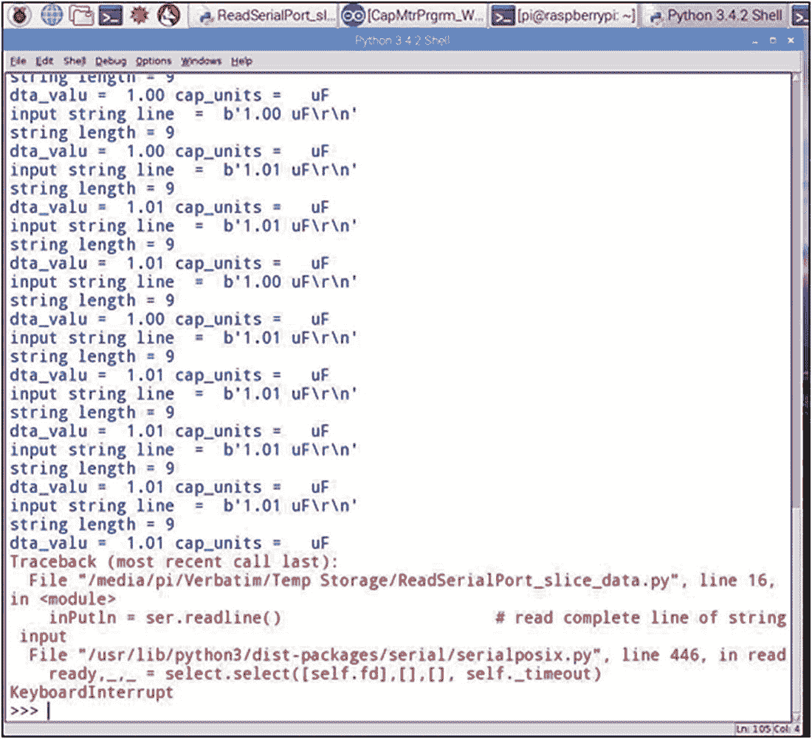

**图 1-15** 1μF 标准电容的控制台输出

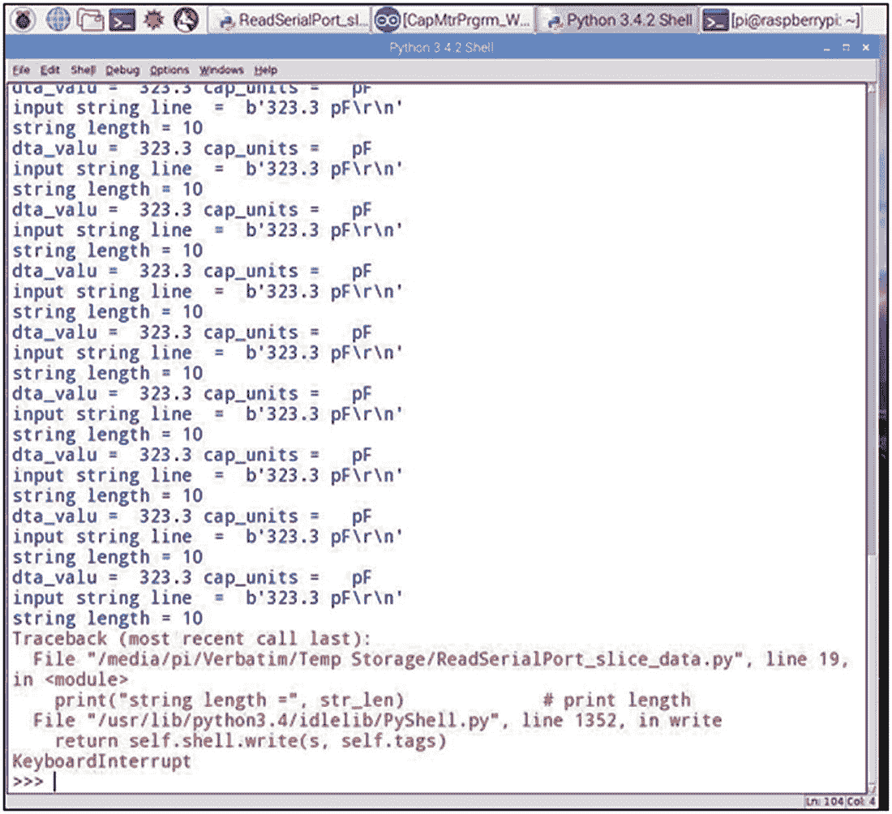

**图 1-14** 330 pF 器件的控制台输出

## 讨论

对任何测量系统进行校准时，若待测值存在多个数量级的变化，都应谨慎操作，并对测量值进行严格检验。从 `1 μF` 电容器流出的数据是聚苯乙烯标准电容器，基于此进行了杂散泄漏估算。图 1-14 中标称 `330 pF` 元件的实测值为 `323 pF`。

一台鼎阳科技 `5.5` 位台式万用表测得该 `330 pF` 元件的电容值为 `0.364 nF`。

对于如此廉价且易于获取的系统而言，Arduino–RPi 组合提供了非常出色的数据。

当涉及极小或极大的量值时，任何测量都难以实现绝对精度。绝对精度依赖于往往无法获取的标准。如有可能，应将绝对测量需求重新表述为差分测量问题，这通常可以消除对绝对标准的需求。

Arduino 的连续小电容监测功能提供了有用且灵敏的差分电容测量能力。

## 使用 Python 和树莓派测量大电容值

在 Arduino 上运行的连续电容测量程序可以测量超过微法级的电容值，但随着电容器容量的增大，测量速度会开始减慢。当时间跨度达到分钟级或更长，且采用恒流、线性电压斜坡监测技术测量电容值时，涉及 RPi、GPIO 阵列及相应 Python 库的计时问题就变得不那么重要了。

较大的充电电流和更高电压的电源可以部分抵消由 RC 时间常数增大所引起的问题。用于大电容的高功率充电电源必须与 RPi GPIO 阵列和 MCP3008 ADC 的低压、低电流电路隔离。

在测量电容值之前，对大型电解器件中液体介质的受控预处理进行可视化记录，有助于获得更一致、可重复的数据。清单 1-4 提供了一种方法，用于对大型电解电容器充电的可重复性进行可视化验证。

## 实验

创建线性电压斜坡的传统方法是用恒流源给电容器充电。电流镜可以提供恒流电源，结合 `555` 定时 IC，可以对大容量被测器件中的介质层进行交替充电/放电的循环修复。

两个 `2N3906` 晶体管以电流镜配置连接，配合 `LM555` 定时器 IC 和 `6 V` 电池组（`4` 节 `12,000 mA` 碱性 D 型电池），可与 RPi 及 `gpiozero` 库一起使用，读取 `MCP3008` ADC，以记录和显示大型电解电容器的充电历史及电容值（见图 1-7）。循环修复程序的代码见清单 1-4。

要使用 Python RPi 的测量前预处理、数据显示或记录程序，必须通过主菜单选择在 RPi 上调用 MCP3008 串行外设接口（SPI）协议，如图 1-16 和 1-17 所示。

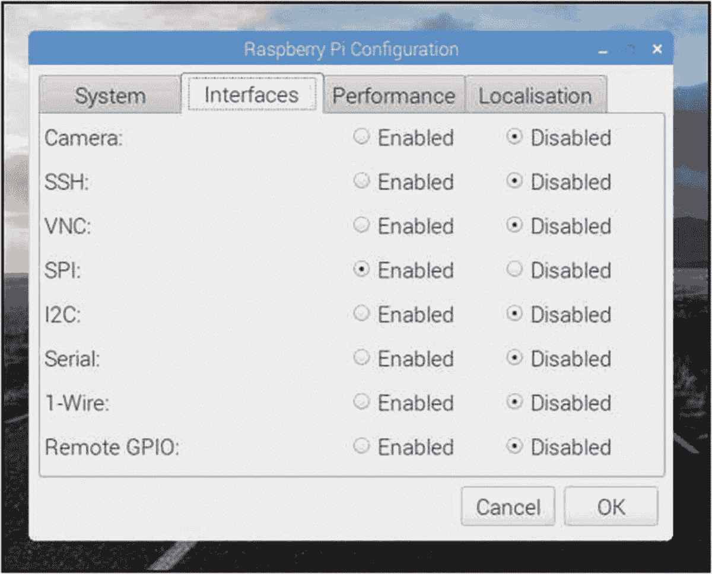

**图 1-17** 从接口选项卡选择 SPI

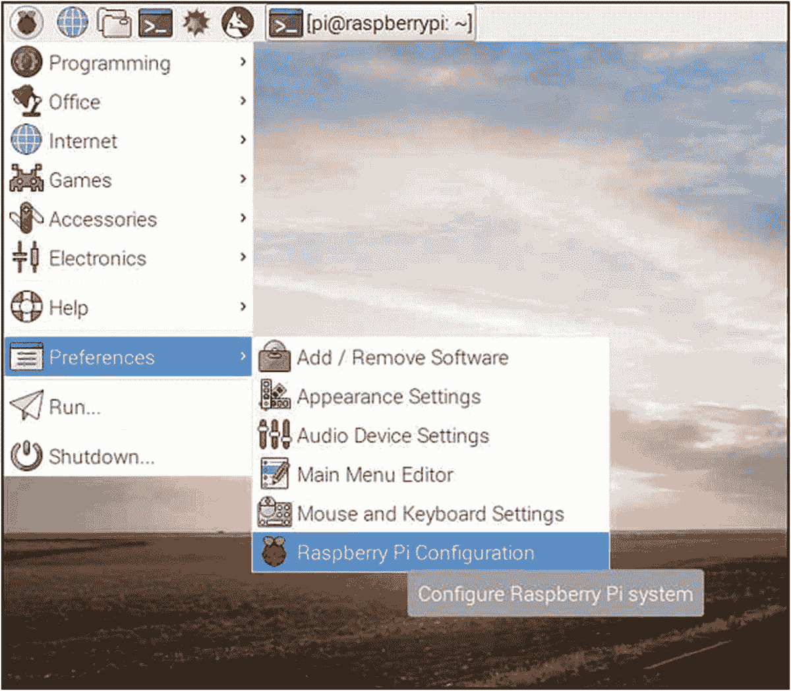

**图 1-16** 性能菜单的子菜单选项

图 1-18 是一个连接图，展示了 RPi GPIO 阵列与 MCP3008 ADC 之间的电源、控制和数据传输。`Vin` 是在图 1-7 中箭头所示点测量的电压斜坡。

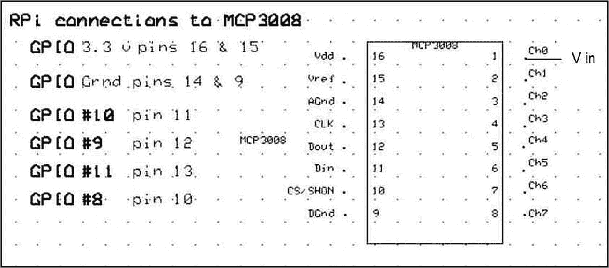

**图 1-18** MCP3008 10 位 ADC 与 RPi GPIO 的连接图

为简化实现，大电容测量可使用两个程序：第一个用于对被测器件的电解层进行预处理，第二个用于测量器件的电容。配置好电流镜、`555` 定时器 IC 和 RPi，并用清单 1-5 中的 Python 代码进行编程后，应能产生一系列重复的线性上升电压斜坡（由恒流充电产生），随后是指数衰减的电压放电曲线（见图 1-19）。

在通过基于硬件的循环充放电对电解介质进行预处理以获得可重复、可预测的电压行为模式后，即可启动软件，按照定时器控制的循环进行测量。

## 观察结果

图 1-19 展示了一个典型的大型电解电容器六循环介质修复程序。相对均匀的峰值高度表明其具有合理的可重复性，适用于对器件电容进行定量测量。

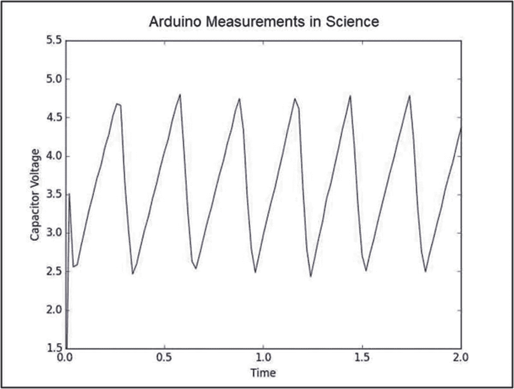

**图 1-19** 电解电容器介质修复的电压循环轨迹记录

图 1-19 展示了一个典型的循环模式，该模式对标称 `470 μF` 电解电容器的液体介质进行了预处理。图 1-20 展示了典型四循环测量的数据输出。

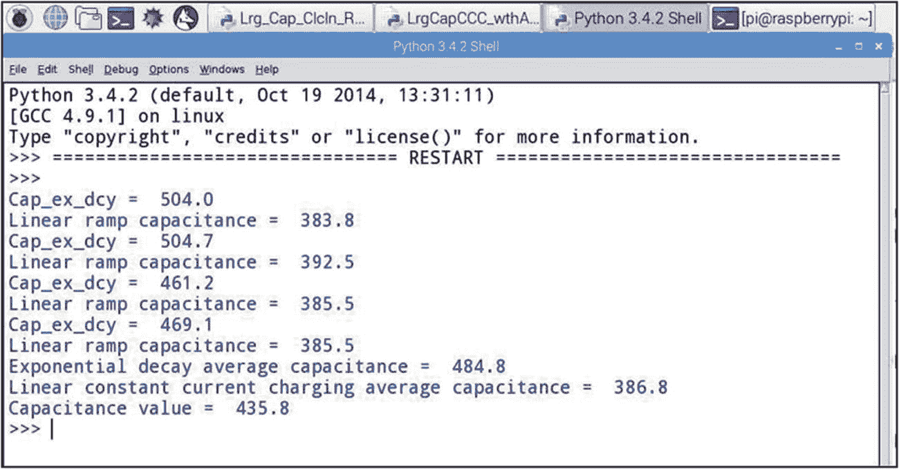

**图 1-20** 大型电解电容器恒流充电技术的控制台输出

## 讨论

以 6 伏大号 D 型电池组作为电源，`LM555` 定时器应在 `V[cc]` 的三分之一或三分之二之间，即 2 伏至 4 伏之间循环——这完全在 `RPi` 和 `MCP3008` 的电气限制范围内。`MCP3008` 的 `gpiozero` 实现会输出 0 到 1.0 的归一化结果。ADC 输出乘以 6，以生成充放电循环期间电容器上的实际电压。

通过对被测器件中液体电介质的预测量调节进行可视化图形记录，可以极大地简化大容量电容器的测量。当记录到一系列均匀的线性斜坡和指数衰减曲线后，可以关闭图形程序，启动电容评估程序，以数值方式测量器件的电荷存储能力。

仔细观察由电解电容器调节产生的锯齿波右侧下降斜率（尤其是迹线较低部分附近），可以观察到预期曲率或偏离线性状态的迹象。

我最初使用的程序采用双入口点算法，分别在上升或下降斜率的迹线上启动。然而，由于数值误差（如负值）、硬件与软件程序之间的同步丢失以及观测到的单个数据点离散度较大，最终采用了仅在迹线的线性上升恒流充电（CCC）部分开始电容测量的代码。

通过在尽可能接近恒流充电段起点处启动程序，可获得测量系统的最佳整体性能。该起始点通过观察定时器输出电路中的红色和绿色二极管来确定：红色二极管在循环的指数衰减阶段点亮，绿色二极管则在恒流充电阶段点亮。

考虑到已知的 `RPi` GPIO 定时不规则性，更长的定时序列有望带来更高的精度和准确度。一个标称值为 470 μF 的器件通常需要 56 秒的时间周期才能生成一个结果，如图 1-20 所示，而一个 1000 μF 的器件则需要 1.75 分钟。

从一盒混合电容器中取出的五个电解电容器，其标称值为 470 μF（使用鼎阳科技 5.5 位台式万用表测量），实测值在 423 至 430 之间。对一个标称值为 470 μF 的单元进行了六次重复的 `RPi` 测量。生成的数据列于表 1-4 中。

此外，对五个标称值为 1000 μF 的单元进行的一系列万用表测量值在 955 至 961 之间。对 1000 μF 单元进行的一系列五次重复 `RPi` 测量则在表格中产生了较大的数值。

**表 1-4** 470 μF 和 1000 μF 器件的电容器实测值

| 测量次数 | 数值 |
| --- | --- |
| 1 | 429 – 936 |
| 2 | 443 – 940 |
| 3 | 431 – 940 |
| 4 | 427 – 937 |
| 5 | 436 – 940 |
| 6 | 425 |

表 1-5 是一个表格对比。

**表 1-5** 鼎阳科技台式万用表与树莓派的数据对比

| -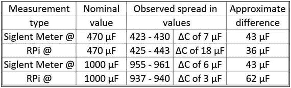 |

将 `RPi` 生成的各个数值与台式万用表生成的数值进行比较，考虑到这两种测量系统之间近两个数量级的成本差异，二者在精度和准确度上显示出显著的相关性。

对于使用较大电容器的实验工作，可以减小电流镜的电流调节电阻以产生更大的充电电流。`2N3906` 可处理 200 mA 的连续集电极-发射极电流。如果使用更小的电流编程电阻来增大恒流充电值，则必须更改计算代码中的电流定义以及 555 定时器上的放电电阻。调节程序的图形显示可以调整定时器放电电阻，以保持计算程序的对称性，从而跟踪变化的电容器电压。您还应适当调整电流镜和放电电路的功率额定值，以适应任何增加的电流，从而测量更大容量的电容器器件。

# 电容测量代码清单

```python
# 大容量电容器测量
# gpiozero MCP3008 ADC 将 0-5 伏输入归一化为 0-1 输出，需要
# 延时和计时计数的数学计算以用于对数函数。
#
from gpiozero import MCP3008
import time
import math
#
adc = MCP3008(0)      # 创建一个读取通道 0 的 ADC 实例
icc = 5.365/47100     # 电流镜编程电阻两端的电压值
#
def calc_slope():     # 计算电流镜充电/放电迹线的斜率
    cap_vlu = (adc.value) * 6
    #print("电容电压 = ", cap_vlu)
    frst_vltg = cap_vlu
    strt_tm = time.time()
    time.sleep(0.25)
    cap_vlu = (adc.value) * 6
    scnd_vlu = cap_vlu
    stp_tm = time.time()
    #
    slope = (scnd_vlu - frst_vltg) / (stp_tm - strt_tm)
    #print("斜率 = ", slope)
    return slope
#
trnd = calc_slope()                 # 确定在循环中的位置
#print("trend = ", trnd)             # 诊断打印语句
#
if (trnd > 0):                      # 迹线处于线性上升恒流充电阶段
    while(calc_slope() > 0):
        exp_dec_strt_tcks = time.time() # 跟随迹线向上直到拐点，指数
        exp_dec_vlts = (adc.value) * 6  # 衰减曲线开始处
        #print("expntl_dec_strt_ticks = ", expntl_dec_strt_tcks)  # 用于诊断和错误检查的输出 (PODEC)
        #print("expntl_dec_vlts = ", expntl_dec_vlts)             # PODEC
    #
    ExpDecayCap_ttl = 0
    LinCCC_Cap_ttl = 0
    #
    for i in range(1 , 5):          # 收集四组数据
    #
        while(calc_slope()  0):                 # 跟随线性斜坡上升
            lnr_ccc_fnl_tcks = time.time()       # 跟踪最终斜坡值的时间 ticks
            lnr_ccc_fnl_vlts = (adc.value) * 6   # 和电压值
        cap_lnr_vrmp = (icc * ((lnr_ccc_fnl_tcks - lnr_ccc_strt_tcks) / (lnr_ccc_fnl_vlts - lnr_ccc_strt_vlts)) * 1000000)
        print("线性斜坡电容 = ", round(cap_lnr_vrmp, 1))
        LinCCC_Cap_ttl = LinCCC_Cap_ttl + cap_lnr_vrmp
    exp_dec_strt_tcks = lnr_ccc_fnl_tcks   # 为指数衰减计算重置起始 ticks 变量
    exp_dec_vlts = lnr_ccc_fnl_vlts        # 为指数衰减计算重置起始电压变量
    ExpDecayCap_avr = ExpDecayCap_ttl / 4
    print("指数衰减平均电容 = ", round(ExpDecayCap_avr, 1))
    LinCCC_Cap_avr = LinCCC_Cap_ttl / 4
    print("线性恒流充电平均电容 = ", round(LinCCC_Cap_avr, 1))
    CapValue = (ExpDecayCap_avr + LinCCC_Cap_avr) / 2
    print ("电容值 = ", round(CapValue, 1))
    #
elif (trnd < 0):                              # 迹线处于电容器放电的指数衰减阶段
    print("不在循环的恒流充电部分，请重新开始测量。")
else:
    print("程序在拐点处启动，请重新开始测量。")
清单 1-5
测量大容量电解电容值
```

```python
## SCR Plotting of Normalized Potentiometer Voltage Value from an MCP3008
## gpiozero used to configure MCP3008 and attributes for plotting
#
import matplotlib
import numpy as np
from matplotlib.lines import Line2D
import matplotlib.pyplot as plt
import matplotlib.animation as animation
import time
from gpiozero import MCP3008
#
pot = MCP3008(0)
#
#
class Scope:
    def __init__(self, ax, maxt=4, dt=0.02):
        """maxt time width of display"""
        self.ax = ax
        self.dt = dt
        self.maxt = maxt
        self.tdata = [0]
        self.ydata = [0]
        self.line = Line2D(self.tdata, self.ydata)
        self.ax.add_line(self.line)
        self.ax.set_ylim(1.0, 6.0)  # y axis scale
        self.ax.set_xlim(0, self.maxt)

def update(self, y):
        lastt = self.tdata[-1]
        if lastt > self.tdata[0] + self.maxt:  # reset the arrays
            self.tdata = [self.tdata[-1]]
            self.ydata = [self.ydata[-1]]
            self.ax.set_xlim(self.tdata[0], self.tdata[0] + self.maxt)
            self.ax.figure.canvas.draw()
        t = self.tdata[-1] + self.dt
        self.tdata.append(t)
        self.ydata.append(y)
        self.line.set_data(self.tdata, self.ydata)
        return self.line,

#
#
def rd_data():
    while True:
        inPutln = pot.value
        # print("inPutln = ", inPutln)
        line = (inPutln) * 6
        # print(line)
        yield (line)

fig = plt.figure()
fig.suptitle("科学家的助手", fontsize=12)
ax = fig.add_subplot(111)
ax.set_xlabel("时间")
ax.set_ylabel("电容被测件电压")
scope = Scope(ax)
## uses rd_data() as a generator to produce data for the update func, the MCP3008
## value is read by the plotting code in 40 minute windows for the animated
## screen display. Software overhead limits response speed of display.
ani = animation.FuncAnimation(fig, scope.update, rd_data, interval=50,
                              blit=False)
plt.show()
```

**列表 1-4**  
大型电解电容器介质的调理

```python
## Program to read serial port
## when the length of the input string appearing on the port varies
## with varying numerical values the max and min possible lengths of
## the string must be determined and a slicing operation set up to
## accommodate each of the possible input string lengths.
## If possible the line of string data sent by the Arduino should
## have the same character string before and after the digits of the
## varying numerical data so as the slice operation need only take a
## fixed number of characters off the front and back of the string to
## leave the numerical data as a remainder.
#
import serial
#
while True:
    ser = serial.Serial('/dev/ttyACM0')           # open serial port
    inPutln = ser.readline()                      # read complete line of string input
    print('input string line  = ', inPutln)       # display input string
    str_len = len(inPutln)                        # determine input string length
    print("string length =", str_len)             # print length
    dta_valu = str(inPutln)[slice(2, -8)]         # make list, slice digit string
    cap_units = str(inPutln)[slice(-8, -5)]
#
    print('dta_valu = ', dta_valu, "cap_units = ", cap_units)
```

**列表 1-3**  
树莓派 – Python 串口读取 Arduino 电容数据

```cpp
//CAPACITANCE METER PROGRAM
//Program requires calibration with known capacitors to evaluate internal resistance
const int OUT_PIN = A2;
const int IN_PIN = A0;
//Capacitance DUT between IN_PIN and Ground
//Stray capacitance value will vary from board to board.
//Calibrate this value using known capacitor.
const float IN_STRAY_CAP_TO_GND = 24.48;
const float IN_CAP_TO_GND = IN_STRAY_CAP_TO_GND;
//Pull up resistance will vary depending on board
//Calibrate this with known capacitor.
const float R_PULLUP = 37.0;  //has been found to vary from 35.9 to 37.0 in K ohms
const int MAX_ADC_VALUE = 1023;
void setup()
{
    pinMode(OUT_PIN, OUTPUT);
    //digitalWrite(OUT_PIN, LOW; //This is the default state for outputs
    pinMode(IN_PIN, OUTPUT);
    //digitalWrite(IN_PIN, LOW);
    Serial.begin(9600);
}
void loop()
{
    //Capacitor under test between OUT_PIN and IN_PIN
    // Rising edge on OUT_PIN
    pinMode(IN_PIN, INPUT);
    digitalWrite(OUT_PIN, HIGH);
    int val = analogRead(IN_PIN);
    digitalWrite(OUT_PIN, LOW);
    if (val < 1000)
    {
        // zero out return value for first reading
        // Connect 130k or bigger resistor to limit current
        pinMode(OUT_PIN, INPUT_PULLUP);
        unsigned long u1 = micros();
        unsigned long t;
        int digVal;
        do
        {
            digVal = digitalRead(OUT_PIN);
            unsigned long u2 = micros();
            t = u2 > u1 ? u2 - u1 : u1 - u2;
        } while ((digVal < 1) && (t < 400000L));
        pinMode(OUT_PIN, INPUT);
        val = analogRead(OUT_PIN);
        digitalWrite(IN_PIN, LOW);
        int dischargeCount = 0;
        int dischargeMilli = 0;
        pinMode(IN_PIN, OUTPUT);
        digitalWrite(OUT_PIN, LOW);
        do
        {
            dischargeCount ++;
            delay(1);
            dischargeMilli ++;
            val = analogRead(OUT_PIN);
        } while (val > 0 && dischargeMilli < 100); // Discharge cap
        pinMode(OUT_PIN, INPUT);
        //digitalWrite(OUT_PIN, LOW);
        Serial.print("电容 uF = ");
        Serial.print("digVal = ");
        Serial.println(digVal);
    }
    //return the time constant
    float capacitance = (float)t / R_PULLUP * 1000.0; // uF
    Serial.print(t);
    //Print time constant in uS
    Serial.print(" uS -->");
    if (capacitance > 1000.0)
    {
        Serial.print(capacitance / 1000.0, 2);
        Serial.println(" uF");
    }
    else
    {
        Serial.print(capacitance, 2);
        Serial.println(" nF");
    }
    //Serial.print(" (");
    //Serial.print(digVal == 1 ? "Normal" : "HighVal");
    //Serial.print(", t= ");
    //Serial.print(t);
    //Serial.print(" us, ADC= ");
    //Serial.print(val);
    Serial.println(")");
}
while (millis() % 250 != 0);
}
```

**列表 1-2**  
用于连续电容测量的 Arduino 代码

# 清单 1-1 DAQFactory 序列代码

```c
// 大电容值测定  周三 10-17、11-14 及 12 月 1 日至 15 日/2012 年
// 一个非稳态 555 定时器电路利用电流镜产生的恒流源对被测电容 (`C dut`) 进行充电，
// 并在被测电容与 IC 引脚 7 之间连接一只 1% 精度的金属膜电阻，用于对已充电的器件进行放电。
// 555 定时器通过线性电压斜坡上升后紧接着指数衰减的方式，使输出循环工作。
//
// 一开始使用描述性文本组件或屏幕按钮，“if else”代码通过观察
// 电容电压轨迹的即时斜率来判断波形处于其周期的哪个阶段。跟随上升或下降的
// 轨迹直到一个拐点。在拐点处，代码
// 首先根据适当的线性或指数公式计算电容，然后在下一个拐点之后
// 再根据互补的指数或线性公式进行计算。
// 将计算出的线性值和指数值取平均并显示。
//
// 指数衰减电阻的标称值被用作
// 基于衰减计算的初始近似值，但在放电周期中，
// 该电阻与通过电流镜到地的电阻并联。用于计算
// 基于衰减的电容值必须向下调整，直到
// 充电/放电值的平均值与已知电容标准在实验误差范围内一致。
//
// 屏幕轨迹斜率的数值被声明为全局变量，并根据通道事件中监测的
// 电容电压值计算得出。
// 用于确定累积电容电荷所需的电流变量是用于恒流充电的 `Icc`。
// 斜率和 `Icc` 值在监测电流镜电路中编程电阻两端电压降
// 和被测电容的通道的事件选项卡中计算。
//
`global Flag = 0`
//
//
`global linStrtTm`       // 线性斜坡起始时间
`global linStrtVltg`     // 线性斜坡起始电压
`global linEndTm`        // 线性斜坡结束时间
`global linEndVltg`      // 线性斜坡结束电压
`global Ccc`             // 恒流充电所得电容
//
`global expVltgStrt`     // 指数放电起始时的初始电容电压
`global expVltgStrtTm`   // 初始电压测量时间
`global expVltgEnd`      // 指数放电结束时电容电压的最终值
`global expVltgEndTm`    // 最终电压值测量时间
`global Cexp`            // 指数放电测量所得电容
`global Cavrg`           // 线性充电与指数放电电容的平均值
//
// 当启动按钮按下时，`Flag` 被设为 1，以指示程序正在
// 测量一个大电容值
`Flag = 1`
//
//
if (`slope  0`)                    // 跟随线性充电斜坡上升
`delay(.25)` // 等待拐点
`endwhile`
// 斜率从线性斜坡变为指数衰减放电
//
//
`linEndTm = cnstntCurntCap.Time[0]` // 记录斜坡结束时间
`linEndVltg = cnstntCurntCap[0]`    // 记录斜坡结束电压
`Ccc = Icc * ((linEndTm - linStrtTm)/(linEndVltg - linStrtVltg))`
//
//------斜率变为指数衰减放电 --------------
//
//
`expVltgStrt = cnstntCurntCap[0]`
`expVltgStrtTm = cnstntCurntCap.Time[0]`
while (`slope  0`)
`delay (.25)`  // 等待拐点
`endwhile`
// ----------计算指数衰减电容 -------------------
// 斜率从线性上升变为指数衰减
//
`expVltgStrt = cnstntCurntCap[0]`
`expVltgStrtTm = cnstntCurntCap.Time[0]`
while (`slope  0`)                    // 跟随线性充电斜坡上升
`delay(.25)` // 等待拐点
`endwhile`
// 斜率从线性斜坡变为指数衰减放电
//
`linEndTm = cnstntCurntCap.Time[0]` // 记录斜坡结束时间
`linEndVltg = cnstntCurntCap[0]`    // 记录斜坡结束电压
`Ccc = Icc * ((linEndTm - linStrtTm)/(linEndVltg - linStrtVltg))`
//--------------------计算上行和下行斜率的平均值 --------
//
// 一个完整的充放电周期结束，`Flag` 重置为 0
//
`Cavrg = (Ccc + Cexp)/2`
//
`Flag = 0`
//
//
`Endif`
```


# 摘要

本文介绍了电容器结构、电荷存储以及伴随恒流或恒压充电的电子流的数学理论。介绍了使用商业 SCADA 软件以及由单板计算平台配合分立 IC 组件或微处理器组装的低成本系统进行静态和动态电容测量的技术。在第 2 章中探讨并评估了用于测定大电流和小电流的一些方法。


