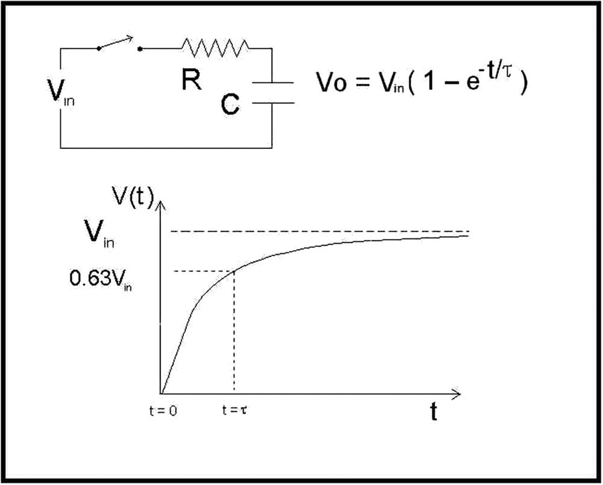
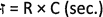
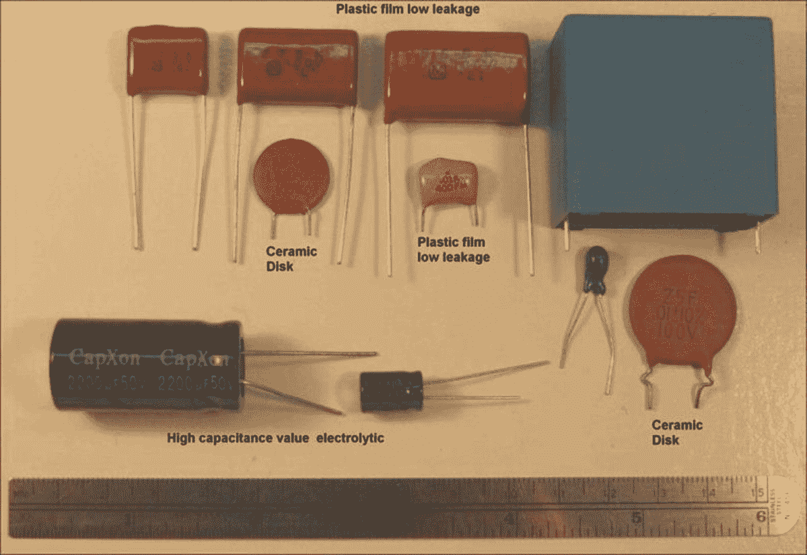

# 1. 电容与电荷

用绝缘体将两个导电板隔开，就形成了一种称为**电容器**的器件。在实验科学中，电容器的众多传统用途包括：存储或收集电荷、阻断直流电流、滤波电子信号，以及产生电压斜坡和定时。具有非常大电容值的器件常被用于存储电能作为内存备份，或在摄影记录期间为“闪光灯”的强光输出提供快速释放的高压功率脉冲。

电容，以**法拉**为单位测量，用符号`C`表示，可以用电荷`Q`和电压`V`来表达，写作：

`C = Q / V` -- (1)

绝缘体被称为**电介质**。电容器的电容由几个参数决定：绝缘电介质的化学性质`ɛ[r]`、真空介电常数`ɛ[0]`、电容器极板的面积，以及电介质的厚度或极板间的距离。

`C = ɛ[0] × ɛ[r] × A / d` 法拉 -- (2)

真空介电常数为每米`8.84 × 10^(–12)`法拉。以空气或真空为电介质的电容值计算通常以微法拉（μF）为单位表示。

介电常数表可在诸如大卫·莱德（CRC 出版社，2003 年）编写的《CRC 化学与物理手册》第 84 版等参考资料中找到。纸张等材料的介电常数在 2.5 到 3.5 之间变化。玻璃的介电常数范围从 3 到 10。云母等矿物的范围是 5 到 7。木材的范围是 3 到 8。金属氧化物粉末的范围是 6 到 20。不同类型的电介质可以制造出不同类型的电容器器件。在某些电容器中，使用化学溶液来在相对紧凑的器件内创建具有高电容的大表面积。

没有哪种电介质是完美的绝缘体。因此，所有电容器都存在跨极板的泄漏电流，并且电介质在存储电荷电压下被击穿之前能够承受的电压也有限制。超过电容器的安全工作电压可能会因极板间电弧放电而损坏器件。

如果考虑`Q`为电容器存储的电荷，并回顾电流是电荷流动的速率，则可以写出下式。

`C = i × t / V` – 其中 `i` 是电流，`t` 是时间 -- (3)

如果充电电流是恒定的，随着时间的推移，电流和时间的乘积会在电容器上产生一个线性增长的`Q`。为了保持`C`恒定，电压`V`的值必须线性增加。通过用恒定电流对电容器充电或放电，可以在电容器极板两端观察到线性电压斜坡。

由恒定电压源充电的电容器，其极板两端的电压变化呈指数形式。图 1-1 显示，闭合开关使电压源迫使电流通过电阻流入电容器。直流电流不穿过电容器的绝缘介质。因此，上极板变得缺乏电子而带正电，而下极板则带负电。

对于包含电阻和电容器串联的电路，一个重要的数值是`RC`乘积，通常特别用`Ƭ`（tau）表示。电路的`RC`乘积被称为**时间常数**，是电容器上的电压上升到其最终值的大约三分之二，或衰减到其初始值的三分之一所需的时间。在 555 定时器、无稳态振荡应用中，这些点就是您熟悉的充放电电压值。

一个电容器在经过五个时间常数后，即被完全充电或放电。

由于电子无法自由穿过电介质，随着电荷量的增加，每个极板上积累的静电荷需要越来越大的能量才能改变其数值。可以证明，当电容器上的电压接近其最终值时，电压变化率呈指数形式，如图 1-1 所示。

由于一个极板上积累的电荷类型反转，其大小在另一个极板上镜像出现，因此一个变化的电信号会反转，但仍能通过电容。

图 1-1

电容器电压随时间变化，其中 

电路时间常数  是电阻值（以欧姆为单位）与电容值（以法拉为单位）的乘积，以秒表示。

 -- (4)

τ 表示电容器充放电过程中的一个可测量点。对于一个完全放电的电容器，其电压在  秒内上升至 0.632V[in]。相反，一个完全充电的电容器在  秒内放电至 0.368V[out]。从数学上讲，建立这三个可测量量之间的关系，使得能够通过任意两个量来测量第三个量。

电容器在直流系统中是一种储能元件，在交流电路中则构成频率敏感的电阻。电容的基本单位是法拉，即存储容量，能够在 1 伏特电压下容纳 1 库仑的电荷。1 库仑的电荷相当于 1 安培的电流流过 1 秒钟。法拉曾被认为是一个很大的单位。

电容器的存储能力取决于极板的面积、电介质材料的性质以及极板之间的距离。用于制造电容器的结构材料决定了其性能和缺陷。如果电容器用于电路中的定时，应选择漏电最小的电介质。塑料薄膜电容器最适合低泄漏应用。

电解电容器具有相对较大的存储容量，最适合用于电源中滤波或抑制电压振荡，其漏电流通常与器件电容成正比。有关各种电容器的结构、特性和最佳用途的信息，可在多种文献中找到，包括《*Building Scientific Apparatus*》，第 4 版，（剑桥大学出版社），《*The Art of Electronics*》，第 2 版，（剑桥大学出版社），以及《*Practical Electronics for Inventors*》，第 3 版，（麦格劳-希尔集团）。

虽然传统上认为法拉是一个很大的单位，但如今已能制造出由颗粒活性炭和金属凝胶制成的电容器，其存储容量以法拉计量。法拉级单元，称为*超*级电容和*超级电容器*，能够快速存储和释放能量，作为存储电路或高放电率应用（例如相机闪光灯照明）的备用电源。高速充放电速率、巨大的重复充电循环能力，以及器件制造的轻质材料，使得“超级”电容器相比可充电电池拥有众多优势。

电容器的电荷存储能力范围广泛，大致对应器件的物理尺寸，如图 1-2 所示。

图 1-2

各种类型的电容器

总之，视野左上方的三个棕色矩形器件是金属化塑料薄膜型、低泄漏电容器，电容值分别为 1.2 μF、2.7 μF 和 5.6 μF。视野右上方的蓝色大型矩形器件是一个低泄漏的 15 μF 塑料薄膜电容器。顶行器件的价格通常从个位数到十位数递增，与其物理尺寸和电容值的增大成正比。

塑料薄膜器件都具有相同尺寸的元件引线，并且是无极性的。绿色泪滴形和黑色圆柱形电容器具有不同长度的电气连接引线，并且是有极性的。有极性器件的电容值比无极性的要大，因为绿色泪滴形是基于钽的器件，电容为 22 μF，而蓝色大型薄膜电容器为 15 μF。有极性电容器在安装时必须保证长引线的电位高于短引线。有极性电容器通常比无极性器件的极板间漏电流大得多。小型黑色圆柱体是一个 1 μF 400 V 的单元，而大型圆柱体是一个 2200 μF 50 V 的器件。

陶瓷圆盘电容器是相对便宜、稳定的单元，采用金属氧化物电介质，额定值通常在微法和皮法范围内。氧化物电介质可以封装在小型器件中，能够承受较高电压，并且在温度、电压和信号频率变化时保持电容值恒定。

跨越几个数量级的电容范围不易用单一的测量技术来评估。因此，需要研究几种方法来确定器件的电容值。

大量电子电路使用电容与电阻串联，形成称为*时间常数*的电路特性。时间常数，常用符号  表示，是电容与电阻的乘积，以秒为单位，常用于调整电子电路的性能特性。

图 1-3 是一个放大的诺模图，描绘了电阻-电容时间常数值与非稳态配置的 555 定时器 IC 芯片输出振荡频率之间的理论关系。

在非稳态配置中，定时器 IC 输出一个方波，其频率由其定时元件网络中的 RC 时间常数决定。如果在时间常数网络中使用一个确定值的电阻，并以电容作为第二个时间常数元件，则输出信号频率的值与电容成正比。

当使用像 555 定时器这样的 IC 器件作为传感器，将电容值转换为可变频率的方波以便测量时，应尽量使测量的频率范围保持在读出设备的能力之内。对于由代码清单 1-1 生成的、用于图形屏幕显示实际充放电过程，由于绘图仪显示需要大量的软件开销，因此需要相对较低的数据采集和显示速率。

如果使用数值输出显示，则可通过更快的硬件计数器（例如 LabJack 和 Arduino 设备上可用的计数器）收集频率数据，这些计数器可以将实时数据流式传输到数值计数器显示屏上。

在射频工作中通常会遇到更高的频率，最好使用示波器类型的显示器进行观察。

