# 5. 磁性、磁阻与霍尔效应

数千年来，人们一直利用天然磁性矿物碎片在陆地和海洋旅途中辨别方向。19 世纪，电流与电磁之间的关系才从矿物中的天然磁性中区分出来。电磁学的诞生进而解释了由磁极产生的吸引或排斥力的现象。

诸如旋转磁场之类的应用是我们大部分电能的来源。磁力驱动马达将电能转化为机械动作，构成了现代技术的基石。本节的焦点在于磁场强度的测量。

霍尔效应和磁阻是测量磁场强度的两个重要物理现象。

1892 年，人们发现了霍尔效应，该效应涉及磁场对通过导体的电流的影响。在半导体材料出现之前，霍尔效应一直只是实验室中的新奇事物，后来半导体材料才使得该效应能够用于测量磁场强度。

第二个被发现的重要现象是`磁阻`，即导体在磁场影响下电阻的变化。

如图 4-1 所示，测量高低磁场强度有许多技术手段。下文的主要内容将聚焦于基于霍尔效应或磁阻的、易于获取且成本较低的磁场测量集成电路。

对极低磁场强度的测量通常涉及复杂且昂贵的设备，这超出了本书的入门性质。关于低磁场检测的详尽信息可参考相关文献。

用于测量磁场的集成电路主要以表面贴装技术提供。`SMT`器件常用于分线板，由多个供应商制造和销售。

尽管磁场源于电子的运动，但传统上使用两种符号来完整描述磁场强度。由安培和毕奥-萨伐尔定律发现的感应磁场，用矢量符号`B`表示。当感应磁场包围一块材料时，会产生一个新的磁场，用矢量符号`H`表示。`H`和`B`的单位都是安培/米。`B`和`H`仅能在真空中相等，因为当存在能够增强或减弱感应磁场强度的材料时，它们会有所不同。能够增加或集中磁力线的物质称为`顺磁性`物质。而使磁力线分散或稀释的物质称为`抗磁性`物质。（严格从数学角度考虑，这些量都是矢量）。

在厘米-克-秒（`CGS`）单位制中，磁场强度的度量单位称为`奥斯特`（`Oe`）。当两个相同磁铁的相同磁极相距一厘米时产生一达因的排斥力，这时的磁场强度就是一奥斯特。在国际标准单位制中，一奥斯特等于`(1000/4π) × (A/m)`，其中`A`是安培，`m`是米。

类似的`电磁`场强度度量方法是：将一根无限长的导线缠绕成每米固定匝数的线圈，并通以一安培的电流。此时线圈中心的磁场强度用安培/米来描述。基于力和电流的度量通过比率`1 A/m = 79.58 Oe`相关联。

磁场强度可以通过磁力线来形象化理解。在给定区域内，磁力线越多，磁场越强。固定区域内的磁力线数量称为`磁通量`，以平方米为单位的磁通量单位称为`特斯拉`。`特斯拉 = kg/A × s²`或`V × s/m²`（采用千克、安培、秒的`SI`单位制）。

静态磁场和感应磁场的性质以各种单位进行定义和表达，详见表 5-1。

| 单位制 | 磁感应强度 `B` | 磁场强度 `H` |
| --- | --- | --- |
| `SI` 单位 | 特斯拉: `1 T = 1 V×s/m²` | `A/m` |
| 传统单位 | 高斯: `1 G = 10^(–4) T` | 奥斯特: `1 Oe = (10³ / 4π) × A/m` |

| | `mT` (特斯拉) | `G` (高斯) | `kA/m` | `Oe` (奥斯特) |
| --- | --- | --- | --- | --- |
| `1 mT` | = 1.000 | = 10.000 | = 0.7960 | = 10.000 |
| `1 G` | = 0.1000 | = 1.000 | = 0.0796 | = 1.000 |
| `1 kA/m` | = 1.2560 | = 12.560 | = 1.000 | = 12.560 |
| `1 Oe` | = 0.1000 | = 1.000 | = 0.0796 | = 1.000 |

你可以说，流过导线的电流在空气中产生磁场，这用符号`B`表示。如果这个电磁场包围了一种材料并且导致场强发生变化，这个新的实体就用符号`H`表示，并且可以写成`B = μ[0] x H`。`μ[0]`是一个比例常数，称为`磁导率`。`μ[0]`可以从空气或真空中的 1 变化到软铁材料的 1000 以上。请记住，`H`和`B`是由力的大小和方向组成的矢量单位。

安培定律将`B`的大小与导体中的电流联系起来，而通过将导体缠绕在铁芯上形成线圈来操控电磁场时，该电流决定了`H`的值。

螺线管一词由安德烈-玛丽·安培于 1832 年提出，用于描述一种紧密缠绕的螺旋形导体线圈，当电流通过该螺旋线圈时，可在线圈筒内形成均匀的电磁场。

螺线管内部的场强可通过以下表达式估算：

```
B = μ0I
```

其中`μ[0]`是空气的磁导率，`n`是单位长度的导线匝数，`I`是流经线圈的电流。

通过制作铁芯螺线管并用变化的电流为其供电，可以产生可变磁场，并且借助磁性材料，可以在电流、磁场强度和机械运动之间进行转换。

根据待测场强的不同，可以采用多种方法确定场强，如图 5-1 所示。

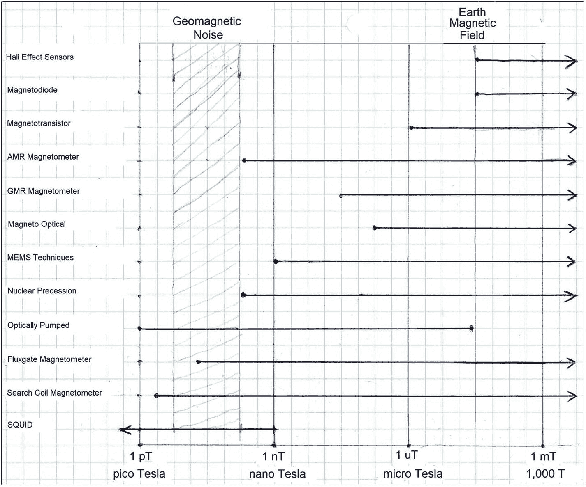

图 5-1 中描绘的许多测量方法或技术都是复杂的实现方案，涉及低温冷却剂、精密电子设备以及研究级医疗或物理实验室设施。

各种仪器和测量单位的摘要可在`en.wikipedia.org/wiki/Orders_of_magnitude_(magnetic_field)`上获得。如果需要更详细的资料，也可以参考 J. Lenz 和 S. Edelstein 发表在`IEEE Sensors Journal`（第 6 卷，第 3 期）上的文章“磁传感器及其应用”。

本章的重点是三种更常见且易于实现的磁场测量技术，它们利用电流在有无磁场存在下流动时所产生的不同物理现象。

霍尔效应检测器、各向异性磁阻和巨磁阻阵列在磁场存在的情况下会产生可测量的电压差。霍尔效应、各向异性磁阻和巨磁阻涵盖了现代技术可测量磁场强度的大部分可检测范围。

# 霍尔效应测量

1892 年，埃德温·霍尔发现磁场会使流经薄金箔的电流发生偏转，从而在金属薄片表面之间产生可测量的电压差。图 5-2 描绘了霍尔实验的框图。

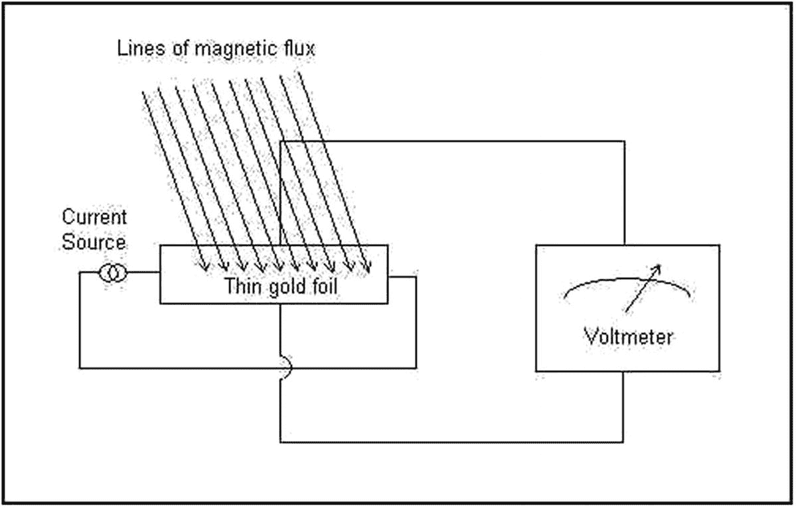

图 5-2

霍尔效应测量

直到半导体的发展使实际测量成为可能，这种微小的电压差才得以利用。`InAs`（砷化铟）和`GaAs`（砷化镓）被用于制备成薄膜，并采用斩波稳定运算放大器来测量霍尔效应中产生的微小电压，从而制造出专用集成电路（ASIC）。图 5-3 示意性地描绘了薄膜探测器。

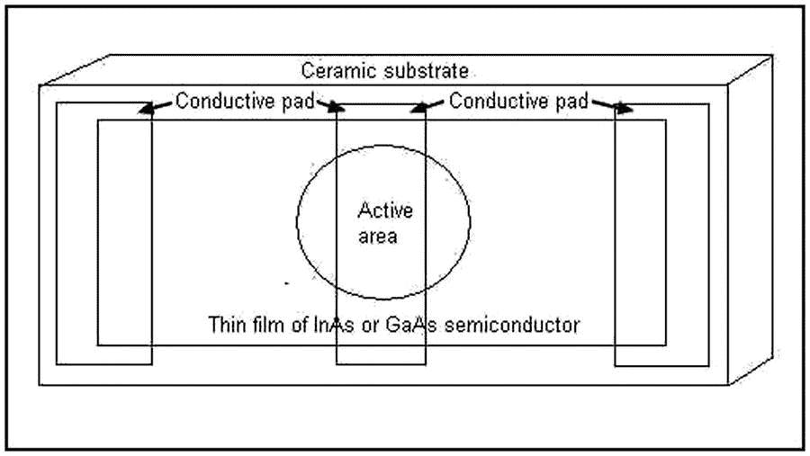

图 5-3

用于霍尔效应测量的 ASIC 配置

# 磁阻磁场测量

当磁场垂直于铁磁材料薄带中的电流方向施加时，会在铁磁化合物中产生各向异性磁阻（AMR）。威廉·汤普森于 1856 年观察到铁的电阻下降了 5%。镍则表现出更大的电阻下降。在某些铁磁铀化合物中，AMR 可达 50%。

图 5-4 展示了这种物理效应的基本配置。

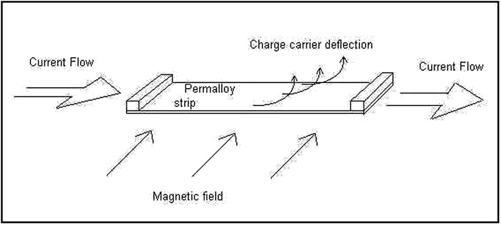

图 5-4

AMR 机制

在没有磁场的情况下，图 5-4 中的电流从左边的矩形电触点流经金属带到达右边。当磁场平行于坡莫合金带（80% Ni 和 20% Fe）的平面，但垂直于电流方向时，磁化矢量会试图旋转。随着矢量旋转角度的增加，带的电阻也随之增大。

通过几何结构和材料的改进，各向异性磁阻传感器被设计和制造出来，极大地提高了磁场测量的灵敏度。采用多个“巴伯极”几何结构，将换能器配置成惠斯通电桥，并利用斩波稳定运放放大信号，使得这种灵敏度的提升成为可能。

巨磁阻现象存在于铁磁合金与超薄导电材料层的多层结构中。铁铬（Fe/Cr）和钴铜（Co/Cu）多层堆叠在存在或不存在磁场的情况下，电阻可以下降超过 100%。传感器通常也配置成惠斯通电桥结构，以提供与磁场强度成比例的模拟输出。

并非所有用于测量磁场的传感器都以模拟形式制造。有些传感器被认为是“数字输出”器件。数字输出传感器表现出“快动”特性，在没有磁场的情况下，几乎不产生输出。当存在足够强的磁场将其激活时，则会切换为“全开”状态。数字传感器的规格是根据其开启和释放所需的磁场强度来确定的。

表面贴装技术为实验开发增加了一层复杂性。在接下来的磁场强度测量练习中，有一种传感器采用与常用原型开发面包板兼容的单列直插式封装（SIP）形式提供，而另外两种则不是。表面贴装技术（SMT）芯片设计用于直接安装在电路板上。为了将 SMT 器件用于无焊原型板，必须将这些器件安装到微电路板适配器上，该适配器可以电气连接到与原型面包板兼容的引脚上。

磁阻传感器依赖于所选用于检测或测量磁场存在的材料的电阻特性变化。许多电阻型传感器将感应元件配置成惠斯通电桥结构，以提供易于测量的、与周围磁场强度成比例的电桥失衡电压。

能够检测低强度磁场的灵敏磁阻传感器易受局部杂散磁场的影响，并且在强磁场环境中自身可能会被磁化或发生特性畸变。

为了能够使用高灵敏度场探测器，一些制造商在其器件中内置了磁偏移线圈，并提供了能够承受足够大电流的导线，以便在强磁场暴露破坏了传感器正常功能后，能够恢复磁阻特性（参见[`https://aerospace.honeywell.com/content/aero/en/us/home/learn/products/sensors/low-field-high-precision-linear-1-and-2-axis-analog-magnetic-sen.html`](https://aerospace.honeywell.com/content/aero/en/us/home/learn/products/sensors/low-field-high-precision-linear-1-and-2-axis-analog-magnetic-sen.html)）。

# 磁感线与磁场强度

磁场强度通过穿过某一空间区域的磁感线数量来表征。磁感线呈闭合环形，互不相交，在磁体外部从北极指向或流向南极。由于磁感线是闭合环路，在尝试将磁场强度与磁场中距磁体的位置和距离关联时，必须格外谨慎。条形磁铁产生的磁力线典型图像（如铁粉描绘出的轨迹）显示，在磁极两端，高度弯曲的独立磁感线密集分布，而连接弯曲磁极区域的则是平缓弯曲的磁感线。图 5-5 描绘了矩形磁体所产生的磁场的典型横截面积。

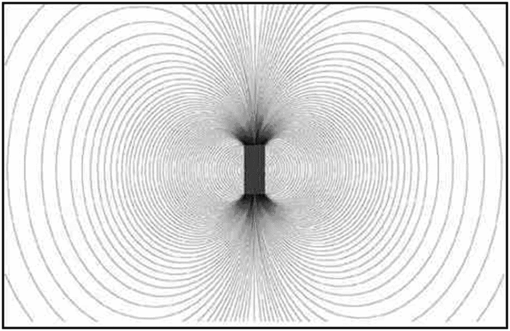

**图 5-5**
矩形磁体产生的典型磁场

磁场是一个三维实体。要完全可视化磁场，图中描绘的磁感线必须绕矩形磁芯中心的垂直轴旋转 360 度。定性地说，随着磁体表面与图中任意一点之间距离的增加，磁感线的密度会降低。定量地说，那些从磁体垂直轴共线出发的磁感线，先以圆锥形向外发散，然后转向垂直于原始轴线。在持续发散的同时，它们最终会转向大致平行于主轴的方向，在磁体外部于另一极上形成完整的磁感线回路。这些磁感线在磁体内部继续延伸，最终返回北极，形成闭合环路。

除了为高度对称的简单立方体、圆柱体和圆环开发的公式外，没有简单的数学表达式可以计算永磁体的磁场强度。以下是本实验部分中使用的圆柱形磁体的方程。

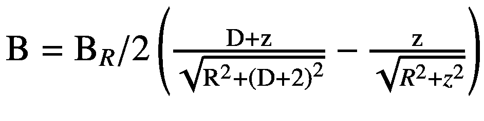

`B`是磁场强度。`B[R]`是磁体的剩磁（磁体在制造过程中磁化后剩余磁场的强度）。`D`是磁体圆柱的长度。`R`是圆柱的半径。`z`是主轴上用于计算磁场强度的距离点。

在磁极表面附近，磁场强度大约与距离的平方成反比；在更远的距离处，则与距离的立方成反比。对于使用  × 1 英寸（3 × 24.5 毫米）稀土磁体完成的工作而言，平方反比关系大约延伸至 1 英寸（2.45 厘米）处，而立方反比关系则在此距离之外适用。一个经验法则是：通过将圆盘堆叠在一起，直到堆叠的厚度等于圆盘的直径，可以产生叠加的磁场强度。

由钐钴合金制成的稀土磁体是最强、最紧凑且最昂贵的磁性材料。钕铁硼合金的强度与稀土材料相当，但成本较低。NdFeB（钕、铁、硼）合金对温度敏感，但若未过热，在 100 年内仅会损失其初始强度的 5%。NdFeB 磁体还可以进行涂层处理以实现防腐蚀或装饰性外观。铝镍钴是一种含有铝、镍、钴、铁及其他添加剂的合金，其成分可调整，从而获得具有广泛理化特性的材料。某些成分可制成温度敏感性低的超强磁体。高强度铝镍钴磁体比稀土磁体便宜，但比大多数其他磁性材料昂贵。由钡铁氧体或锶铁氧体制成的陶瓷磁体是热和电的不良导体，化学性质惰性，且比铝镍钴器件便宜。铁铬磁体可以具有与低级铝镍钴相似的磁性，但在最终硬化处理前，其质地足够柔软，可使用常规机械加工技术进行加工。还有一种名为`库尼菲磁体`的延展性铜/铁/镍合金，可按需塑形和成型，以及可按需成型的柔性塑料和橡胶复合钡铁氧体或锶铁氧体材料。

典型的磁场强度，如 0.25 至 0.65 高斯的地磁场和 100 高斯的冰箱磁贴，是两种常见的低强度磁场。稀土磁体、NdFeB 磁体和铝镍钴磁体在其磁极表面可具有 11,000 至 13,000 高斯的磁场强度。（10,000 高斯 = 1 特斯拉）

铁是为数不多的能有效屏蔽或约束磁场的材料之一。铁必须具有足够的厚度，以免磁场使屏蔽层饱和而传递磁感线。

# 实验：霍尔效应传感器

## Allegro Microsystems LLC

`A1326`传感器有三个引脚。从器件圆顶面（正面）看，左侧引脚接 5 V 电源，中间引脚接地，右侧引脚是传感器输出端。通常，在无磁场环境下连接到 5 V 电源时，标称输出电压为标称 5 V 电源电压的一半。如果将磁场引至器件正面，北极会使输出电压向`V[cc]`或 5 V 轨上升。反之，南极的存在会使电压向接地零值下降。随后使用`A1326`型号的出厂校准值（2.5 mV/G）来确定磁场强度。

接下来，我们讨论电路连接和磁场强度测试协议。要使用该器件测量磁场，需要将 Allegro 1326 的三个引脚连接到 5 V 电源、地、`LabJack U3-HV`的`AI0`端子以及一个`DAQFactory`绘图程序。该器件由一个微型芯片（尺寸为 1.5 × 4 × 1.5 毫米）组成，采用单列直插式通孔封装，带有三个 15 毫米的引脚。该器件以及连接到`LabJack`人机界面的导线均可安装在一块 1¾ × 1¼ 英寸（44 × 34 毫米）170 引脚的迷你面包板上，以方便组装。

被选作评估的每个传感器都使用一个强稀土圆盘磁体进行测试，以提供一个简单的相对磁场灵敏度测量。直径 1 英寸 ×  英寸（3 毫米 × 24.5 毫米）的磁体在木工中用作橱柜门闭合固定件。该稀土磁体的实际磁场强度未知，但在各个传感器的整个测试过程中保持恒定。

传感器的相对评估通过以下方式进行：将传感器固定在 6 英寸刻度尺（152 毫米）的 0 端，然后将磁盘放置在距场探测器不同的测量距离处。

# 软件

图 5-6 展示了当将一块直径为 1 英寸的稀土永磁体放置在传感器测量距离处时，用于监测 Allegro 传感器输出的页面组件。由于 Allegro 传感器的输出电压与磁通密度成正比，且其电源电压为标称 5V，因此单个`DAQFactory`通道即可接收传感器输出。左侧的黑色迹线记录了传感器输出电压，在无磁场环境下，该电压应为`LabJack`电源端子提供的标称 5V 电压的一半。右侧的红色迹线则描绘了根据传感器输入电压计算出的以高斯为单位的磁场强度。（测得`LabJack U3-HV`上的`V[S]`为 4.24 V。）

对北极和南极的灵敏度会导致输出电压偏离标称 5V 电源电压的中值点。如果无磁场基准线设定为 0G，则向上或向下的偏离可以量化和定性描述被测磁场的性质与强度。

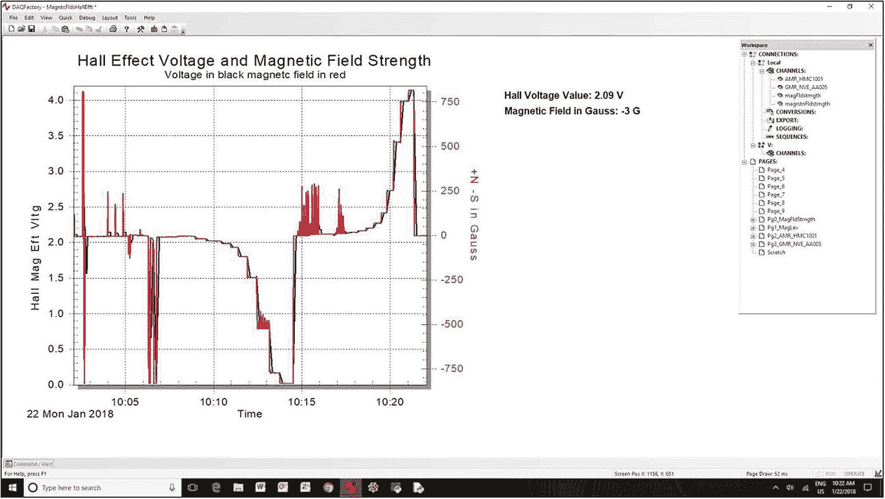

**图 5-6** — 稀土永磁体在固定距离时，其磁场与传感器电压响应

两个变量值显示控件提供了在霍尔效应传感器与稀土永磁体之间各个单独距离处测得的电压和磁场的数字数值。

表 2 列出了在简单相对灵敏度测量过程中收集的数据。

## NVE 公司 AA005 模拟磁传感器

NVE 传感器是一种基于巨磁阻效应、配置成惠斯通电桥的器件。在无磁场环境下，电桥平衡，两个输出端的电压均为电源电压的一半。磁场会增加桥臂元件的电阻，使输出端产生不同的电压。必须使用低噪声、高稳定性的电源为电桥提供偏置。必须使用高阻抗差分放大器来读取电桥的不平衡状态，且不能加载或干扰电桥的偏差。

该传感器的线性范围为 10G 至 70G，在 100G 时饱和。器件电源电压最高可达 24V，在最大磁场时输出为 60 mV/V/G。器件的灵敏度位于封装平面内，因此被测磁场线必须平行于封装表面。传感器的配置使其属于`全极性`器件，能对任意磁场极性产生正电压输出。

磁阻系统的惠斯通电桥灵敏度可表示如下：

```
灵敏度和张成 / V[桥路电源] / 高斯 (或奥斯特)
```

图 5-7 描绘了我用于记录采用电阻桥配置的传感器磁场响应的电路。在为比较传感器而进行的粗略测量中，`AD 620`使用了一个 1kΩ、5%精度的金属膜增益电阻，以提供 50 倍的放大器增益。

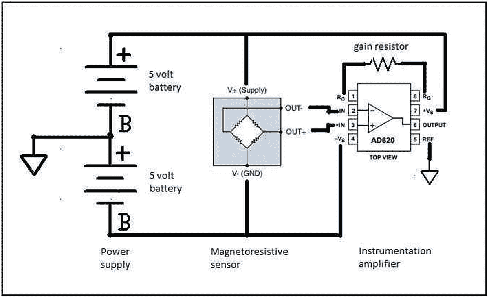

**图 5-7** — 针对配置为惠斯通电桥的磁阻传感器的读出电路

图 5-8 描绘了三次实验记录的迹线，这些实验测量了来自一个盘状稀土永磁体在距离传感器数个固定距离处的磁场。

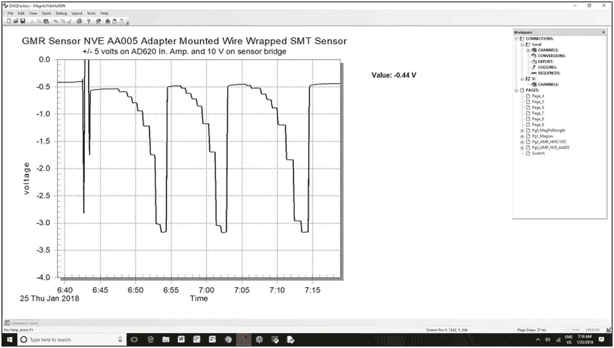

**图 5-8** — 使用 GMR 传感器在固定距离处测得的 AA005 稀土永磁体磁场强度

AA005 是一款尺寸为 1/8 × 3/16 × 1/16 英寸（3 × 5 × 1 毫米）的 SOIC-8 SMT 器件，安装在 11/16 × 3/8 英寸（17 × 11 毫米）的电路板上，该板配有两排各四个引脚，以适配原型开发板。（分线板由`Proto-Advantage.com`制备。）在图 5-8 中以图形方式记录、在表 5-2 中以数值方式记录的测量实验中，电路板上的传感器使用双面胶带对准距离测量尺的零位。使用惠斯通电桥探测器的电路板输出引脚采用绕线方式连接，以便在距离与场强测量过程中提供足够的灵活性。

## 霍尼韦尔 HMC 1001 单轴磁场传感器

霍尼韦尔传感器是基于各向异性磁阻、四有源元件、惠斯通电桥的器件，具有非常高的灵敏度。这些传感器可测量从微高斯到六高斯的场强。本测量练习中使用的 SMT 传感器是一个单轴敏感器件，有 8 个引脚，安装在 1 × ½ 英寸（30 × 12 毫米）的分线板上，带有 8 个直列引脚，可插入原型开发板。将板载传感器固定在距离尺的零位，并使用图 5-7 中描绘的双电池电路供电。

根据制造商的说法，HMC 1001 的磁场测量应限制在小于 5G 的范围内。尽管该器件配备了一个 8 引脚的 I/O 阵列，但本书中只使用了其中四个引脚。强磁场可能会扭曲输出、干扰灵敏度，甚至可能给坡莫合金（80%/20% 镍/铁）传感器元件引入剩磁。

霍尼韦尔传感器内置线圈，可抵消局部磁场。被称为`设置`和`复位`的连接通过探测器发送脉冲电流，以纠正暴露于强磁场的影响。在本实验中，仅使用了连接至惠斯通电桥电源输入端和电桥输出端的引脚。设置/复位线圈和偏移线圈的引脚被插入原型开发板的空白行中，以确保不会意外短路电路。

在过载后，通过快速地将稀土永磁体的北极或南极在测试夹具中靠近和远离传感器移动，直至重新建立静态基线，从而凭经验重新建立基线输出。在图 5-9 中，传感器过载发生在 9:56 和 10:04。

数据采集方法是：将稀土永磁体从一个无法探测到的远处位置，以感兴趣的磁极朝向探测器，快速移动到距离尺上一个预先确定的测量标记处。记录每个点的距离及其在变量值读数中的数值。

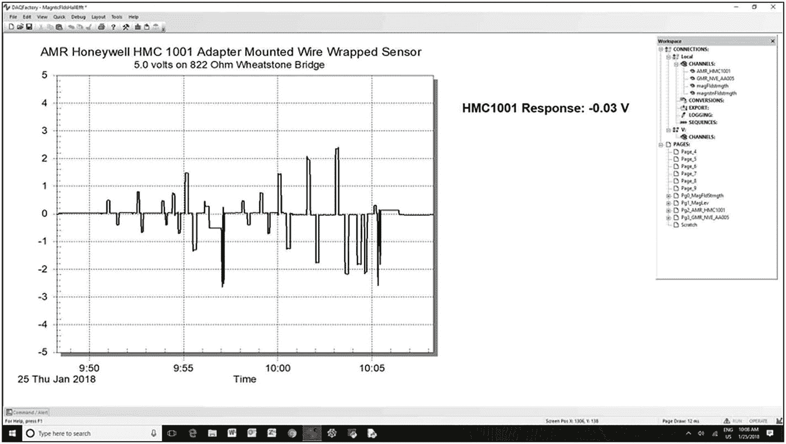

**图 5-9** — HMC 1001 磁场响应

# 观察结果

一块高磁场强度的稀土永磁体提供了一个恒定、高值的标准磁场，用于比较三种易得、廉价、易用、小巧的固态磁场传感器的相对灵敏度。

表 5-2 以图形化方式列出了当磁场源放置在距相应磁场传感器一个固定的已知距离时，各探测器对稀土永磁体磁场的响应。距离以 ¼ 英寸（6 毫米）为间隔呈现。在每个距离处测得的场强值对于简单的比较而言具有合理的可重复性。

## Allegro Microsystems

本练习中使用的 Allegro Microsystems 公司霍尔效应传感器（型号`A1326`）出厂时已校准，灵敏度为 2.5 mV/G。图 5-6 中的红色迹线在磁场强度接近 725 至 750 高斯时达到满偏转。使用`REM`和磁珠传感器在 1/8 英寸（3 毫米）和 1/16 英寸（1½ 毫米）距离处进行的额外测量显示，场强分别为 755 和 818 高斯，这表明测量系统已饱和，可能已超出可靠使用的限度。

据报道，由稀土制成的永磁体在其表面产生的磁场强度可高达一千高斯或更多。测试中使用的`REM`购自一家木工五金供应商。在图 5-6 所示的`DAQFactory`带状图记录器图形显示中，它很容易产生 2.5 V 的标称偏转。从`V[cc]/2`偏离 2.5 V 相当于 2.5 V / (2.5 × 10^(–3)) mV/G = 1000 G。`REM`在磁碟表面观测到的场强接近或超过 1000 高斯，这一数值与文献估算值相符。

如图 5-2 所示，霍尔效应传感器对被采样磁场的任一磁极均有响应，这与该效应的预期表现一致。

## NVE Corporation AA005

`AA`系列传感器被归类为高灵敏度磁力计，其基础是展现巨磁阻特性的材料。制造商指出，与霍尔效应和其他磁场监测器不同，GMR 传感器可以测量毫高斯级别的磁场。在使用分数高斯级别的测量时必须小心，因为地球磁场的典型范围是 0.5 G 到 0.65 G。

该传感器仅对稀土磁铁的一个磁极有响应，其线性灵敏度范围低于 5 高斯。在小于 3 英寸（75 毫米）的距离下，由场强代表的值与霍尔效应数据记录的值越来越不一致。

## Honeywell HMC 1001

最初尝试使用`HMC 1001`，并设置仪表放大器增益为 50，将`REM`置于距离标尺顶端 6 英寸（15.2 厘米）处测量场强时，直接将读数驱动到了电源轨电压。在增益电阻为 47 kΩ 且放大器增益为 2 的情况下，收集到了表 5-2 中的数据。然而，由于未按照制造商建议，通过设置/复位电流带施加适当的电流来正确地将检测器重新归零，数值结果包含了一个较大的系统偏移误差。使用制造商的校准数据后，表 5-2 中收集的数值在较近距离下产生的磁场强度数值达到 8 或更高，这明显超出了该传感器 +/- 2 高斯的线性范围。尽管定性记录显示其对稀土磁铁具有相对长距离的比例灵敏度，但数值数据存在误差。

表 5-2

已知距离下的磁场强度测量

| -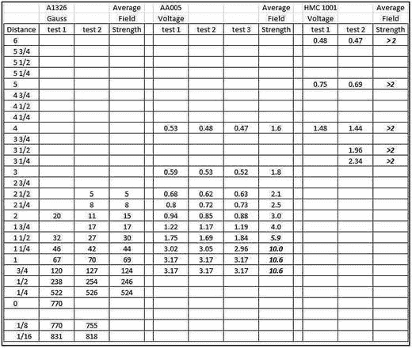 |

表 5-2 展示了霍尔效应、GMR 和 AMR 磁场传感器的相对灵敏度。霍尔效应传感器在场强测量中具有最大的动态范围，而 GMR 和 AMR 传感器更灵敏，但动态范围预期更窄。

# 讨论

使用稀土磁铁时请小心操作，避免材料破裂。我的几个磁碟在因两个磁碟之间或磁碟与铁表面之间不受约束的吸引而产生剧烈撞击时，碎裂成了锋利的小碎片。

多家制造商提供了关于使用集成电路进行磁场检测和感应的详细概述（参见`sensing.honeywell.com/hallbook.pdf`、[`www.allegromicro.com/hall-effect-sensor-ic-publications`](http://www.allegromicro.com/hall-effect-sensor-ic-publications)或[`www.nve/SensorAppsList`](http://www.nve/SensorAppsList)）。

磁场强度是决定为当前测量选择何种检测器的关键因素。强磁场使用霍尔效应传感器测量。中等强度磁场可使用 GMR 传感器进行评估，而低水平磁场则应使用适当屏蔽和校准的 AMR 器件进行采样或测量。与所有测量技术一样，测量越灵敏，所需的测量系统就越复杂。

霍尔效应传感器可以制作成仅需一个偏置电压和一个阻抗足够高的电压表读数系统即可实现测量。而 GMR 和 AMR 传感器则采用惠斯通电桥制造，其输出信号通常需要一个高阻抗差分放大器来产生可用的信号。像 AMR 器件所展现出的灵敏度还需要额外的电路来处理干扰测量的外部和内部效应。

与大多数物理化学传感操作一样，随着系统灵敏度的提高，实施成本也会增加。Allegro HE 传感器价格为 3 美元，NVE GMR 传感器价格为 11 美元，而 Honeywell`HMC 1001`价格为 29 美元。

在任何实验中，高灵敏度测量都需要对细节给予高度关注。Honeywell`HMC 1001`对标准化磁源在远超出 GMR 和霍尔效应传感器工作距离范围之外仍显示出定性响应。然而，传感器测量的电压并不准确，并且似乎存在显著且系统性的高数值误差。Honeywell 已发布了多篇关于电桥平衡、消除传感器上的残余磁效应以及磁场电流感应的应用笔记。（Honeywell AN 209、AN 212，以及 Honeywell 1 轴和 2 轴磁传感器`HMC-1001/1002/1021/1022`）。制造商的文献指出，过度暴露于强磁场会导致 AMR 传感器在错误的输出电平上“卡滞”。

## Allegro Microsystems LLC：线性霍尔效应传感器 A1324、A1325 和 A1326

Allegro 的传感器提供 5.0、3.125 和 2.5 mV/G 的灵敏度。这种三引脚单列直插式（SIP）封装集成电路可轻松组装成宽动态范围的磁场测量探头，仅需三根导线分别用于供电、接地和输出读数信号电压。

图 5-10 所示的框图为使用 A1326 通孔三引脚封装配置成可移动磁场探头来测量磁场强度的方案。芯片内部包含传感器、放大器、偏移校正电路、调谐滤波器以及其他电子元件，用于生成与采样磁场成比例模拟电压。制造商文档指出，该专用集成电路（ASIC）集成了斩波稳定运算放大器、滤波器、温度补偿电路以及霍尔效应传感器。

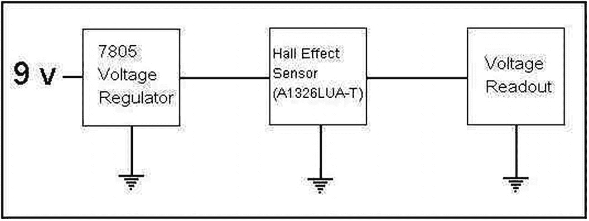

**图 5-10** 便携式霍尔效应磁场探头框图

便携式设备中，可用 9V 电池为 7805 稳压器供电，或者使用来自“独立”单元或通过 LabJack 型人机界面（HMI）的“固定安装”设置的稳压 5.0V 电源为设备供电。从`A1326ALU-T`读取的比例缩放电压值可显示在`DAQFactory`图形界面上。

Pololu Robotics 提供一款 0.8 × 0.7 英寸（18 × 20 毫米）的转接板，据称是 Allegro 的 ±15.5 A ACS711 霍尔效应线性电流传感器（带过流故障输出）的简单载体。它提供低电阻（约 0.6 MΩ）电流路径和高达 100V 的电气隔离。此版本接受幅度高达 15.5 A 的双向电流输入，并输出以`V[cc]/2`为中心的比例模拟电压，典型误差为 ±5%。其工作电压范围为 3V 至 5.5V，因此可直接与 3.3V 和 5V 系统接口（[`www.pololu.com/product/2197`](http://www.pololu.com/product/2197)）。

## NVE 公司磁力计

可提供从`AA002-02`到`AAK001-14`的磁力计型号，覆盖 1.5 至 2500 Oe（1 Oe = 1 G）的磁场范围。这些器件采用表面贴装（SMT）封装，其感应元件配置成惠斯通电桥，根据所监测的磁场强度，灵敏度范围约为 10 至 0.0025 mV/V/G。这些器件是单极性的，产生与仪表放大器兼容的差分输出。

## Honeywell HMC 1001

尽管表 5-2 和图 5-9 记录了`HMC1001`在距离公共磁场源较远时响应呈半比例增加，但过强的场强会干扰或扭曲测量结果。强磁场的接近显然会导致传感器错误地输出过高的桥电压，必须对此进行校正才能正确使用。

如果测量需要利用各向异性磁阻（AMR）传感器提供的高灵敏度，则必须实现制造商推荐的校正电子电路。

# 磁场的产生、控制与测量

电气工程通过电磁悬浮的图形化演示，教授了反馈控制原理。一个钢珠被悬浮在电磁铁下方的空气中。在一些早期的教学单元中，通过中断照射光电管的光束来确定钢珠的位置。照射到光电探测器上的光束强度会随着钢珠位置的变化而变化，从而控制输送给电磁铁的功率。

目前已有大量磁悬浮装置的实例。它们包括市售的组装好的桌面单元、带有电路板的完整套件，以及用于教育或科学展览项目的公开方法，这些方法使用永磁体、钢或软铁物体作为电磁铁控制悬浮的核心。为开发本实验而组装的初始系统是一个模拟计算系统，能够通过改变驱动电磁线圈的电源电压来悬浮磁材料或永磁体。

本实验考察两种形式的反馈控制器：模拟计算机和微处理器。多组件模拟计算机由四个可靠且易于获得的 741 运算放大器构建，而单单元反馈控制器则由 Arduino 微处理器配置。所有反馈机制都需要监测一个过程，以生成一个“反馈”到过程输入级的信号。

在负反馈磁悬浮系统中，光束和光电管是产生误差信号的传统方法。测量磁场强度变化的霍尔效应传感器也可用于此目的。

磁悬浮利用电流控制的电磁场来抵消重力对悬浮物体的下拉作用。电磁场必须足够强，以便与悬浮质量中的永磁体耦合，或在可磁化材料中感应出足够强的磁场以实现悬浮。

计算悬浮任一种质量所需的电磁场强度并非易事，最好通过直接测量来评估。

# 实验

## A. 使用模拟计算系统的磁悬浮/磁悬浮

为了实现悬浮，需要一个非磁性支撑框架来固定电磁铁。电磁铁通常安装在可调节的垂直位置上。待悬浮的质量可以不受阻碍地悬挂在磁芯尖端刚刚产生的磁场中。根据所选监测悬浮质量位置的方法，支撑框架可以制造成用于霍尔效应传感器的单个基座形式，或制成倒“U”形，在两侧安装光束发射器和传感器。

如果选择光速法测量悬浮物体，硬件配置必须允许对电磁铁尖端与红外光束之间的垂直距离进行机械调节。

## 电路原理图：模拟计算机控制

图 5-11 展示了用于模拟计算机的电路原理图，该模拟计算机是一个反馈功率控制器，可产生磁悬浮或磁悬浮场。遮挡光束会降低输送到电磁线圈的功率。增加光电管探测器的光照强度则会提高输送到线圈的功率。

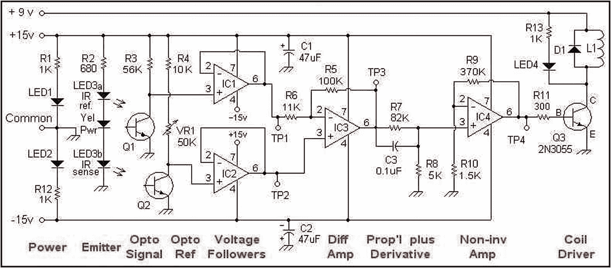

**图 5-11** — 用于磁悬浮的模拟计算控制器

图 5-11 中的电路是源自[`www.coilgun.info`](http://www.coilgun.info)上一个电路的修改版。在我组装的电路中，使用了一个小型 Potter & Brumfield 电磁铁（框架尺寸为 1 英寸 × 1¼ 英寸，线圈厚 11/16 英寸、直径 1 英寸，标称 6 V DC），其线圈电阻为 18 欧姆。除了这个成品线圈外，还在原电路基础上增加了一个用于红外发射二极管的黄色 LED 电源指示灯，以及一组独立的红外发射和接收参考光束。这个较小的 P&B 线圈电阻比定制线圈更高，但在我的实验室中已有现成，只需对比例加微分电阻的值进行微小调整即可实现磁场稳定。

由运算放大器组成的反馈监测器和功率控制器，实际上是一台相当复杂的模拟计算机。741 运算放大器的简洁性、稳定性和鲁棒性，使得这台模拟计算机的复杂性变得易于管理。在面包板上组装好电子元件并验证所有连接无误后，将每个运算放大器的同相和反相输入端接地。输入端接地后，可以给运算放大器通电，并调整放大器的微调电位器，使输出平衡到零伏。

四个放大器全部平衡后，便可调整模拟计算机的输入端以控制磁场强度。每个运算放大器都有一个双极性电源。为获得最佳性能，应利用监测光束上的 LED 移动和参考光束上的`VR1`进行偏置，使其工作在接近 0 输出电平的状态。这意味着需要提供 +/-15 V 的电压，以便根据磁悬浮物体运动产生的偏差，在正负范围内摆动。如图 5-11 所示，这里有两束红外光：一束用于监测悬浮物体的位置，另一束用于监测环境光强。

## B. 微控制器磁悬浮

1. 微控制器可以大幅缩短构建磁悬浮演示所需的开发时间。微控制器通过编程代替了大部分模拟电路。两种系统的光电机械结构和装配方式基本相同。由于编程及其算法的明确性，微控制器的操作更容易理解。

有许多磁悬浮演示资源可供实验使用。本书中用于测量磁场的系统是一种成熟且相对稳健的系统，在 Monk 博士（Simon Monk，麦格劳-希尔出版社，2011 年）所著的《15 个疯狂的危险极客项目》一书的第[13](https://doi.org/10.1007/978-1-4842-6781-3_13)章中有详细描述。该设备使用 Arduino 微控制器板，其文本和图纸提供了关于构建、装配、测试、操作、故障排除、控制算法代码以及运行理论的完整说明。

当系统调整得当并正常工作时，您可以通过物体在控制系统试图稳定其位置时产生的振动，感受到物体悬浮的正确位置。

我没有调整`PID`算法，而是采用试错法来修整悬挂的磁性“摆锤”的重量，直到这个加重后的磁性摆锤静静地悬挂在电磁铁下方。在组装好磁悬浮装置、从本书网站下载微控制器代码并启动整个系统后，试错过程便开始了。

将一个½英寸（12 毫米）的圆柱形铁磁体握在电磁铁下方，并上下移动以激活线圈电流。当电磁铁开始对磁体施加力时，将其向下拉以找到释放点。

我将磁体在释放点下方平衡在手指上，然后慢慢将其抬升到红外光束中以增加线圈功率。如果磁体立即向上飞向线圈，则在磁体上添加一个回形针并重复实验。为了控制添加到磁体上的质量，我用一片透明胶带将一个纸管固定在圆柱形磁体的边缘上。纸管的底部被压平并折叠起来，形成一个容器，用于盛放添加到摆锤上的额外回形针砝码。

经过几次试验后，摆锤静静地漂浮在电磁铁下方，如图 5-12 所示。摆锤上的纸管用记号笔做了标记以便于观察。

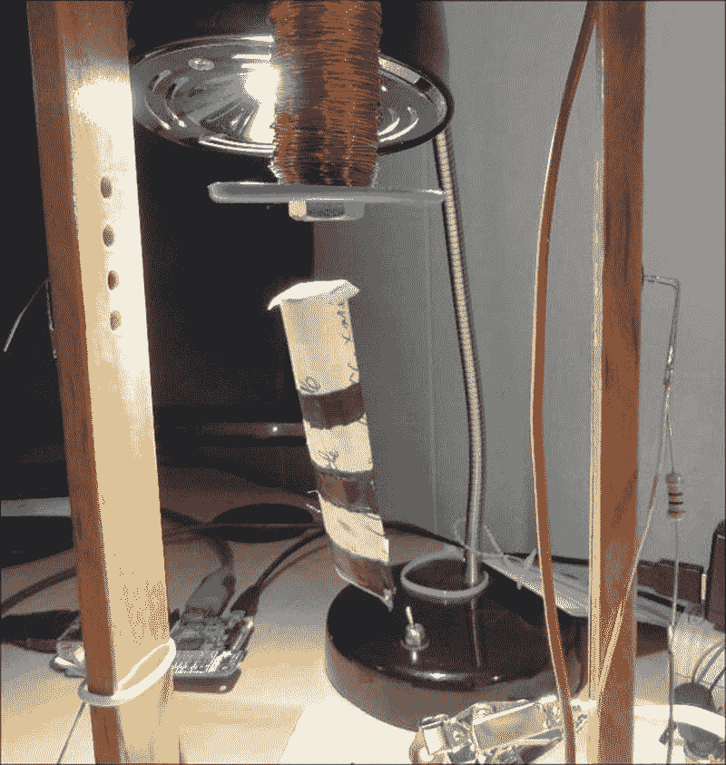

**图 5-12** — 加重磁性“摆锤”的磁悬浮

当摆锤悬挂在电磁场中时，尝试使用如图 5-10 所示的霍尔效应探头测量场强。探头由`LabJack U3-HV`的标称 5 V 电源供电，并通过笔记本电脑上的一个`DAQFactory Express`副本记录读数（见图 5-14）。如图 5-13 所示，使用探头时必须小心，不要遮挡红外控制光束。尽管探头按预期工作，但必须通过电子方式记录或平均化处理磁场的快速变化，才能获得任何定量的数值。

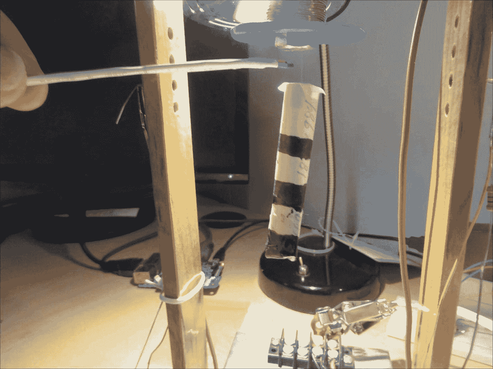

**图 5-13** — 霍尔效应磁场探头

图 5-14 展示了桌面磁悬浮装置和记录用的笔记本电脑。图 5-15 记录了在一次悬浮实验中的磁场和电压值。（请注意记录数据左上角的尖峰轨迹。）

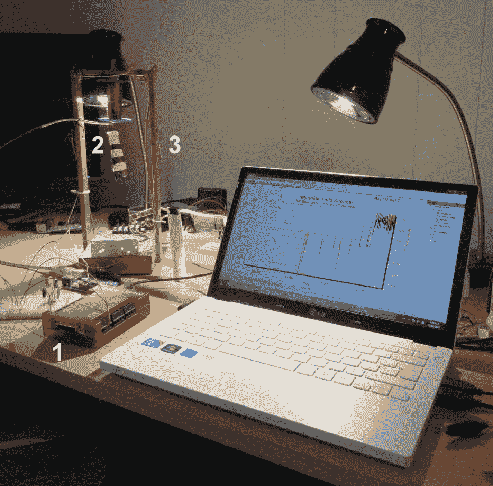

**图 5-14** — 磁悬浮实验装置

在图 5-14 中，标记为 1 的区域显示的是红色的`LabJack U3-HV`，以及它左后方的 Arduino 和原型板。标记为 2 的区域显示了悬浮的摆锤、白色管中的霍尔探头以及上方的电磁铜线圈。标记为 3 的区域显示了带有红外光束位置探测器的木质支撑框架。桌面上还有我的笔记本电脑、两盏台灯、一台 12 V 市电供电的直流线圈电源，以及主机显示器后面的一个电流表。

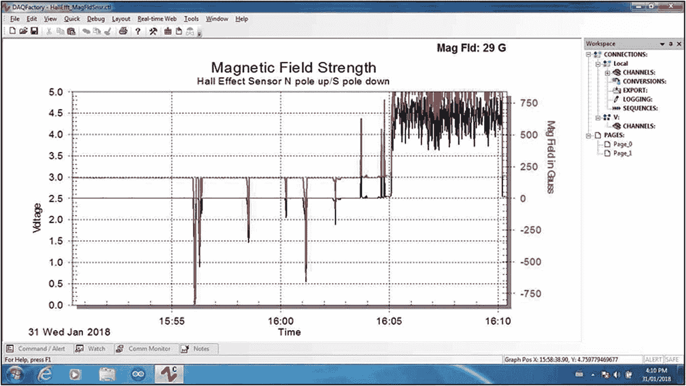

**图 5-15** — 磁悬浮场强记录

# 讨论

请勿在霍尔探头就位的情况下尝试平衡浮子，因为磁性浮子质量较大，在被强力吸向电磁铁极面时可能会损坏探头芯片。

通过组装由莫克博士详细说明的悬浮装置，可以借鉴大量成功的实验开发工作，从而使实验人员能够专注于磁测量技术的开发。

我们组装了两个悬浮浮子：一个较重，重 23.26 克；另一个较轻（见图 5-12、5-13 和 5-14），重 9.85 克。较轻的浮子悬浮在距线圈约½英寸（12.5 毫米）的位置，线圈电流在 0.52 至 0.62 安培之间变化。使用较重浮子的实验中，该浮子悬浮在线圈下方更低的位置。浮子会在短暂时间内不规则跳动，然后脱离悬浮场。一个较轻的浮子，并将红外光束二极管移近线圈，可以使浮子平稳悬浮，仅有微小幅度的移动，并且只要系统持续供电，就能保持悬浮状态。

图 5-15 表明，控制器算法以快速速率调节线圈电流和电磁场强度。霍尔效应传感器似乎在 600 至 1000 高斯范围内接近线性上限工作。

磁悬浮演示始终是过程控制的直观展示，并构成了一个有趣的问题，用以说明探头式磁场测量方法。

## 使用树莓派和 Arduino 进行磁场测量

像 Allegro A1326 这样的霍尔效应传感器，在与 Arduino/树莓派组合配对使用时，是一种易于实现的磁场传感器。Arduino 既可以提供传感器工作或偏置所需的 5 伏电压，也可以将模拟输出转换为 10 位数字信号。Arduino 将 ADC 输出写入到串行端口，由树莓派上的 Python 绘图软件读取，用于实时显示和带时间戳的存档存储。

# 实验

代码清单 5-1 非常简短而简洁。我们对代码清单 5-2 中 Matplotlib 条带图记录器代码的输入生成函数进行了简单修改（所有代码清单均提供在章末）。由于 Allegro 传感器输出与磁场强度成线性比例的电压，因此一个简单的线性变换即可将 ADC 输出转换为高斯值。

Allegro 的器件使用 5 伏电位，将无场或零场电平设定在偏置范围的一半。磁场强度不断增强且极性为北时，会导致电压和 ADC 读数向读出系统的最大值 5 伏或 1023 上升。磁场强度不断增强且极性为南时，会导致电压输出和 ADC 读数向地电位处的零最小值下降。通过从 ADC 读数中减去无场或中间电位来变换电压输出，并利用工厂标定的 5 mV/G，可将 ADC 输出转换为正负磁场值，以供存档和绘图。

通过在距离传感器探头固定距离处放置不同强度的磁铁，来演示传感器性能。在记录单个磁盘的磁场强度值后，将该磁盘或磁铁堆翻转，测量并记录相反磁极的强度。数值标注标识出被记录南北磁极强度的磁铁堆中磁盘的数量。磁盘来自一套六个英寸×1 英寸直径（3×24.5 毫米）的陶瓷磁铁，购自木工用品店。

# 观察结果

图 5-16 是树莓派显示器的屏幕截图，上面显示了已存档的时间戳和磁场值的控制台输出。右侧的图是用于评估磁铁堆叠时总场强增加的测量结果的图形化显示。

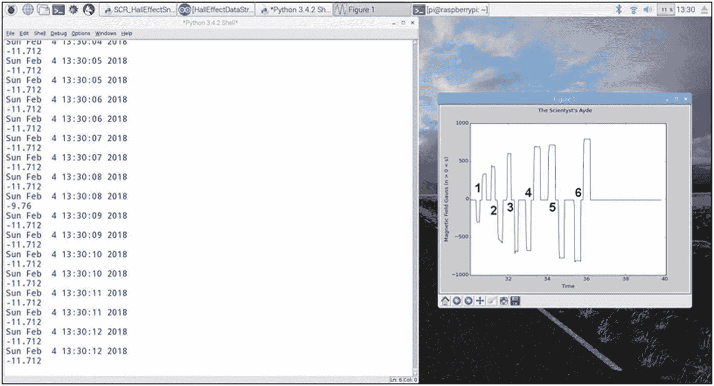

图 5-16：堆叠盘形磁铁导致的磁场强度增加

# 讨论

图 5-16 描绘了通过堆叠盘形磁铁以产生更强磁场的效果。经验法则是，磁场会叠加增强，直到磁铁堆的厚度等于单个磁盘的直径。

尽管 Arduino 代码非常简短、简单且直接，但用于读取传入数据的 Python 串行端口代码必须再次编写，以适应从传感器流出的数字的可变宽度。代码对复制粘贴部分有大量注释，但我保留了这些注释，以便您可以理解其逻辑，而无需回头查看某个语句或操作的目的。

## 自然磁场与磁力计指南针

地球上的生命受到地球磁场的保护，免受太阳辐射的伤害。地球的铁核产生磁场，其存在通常在南北纬度高纬度地区以北极光和南极光的形式可见。这些极光是当来自太阳的高能粒子被地球磁力线收集，并与地球高层大气中的气体分子和原子碰撞时产生的。

尽管在地质时间尺度上，地核磁场的磁极会移动并偶尔反转，但南北磁极在数年内足够稳定，可用作导航的方向指示器。在地球表面，磁场强度通常在 0.25 至 0.65 高斯（或微特斯拉）之间。

可以制造固态磁力计来读取局部磁场的方向，并确定北磁极的方向。然后，可以利用磁极的位置来确定地理北极的方向。

市场上存在许多采用表面贴装技术、并集成了运动传感单元的固态罗盘器件。

接下来，两个罗盘单元将展示作为更大导航装置一部分的测向能力。

# 实验

来自 Adafruit Industries 的一个分线板（它结合了一个三轴加速度计与一个罗盘）以及 Sense HAT 板的输出，是两款通过读取地球磁场来确定磁北方向的器件。Sense HAT 是一个可直接安装在树莓派上的完全组装板。如果该分线板用于原型搭建环境中，则需要焊接一排排针。

## Adafruit Industries, Inc.：LSM303DLHC（15 加元）

通过 Arduino 微控制器，可以收集并解读 Adafruit 板上安装的 SMT 模块提供的罗盘信息。借助一对软件库，能够读取磁力计数据，并将其转换为数字化的罗盘航向或方向，随后通过串行端口广播出去。

`DAQFactory`和 Python 均可从微控制器的串行端口读取数据，并显示罗盘航向。用于对微控制器进行编程的库可从在线存储库[`https://github.com/adafruit/Adafruit_LSM303DLHC`](https://github.com/adafruit/Adafruit_LSM303DLHC)下载。除了微控制器软件外，还有读取扩展板上罗盘航向和三轴加速度计的示例程序（参见第 6 章）。

主机与微控制器之间的 USB 连接为微控制器提供电源和通讯。扩展板上的+5V 和接地引脚可连接到微控制器以供电。传感器板上的`SDA`和`SCL`串行总线通讯引脚可连接到 Arduino 的`A4`和`A5`输入引脚，从而完成系统接线。

将库安装到所用主机后，即可运行磁力计罗盘程序，并验证微控制器的串行端口输出。（编写本文时，基于 RPi 的 Arduino IDE 要求删除草图本库文件夹中存储的 Adafruit 库标题中的所有非字母或数字值。IDE 程序在初始化时只能读取字母数字标题。）最新版本的 Windows 版 Arduino IDE 已包含所需的库。

在 Arduino IDE 的串行端口监视器上验证微处理器罗盘航向读数后，可移除输出中的`"罗盘航向"`部分，以简化`DAQFactory`或 Python 串行端口监视器所需的解析工作。在磁力计罗盘程序中，通过注释跳过以下几行：

```
Serial.println("Magnetometer Test"); Serial.println(""); in the setup function and the line;
Serial.print("Compass Heading: ");
```

通过注释掉上述代码行，只有数值会被打印到串行端口。

`DAQFactory`可以配置为在 COM 端口接收罗盘数据。如`DAQFactory 串行通讯手册`（[`www.azeotech.com/dl/serialguide.pdf`](http://www.azeotech.com/dl/serialguide.pdf)）所述，这些数据可追加到某个通道，用于`DAQFactory`显示界面。图 5-17 展示了罗盘显示属性面板，图 5-18 则展示了罗盘显示效果。

## RPi 与 Python 的罗盘航向

Python 和 RPi 可用于显示从 Arduino 或 Sense HAT 板获取的罗盘航向数值。

可通过简单的 Python 代码读取串行端口的数字值，并在控制台上进行流式显示，或实现基于 Tkinter 的静态实时 GUI 显示，如图 5-19 所示。图 5-19 的代码见代码清单 5-3。

RPi 也可从 Sense HAT 板的磁力计罗盘读取方向信息。代码清单 5-4 中的代码可读取单个罗盘航向。若将该代码置于`while`循环中，罗盘数据便可在 Python 控制台上流式输出以便存档。

# 观察结果

属性选择面板允许您更改`DAQFactory`罗盘图标中圆盘和文本的颜色及大小。（该图标在 Express 版本中不可用。）

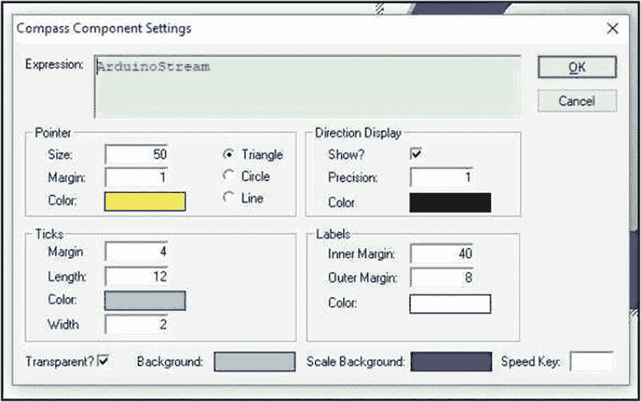

图 5-17

`DAQFactory`罗盘显示的属性选择面板

经过几分钟观察，数字显示数值会因电子噪声而波动，但始终指向特定方向。

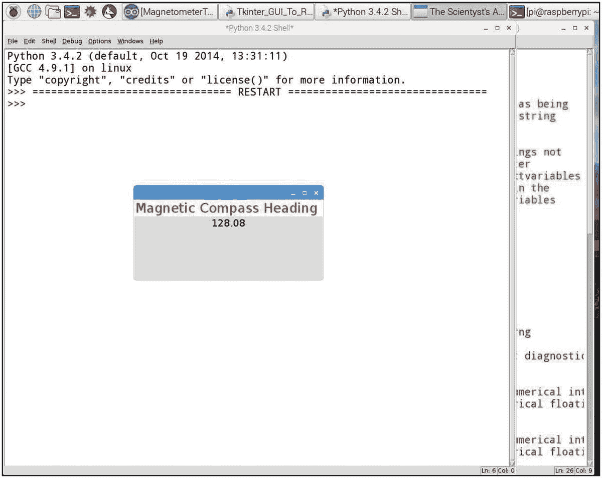

图 5-19

RPi Tkinter GUI 实时显示来自 Arduino 和 Adafruit LSM303 板的罗盘航向

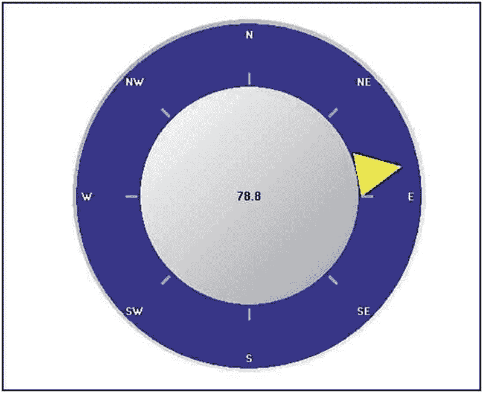

图 5-18

`DAQFactory`罗盘显示

# 讨论

地球磁场很弱。磁铁或大量磁性金属的存在会影响罗盘读数。罗盘航向是一种磁方位角，它与真北的关系取决于测量地点地理位置的多种变化因素。

大多数固态罗盘读数来自集成到系统中的磁力计，用于提供高速位置测定。图形显示对快速变化的数据响应相对较慢，因此在对罗盘航向读数进行平均化后再显示，可以获得稳定的航向指示。

# 代码清单

# Sense-HAT 编程

```python
from sense_hat import SenseHat

sense = SenseHat()
```

## 矩阵显示消息

```python
sense.set_rotation(180)
north = sense.get_compass()
print("北向: %s" % north)
```

*清单 5-4：Sense HAT 磁力计指南针航向的单一读数*

```python
# -*- coding: utf-8 -*-
"""
一个用于读取串口以显示磁航向的实用程序。
首先从 Arduino 收集的传感器数据通过串口读取，并验证其为数值型数据字符串。关闭串口后
启动此程序。字符串数据被读取、解析并显示
在 Python - Tkinter GUI 中。
解析代码针对多位浮点数字符串而非数值编写。此默认程序读取 Arduino ADC
整数值和电位器浮点电压值作为
传输的单个字符串。Tkinter 文本变量默认
设置为显示 adc_numeric 和 wpr_flt，并在
默认 Tkinter GUI 中显示相应标题。如果不使用，请注释掉标题并将
文本变量设置为 None。
"""
import serial
from tkinter import *

ser = serial.Serial("/dev/ttyACM0", 9600)
ser.baudrate = 9600

def update(): # 主循环每毫秒后调用
    while 1:
        reading.set(ser.readline())  # tkntr StringVar()设置为串行输入字符串
        string_val = reading.get()  # 用于切片操作的 string_val 变量
        #print(string_val, "len string_val, ", len(string_val)) # 诊断打印
        #
        if len(string_val) == 13: # ADC 为 1 位数字
            adc_numeric.set(int(string_val[2:-10])) # 切片并设置 IntVr()数字整数字符串
            wpr_flt.set(float(string_val[3:-5])) # 切片并设置 DoubleVar()浮点数字
        #
        if len(string_val) == 14: # ADC 为 2 位数字
            adc_numeric.set(int(string_val[2:-10])) # 切片并设置 IntVr()数字整数字符串
            wpr_flt.set(float(string_val[4:-5])) # 切片并设置 DoubleVar()浮点数字
        #
        if len(string_val) == 15: # ADC 为 3 位数字
            adc_numeric.set(int(string_val[2:-10])) # 切片并设置 IntVr()数字整数字符串
            wpr_flt.set(float(string_val[5:-5])) # 切片并设置 DoubleVar()浮点数字
        #
        if len(string_val) == 16: # ADC 为 4 位数字
            adc_numeric.set(int(string_val[2:-10])) # 切片并设置 IntVr()数字整数字符串
            wpr_flt.set(float(string_val[6:-5])) # 切片并设置 DoubleVar()浮点数字
        #
        root.update()

root = Tk()

w = Label(root, text="磁罗盘航向",background="white",
          foreground="red", font="Arial 20")
w.pack()  #第 1 个显示标签

## 第 2 个标签是串行输入的字符串值，实时显示
reading = StringVar()  # 创建 tkinter StringVar 变量 reading
w = Label(root, textvariable= reading, font="Arial 15") # 标签更新
w.pack()

"""
#第 3 个标签是传感器浮点电压和整数 ADC 值的标题
w = Label(root, text="电位器滑臂电压与 ADC 输出", background=
          "white", foreground= "red", font="Arial 16")
w.pack()
"""

## 第 4 个标签是 3 位有效浮点滑臂电压
wpr_flt = DoubleVar() # 创建用于显示的 tkinter 双浮点变量
w = Label(root, textvariable= None, font="Arial 15")
w.pack()

#第 5 个标签是来自 A0 输入的 3 位整数 ADC 值
adc_numeric = IntVar() # 创建用于显示的 tkinter 整型变量
w = Label(root, textvariable= None, font="Arial 15")
w.pack()

root.after(1, update)  # 读取一个新值
root.title("科学家的助手")
root.mainloop()
```

*清单 5-3：用于读取串口的 Python Tkinter GUI*

## 用于树莓派带串口输入的带状图表记录器

### SCR 绘制来自 Arduino A0 输入的霍尔效应传感器变化数据
### ADC 计数约 2 高斯，数据为正表示北极，负表示南极

```python
import matplotlib
import numpy as np
from matplotlib.lines import Line2D
import matplotlib.pyplot as plt
import matplotlib.animation as animation
import time
import serial

class Scope:
    def __init__(self, ax, maxt=10, dt=0.02):
        """maxt 为显示时间宽度"""
        self.ax = ax
        self.dt = dt
        self.maxt = maxt
        self.tdata = [0]
        self.ydata = [0]
        self.line = Line2D(self.tdata, self.ydata)
        self.ax.add_line(self.line)
        self.ax.set_ylim(-1000, 1000)  # y 轴刻度
        self.ax.set_xlim(0, self.maxt)
    def update(self, y):
        lastt = self.tdata[-1]
        if lastt > self.tdata[0] + self.maxt: # 重置数组
            self.tdata = [self.tdata[-1]]
            self.ydata = [self.ydata[-1]]
            self.ax.set_xlim(self.tdata[0], self.tdata[0] + self.maxt)
            self.ax.figure.canvas.draw()
        t = self.tdata[-1] + self.dt
        self.tdata.append(t)
        self.ydata.append(y)
        self.line.set_data(self.tdata, self.ydata)
        return self.line,

ser = serial.Serial("/dev/ttyACM0", 9600)  # 串口实例

def rd_data():
    while True:
        inPutln = ser.readline()
        # print("inPutln = ", inPutln) # 仅用于错误诊断
        if (len(inPutln ) > 6):     # 长字符串片段
            continue
        #
        if (len(inPutln) == 3):    # 单个无符号数字的长度
            line = int(str(inPutln)[slice(2,3)])
            print(time.asctime()) # 用于控制台/数据存储的存档时间戳
            print ((line - 516) * 1.952) # 控制台显示/存档数据存储
            yield (line - 516) * 1.952
        #
        if (len(inPutln) == 4):    # 双位无符号数字的长度
            line = int(str(inPutln)[slice(2,4)])
            print(time.asctime()) # 用于控制台/数据存储的存档时间戳
            print ((line - 516) * 1.952)  # 控制台显示/存档数据存储
            yield (line - 516) * 1.952
        #
        if (len(inPutln) == 5):    # 三位无符号数字的长度
            line = int(str(inPutln)[slice(2,5)])
            print(time.asctime()) # 用于控制台/数据存储的存档时间戳
            print ((line - 516) * 1.952)  # 控制台显示/存档数据存储
            yield (line - 516) * 1.952
        #
        if (len(inPutln) == 6):    # 四位无符号数字的长度
            line = int(str(inPutln)[slice(2,6)])
            print(time.asctime()) # 用于控制台/数据存储的存档时间戳
            print ((line - 516) * 1.952)  # 控制台显示/存档数据存储
            yield (line - 516) * 1.952

fig = plt.figure()
fig.suptitle("科学家的助手", fontsize = 12)
ax = fig.add_subplot(111)
ax.set_xlabel("时间")
ax.set_ylabel("磁场强度（高斯，n > 0 < s）")
scope = Scope(ax)

## 使用 rd_data()作为生成器为更新函数提供数据，
## Arduino LDC 值由绘图代码以 10 分钟窗口读取，用于
```


