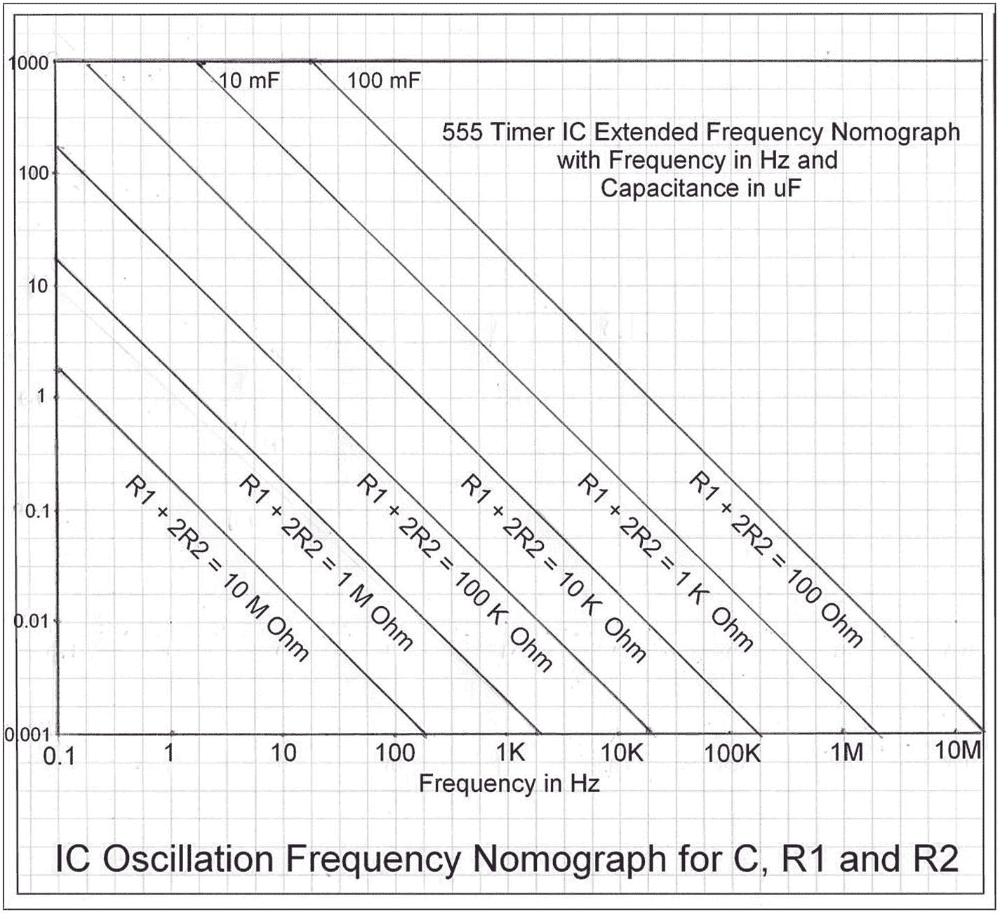
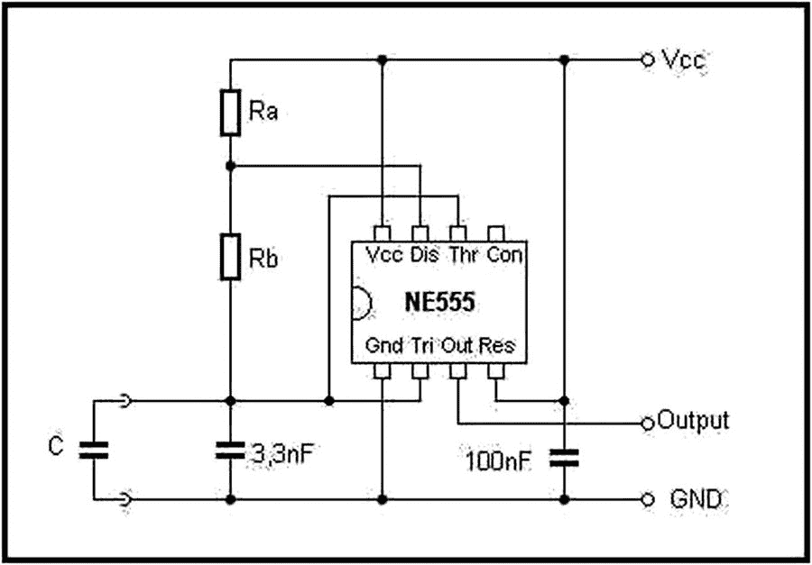
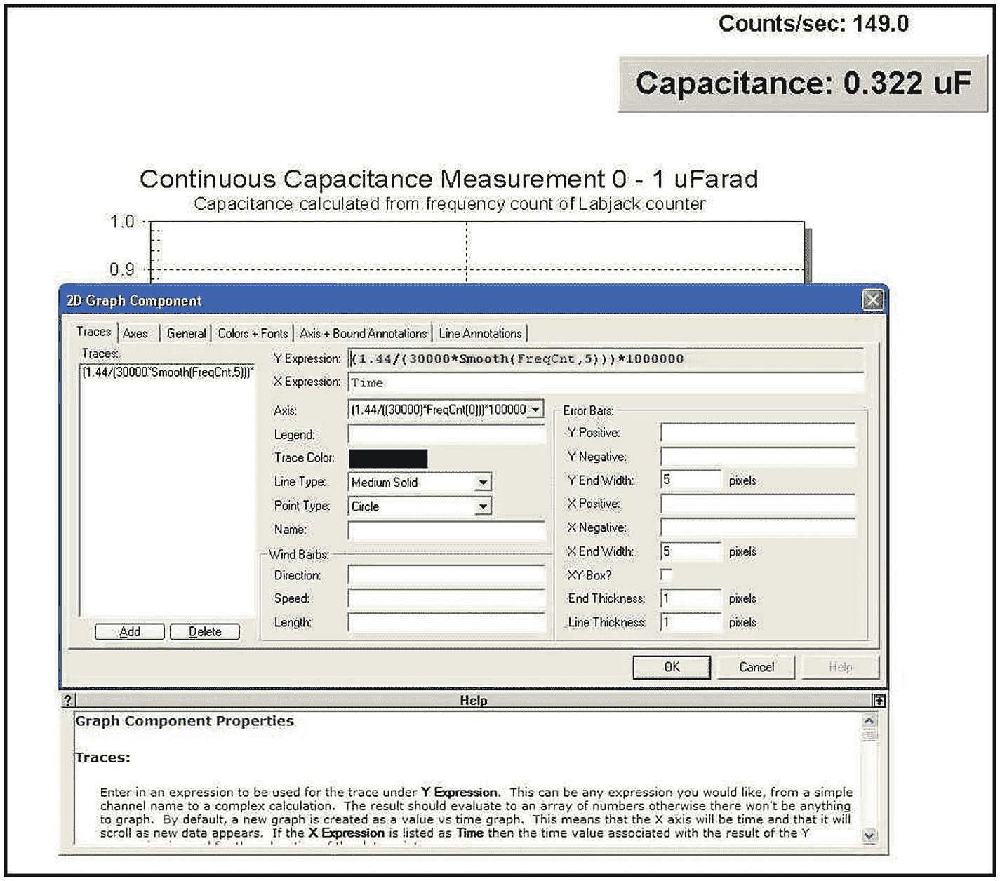
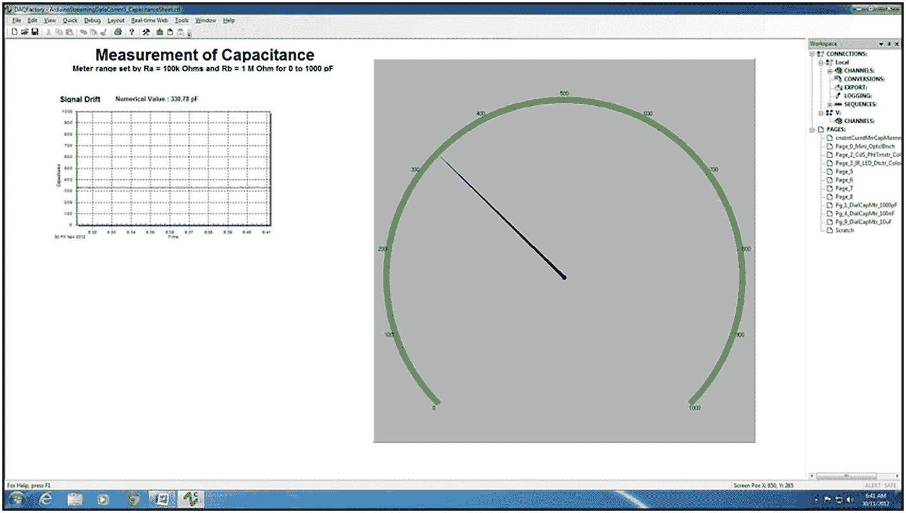

# 电容测量与监测

本次电容测量/监测练习分为四个部分。其中三个部分使用`DAQFactory`中的图形用户界面，将电容值显示为旋转模拟指针式仪表、数字万用表式数值读数或连续显示条带图记录。

将电容值的测量与显示划分为这些独立的部分，是由于记录和显示系统受限于电容设备宽动态范围而造成的。

第四种电容测量技术使用Arduino微控制器及其串口读数，构成一个自动量程电容计，测量范围从微法拉到皮法拉。有两种程序可将该微控制器用作更高分辨率的连续电容测量仪表。

列表1-2中主要的连续显示程序几乎无需布线。它利用杂散输入电容校准和Arduino微控制器板载的内部“上拉”输入电阻，生成被测设备(DUT)一系列相当准确的电容值。

第二种连续读数程序需要一些外部元件和布线，以实现对电容DUT的精确连续测量，将在第10章中介绍。

第二种程序使用精确测量的时间段和已知电阻值来确定DUT的电容值。通过使用微控制器芯片内部的比较器、基于晶振的定时器以及操作系统中断序列，实现了显著的计时精度，从而获得精确且可重复的时间值。

使用诸如Arduino之类的微控制器来测量DUT的电容，其优势在于允许实验者在测量系统中嵌入一些数字信号处理功能（例如移动平均），以提高系统的信噪比。

在线论坛中有大量练习展示了电容现象在组装触摸板方面的常见用途，例如用Arduino微控制器激活LED。

电容器中的电荷通过描述电容与电压关系的基本公式计算得出。非电容性的静电荷在第8章中讨论。

## 电容器特性

电容器有多种电荷存储容量和介电特性。电容器的特性主要由填充在器件导电板之间的介电材料决定。通常，高电荷存储容量的器件具有较大的漏电流，这使得它们不适用于定时应用。

## 漏电流

理论上，电容器是一种电荷存储器件。其导电板之间具有高极化性绝缘电介质，因此可以存储更多能量，或在给定存储容量下体积更小。然而，充电时，极板间的电压会导致电流流过电介质，最终使电容器放电。电容器的漏电流主要由电介质的化学成分决定。

电解电容器使用金属氧化物绝缘层作为器件的电介质。氧化铝和氧化钽形成具有高介电常数的薄膜，但电解器件也表现出更高的漏电流。

漏电流的测量使用基于跨阻放大器(TIA)的电流静电计，如图2-2（第2章）所述。TIA配置也应用于第7章图7-4所述的漏电流测量。本练习仅检查低压或线电压兼容的电容器，因为高压大电流系统超出了本书的入门性质。

运放TIA静电计的高输入阻抗可以测量极低水平的电流。电容器的漏电流可以直接从测量电路的稳定电池激励电压中测得。

在测量已放电电容器中非常小的漏电流时必须小心。只有当器件在电池提供的全测试电压下达到稳态平衡时，才能进行测量。

如第2章所述，测量非常小的电流需要特殊技术和仪器。

第2章的表2-4显示了在不同电容器上测得的典型漏电流。

漏电流有时被认为对电容器的定时应用不利。在定时电路中，漏电流应尽可能小，以确保定时操作的可重复性。使用塑料薄膜作为电介质的电容器，如聚乙烯、聚酯薄膜（聚对苯二甲酸乙二醇酯薄膜）和聚苯乙烯，因其塑料薄膜电介质的高电阻或低导电性而具有极小的漏电流。然而，大多数塑料薄膜无法存储显著的电荷。这种分子结构的非极化特性限制了在尺寸合理的器件中可制造的电容值。图1-2右上角看到的蓝色大块是一个15 μF的聚苯乙烯电容器。

用于滤除整流交流电源纹波的电容器，其漏电流比电容器所平滑的电流低数个数量级，且对平滑操作几乎没有影响。

陶瓷电容器是漏电流相对较低的器件，通常以微法分数和纳法数值供应。

## 实验A：低电容值（< 10 μF）的连续显示

### 电路：一个基于`555`定时器的简易电容计

在大多数应用中，`555`定时器会生成固定或可变占空比的矩形波输出。通过在非稳态工作模式下，用可变电阻或电位器替换两个固定电阻之一，即可获得可变的占空比。若两个充电电阻的阻值固定为10:1的比例，则输出信号为近似50%占空比的方波，其频率`f`仅由电容值决定。

```
f = 1.44 / (Ra + 2Rb) * C -- (5)
```

```
C = 1.44 / (Ra + 2Rb) * f -- (6)
```

通过测量频率或一秒钟内产生的方波脉冲数量，即可确定电容值。

由传统双极型晶体管`555`定时器集成电路组装而成的非稳态振荡器，其振荡频率仅限于几百千赫或几兆赫的低频范围。采用CMOS工艺制造的定时器集成电路可在兆赫兹范围内振荡。三种常见器件的最大输出频率列于表1-1中。

**表1-1 555定时器高频限制**

| 制造商 | 器件编号 | 最高振荡频率 |
| --- | --- | --- |
| Intersil | `IMC7555` | 1 MHz |
| Texas Instruments | `TLC555` | 2 MHz |
| TI (National) | `LMC555` | 3 MHz |

图1-3与Intersil公司`IMC 7555`数据手册中的图1-4类似，描绘了不同定时网络RC元件组合下的定时器输出频率。两张定时电阻组合的曲线图表明，如果`(R[a] + 2R[b])`为1 kΩ，则通过测量1/10 Hz至3 MHz之间的振荡器输出频率，应该可以测量1 pF至10 mF（10,000 μF或1/1000 F）范围内的电容值。测量应基于遵循前述公式的电容-频率数据线性部分进行，这些数据是可复现且可预测的。低于100 pF的低电容值可能需要使用1 MΩ电阻网络进行单独校准，以确保合理的精度。

1 kΩ、10 kΩ、100 kΩ和1 MΩ的电阻总和应能覆盖常规电路中遇到的电容范围。（注意：某些`555`变体在RC网络电阻低于1 kΩ时不会振荡。）

由于希望保持10:1的电阻比以使输出保持合理对称，你可以写出`(R[a] + 2R[b]) = 1K = (R[b]/10 + 2R[b])`，并求解出`R[b]`为500 Ω，从而`R[a]`为50 Ω。在实际实现中，可以使用47 Ω和470 Ω或56 Ω和560 Ω的标准规格，但必须根据所选用的`555`定时器类型来测试总电阻低于1千欧的情况。



**图1-3 来自Intersil数据手册的图14**

图1-3中的曲线图形成了一个有点直观的概念：充电速度很快的小电容与高频振荡相关联。充电缓慢的大电容与大阻值限流电阻相关联，对应较低的振荡频率。

查看LabJack的计数器文档可知，当检测到下降沿后紧接着上升沿时，计数器会记录一次事件。矩形输出波的每个周期都有一个下降沿/上升沿对。如果电阻值精确已知，则可以根据测量到的频率计算出电容值。

#### 电路原理图

图1-4所示的定时器电路可由LabJack提供的5V电源供电。原理图中未显示电阻值，因为不同测量量程使用了不同规格的电阻，如表1-2所列。（请回忆：电容单位符号F表示法拉；μF或10^(–6) F表示微法；nF或10^(–9) F表示纳法；pF或10^(–12) F表示皮法。）



**图1-4 555 IC电容测量电路**

**表1-2 555定时器振荡频率的RC常数范围**

| 电容值范围 | 电阻值 (欧姆) `R1-R2` | 555频率 |
| --- | --- | --- |
| 1 mF 至 10 μF | 0.1 kΩ 至 1 kΩ | < 6.86 Hz |
| 10 μF 至 0.01 μF | 1 kΩ 至 10 kΩ | 6.86 Hz 至 6860 Hz |
| 10 nF 至 1000 pF | 10 kΩ 至 100 kΩ | 686 Hz 至 6860 Hz |
| 1000 pF 至 10 pF | 100 kΩ 至 1 MΩ | 686 Hz 至 686K Hz |

表1-2是设计指南。任何符合所列范围的元件都可使用。请记住，必须关注计数器的低频计数能力，以及低定时电阻值所带来的功耗增加问题。

## 软件

最初，使用DAQFactory的二维图形和双变量值组件开发了电容测量屏幕。结合图1-4中的`555`定时器电路，LabJack计数器通过标有`FreqCnt`的计数器通道确定了DAQFactory中监测的输出频率。

图1-5中Y表达式框内的公式在图形和变量值显示中均被用于将频率转换为电容的测量值。开发过程中，使用“Counts/sec:”（计数/秒）或频率和电容值的数值显示进行调试。



**图1-5 DAQFactory二维图形组件显示配置窗口**

使用传统双极型`555`定时器RC定时网络进行电容测量时，受到芯片偏好的RC网络电阻不小于1 kΩ且不大于1 MΩ的限制。通过使用略超出优选范围的电阻（例如，对于100 μF量程使用47 Ω和470 Ω），可以略微扩展测量范围。不同的定时芯片，如CMOS器件，可以提供更宽的测试范围。

全屏条图记录仪输出被用来开发测量过程。后来，组装了一个带有数字读数模拟表盘和微型连续记录仪读数的仪表，以提供读数漂移趋势的视觉图像。

表盘式仪表和漂移记录器如图1-6所示。



**图1-6 DAQFactory仪表和微型SCR显示**

如果你需要一个电容测量仪器，可以将电路组装在一块万能板上，安装在一个配有量程开关和测试引线的通用盒中，然后与笔记本电脑、平板电脑或台式电脑配合使用。

小电容必须通过大电阻充电，以保持`555`的振荡频率在硬件和软件的能力范围内。用`555`定时器测试大电容需要小电阻和更大的电流消耗，这最终会超出LabJack或USB的供电能力。为了测试由液态电解系统作为介电介质产生的大电容值，通常需要以电池或稳压电源形式提供的外部电源。随着电流供应增加，你必须注意`555`定时网络中阻值更小的电阻的额定功率。