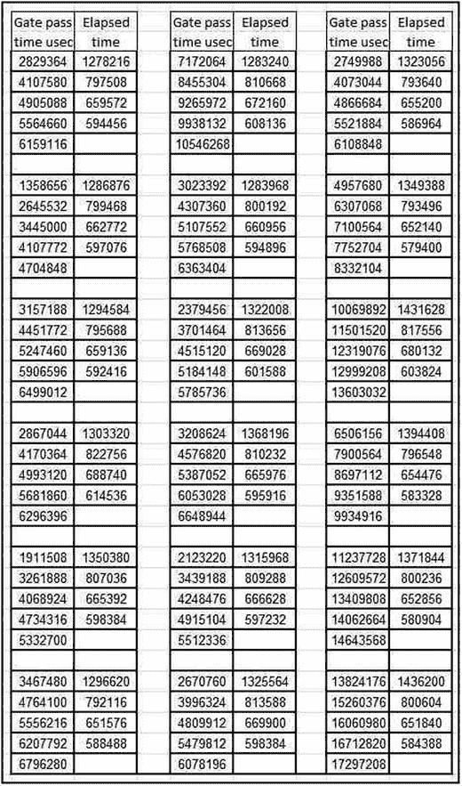
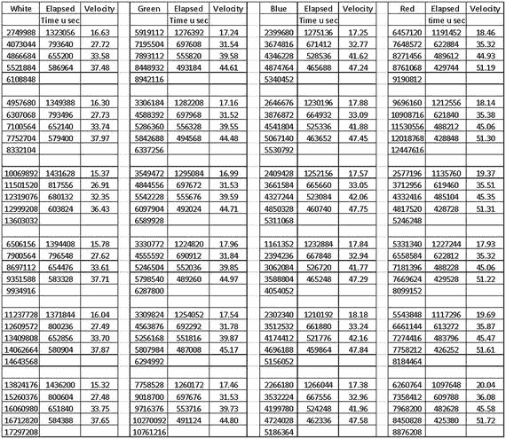
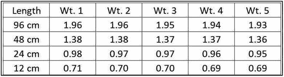
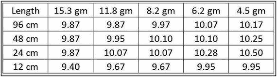

# 6. 运动与振动

实验常常需要监测那些肉眼难以察觉的微小运动、肉眼可见的运动，或者距离远到超出肉眼可见范围乃至思维难以理解的运动。

利用各种传感器来同时确定时间和位置，可以以电子方式记录运动。记录的运动范围，小到需要借助惠斯通电桥应变片测量的弹性材料细微膨胀，大到追踪物种的跨大陆迁徙，或是测定天文距离。连续记录时间和位置，即可计算出导航所需的速率、加速度和方向。

对地球表面垂直平面内运动的粗略测定，可以通过测量大气压来实现。诸如`BMP180`或`Sense HAT`板载气压传感器等气压传感器，可监测环境压力；随着海拔高度的增加，环境压力会以可预测的速率下降（参见第 9 章）。

振动是一种围绕正常静止点进行往复运动的重复性运动。这种往复运动可能是周期性的，也可能是随机的。由于其重复性质，振动通常用频率来描述，单位为每秒周数（cps）或赫兹（Hz）。振动既可以用于建设性目的，也可能无意中成为不受控制的、破坏性共振的根源。

在水中、土壤中或环境空气中，特定频率范围内的机械振动是不同物种声音的来源。压电式和机电式传感器可以实现运动能与电能之间的相互转换，从而监测人耳听觉范围之外及之内的声音频率。

距离和时间是研究或讨论运动或移动时所需的两项基本参数。距离与时间的商是速率，而速率的变化率则是加速度，它是作用在物体上的不平衡力所产生的结果。


## 宏大尺度上的距离

### 航位推算

从已知位置出发，利用行驶的速度和方向来估算当前位置的导航方法已沿用数百年，被称为*航位推算*。自上次已知位置以来，在方向、时间和行驶距离测量上的误差会累积，并且通常与行驶距离成正比增加。

### 惯性导航

惯性导航是一种自包含式技术（参见[`http://www.eng.hmc.edu/NewE80/PDFs/IntroToInertialNavigation.pdf`](http://www.eng.hmc.edu/NewE80/PDFs/IntroToInertialNavigation.pdf)）。与航位推算类似，该技术从一个已知的位置和方位开始，通过记录时间的流逝，以及测量加速度和陀螺仪效应，惯性导航装置便能确定当前物体的位置和方位。

由三个正交速率陀螺仪和三个正交加速度计构成，用于测量角速度和线性加速度的装置被称为*惯性测量单元*（`IMU`）。对这些装置输出信号的处理，可用于确定位置和方位。

微机电系统（`MEMS`）技术可制造出微型惯性导航系统（`INS`）。

市面上有价格低廉的自包含式 `INS` 单元和 `IMU` 设备可用于记录运动和位置。与传统的航位推算一样，这些系统存在固有的误差，这些误差会随着方向、距离和时间的变化而累积。

为了确定和描述在空间中运动的物体的位置，发展出了*自由度*这一术语。被限制在单一运动线上的物体，例如沿倾斜轨道滚下的球，具有一个自由度。一个可在水平平坦平面上自由滚动的球，具有两个自由度。一个由起重机吊臂吊起、带有挂钩的球，具有三个自由度。

如果一架飞机或无人机在空间中移动，其相对于地球的位置可以用三个自由度来表示。而其相对于俯仰、偏航和滚转的姿态，可能需要增加三个自由度才能精确描述其在空间中的完整位置和方位。

### 全球定位系统（GPS）

围绕地球轨道运行的卫星，会广播高度稳定的时间信号。这些广播信号源自振荡器，这些振荡器利用大的原子、原子的电子能级跃迁来为射频（`RF`）调制器提供基准。使用铯等重原子蒸汽作为谐振频率基准的振荡器，通常被称为*原子钟*。由于许多无线电传输受限于“视距”，因此卫星的数量和轨道位置经过精心安排，以确保其信号能够持续覆盖地球的整个表面。

在地球表面、视野内有多颗卫星的微计算机系统，若配备接收器，即可根据卫星的传输信号计算出自身位置。如果来自地面站的时间信号与多个 `GPS` 卫星信号同时可用，则地球表面的位置可被确定在厘米或英寸的精度内。

`GPS` 接收天线必须有清晰、无遮挡的天空视野，并且视野内要有足够数量的卫星才能正常工作。位置确定可能需要 1 到 5 秒的计算时间，具体取决于所需的定位分辨率。此外，位置固定的地面基站通常会提供本地的高精度定位信息。

### 反射式距离测定

雷达（无线电探测与测距）这个缩写词，描述的是一种利用无线电波反射来探测并确定广播天线视野内固体物体距离的系统。雷达系统测量的距离范围，从探测地下物体（探地雷达，`GPR`）的英尺或米，一直延伸到行星际距离。

激光雷达系统是一种激光驱动的距离测量技术，它通过反射光的脉冲来测量发射器到目标的距离。搭载红外激光雷达的飞行器可以绘制森林冠层下方的地表拓扑结构，而地面系统则能精确测量地月距离。

大型光学和射电望远镜阵列则可测量那些超出常人思维理解的星际和恒星距离。

## 可见尺度上的距离

### 测距仪

在 20°C 的干燥空气及正常气压下，声音（或*大气压力波*）的传播速度经测量为 343.2 米/秒或 1126 英尺/秒。

借助微处理器和适当的传感器，可以向一个空间区域发射一束短的超声波脉冲，然后监测该区域是否存在来自任何固体物体的反射波。通过测量发射超声波脉冲到接收传感器接收到反射波之间的时间，可以计算出物体的距离。通过量纲分析（米/秒 × 秒 = 米），可以计算出距离和方向。利用重复的定时测量，还可以计算出物体的速度或加速度。

方波脉冲串形式的红外光，通过测量脉冲串发射到反射脉冲串返回之间所经过的时间，来测量距离和方向。

激光雷达和雷达分别是利用光波和无线电波来确定距离和方向的测距装置。使用脉冲激光和长无线电波的仪器，在探地雷达、建筑物内部激光雷达测绘以及空中拓扑测量中，能够测量以英尺和英寸为单位的距离。

## 不可见标尺中的距离

光波的相长与相消组合，即所谓的*干涉*，一百多年来一直被用于一种名为*干涉测量法*的技术，以测量光波波长尺度上的距离。在利用干涉的实验中，来自同一光源的光被分为两束，经过不同路径长度或不同介质路径后重新合束。光具有波动现象的特性，它遵循叠加原理，该原理规定，两束同相波会相长干涉，从而增强或增加它们的合振幅。异相波则相消干涉，抵消或减少其总振幅或强度。

观察者观察合束光的强度或亮度时，会看到随着任一束光路径长度的变化，其亮度从黑色变化到全亮。干涉仪或许是动态范围最大的仪器。它们被部署在大陆之间，用于测量天文距离和引力波。在红外光谱仪中，它们用于测量有机分子的大小和形状。需要干涉测量方法的实验，要求你研究当前文献中关于该主题相对丰富且广泛的化学、物理和数学知识。

平方反比定律限制了使用广播声能或光能作为反射介质进行距离测量的系统的测量范围。一束窄聚焦的能量束应能按光束宽度比例扩展测量范围。激光通过反射来自探险者留在月球表面的成形反射器的脉冲束，来测量地月距离。

任何依赖反射率的距离测量技术都会受到被探测物体的大小、形状、表面纹理和材料成分的影响。柔软的棉质表面可能无法反射超声波脉冲，而雷达脉冲可能完全穿过一群鸟。

## 应变片

一种表面沉积有薄金属箔的塑料绝缘膜可以测量非常小的机械位移。典型的应变片元件由沉积在塑料膜上的许多平行的电阻性金属合金细线组成。如果对粘合有多条平行导体阵列的塑料介质施加应力而导致合金变形，其电阻就会改变。应变片元件也有螺旋形结构制造。一家应变片制造商已在[`www.vishaypg.com/docs/11055/tn505.pdf`](http://www.vishaypg.com/docs/11055/tn505.pdf)上发布了详细的应变片信息。在该参考文献中，指出最常用的薄膜合金是康铜（用于 J 型热电偶的 45%铜和 55%镍合金）。这种合金对应变或应变系数具有高灵敏度、高电阻率以及相对较低的温度灵敏度。高电阻率是可取的，因为一小块合金网格具有合适的电阻值，有助于测量微小的变化。康铜还具有相对较高的伸长能力和良好的疲劳寿命。

合金网格的基底材料必须是塑料、可变形、绝缘的介质，且足够坚固，以便于操作并安装在待监测的基板上。聚酰亚胺聚合物和玻璃纤维增强酚醛环氧树脂是两种较常用的基底材料。

正如第 3 章和第 5 章所述，惠斯通电桥可检测构成电桥的电阻元件的微小变化。多个应变片常被用作电桥的桥臂。如果两个应变片同时测量拉伸引起的膨胀以及监测弯曲或挠曲动作的惠斯通电桥桥臂中伴随的压缩，就可以增强由机械变形产生的信号。

## 电容器距离测量

电容和电容器（见第 1 章）是重要的电路元件，但也可以用来测量重量、力、压力和小距离。电容器中存储的能量取决于多个物理和化学参数，包括导电极板之间的距离。

第 9 章描述了利用多极板电容器的压缩来测量重量、力以及倾斜角度。通过校准多极板平行板电容器中电容与已知距离的函数关系，应该可以将该装置用作小距离或短距离测量传感器。

## 速度与速率

速度是一个矢量，由位移距离除以通过时间得到。具有大小和方向的速度可以确定过去或未来的位置（速度 = 位移/时间）。速率是一个标量，由两地之间的距离除以通过该距离所需的时间来确定。

### 加速度

根据牛顿第二运动定律，要使静止的物体运动起来，必须有一个不平衡的力在位移上对物体做功，以使其速度从零增加到某个有限值。如果记录了速度从零变化到最终值所需的时间，就可以使用公式 `加速度 = 速度变化量 / 速度变化时间` 来确定矢量加速度。

伽利略·伽利莱在十六世纪末用数学关系检验并建立了速度和加速度的模型。伽利略设计了几种创新技术和实验方法，来研究重力与其对自由落体作用之间的关系。他利用一个斜面使重力导致一个铜球加速下滑，从而减缓了重力使物体获得更高速度的速率。他用一种巧妙的方法测量铜球速度增加的时间：将流经小孔的水的重量作为计时时钟。通过多次精心观察和记录数据的试验，他推导出了距离、速度以及由重力引起的加速度之间的关系。

伽利略还研究了钟摆以及由振荡系统的物理长度和质量变化产生的简谐运动。

### 振动

振动可以想象为系统质量围绕其正常“静止”位置或平衡点进行的重复性或随机性振荡。

振动通常与旋转运动相关，这种旋转运动可能是连续动作，也可能是一系列在固定时间单位内发生的、有规律间隔的离散步进运动，或者是随机间隔发生的步进。

#### 连续运动

直流电机将电能转换为连续的旋转能量。通过控制电机的电压，可以改变电机提供的速度、旋转方向和扭矩（扭转力）。连续振动通常由绕旋转轴质量分布不对称的旋转物体产生。

通常，风扇和电机等物体的旋转速度可以通过计算旋转叶片在一束红外辐射中造成的遮挡次数来监测，或者通过测量在固定时间单位内安装在旋转轴上的磁铁所产生的磁脉冲数量来监测。

#### 离散步进

继电器、机械螺线管、步进电机和伺服电机在激活时会产生振动。由单个机械动作决定的振动频率可能是重复性的，也可能是随机性的。

### 振动探测器与发生器

材料科学的最新进展使得石墨烯首次得以实际应用。石墨烯是一种由碳原子以平面六边形构型结合而成的单原子厚薄片。石墨烯薄片坚固、柔韧且轻便，可用于制造工作频率范围从低于 20Hz 到超过 500KHz 的扬声器和麦克风。

压电材料在受到物理应力时会产生电压。某些有机聚合物和无机晶体在受到快速压缩或弯曲应力时会产生电信号，并将压缩和弯曲振动转换为可测量的电信号。

### 晶体与塑料聚合物

1880 年至 1881 年间，居里兄弟首次报道了当某些类型的无机晶体（如石英、黄玉和罗谢尔盐）受到机械应力时会产生电压。次年，物理学家 G·李普曼报道了当对这些晶体施加电压时，会产生膨胀和收缩的逆效应。

电压与机械体积变化之间的相互转换，催生了高频声波的产生及其在声波测距中的应用。为改进声电换能器而进行的研究与开发工作，产生了三种压电材料：钛酸钡（`BaTiO[3]`）、锆钛酸铅（`Pb[Zr[x]Ti[1–x]]O[3]`）（`PZT`）和铌酸锂（`LiNbO[3]`）。

压电现象存在于那些晶胞结构中正负电荷分布缺乏中心对称性的离子晶体中。施加应力会使正负电荷相互之间产生净变形，从而形成电偶极子或极化。对于某些材料，可以在强 `DC` 电场影响下加热晶体结构，使结构中的极化域对齐，然后冷却晶体以固定对齐的极化域，从而增强该效应。

一种有机聚合物——聚偏二氟乙烯（`PVDF`）（`[-CH[2]-CF[2]-][n]`）表现出足够强的压电电压产生能力，可用作柔性薄膜振动探测器。

## 实验：距离、时间、速度和加速度

利用迄今开发的物理计算系统，并重复伽利略在 500 多年前进行的两个基本实验，可以实现对运动与振动基础的现代化研究。重力常数 `g` 的值可以通过观察球体在斜面上滚动的速度，或者通过测定单摆的摆长和周期来测量。（注意：空气阻力会影响这两个实验，而机械摩擦会导致球体在斜面上滚动时旋转，从而将部分重力势能转化为旋转动能。）

这两个实验相对容易实现，是实验设计中的经典研究，并且都可以使用众所周知的、有完善文档记录的 `IR` 遮断光束技术（参见[`https://learn.adafruit.com/ir-breakbeam-sensors`](https://learn.adafruit.com/ir-breakbeam-sensors)）。

为了实现一个遮断光束计时门，可以蚀刻并钻孔一对小型印刷电路板，用于安装 `IR` 发射器以及光电二极管或光电晶体管，以实现图 6-1 中的电路。

在图 6-1 中，两个箭头标示了电路的两部分，它们必须安装在两块板上，以形成一个被计时的物体必须穿过的遮断光束门。手绘电路板门对可见于图 6-3、6-4、6-5、6-6 和 6-29，每对都安装在可调节的木质 `U` 形支架上。对于摆锤计时，只需要一对板，而模拟斜面的双轨轨道可能需要五对板，以将轨道分成四个等距段。（注意：`RPi GPIO` 的 `1` 和 `0` 逻辑电平分别由 `3.3 V` 和接近 `0` 表示，而 Arduino 则为 `5 V`。电压电平超过逻辑 `1` 值一半的信号被解释为高电平。信号电压低于 `50%` 电平则为低电平或 `0`。意外地将 `5 V` 信号施加到 `RPi GPIO` 阵列的引脚上可能会损坏计算机。）

您可以通过使用 Arduino 的晶振控制振荡器时钟，并利用图 6-1 所示电路将一个或多个光电门连接到微控制器，从而消除主机计时方面的问题。


图 6-1

一个 `5 V` `IR` 遮断光束计时门电路

图 6-2 描绘了一个由 `5` 个计时门组成的电路配置，这些计时门可以沿倾斜轨道按已知间隔放置，以测量滚动的球体通过各个位置的时间。


图 6-2

用于树莓派数据采集的五门 `IR` 遮断光束计时电路

伽利略推断，斜面会减缓物体被重力加速的速率。垂直轨道相当于自由落体。随着角度从 `90` 度向水平方向减小，你应该会看到测得的加速度按与斜面坡度减小成比例的方式下降。两个计时门可以测量通过整个斜面长度所需的时间，从而计算出加速度，或者可以用多个门监控轨道，以展示速度随轨道长度的增加。

## 伽利略斜面轨道实验

伽利略观察到，小球在斜面轨道上移动的计时距离，其增长比例与奇数序列一致。在第一个时间间隔内，小球移动了一个单位的距离。在第二个时间间隔内，小球移动了三个单位的距离。在第三个时间间隔内，小球移动了五个单位的距离。经过多次测量，伽利略证明了滚动小球经过的距离与经过时间的平方成正比。

## 计时与测量装置

精确的时间测量取决于多个因素。对于斜面轨道和单摆摆动而言，采用中断驱动或逻辑驱动的毫秒及微秒时间分辨率应该足够。`Arduino Uno` 板卡在引脚 2 和 3 上有两个外部硬件中断端子。

外部中断可以监测单摆摆动和斜面轨道的总跨度。如果使用多个光门，也可以使用 `Atmega 328` 芯片上可用的引脚变化中断系统。然而，一种在某个教学期刊文章^(⁴) 中开发并报道的、更简单的逻辑驱动系统，可以通过修改来适配多个计时光门（参见本章末尾的代码清单 6-1）。

## 轨道构造

一段 3 英尺长、宽英寸、深 ½ 英寸（900 毫米 × 15 毫米 × 12 毫米）的铝制 U 型槽，被安装在一个准备好的支撑木框架上，该框架可容纳五个红外发射/光电晶体管光门，这些光门将轨道分成四个等份。在支撑框架的一端钻一个 ¾ 英寸（18 毫米）的孔，用于插入一个木榫，该木榫可固定在实验支架垂直杆上的可调夹具中，从而允许改变轨道坡度，如图 6-3 所示。


**图 6-3** 斜面轨道的顶端

五个光门被安装好，将轨道分成四个相等的四分之一段。图 6-4 显示了一个典型的计时光门。


**图 6-4** 典型光门安装细节图

每个 U 形光门使用一个 `#10` 螺栓（英寸或 3 毫米）固定在主体框架上，如图 6-4 所示。螺栓头位于 U 形光门框架底板的中心。通过在光门框架顶部和主体框架底部之间插入或移除垫片，可以调整红外光束相对于轨道导轨的高度，以适应不同大小的球体。

图 6-5 显示了斜面轨道的底端。


**图 6-5** 斜面轨道的底端

## 捕获块与球体处理

为了在实验结束时捕获测试球体，我们用一个 3½ 英寸 × 4 英寸 × 1¾ 英寸（90 毫米 × 112 毫米 × 45 毫米）的木块制作了一个 *捕获块*，并在其一个面上钻了一个直径 2 英寸（51 毫米）、深 1 英寸（24.5 毫米）的孔，用于固定捕获到的球体。图 6-6 显示了捕获块就位待用的状态，图 6-7 显示了它正在容纳测试球体。


**图 6-7** 测试球体、捕获块和高度调节块


**图 6-6** 装有捕获块的斜面轨道底端

## 电源与电路

USB 供电的 Arduino 为驱动外部电路提供的电流有限，因此 5 个红外发射器的系统应由外部电源供电。为了确保红外光束强度足够，我的装置使用了一个 9 V、1.5 A 的直流稳压实验室电源，为五个并联的红外发射器供电，每个 LED 中产生 27 mA 的电流。明亮的红外光束电流导致电路中的 ¼ W、330 Ω 电阻在实验过程中处于高温运行状态。

为了确保有足够的功率为五个光电晶体管探测器提供偏置，一个辅助的 1.5 A、5 V 直流稳压电源被连接到 Arduino。经测量，五元探测器阵列的电流消耗为 2.5 mA。

## 数据采集流程

一旦斜面轨道和计时光门可以正常工作，就可以进行距离时间的测量。将代码清单 6-1 加载到 Arduino 后，选择 `Tools` 菜单中的串行监视器，将显示空白屏幕并启动内部计时器。将测试球放在第一个光门上方的轨道上并释放，使其“向下”滚动，每当球体经过一个光门时，系统时间就会被打印到串行监视器上。

在图 6-8 中，一次使用斜面轨道的实验生成了五个“滴答计数”时间，这些时间由各个光门被触发时的系统微秒计数组成。数据包括起始光门时间、第一四分之一段结束时间，以及随后的第二、第三和第四四分之一段结束时间。每个四分之一段所用的时间，是通过计算该段结束和开始时的滴答计数之差得到的。

数据通过高亮选中数据，按 `Ctrl+C` 复制到操作系统剪贴板，然后粘贴到所需的电子表格或软件中进行数据处理。


**图 6-8** 典型的斜面轨道数据采集显示界面

## 测试球体

为了重现伽利略所做的实验，我们从一家大型玩具经销商处获得了一系列不同尺寸的玻璃球体，形式为一小袋儿童弹珠。表 6-1 列出了测试球体的直径、重量和对应的颜色。

**表 6-1** 玻璃测试球体的物理参数

| **直径 (mm)** | **重量 (g)** | **颜色** |
| --- | --- | --- |
| 16 | 6.69 | 白色 |
| 22 | 14.24 | 绿色 |
| 24 | 21.72 | 蓝色 |
| 40 | 91.12 | 红色 |

### 观察

为了保持结构的简单性，在用于数据收集的装置中引入了一个固有的系统性误差源。伽利略指出，球体沿轨道下落过程中的速度取决于其起始位置。在图 6-3 中，并没有固定的起始位置。为了对不同尺寸的球体进行精确测量，所有球体必须从与轨道接触的同一个点开始运动。

对光电门倾斜坡道的初步测试收集了三组数据，这些数据来自一个白色玻璃球沿缓坡轨道（坡度 = 在 88.0 厘米水平距离上升 1.9 厘米，即 ¾ 英寸上升 × 34½ 英寸水平距离）滚下，重复六次的实验。数据被粘贴到电子表格中，计算出了坡道每四分之一段所用的时间，如表 6-2 所示。

**表 6-2** 初始坡道测试数据

| - |

第二个坡道实验使用了相同的缓坡（1.9 厘米上升 / 88.0 厘米水平距离）配置，并以不同尺寸的球体作为测试对象。表 6-3 列出了记录的“滴答计数”数据以及为不同测试球体计算出的四分之一段轨道速度。

**表 6-3** 不同尺寸和质量球体的坡道速度

| - |

第三个实验使用绿色球体在坡道上进行，坡道坡度逐渐增大直至垂直。收集到的数据被处理为四分之一段的增量，并且仅针对轨道长度第一段的渡越时间计算了加速度，因为此时起始速度基本为零，可以使用简短的公式 `s = ½ a t²`。数据以表格形式列出，并图形化地展示在图 6-9 中。


**图 6-9** 测量加速度与轨道坡度的关系

## 讨论

由光电晶体管构建的光电门对宽范围的可见光极为敏感，因此在调试新的测量系统时必须格外小心。来自窗户的日光会导致反射物体实际上穿过了光电门的红外光束，但同时又向光电晶体管反射了足够多的日光，从而未能触发数字读取逻辑。当拉上窗帘遮挡窗户后，这个看似异常的光电门工作正常了。除了消除杂散光之外，遮挡物或遮光介质的尺寸应足够大，以消除发射辐射传输到光电探测器。

Arduino 具有一个 16 MHz 的晶体控制振荡器，为微控制器提供时基。兆赫兹级的时钟速度以极高的速率执行代码行，使得紧凑且高效的逻辑驱动代码能够精确地读取毫秒和微秒。（回忆 Arduino 计时中的 `+/- 4 μs` 舍入误差）在图 6-9 中，当坡度为 0.5 时，测试球体穿越轨道第四段耗时 100,396 μs。使用逻辑驱动计时方法与中断驱动计时方法之间的任何差异，其影响都是微乎其微的。

收集到的数据表明，在实验误差范围内，球体的大小和质量不会改变它们穿越坡道的速率。检查四个四分之一段的渡越时间，可以看到随着球体沿坡道下降，其速度在增加。图 6-9 中的图形显示，随着斜坡坡度增加，加速度也随之增加，当轨道处于垂直方向时，加速度约为 992 `cm/s²`。

该技术的主要误差源是缺乏明确的球体起始点。在理想的实验中，球体在开始沿坡道下落时应具有零速度，然而，由可变起始位置引入的微小误差并未掩盖从实验中得出的主要结论。可以通过使用带翻转枢轴、铰链或滑动的机械挡板来实现一个定义的起始位置。

坡道是一种用于研究重力诱导运动的简单机械装置，其实现方式可以是从简单的斜板和秒表到计算机计时光电门等多种复杂程度。

## 实验：电子距离测量

### 超声波距离测量

声音振动在空气中以大约 344 m/s 的速度传播，该速度随相对湿度的不同而略有变化。为了在不同环境条件下获得准确的速度，可以使用在线计算器进行修正（参见 `resource.npl.co.uk/acoustics/techguides/speedair/`）。

由并排的高频声音发射器和接收器组成的超声波测距仪与计算机和微控制器一起使用，可监测最远 200 厘米的距离。一种相对便宜、易于获取且使用简单的超声波测距仪是 `HC-SR04`。该设备有四个连接端：电源、地线、触发和回波。当连接到 Arduino 的 `+5 V`、地线以及 `#9` 和 `#10` 数字引脚，并使用下面列表清单 6-2 中的代码进行编程后，设备视野（`FOV`）内最近物体的距离测量值流便会输出到串行监视器。

超声波反射测距技术的应用涉及多个变量，这些变量将在下文“讨论”部分中介绍。

## 实验

切割出一个 3/16 英寸（3 毫米）的胶合板安装支架，以容纳一个 `HC-SR04` 超声波测距仪的发射和接收管。支架上的两个开口偏离了板上钻出的一个孔，该孔用于容纳一个 `#10`（3/16 英寸或 3 毫米）的螺栓和蝶形螺母，作为可调节夹具组件中的压缩接头使用（见图 6-10）。`SR04` 连接到 Arduino 微控制器板，并使用清单 6-2 中的代码进行编程。


**图 6-10** 超声波测距仪到摆锤实验装置的测量距离

### 观测结果

使用厘米尺和一块木块进行测试时，`SR04` 在 2 至 50 厘米范围内表现出小于 ½ 厘米（¼ 英寸）的波动测距误差。当木块移出视野（`FOV`）时，该设备测得至墙壁的距离为 174.3 厘米（71 英寸）。

为了追踪运动物体的轨迹，我们开发了如图 6-10 所示的双线悬挂平板钢片。（双线摆有时也被称为*双线悬挂摆*或*双丝摆*。双线摆常用于确定悬挂物体的重心。）本实验中使用双线排列的唯一目的，是确保运动质量块始终保持在 `SR04` 视野（`FOV`）的中心。由于平板的水平运动受到限制，当它作为如图 6-10 所示的机械配置中的单摆“摆锤”时，`Arduino` 串口监视器的半定量绘图功能可以记录下平板的前后运动，其图形化显示结果如图 6-11 所示。关于 `Arduino` 串口监视器绘图器的操作、调整及限制的详细说明，请参阅以下在线资源。


图 6-11

使用 `HC-SR04` 超声波测距仪记录的简谐运动

*   [`www.arduino.cc/reference/en/libraries/plotter/`](http://www.arduino.cc/reference/en/libraries/plotter/)
*   [`https://github.com/devinaconley/arduino-plotter`](https://github.com/devinaconley/arduino-plotter)
*   [`https://learn.adafruit.com/experimenters-guide-for-metro/circ08-using%20the%20arduino%20serial%20plotter`](https://learn.adafruit.com/experimenters-guide-for-metro/circ08-using%2520the%2520arduino%2520serial%2520plotter)

## 讨论

超声波测距仪通过测量高频、多波声音脉冲（或称“啁啾声”）从目标物体反射回来所需的时间来确定距离。由于系统是一个点辐射源，经反射面反射后，其性能由平方反比定律和初始功率决定。除了广播信号固有的色散特性外，纹理化表面、小型或弯曲的反射面、斜角反射、物体运动以及最小和最大探测距离，都是导致设备无法探测到物体的部分原因。所用的大面积平坦钢制表面（与发射和接收模块成直角，如图 6-10 所示）是在尝试将 `SR04` 用于单摆和斜面轨道运动研究时，为了获得可重复结果而进行的一个小型实验测试项目的产物。

测距仪的最佳性能是在与前述及图 6-10 所示相似条件下实现的。然而，该记录系统在定量数据采集方面存在诸多缺陷。

振荡幅度由实验前后校准过的距离测量传感器记录。振荡周期则稍难校准。可以尝试使用秒表进行手动振荡计数，或采用类似于第 3 章中用于追踪温度记录斜率的一阶导数软件监视器进行实验。

尽管能产生稳定且强烈的单摆振荡记录，但该摆是巨大的空气阻力源。如果需要更长的振荡衰减时间，使用带有孔洞的平板或金属格栅应该能够减小这种大的空气阻力。需要测试带孔平板或金属格栅摆，以确定开敞面与封闭面之间的比率在何种程度上会影响超声脉冲的反射。

## 红外电磁接近传感器与距离

### 测距仪

接近传感器是一种定性位置指示器，由脉冲红外发射器和反射红外脉冲探测器组成。一个红外二极管和一个红外光电二极管以平行方向安装，指向同一方向。红外光电二极管仅能感知背景辐射。一个对红外线不透明的物体进入发射器视野（`FOV`），可以将部分红外线反射到光电二极管的视野（`FOV`）中，从而导致二极管电路中的电流增加。反射的红外线越多，光电二极管电路中的电流就越大，这可以用来测量发射-探测器对与反射器之间的接近程度。`OSEPP IRDET-01` 是一款价格低廉、距离可调的接近传感器。

`意法半导体` 公司生产一种表面贴装技术（`SMT`）集成电路激光测距传感器，型号为 `VL53L0X`，其测距能力可达 2 米（7 英尺）。

## 实验：接近感应

将一个`OSEPP IRDET-01`连接到 Arduino 的 5V 电源和接地端，信号引脚则连接至`A0`模拟输入。采用类似于图 6-12 所示的排布方式，可对该传感器进行校准。电路板右上角带有槽口螺丝调节的蓝色方盒，即为十圈距离设定调节器。


图 6-12 - 建立`IRDET-01`有效接近感应范围

要完成校准，请将设备连接至 Arduino，加载代码清单 6-3 中的程序，并设置好测量标尺和可检测物体。来回移动物体，直到探测器板上位于发射二极管与接收器之间的 SMT LED 以每 20 秒闪烁 30 次的速率稳定闪烁。小心地将物体移向电路板，当 SMT-LED 亮起并保持常亮时停止。

稳定的照明标志着在给定电位器设置下比例感应范围的最近点。小心地将物体移离传感器。当稳定闪烁停止时，物体即处于给定距离电位器设置下工作范围的最远点。记下最近和最远的有效点后，可将距离控制旋钮沿顺时针或逆时针方向旋转一整圈。

对距离控制旋钮进行已知的变动后，可以再次测量最近和最远的有效点。通过检查先前的距离设定数据，即可确定范围的增减。采用所述技术，距离电位器的位置产生了表 6-4 中列出的接近感应区域。描述有效范围的数据以英制测量值列在左侧，对应的公制数值列在右侧。

表 6-4 - `IRDET-01`在不同电位器设置下的有效范围

| 电位器位置 | 有效范围 | 最小至最大 |
| --- | --- | --- |
| 完全逆时针 | 2 至 2-½ | 54 至 64 mm |
| 顺时针 1 圈 | 2 至 2- | 54 至 64 mm |
| 顺时针 2 圈 | 2 至 2¾ | 54 至 70 mm |
| 顺时针 3 圈 | 2¼ 至 2¾ | 58 至 70 mm |
| 顺时针 4 圈 | 2½ 至 3 | 58 至 64 mm |
| 顺时针 5 圈 | 2 至 3¼ | 67 至 82 mm |
| 顺时针 6 圈 | 2 至 3½ | 72 至 89 mm |
| 顺时针 7 圈 | 3 至 4 | 80 至 102 mm |
| 顺时针 8 圈 | 3 至 4½ | 85 至 114 mm |
| 顺时针 9 圈 | 5¼ 至 8¾ | 133 至 214 mm |
| 顺时针 10 圈 | 7 至 ∞ | 175 至 ∞ |

### 观测结果

当代码清单 6-3 中的 Arduino 程序运行时，仅能观测到两个 ADC 值。在表 6-4 中列出的近似最小值处，发送到串口监视器的数字值在`1023`和`12`或`13`之间切换。`IRDET-01`在距离电位器设定的最小接近距离处，表现得像一个数字传感器。

## 讨论

与较大的多圈电位器不同，微型电位器可能在触点行程末端没有机械限位。因此，您必须将电位器触点的当前设定位置与表 6-4 中的近似值进行“对齐”。

制造商建议，如果存在干扰辐射，可以调整脉冲红外线的工作频率。我的实验表明，调整频率电位器也会改变由距离电位器设定的范围设置。需要进行频率调整的实验，应在调整频率设定后重新调整任何先前设定的距离校准，或者重新定义范围。

若要配合模拟输入使用接近传感器，必须使用`IF`逻辑语句来决定当探测器导致模拟输入从`1023`切换到`12`或`13`时应采取的任何行动。

## 实验：红外飞行时间距离测量

多家制造商，例如 Adafruit Inc. 和 Pololu Corp.，均采用 STMicrocircuits Inc.的`VL53L0X`飞行时间（`ToF`）距离传感器作为测距仪。后续实验中使用的是标称 200 mm 范围的 `SMT` 芯片，据报道其可测量约 3 cm（1.19 in）到 2 m（81.5 in）的距离，精度在 3%到 10%之间，具体取决于设备使用时的环境光照和温度条件。

定量距离测量是通过反射脉冲红外光束的传播时间来获得的。这些装配有 `SMT IC` 元件的微型电路板接受 5V 电源，并通过 Arduino 类微控制器在`A4`和`A5`模拟输入引脚上接收的`I2C`协议进行通信。（Pololu Corporation 提供三种 `ToF` 载板，范围分别为 60 mm、200 mm 和 400 mm（24 in、81 in 和 162 in））。

有两个库提供了以连续模式或单次测量模式读取传感器的示例代码。这两个库均可在 GitHub 仓库中找到，地址分别为[`https://github.com/pololu/v1510x-arduino`](https://github.com/pololu/v1510x-arduino) 和 [`https://github.com/adafruit/Adafruit_VL53L0X`](https://github.com/adafruit/Adafruit_VL53L0X)。每个库都提供一个与 Arduino 兼容的库，并包含芯片制造商建议的应用程序编程接口（`API`）。

为了测试和验证测距载板，平板摆和合适的夹紧系统消除了测距系统中广播辐射的许多问题。几乎所有依赖广播辐射并捕获反射信号的设备，都必须满足以下标准：发射器、目标和探测器均处于系统视场（`FOV`）内，目标具有反射表面，并且反射辐射处于探测器的视场内。双股平板摆满足在使用`SR04`设备进行超声波探测的演示中概述的所有标准。`ToF` 红外测距实验的测试和验证设置如图 6-13 所示。


图 6-13 - `ToF` 红外脉冲测距仪的测试与验证设置

## 观察结果

图 6-14 展示了 Arduino 串口绘图仪上 `ToF` 探测器的信号。Arduino 微控制器运行着来自 Pololu 公司库的连续数据采集程序。虽然绘图仪记录的静态距离测量值在 85 mm 到 96 mm 之间，但传感器与平板之间的实际距离测得为 75 mm（3 英寸）。一天后重复进行的静态距离测量（见图 6-15）表明，测量到的距离似乎在 66 mm 到 68 mm 之间（2 英寸到 2¾ 英寸）。


图 6-15

Arduino 串口绘图仪次日采集的距离测量值


图 6-14

Arduino 串口绘图仪采集的距离测量值

噪声带（在图 6-14 和图 6-15 中因 Arduino 串口绘图仪的自动缩放扩展而明显可见）并未明显干扰 27 秒内 20 次简谐振动的记录。该振动是通过将双线摆从其 75 mm（3 英寸）的静止位置进行微小位移而产生的，如图 6-16 所示。


图 6-16

使用飞行时间红外脉冲测距仪记录的双线平板摆的简谐运动

`ToF` 红外脉冲距离测距仪的一个预期应用是作为手部运动探测器。当微控制器运行 Pololu 连续监测程序时，使用 Arduino 串口绘图仪进行了三次实验。我将手插入设备的视场（`FOV`）中，并使其朝向固定载板移动和远离。探测器放置在距离墙壁 82 cm（33½ 英寸）处，位于进行实验的桌面末端。

图 6-17 展示了 Arduino 串口绘图仪在初始默认模式下的状态。它记录了在发射器和探测器视场（分别为 35° 和 25°）内没有任何障碍物或移动物体时 Pololu 软件的默认满量程显示。


图 6-18

Arduino 串口绘图仪软件自动缩放记录的手部运动


图 6-17

清晰 `ToF` 视场下 Arduino 串口监视器输出

在图 6-19 中，绘图仪软件的自动缩放已恢复到其初始默认设置。


图 6-19

Arduino 串口绘图仪软件自动重新缩放记录的手部运动

进行了一项半定量实验，以评估环境光照条件对测距值的影响。将一把与传感器垂直和水平轴正交（成直角）的薄平塑料尺放置在距离 `ToF` 载板 129 mm 处。在一个阴天，距离窗户 3 英尺的桌面上，头顶荧光灯照明的房间里，在我的 Windows/Arduino 设置上的串口监视器屏幕中记录了 22 个数据点。

采集数据点后立即拉上窗帘，关闭头顶的荧光灯，并采集了第二组数据点。在接下来晴朗明亮的一天，采集了第三组距离数据点。表 6-5 总结了这三个实验的结果（距离以 mm 为单位）。

表 6-5

环境光照条件对 `VL53LOX` 响应的影响

| 光照条件 | 采集的数据点数 | 平均值 | 标准差 |
| --- | --- | --- | --- |
| 暗室 | 28 | 124.9 | 2.086 |
| 阴天窗口 | 21 | 123.1 | 1.571 |
| 晴天窗口 | 27 | 119.4 | 1.638 |

## 讨论

根据狭义相对论，无质量光子的运动是宇宙中相对速度大小的上限（186,000 英里/秒，即 299,792,458 m/s）。在短距离上，需要特殊技术和电子设备来进行反射光测量。使用工作在 850 nm–940 nm 范围内的激光器发出的脉冲调制正弦波或方波红外束照射目标，然后使用具有快速电子器件的单光子雪崩二极管（`SPAD`）收集反射的能量脉冲，该器件能够计时持续 6.6 皮秒的脉冲，从而实现 1 mm 的距离分辨率。发射和捕获的反射脉冲之间的相位差与飞行时间或距离成正比。

仅从环境背景中测量反射脉冲可以提高信噪比（见表 6-5）。仔细检查实际测量距离和串口监视器上报告的 `ToF` 距离，会发现一些明显且在一定程度上可预测的差异和误差。对于设置的 129 mm 距离，三种光照条件变化实验产生的测量值分别为 125、123 和 119。

制造商规格书表明存在 3% 到 10% 的误差，而三次测量的误差分别为 3%、4.7% 和 7.75%。该固态器件对温度敏感，但规定可在 –20°C 到 70°C 之间工作，并且是出厂校准的，大概是针对 20°C/25°C 或室温操作。数据表指出，如果测量时的温度与出厂校准条件相差超过 8°C，则校准无效。

对于需要中等精度的实验工作，应在实际测量环境中遇到的光照变化和温度变化下测试和验证 `ToF` 传感器。

测量脉冲时间偏移的差异会导致混叠，限制了脉冲频率可以确定距离的范围。其他型号的 `ToF` 芯片可用于测量更短的距离。

截至 Arduino IDE 版本 1.6.13，串口绘图仪上的坐标轴不可调节。串口绘图仪软件实用程序在一个动态的 `x/y` 坐标轴屏幕上以图形方式显示传入的 USB 串行数据值。垂直 `y` 轴（纵坐标）会随着输出数值的增减自动调整。`x` 轴（横坐标）上的每个刻度对应于在 Arduino 草图中执行的一条 `serial println` 语句。因此，显示刻度的速率取决于草图的执行速率。串口窗口中的 `x` 轴显示限制为 500 个刻度计数。

为了更可控地绘制距离测量值并跟踪目标运动或位置，Arduino 的数据可以流式传输到串口，并且可以使用 Windows `DAQFactory` 或 `RPi` Python `Matplotlib` 带状图记录器显示，以可量化的图形格式查看数据。响应较慢的绘图程序可能需要降低流式数据速率，或者将数据存储在内存中供以后离线绘图。

## 三维定位与运动

## 加速度计、电子罗盘与倾斜校正

像 Arduino 这样的微控制器可以读取固态加速度计、基于磁力计的罗盘以及全球定位系统接收器的输出。表面贴装技术将位置和运动传感设备的尺寸与响应时间缩小到如此程度，以至于尺寸与大型昆虫和鸟类相当的小型遥控和自主飞行器，已成为野生动物生物学及航空地质/地理野外调查中常见的监视设备。

有许多可用于测量三维空间中的时间和运动的传感器，它们都可以与 Arduino 微控制器配合使用。此前已演示了意法半导体`LSM303DLHC`输出中的磁罗盘功能，此处将进一步开发其加速度计和磁力功能。

Adafruit 和 Pololu 这两家公司都开发了电子罗盘板和软件。Pololu 采用更新版本的加速度计-磁力计电子元件（`LSM303D`）来生产具有倾斜校正功能的罗盘。两家制造商都提供了丰富的软件库，用于演示加速度计和罗盘功能。

较新的`LSM303D`芯片是一款系统级封装产品，集成了 3D 数字线性加速度传感器和 3D 数字磁传感器。

## 观察结果

图 6-20 显示了在数字罗盘模式下，从 Adafruit 软件和`LSM303DLHC`载板（或分线板）获得的串行监视器输出。该板安装在一个小型桌面可调支架上，通过手动旋转来记录不断变化的罗盘航向。


图 6-20

Arduino 串行监视器显示的罗盘航向

图 6-21 显示了当 Arduino 加载 Adafruit 磁力计软件，并且作者将一块稀土磁铁靠近探测板时，串行监视器的输出。


图 6-21

三轴磁力计对稀土磁铁靠近`LSH303DLHC`的响应

图 6-22 显示了作者拿起并摇晃装有加速度计/磁力计板的桌面支架时，获得的串行监视器响应。


图 6-22

手动摇晃已安装的`LSH303DLHC`板记录的加速度计读数

## 讨论

图 6-20、6-21 和 6-22 展示了 Arduino 使用三个草图程序接收到的传感器串行监视器输出，这些程序来自 GitHub 仓库中提供的 Adafruit 程序库。

*   多传感器接口库位于 [`https://github.com/adafruit/Adafruit_Sensor`](https://github.com/adafruit/Adafruit_Sensor)。
*   设备库位于 [`https://github.com/adafruit/Adafruit_LSM303DLHC`](https://github.com/adafruit/Adafruit_LSM303DLHC)。
*   `LSM303DLHC`教程和罗盘代码位于 [`https://learn.adafruit.com/lsm303-accelerometer-slash-compass-breakout/coding`](https://learn.adafruit.com/lsm303-accelerometer-slash-compass-breakout/coding)。
*   磁力计程序位于 [`https://github.com/adafruit/Adafruit_LSM303DLHC/blob/master/examples/magsensor/magsensor.pde`](https://github.com/adafruit/Adafruit_LSM303DLHC/blob/master/examples/magsensor/magsensor.pde)。
*   加速度计程序位于 [`https://github.com/adafruit/Adafruit_LSM303DLHC/blob/master/examples/accelsensor/accelsensor.pde`](https://github.com/adafruit/Adafruit_LSM303DLHC/blob/master/examples/accelsensor/accelsensor.pde)。

有关`LSM303DLHC`特性和功能的更多信息，请查阅制造商的数据手册，网址为 [`www.st.com/en/mems-and-sensors/lsm303dlhc.html`](http://www.st.com/en/mems-and-sensors/lsm303dlhc.html)。该数据手册描述了 3D 加速度计和 3D 磁力计可用的灵敏度范围以及许多其他器件特性。

分线板通过支持标准和快速模式（100 kHz 和 400 kHz 操作）的`I²C`（或`I2C`）串行总线接口与 Arduino 通信。该系统可配置为通过惯性唤醒/自由落体事件以及设备位置生成中断信号。中断发生器的阈值和时序可由最终用户编程设置。磁力模块和加速度计模块可以单独启用或进入掉电模式。

## 树莓派运动检测、记录与可视化

传统上，用于描述船舶在海中运动的术语也适用于在空中飞行的飞行器。当在三维空间中沿`x`方向运动时，绕三轴的旋转运动分别称为横摇、纵摇和偏航，如图 6-23 所示。


图 6-23

横摇、纵摇和偏航轴

`RPi` 基金会开发并提供了一款名为 Sense HAT（顶部硬件）的多功能运动与环境监测板。Sense HAT 是为年度 `Astro-Pi` 竞赛而开发的。2015 年，在国际空间站上的两枚装有 Sense HAT 板的 `RPi` 上，加载了使用该板传感器和显示器进行测量的最佳学生编写代码。

Sense HAT 传感器板可直接安装到 `RPi` 的 `GPIO` 引脚阵列上，或通过 40 针排线连接到 Pi。尽管它比小型 Arduino、易用的载板或分线板大得多，但多功能 Sense HAT 具备实体运算能力。它是一个教育演示平台，也是一个功能齐全的传感器阵列。Sense HAT 易于操作。关于如何编写 Python 程序以提取板载传感器数据的完整教程可在 GitHub 上找到（参见 [`https://github.com/raspberrypilearning/sense-hat-data-logger/blob/master/worksheet.md`](https://github.com/raspberrypilearning/sense-hat-data-logger/blob/master/worksheet.md) 或 [`https://projects.raspberrypi.org/sense-hat-data-logger/4`](https://projects.raspberrypi.org/sense-hat-data-logger/4)）。

## 实验

通过遵循工作单或项目教程，您可以开发一个数据记录程序，该程序以带时间戳的逗号分隔值格式记录板上所有传感器的输出，大多数电子表格程序都可以读取这种格式。

图 6-24 和 6-25 显示了在 `RPi` 上将数据文件导入 LibreOffice 电子表格 calc 程序后的一些数据列。

用于位置或导航判定的选择性数据记录，可以使用 GitHub 仓库中`worksheet2`教程所解释的技术，来隔离加速度计、陀螺仪、磁力计/罗盘读数以及时间戳。

`worksheet2`教程描述了如何将真/假布尔逻辑应用于在主要教程中创建的通用数据记录程序，以收集所需参数。除了选择性收集之外，第二个教程还引导您完成改变数据收集时间的过程，如图 6-26 和 6-27 所示。

### 观测结果


图 6-27：导航传感器数据记录（右侧列，含所选时间间隔）


图 6-26：导航传感器数据记录（左侧列，含所选时间间隔）


图 6-25：LibreOffice Calc 电子表格中 Sense HAT 数据记录的右侧行与列


图 6-24：LibreOffice Calc 电子表格中 Sense HAT 数据记录的左侧行与列

## 讨论

图 6-27 中的时间戳反映了我为演示 `Sense_Logger_v4` 代码功能而选择的 10 秒间隔。

除了以数字形式记录位置、运动和方向之外，`RPi` 和 Sense HAT 板还能生成交互式的三维图形图像显示。该板的传感器可利用加速度计和陀螺仪的输出创建软件或虚拟 `IMU`，以控制三维图形图像的显示。

图 6-28 展示了 `RPi` 显示器上的 3D 阿波罗-联盟号图像，该图像跟随传感器板的横滚角、俯仰角和偏航角输入至虚拟 `IMU` 的方向变化。

安装在 `RPi` 上的板卡所承受的任何动作或运动，都会由对接航天器的 3D 图像同步反映出来（参见 [`https://github.com/astro-pi`](https://github.com/astro-pi)）。正如 GitHub ReadMe 文件所述，通过输入特定指令，可以评估移除 `IMU` 不同输入所产生的效果。


图 6-28：利用 `IMU` 控制 3D 图像

图像运动仅限于三个主要自由度——横滚、俯仰和偏航。沿 x 轴的向前平移运动不会从 `RPi` 传递到图像。使用排线将 Sense HAT 板与计算机分离，可以减轻 `RPi` 及其电源线和输入输出线的压力。

## 重复运动与振动

一种真正古老的建筑工具——*铅垂线*，由一根从顶部结构悬挂下来的绳子连接一个重物构成。静止时，铅垂线的支撑绳在重力作用下形成一根铅垂线，即一条真正的垂直线或垂直参考线。

铅垂线也是一个单摆。将悬挂的重物位移并释放后，重物会围绕其平衡点来回摆动，这种振荡称为*简谐运动*（`SHM`）。摆锤在其平衡点上来回摆动，直到空气摩擦产生的阻力耗尽了最初移动其质量所需的力量能量。在十七世纪，伽利略观察到，摆锤在较小距离内来回摆动所需的时间仅取决于摆长。

以下数学表达式描述了一个小角度位移下单摆的振荡时间。

`T = 2π(L/g)^(1/2)`

其中 `T` 是以秒为单位的时间，`L` 是以米为单位的摆长，`g` 是重力加速度。

在一个典型实验中，摆锤从其静止位置被水平位移一段距离后释放。重力向下拉动摆锤，使其向低能量的静止位置加速，摆锤在向下加速并向内运动时速度不断增加。当质量通过静止位置时，速度达到最大值。此时，重力的拉力开始使摆锤在逆着重力向外向上运动时减小其已获得的速度。最终，在偏离静止位置的最大角位移处，向外向上的速度减为零，简谐振荡周期再次开始。

由运动摆锤推开空气而产生的空气摩擦引起的气动阻力，最终会抑制振荡，使摆锤/铅垂线回到其静止位置。

对摆的周期表达式进行重新排列，可以得到一种测量 `g`（局部重力加速度）的方法。

`g = L/(T/6.2832)²`

这个用于测量 `g` 的重新排列后的表达式涉及确定摆长 `L` 和振荡周期 `T`。

伽利略观察到，摆长决定了周期或振荡时间，而摆锤的质量不影响振荡时间。

## 实验

图 6-29 展示了用于收集表 6-6 中数据的实验装置。


*图 6-29：使用 Arduino 微控制器搭建的光电门摆锤计时数据采集装置*

为重复伽利略的观测实验，我们从体育用品商店购买了一套钓鱼用的分级铅坠，用作不同的摆锤重量或质量。

每个铅坠均涂有哑光黑色丙烯酸涂料并称重，结果列于表 6-7 中。我们剪裁了若干根聚酯线，并在每根线的两端各打一个环，以制备标称长度列表中各长度的摆锤。为便于制作所需长度的摆锤，在一小块废木料上，于 0 cm、12 cm、24 cm、48 cm 和 96 cm（即 4.9 英寸、9.8 英寸、19.6 英寸和 39.2 英寸）标记处，部分钉入小号（¾ 英寸或 20 mm）装饰钉。每个铅坠均配备一个金属丝环，用于连接快拆扣。快拆接头的长度相同，因此，一根适配总长为 48 cm 的摆锤的聚酯线，可快速更换所有五个铅坠，而无需改变摆长。每个带环线的长度经过调整，使得从顶部挂钩到铅坠中点（质心）的摆长，与预期的标称长度相差不超过一到两毫米。

Arduino 中烧录了如代码清单 6-4 所示的代码。

每次周期测量实验均需将程序上传至 Arduino，并将摆锤“重物”拉出光电门的红外光束范围。随后激活串行监视器，释放铅坠使其开始摆动。每当“重物”穿过红外光束时，系统时间（以 ms 或 `millis()` 为单位）便会打印到串行监视器中。收集约 25 到 30 次振荡数据后，关闭串行监视器窗口左下角的自动滚动选项，并将屏幕滚动回采集到的第一个数据点。接着，用光标选中整列数据，按下 `Ctrl+C` 组合键，将这列数据复制到操作系统剪贴板中。

打开 Excel 或其他电子表格软件，将数据列粘贴到工作表中。通过计算相邻数据记录之间的时间差，可以得到摆锤的半次摆动时间。对大约 20 个半次摆动时间取平均值，然后将该平均值乘以 2，即可得到完整的振荡周期（以毫秒为单位）。

数据采集过程如下：将聚酯线顶部的环套在实验支架的顶部挂钩上，再将线底部的环套在待测铅坠的快拆接头上。通过依次改变线的长度和铅坠的重量，实验中任何大规模的异常变化都会立即表现为所采集和传输数据中的异常值。

### 观测结果

在表 6-6 中，摆锤的周期随摆长减小而减小；且在任一给定摆长下，即使“重物”重量发生变化，周期也基本保持不变。

*表 6-6：不同重量和摆长下的摆锤周期数据*
| - |

在图 6-30 中，摆锤周期与其摆长几乎呈线性关系。

*表 6-7：根据摆锤数据及实测重量与摆长差异计算得出的“g”值*
| - |


*图 6-30：摆长与周期的关系*

## 讨论

使用红外光束中断技术和毫秒级时间测量的 Arduino 微控制器，必须将其时间单位转换为秒，才能验证伽利略最初的观测结果以及对当地重力加速度的计算。

在表 6-7 中，随着摆锤质量的减小和摆线的增长，空气阻力和摆长的影响变得更为显著。

关于简谐运动记录中振幅衰减的进一步见解，如图 6-11 和图 6-16 所示，可通过严格的数学分析加以处理^(⁵)。

`DAQFactory` 和 `RPi` 可利用微控制器生成的数据来处理摆锤运动数据。

采用红外 LED 发射器与光电晶体管构成光束中断配置的实验是一种非常灵敏的技术，使用时必须格外小心。光电晶体管在 850 nm 至 950 nm 波长范围内最为灵敏，但在其他波长（直至 400 nm 的蓝光范围）也能感应，只是灵敏度逐渐降低。强烈的直射日光可能导致光电晶体管电路产生错误信号或完全丢失信号。有几次实验中，上午能正常工作，但到了下午，除非在光电晶体管与有日光的窗户之间放置不透明遮光罩，否则实验无法进行。

本书迄今为止所使用的光电门，均基于由 LED 产生并由光电晶体管探测器监测的 940 nm 红外光束。光电二极管的电流输出在七到九个数量级范围内呈线性关系，而光电晶体管的线性范围仅为三到四个数量级。光电晶体管对光的敏感度比光电二极管高出多达一千倍，并且在有光或无光时充当机械开关的作用。有光时，光电晶体管能够吸收或通过相当大的电流。无光时，它通过的典型暗电流在 10 nA 到 100 nA 之间。光电晶体管的频率响应能力远低于光电二极管，但其速度足以满足机械系统运动检测研究的需求。

## 高频振动测量

摆的简谐运动是可以看见的，但当运动频率超过每秒三十分之一时，人眼便无法再看到机械振荡器连续变化的位置。

除了导航之外，加速度计还被广泛用于振动监测。频率在每秒 20 次到 20 至 40 千次之间的高频振动，属于人类听觉的音频范围。更高频率的机械振动则被认为处于超声波范畴。

由于振动通常是一种循环运动，在振荡的极限位置会有巨大的加速度变化，或者因随机冲击而产生不规律运动，这些都可以通过伴随质量块方向改变和加速度变化而产生的作用力来进行监测。

压电、光学和微机电系统（`MEMS`）是用于测量加速度变化的一些技术。监测振动的方法和技术不胜枚举。两个工业组织的出版物对振动监测进行了描述。美国国家仪器公司（National Instruments）在一份题为《使用加速度计测量振动》的白皮书中，回顾了采用集成电子压电（`IEPE`）工业传感器的振动监测方法，该白皮书网址为 `www.ni.com/en-us/innovations/white-papers/06/measuring-vibration-with-accelerometers.html`。德州仪器（Texas Instruments）则发布了一份题为《用于 PLC 模拟量输入的 IEPE 振动传感器接口参考设计》的白皮书，网址为 `www.ti.com/lit/ug/tidud62/tidud62.pdf`。

这两份工业论文中描述的大部分坚固耐用型传感器，在非工业原型设计领域都有对应的较为常见且廉价的压电式双头螺柱安装、螺丝或螺栓安装爆震传感器（见图 6-31）。

SparkFun Electronics 公司生产了一款三轴加速度计，它集成在一块 0.5 英寸 × 0.75 英寸（12 × 18 毫米）的 `SMT` 电路板上，包含一个 Analog Devices `ADXL345` 芯片，并提供了显示该分线板灵敏输出所需的软件，该分线板亦见图 6-31。

第三种不同的技术使用由 Measurement Specialties 公司制造的传感器，它由一层压电 `PVDF` 聚合物薄膜层压到聚酯背衬上，形成一个带有两个电气连接器的小型柔性矩形薄片。弯曲或弯折该塑料薄片会使聚合物层产生一个显著的大电压尖峰。

## 实验

图 6-31 中的传感器是易于获取的振动探测器，可用于物理计算或实验工作，其激励和输出显示由 Arduino 微控制器提供。清单 6-5 是用于监测爆震传感器和薄膜传感器的 Arduino 代码。


图 6-31 压电传感器

高分辨率三轴加速度计（4 mg/LSB，即毫重力加速度/最低有效位）与微控制器之间通过双线`I2C`协议进行通信。

该库由制造商提供，网址为 `https://github.com/sparkfun/SparkFun_ADXL345_Arduino_Library`。制造商指定的电路板与 Arduino 之间的连接详见表 6-8。

表 6-8 Arduino/`ADXL345` 分线板连接

| Arduino 引脚 | `ADXL345` 板引脚 |
| --- | --- |
| `GND` | `GND` |
| `3V3` | `V[CC]` |
| `3V3` | `CS` |
| `GND` | `SDO` |
| `A4` | `SDA` |
| `A5` | `SCL` |

图 6-32 和图 6-33 中显示的图像是通过运行 SparkFun 库中的 Arduino 草图程序：`ADXL345` 示例程序获得的。代码表明，`x`、`y` 和 `z` 位置值由 Arduino 绘制，其中 `x` 迹线为蓝色，`y` 迹线为橙色，`z` 坐标迹线为红色。

在图 6-31 中，两个黑色压电传感器——一个为圆柱形“双头螺柱”或引脚安装式，另一个为扁平圆盘螺丝或螺栓安装式——其正极端子连接到 Arduino ADC 的 `A0`（模拟输入引脚 0）输入。器件上的第二个端子连接到地。一个 1 MΩ 的电阻跨接在 `A0` 和地连接之间。该电阻用于保护 ADC 转换器上的输入电路，因为压电元件在某些高强度激励条件下可能产生 90 V 的电压尖峰。（可在原型板上进行连接以进行测试。）

来自 MEASUREMENT SPECIALTIES 公司（现属 TE Connectivity，参见 DigiKey 分销商编号 223-1321-ND，售价 10 加元）的 MEAS 薄膜传感器是活性悬臂梁式加速度计，每 g 加速度可产生 1.1 V 的脉冲直流电压。该器件的谐振频率为 75 Hz，在此频率下可产生 6 V 电压。Arduino ADC 的 5 V 输入限制可能需要一个分压器来保护转换器。该器件可以直接安装在面包板上，或者对于需要电缆连接到实验装置的场合，也可以使用 Amphenol FCI Clincher 连接器。

我建议在薄膜传感器的电极两端跨接一个 1 MΩ 电阻以保护 Arduino ADC。在接入保护电阻的情况下，薄膜上的两个电极引线可以分别连接到 `A0` 和地以进行数据显示。

## 观察结果


图 6-35 Arduino 串口绘图仪记录的塑料薄膜传感器对经过的冲击偏转及其后续弯曲的响应


图 6-34 Arduino 串口绘图仪记录的塑料薄膜传感器对缓慢弯曲的响应


图 6-33 Arduino 串口绘图仪记录的加速度计板被摇晃时的响应


图 6-32 Arduino 串口绘图仪记录的加速度计板静止状态下的响应

## 讨论

关于将 `RPi` 和 Arduino 微控制器等小型计算系统应用于振动运动的测量与显示，已有大量文献论述，尤其是在生产设备领域。

要检测振动，首先需要通过传感器或换能器将其捕获，该设备将机械运动转换为电信号。图 6-31 中的几种传感器设计为使用紧固件牢固地固定在固体表面上，其中一些能够响应通过空气传播的振动。

振动可分为两大类，可能需要两种不同的技术进行记录以供分析。旋转机械或伺服驱动会产生重复性的扰动，这种扰动适合通过频率计数来确定，以便进行记录和后续分析。

诸如车辆悬挂系统在不平路面上行驶时产生的随机振动，则不太适合采用频率计数技术。随机振动可以通过高速数据采集系统进行记录，该系统记录机械位移的幅度和时间，这些数据可以在离线状态下绘制成图，以进行详细的可视化和分析。

Arduino 的串口绘图仪是一个优秀的瞬时实时可视化工具。所绘制信号的图像可以通过主机上的屏幕截图功能保存。可用的定量信息仅限于 x 轴上的值，这些值是`println`函数的计数。要存档数据，Arduino 的串口信号必须通过基于 Windows 的 `DAQFactory` 或 `RPi` 的串口进行路由，以便进行低频下的绘图或记录。

对于更高频率的振动，只要信号强度足够驱动数字检测电路，Arduino 上的数字输入端就可以测量振动频率。

## 代码清单

```cpp
// 压电式撞击/叶片振动传感器监测器
// 撞击/叶片振动传感器是脉冲直流源，可直接使用 A0
// ADC 输入。如果电压可能持续升高超过 5 伏，
// 可能需要分压器来保护 ADC。在撞击/叶片电极两端使用 1 M 欧姆
// 电阻提供尖峰保护，然后将一个引脚或负极（如果有标记）接地，
// 并用 A0 监测电压
//
int sensorPin = A0;         // 选择用于电压读取的输入引脚
int sensorValue = 0;        // 用于存储来自模拟输入值的变量
//
void setup() {
  // 启动串口用于数据显示
  Serial.begin(9600);
}
//
void loop() {
  // 从传感器引脚读取值
  sensorValue = analogRead(sensorPin);
  //
  // 减慢程序运行速度，以调节向串口发送数据的速率
  delay(50);
  //
  //Serial.print("ADC value = "); // 为了串口绘图仪显示，注释掉此行
  Serial.println(sensorValue); }
```
*列表 6-5*：用于测量撞击/叶片振动传感器的 Arduino 代码

```cpp
// 用于通过周期平均法测量重力加速度 g 的遮断摆锤计时
// 振荡时间相对于平衡点进行测量，以避免
// 对准问题。程序从红外线光束的高电平或低电平状态开始
//
const int switchPin = 2;          // 引脚输入
const float pndlm_lngth = 71.9;   // 摆长
float g;                          // 重力常数变量
int oscl_time;                    // 振荡时间
int counter = 0;                  // 用于 while 取平均循环的计数器
int n = 5;                        // 要计时的连续周期数。
//
long startTime;                   // 从 millis 返回的值，用于开始高电平计时
//
//
void setup()
{
  pinMode(switchPin, INPUT);
  //
  Serial.begin(9600);
}
//
void loop()
{
  if(switchPin == HIGH)                         // 从光束被遮挡开始
  {
    while(digitalRead(switchPin) == HIGH)
    {
      if(digitalRead(switchPin) == LOW)
      {
        break;                             // 当引脚变为低电平时退出循环
      }
    }
    startTime = millis();                        // 启动周期计时器
    //
    while (counter < n)                         // 启动 while 循环以确定 n 个周期的时间
    {
      while(digitalRead(switchPin) == LOW)  // 跟随低电平直到变为高电平
      {
        if(digitalRead(switchPin) == HIGH)
        {
          break;  // 退出循环
        }
      }
      while(digitalRead(switchPin) == HIGH)
      {
        if(digitalRead(switchPin) == LOW)
        {
          break;  // 退出循环
        }
      }
      while(digitalRead(switchPin) == LOW)
      {
        if(digitalRead(switchPin) == HIGH)
        {
          break; // 跳出循环并停止计时器
        }
      }
      counter ++;  // 计数器递增，准备为下一个周期计时。
    }
    oscl_time = (millis() - startTime)/n;
    g = (39.44 * pndlm_lngth) / ((oscl_time) * (oscl_time));
    Serial.print("g = ");
    Serial.println(g);
  }
  //
  if(digitalRead(switchPin) == LOW)    // 光束未被遮挡
  {
    while(digitalRead(switchPin) == LOW)
    {
      if(digitalRead(switchPin) == HIGH)
      {
        break;  // 在从低到高跳变时，于退出循环后启动计时器
      }
    }
    startTime = millis();  // 开始计时
    //
    while (counter < n)  // 启动 while 循环以确定 n 个周期的时间
    {
      while(digitalRead(switchPin) == HIGH)
      {
        if(digitalRead(switchPin) == LOW)
        {
          break;  // 退出循环
        }
      }
      while(digitalRead(switchPin) == LOW)
      {
        if(digitalRead(switchPin) == HIGH)
        {
          break;  // 循环退出
        }
      }
      while(digitalRead(switchPin) == HIGH)
      {
        if(digitalRead(switchPin) == LOW)
        {
          break;  // 退出循环
        }
      }
      while(digitalRead(switchPin) == LOW)
      {
        if(digitalRead(switchPin) == HIGH)
        {
          break;  // 退出循环以停止计时
        }
      }
    }
    //
    oscl_time = (millis() - startTime)/n;
    g = (39.44 * pndlm_lngth) / ((oscl_time) * (oscl_time));
    Serial.print("g = ");
    Serial.println(g);
  }
}
```
*列表 6-4*：用于铅垂线计时的 Arduino 程序

```cpp
/*
Arduino A0 输入引脚上的红外接近传感器。
当物体位于用户为距离电位计设定值所测量的距离范围内时，板载的 OSEPP IRDET-01 LED 会闪烁。
当物体位于预设范围的内侧时，LED 持续点亮；当物体位于范围外侧时，LED 熄灭。
使用一个 10 圈电位计来调节和设置范围宽度或景深。
*/
int IR_Pin = A0;    // 定义传感器输入引脚
int ledPin = 13;    // Arduino 板载 LED
int IR_Value = 0;   // 传感器变量 0 -1023
void setup() {
  // 将 ledPin 设置为输出模式：
  pinMode(ledPin, OUTPUT);
  Serial.begin(9600);
}
//
void loop() {
  // 从传感器读取数值：
  IR_Value = analogRead(IR_Pin);
  Serial.println(IR_Value);
}
}
列表 6-3
用于 OSEPP IRDET-01 的 Arduino 草图
```

```cpp
const int trigPin = 9;
const int echoPin = 10;
//
float duration, distance;
//
void setup() {
  pinMode(trigPin, OUTPUT);
  pinMode(echoPin, INPUT);
  Serial.begin(9600);
}
//
void loop() {
  digitalWrite(trigPin, LOW); // 选通脉冲输出
  delayMicroseconds(2);
  digitalWrite(trigPin, HIGH);
  delayMicroseconds(10);
  digitalWrite(trigPin, LOW);
  //
  duration = pulseIn(echoPin, HIGH);
  distance = duration*0.0343/2;
  Serial.print("Distance ");
  Serial.println(distance);
  delay(100);
}
列表 6-2
用于 HC-SR04 超声波测距模块的 Arduino 草图
```

```cpp
// 五个光闸四分之一赛道计时实验
// 光闸连接到 D2 至 D6 引脚，当光束被遮挡时，闸门信号变为高电平，
// 记录下时间并通过串口监视器显示。
// 触发代码确保：当遮挡光束的物体通过闸门时，时间仅被记录一次。
//
int photogate, photogate1, photogate2, photogate3, photogate4;// 1 = 物体在光闸路径中
int trigger, trigger1, trigger2, trigger3, trigger4; // 1 = 光闸准备触发
unsigned long time0, time1, time2, time3, time4; // 时间，单位为微秒
//
void setup() {
  Serial.begin(9600);
  pinMode(2, INPUT); // 将数字引脚 2 设置为输入
  pinMode(3, INPUT); // 将数字引脚 3 设置为输入
  pinMode(4, INPUT);
  pinMode(5, INPUT);
  pinMode(6, INPUT);
  //
  trigger = 1;  // 初始化触发变量
  trigger1 = 1;
  trigger2 = 1;
  trigger3 = 1;
  trigger4 = 1;
}
//
void loop() {  // 以循环周期速率检查数字引脚。
  photogate = digitalRead(2);
  time0 = micros();
  //
  photogate1 = digitalRead(3);
  time1 = micros();
  //
  photogate2 = digitalRead(4);
  time2 = micros();
  //
  photogate3 = digitalRead(5);
  time3 = micros();
  //
  photogate4 = digitalRead(6);
  time4 = micros();
  //
  if((photogate==1) && (trigger==1)) // 如果是引脚 2 首次为高电平，则记录时间
  {
    Serial.println(time0);
    trigger = 0;
  }
  if ((photogate==0) && (trigger==0))  // 如果光束仍被遮挡，将 trigger 保持为 0
    trigger = 1;
    digitalWrite(2, LOW); // 开启下拉电阻
  //
  //
  if((photogate1==1) && (trigger1==1))
  {
    Serial.println(time1);
    trigger1 = 0;
  }
  if ((photogate1==0) && (trigger1==0))
    trigger1 = 1;
    digitalWrite(3, LOW); // 开启下拉电阻
  //
  //
  if((photogate2==1) && (trigger2==1))
  {
    Serial.println(time2);
    trigger2 = 0;
  }
  if ((photogate2==0) && (trigger2==0))
    trigger2 = 1;
    digitalWrite(4, LOW);
  //
  //
  if((photogate3==1) && (trigger3==1))
  {
    Serial.println(time3);
    trigger3 = 0;
  }
  if ((photogate3==0) && (trigger3==0))
    trigger3 = 1;
    digitalWrite(5, LOW);
  //
  //
  if((photogate4==1) && (trigger4==1))
  {
    Serial.println(time4);
    trigger4 = 0;
  }
  if ((photogate4==0) && (trigger4==0))
    trigger4 = 1;
    digitalWrite(6, LOW);
  //
}
列表 6-1
用于 5 光闸斜坡赛道的 Arduino 代码
```


## 总结

长线性距离和较短的相对位移测量可以通过多种技术实现，包括雷达、`GPS`、激光、超声波测距仪和应变片。

对一段距离内的定时运动进行测量，可以导航或检测破坏性振动的存在。

四百年前，伽利略使用经典的计时运动实验来测定重力加速度。

采用表面贴装技术、基于压电晶体和 `MEMS` 的微型传感器，可以为 `SCADA` 系统提供传感器，用于控制多自由度运行的设备。

在第 7 章中，将探讨电阻和电导率的测量。

脚注 1 2


