# 3. 热量与温度

温度与热量的测量在几乎所有科学、工程、医学和技术学科中都起着重要作用。热量是一种能量形式，源于分子或原子的振动与运动。热量通过辐射、传导和对流从高温物体传递到低温物体。通过观察发生能量交换的物体的温度变化来测量质量间的热传递，“比热”是将单位质量的热量差与观测到的温度变化相关联的数值。

固态器件仅通过施加电流即可将热量移入或移出基底。化学反应和相变涉及热量的释放或吸收，因此可以通过监测温度差异来追踪所研究现象的进展。（潜热的图形演示请参见图 3-47。）医学成像、设备过热以及通过红外扫描的热量流失、热滴定法（焓滴定法）、差示扫描量热法和热重分析法，都是依赖热量和温度测量的众多测量技术中的一部分。

通常，涉及热能实验必须追踪温度变化。在进行热量测量、固态热传递以及创建高温高热量系统之前，应先对温度测定方法进行回顾。

# 温度测量

我们世界中的生命是在液态水中进化并诞生的，而水的沸腾或冻结，定义了温度测量系统中的两个基准点。目前，低温超导研究和聚变研究涉及的温度范围，远大于由水相变所定义的范围。

作为一本基础实验科学导论性书籍，我们将使用相对廉价的传感器和读出系统来测量较为温和的温度范围，该系统理论上可覆盖-200°C 至 1250°C。科学中使用的温标是摄氏温标或开尔文温标，其中水的冰点是摄氏温标的零点，而绝对零度（所有分子运动停止的点）是开尔文温标的零点。摄氏温标的零点对应开尔文温标的 273.15°K。北美地区常用的第三种温度测量系统是华氏温标，其中水的冰点为 32°F，沸点为 212°F。（要将°F 转换为°C，请从华氏温度中减去 32，然后乘以 5 再除以 9。要将°C 转换为°F，请将摄氏温度乘以 9，将乘积除以 5，然后加上 32。）

```
(摄氏度 × 9/5) + 32 = 华氏度
(华氏度 – 32) × 5/9 = 摄氏度
```

华氏温标下的低温则使用兰氏温标，其中绝对零度（即 0°R）为-459.67°F。

温度会改变材料的物理和化学性质，在为特定应用选择温度测量系统时，必须考虑这些影响。除了材料熔点造成的结构强度损失外，还必须考虑到一些更细微的影响，例如 `K` 型热电偶中使用的铬镍-铝镍合金，由于合金金属中镍的居里点变化，在 350°C 处会出现不连续性。需要针对镍在 358°C 时从铁磁性转变为顺磁性的居里点进行小幅补偿，因为这会干扰电压-温度线性关系（参见 `NIST` 表中的修正值）。金属的电阻也会随温度升高而增加，这一现象是基于铂薄膜和铂丝制成的电阻温度检测器（`RTD`）进行精确温度测定的基础。

简而言之，热量是以原子或分子振动形式存在的能量。温度是衡量每个自由度上振动幅度的指标。如果使用温度传感器监测一个物体的温度，那么该物体中的部分热量必须传递给传感器，使其温度升至与物体相同。回顾一下，热量通过辐射、传导或对流传递，实验者必须确保热量能不受阻碍地流向传感器。完全浸入、导热液或导热膏、搅拌以及机械紧固件，可以确保物体和传感器之间有足够的热传递。对于小质量的样品，可能需要进行光学温度测量，因为任何向传感器的热传递都会干扰被测温度。

在设计实验装置时，必须谨慎使用诸如聚氯乙烯（`PVC`）、聚乙烯（`PE`）或特氟龙等塑料材料，以及其他在室温下能绝缘电导体，但在高于水沸点时软化熔化，在低于水冰点时则变得愈发脆的材料。玻璃、陶瓷和金属都有各自的上限温度，超过该温度它们会失去机械强度并熔化。其中一些材料能够承受剧烈且快速的温度变化，而另一些则不能。

温度升高会加快化学反应速率。诸如铁和钢等金属结构材料，在室温干燥条件下相当稳定，但随着温度升高并且在有氧环境下会发生氧化。高温会极大地增加不同金属接触点处的腐蚀速率。端子排上的螺丝连接、用钢制螺栓或螺钉连接铜线的螺纹紧固件，必须进行配置、定位或保护，以最大限度地减少热量暴露或空气接触。

传统的温度测量主要围绕水的沸点和冰点进行标准化。使用密封在带刻度玻璃毛细管中膨胀或收缩的水银柱温度计，是用于测量温度的传统且至今仍常用的实验室仪器之一。水银玻璃温度计易碎，但由于水银在-38°C 至 350°C 范围内呈液态，其测温范围很广。水银蒸气有剧毒，因此必须格外小心，确保水银始终被封装在玻璃毛细管内，一旦发生意外，必须彻底清理或重新封装。

通过几种方法，可以使用电子设备进行明显更可靠的温度测量。

在异种金属连接处形成的`热电偶`，能在宽温度范围内产生微小的、相对线性的电流。`热敏电阻`（或`热敏电阻器`）在有限的温度范围内表现出非线性的电阻变化。还有专门用于测量基本环境温度的固态集成电路。红外传感器可用于中等温度范围的非接触式测量。由薄膜或铂丝制成的电阻温度检测器（`RTD`）可用于在较大温度范围内进行灵敏的温度测量。各种传感器的一般特性总结在表 3-1 中。

**表 3-1 温度传感器**

| -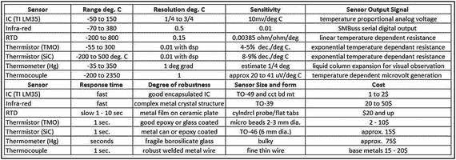 |

基于铂的 `RTD` 通常比本书中考虑的传统设备更昂贵。但是，如果实验需要精确测量温度，而后续练习中的传统技术无法达到所需的精度，则必须使用合适的 `RTD`。在[`www.omega.com`](http://www.omega.com)、[`www.digikey.com`](http://www.digikey.com)和[`www.littlefuse.com`](http://www.littlefuse.com)上可以获得关于 `RTD` 的出色应用说明和描述。

`RTD` 有薄膜形式和绕线元件形式。待监测的温度范围和实验装置的限制条件，决定了要获得所需的温度分辨率必须采用哪种形式。特种 `RTD` 应用的复杂性在之前提到的供应商提供的文献中有所描述。`MAX31865` SMT 芯片提供了完整的系统，用于将铂电阻温度检测器（`Pt-RTD`）与微处理器连接，以在-200°C 至 800°C 范围内实现 0.5°C 的分辨率。`US Sensor` 生产的 100Ω薄膜铂 `RTD` 器件（料号`PPG101A`）可从分销商 `DigiKey` 购买，价格为 20 美元。

许多传统的实验室和临床温度测量方法仍在使用各种物理形态的水银温度计进行一般和特殊测量。经过校准的水银温度计理论上可用于测量–38.37°C 至 356.73°C 的范围，即该元素的液态区间。使用玻璃或石英温度计中的液态金属组，能够实现 0.1°C 的温度分辨率。（欧盟对水银温度计的销售进行了限制）。对于水银/液态金属膨胀法无法测量的更高或更低的温度，可以使用热电偶。被指定为 `J` 型和 `K` 型的双金属结具有可重复的、特定的电压-温度关系，其适用温度范围分别为–200°C 至 750°C 和 1250°C。

为了符合本书的预期性质，后续的练习和讨论将涉及贱金属热电偶温度传感器，而非更昂贵的铂基设备。在某些实验条件下，铂族金属是唯一可用的传感器类型。遇到这种情况时，您应查阅文献中的相关参考文献。

热电偶产生的微伏信号必须经过放大才能驱动任何形式的显示器。热敏电阻、`RTD` 和红外传感器需要电源提供激励或偏置，以产生与温度成比例的电子信号。

热敏电阻由过渡金属氧化物的固态混合物制成微珠形式，用于 –100°C 至 200°C 范围内的温度传感。碳化硅（`SiC`）热敏电阻可用于从 –20°C 到 450°C 的温度测量。热敏电阻有玻璃、环氧树脂和金属涂层或护套等保护形式。碳化硅传感器有金属 `TO-46` “礼帽” 封装（带短引线）和环氧树脂涂层珠形式。`SiC` 热敏电阻金属器件较高的温度能力带来了一些电气连接问题。该器件温度测量范围的上限高于锡铅焊料的熔点。为了使用 `TO-46` 器件，必须通过机械方式建立电气上可靠的连接。

将温度传感器连接到监测设备会在被测物体的温度变化与监测设备输出的变化之间产生一个时间延迟。这个时间差就是*响应时间*。对于测量事件发生温度或随时间记录数据以检测多个热事件的简单实验而言，显示响应的时滞通常次于所测量的数值温度。如果热数据用于控制某个过程，例如将炉温保持恒定或向化学系统添加试剂，那么系统响应时间就变得至关重要，传感器响应、热传递和数据处理时间都必须最小化。

与几乎所有形式的实验测量一样，必须有一种方法来验证或确认所使用测量系统产生的数值。国际温标 (1990) 定义了各种元素标准物的沸点和凝固点，可用于验证从接近绝对零度到 1085°C 范围内的温度。

一些更方便的金属，如锡（熔点 232°C）、铅（熔点 327°C）、锌（熔点 420°C）、铝（熔点 660°C）和铜（熔点 1084°C），可以用作实用的中高温验证标准。

对能量存储的研究已经汇编了盐和氧化物的共晶混合物的熔点或凝固点数据（参见[`www.nist.gov/system/files/documents/srd/NSRDS-61_Part-1.pdf`](http://www.nist.gov/system/files/documents/srd/NSRDS-61_Part-1.pdf)）。表 3-2 根据引用的来源和多个其他来源汇编而成，整理了许多已知的共晶混合物，形成了一个覆盖从室温到 1250°C 温度范围的参考标尺。

处理熔盐时必须极度小心。熔盐会溶解某些金属、玻璃和陶瓷，导致意外故障，并引发灾难性的爆炸、火灾，通常还会造成严重烧伤。如果您不熟悉熔盐操作，应咨询熟悉熔盐的化学家或物理学家，或者查阅从 `NBS` 文件中提取的参考文献列表中的原始文献，表 3-2 中的许多条目即来自该文件。

铂金器皿可以盛装许多（但并非全部）熔盐。铁、镍和锆金属器皿可用于某些混合物。熔融石英、瓷器和硼硅玻璃容器可以盛装各种低于容器熔点的熔融混合物。

为表格选定的混合物均包含易于获取、价格低廉的组分，这些组分应能平稳熔融，几乎不产生或完全不产生分解。如果要验证温度测量系统，应选择熔点接近所需温度的混合物，收集各组分，并查阅原始文献或咨询熔融工艺专家，以选择合适的容器来盛装熔融物。使用合适的热源，即可将组分熔融，使其冷却，然后将得到的玻璃状或熔融物破碎成合适大小的碎块，用于测试温度测量系统的有效性。

**表 3-2 熔点混合物**

| -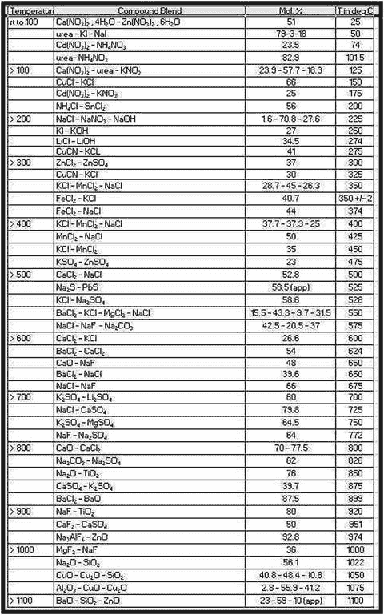 |

熔融表 3-2 中大多数混合物所需的高热量和高温，可以在空气中使用镍铬合金线加热元件来实现。镍铬合金的熔点为 1400°C (2550°F)，但为了安全，应极其谨慎地将其使用限制在 1250°C (2282°F) 以下，为了更高的安全性，应限制在 1100°C (2212°F) 以下。

您必须小心，因为加热系统的组件在这些高温下接近其熔点。任何结构材料的熔融都可能导致熔融物溢出或电路短路，这两种情况都可能引发火灾或熔融物的爆炸性飞散，造成灾难性后果。

用于玻璃吹制、锡焊、铜焊和焊接的安全、实用、高温加热系统在参考文本和专业出版物中有所论述（参见 John Moore 等人所著的 *Building Scientific Apparatus*，第 4 版，剑桥大学出版社，2009 年，以及 [Jacobs-online.​biz/​nichrome_​wire.​htm](http://jacobs-online.biz/nichrome_wire.htm)）。《热量与温度测量》一书中关于热电偶的最后部分，使用小型明火来产生高温以供演示和测试。尝试在 1100°C (2212°F) 以上的温度下安全工作，通常需要特殊的非金属加热元件、专用电源、惰性气体或真空腔，这些涉及的费用和技术超出了本书力求简化的性质。

## 亚环境温度与低温

除非您熟悉并能安全处理挥发性、有毒、易爆溶剂，且拥有低温固体或液体的获取条件，否则低温校准应仅限于使用盐浴和冰水浴。

可以通过物理解释溶液依数性质变化（例如沸点升高和凝固点降低）的化学原理，来为低温热测量系统的验证建立参考温度。当溶质溶解于水中时，溶液的凝固点会下降，而沸点则会升高，其变化程度与溶解溶质的浓度相关。

通过仔细控制溶质的性质、溶质浓度以及进出盛放溶液容器的热流，可以实现稳定的零下温度。冰与常见的易溶性化学盐（如氯化钠和氯化钙）混合，由于冰融化时浓度会发生变化，因此很难产生稳定且可重复的零下温度。植物生理学的研究人员曾发布过一种制备盐冰基低温恒温器的方法。这些低温浴槽选用的是在水中微溶的特定盐类进行制备。

使用杜瓦瓶（玻璃或金属真空夹套容器，即保温瓶）、搅拌设备以及适量的选定盐、细碎冰和水制备的低温恒温器，能够在从零下几分之一度到零下若干度的温度范围内长时间稳定运行。表 3-3 综合了多个来源的数据进行制表，这些来源包括 Arnold Gordon 和 Richard Ford 所著的 *《化学家指南：实用数据、技术与参考文献手册》*（`J. Wiley & Sons`, 1972 年出版）。

通过使用水溶性有限的化合物中过量的盐晶体，可以形成一个两相三组分体系。当冰融化时，更多的盐会溶解，从而维持恒定的盐浓度和温度。表 3-3 是综合参考来源汇编的精选数据表格。

**表 3-3** 低温恒温器混合物

| -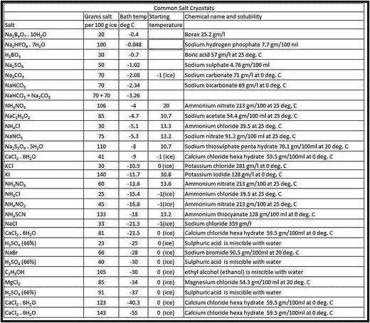 |

亚环境温度也可以通过机电式气体膨胀/压缩系统以及能在热能与电能之间相互转换，从而在热隔离环境之间移动或“泵送”热量的固态半导体系统来实现。

## 热敏电阻：灵敏的高分辨率温度测量

### 过渡金属氧化物热敏电阻（-40°C 至 150°C）

对于涉及接近环境温度或室温溶液化学的生物学、医学和热化学分析，热敏电阻是撰写本文时最灵敏的温度传感器。除了灵敏度高之外，它还采用微型珠状封装制造，坚固耐用、化学惰性、成本低廉，并且对温度变化响应迅速。当与数据处理软件配合使用，或用于测量微小或分数级别的温度变化时，热敏电阻的非线性特性并非大问题。

意法半导体 2004 年的一份应用笔记 `AN1755` 描述了一种利用 `555` 定时器芯片、热敏电阻和微处理器来开发高分辨率温度测量系统的方法（参见 [`www.st.com/resource/en/application_note/cd00010962-a-high-resolutionprecision-thermometer-using-st7-and-ne555-stmicroelectronics.pdf`](http://www.st.com/resource/en/application_note/cd00010962-a-high-resolutionprecision-thermometer-using-st7-and-ne555-stmicroelectronics.pdf)）。该系统将热敏电阻的温度变化转换为定时器芯片输出频率的变化。

将一个 `NTC` 热敏电阻和一个高质量、低漏电的电容器放置在非稳态配置的 `555` 定时器的电阻/电容定时网络中，定时器芯片输出的占空比或脉宽比将随热敏电阻的温度变化而变化。当由高速微处理器以微秒级进行多次平均读数测量时，输出脉冲的宽度提供了对热敏电阻珠温度灵敏、高分辨率的测量。微处理器数字化后的信号随后可被串流输出到计算机的串行端口，以便在基于 `PC` 的 `SCADA` 程序中进行图形显示。

在 `AN1755` 中，讨论了 `555` 的周期定时，并在应用笔记内的两张图中进行了展示。然而，当定时器在电源电压的三分之一到三分之二之间循环时，会输出一个由高电平和低电平脉冲组成的方波脉冲序列。热敏电阻的阻值是其温度的函数。热敏电阻的阻值部分决定了电容器充电的速率。这可以通过高电平、低电平时间间隔 `t[1]` 和 `t[2]` 的数学表达式来证明，如下所示。

```
t[1] = 0.693(R[ntc] + R[2])C--- 1
t[2] = 0.693(R[2])C--- 2
因此
R[ntc] = R2/t[2]--- 3
```

虽然 `C` 的值并不直接参与 `R[ntc]` 值的计算，但它确实决定了高电平和低电平时间值 `t[1]` 和 `t[2]` 的大小。如果 `t[1]` 和 `t[2]` 之间的差值被用作温度变化的量度，并且该变化以微秒为单位进行测量，那么使用较大的 `C` 值可以显著提高温度测量的分辨率。

在此应用中，`C` 是一个定时电容器。它应为塑料薄膜型、低漏电的器件。低漏电的塑料薄膜电容器具有极性很低的介质材料，这意味着要制造出更高电容值的器件，需要体积大且昂贵的材料封装。通常，较小的物理尺寸对应 `pF` 和 `nF` 范围的电容值，但这些电容也可能价格昂贵且难以找到。为了最大化 `Δt` 值，应尽可能使用实际可行的、大容量的塑料薄膜电容器。我的一些开发电路曾使用 `1 μF` 的聚苯乙烯电容器组装，其尺寸为 `5/32 × ½ × 1¾ 英寸`（`4 × 10 × 45 毫米`）。

理论上，定时器循环的频率与 `1/ln(2)*(R1+R2)*C` 成正比。如果循环时间保持在 `4 Hz` 或更高，则电容器不应超过 `18 μF`。通常，当低漏电塑料薄膜电容器的值超过几微法时，其成本会开始显著增加。

# 构建高分辨率、高灵敏度温度监测器

为组装一个高分辨率、高灵敏度温度监测器，您需为实验选择合适的`thermistor`（热敏电阻）。为了在`555定时器`输出信号中提供合理的不对称性，`RC网络`中的固定电阻应选择与传感器在其预期工作温度范围内的电阻值大致相等。固定`RC网络`的电阻值后，只需确定电容值，以提供适合微处理器数字信号处理（DSP）能力的输出频率。`RC`定时网络中的电容越大，系统的振荡频率就越低。`555定时器`输出信号的频率必须足够低，以便微控制器代码能够测量高电平和低电平的脉冲宽度，然后计算脉冲宽度差值并平均该数值差值，从而提供适当的降噪水平。

`Arduino`是一款 8 位处理器，因此使用脉冲宽度差值而非实际脉冲宽度。移动平均数字信号处理代码中的元素数量必须足够小，以避免微处理器代码中使用的长整数发生数值溢出。

热敏电阻测量系统可通过使用干井温度参考源进行校准。典型的测温化学分析过程仅涉及几度到 8°C 至 10°C 的温度变化。热敏电阻与温度关系的线性度可在较短的高分辨率范围内进行检验和验证。

## 实验 A 部分：金属氧化物 NTC 热敏电阻

为进行灵敏的高分辨率温度测量，`Arduino`或类似的微处理器板应独立使用电池或稳压电源供电，以提供几乎无噪声的+5 V 偏置电压和地线。使用合适的 NTC 热敏电阻、电容和参考电阻构成非稳态配置定时网络后，`555定时器`引脚 3 的输出可连接至`Arduino`板的数字引脚 2。`Arduino`板代码（见清单 3-1）包含一个 n 元素移动平均程序，可为`DAQFactory`图形显示提供平滑的数据流。该代码设置为采集并平均 16 个数据点。

### 硬件

`555定时器`按图 3-1 所示配置。

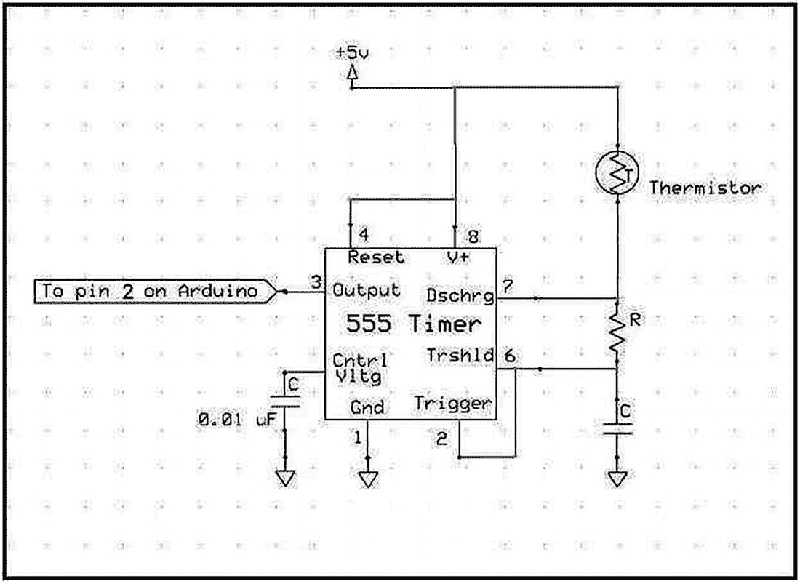

`图 3-1` — 热敏电阻的ΔR对`555定时器`输出信号的调制

图 3-1 电路中的`C`应选用高质量的聚酯薄膜或聚苯乙烯低漏电电容。电容值的选择需确保输出信号频率足够低，以便 DSP 代码能够测量并平均矩形（标称 5 V）输出波形的高电平和低电平部分。关于选择温度监测电路所用`R`、`C`及热敏电阻值时需考虑的定时因素，将在本实验的下一节进行讨论。

# 干井温度

干井由大型热质量块中的空腔构成。大型热质量块的作用是维持井内已知温度并减缓温度波动。加热式干井可通过金属块或多层金属层压板制作，对其进行钻孔或开槽以容纳温度测量设备和传感器，然后用任何具有显著热阻的材料（如泡沫塑料、木材、石膏或水泥）进行绝缘。如果可能，可编程温度干井应选用导热性更高的金属来制造。

温度可编程干井比静态系统更复杂，因为需要可变热源，并且包含干井的金属块需要足够的绝缘材料。在高于环境温度下运行的干井，可选择使用比例-积分-微分过程控制器（`PID`）进行控制，以帮助维持所需的运行设定点。

图 3-2 展示了一个由厚度为 3 毫米至 6 毫米（或 1/4 英寸）的铝金属板通过金属螺栓固定在一起而制成的低温干井。
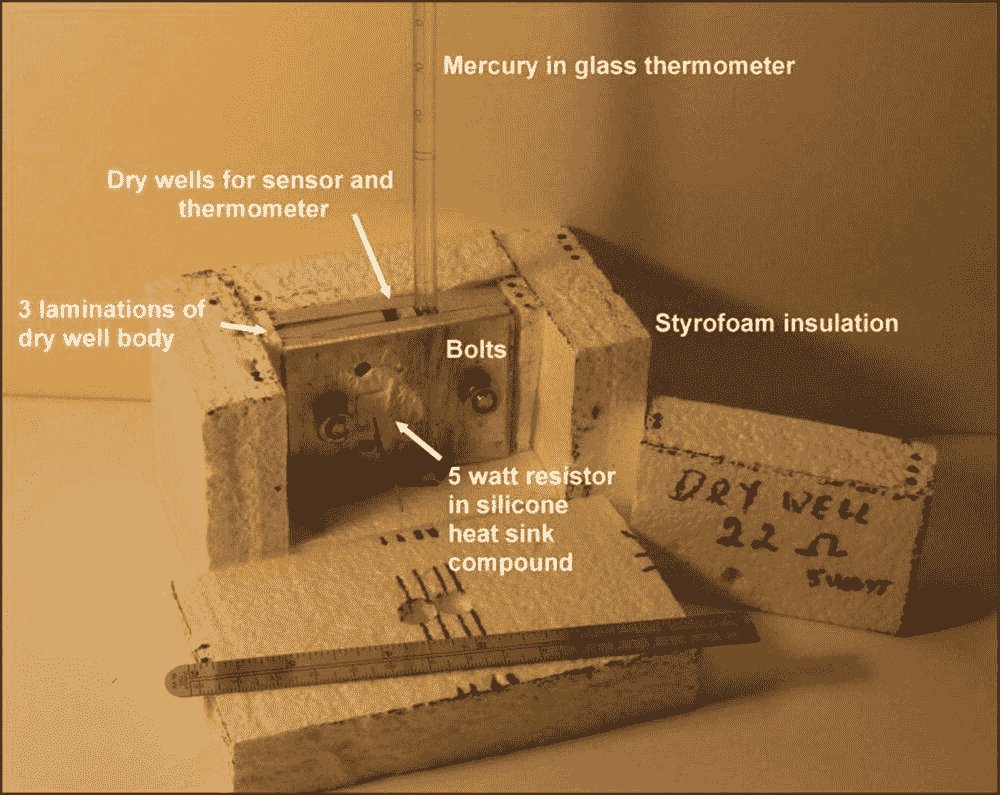
**图 3-2**  
层压铝板干井

采用层压板构造方法极大地简化了材料采购和成品干井的成型。单个板件完全可以使用手工工具成型，以容纳加热元件、温度计和传感器，或者加工成所需的外部轮廓，然后用螺栓牢固地固定在一起，并钻孔至最终配置。

除了图 3-2 中所示的三层干井外，我的实验室还有几个干井是用六层  英寸（3 毫米）厚的层压板制成，这些层压板来自当地五金店购买的 2 英寸宽的扁平铝材。无论是方形还是圆柱形的加热元件，都应尽可能紧密地贴合在金属块上，并涂覆硅酮导热膏以提供最大的热传递。确保加热电阻引线与金属块绝缘，以避免短路。

在图 3-2 中，干井的保温层是使用电烙铁上的塑料切割头从一英寸厚的聚苯乙烯泡沫板上切割下来的。金属块的保温套件部件上标有“对位标记”，并用毡尖笔做了标记，以便于组装。层压铝干井的各个板件也应标上“对位标记”，以确保设备能够快速轻松地组装。

要使用该金属块产生高温，需要电源来加热嵌入块内的电阻。我的实验室选择了低欧姆电阻值、多瓦特额定功率的低压直流电源，因为这些组件易于获取。交流系统也可以通过诸如 `Variac` 品牌的可变电压交流变压器来工作。交流电（AC）或线电压布线必须遵循当地的电气布线和建筑规范。

如图 3-2 所示设备上使用的典型干井校准过程包括：设置连接到井加热电阻或元件的电源上的低电压输出，然后等待直到干井温度稳定。记录电压和温度，然后稍微增加电压，让系统再次达到平衡。

收集第二组电压与平衡干井温度的数据。然后绘制这四个点，以获得施加电压与所得平衡干井温度之间相关性的一些概念。为了验证施加电压大小与所得平衡温度之间的相关性，绘制数据的斜率可以确定在预期运行范围内建立近似干井温度所需的施加电压。

预测在目标运行区域内建立第三个平衡温度数据点所需的电压，通常可作为电压-温度校准数据的验证。图 3-3 描绘了典型的干井温度与直流电压施加关系图。
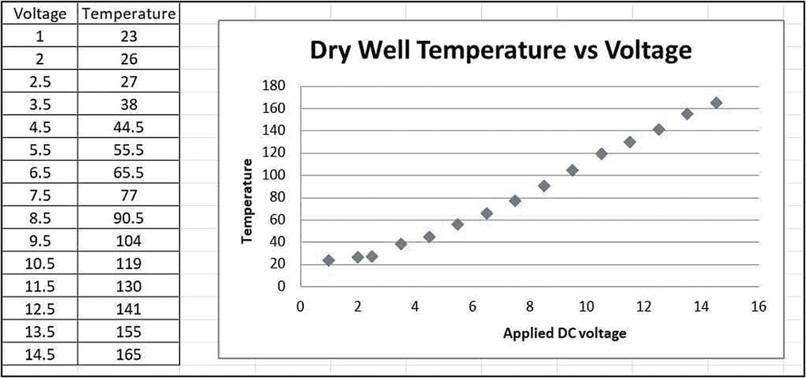
**图 3-3**  
干井温度与施加的直流电压关系图

虽然聚苯乙烯泡沫保温材料是一种易于使用且容易获得的优良材料，但其使用温度限制在 150 至 160°C 以下。然而，当用于热敏电阻的干井校准系统时，聚苯乙烯泡沫的温度限制并不会引起任何担忧，因为热敏电阻最适合用于 120°C 以下的测量。

## 软件

### 微处理器代码

清单 3-1 中的带注释代码调用了 `Arduino` 板的 `pulseIn()` 函数，以确定高脉冲和低脉冲的时间宽度，然后计算“传导”和“间隔”脉冲宽度之间的差值。然后在微处理器代码中实现的移动平均函数中对各个时间差测量值进行平均。平均后的时间值随后通过串行端口流式传输到 PC 进行图形显示。微处理器代码完全以整数格式编写，以最大程度减少数字信号处理（`DSP`）移动平均所消耗的时间。

在开发温度测量系统时，需要对微处理器代码和 555 定时器频率进行一定的实验。高/低或传导/间隔时间必须在 `pulseIn()` 函数允许的范围内。这两个值之间的差异应尽可能大，但又足够小，以便微处理器代码能够使用长整数，而不会在移动平均计算中导致整数溢出。

虽然该过程测量的是热敏电阻珠的温度，但珠式传感器和微处理器以 555 RC 定时器电路值以及微处理器代码计算所需平均值的速率所确定的速度运行。平均数据以串行格式发送到 PC，图形显示速率由数据到达串行端口的速率决定。如果串行端口接收数据的速度快于显示处理速度，则屏幕和光标响应会变慢。

为了限制数据通过串行端口发送的速率，移动平均程序代码的主循环包含一个 `delay()` 语句来降低数据发送速率。理想情况下，应通过仔细记录的实验来优化 555 频率、移动平均迭代次数和延迟常数。

## DAQFactory 图形显示界面与信号处理

高灵敏度或高分辨率的温度监测最好以图形格式呈现，以便持续显示被测参数的趋势。虽然在高灵敏度下，被测温度的绝对值相对于系统即时或实时的热量与温度变化通常处于次要地位，但绝对温度读数仍可校准至合理精度。

所有看似复杂的系统均由更简单的子系统组成。温度测量从组装 `NTC` 热敏电阻、555 定时器和 `Arduino` 硬件开始。为确保信号相对恒定，将 `NTC` 热敏电阻放置在如图 3-2 所示的隔热干井中。可将清单 3-1 中的代码加载到微处理器中运行，并使用 `Arduino IDE` 的串行输出监视器来确认通过相应通信端口或 `COM` 端口发送的数据的有效性。

接下来，配置 `DAQFactory` 程序以在相应通道上接收串行数据，并通过使用正确的串行端口监视器观察接收到的数据来确认数据流入。图 3-4 显示了数据传输时间、整型数据值，以及紧随其后的回车和换行 ASCII 字符。
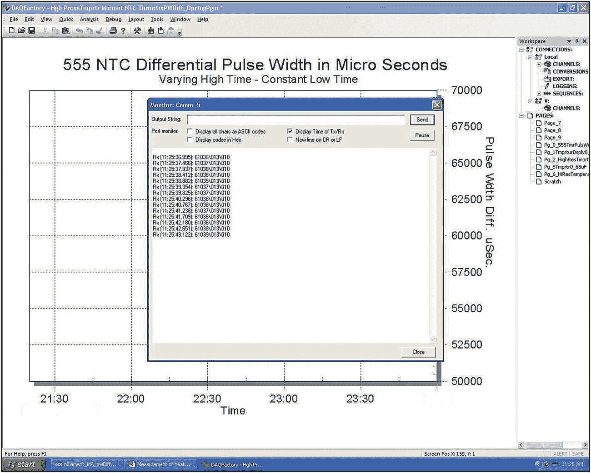
图 3-4
来自 `Arduino` 移动平均代码的 `DAQFactory` 串行端口脉宽差分数据

一旦 `DAQFactory` 界面能够记录平均脉宽时间差，即可在两个有用的温度点之间对热敏电阻进行校准。

## 观测与校准

要开发热敏电阻校准程序，必须创建一个可重复的温度程序。干井可通过从稳压电源为加热元件供电特定时长来创建温度程序。通过调整施加电压和供电时间，可以实现温度从环境温度升高到所需的高温水平。一旦建立并验证了环境温度与所需较高温度之间的可重复程序，就可以对 `DAQFactory` 显示界面进行校准。

在我的实验室中，使用放置于额外干井腔体内的玻璃水银温度计作为校准的主要标准。负温度系数热敏电阻在较高温度下将表现出较低的电阻。在我们正在开发的系统中，所测量的脉宽差值的“高电平时间”取决于流经 `NTC` 热敏电阻和参考电阻以对电容充电的电流。当定时器改变状态时，电容仅通过参考电阻放电。随着干井块的温度升高，高电平时间值会成反比地减小，`NTC` 热敏电阻的电阻也同样减小。

校准实验首先将热敏电阻浸入环境温度的干井中以建立基线。在测量并记录环境温度后，开始定时供电时段。随着块体和干井升温，`DAQFactory` 显示迹线开始下降。在定时时段结束时，切断电源，并监测块体温度，直到其达到最大值并开始下降。

温度的上限值和下限值，以及脉宽差值的初始值和最终值，定义了系统的校准范围。该过程应重复多次，以确认并证明其可重复性。图 3-5 展示了一组三次 3.0°C 温度变化的迹线。随着温度测量灵敏度的提高，温度漂移成为一个问题。

可以通过计算观测到的温差对应的脉宽差值变化率，来建立测量的脉宽差值与温度之间的相关性。对于图 3-5 中的曲线以及另外六次重复实验，平均比值为 3140 PWD 单位/°C。
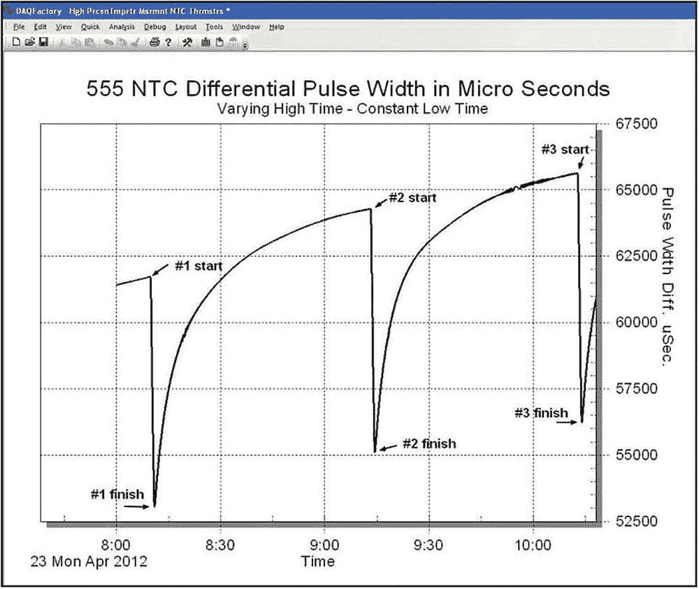
图 3-5
三度温度变化

利用计算出的斜率，以及在多次验证重复实验中观察到的精确起始点 17.0°C，构建了图 3-6 中所示的表格和图表。随后将构建的图拟合为标准 `y = mx + b` 格式，并在图表上打印出方程。在图 3-7 中，将来自 `Arduino` 555 `NTC` 定时器的流数据通道值代入方程 `y = –3140x + 117780` 的重排形式，以生成热敏电阻温度测量通道数据迹线。该迹线在图 3-7 中显示于二维图形组件窗口下方左右两侧边缘，数值为 18.55°C。
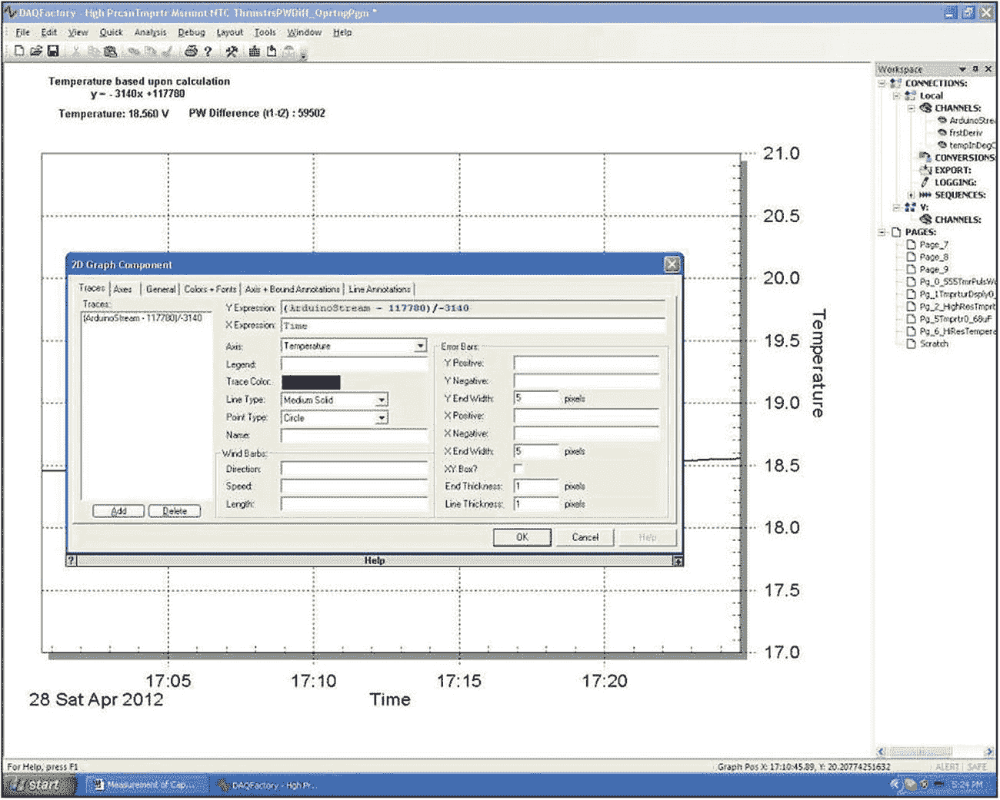
图 3-7
`DAQFactory` 图形组件 Y 表达式

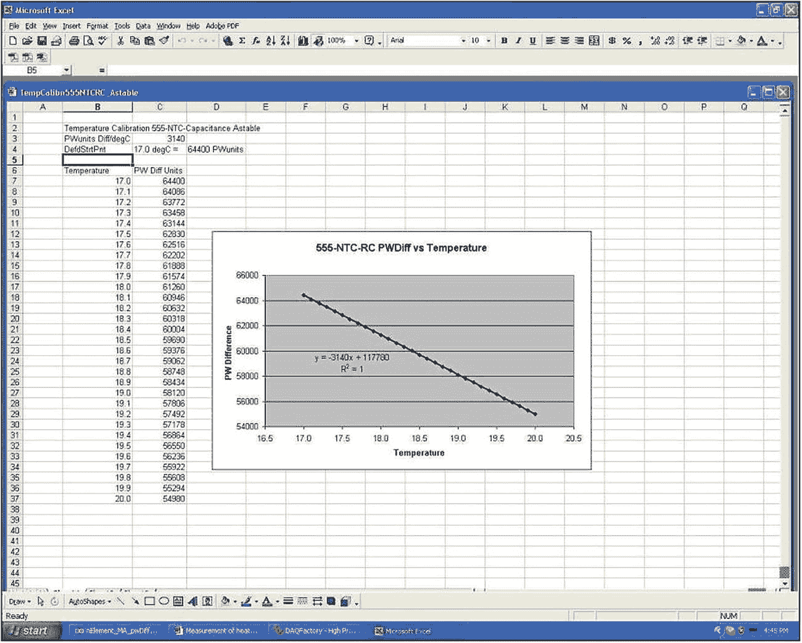
图 3-6
脉宽差值与温度的关系

### 使用一阶导数监测热现象

在滴定及其他图形化热现象监测中，一个有用的特性是主数据迹线的一阶导数，即数据的斜率。当前显示点的数据斜率，可以通过已绘制的数据点数值之间的差值，以及记录这些数据值的时间之间的差值来计算。
```
slope = (X[t1] - X[t2]) / (t1 - t2)
```
在 `DAQFactory` 中，数据以带时间戳的二维数值数组形式保存在通道中。在通道表视图中创建的每个通道都有一个属性窗口，其中包含五个选项卡：通道的基本属性、通道的可用选项、通道数据图表、通道数据表格以及一个事件选项卡。

在编写本书期间，我使用了三个通道来数学映射或转换脉冲宽度差值，以实现高灵敏度的温度记录，并显示温度记录的“屏幕上的”一阶导数。

这三个通道分别命名为 `Arduino Stream`，用于接收来自 `Arduino` 板的数据；`tempInDegC`，用于将脉冲宽度数据变化转换为图形显示值，供可视化温度监视器使用；以及 `frstDeriv`，用于计算显示数据的一阶导数的数值。

图 3-8 显示了输入到 `Arduino Stream` 事件函数选项卡中的转换代码。该代码根据测量的脉冲宽度差值数据计算热敏电阻温度，并将计算出的温度和时间值插入到 `tempInDegC` 通道中，以进行图形显示。
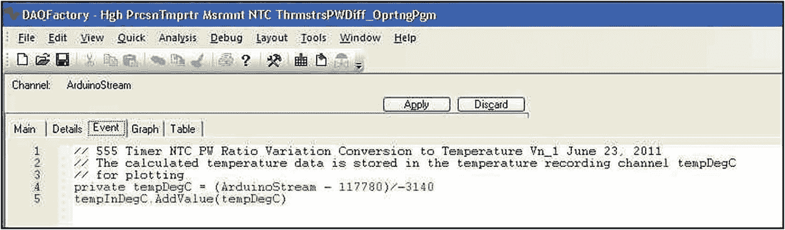
**图 3-8**
通道事件转换代码

`Arduino Stream` 通道事件函数的第 5 行将计算出的温度传输到 `tempInDegC` 通道中以供显示。第二个通道事件函数使用如图所示的两行长代码进行编程。这些长行代码计算第二个通道中温度迹线的一阶导数。第二行将数据传输到第三个通道中以供显示。
```
1) private frstDiff = (Smooth(tempInDegC[0], 5) – (Smooth(tempInDegC[25], 5)))  /  ((Smooth(ArduinoStream.Time[0], 5)) – (Smooth(ArduinoStream.Time[25],  5)))
2) frstDeriv.AddValue(frstDiff)
```
为了便于编码、控制屏幕显示和配置开发，我使用了三个通道以及正在计算的中间值的各种图形显示，以跟踪和验证数据转换。对于实验应用，这三个通道可以与单个双迹线显示一起使用。

## 讨论

`555`定时器已使用超过 40 年，目前有使用双极型晶体管或`CMOS`集成电路的芯片。芯片功耗、对外部组件的功率传输以及工作频率是生产这两种集成电路的主要考量因素，这两种电路在此信息处理、温度测量应用中均能同样良好地工作。

尽管个人电脑和`USB`总线能够提供驱动实验设置所需的电源，但其供电能力有限，并且可能产生额外的噪声。在可能的情况下，实验装置中的`Arduino`和`555`芯片应由独立的专用电源供电。对于高灵敏度的低噪声测量，电池能提供最纯净的电源。图 3-9 显示了在从计算机`USB`连接取电时，温度记录信号中出现的短期或瞬态“振铃或混叠”现象。当`Arduino`独立供电时，仍能看到这些失真，但其强度显著降低。

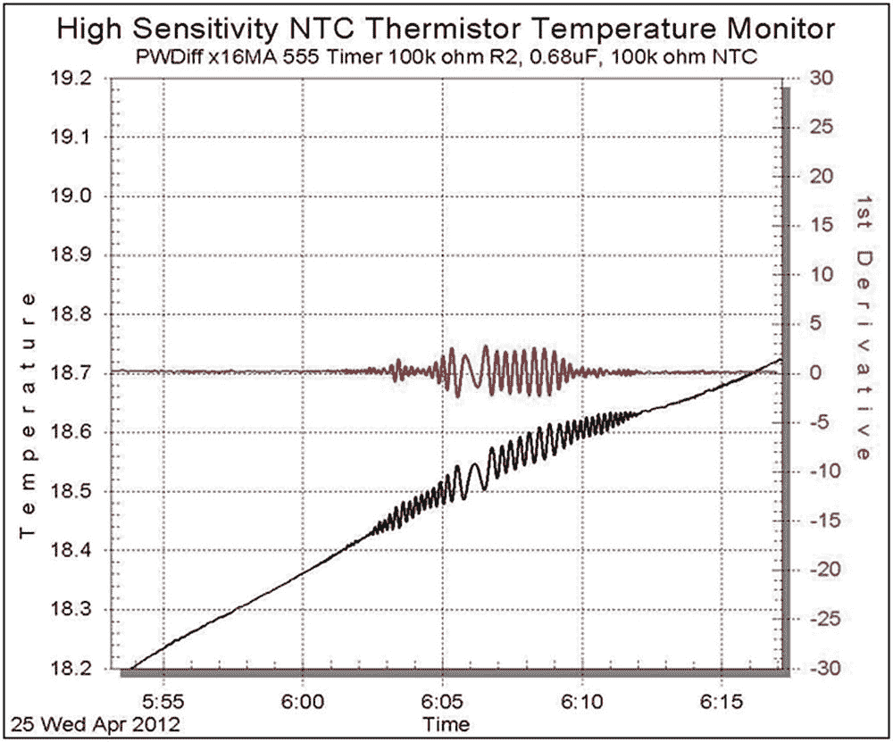

**图 3-9**

信号振铃或混叠

热敏电阻或温度敏感电阻器有多种物理尺寸和电阻值可供选择，其中在 25°C 时的电阻被认为是该元件的标称值。对于大于 10°C 至 15°C 的温度范围，温度与电阻之间的非线性关系可能需要在某些应用中进行校正。对于仅跨越几度高低温范围的高分辨率温度测量，非线性变得不那么重要。

热敏电阻是温度敏感电阻器，当电流流过时，会根据`I²R`公式自发热。通过将热敏电阻放置在非稳态`555`电路的`R1`位置（参见图 3-1 中的电路），电流仅在电容器充电时流过热敏电阻-电阻串联对，从而减轻了自发热电流效应。

通过在`RC`定时网络中安装热敏电阻，占空比成为热敏电阻温度的函数。由`555`定时器数字化的模拟温度信号，可以通过微处理器进行处理，对测得的脉冲宽度数据应用移动平均过程，从而大大改善输出信号的信噪比。

移动平均（`MA`）程序会执行一系列不正确的计算，直到其平均代码达到其标称运行值。一个九元素移动平均在处理完九个数据点之前，会产生不正确的答案。一旦数组填满并运行，用于计算平均值的数组会产生一串串行数据，其噪声值理论上降低至原来的三分之一。一旦移动平均处理了足够多的数值，它就会以微处理器时钟的速度循环执行其代码，产生一个噪声降低值与平均点数平方根成正比的串行数据流。

尽管一个典型的`MA`数字信号处理（`DSP`）可能需要 15 到 20 行代码来实现，但处理后的数据点流式输出到串行端口的速度通常远高于`DAQFactory`图形显示能够跟随的速度。通常需要在微处理器的主循环中添加一个延迟语句，以降低移动平均代码的速度，使其达到图形显示能够跟上的程度。理论上，实验者可能需要调整`MA`中的元素数量并减小延迟语句的值，以获得最佳性能。

### 微处理器平均与图形显示响应时间

除了图形显示跟上数据接收速率所需的时间外，微处理器平均还需要额外的计算时间。随着数据平均、串行传输和图形显示消耗更多时间，被研究系统的变化与图形显示移动之间的时间延迟会增加。所有这些延迟的总和就是测量或系统的“响应时间”。

增加移动平均中的元素数量时必须小心，因为显示响应的时间延迟会增加，但信噪比的改善仅随平均元素数量的平方根而提高。实验者在组装温度测量系统时，必须考虑待收集数据的性质，以及在保持数据显示合理响应时间的同时，可用于平滑数据的时间量。

根据 IC 定时器数据手册，`555`定时器非稳态配置的输出频率与`RC`网络的值成正比。大容量电容器与大阻值电阻器一起会产生大的时间常数。测量温差的脉宽差技术依赖于微处理器测量定时器输出信号中连续高电平时间之间的差值。

测量定时器输出的微处理器代码使用 8 位逻辑，因此对二进制算术能准确表示的数值的大小有限制。如果脉宽过大，连续差值测量之间的差值可能会导致微处理器算术编码中的数值溢出。`Arduino`代码中的长整数可以处理高达`2,147,483,647`的数值。几个微法的高质量、低泄漏电容器应为实验工作提供足够的温度分辨率。

### 实验 B 部分：碳化硅热敏电阻 –20°C 至 450°C

自 1833 年迈克尔·法拉第注意到硫化银中的温敏电阻现象以来，这一特性已被认知。热敏电阻的商业化生产始于 1930 年，并演变为本主题 A 部分中使用的廉价微玻璃或环氧树脂涂覆的混合过渡金属氧化物珠状器件。

碳化硅（`SiC`）最初作为磨料制造，后来用作高温炉中的电阻加热元件，它也是一种半导体。`SiC`已被制成电阻递减的温敏器件，大大扩展了常规过渡金属氧化物热敏电阻传感器所能达到的高温测量范围，并使每单位温度变化的电阻变化率大约翻倍（金属氧化物为 3% – 4% `ΔR/°C`，而`SiC`热敏电阻为 7% – 8% `ΔR/°C`）。

监测的温度范围给使用`SiC`器件可测量的上限 500°C 的实验工作带来了一些材料选择问题。混合金属氧化物热敏电阻仅限于约 150°C 以下的温度。锡铅焊料和聚苯乙烯泡沫绝缘材料也仅限于 200°C 范围的下限。

图 3-10 是典型`SiC`热敏电阻的器件电阻与温度关系图。

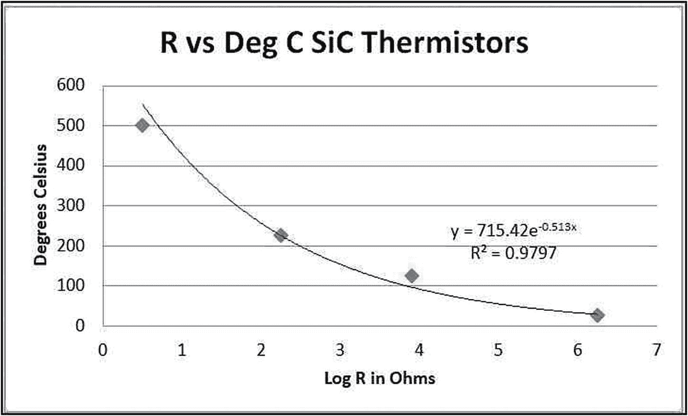

图 3-10

`SiC`温度范围

可以使用开发的`555`定时器电路或传统的高阻惠斯通电桥电路进行半导体`NTC`热敏电阻的温度测量。

### 实验：555 定时器频移温度测量

#### 硬件

将一个 National Semiconductor `CMOS LMC 555CN`配置为非稳态配置，使用一个 Adsem 碳化硅`TO-46`金属罐“顶帽”热敏电阻（其在 25°C 室温下的电阻为`1.750 MΩ`）和一个`2.2 MΩ`电阻。回顾在非稳态配置中，`R1`随`SiC`热敏电阻的温度变化，而`R2`是固定的`2.2 MΩ`参考电阻，`555`定时器的高低电平或标记-空间时间占空比约为`2:1`或`66%`。使用`10 nF`（`0.01 μF`）电容器与`SiC`及`2.2 MΩ`组合，以产生`25 Hz`的理论输出频率。（对于非稳态`555`，`f = 1.44/(R1 + 2R2)*C`。）

`SiC`热敏电阻被安装在一个`3/16`英寸（`5 mm`）直径的铝制干井中，该干井位于一个聚苯乙烯泡沫绝缘的层压铝块（`½ in × 3 in × 2 in`，即`12 mm × 76 mm × 50 mm`）内，干井由一个`22.6`欧姆、`5 W`的电阻加热。块加热器电源由`12 V`、`1 A`的直流电源提供，主温度测定由一个监测热敏电阻附近块孔的水银温度计完成。

用`12 V`加热干井`2.0`分钟产生了`4.0°C`的温差（`ΔT`），并使用三次`4.0°C`的偏转来计算每摄氏度观测偏转的平均值。然后使用该灵敏度值来关联`SiC`热敏电阻的每度偏转与观测到的温度计响应，方法与 A 部分中环氧树脂金属氧化物单元相同。

#### 观测结果

碳化硅热敏电阻偏转-温度图如图 3-11 所示。

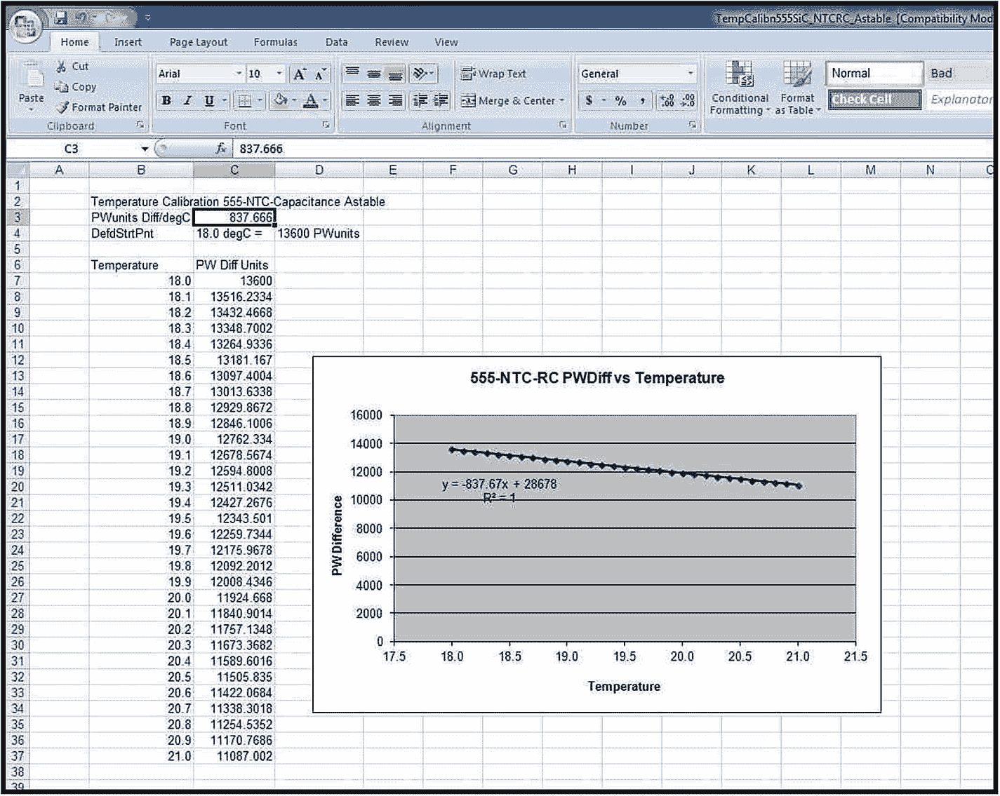

图 3-11

`SiC`热敏电阻响应数据

通过生成并记录一个微小温差的测量值，展示并评估了该温度测量系统的典型能力。`SiC`热敏电阻通过测量由`12 V`直流电压施加`2.0`分钟所产生的`4.0°C`温度跃迁引起的`PWD`（脉宽差）进行校准。为了测试该系统，一个`3`秒的电源施加应产生十分之一度的温差，如图 3-12 所示。该功率脉冲是通过手动激活电源并持续一个计时的`3`秒间隔产生的；如此短脉冲的定时误差相对较高。

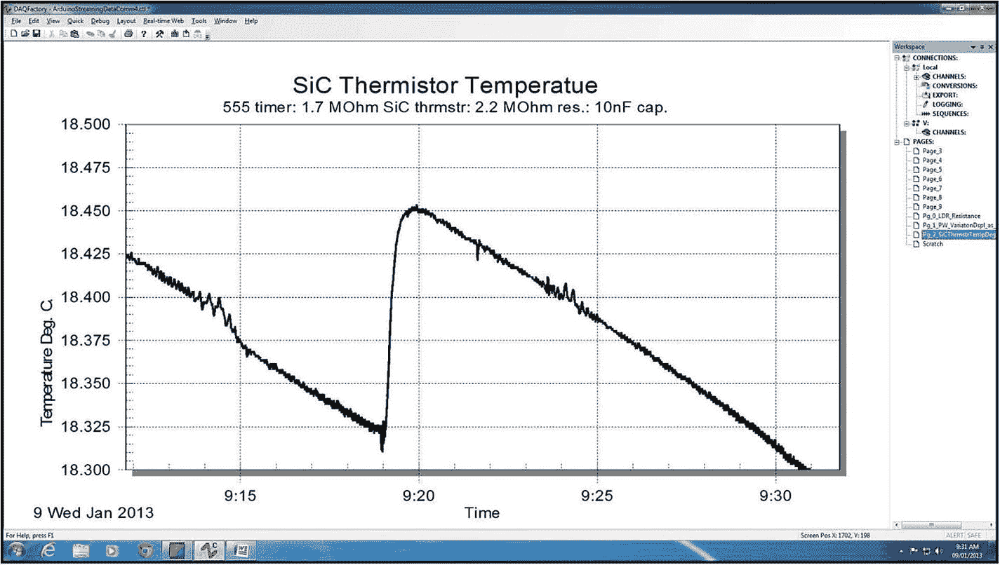

图 3-12

`SiC`热敏电阻高灵敏度温度测量

碳化硅热敏电阻的电阻值和可用温度范围都明显高于金属氧化物器件。金属氧化物器件的电阻值从几百欧姆到兆欧姆不等，每摄氏度电阻值下降 4%–5%，并且在水沸点之后会迅速失去灵敏度。碳化硅器件可在 –20°C 到 450°C 范围内使用，电阻值在兆欧姆级别，每摄氏度温度变化电阻值下降 8%。

图 3-12 中记录的迹线显示，在未平滑的迹线中，9:15 和 9:25 之前存在重复性的振铃或混叠现象。`DAQFactory`提供了多种数字信号处理功能，可用于降低数据中的噪声水平，每种 DSP 功能都有其自身的优点，同时在信号响应中增加了时间延迟。

图 3-12 显示，`DAQFactory`绘图的主要刻度相当于 0.025 度。由于基线噪声约为主刻度的五分之一，因此 0.005 度的温度分辨率应该是可行的。

高分辨率温度图说明了灵敏温度测量中固有的问题之一：热量通过绝缘层的泄漏以及由此产生的温度漂移。在充电周期中，USB-Arduino 电源的标称电压为 5 V。在环境温度下，热敏电阻和参考电阻的总和约为 4 MΩ，导致热敏电阻电流约为 1.25 μA，该电流仅在 66% 的时间内流过热敏电阻（占空比 = 高电平时间/总周期时间）。这种漂移是一种电子伪影，或者热量移入或移出干井。

### 实验：使用惠斯通电桥测量碳化硅负温度系数热敏电阻的温度

惠斯通电桥电路由克里斯蒂于 1833 年发明，最初用于测量静态系统中的未知电阻值。使用热敏电阻和 RTD 进行静态温度测量仍然存在，但动态温度测量在实验科学中有广泛的应用，也是本小节的主题。

考虑一个由两个分压器以并联方式组装而成的惠斯通电桥。如果两个分压器中的所有四个电阻值都相同，则电路两臂的分压点之间没有电压差。如果其中一个分压器电路中的电阻值发生变化，则电路中的两个分压点之间会产生电压差。在一定的电阻变化范围内，电压不平衡量与电阻变化成正比。手头系统中的电阻变化就是碳化硅热敏电阻所处环境的温度变化。

在图 3-13 中，显示了电桥配置各组件的数值关系。如果通过设置 `R1 = R2 = R` 来简化电桥输出的公式，则输出电压遵循该公式。

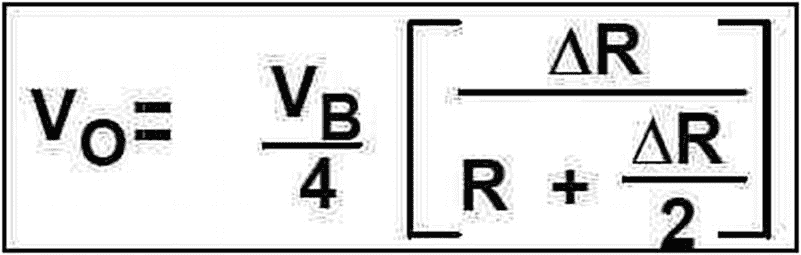

图 3-13

惠斯通电桥输出公式

- `V[o]` 是电桥的输出。`V[B]` 是电桥电压或偏置电压。
- `R` 是平衡时电桥电阻的阻值。
- `ΔR` 是有效电阻的变化量，或碳化硅热敏电阻阻值的变化量。

完整的公式和配置如图 3-14 所示。

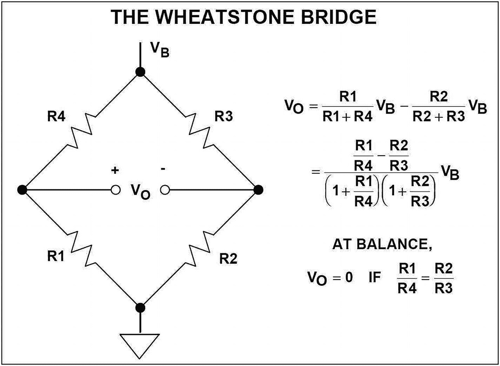

图 3-14

惠斯通电桥电路和公式

### 实验

如图 3-15 中的电路原理图所示，我们使用一个可变电阻和三个固定值电阻创建了一个电桥配置。通过选择三个固定值单元的电阻值略高于碳化硅热敏电阻的室温电阻值，并添加一个适当大小的电位器，您可以组装一个围绕高阻值碳化硅热敏电阻的电桥电路，该电路可应用于加热或冷却操作。

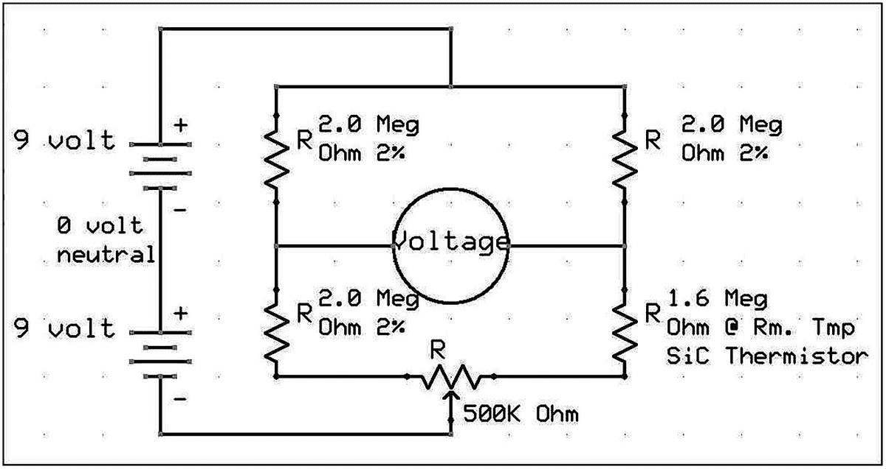

图 3-15

碳化硅惠斯通电桥

对于初始开发工作或实验装置，可以使用任何高阻抗电压测量设备来监测电桥的不平衡。我们选择了一个双电池电源，为仪表放大器提供双极性电源。

在使用碳化硅热敏电阻开发温度测量过程时，我们保存了温度校准测量的存档记录，用于本节后续涉及热运动和热力学的工作中。数据通过监测和记录一个初始平衡的等臂惠斯通电桥所产生的偏差来收集和显示。将一个众所周知的温度程序应用于电桥的碳化硅感测元件。如图 3-16 原理图所示，使用单位增益配置的 AD 620 仪表放大器将电桥偏差信号缓冲到`LabJack U12`的差分输入上，后者为`DAQFactory`图形记录显示提供输入。

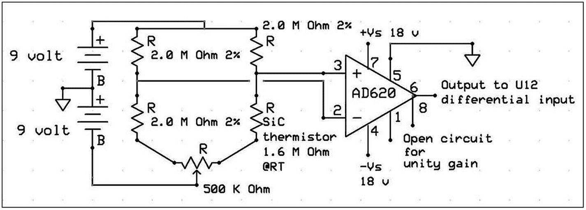

图 3-16

带碳化硅电桥的 AD620 仪表放大器

### 观察结果

对带有水银温度计、K 型热电偶和碳化硅热敏电阻的绝缘铝块干井的 22.6 Ω、5 W 电阻进行一系列定时的 12 V 直流电源施加，生成了表 3-4 中的数据。

表 3-4

碳化硅电桥校准数据

| -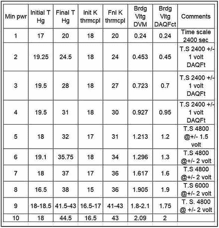 |

当施加电源时间为 8 分钟，偏差接近 2 V 而ΔT 为 24°C 时，电桥电路的线性度开始恶化。（电池电压 2 × 9 V = 18 V 电桥偏置。）

### 讨论

在室温（20°C 或 68°F）下，典型的 SiC 热敏电阻的标称电阻为 1.6 MΩ，传感器温度每变化 1°C，其电阻变化率为 7%至 8%。因此，在 19°C 或 21°C 时，SiC 热敏电阻的电阻变化量应为 1.6 MΩ × 0.075 = 120 KΩ。将 120 KΩ的值代入灵敏度公式，可以得到对于 2 MΩ电桥电路，其灵敏度为 0.261 V/°C。

理论上，由于能够轻松测量到最接近毫伏的电压，每度温度应能分辨到最接近的毫伏，即大约 1/261 °C。然而，电阻器容易产生噪声，对于 2 MΩ电桥，预计会出现显著噪声，并且如图 3-17 所示，确实发现了这种情况。

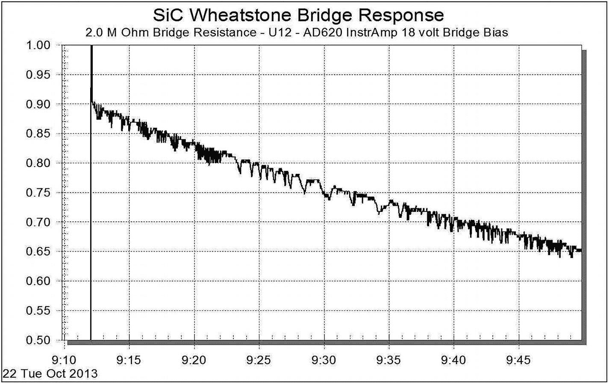

图 3-17

高灵敏度温度测量噪声

`DAQFactory`程序的平均功能可以降低迹线的噪声，同时减少信号的响应时间。

通过如图所示配置电桥，您可以通过调节电位器将电桥输出平衡至零伏。该传感器可用于测量加热或冷却操作。

在电池供电系统中，电桥电路中的较高电阻值更受青睐，因为这样可以将电流消耗降至最低，从而最大限度延长电源的使用寿命，并限制流经热敏电阻的电流，以限制自热效应。然而，电阻器产生的噪声与其电阻值的大小成正比。

尽管电桥电路在测量电桥输出电压与温度引起的电阻变化呈线性关系的范围有限，但图 3-18 显示，只要电桥偏差电压保持在线性范围内，该范围就足够大，具有实用价值。

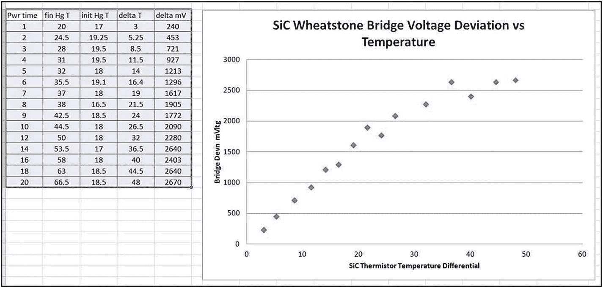

图 3-18

SiC 惠斯通电桥线性度

要将 SiC 惠斯通电桥用作连续温度监测器，需要将电桥偏差为零电压时的传感器温度，加上由电桥偏差测量的温度值。

### 非接触式红外温度测定

红外温度测量的关键优势在于能够通过光学方式，在无物理接触的情况下进行远程或“远距离”温度测量。在解读红外温度数据时，请记住这些测量是通过光学方式完成的。换能器或检测器仅将来自远处物体或电磁辐射源、在确定视场（FOV）内的不可见红外能量，转换为数字数值。整个热辐射收集系统必须遵循电磁辐射传播的规律。检测器有多种物理和光学配置可供选择，它必须拥有无遮挡、光学透明的路径，以收集并平均落入特定设备视场内的所有热辐射。

### 实验

#### 硬件

可以使用一个成本相对较低（20 加元）的红外检测器，例如 Melexis 的 `MLX90614`（可从多个在线供应商处购得），配合 Arduino、两个 4.7 KΩ 的“上拉”电阻、电源、地线和两条数据传输线，来进行非接触式温度测量。对于临时开发工作，我将该设备安装在一个迷你原型板上，并进行了以下连接（见图 3-19）。

- 引脚 1 `SCL` 连接到 Arduino 板的模拟引脚 5
- 引脚 2 `SDA` 连接到 Arduino 板的模拟引脚 4
- 引脚 3 `VDD` 连接到 Arduino 板的 3.3 V 引脚
- 引脚 4 `VSS` 连接到 Arduino 板的 GND 引脚
- 一个 4.7 KΩ 电阻连接在引脚 3（`VDD`）和 `SCL` 之间
- 第二个 4.7 KΩ 电阻连接在引脚 3 和 `SDA` 之间

原型板对于开发工作很有用，但在 3.3 V 或 5 V 电平下，原型板中“弹簧”触点的电阻可能足以导致接触电压下降，从而使电路无法按预期工作。在本书红外温度测量部分的开发过程中，有几次正确接线并供电的电路，在故障排查时用万用表探针接触后才开始工作。对于实际数据采集，更推荐使用印刷电路板或硬连线电路。

图 3-19 显示了一个电路原理图。

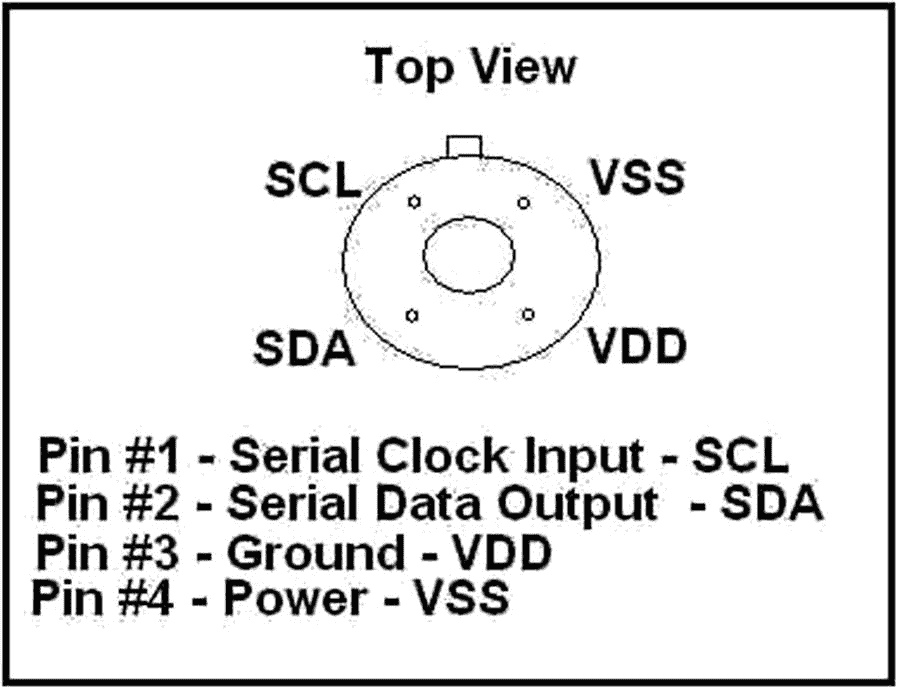

图 3-19

Melexis 90614 红外检测器引脚定义

## 软件

红外芯片可以以脉冲宽度格式，或者通过集成电路间通信格式（有时写作 `I²C`，但更常见的是 `I2C`）串行方式，提供其视场内物体的温度。Arduino 红外传感器通信所需的用于读取 Melexis 的库，是标准 Arduino 库的一部分，可从 IDE 菜单加载，其名称为 `MLX90614`。

### 所需页面组件

可以在 `DAQFactory` 中配置一个可视化温度显示，以适应红外检测器可用的范围，如图 3-20 所示。

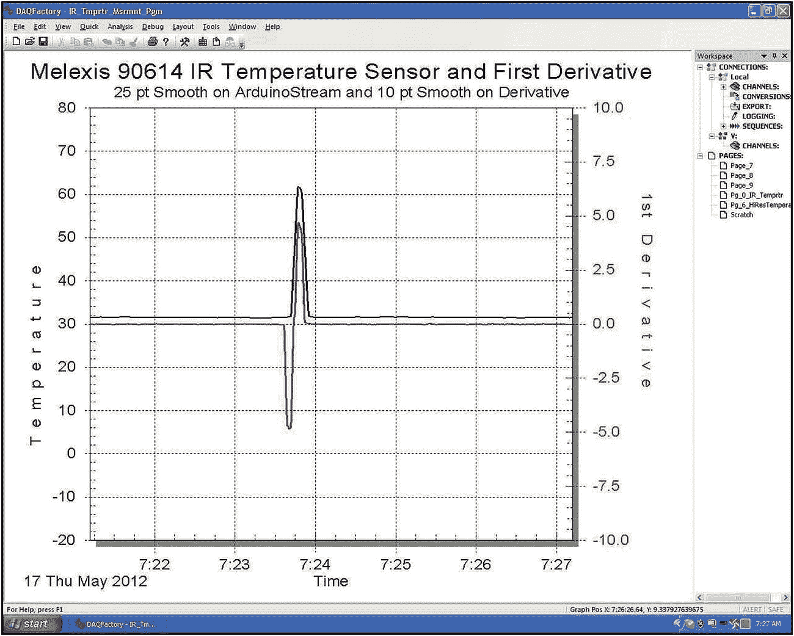

图 3-20

红外检测器温度记录及其一阶导数

### 所需脚本

从 Arduino 传输到 PC 的数据流，是检测器芯片观察到的、以摄氏度格式表示的出厂校准温度。图 3-20 显示了记录温度迹线的温度及其一阶导数。算法和代码结构与此前热敏电阻温度测量工作中使用的相同。红外检测器直接产生实际温度，因此无需进行转换。一阶导数的计算方法也与之前相同。导数函数的灵敏度是根据经验确定的，并取决于所监测的温度范围。

## 观察结果

红外探测器的响应迅速，且与热敏电阻相比，具有更大的线性范围。图 3-20 是我为开发验证而设置的一个显示屏，测量范围从 –20°C 到 80°C。通过将冰袋和热饮移入和移出探测器的视野，可以轻松展示快速且大幅度的温度变化。

使用一个面向垂直的传感器进行了几个易于操作的桌面实验，以图形方式展示了在使用红外传感器采集温度数据时必须注意的事项。由于传感器的锥形视野（FOV），如果将一个热源，例如装满热饮的杯子或马克杯，或是一个冷冻的“冰袋”，放置在探测器上方几英尺（半米）处，显示的温度测量值将是测量环境的环境温度，而不是目标物体的温度。

如果热源降低到距离探测器几英寸（5 到 6 厘米）以内，显示的温度轨迹会上升或下降，以显示热源的表面温度。然而，热源是一个辐射体。如果辐射的功率强度足够大，它可能会影响探测器外壳的温度，以及热敏探测器，并且显示的读数会发生漂移。当日光、手部热量和热饮靠近传感器外壳时，即使它们不在探测器的视野内，记录到的温度信号也会变得嘈杂并产生偏差。

与所有传感器一样，随着灵敏度的提高，信噪比会降低；而随着用于降低噪声的信号平均量的增加，显示的响应时间也会增加。

使用 `DAQFactory` 程序创建的视觉显示需要 200 毫秒的延迟，以避免过高的数据流速率，该速率会导致光标变得迟缓甚至无响应，从而降低图形显示质量。我能够在 `DAQFactory` 通道中添加一个 25 点平均值，并将 Arduino 代码中的延迟减少到 150 毫秒，而显示屏光标的性能没有明显下降。

光学温度测量依赖于“视线”观测。要测量的热源必须对探测器可见。容器内的热液体或冷液体可能需要从上方观测，以测量其内容物的温度。

## 讨论

一个 Melexis 探测器芯片被识别为型号 `MLX 90614 AAA`。根据制造商的数据手册，第一个 `A` 表示该单元由 5 V 供电（也有 3.5 V 的版本），第二个 `A` 表示视野被视为一个单一物体（也有双视区探测器可供选择）。最后一个 `A` 表示封装是行业标准的 TO-39 外壳，具有 45 度的视野（FOV）。探测器有多种视野选项可供选择，范围从 5 度到 35 度。

数据手册包含使用各种数据输出的时序信息，以及探测器物理、电子和光学参数的深入解释。容纳该设备的金属外壳上的窗口可以透过 5.5 至 14 微米之间的红外辐射。

`I2C` 库和 Arduino Melexis 代码是 Arduino 的标准库，可从 IDE 中获取。在库的某些较旧版本中，Arduino 代码的最后几行（通过三步串行打印操作）会将字符串字符和数字的混合发送到串行端口，以组装成一个两位小数值，代表探测器视野内物体的平均温度。如果遇到 Arduino 代码中输出值的混合数字和字符串字符格式，最好使用 `DAQFactory` 通道和图形显示的信号处理功能来进行平均值计算和任何所需的数据平滑处理。

工厂校准和设备固件基于 `SMBus` 数字接口，并允许访问 –70°C 到 380°C 的温度范围。`SMBus` 是一种较旧的、单端、两线通信协议，用于简单的单向数据串行传输。系统管理总线协议通常与较新的当前 `I2C` 协议兼容。

热量通过传导、对流或辐射从一个物体传递到另一个物体。辐射热传递涉及波长范围为 0.7 至 1000 微米的红外波段电磁辐射（1 微米或有时为 `μ` 等于 `10^(–6)` 米）。出于实际原因，0.7 至 14 微米之间的波长用于红外温度测量。如果视野中的物体被入射辐射照射，部分辐射会被吸收，部分会被反射。物体的反射系数可以从 0% 变化到 100%。粗糙、无光泽的表面可能具有低反射率，而抛光、有光泽的金属表面可能具有很高的反射率。

热源相对于探测器的位置，以及物体透射被测红外波长的能力，也会影响对视野中物体温度的测量（有关黑体辐射的更多信息，请参阅光谱学或物理学文献）。从视野中的物体落到探测器上的能量，受到该物体的反射、透射和吸收系数以及红外辐射波长的影响。

为了准确确定温度，需要评估物体周围的背景。需要确定表面的物理状态，并且必须考虑该表面的发射率。光滑或抛光的金属表面可以像红外辐射的镜子一样。金属表面可能指示其周围环境的温度，而不是金属本身的温度。明亮的铝表面可能需要涂上耐高温的黑色涂料，或者进行阳极氧化处理，以便让红外探测器测量到实际温度。

对于涉及红外温度测量方法的工作，必须通过观察并获取已知物体的温度来验证系统。

# 热电偶温度测定

塞贝克效应和珀尔帖效应描述了由两种不同金属构成的回路中，当接触点处于不同温度时发生的可逆电子流动。图 3-21 展示了一个典型的不同金属热电偶测量装置。
典型的电压电平在每摄氏度几微伏的范围内，具有相当好的线性和可重复性。未知温度的测量是通过测量不同金属导线回路中的电压来完成的，此时两个接点中的一个保持在已知的参考温度下，通常是冰水混合物的温度。热电偶在冰水温度下的电压具有足够的稳定性和可重复性。现代集成电路如 `MAX31855`、`AD594` 和 `595`，能够产生一个参考电压，以替代在给定的固定 0°C 温度下的第二个热电偶接点。有了集成电路提供的固定参考接点信号，单个双金属接点就可以通过测量接触点处产生的电压来确定未知温度。热电偶是自供电传感器，无需激励或外部电源。

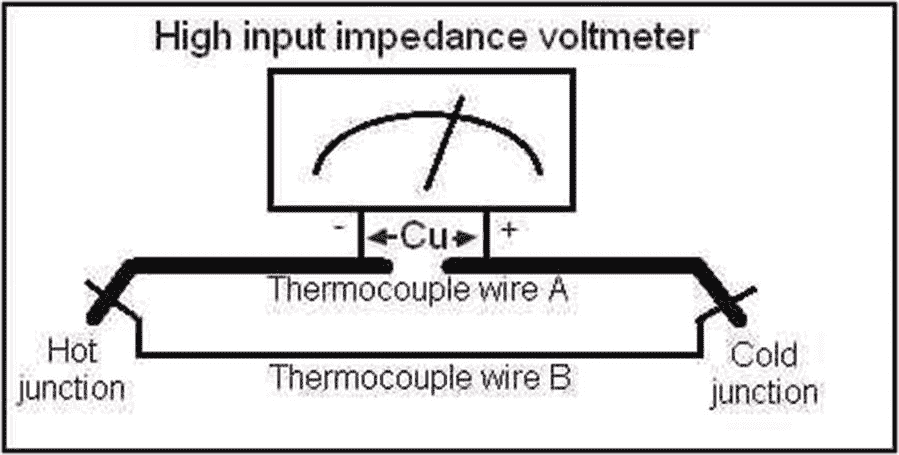

**图 3-21** 一个典型的不同金属热电偶电路

热电偶产生的小电压值所带来的困难，在一定程度上被金属所能工作的宽温度范围所弥补。相对廉价的镍、铬、铁和铜合金被用于制造 J 型和 K 型热电偶，这些是目前最常用的传感器。根据用于产生热电流的金属种类，热电偶可分为贱金属组和贵金属组。更高温度的测量范围在 1350°C 至 1700°C 或更高时，必须使用铂族金属与其他金属（如钨、金和钼）组成热电偶接点，或者研究者可以使用光学方法。关于高温工作以及昂贵合金的正确应用，可以在文献中找到更多信息。
使用表 3-5 中列出的常见金属制成的热电偶，可以实现从低温到约 1250°C 的测量范围。贱金属热电偶是后续文本中所述工作的重点。
由铬镍-铝镍合金接点组成的 K 型传感器每摄氏度产生 41 μV。K 型传感器由两根导线构成的回路组成，这根回路是通过将一根由 90%镍（Ni）和 10%铬（Cr）构成的铬镍合金导线与另一根称为`铝镍`的合金导线焊接在一起形成的，后者由 95% Ni、2% 锰（Mn）、2% 铝（Al）和 1% 硅（Si）组成。该接点呈现 41 μV/°C 的电压输出，可以测量–200°C 至 1350°C 范围内的温度。
称为`铁-康铜`的 J 型传感器由康铜（一种 55%铜（Cu）与 45%镍的合金）和纯度较高的铁（Fe）导线制成。使用磁性且化学性质相对活泼的铁将其使用范围限制在–40°C 至 750°C。铁-康铜系统的优势在于其构建材料相对廉价，以及 55 μV/°C 的信号产生率。表 3-5 是根据多个来源列出的数据编制的，包括以下来源。
- 《电子学艺术》作者：Paul Horowitz 和 Winfield Hill（剑桥大学出版社，2015 年）。
- `www.analog.com/media/en/technical-documentation/application-notes/AN-369.pdf`

**表 3-5** 热电偶类型

| -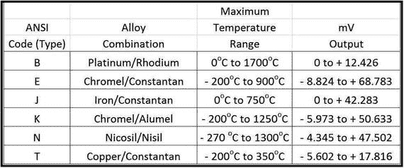 |

金属线径决定了热电偶的强度，从而决定了其“在使用中”的坚固性。线径还会影响导体的电阻和接点响应时间。表 3-6 列出了不同线径的铬镍-铝镍传感器的典型数据。

**表 3-6** 热电偶线径及其对传感器响应时间的影响

| -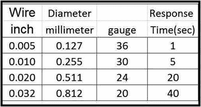 |

有关热电偶热量测量理论与实践的更多讨论，请参阅《电子学艺术》以及访问 `www.analog.com`。几乎所有主要的集成电路制造商都有专门的应用笔记，描述其可用于热电偶温度测量的电路。

## 实验

当使用热电偶实现温度测量时，微信号放大和冰水参考信号的需求，最好通过专用集成电路（ASIC）和市面上现成的点焊传感器来满足，这些传感器易于获取、价格低廉、可重复且可靠。
热电偶结经过点焊以确保完全的物理和电气接触。商用组装传感器通常配备有特制的彩色编码公插头，用于插入单个传感器系统的母连接器，或像许多工业应用那样，插入用于多传感器类型网络的集线器。（北美以外的地区颜色编码有所不同。）在本练习中，Omega Engineering 公司生产的商用 J 型和 K 型热电偶所附带的公头热电偶插头，连接到一个红色或黄色的母插座上，母插座再通过一对双绞线连接到原型面包板。
插接式面包板便于轻松组装并为 `AD595` 陶瓷 DIP 集成电路供电，该芯片为 K 型铬镍-铝镍硅传感器提供内部电子冰水参考电压、信号放大和高阻抗电压读数。（`AD594` DIP 陶瓷芯片可用于 J 型热电偶。）制造商的数据手册提供了以下主题列表的信息（见图 3-23 至 3-26）：
*   热电偶基础知识
*   `AD594` 和 `AD595` 用于 J 型和 K 型传感器的温度标度校准
*   所需显示温度范围和精度对应的电源要求
*   器件输出模式及实现热电偶故障报警
最初，本书使用了安装在原型面包板上并由 `LabJack U3-HV` 接口供电的 `AD595`。演示系统中的电气连接通过螺丝连接器和一对双绞线完成，双绞线将仪表放大器连接到行业标准的黄色 K 型热电偶插头。为了确保可靠性，还安装了一个红色 LED 连续性故障报警器。
验证或演示热电偶温度测量以及处理高温实验带来的材料问题中，比较困难的方面之一在于制造小型、可控的高温热源。
图 3-28 中接近 200°C 的温度，是通过将一个 15 W 的“负载灯”灯泡封装在锡纸包裹的瓦楞纸板辐射热烤箱中实现的，如图 3-22 所示。烤箱放置在一块底板上，底板上开有孔洞，以便将负载灯灯泡拧入其灯座。必须小心确保底板紧密地安置在 CSA 或 UL 认证灯具中包裹灯泡插座的可拆卸螺纹瓷环下方。（加拿大标准协会或美国保险商实验室——电气配件认证机构）。烤箱的壁和顶由锡箔包裹的厚重硬纸板套筒和方形锡箔覆盖的硬纸板制成。灯泡功率可以通过经认证的调光器或图 3-23 中的电路来控制。
如果选择使用 TRIAC 供电的交流 PWM 电路来控制施加到灯泡的功率，则定时电容器应为塑料薄膜型或接近 1 μF 的低漏电电容器，以使定时器 IC 输出与 60 Hz 交流线电压波形保持同步。请记住，所有交流布线和电气配件必须符合当地电气或建筑规范。

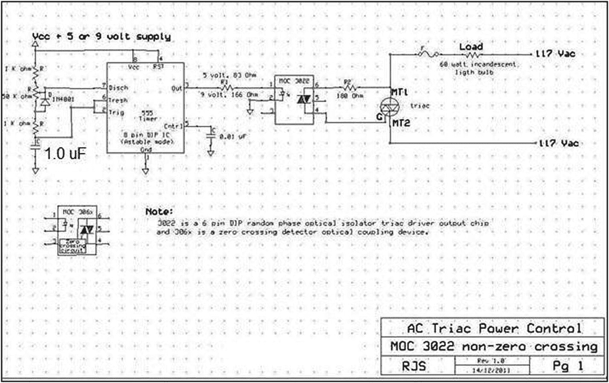

**图 3-23** 用于灯泡烤箱的基于 TRIAC 的交流电源

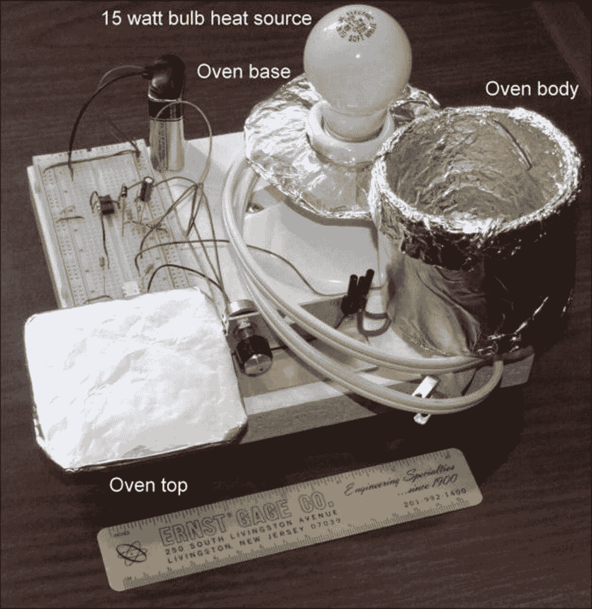

**图 3-22** 灯泡烤箱

图 3-24 至 3-27 描述了一系列描述使用 `AD594/5` IC 测量热电偶温度的变体电路图。
要测量超过使用 `U3-HV` 提供的 +5 V 电源（见图 3-24 和 3-26）所施加的 300°C 限制的温度，必须使用如图 3-25 所示的双极性非对称电源。可以使用三个 9 V 电池，方法是将一对串联电池的负极引线连接到第三个 9 V 电池的正极引线上。这样，公共的正-负连接就建立了比“地”或公共点高 +18 V 的电位，以及比地低 –9 V 的电位。因此，非对称电源允许 `AD595` 和 K 型热电偶测量从 –200°C 到 1350°C 的温度。组合的这三个电池总共产生 27 V 的电位，比芯片最大 30 伏低三伏。
图 3-26 中的电路显示了用于接线 LED 连续性指示器的连接方式，该指示器应安装在所有热电偶实现方案中。
图 3-27 说明了一种配置，其中 `595/4` 芯片本身可用作温度传感器。

### 硬件

典型的 K 型热电偶器件可能会产生 41 μV/°C 的信号，而 J 型则产生 55 μV/°C。测量如此微小的信号需要一种不会从传感器汲取任何可观电流的“仪表放大器”器件。专用的高阻抗仪表放大器可在专用集成电路中获取，例如用于 J 型和 K 型热电偶的 `Analog Devices 594` 和 `595` 芯片。
由温度因素以及制造热电偶所用不同合金的化学性质引起的焊接问题，通过使用机械连接将传感器连接到电子器件来规避。将 Omega Engineering 公司生产的商用带插座公头的铬镍-铝镍硅 K 型热电偶插入一个 K 型母插座中，该母插座配有一对双绞线，用于接入原型面包板。原型板承载了双列直插式封装（DIP）的 `AD595`、来自 `LabJack` 的 5 V 电源以及 LED 连续性指示器，同时方便连接到 `U3-HV` 接口。
图 3-24、3-25、3-26 是电路原理图。

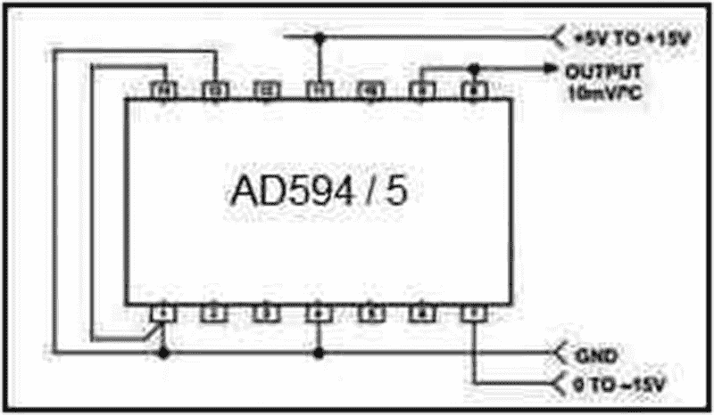

**图 3-27** 配置为独立摄氏温度计的 `ADC594/5`

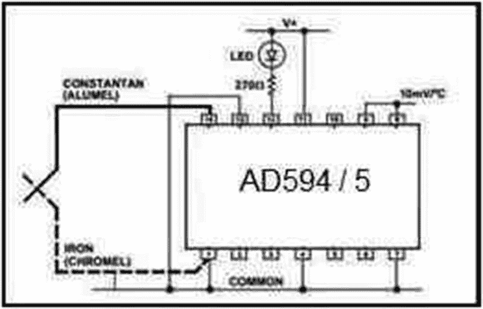

**图 3-26** 带 LED 的报警配置

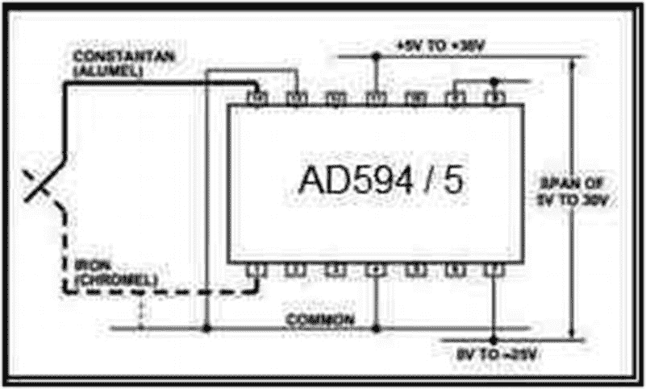

**图 3-25** 双电源供电操作

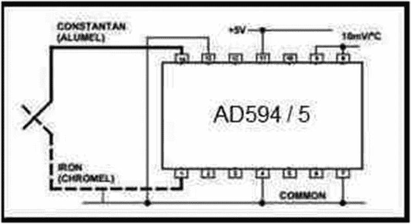

**图 3-24** 基本连接，单电源供电操作

## 软件

根据制造商的数据手册，这些集成电路在出厂时已针对标称 25°C 下的固定增益操作进行了校准，以生成与 ANSI 值相对应的电压。为了记录 `AD595` 的热电偶温度、输出电压、面包板安装及 USB 供电组合的情况，用于跟踪 `AD595` 输出的通道，其图形输出可以通过向图形显示器的绘图函数添加补偿值来进行调整，以符合 ANSI 标准。对于温度-电压关系的 J 型和 K 型曲线，其线性度对大多数实验而言已经足够。如果需要更精确的温度数据，建议在感兴趣的温度范围内进行校准。
在 `DAQFactory` 中创建了一个名为 `thrmoCplU3` 的通道，用于读取 `LabJack U3-HV` 接口上的第一个模拟输入通道。结果以黑色绘制在二维图形显示器上。右轴上以红色绘制的第二张图用于在开发阶段跟踪实际电压值。
虽然不需要编写脚本，但在 Y 表达式框中，只需将 `AD595` 以伏特为单位的输出电压乘以 100，即可绘制热电偶温度。该通道测量的是 595 的输出电压。当转换为毫伏并除以 10mV/°C 后，得出一个 100 的乘数因子，用于将观测到的放大后热电偶电压转换为摄氏度以便绘图。

## 观察结果

使用 `AD595` 热电偶放大器可测量的温度范围，由为该集成电路供电的电源电压决定。图 3-28 显示了一个简单负载灯炉中观测到的温度记录，即热电偶放大器输出在 0 到 3.5 V 和 0 到 300°C 范围内的数据。该负载灯炉的设计目的是在 USB +5 V 电源所施加的约 300°C 限制以下，产生可调节的、可变的温度。

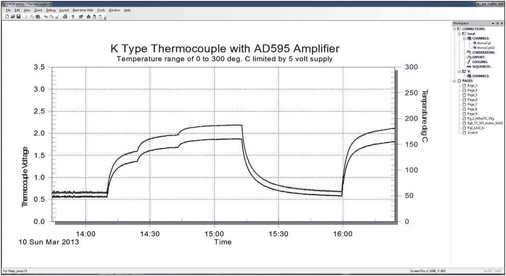

**图 3-28** 白炽灯泡的表面温度

图 3-28 中的温度曲线显示了在简易负载灯炉中，当负载灯的开启/关闭时间随 PWM 功率控制器变化时所观测到的温度波动。
使用双极非对称电源时，热电偶既可以测量低于环境温度的温度，也可以测量远高于环境温度的温度，其温度上限由所涉及金属的熔点决定。在图 3-29 中，对烙铁测量的不同温度揭示了测量较高温度时遇到的一个问题：腐蚀产物干扰了热传递。

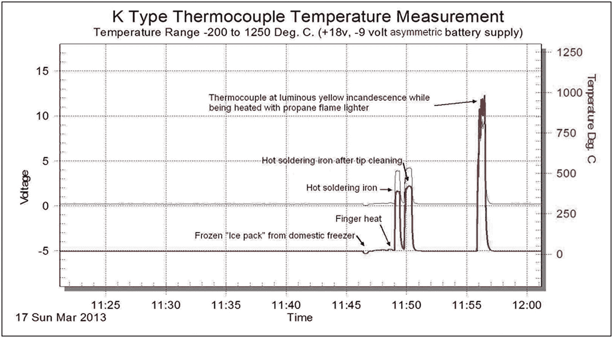

**图 3-29** 热电偶电压与较高温度测量

## 讨论

热电偶提供了一种温度测量手段，其测量范围超过了热敏电阻所能达到的范围。大多数热电偶可以在接近其熔点的温度下提供数据。
科学史指出，热电效应最初是在发现浸没在热梯度中的导体周围存在磁场时被发现的。通常认为热电效应是由异种金属接触产生的，但无论是熔焊、基于焊剂的钎焊，还是螺钉或螺栓等机械紧固件，在对热电偶进行测试或验证时都会产生相同的结果。热电效应是沿着导线热梯度的长度方向产生的，而不是在异种金属的接触点处产生，接触点只需要可靠的电气接触来闭合电路即可。
达到超过 650°C (1300°F) 的温度，会使设备进入一个温度范围，在此范围内，典型的构建材料（如锡铅焊料、镀锌涂层、锡、铅和铝金属、塑料、钠钙玻璃和硼硅玻璃以及许多其他材料）会软化或熔化。在较低温度下绝缘的大功率电导体可能会突然短路，可能导致熔融材料的爆炸性气化。为了达到更高温度而开发的装置或辅助设备，其从规划、制造到投入运行温度的整个过程，都必须经过仔细监控并缓慢递增步骤，以确保所有相关人员的安全。
热电偶、RTD 或光学方法是测量超过 650°C 温度的仅有手段。热电偶可能是监测较高温度的最简单方法。K 型和 J 型传感器在实验工作中很受欢迎，因为它们价格低廉、坚固耐用，并且能产生较高的热电偶结电压（分别为 41 μV/°C 和 55 μV/°C）。
由铬镍-铝镍热电偶结组成的 K 型热电偶灵敏度较低，但由于其合金中镍、铬和铝成分形成的铝和氧化铬层，其温度范围更宽且具有化学惰性。J 型传感器虽然能产生热电偶传感器中最高的电压，但由铁-康铜组成。铁的活性特性，加上温度-电压相关性中 770°C 居里点的不连续性，限制了该传感器的可用范围。
在选择用于封闭环境中测量高温的热电偶时必须小心，因为被加热材料可能会释放出腐蚀性气体。K 型热电偶受到铬和铝的耐火氧化物的保护，能在空气中完全覆盖传感器量程。J 型和 T 型热电偶含有铁和铜，两者都是具有反应活性的天然金属。
含有大量或少量反应性和还原性气体（如氨、氢气、卤化氢、硫化氢、氮氧化物、氧气或硫氧化物）的气氛，需要您查阅相关文献，以了解其化学相容性和温度限制。
低温测量应用通常处于低温大大抑制了化学反应活性的环境中，因此在传感器选择方面问题较少。
升高的温度会按比例提高化学反应速率，这包括了被称为腐蚀的反应。虽然异种金属之间的接触在机械结构中因腐蚀作用而臭名昭著，但热电偶金属的情况要好得多，然而高温和高热会对几乎所有材料产生严苛的条件。建议在任何 TC 温度监测系统中，安装图 3-26 所示的 LED 连续性监测器。

# 热传递与基础热力学

热能可视为特定温度下特定质量或系统中以运动或振动形式存在的分子动能。理论物理学将除零点分子运动之外的所有运动停止的点称为温标上的绝对零度。从绝对零度的概念出发，我们可以通过考虑两个质量块来进一步区分热量与温度：其中一个质量是另一个的两倍，两者具有相同水平的分子动能。这两个不等质量块的温度相同，但质量较大的块所包含的热量是较轻块的两倍。温度描述的是能量的水平，热量描述的是能量的数量。

热量是一种能量形式，可以凭借两个位置之间的温差从一个系统传递到另一个系统。能量从热的地方向冷的地方移动，以达到热力学平衡。对流、传导和辐射是传递热能的三种主要方式。艾萨克·牛顿爵士关于热的原始出版物论述了温度测量。傅里叶的著作描述了热能的运动。

通过模拟加热物体的冷却，对热运动进行热力学研究已成为科学或数学教育中的传统练习。牛顿冷却定律是一个应用，由此可以发展出指数衰减数学模型。

迄今为止，在涉及温度监测研究的先前实验中，使用了内部装有电加热器并设有特殊空腔以容纳温度传感器的绝缘金属块组件，这种传感器被称为*干井*。通过记录干井从较高温度冷却到较低温度时的温度变化，我们可以推导出冷却定律，并生成关于材料的特定信息以及预测性数学公式。

社会中广泛使用的金属、玻璃和塑料，通常是从其高温液态制成物品。当被加热材料保持在熔炉或烘箱中时，它处于液态或塑性状态，可以被塑造或挤压成有用的形状，然后通过冷却固定成所需的最终形状。冷却过程通过将热成型产品移至较冷的环境，使其自由散热或按受控程序散热来启动。

就一个有用的数学模型而言，你可以写成：

```
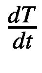 = `–k(T[i] – T[e])` -- 1
```

*   `–k` 是比例常数，`dT/dt` 是一阶导数，即温度随时间的变化率
*   `T[i]` 是物体的初始温度
*   `T[e]` 是物体向其散失热量的环境温度。

为了求解微分方程并找到任意所需时刻的温度 `T`，将时间和温度变量分离。对等式两边进行积分以得出表达式。

`–kt = log(T[i] – T[e]) + ln C`  或

`T[i] – T[e] = Ce^(-kt)` ，根据零时刻的初始条件，当

`C = T[i] – T[e]` 时，我们可以代入 `C` 并写成

`T = T[e] + (T[i] – T[e]) e^(-kt)`，以关联物体温度和时间流逝。

如果在固定时间内连续记录温度的下降，可以使用该衰减曲线作为数据源来评估参数，例如隔热材料的有效性以及实验装置的热容量。

一种称为*欧拉法*的技术将记录到的时间和温度曲线的各个点转换成一种格式，从中可以推导出牛顿定律公式中比例常数的数值。

牛顿冷却定律被用作微分方程的教学示例，因为与大多数微分方程不同，它可以求出精确解。欧拉法是一种技术，它既能对可能没有精确解的微分方程在小范围内生成近似解，也能对确实有精确解的微分方程（如牛顿冷却定律中的方程）求出其中的常数。

## 实验

对于化学家、生物学家和工程师来说，许多实验研究都需要监测封闭系统中热量的产生或散失。本书前面的章节中，使用了一种简单的“封闭系统”近似，即铝制*干井*，用于创建可重复的固定温度和可变温度曲线。将干井封装在泡沫聚苯乙烯盒内作为隔热，但留有加热器电源线的开口以及进入金属块中干井腔体的通道，这样就近似构成了一个封闭系统。通过在温度升高扰动后，记录干井冷却到环境条件时其温度随时间下降的数据，可以收集评估方程 1 中比例常数 `k` 所需的数据。如果在有和没有隔热层的情况下对干井进行定时供电，则可以推导出该隔热层隔热效果的数值。使用如图 3-15 所示惠斯通电桥中的 SiC 热敏电阻，记录了有隔热和无隔热情况下干井的冷却曲线。

### 观测结果

图 3-30 展示了从观测到的冷却曲线中读取的、有和没有泡沫聚苯乙烯隔热层的 22.6 Ω 干井的时间和温度测量数据表格。蓝色代表有隔热层冷却，红色代表无隔热层冷却。

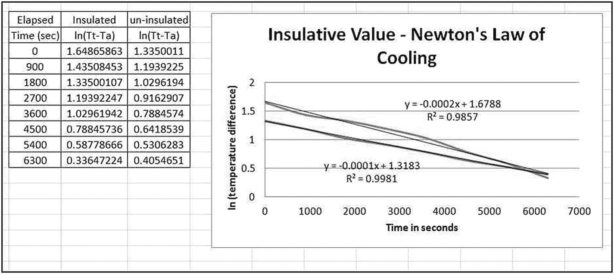

图 3-30

泡沫聚苯乙烯隔热对铝制干井块冷却速率的影响

## 讨论

热量可以简单分为两种形式：*显热*和*潜热*。显热是指当向某物质添加或移除能量时，导致该物质温度发生变化的能量。潜热则是为改变物质物理状态而必须向该物质添加或从中移除的能量，且不表现为温度变化。水的比热容为`4.186 J/g °C`（80 cal/g °C），但在 0°C 时，其熔化潜热为`334 kJ/Kg`（80 cal/g）。在 100°C 时，其汽化潜热为`2260 kJ/Kg`（540 cal/g）。我们利用潜热现象，通过测量热敏电阻浸入水/冰混合物时的电阻来校准它们。如果液体浴槽中存在冰块，温度将保持在 0°C，直到所有冰块融化，此时任何流入浴槽的热量都会导致系统温度升高（见图 3-49）。在另一种极端情况下，当使用水作为校准流体时，一容器沸腾或冒蒸汽的水，在根据海拔或大气压进行校正后，只要容器内仍有液态水，其温度就会保持在 100°C。

在水沸点和冰点之间的温度下，向一克水添加一卡路里热能，会使水温升高一摄氏度。比热容是将单位质量的物质升高一摄氏度所需的热能。

水是比热容的标准参照物，其值为每摄氏度一卡路里。文献中包含了许多关于元素、化合物以及液体和固体形态建筑材料的比热容表格。气体的比热容定义则需要更加谨慎。

除了比热容，热导率在设计控制热流系统方面也很有价值。测量加热块冷却速率的变化，可以作为衡量泡沫聚苯乙烯隔热效果以及系统封闭性的一项指标。表 3-7 列出了各种材料在室温下的热导率，其中热导率`k`的单位是瓦特每米摄氏度。

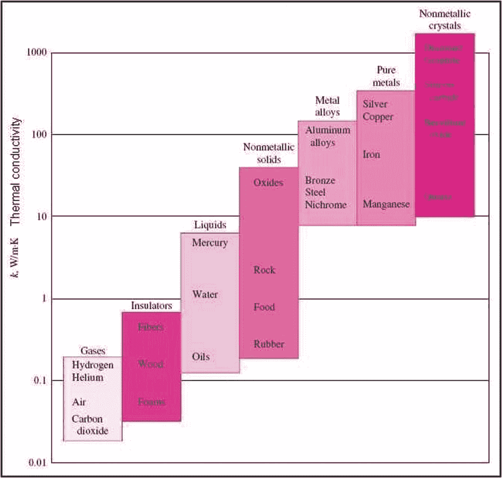

图 3-31

选定材料热导率的图形表示（参见 [`what-when-how.com/energy-engineering/heat-transfer-energy-engineering/`](http://what-when-how.com/energy-engineering/heat-transfer-energy-engineering/)）

表 3-7

各种材料在室温下的热导率

| -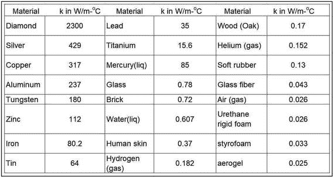 |

# 热电效应

人们很早就知道，通过在磁场中移动线圈导线导体可以将机械能转换为电能。但鲜为人知的是，沿着导体的温度梯度也会在该导体内产生一个微弱的电场。通过使用另一种金属导体来完成测量回路，可以测量出驱动载流子穿过温度梯度的电压，这样就形成了常用于测量梯度一端温度的热电偶。

热电偶是一种广为人知且常用的温度测量系统。热电偶结点是由两种不同的金属导线电气连接而成，当这些导线组合成适当、具有双结点的电路时，就能将温差转换为微弱、可测量的电压。热电偶利用的是 18 世纪发现的热电效应（塞贝克效应），同时发现的还有珀尔帖效应，该效应阐述了电流与不同金属结点处加热或冷却之间的关系。

随着对电能、金属导体和温差之间关系的认识加深，人们逐渐意识到，与电磁感应力相比，热电现象本质上非常微弱。

热量、电流和功率通过欧姆定律以及功率表达式`P = I²R`相关联。电流在金属导体中克服电阻移动时，会产生热量。

尽管最初的热电现象是在金属导体界面发现的，但同样的热-电转换也可以在半导体中实现。如今，大多数热电设备中使用的半导体是碲化铋（`Bi[2]Te[3]`）。

在图 3-32 中，现代热电设备的可逆性质通过热量或电能流动的方向得以说明。如果存在温度梯度或热梯度，单个设备可以发电。如果有电能可用，则可以移动或“泵送”热能。


图 3-32：一种可逆的热电设备

图 3-33 描绘了一个典型的尺寸为`40 mm² × 4 mm²`的陶瓷封装热电板的构造。


图 3-33：一个典型的陶瓷封装热电板

# 热电加热与制冷

热电设备是商业制造的，用于实现电能和热能之间的相互转换。固态热电设备可以认为是可逆的，因为它们没有移动部件，既可以利用电能泵送热量，也可以利用热能发电。

通过使用半导体优化微弱的热电效应，创造了一种热移动技术，该技术具有同样微弱、有限但仍然可用的能力。除了这种效应本身的微弱性质外，温差还受到用于组装传热设备的建筑材料和已建立梯度上的辐射传热的热导率的限制。与电阻加热组件一样，必须小心谨慎，避免过近地接近或无意中超过热操纵系统中用于制造电气连接的焊料的熔化温度。几乎所有类型的半导体设备都对热敏感，并且倾向于在环境温度和更低温度下运行得更好。`Tellurex` 是一家`40 mm²`、碲化铋、氧化铝陶瓷板热电设备的制造商，其数据手册建议最高使用温度为 100°C。

## 实验

平板热电热传导元件需要低压、大电流的直流激励才能在其表面传递热量。使用微控制器和`MOSFET`器件可以方便地实现对低电压下大直流电流的控制。图 3-34 电路中所用的微控制器代码，是一个简单的、通过脉冲宽度调制（PWM）应用手动增加或减少供电功率的模块，用于调制或驱动高电流`MOSFET`的栅极。因此，栅极调制可调节由线路供电电源提供的 12 V、8.5 A 直流电源。

一个热电热泵演示单元由木制底座和一系列成形堆叠的木制板构成，这些板形成一个双腔测试单元，中间由一块 40 mm²（1½英寸）× 4 mm（英寸）厚的热电板隔开。一个大电流电源、接线端子板、一个`Arduino`微控制器和两个 30 KΩ热敏电阻温度探头均牢固地安装在组件底座上，以便在改变热电冷却（TEC）板的功率时，安全地供电并监测产生的温差。

图 3-34 是一个综合示意图，展示了与`Arduino`的连接，用于温度监测以及高电流`MOSFET`栅极的脉冲宽度调制（PWM）控制。两个 30 KΩ热敏电阻安装在测试单元两侧形成的热室和冷室中，TEC 板将这两个腔室分隔开。

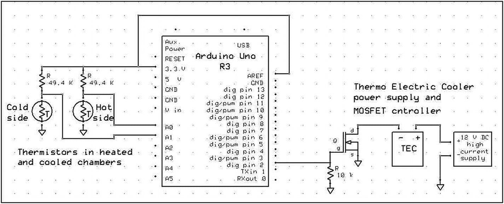

**图 3-34**

Arduino TEC 电源控制与温度监测原理图

如图 3-34 原理图所示，对 TEC 的功率控制以及 TEC 板产生的温差，由编程了清单 3-4 中代码的`Arduino`进行控制和显示。这段代码控制一个 PWM 引脚，其输出宽度通过从串口发送`"i"`或`"d"`来增加或减少，从而改变高电流`MOSFET`开关栅极的导通和关断时间。使用了一个安装在 2 英寸×2 英寸（50 mm × 50 mm）带散热片散热器上的`FQP33N10` 100 V、33 A、52 mΩ导通电阻、N 沟道、增强型功率`MOSFET`，用于控制流向 TEC 的电流。TEC 产生的温差由安装在测试单元内 TEC 板两侧两个腔室中的两个 30 KΩ环氧树脂珠热敏电阻进行监测。

通过在温度监测中使用`Arduino`上的 3.3 V 电源、5 倍数据平均值以及描述电阻与热敏电阻温度关系的 Steinhart-Hart 近似公式，可以获得更高的稳定性和精度。

用于监测由 TEC 板将主腔室一分为二所形成的每个隔间相对温度的两个热敏电阻，均安装在手工绘制的小型电路板（见图 RE-2）上，然后将这些电路板固定在测试组件顶板和底板中心钻孔的检修孔旁。

清单 3-4 会将控制和监测算法中使用的几个中间值打印到串口，以协助系统配置。一旦测试单元功能令人满意，您可以根据需要注释掉打印中间诊断值的代码行，以清理串口显示。

在图 3-35 和图 3-36 中，TEC 测试装置以组装形式以及部分拆卸状态展示，以显示其简单的构造。各个组件由数字标注标识，这些数字在图后的文字中予以说明。

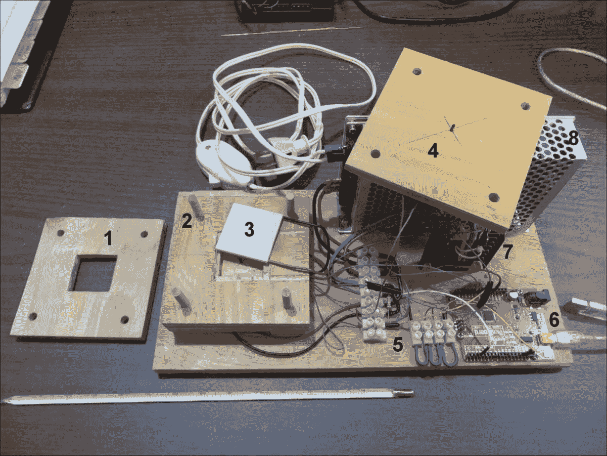

**图 3-35**

Arduino TEC 测试腔室（部分拆卸状态）

图 3-35 展示了用于制作 4 平方英寸（10 cm²）双腔测试单元的部分拆卸状态的组件，该单元使用四块 3/8 英寸（9.5 mm）厚的胶合板。板 I 和板 II 在 1-5/16 英寸（3.3 cm）的方形开口周围有 1/8 英寸（3 mm）宽、1/16 英寸（1.5 mm）深的凹槽台阶，用于容纳 1-9/16 英寸（40 mm）的 TEC 板（组件 3）。

与该板的电气连接通过冷却板右侧的两个凹槽通道引出。单元的底板与顶板（标注 4）相同，在板的几何中心钻有一个 3/32 英寸（2.4 mm）的孔，用于容纳安装有 PCB 的热敏电阻组件，如图 3-36 所示。

四个木制定位销对齐测试单元组件，并定位 4 平方英寸（10.1 cm²）的垫片，这些垫片将整个堆叠件抬高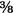英寸（9.5 mm），使其离开½英寸（12.2 mm）厚胶合板底座的顶面。在标注 5 两侧可见的两个接线端子板安装在底座上，为连接 USB 的微控制器（标注 6）、安装有散热器的`MOSFET`（标注 7）以及边缘安装的大电流 12 V 电源（标注 8）的接线提供牢固的安装点。

图 3-36 显示了安装在顶板上的、手工绘制的分压电路 PCB，其上装有热敏电阻和固定值电阻。这个顶板 PCB 与安装在大电流测试装置底板上的第二个 PCB 组件完全相同。

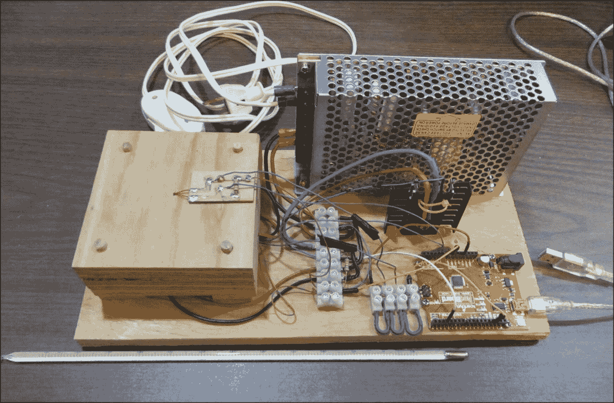

**图 3-36**

Arduino TEC 测试系统（完全组装状态）

进行 TEC 测试时，将微控制器连接到装有 Arduino IDE 的计算机，并为 12 V 电源供电。将清单 3-4 加载到微控制器中。通过从串口监视器发送一个`"i"`，以 5 个单位为增量增加施加到 TEC 板的所需功率。由`"i"`调用的 5 单位增量被映射到一个 0 到 255 的脉冲宽度调制范围，该范围调整栅极导通时间，从而每调用或使用一个 5 单位增量，就将可用功率的 12.5%施加到 TEC。

## 观察结果

对木质双腔单元中 TEC 的初步测试表明，腔室整体有冷却效果。对 Arduino 代码进行一个 5 单位的增量（对应于 12%的 PWM 功率输送至负载）后，一个小时内，板冷侧的热敏电阻读数从初始的 26°C 降至 1°C。

在图 3-34 的电路图中，电源的正极连接到板的红色或正极端子。施加较低功率水平会使板冷却，一侧的冷却速度比另一侧快 5 或 6 度。如果施加的电流反向，则另一侧冷却得更快，但在反向电流配置下仅进行了有限的实验。

在图 3-37 中，施加到 TEC 的功率大小决定了从冷却板获得的冷却程度。

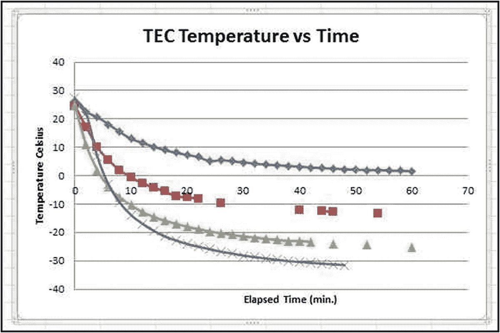

**图 3-37**

在四种施加功率水平下，Arduino TEC 温度随时间的变化

## 讨论

热电热传递需要在相对较低的电压水平下控制大电流。测试单元的`TEC`电热冷却片由一款线路供电的 12 V 电源供电，其输出能力为 8.5 A。为了使用`PWM`技术控制该电流，将一个`FQP 33N10` MOSFET 安装在 2 in × 2 in (5 cm × 5 cm)的带翅片散热器上，以满足`TEC`电热冷却片的电流需求。

我们选用干燥木材作为基本结构材料，因为它易于获取、便于加工，并且兼具电绝缘和热绝缘特性。

代码清单 3-4 是一个允许对`TEC`电热冷却片进行功率控制并将腔体温度打印到串口的 Arduino 程序。该代码使用 Steinhart-Hart 方程来生成每个腔体的摄氏度温度。此处仅绘制了冷却腔体的数据，作为`TEC`电热冷却片提供的热传递能力的一个示例。

为了充分利用`TEC`电热冷却片的热传递特性，必须在使用保温或隔热的绝缘材料方面格外小心。例如，如果实验需要温度与环境温度有显著差异，那么双腔体测试装置的设计并不理想，因为被泵送的热量无法消散，会在相邻的接收腔体中积聚，从而为热量回流到温度不足的腔体提供一个近距离的热源。作为制冷功能的最低设计参数，`TEC`电热冷却片的热端应暴露于环境大气中，以便被泵送的热量得以消散。

# 使用 Raspberry Pi 和 Python 测量热量与温度

高灵敏度或高精度的温度测量可以通过 Arduino 微控制器实现，该控制器在 555 定时器芯片的输出端（其 RC 定时网络中使用了一个热敏电阻）实施脉宽差分测量技术。由热敏电阻温度变化产生的脉宽差分变化，随后可通过运行在`RPi`上的 Python `Matplotlib`带状图表记录器（`SCR`）显示进行记录和显示。

正如在`DAQFactory`实现的高精度高分辨率温度测量方法中所介绍的，通过利用 Arduino 微控制器的脉冲计数能力，来测量通过一个固定电阻和一个负温度系数热敏电阻的串联电阻对高质量、低漏电电容充电所需的时间，从而扩展了热敏电阻测量的灵敏度。

该方法与最初发表的技术有所不同。脉宽差分时间被用作温度变化的指标，而不是计算热敏电阻的电阻值并将其转换为绝对温度（参见[`www.st.com/resource/en/application_note/cd00010962-a-high-resolutionprecision-thermometer-using-st7-and-ne555-stmicroelectronics.pdf`](http://www.st.com/resource/en/application_note/cd00010962-a-high-resolutionprecision-thermometer-using-st7-and-ne555-stmicroelectronics.pdf)）。

以脉宽差分数值形式连续记录和绘制温度数据，要求绘图程序能够接受不同位数的数值，本练习的实验部分对此进行了说明。

在代码清单 3-2 中开发了 Python 代码，用于接收并评估由 Arduino 微控制器广播后到达串口的、具有不同数字位宽度的变量值。然而，除了解析传输的数字值之外，有时还需要清除 Python 串行输入缓冲区（如代码清单 3-2 所示），以防止串口缓冲区中累积的垃圾数据导致 Python 代码在后续的绘图例程中抛出错误。您还必须确保所使用的 Python 输入缓冲区清除命令和切片符号与用于绘图程序的 Python 版本兼容。

本练习作为代码清单 3-2 发布到编程列表中的绘图代码，主要是通过试错过程，从原始的 Matplotlib 带状图表记录器或示波器程序修改而来的。需要注意使用`len()`函数来确定字符串的长度，以及使用`slice()`函数来隔离所需部分的字符串。Arduino 输出的字符串可能包含几个 ASCII 转义字符，例如`\r`（“回车”）和`\n`（“换行”），`len()`和`slice()`函数将这些字符视为单个字符处理。串行读取行函数会读取直到`\r\n`序列（表示当前行结束）的所有字符。`len()`和`slice()`函数将这四个字符视为两个单独的单元`\r`和`\n`。

Matplotlib 绘图程序提供了为显示轴添加标签的功能。它允许实验者通过颠倒 y 轴最大值和最小值的指定顺序，来选择随数据值变化而上升或下降的轨迹（见图 3-38 和 3-39）。通过为目标量程指定正负最大值，可以在零轴上方和下方绘制正数和负数。

确保操作系统保持更新、仔细关注向后兼容性，并愿意为获得一个可运行的程序而进行代码实验，是使用免费开源系统所必需的前提条件。

## 实验

图 3-1 是实现高分辨率或精密热敏电阻温度测量装置的电路原理图。

为了进行高分辨率或精密温度测量实验，需要选择要使用的设备组件。无焊面包板可以快速准备一个用于一两次测量或应用演示的装置。假设要进行大量不同热敏电阻、电阻或电容值的实验，则应考虑使用印刷电路板，或在带螺丝接线端子的洞洞板上进行硬接线配置，以便更换组件（见图 3-42）。

在图 3-42 中，用于演示在 555 定时器 RC 振荡器的热敏电阻-电容定时网络中使用不同元件值效果的装置，由一块洞洞板、焊接的导线连接以及三组双端子螺丝连接器组成。

完成 RPi 的电气配置、555 定时器-热敏电阻-Arduino 组合的连接、绝缘干井的供电，并加载 Arduino 的移动平均数字信号处理软件和 RPi 的带状图记录仪程序后，就可以开始装置验证过程。

将热敏电阻珠浸入已稳定在室温的干井块中后，Arduino 上的串行监视器应生成一系列逐渐上升至稳定数值的数字。这些上升的数字是移动平均数字信号处理算法填充平均矩阵的结果，并确认了 Arduino 软件的正常运行。

一旦串行端口输出得到验证，就可以加载并启动 Python SCR 绘图程序，以显示由热敏电阻引起的 555 定时器高、低脉冲宽度变化所对应的脉冲宽度差分计数。

为了校准绘图程序的显示，应使用秒表测量图形显示的时间宽度；或者，可以使用 Python 的`asctime()`函数（[`https://docs.python.org/3/library/time.html`](https://docs.python.org/3/library/time.html)）为控制台显示的温度添加时间戳。然后，如第 10 章所述，可将带时间戳的温度记录存储在 SD 卡上。

为了对系统进行热校准，向干井块中的加热元件施加一个定时功率脉冲。脉冲的持续时间和所施加功率的电压应通过实验确定，因为块的大小、加热器的功率以及可用电源功率在实验工作中都是变量。我使用了图 3-2 中所示的干井，并配有一个 12V、3A 的电源，对于 2 至 3 分钟的功率脉冲，该电源能够产生 2 至 5 度的温升。精确的温度差值是通过读取占据块中三个井之一的水银玻璃温度计获得的。

在装置验证过程中，RPi 显示同时调用了控制台输出和绘图仪跟踪结果，以便轻松确认正在接收、处理和显示的值。通过将 Matplotlib 代码中的打印语句转换为注释来移除它们，则对于不需要存档数据存储的重复性实验，仅显示 SCR 轨迹。

## 观察结果

总共进行了四次校准实验，在 555 定时器的 RC 网络中使用了两种不同数值的高质量、低漏电聚酯薄膜电容。图 3-38 和图 3-39 中控制台记录或绘图仪轨迹的 y 值刻度显示，PWD 计数在 5000 至 6000 范围内。图 3-40 的 PWD 计数低了一个数量级，在数百范围内。图 3-38 和图 3-39 中的数据是使用 1 μF 电容收集的。图 3-40 中的记录数据则是使用 150 nF 电容生成的。

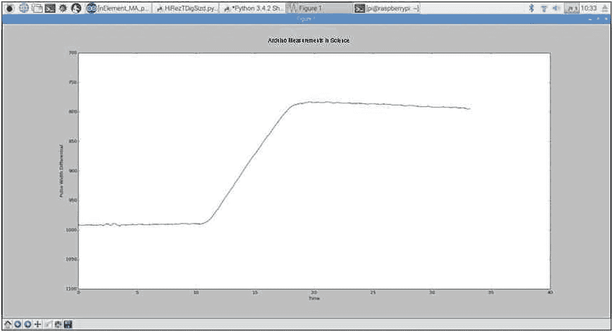

**图 3-40**

Matplotlib SCR 绘图程序的全屏显示选项

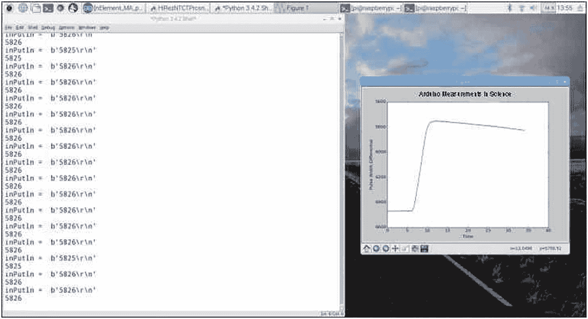

**图 3-39**

带有倒置 PWD 计数刻度的控制台日志和 SCR 绘图

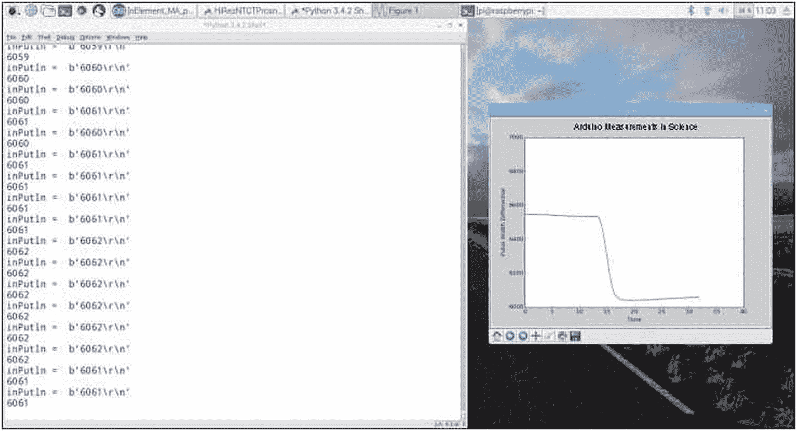

**图 3-38**

已知温度变化期间脉冲宽度差分计数的 Python 控制台日志和 SCR 绘图

表 3-8 列出了一组重复的温度校准实验，实验使用了一个 10 kΩ环氧树脂珠热敏电阻，并在 555 IC 定时器网络的`R2`位置放置了一个 10 kΩ 1%精度的电阻。

**表 3-8**

10K Ω环氧树脂珠热敏电阻的高分辨率温度校准

| -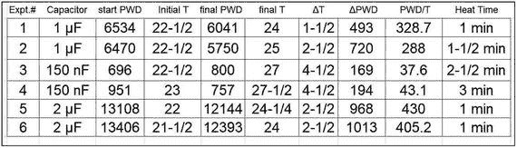 |

# 讨论

基于 Linux 的操作系统中的计时存在不一致性。为确保准确性，`Matplotlib` 的 `SCR` 绘图显示上的时间刻度应使用秒表进行校准，或者可以将带有时间戳的数据保存到 `SD` 卡并在控制台上显示。

通过使用热敏电阻和电容器构成 `555` 定时器的 `RC` 定时网络，可以将热敏电阻阻值的微小变化转换为 `555` 定时器方波输出高低电平时间比的变化。通过以微秒级分辨率监测该比率的变化，热敏电阻阻值的微小变化可以用较大的数值来表示，从而大大提高了监测温度的分辨率或精细度。与所有灵敏或高分辨率的测量系统一样，应验证探测器在其预期使用范围内的响应校准，以确保其准确性和可重复性。

表 3-8 表明，当使用 `10 kΩ` 热敏电阻、`10 kΩ` 电阻器和 `1 μF` 电容器构成 `RC` 网络时，每经历 1 度的温度变化，大约会记录 300 个计数。如果绘图仪可以读取基线上方 30 个计数，那么温度监测精度可达 `1/10` 度。如果可以看到 3 个计数，则实验正在测量 `1/100` 度的温度变化。在电子定时应用中，`RC` 时间常数的大小是各个元件大小的线性函数。在高分辨率热敏电阻温度测量电路中使用各种容量的低漏电电容器时，对于恒定的热敏电阻-R2 组合，`PWD` 计数与电容值成线性函数关系，如图 3-41 所示。图 3-41 中直线的方程为 `y = 6689.7x + 13.157`。

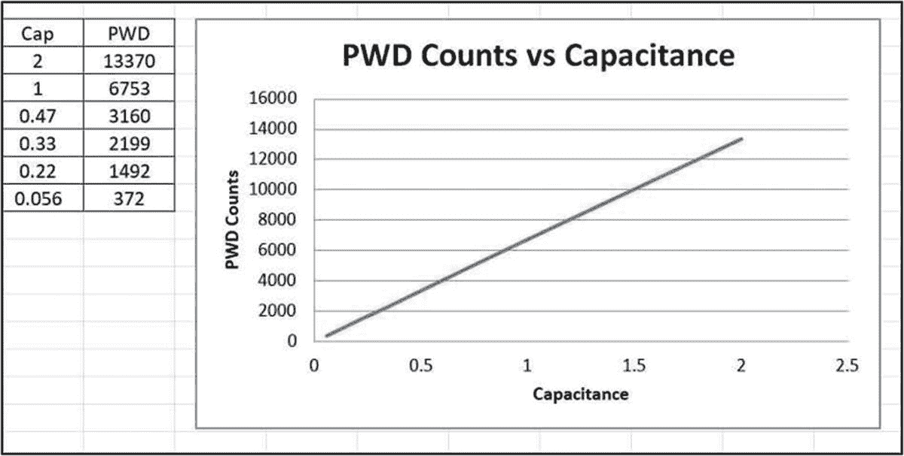

**图 3-41**
电容大小在高分辨率温度测量电路中的影响

对于高灵敏度测量，需要注意细节。必须最大限度地减少电源噪声，或使用电池供电，安装所有金属部件的电磁屏蔽，并考虑使用足够的隔热措施以防止热漂移。为了最大化特定应用中该技术的灵敏度，需要对 `RC` 组合进行优化。这最好在装置中实施了降噪和热稳定技术后，通过实验来完成。作为任何优化程序的一部分，热敏电阻的阻值可以超出本书中使用的 `10 kΩ` 和 `30 kΩ` 的范围进行改变。

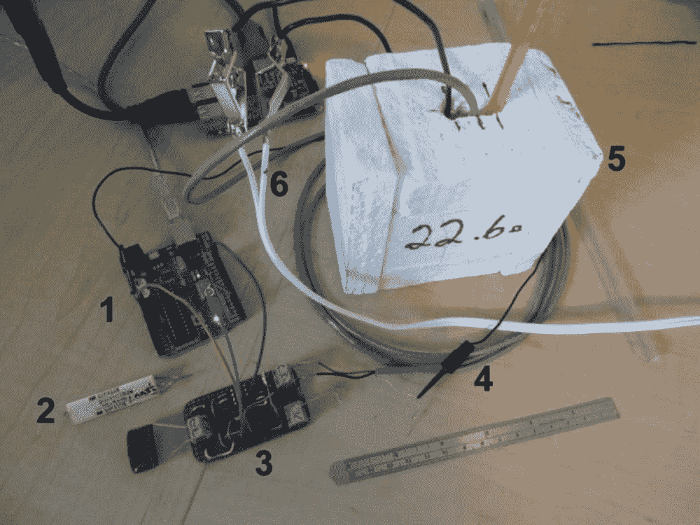

**图 3-42**
高分辨率或精密热敏电阻温度测量装置

1.  `Arduino` 微控制器板
2.  `1 μF` 聚苯乙烯电容器
3.  高分辨率热敏电阻 `555` 定时器面包板，带有三个用于更换元件的双线螺旋端子连接器
4.  带有接地屏蔽引线（灰色）的热敏电阻绞合引线电缆和接地黑色夹子
5.  用于温差测试的带有玻璃水银温度计的干井
6.  加热器电源引线和夹子，背景为 `RPi`

# 非接触式温度测量

红外传感器可用于测量更强烈的 `0.7` 至 `14` 微米（`10^(-6)` 米）红外辐射波段。由于红外线是一种光学测量，必须遵循所有光学测量中的注意事项。必须优化反射率、透射率、视场角和视角，以确保测量具有可重复性和准确性。

使用 `Melexis 90614` 热电堆探测器可测量 –70°C 至 380°C 的温度，单个探测器可测量其 45 度视场内物体发出的 `5.5` 至 `10` 微米红外波段。

## 实验

使用 `Arduino` 控制的探测器进行红外温度测量，然后通过 `Matplotlib` 带状图表记录器程序和 `Python` 控制台进行记录。数据通过绘图仪以图形方式记录，并通过控制台以数字方式输出。数字数据可以根据后续分析的需要打印或存储在 `SD` 卡上。

传感器按照图 3-19 所示连接到 `Arduino` 微控制器。微控制器使用通过 `Arduino IDE` 访问的标准 `MLX90614` 库集合中的一个库进行编程。

与所有多硬件平台一样，您应该将微控制器连接到传感器，将适当的软件加载到微控制器中，并验证 `Arduino` 正在读取 `IR` 传感器并将所需数据发送到串行端口。标准库可能包含包含串行端口显示标签和值的文本代码行或部分。该库可能包含打印语句和输出，用于第一行以摄氏度为单位的环境温度和传感器目标温度，第二行以华氏度为单位。端口会打印第三行空行，以便将输出间隔成更易读的格式。

我注释掉了 `Arduino` 代码中的华氏度和空行输出打印语句，以获取单行输出，从而更轻松地在 `Python` 绘图程序中解析数据。

一旦配置并验证了 `Arduino` 传感器数据流，就可以将 `Python` 绘图代码加载到 `RPi` 中，并监测红外温度（参见代码清单 3-5）。

如果要将数据记录下来供后续解释和分析，可以配置一个采集系统，将带有时间戳的控制台输出存储到 `SD` 卡上，如第 10 章所述。

## 观察结果

图 3-43 是 `IR` 探测器对一系列加热物体的响应曲线图，这些物体被放置在距离桌面原型板上安装的传感器上方 `2` 到 `3` 英寸处。最左侧是传感器对上方开阔视场（`FOV`）的“基线”响应。第一个向下的偏转来自一个装满冷冻乙二醇水的新鲜聚乙烯冰袋，其记录温度为 –7.5°C。

下一个向上的偏转来自我的手温，记录为 29°C。而下一个大的偏转来自一个热饮杯的底部，记录为 47°C。接着向上偏转到 32°C 是我在热饮杯侧面暖手后的结果。曲线上最后两次向下的偏转（–1°C 到 –0.75°C）和一次向上的偏转（40°C）是冰袋和热饮杯底在桌面上放置几分钟后记录的温度。

先前用微波炉容器装热水的实验表明，容器底部表面温度为 44°C。玻璃水银温度计显示内部液体温度为 58°C。


**图 3-43**
`Melexis 90614` 红外温度测量

传感器的响应似乎很快是瞬时的。

## 讨论

如在演示读数及内部与外部容器测量中所见，测得的是表面温度。

若加热物体的温度远高于环境温度，辐射热可能导致读数漂移。传感器与物体的距离足够小，辐射热便会提升传感器外壳及其周围环境的温度（距离在数英寸或 `15` 厘米以内）。

总视场是围绕垂直轴的一个 90°或 45°锥体。传感器读取视场内物体辐射出的所有表面热量。如果物体很小而传感器距离很远，则传感器可能成比例地读取物体背景的热量。

有关传感器构造、不同型号或可选配置、可用电子配置以及光学特性的更多信息，请参阅制造商数据手册。

# 使用树莓派进行热电偶测量

金属热电偶因其坚固耐用和宽泛的温度测量范围，是一种常见的工业技术。诸如`DAQFactory`和`LabJack HMI`之类的 `SCADA` 系统，正是为配合热电偶测量系统而设计。大多数集成电路制造商都提供用于热电偶温度测量仪器的专用集成电路(`ASIC`)选择。

热电偶每摄氏度大约产生 `40` 至 `50` 微伏的电压，并需要一个放大器将该微伏信号放大到能与`Arduino`及其 `5` 伏 `ADC` 等设备兼容的水平。使用`Arduino`微控制器、`AD 595`集成电路和`RPi`，可以测量、图形化显示并记录 0°C 到 500°C 的温度范围。制造商提供了采用表面贴装技术集成电路的专用微电路分线板，使`RPi`能够访问 `K` 型热电偶可测量的-200°C 至 1250°C 温度范围（参见 `Adafruit Industries` 公司 `Max31855`，产品编号 `269`；加拿大元售价约 `25` 元，网址为[`www.adafruit.com`](http://www.adafruit.com)）。

`AD595 DIP IC`可由`Arduino`提供的 `5V` 电源供电，从而直接从 `K` 型热电偶产生一个直接、简单的、与`Arduino ADC`兼容的信号，该信号随后可转换为温度值，传输至`RPi`用于绘图和时间戳数据存储。

请记住，导线尺寸决定电阻，因此，对于所产生的小电压，使用可用的最大尺寸导线可提供最小电阻（响应时间请参见表 3-6）。我建议对于较长的热电偶延长线使用双绞线，进行 `LED` 通断检查，并记录热电偶电阻日志。在电气“嘈杂”的环境中，可能需要在热电偶线两端并联一个 `0.01` 至 `0.1μF` 的电容器以最大程度地降低噪声。在恶劣环境中，可能需要为热电偶导线配备适当的护套。

## 实验

`AD595 DIP IC`可安装于原型板上，并连接到 `K` 型热电偶。将集成电路连接到`Arduino`上的 `5V` 电源，将地线连接以为集成电路供电，并将`AD595`的输出端连接到`Arduino ADC`的`A0`输入端，即可完成测量操作的电路连接（参见图 3-24 和图 3-25）。

完成系统布线后，应按照正常组装流程，首先加载 `Arduino` 代码（清单 3-6），并通过观察 `Arduino` 串行监视器的串行总线上数据流的采集和传输来进行验证。

一旦确认数据传输正常，即可启动 `Python` 绘图代码（清单 3-7），并在 `RPi` 监视器上验证控制台输出和绘图图形。

为了规避使用`AD595`集成电路时`Arduino`的 `5V` 电源供电所带来的测量限制，可以改用 `Maxim MAX31855` 芯片来监测 `K` 型热电偶。该芯片是一种表面贴装技术器件，可从制造商处购得已制成微型分线板且与`Arduino`微控制器兼容的版本（可在[`www.sparkfun.com`](http://www.sparkfun.com)和[`www.adafruit.com`](http://www.adafruit.com)获取）。此分线板包含电源连接和串行外设接口(`SPI`)连接，`SPI` 用于将热电偶电压传送至微控制器，以便在控制器的串行监视器中显示。两家制造商均提供与 `Arduino` 兼容的库，其中包含连续进行热电偶温度测量所需的所有代码。（请确保 `RPi` 已更新至最新版本的 `Arduino IDE`，因为较旧版本的 `SPI` 协议与 `MAX31855` 库不兼容。）

## 观察结果

### `AD595`/`Arduino`/`RPi` 温度监测

图 3-44 展示了系统对环境室温建立基线的响应（最左侧轨迹）、我的手指热量（第一个小波峰）、将热电偶置于两个刚冷冻的冰袋之间（第一个下降至 0°C 的波谷）以及在蜡烛火焰附近移动热电偶时所记录的温度变化。


**图 3-44**

`K` 型热电偶对不同热源的响应

在从蜡烛火焰附近测得的高温冷却后，基线虽然看起来比受高热影响前略高，但对手指热量和冰袋仍提供正常响应。

### `MAX31855`/`Arduino`/`RPi` 温度监测

要使用 `MAX31855` 芯片上的 `SPI` 协议，`Arduino IDE` 版本需高于 `1.6.6`。较新版本的 `IDE` 具有与 `Arduino` 串口联动的有限图形数据显示能力。

图 3-45 展示了热电偶在桌面环境温度下串口输出的数据。串口显示两行数据，分别由芯片所在晶圆的温度以及热电偶的温度组成。


**图 3-45**
`MAX31855` 对 `K` 型热电偶环境温度响应的串口数据输出

`MAX31855` 可测量铬镍-铝镍 `K` 型热电偶所能触及的整个温度范围，即 –200°C 至 1200°C，并采用 `Arduino` 提供的 `5V` 电源供电。

当热电偶被置于两个刚从冰箱取出的新鲜乙二醇冰袋之间时，测得的温度为 –10.5°C。当一小团蜡烛火焰靠近热电偶至八分之一英寸（3mm）以内时，测得温度为 930°C，并产生了图 3-46 所示的 `Arduino` 串口图形记录。


**图 3-46**
`Arduino` 串口图形记录 `K` 型热电偶对蜡烛火焰热源的响应

图 3-47 展示了热电偶冷却回环境温度，并被我 32°C 的手指热量再次加热时的部分响应记录。


**图 3-47**
`K` 型热电偶冷却至环境温度及手指加热效果

图 3-48 展示了 `y` 轴刻度自动调整为较低温度范围。


**图 3-48**
串口绘图仪对较低温度响应的自动调整

`Arduino` 的串口绘图仪对于图形化记录和显示数据趋势非常有用。要使用更灵活的 `Matplotlib` 带状图记录程序及其缩放功能，必须修改板卡制造商提供的光电偶读数程序。与之前将串口字符串转换为数值以兼容 `Matplotlib` 的方法类似，需要注释掉 `Arduino` 草图（`sketch`）中的格式化和标签代码。仅将所需摄氏度或华氏度温标下的温度字符串打印到串口。

清单 3-8 仅是从 `Matplotlib SCR` 程序中提取的生成器函数，用于绘制来自 `MAX31855` 的 `Arduino` 数据。其余 `SCR` 代码已在之前使用热敏电阻、红外传感器和 `AD595` 模拟热电偶温度传感器的方法中复现。实验条件需要根据测量需求调整刻度范围和坐标轴标签。

清单 3-8 中的生成器代码在串口字符输入到数值绘图值解析与转换的代码周围包含了一个 `try/catch` 块，因为串口中的字符串经常被误读。热电偶可能存在噪声干扰，在大约 `25%` 的时间里，尝试启动绘图器会因 `ValueError` 异常而失败，导致程序在启动前或启动后不久终止。这些错误是由代码试图将损坏或不可转换的字符串转换为数值引起的。设置 `try/except` 块是为了捕获 `ValueError` 异常，然后强制 `readline()` 循环进行下一次迭代。

图 3-49 描绘了热电偶对低于零度温度测量响应的 `Matplotlib SCR` 绘图。


**图 3-49**
低于零度的热电偶响应及潜热效应

图 3-49 中的低温数据是通过将 `K` 型热电偶置于两个刚从冰柜取出的聚乙烯乙二醇-水填充冰袋之间获得的。与先前版本的 `SCR` 数值生成器绘图代码一样，包含了带时间戳的数据打印输出功能，可将带时间戳的数据流打印到控制台以供存档。

检查绘图仪轨迹和带时间戳的数据，可以直观地展示水体系中潜热的物理概念。

# 讨论

热电偶是一种自供电的温度传感器，具有较大的动态范围，并且在一阶近似下是线性的。某些热电偶在其温度-电压关系中存在不连续性，显示测量值的软件和仪器在某种程度上会忽略这些不连续性。如果需要进行精确的热测量工作，则必须根据标准表中的参数对热电偶使用的温度范围进行校准。

`AD595` 放大器具有内部固定增益，当连接 `K` 型热电偶时，可提供 `10 mV/°C` 的模拟输出。如果芯片由 `5V` 电源供电，则可测量的最高温度为 500°C。通过将 `AD595` 的电源电压提高到 `10V`，并在芯片输出与 `Arduino ADC` 输入之间施加一个 `2:1` 的分压器，以确保转换器看到的信号为 `5V` 或更低（`ADC` 允许的最大信号强度），可以测量更高的温度。当为放大器芯片使用更高的电源并在 `ADC` 输入上使用 `2:1` 分压器时，必须调整 `Arduino` 代码，将发送给绘图器的温度值加倍。

通过使用 `K` 型热电偶和 `MAX31855` 集成电路，仅需 `Arduino` 提供的 `5V` 电源即可进行低至低温、高至火焰温度范围的热电偶测量。`Maxim` 公司的 `IC` 是一种表面贴装器件，以小尺寸印刷电路板形式提供。该转接板可以安装在原型板上，用于临时实验或开发工作。

热电偶通常会产生噪声，因为它们通常具有较长的金属引线，用于高功率环境，并且需要大信号放大才能产生可驱动显示器的可用信号。在某些环境中，可能需要在两根导线之间并联一个电容器，以抑制测量系统中产生的一些杂散信号。

`Matplotlib` 绘图器的串口转换代码中存在的噪声信号问题，通过一个用于错误捕获的 `Python` 函数得以最小化，该函数利用 `try/except` 块忽略误读的数据。

尽管具有固定刻度的 `Arduino` 串口绘图仪很有用，但 `Matplotlib SCR` 更加灵活，因为它可以适应显示刻度放大、压缩，或数据在正负数值域之间变化的情况。

图 3-49 直观地展示了潜热这一物理现象。冰袋将热电偶冷却至约 –17°C 的初始温度，然后温度开始线性上升。该绘图的时间尺度在时间单位刻度上显示为四十分钟的窗口。温度以线性方式稳定上升，直到大约 `12.5` 分钟时，潜热效应开始对温度上升产生调节作用。`20` 分钟后，温度变化速率停止。温度在 0.7°C 区域附近持续了数小时，因为冰袋内融化的冰吸收了固液相变所需的热量。

# 被动红外（PIR）热传感器

市面上存在可被描述为数字热传感器的设备。热感应`HC-501` PIR 模块广泛用于安防和人员检测系统（售价约 5 加元）。该设备配备了一个塑料穹顶菲涅尔透镜，能够将红外光聚焦在热敏材料上，例如氮化镓 (GaN)、硝酸铯 (CsNO[3])、聚偏氟乙烯 (–CH[2]-CF[2]-)[n]、有机吡啶和酞菁钴络合物。照射在探测器上的红外辐射变化会引起监测电路中的电压波动，从而改变模块的高/低输出状态。

## 实验

PIR 模块如图 3-50 和图 3-51 所示。图 3-51 中可见的三个连接引脚，从左到右分别是电源、中间的模块数字输出端和右侧的地线。我将模块输出端连接到 Arduino 的数字引脚 2，用于测试、演示、验证和应用开发。我在数字引脚 7 上连接了一个红色 LED 和 330 Ω 的限流电阻。在引脚 8 上连接了一个绿色 LED 和限流电阻。

`清单 3-9` 跟踪了 PIR 模块输出端的活动，并根据视场内的活动水平激活红-绿二极管阵列，同时将文字信息打印到串行监视器上。

PIR 模块有两个电位器，在图 3-50 中表现为砖红色的圆盘；还有一个位置可通过跳线选择的黄色矩形（电路板右上角）如图 3-51 所示，用于控制设备的操作。这些控制元件的作用将在本节的“观察”和“讨论”部分进行介绍和探讨。


图 3-51
HC-SR501 PIR 传感器的电路板


图 3-50
HC-SR501 PIR 传感器的菲涅尔透镜顶部

### 观察

制造商的数据手册指出，该设备在通电后需要一分钟才能稳定下来。

透镜的视场是一个 110–120 度的锥体，其景深可在 3 到 7 米（9 英尺到 21 英尺）之间调节，由右侧的电位器控制。在图 3-50 和图 3-51 中，顺时针旋转可增加监控距离。

左侧电位器控制延时，顺时针旋转可在 5 秒到 300 秒（5 秒到 5 分钟）之间调节。

触发选项通过黄色跳线的位置来选择。在顶部位置（即单次触发模式）下，延时定时器在接收到第一个运动感应信号时启动。在下方位置（即多次触发模式）下，每次检测到运动检测信号时都会重新启动延时定时器。

## 讨论

要有效使用 PIR 探测器，必须将传感器置于正确的方向，以检测视场内红外辐射的差异。该探测器由两个平行的矩形表面组成，表面涂有热释电材料。在静止状态下，这两个表面看到的来自透镜监控区域的红外辐射相同。当热源以任何不平行于探测器元件间中心线的角度进入视场时，会先激活其中一个元件。于是，一个差分信号被记录为背景红外辐射中的扰动。传感器是矩形的，其敏感轴平行于较长的一边。

Arduino 程序中使用的测试电路和彩色二极管仅用于演示传感器的特性，并让实验者熟悉其控制元件、响应模式、传感器的物理方向，以及在日光和极端天气条件下评估传感器的性能。

一旦为某个问题找到了最佳的工作条件，就可以用固态继电器替换 LED，以便在检测到发热物体运动时，激活夜间摄像头、照明光源或机械继电器。

## 代码清单

```cpp
/*
* PIR 传感器演示与验证
* 当视场中的红外辐射较低或无活动时，
* 点亮绿色 LED。当红外辐射增加时，
* 关闭绿色 LED 并点亮红色 LED。
*/
int pirPin = 2;              // 选择 PIR 传感器的引脚
int ledPinAct = 7;           // 红色 LED 指示视场内有活动
int ledPinInact = 8;         // 绿色引脚指示视场内无活动
//
int val = 0;                    // 用于读取引脚状态的变量
void setup() {
pinMode(ledPinAct, OUTPUT);      // 将活动 LED 设为输出
pinMode(ledPinInact, OUTPUT);    // 将非活动 LED 设为输出
pinMode(pirPin, INPUT);          // 将传感器设为输入
//
Serial.begin(9600);   // 启动串口
}
void loop(){
val = digitalRead(pirPin);  // 读取输入值
if (val == HIGH) {            // 检查输入是否为高电平
digitalWrite(ledPinAct, HIGH);  // 点亮红色 LED
digitalWrite(ledPinInact, LOW); // 关闭绿色 LED
Serial.println("视场内有活动。");
}
if (val == LOW) {
//
Serial.println("未检测到活动！");
// 点亮绿色 LED 并关闭红色 LED
digitalWrite(ledPinInact, HIGH);
digitalWrite(ledPinAct, LOW);
}
delay(10);
}
```
清单 3-8
Arduino 的 PIR 程序

```python
#
ser = serial.Serial("/dev/ttyACM0", 9600)
#
def rd_data():
while True:
inPutln = ser.readline()
if (len(inPutln )  9):     # 长字符串片段
continue
#
try:
if (len(inPutln) == 6):    # 单个无符号数字的长度
line = float(str(inPutln)[slice(2,5)])
print(time.asctime()) # 用于控制台/数据存储的归档时间戳
print (line)          # 控制台显示/归档数据存储
yield (line)
#
if (len(inPutln) == 7):    # 单个无符号数字的长度
line = float(str(inPutln)[slice(2,6)])
print(time.asctime()) # 用于控制台/数据存储的归档时间戳
print (line)          # 控制台显示/归档数据存储
yield (line)
#
if (len(inPutln) == 8):    # 单个无符号数字的长度
line = float(str(inPutln)[slice(2,7)])
print(time.asctime()) # 用于控制台/数据存储的归档时间戳
print (line)          # 控制台显示/归档数据存储
yield (line)
#
if (len(inPutln) == 9):    # 单个无符号数字的长度
line = float(str(inPutln)[slice(2,8)])
print(time.asctime()) # 用于控制台/数据存储的归档时间戳
print (line)          # 控制台显示/归档数据存储
yield (line)
except ValueError:
continue
```
清单 3-7
用于绘制 MAX31855 热电偶数据的生成器代码

```python
## RPi Python Strip Chart Recorder of Arduino Output
## SCR Plotting of serial data from Arduino output over serial port
## Arduino serial output must be numerical values only.
#
import matplotlib
import numpy as np
from matplotlib.lines import Line2D
import matplotlib.pyplot as plt
import matplotlib.animation as animation
import time
import serial

class Scope:
    def __init__(self, ax, maxt=40, dt=0.02):
        """maxt time width of display"""
        self.ax = ax
        self.dt = dt
        self.maxt = maxt
        self.tdata = [0]
        self.ydata = [0]
        self.line = Line2D(self.tdata, self.ydata)
        self.ax.add_line(self.line)
        self.ax.set_ylim(0, 500)  # y axis scale
        self.ax.set_xlim(0, self.maxt)

def update(self, y):
        lastt = self.tdata[-1]
        if lastt > self.tdata[0] + self.maxt: # reset the arrays
            self.tdata = [self.tdata[-1]]
            self.ydata = [self.ydata[-1]]
            self.ax.set_xlim(self.tdata[0], self.tdata[0] + self.maxt)
            self.ax.figure.canvas.draw()
        t = self.tdata[-1] + self.dt
        self.tdata.append(t)
        self.ydata.append(y)
        self.line.set_data(self.tdata, self.ydata)
        return self.line,

ser = serial.Serial("/dev/ttyACM0", 9600, timeout=1)

def rd_data():
    while True:
        inPutln = ser.readline()
        if (len(inPutln) < 6):
            continue
        if (len(inPutln) == 6):               # convert Arduino single digit output stream
            line = float(str(inPutln)[slice(2, 6)])
        if (len(inPutln) == 7):               # convert double digit
            line = float(str(inPutln)[slice(2, 7)])
        if (len(inPutln) == 8):               # convert triple digit output
            line = float(str(inPutln)[slice(2, 8)])
        if (len(inPutln) == 9):
            line = float(str(inPutln)[slice(2, 9)]) # convert 4 digit output
        print(time.asctime())                   # time stamp data
        print(line)                             # print data
        print(" ")                              # format print out with blank line
        yield (line)
```

# K型热电偶温度监测与Arduino功率控制代码清单

## 代码清单 3-6 K型热电偶（< 500°C）的Python SCR绘图程序

```python
fig = plt.figure()
fig.suptitle("The Scientyst's Ayde", fontsize = 20)
ax = fig.add_subplot(111)
ax.set_xlabel("Time Units")
ax.set_ylabel("K Type Thermocouple Temperature")
scope = Scope(ax)
## uses rd_data() as a generator to produce data for the update func, the
## Arduino LDC value is read by the plotting code in 10 minute windows for
## the animated screen display. Software overhead limits response speed
## of display.
ani = animation.FuncAnimation(fig, scope.update, rd_data, interval=50, blit=False)
plt.show()
```

## 代码清单 3-5 K型热电偶监测的Arduino代码

```cpp
/*
Read a K type thermocouple from an AD 594 IC
Pgm reads an analog input on pin 0, converts it to voltage and for voltages < 5.00 directly
converts the observed voltage into a Celsius temperature by x100 factor.
Thermocouple voltages from temperatures over 500 C must be scaled down.
*/
// the setup routine runs once when you press reset:
void setup() {
  // initialize serial communication at 9600 bits per second:
  Serial.begin(9600);
}

// the loop routine runs over and over again forever:
void loop() {
  // read the input on analog pin 0:
  int sensorValue = analogRead(A0);
  // Convert the analog reading (which goes from 0 - 1023) to a voltage (0 - 5V):
  float voltage = sensorValue * (5.0 / 1023.0);
  float TempInDegC = voltage * 100;
  // print out the temperature
  delay(500);
  Serial.println(TempInDegC);
}
```

## 代码清单 3-4 RPi红外温度测量与绘图程序

```python
## RPi Python Strip Chart Recorder of Arduino Output
## SCR Plotting of serial data from Arduino output over serial port
## Arduino serial output must be numerical values only.
#
import matplotlib
import numpy as np
from matplotlib.lines import Line2D
import matplotlib.pyplot as plt
import matplotlib.animation as animation
import time
import serial

class Scope:
    def __init__(self, ax, maxt=20, dt=0.02):
        """maxt time width of display"""
        self.ax = ax
        self.dt = dt
        self.maxt = maxt
        self.tdata = [0]
        self.ydata = [0]
        self.line = Line2D(self.tdata, self.ydata)
        self.ax.add_line(self.line)
        self.ax.set_ylim(-10, 50)  # y axis scale
        self.ax.set_xlim(0, self.maxt)

def update(self, y):
        lastt = self.tdata[-1]
        if lastt > self.tdata[0] + self.maxt: # reset the arrays
            self.tdata = [self.tdata[-1]]
            self.ydata = [self.ydata[-1]]
            self.ax.set_xlim(self.tdata[0], self.tdata[0] + self.maxt)
            self.ax.figure.canvas.draw()
        t = self.tdata[-1] + self.dt
        self.tdata.append(t)
        self.ydata.append(y)
        self.line.set_data(self.tdata, self.ydata)
        return self.line,

ser = serial.Serial("/dev/ttyACM0", 9600)

def rd_data():
    while True:
        line = ser.readline()
        ln_Ln = len(line)  #determines # digits in temp
        if (ln_Ln < 4):
            continue
        if (ln_Ln == 14):               # single digit temp values outside
            line = float((line)[slice(10, 14)])
        if (ln_Ln == 15):               # double digit temp values
            line = float((line)[slice(10, 15)])
        if (ln_Ln == 16):               # triple digit temp values
            line = float((line)[slice(10, 16)])
        if (ln_Ln == 17):               # 4 digit temperatures
            line = float((line)[slice(10, 17)])
        if (ln_Ln > 100):
            line = float((line)[slice(27, 33)])
        # decimal and single digit temperature values are processed by the code
        # double digit minus value may require additional processing code.
        print(time.asctime())                   # console print out of
        print("Temperature =", line," deg. C")   # timestamped data with a
        print()                                 # formatting blank line
        yield (line)

fig = plt.figure()
fig.suptitle("The Scientyst's Ayde", fontsize = 18)
ax = fig.add_subplot(111)
ax.set_xlabel("Time Units")
ax.set_ylabel("Centigrade IR Temperature ")
scope = Scope(ax)
## uses rd_data() as a generator to produce data for the update func, the
## Arduino IR value is read by the plotting code in 40 time unit windows
## for the animated screen display. Software overhead limits response speed
## of display.
ani = animation.FuncAnimation(fig, scope.update, rd_data, interval=50, blit=False)
plt.show()
```

## 代码清单 3-3 Arduino TEC功率控制程序

```c
// 一款带温差监控功能的热电功率控制器
//
// 本程序利用 Arduino 的#3 号 PWM 引脚调节供给珀尔帖板的功率。
// Arduino 控制一个高功率 MOSFET 栅极，以调节流向热传导板的电流。
// 从串口发送 i 或 d 可增大或减小 TEC 板的功率。
// 两个热敏电阻温度传感器分别监测 TEC 板两侧隔热腔内的热泵效应。
//
int peltier = 3; // N 沟道 MOSFET 的栅极连接至 Arduino 的 3 号引脚
int power = 0;  // 功率等级从 0 变化至 99%
int peltier_level = map(power, 0, 99, 0, 255);  // 功率百分比与 0-255 之间的映射
//
////定义热敏电阻的模拟引脚连接
#define THERMISTORPIN A0
#define THERMISTORPIN1 A1
// 25 摄氏度时的电阻值
#define THERMISTORNOMINAL 30000
// 标称电阻对应的温度（通常为 25°C）
#define TEMPERATURENOMINAL 25
// 对读数取平均可提高信噪比，改善幅度为采样数的平方根
#define NUMSAMPLES 5
// 热敏电阻的 Beta 系数（通常为 3000-4000）
#define BCOEFFICIENT 3899
// 分压电路中固定电阻的阻值
#define SERIESRESISTOR 33000
int samples[NUMSAMPLES];
void setup(void) {
Serial.begin(9600);
analogReference(EXTERNAL);
pinMode(peltier, OUTPUT); // 将珀尔帖或 MOSFET 栅极控制引脚设置为输出模式
}
void loop(void) {
uint8_t i;
float average;
float average1;
char option;  // 待执行的操作；"i"增大功率，"d"减小功率输入
//
if(Serial.available() > 0)
{
option = Serial.read();
if (option == 'i') // 从串口发送'i'可增大负载功率
power += 5;
else if(option == 'd') // 从串口发送'd'可减小负载功率
power -= 5;
//
if(power > 99) power = 99;
if(power < 0) power = 0;
//
peltier_level = map(power, 0, 99, 0, 255);
}
//
Serial.print("Power = ");
Serial.print(power);
Serial.print(" PLevel = ");
Serial.println(peltier_level);
//
analogWrite(peltier, peltier_level); // 将新的百分比及 0-255 对应的电平值写入端口
//
//
// 采集热敏电阻#1 的数据
//
// 连续采集 N 个样本，每次采集间隔短暂延时
for (i=0; i< NUMSAMPLES; i++) {
samples[i] = analogRead(THERMISTORPIN);
delay(10);
}
// 对所有样本取平均
average = 0;
for (i=0; i< NUMSAMPLES; i++) {
average += samples[i];
}
average /= NUMSAMPLES;
Serial.print("Average analog reading ");
Serial.println(average);
// 将数值转换为电阻值
average = (1023/average) - 1;
average = SERIESRESISTOR / average;
Serial.print("Thermistor resistance ");
Serial.println(average);
float steinhart;
steinhart = average / THERMISTORNOMINAL;     // (R/Ro)
steinhart = log(steinhart);                  // ln(R/Ro)
steinhart /= BCOEFFICIENT;                   // 1/B * ln(R/Ro)
steinhart += 1.0 / (TEMPERATURENOMINAL + 273.15); // + (1/To)
steinhart = 1.0 / steinhart;                 // 取倒数
steinhart -= 273.15;                         // 转换为摄氏度
Serial.print("Temperature ");
Serial.print(steinhart);
Serial.println(" *C");
// 采集热敏电阻#2 的数据
// 连续采集 N 个样本，每次采集间隔短暂延时
for (i=0; i< NUMSAMPLES; i++) {
samples[i] = analogRead(THERMISTORPIN1);
delay(10);
}
// 对第二组所有数据取平均
average1 = 0;
for (i=0; i< NUMSAMPLES; i++) {
average1 += samples[i];
}
average1 /= NUMSAMPLES;
Serial.print("Average analog reading #2 ");
Serial.println(average1);
// 将数值转换为电阻值
average1 = (1023 / average1) - 1;
average1 = SERIESRESISTOR / average1;
Serial.print("Thermistor resistance #2 ");
Serial.println(average1);
// 已在单设备代码中声明浮点型变量 steinhart
steinhart = average1 / THERMISTORNOMINAL;     // (R/Ro)
steinhart = log(steinhart);                  // ln(R/Ro)
steinhart /= BCOEFFICIENT;                   // 1/B * ln(R/Ro)
steinhart += 1.0 / (TEMPERATURENOMINAL + 273.15); // + (1/To)
steinhart = 1.0 / steinhart;                 // 取倒数
steinhart -= 273.15;                         // 转换为摄氏度
Serial.print("Temperature #2 ");
Serial.print(steinhart);
Serial.println(" *C");
delay(1000);
}
```

# 树莓派 Python 条带图记录工具：用于 Arduino 输出的串口数据

该工具用于绘制来自 Arduino 通过串口输出的数值数据序列图。

Arduino 串口输出必须只包含数值。

```python
import matplotlib
import numpy as np
from matplotlib.lines import Line2D
import matplotlib.pyplot as plt
import matplotlib.animation as animation
import time
import serial

class Scope:
    def __init__(self, ax, maxt=40, dt=0.02):
        """maxt: 显示的时间宽度"""
        self.ax = ax
        self.dt = dt
        self.maxt = maxt
        self.tdata = [0]
        self.ydata = [0]
        self.line = Line2D(self.tdata, self.ydata)
        self.ax.add_line(self.line)
        self.ax.set_ylim(1100, 700)  # y 轴范围，根据应用调整大小和顺序
        self.ax.set_xlim(0, self.maxt)

    def update(self, y):
        lastt = self.tdata[-1]
        if lastt > self.tdata[0] + self.maxt: # 重置数组
            self.tdata = [self.tdata[-1]]
            self.ydata = [self.ydata[-1]]
            self.ax.set_xlim(self.tdata[0], self.tdata[0] + self.maxt)
            self.ax.figure.canvas.draw()
        t = self.tdata[-1] + self.dt
        self.tdata.append(t)
        self.ydata.append(y)
        self.line.set_data(self.tdata, self.ydata)
        return self.line,

ser = serial.Serial("/dev/ttyACM0", 9600, timeout=None)

def rd_data():
    ser.flushInput()  # 刷新输入缓冲区
    while True:
        inPutln = ser.readline()
        print("inPutln = ", inPutln)
        nbr_digs = len(inPutln) # 获取字符串长度
        print("nbr_digs = ", nbr_digs)
        if (nbr_digs) == 5:     # 存在 3 位数字
            line = int(str(inPutln)[slice(2,5)]) # 截取 3 位数字
        if (nbr_digs) == 6:     # 存在 4 位数字
            line = int(str(inPutln)[slice(2,6)]) # 截取 4 位数字
        if (nbr_digs) == 7:     # 存在 5 位数字
            line = int(str(inPutln)[slice(2,7)]) # 截取 5 位数字
        print(line)
        yield (line)

fig = plt.figure()
fig.suptitle("科学家的辅助工具", fontsize = 12)
ax = fig.add_subplot(111)
ax.set_xlabel("时间")
ax.set_ylabel("脉冲宽度差值")
scope = Scope(ax)

## 使用 rd_data()作为生成器，为更新函数提供数据，
## 动态屏幕显示的绘图代码每半秒读取一次 Arduino LCD 值。
## 软件开销限制了显示的响应速度。
ani = animation.FuncAnimation(fig, scope.update, rd_data, interval=50,
                              blit=False)
plt.show()
```

*清单 3-2 — 用于 `HiRezTempMonitor` 的 `Matplotlib SCR` 代码*

```cpp
// n 元素移动平均双脉冲宽度差值测量，2012 年 4 月 19 日
// 使用 `pulseIn(pn#,HI/LOW)`读取高低脉冲宽度。计算差值，
// 该差值代表热敏电阻的 `ΔT`，因为低电平时间恒定。
// 将差值累加到 n 元素移动平均中，以便通过串口输出数据

unsigned long duration;                // 第 1 个脉冲宽度
unsigned long duration_L;              // 第 2 个脉冲宽度
unsigned long pwDiff;                  // 脉冲宽度差值
int const numReadings = 16;            // 平均的读数数量，必须声明为"const"
unsigned long readings[numReadings];   // 各个读数
int index = 0;                         // 读数数组索引
unsigned long total = 0;               // 累计总值
unsigned long average = 0;             // 平均值

int inputPin = 2;                      // 用于脉冲计数的数字 PWM 引脚 2 号

void setup()
{
  Serial.begin(9600);                  // 设置串口通信
  for (int thisReading = 0; thisReading = numReadings)           // 如果到达数组末尾，则绕回
  {
    index = 0;
  }
  average = total/numReadings;       // 计算平均值

  //Serial.print("average  ");
  Serial.println(average, DEC);
  //Serial.print("duration_L  ");
  //Serial.println(duration_L, DEC); // 使用 DAQFactory 时注释掉
  //Serial.print("duration   ");
  //Serial.println(duration, DEC);
  delay(50);                        // 降低速率？
}
```

*清单 3-1 — Arduino 脉冲宽度差值热敏电阻监视器*

## 摘要

本章区分了热和温度，讨论了常规科学工作中通常遇到的极端情况，以及校准和验证温标的一些方法。

还介绍多种温度传感器，包括它们的灵敏度范围、输出信号和成本。

介绍了使用热敏电阻、热电偶和非接触式红外传感器实现高分辨率和常规分辨率温度监测的方法。

对热电热传递、绝缘、数学冷却模型和红外安全应用进行了适度的详细研究。

商用以及成本较低的组件组装的 `SCADA` 系统均可实现热与温度的监测与控制。

以红外辐射形式存在的热能是第 4 章的一部分，该章探讨了光、光学和光电效应的科学。

