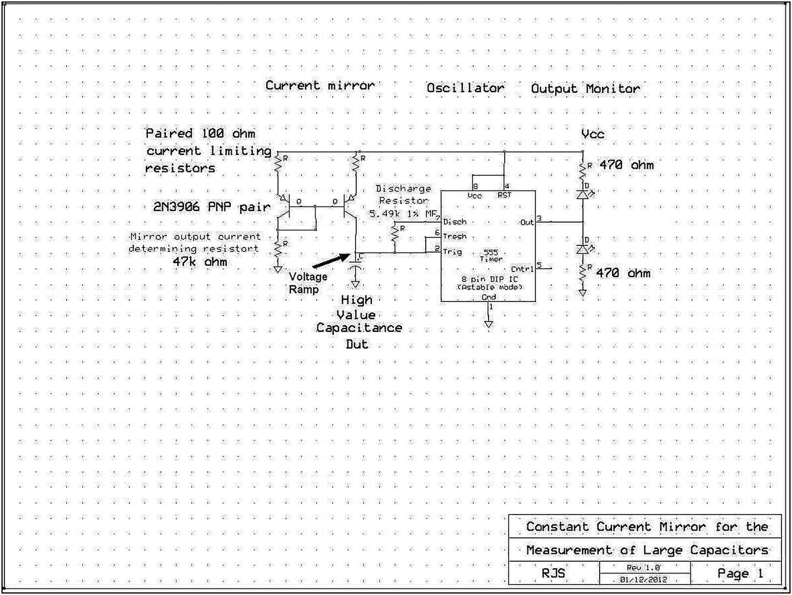
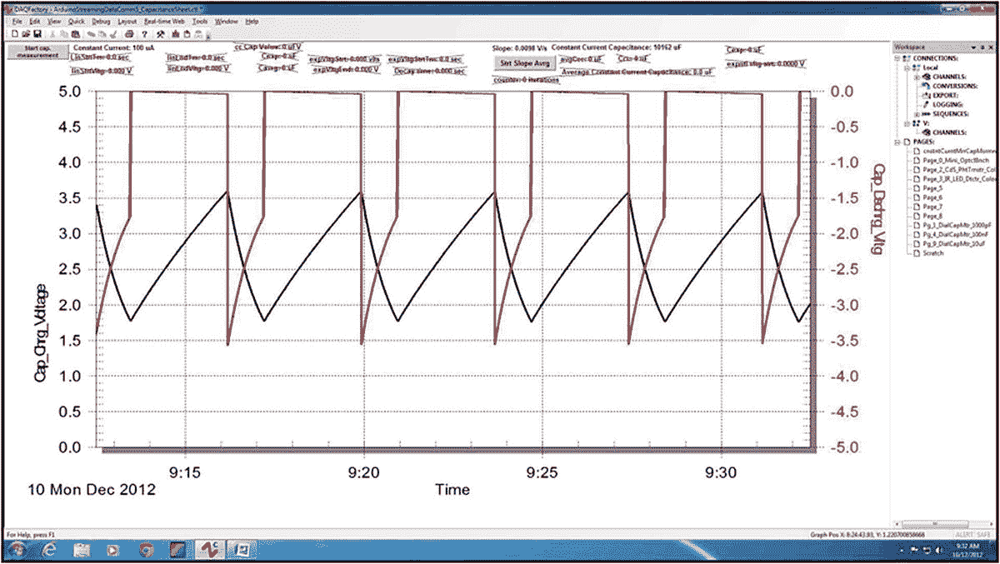
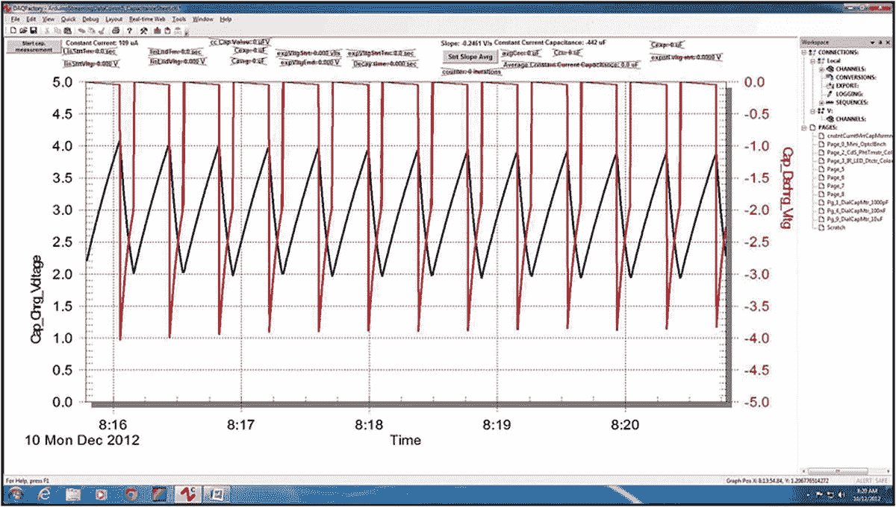
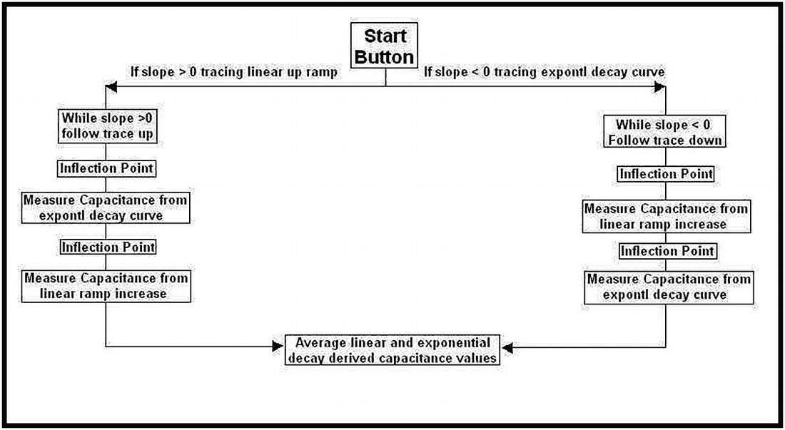
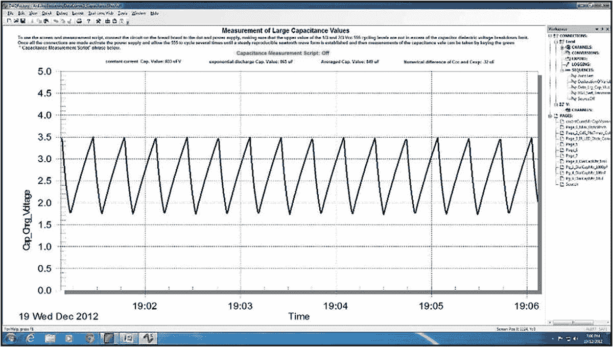
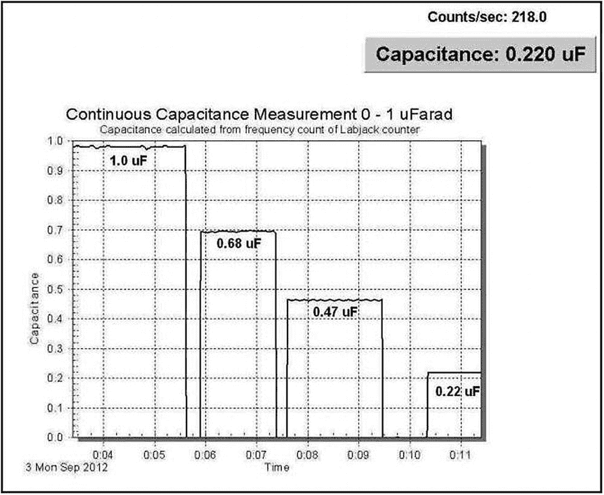

# 实验 B：大电容值（>1000 μF 或 mF）的测量

通常，电容值小于 10 μF 的电容是固态器件，而大于 10 μF 的则是电化学器件。低容值的固态器件与电化学电容器之间的显著差异在于“漏电流”或器件电阻。

电化学器件的大电容值会产生以分钟、小时甚至更长时间为单位衡量的时间常数。这些器件在极板之间也会产生更大的漏电流。在某些情况下，同一器件可能因其近期的“使用中”充放电历史而表现出不同的电容值。

在给定恒定电流下，大电容值电化学器件中的电荷累积速度比固态系统慢得多，并且可以通过图形显示轻松追踪。`555`定时器的循环能力会产生一个电压波形，该波形会由`DAQFactory`的图形记录显示进行追踪，从而可以测量被测器件（`DUT`）在充电和放电阶段的电容值。

电解电容的测量值可能受到其历史状态的影响。通过使被测器件经历一个标准化或统一的充放电循环，可以最大程度地减少历史状态的影响。如果搭建一个非稳态`555`定时器电路，并配合一个用于给器件充电的恒流源，然后通过一个已知的固定电阻进行放电，那么就可以监控该器件在两个功能阶段的表现。

## 电路

在图 1-7 中，振荡器电路本质上是一个采用非稳态振荡器配置的`555`定时器集成电路，但其充电和放电电压波形有所不同。

一个电流镜电路向电容被测器件（`DUT`）提供恒定电流。一旦电容充电至`V[cc]`的三分之二，`555`定时器就会改变状态，已充电的电容则通过一个 1%精度的金属膜电阻放电。恒定电流在电容上产生一个线性电压斜坡，而放电则形成指数衰减曲线，两者共同产生了循环但非对称的波形输出。

由于电化学电荷存储器件可能受其历史状态的影响，因此通过器件的充放电功能循环应能重建电解层。这会形成一个可重现的器件，进而可以测量其电容。可重复的充放电记录器追踪可以建立并验证器件的电解膜恢复状态。

为了产生具有合理信号周期性的非对称振荡器波形，需要高充电电流但低电压。电池或稳压电源可以提供所需的电流，从而在`DUT`极板两端产生具有合理电压变化率（斜率）的图形显示。你还必须确保`555`定时器 IC 在振荡期间的峰值电压（即 2/3 `V[cc]`）低于`DUT`的介电击穿最大电压限值。例如，钽电容的工作电压范围较低。

图 1-7

大电容的恒流充电电路

## 软件

当电容值上升至 10 μF 以上范围时，产生的`RC`时间常数会很大，而确定大电容值的方法必须根据所需的补偿电流大小进行改变。如图 1-8 和 1-9 中黑色迹线所示，电容充电时间可能变得非常长。如图 1-9 中记录在 9:20 的迹线所示，红色的放电电压迹线需要长达一分钟才能完成。

图 1-9

电容充放电电压波形（每刻度 5 分钟）

图 1-8

电容充放电电压波形（每刻度 1 分钟）

图 1-8 和 1-9 中的波形（黑色）是使用图 1-7 所示的电路获得的。图 1-10 描绘了一个流程图，概述了将开发为`DAQFactory`脚本代码以追踪电压波形并计算充电和放电电容平均值的逻辑。

图 1-10

软件流程图

用于大电容器件测量的代码见本章末尾的代码清单 1-1。

如图 1-11 所示，可以配置一个`DAQFactory`控制屏幕，包含图形显示、启动按钮和变量数值读数。

图 1-11

`DAQFactory`大电容测量

### 观测结果

图 1-12 展示了`555`定时器芯片电容测量屏幕对被测标称电容值的响应。

图 1-12

标称电容值与测量电容值对比