# 9. 重量、质量与力

实验科学经常需要测量被测试、分析或等分材料的量。在重力场中，可以通过确定水平杠杆的平衡点来测量质量，杠杆上悬挂着被测物和已知标准质量。只有在重力场中，当力作用于物体质量上时，实验者才能确定其重量。本章包含多个部分，其目的是使用简单的电传感器以重量单位测量质量。

能够以克、毫克或微克为单位称重的现代实验室天平，使用电气和机械杠杆的组合来平衡参考砝码与负载。通常，光电电磁伺服机构会数字化并显示系统的平衡点。对于某些实验工作，这些脆弱、昂贵但非常敏感的系统必须经过适当校准后才能使用。

纯电子方法可以通过测量电阻在承受机械应变时发生的电阻变化来测量力和质量。基于电阻的“称重传感器”使用惠斯通电桥-仪表放大器配对来跟踪一个或多个桥臂的电阻变化，这些桥臂固定在承受应力的可变形机械部件上。商用“即剥即贴”式电阻称重传感器箔可以应用于承受负载的机械系统，以测量任何变形或移动。应变片通常是长、薄、薄膜状、平行或螺旋状的康铜（45% Cu – 55% Ni，用于 J 型热电偶）沉积物，在承受机械负载时会产生较大的电阻变化。电阻式称重传感器通常测量千克重量或牛顿力，并由仪表放大器读取电阻桥的不平衡信号。电阻桥通常配置多个有源传感器臂，以在基底在负载下变形时增强系统的不平衡信号。

# 重量与质量的测定

多年来，磁场物理的教学一直使用称为*电流天平*的装置。市面上有几种商用教育单元，互联网上也有大量帖子描述各种精密程度不一的学生实验演示设备，这些设备可由个人或教育工作者自行组装。在商用设备和实验者自组装的装置中，可以探究由流经导线的测量电流所产生的磁场与重力之间的相互关系。电流天平通常精密、量程有限且灵敏度高，不易用于测量未知的重量或质量。

电阻式称重传感器和电流天平要么缺乏灵敏度，要么过于精密和复杂，难以在实验装置中轻松适用于重量、力或质量的离散或连续测量。以下练习概述了一种简单、稳健的方法。一个由多层平板导体和电介质组装而成的电容器，其电容会因受到多层器件上的重量负荷压缩而发生变化。（基于电容器的称重传感器的优缺点将在本练习的后文中讨论。）

直到最近，利用特制电容器压缩作为工业称重传感器的工业应用和技术才得以实现。以下文本是我在 20 世纪 90 年代中期所做初期工作的进一步发展，当时为了科学实验需要测量亚克级重量。最初，开发工作仅限于电容值的数字读取。连续实时图形显示超出了个人或家庭可用计算设备的能力。通过监测器件输出随时间的变化，电容器作为称重传感器的进一步发展成为可能。在主计算机上显示的“条图记录仪”可确定加载器件何时达到平衡，显示器件响应的相对幅度、信号中的噪声，并指示信号值的漂移。

以下文本摘自我在开发一种相当灵敏且可重复的压缩式重量传感装置期间的研究笔记。为方便希望复制该方法或进一步开发该技术的研究人员，包含了大量细节和探索性测试。

电容器由被绝缘体隔开的两块导体板组成。通常，电容器在电路中被用于储存电能、滤除直流信号、创建定时延迟，或在交流电路中设定谐振点。器件的电容与极板面积、极板间绝缘介质的化学性质以及导体间的距离成正比。

经典理论用以下公式表示器件储存电荷的电容能力。

```
C = k A / d --- 1
```

`C` 是器件的电容。`k` 是由真空介电常数与导体板间绝缘介质的介电常数组成的比例常数。`A` 是导体和电介质板的有效面积。`d` 是导体间的距离。

商用电容器有多种物理形式（见第 1 章图 1-2）和电荷存储能力，电容值范围从皮法（写作`pF`，表示`1/10¹²`法拉）到许多法拉（如第 1 章所述）。极高电阻、低漏电流的器件由卷绕的金属化聚乙烯、聚苯乙烯和聚酯薄膜制成，这为我的最初实验提供了思路，如下所述。

## 开发历史

可以想象，一个用于悬挂重物称重的校准螺旋弹簧，可以被一叠带有可变形塑料电介质的电容器极板所替代，这些电介质置于导电板之间。放置于交错叠层组件顶部的质量所受重力压缩该叠层，应能压缩板间距离并改变器件的电容。

绝缘体两侧的两块导电板构成一个单一电容器件。如图 9-1 所示，五块带凸片的金属板（用字母 A 至 E 表示）分隔开四个绝缘电介质（用数字 1 至 4 表示），构成一个四电容器件。一个包含 n 个单元的多元件电容器拥有 n+1 块导电板，分隔 n 个电介质。多元件电容器称重传感器即由这些多层组件构成。

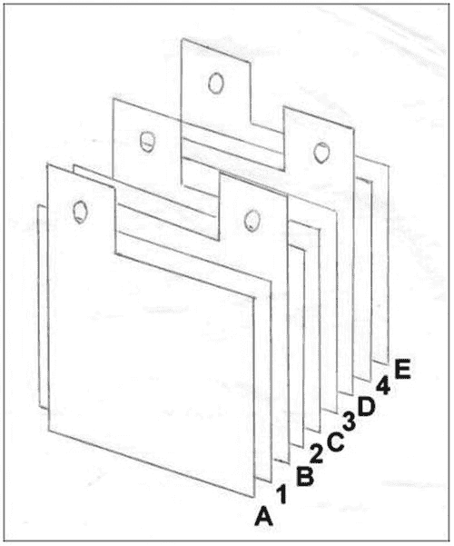

图 9-1：一个多元件电容器称重传感器

在方程 1 的电容器公式中，显示了器件电容与极板距离之间的反比关系。以任意单位绘制的器件电容与任意板间距离单调递减关系的理论曲线，会产生预期的反比例曲线形状，如图 9-2 所示。

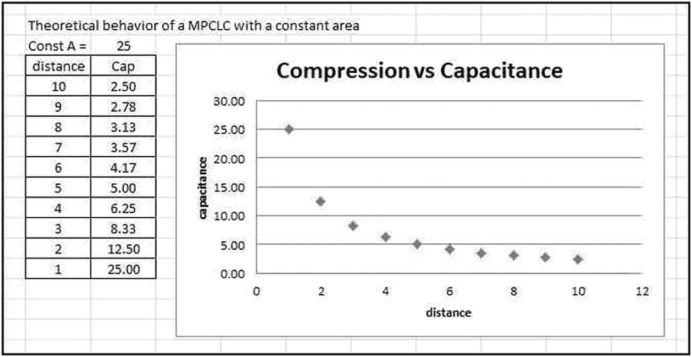

图 9-2：电容与板间距离的关系

从图 9-2 的曲线可以明显看出，在 0 到 2 至 3 个距离单位之间的线性部分，是测量的器件电容与压缩程度之间的关系合理可预测的区域。

图 9-3 描绘了电容-压缩曲线所属的幂函数数学模型。

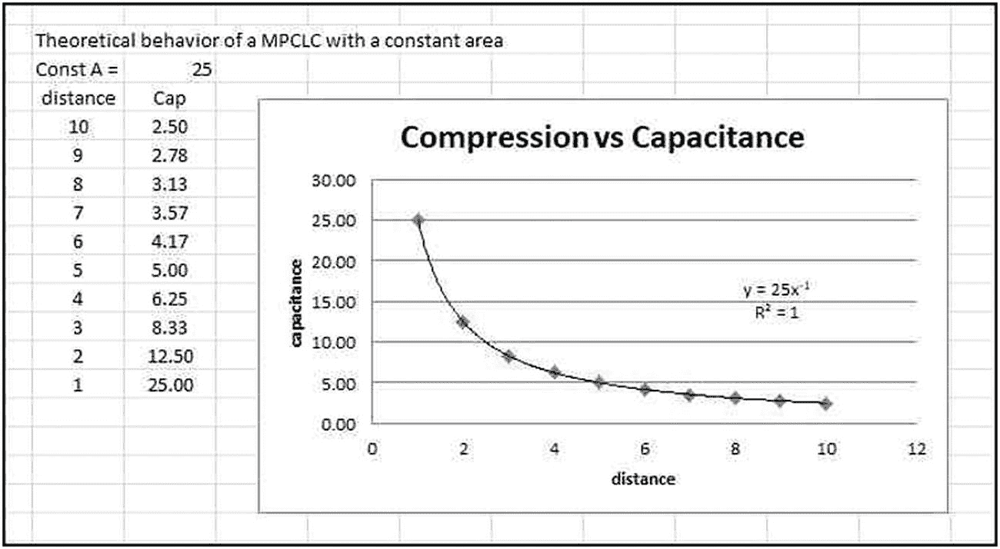

图 9-3：电容与板间距离关系的数学表达式

图 9-1 至 9-3 描绘了一组理想条件和理论考量，而使用并联连接的多个电容器单元构建的实际器件可能不会表现出这些特性。涉及构造材料、组装差异、电子、机械和环境噪声或扰动等一系列变量，都会导致偏离理想行为。构造材料、极板形状、器件层数以及器件取向对组装后器件性能的影响将在后文探讨。

在组装第一批实验单元进行测试时，观察到了一个意想不到的概念验证。将极板和绝缘体逐层堆叠，会使器件的总电容以与所用绝缘体和导体数量成比例的方式过度增加。随着器件层数的增加，上层材料的重量压缩了下层，从而过度增加了传感器观察到的“静态”电容。这种自压缩效应的贡献可以通过监测在水平平面上组装器件时总电容的增加来测量，也可以通过观察器件围绕其凸片端或各层自由端轴线从水平旋转到垂直平面时电容的变化来测量。

## 简单的单舌板式装置

如图 9-1 所示的简单、单舌片、方形板式装置，是最容易构建且能测量较大重量的装置。单舌片三角形板更难制备，但对重量更敏感（见图 9-26 和 9-27）。单舌片方形或锥形形状仅限于水平实验。在垂直平面上使用的高灵敏度装置则需要单独的悬臂安装，以便在装置从水平位置旋转到垂直位置时，能牢固地将组件固定并对齐。

本章将讨论用于在垂直与水平之间任意角度进行实验测量的更复杂装置的构建方法。

### 电容测量要求

要将多板电容器用作称重传感器、测力传感器或可能的倾斜仪，就需要一种能够连续测量或显示装置电容的方法。许多价格相对低廉的万用表都具有电容测量档位。目前已有大量程序可供实验者使用微控制器或个人电脑作为电容计。

实验研究通常涉及测定极少量难以获取的有机、生物或医学材料的物理化学性质，以及某种物质仅存的一点点材料。在开发一种能将压缩力转换为可变电容的重量敏感型传感器时，我们希望测量尽可能小的重量。除了传感器能响应微小的重量变化增量外，软件和显示器也应能跟随这些微小变化，并以最小的时延用于热力学研究。

### 电容测量技术

在第 1 章中，介绍了一种使用单个 Arduino 板校准过的内部杂散电阻和电容（`ISRC`）的 Arduino 电容测量草图。使用内部 Arduino 组件校准的电容计除了被测设备（`DUT`）外，无需任何外部电路。

## 实验

在此重量测量练习中，另一个灵敏的电容测量草图需要一些外部电路。2013 年，Arduino 论坛的几位贡献者提出了一种电容测量技术，该技术利用 Arduino 的 `ATmega328` 微处理器芯片定时器（ICFT）的输入捕获功能，并结合外部电路，于 2013 年 7 月实现了灵敏且准确的连续电容测量（参见 `gammon.com.au/forum/?id=12075`）。

### 重量测量程序与数据处理

在以下文本中，重量测量程序探索了使用不同介电材料和装置物理参数，以评估装置构造与施加重量引起的电容变化之间的关系，涉及线性动态范围和传感器灵敏度。这两种微处理器电容测量程序均与 Arduino 微控制器和 `DAQFactory` 显示器中的数据平滑代码一同使用，以实现最大程度的降噪，同时保持合理的传感器响应时间。

针对特定实验或校准的电容测量微处理器编码草图，已从原始的 ISRC 或 ICFT 代码修改而来。这些草图被修改为包含移动平均数字信号处理（DSP），并每隔四分之一秒（250 毫秒）进行一次电容测量。`DAQFactory` 显示器对 Arduino 数据采用 16 点或更高的平滑处理。（请记住，平均会降低响应时间，而平均带来的信噪比提升或噪声降低与平均点数目的平方根成正比。）

下文给出的一些数据不需要大量的数字信号处理（DSP）来降噪，但随着所需重量测量灵敏度的提高，数据的 DSP 平滑处理变得重要。

### 降噪与电源

为了在提高灵敏度时降低噪声，必须使用 Arduino 的电池供电选项。在图 9-4 中，于 9:03 处可见黑色记录迹线的噪声显著降低，这是将 Arduino 的电源从 USB 的标称 5 V 切换到标称 12 V 的可充电铅酸电池所致（参见第 11 章关于电池的讨论）。

电池是一个储存电能的“水库”。要利用恒定直流电源带来的好处，这个“水库”需要足够大，以便在从中取电时表现为一个“恒压源”。我使用的电池是 4.0 和 4.5 安时规格的（尺寸为 3½ × 2½ × 4 英寸，或 9 × 6.5 × 10 厘米，重 3 磅或 1.4 千克）。这些电池可以为 Arduino 供电 12 到 16 小时甚至更久，直到输出电压降至 12 V 以下。铅酸电池充电后，电压可能会升至 13 V 以上，但几小时后会稳定在 12 V 区间的高位。为防止损坏任何电路，在新充电电池的输出电压降至 13 V 以下之前，不会用它来为微控制器供电。当电压降至 12 V 以下时，停止使用电池供电，并对电源进行充电。

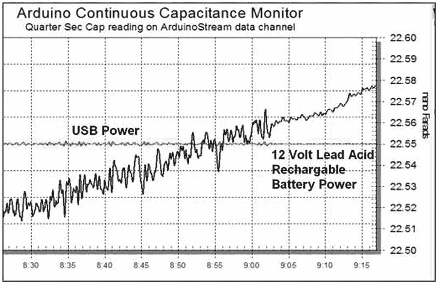

**图 9-4** 使用 12 V 电池供电降低信号噪声

在图 9-4 中，虽然黑色基线噪声从 0.02 nF 降低到了 0.007 nF，但漂移不受影响。

### 其他噪声源与屏蔽

在使用多个平行板电容器进行高灵敏度测量时，产生的信号中还存在其他噪声和漂移源，包括气流、温度变化以及感应的电磁场或静电场。在图 9-5 中，6:35 之前的黑色信号迹线未加屏蔽，而之后的信号则受到保护。

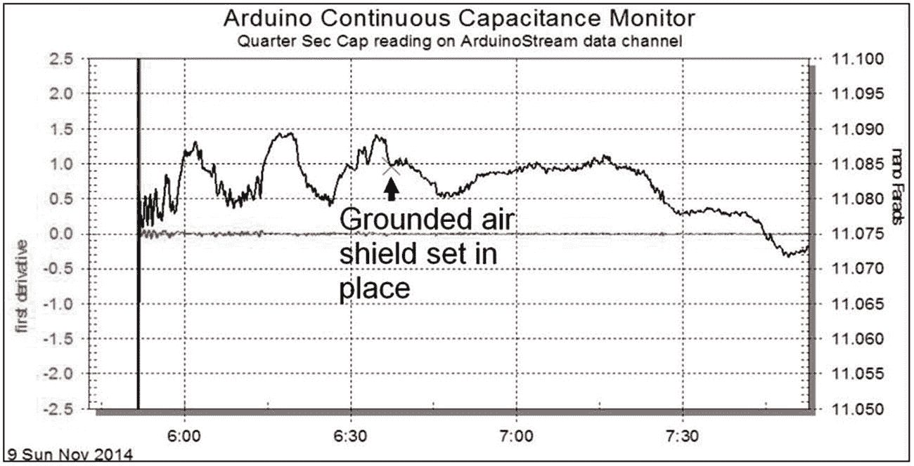

**图 9-5** 通过热、电和机械屏蔽降低信号噪声

图 9-5 中的信号噪声降低是通过一个薄纸板结构实现的，其内表面涂成黑色，外部覆盖铝箔。外部表面的铝箔被切割成比有效覆盖纸板总面积所需更大的形状。多余的铝箔包裹部分被折叠成一个扁平舌片，或卷成一个“猪尾巴”，连接到连接被测设备（`DUT`）与 `Arduino` 板的双绞线电缆的屏蔽层上。一根带有鳄鱼夹的跳线建立了所需的电气接地连接（见图 9-6 中的第 3 项）。

屏蔽组件的设计由研究人员组装的装置配置决定。在开发这些装置的过程中，我组装了许多不同的屏蔽配置，图 9-6 描绘了其中一种。图中所示的屏蔽罩是一个折中方案，它覆盖并保护了传感器的大部分有效区域。屏蔽罩的开口端设计允许传感器的尖端被加载和清除测试砝码负载，可手动操作或使用专用夹具进行，以尽量减少称重操作期间对上极板的干扰。

本书概述的 MPCLC 装置的开发，是典型实验序列的结果，在该序列中，为改进简单装置所做的小尝试，会引出对被测设备（`DUT`）工作机制的进一步见解。对工作机制认识的加深，会带来进一步的实验改进，从而增加对装置的理解，并随后通过增加或降低其复杂性来提升性能。

在开发电容式称重传感器时，从第一个由方形、易于组装的装置构成的简单设备，演变成了更复杂、难以组装的锥形、薄层及复合薄膜设备，其灵敏度大幅提升。

重量灵敏度成为实验者决定构建何种类型装置的关键因素。一个使用现成材料、可手工裁剪的简单方形装置，就能展示效应并测量克和盎司的重量。若要测量克的分数值，则可能需要构建和组装更敏感的锥形设备，这些设备需要更多的细心、时间和精力来制作和使用。对于极低质量，传感器中极板的刚度决定了灵敏度的下限。

标题图 9-6 描绘了几种不同的多板电容式称重传感器（MPCLC）以及最初用于制造和操作这些设备的各种附件。

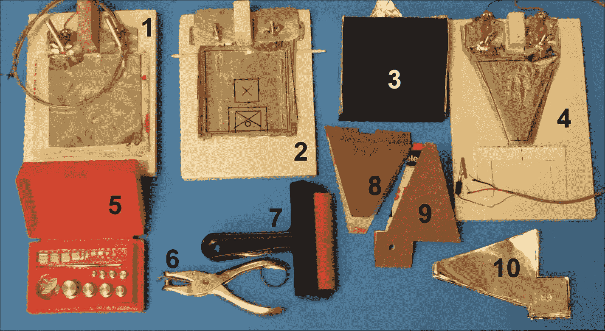

**图 9-6**

各种 MPCLC 与附件

*   项 1 是最初的设备。它由带接头的方形（约 4 英寸或 10 厘米）铝箔导电板组成，左右两侧有公共连接，并由从塑料袋裁切的聚乙烯片材电介质隔开。
*   项 2 是一个用镀铝层 Mylar 薄膜制成的方形板设备。该设备的叶片是从镀铝 Mylar“救生毯”上裁切下来的。（发现成卷的“银色”铝-Mylar 礼品包装纸厚度为 0.0011 英寸（0.029 毫米），几乎是救生毯材料厚度的两倍）。复合材料仅单面有涂层，因此左右两侧的板都必须从库存片材上裁切下来。板的边缘可能需要清除金属，以避免设备短路。

由于仅单面金属化，必须在板之间建立电接触。该电接触由一个折叠的铝箔条构成，两端各打一个孔（参见图 9-7）。尝试使用折返接头以消除锡箔桥接，但未能提供可靠、耐久的电接触，这种接触在组装过程中或在使用中经常失效。尽管聚合物薄膜在传感器叶片的折叠或弯曲处内侧或外侧曲率上会拉伸或压缩，但当铝膜位于传感器叶片折叠或弯曲的外侧时，铝膜经常会断裂。

*   项 3 显示了一个为适配项 4 而制作的空气流和电磁场干扰屏蔽罩的内部视图。敞开盒子的内部涂成哑光黑色，外部包裹铝箔，并将铝箔折叠以提供一个接地连接头，可见于罩子的顶部边缘。
*   项 4 是一个灵敏度更高的设备，由镀铝 Mylar 制成的三角形、蚀刻边缘、锥形板组装而成。通过定制的可滑动纸板“桥”（在电容器板顶端正下方可见，处于缩回位置）将砝码从设备尖端加入或移除。

要使用桥，将砝码放在跨度的中心，桥的左臂或右臂将砝码托架滑动足够远，使其越过电容器尖端，以便砝码可以被拉或推离跨度中心，从而放置在下方称重传感器的中间尖端上。测量完成后，桥臂可以将桥移回缩回位置，在此过程中通常会将砝码从称重传感器上推落。

照片中还可见用于传输电信号的屏蔽双绞线的两端。导电板的端接头通过一个 32 牙/英寸的 `#10` 号螺栓连接，使用蝶形螺母来压紧左右板叠。（`#10` 号螺栓直径为 3/16 英寸，即 4.6 毫米。）

电接触通过一个大面积的铜带适配器实现，该适配器焊接到信号传输电缆的红线和黑线上。连接到 `Arduino` 的电缆末端有两个引脚，可以紧密地插入相应的模拟输入排针，并且屏蔽层上有一个鳄鱼夹，用于夹住紧密插入 `Arduino` 接地排针之一的引脚。

*   项 5 是校准砝码组。
*   项 6 是一个 1/4 英寸（6 毫米）的纸冲孔器。
*   项 7 是一个丝网印刷滚筒，用于抚平并压平箔电容器板。
*   项 8 是锥形电介质的模板。
*   项 9 是锥形箔导电板的模板。
*   项 10 是一批锥形导电板。

项 8 和项 9 是用于裁切锥形箔导电板和电介质片的纸板模板。这些模板旨在批量制作多个均匀的、所需形状的三角形复制品，以便组装后设备的尖端（包括金属箔和电介质绝缘体）都能相互对齐。这些模板与折叠的铝箔片和电介质一起使用，可以同时制作出四到五个相同的部件。

#### 电介质成分、分立板及金属化塑料薄膜的变体

尽管最初的多板电容器称重传感器是用手头已有的材料组装而成，包括厨房级卷铝箔和从塑料袋聚乙烯薄膜裁切的电介质，但通过改变电介质的化学成分，应该有可能提高灵敏度。`Mylar`、纸和许多水溶性盐的介电常数都高于聚乙烯。通过改变电介质的化学成分，有可能制造出对重量更敏感的称重传感器。与商业电容器一样，“称重传感器”可以由复合材料组装而成，例如干纸，或浸泡在各种盐类或可极化化合物（如甘油）中的干纸，以及由沉积在绝缘塑料薄膜（如 `Mylar` 上的铝）上的金属层制成。有几个需要考虑的因素将在后面讨论。在选择用于传感器制造的材料之前，应评估设备所需的服役条件。

多板电容器的组装最好分阶段逐步进行。我组装的每个设备都是按每五或十个电介质板为一个步骤来制造的，在每个步骤之间，会确认设备的开路特性，并测量总电容。通过逐步确认电气特性，可以保证设备在尝试收集实验数据之前是完全正常工作的。实验者会发现，设备的总电容最初会以显著大于预期的增量增加，而这种预期本应是设备总电容与逐步增加的板数量之间的简单线性关系。非线性的一个来源是自压缩，这一点将在后面讨论。

边长为 2 到 4 英寸（5 到 10 厘米）的较大方形设备最容易构建，表现出合理的电容值，并且易于加载克级及更高范围的砝码。为了测量对亚克级加载的电容变化响应，需要借助机械夹具辅助加载或卸载的更小型设备，才能制造出可行、可重复、灵敏的设备。

#### 铝箔和聚乙烯薄膜

1997 年，使用家用材料组装了首个正方形概念验证实验装置。最初通过一台搭载 555 定时器附加电容测量板的`Commodore-64`计算机监测电容变化。该定时器电路读取由可变电容待测元件和已知精密电阻值产生的 RC 时间常数。通过手工绘制数据曲线实现校准和粗略测试测量。

图 9-6 中项目 1 所示的电容器金属板可从家用或厨房级铝箔卷上裁剪。电介质可从聚乙烯塑料袋、透明邮寄包装或聚乙烯防护布上裁剪。极薄的塑料薄膜"密封膜或保鲜膜"无法使导电板与电介质相互滑动，因此不能制成可用的多层板电容器称重传感器（见表 9-1）。

最初使用直径 1/4 英寸（6 毫米）的手持式纸孔打孔器在铝箔单板上打孔。按照所示模板裁剪板和电介质，并在各图片显示的涂漆木质基座上组装多层板电容器。后续实验装置改用"皮革冲子"打更小的孔（见图 9-26 中项目 3）。

#### 纸张、处理纸和纤维素薄膜

由碳水化合物组成的木纤维制成的纸张通常比聚乙烯具有更高的介电常数。纸张有不同厚度和多种形式，如证券纸、新闻纸、描图纸、玻璃纸、仿羊皮纸和洋葱皮纸。许多纸张具有"可湿性"，可被水溶性化合物渗透后再干燥，以增加用这些材料组装的装置的整体电容。食品制造商和花店使用的透明纤维素薄膜也可用作电介质以增加装置电容。

#### 镀铝聚酯薄膜

`镀铝聚酯薄膜`在户外和露营用品商店通常以"救生毯"或 30 英寸宽卷装礼品包装形式销售。这种薄膜在极其耐用的薄型拉伸聚对苯二甲酸乙二醇酯薄膜（商品名`Mylar`）单面镀有铝涂层。通过切割出带突片的方形片材可制成电容器（见图 9-7），但需采用镜像对称的左右突片以适应铝涂层的单面特性。利用左右配置的片材，可形成`Mylar`面朝上、铝面朝下的交错多层板电容器。

为了用铝箔板和独立电介质片材组装可用的多层板电容器，绝缘体的裁剪尺寸应略大于铝板的有效面积。左右侧板分别安装在定位块两侧的固定端子上，绝缘电介质交错插入固定板之间，以避免导电板相互接触导致装置短路。

为避免沉积铝层组装的装置发生板间短路，可去除各复合板边缘的导电金属条带。或者，在铝层边缘沉积绝缘涂层（如油漆、墨水或蜡）以最大限度减少交错板短路的可能性（参见噪声产生相关讨论）。

可使用铝蚀刻溶液去除镀膜箔片上约`1/8`英寸（3 毫米）宽的金属条带。该溶液由 15.7 克蓝色硫酸铜、10 克食盐（氯化钠）和 50 毫升水配制而成。为在镀膜箔片边缘施加窄条蚀刻剂，我使用了适当长度的`1/8`英寸厚矩形胶合板边缘，包裹棉布后蘸取蚀刻溶液，再按压在待处理箔片的铝面支撑侧，去除板片有效铝涂层的外缘。蚀刻过程中，待蚀刻板片需放置在湿平板玻璃上以支撑薄膜并进行清洗。必须注意避免蚀刻剂接触电容器板中央区域。作者制作的多个板片上蚀刻出了几乎完美复制的指纹图案。

两层突片之间的电气连接需要桥接相邻电容器单元铝片间的电介质层。最初用 3/4 英寸（2 厘米）× 3 英寸（7.5 厘米）的铝箔条制作连接器，条带两端各打两个 1/4 英寸（6 毫米）的孔。将条带对折后套在每个突片上，使所有打孔对齐，即可按预期方式将所有独立电容器单元并联连接。

图 9-7 展示了左右手板片及连接箔桥。每个板片（无论左右手）都需要一个连接箔桥。若试图通过简单折叠箔片突片来简化构造，会导致沉积铝箔在弯曲外侧时断裂。采用折叠突片制造的装置在实验测试中突然失效后，通过为每个箔片添加图 9-7 所示折叠箔桥进行修复后即可恢复正常工作。

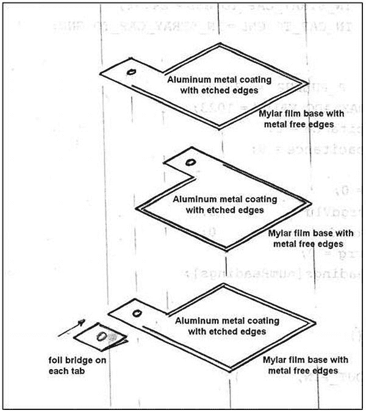

图 9-7
蚀刻边缘的镀铝聚酯薄膜板片与箔桥

`Mylar`薄膜的铝箔涂层侧可通过数字万用表（`DMM`）或伏欧表（`VOM`）的电阻测量或通断检测功能识别。从折叠坯料上一次性切割多层`Mylar`薄膜时，需在切割前确认能获得正确数量的左右手板片。

### 软件

两个 `Arduino` 草图程序可用于持续监控这些传感器。清单 9-1 利用精确已知的电阻和电容来评估 `Arduino` 板的内部杂散阻容 (`ISRC`)。内部校准通过第 1 章中介绍的公式完成。`ISRC` 代码可持续监控器件电容，用于图形显示。

清单 9-2 是第二个电容测量程序，它利用定时器 (`ATmega328`) 的输入捕获功能 (`ICFT`) 方法，并在练习清单中提供了一个移动平均 DSP 代码。通过使用精确定义的外部电路和 `ICFT` 代码进行电容测量，可以实现精确灵敏的测量（见图 9-8）。

为方便使用并降低噪声，图 9-8 中所示的分压电路、电容充放电电阻在原型开发板上完成初步开发后，被焊接到了一个 `Arduino` 扩展板上。`D*x*` 标识是 `Arduino` 板上的标称数字信号 I/O 引脚。

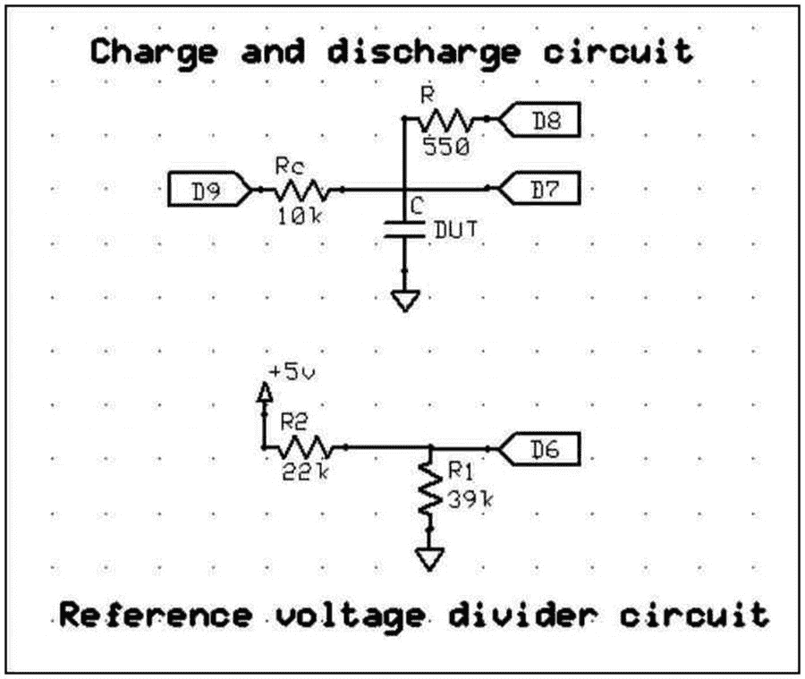

**图 9-8** 用于使用 `Arduino` 输入定时器捕获功能的外部电路

#### 斜率或一阶导数软件

除了测量 `DUT` 电容的两种不同技术外，能够测量被记录信号的一阶导数对于此类测量来说也是一项有用的功能（参见第 3 章，其中讨论了在 `DAQFactory` 的通道事件选项卡中一阶导数的数字实现）。

基本的导数软件可以通过以下长、短两行代码编写到通道的事件选项卡中。

```
private frstDiff = (Smooth (ArduinoStream[0],4) - (Smooth (ArduinoStream[25],4))) / (Smooth (ArduinoStream.Time[0],4) - (Smooth (ArduinoStream.Time[25], 4)))
frstDeriv.AddValue(frstDiff)
```

就 `DAQFactory` 程序显示的 `x` 对时间图而言，导数即为“纵增量”除以“横增量”，或 `x` 值随时间的变化率。这两行代码是在实验碳化硅高温电阻时开发的。“纵增量”的高度和“横增量”的长度值是通过经验得出的。根据来自 `Arduino` 数据流的 25 个数据点计算出的斜率值，再乘以另一个经验推导的比例因子，以生成视觉上有用的一阶导数轨迹。图 9-11 展示了导数轨迹在定位因施加重量可能导致的主电容变化方面的应用。（参见关于聚乙烯介电材料的讨论。）

`Smooth(Value, Amount)` 是 `DAQFactory` 的“移动平均”命令。（`Value` 是被绘制的实体或通道。`Amount` 是要进行平均或平滑处理的点数。）在用于 `frstDerv` 的 `DAQFactory` 代码中，对最近的四个数据点进行平均。减去 25 个数据点之前记录的四个点的平均值，以确定 `x` 值的差值（即“纵增量”跨越“横增量”时间长度内的差值）。将 `x` 的差值除以当前数据值与 25 个数据值之间的时间索引差，即得到斜率或一阶导数值。

在图 9-11 中，一阶导数轨迹值乘以 50，然后显示在屏幕上的 `+/– 3` 范围内，屏幕满量程偏转为 2.0 nF，对应 `MPCLC` 值在 19.3 至 21.3 nF 之间，即当 100 mg 至 1 g 的重量压缩器件时（参见关于量程扩展的讨论）。

## 观察结果

### 简单系统：铝-聚乙烯板

尽管 1997 年开发的原始系统在测量电容和称重传感器上的重量之间呈现出粗略的线性关系，但相对简单的计算系统仅提供单一数值的数字读数，缺乏足够的分辨率或连续记录能力来显示一种固有的现象，该现象限制了聚乙烯板在此类电容式称重传感器应用中的简单使用。随着校准实验中使用的重量增加，系统响应趋于稳定所需的时间也越来越长。图 9-9 显示了一个典型的响应。

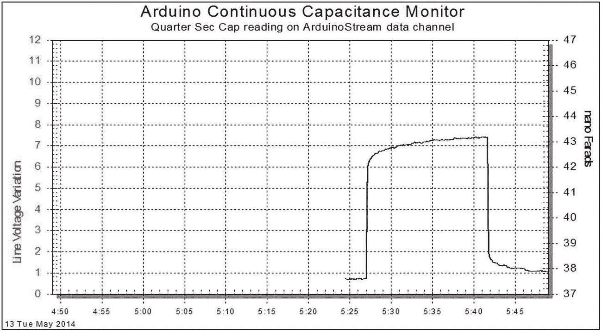

**图 9-9** 使用聚乙烯介电材料时的信号漂移

图 9-10 中的数据是在发现长时间平衡现象并确认其可重复性后收集的。

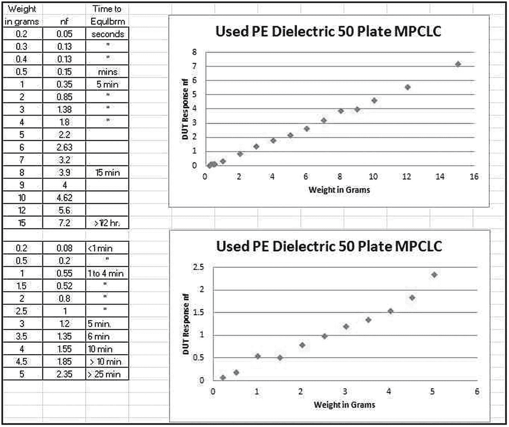

**图 9-10** 聚乙烯漂移研究

系统达到恒定测量电容所需的时间似乎随着负载大小的增加而增加，并且在连续显示模式下使用较高重量时需要小心。

补偿长期漂移的另一种选择（这种漂移可能是器件聚乙烯介电层某种形式二次压缩的结果）是监控传感器输出的一阶导数。可以计算一阶导数，并将其传输到第二个通道，配合 `DAQFactory` 代码的最后两行进行显示。

为了评估在已使用的聚乙烯 `MPCLC` 初始位移期间观察到的电容变化的一阶导数映射的实用性，记录了一次从 100 mg 到 2 g 的校准，如图 9-11 所示。

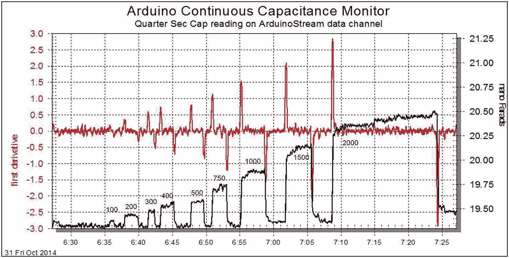

`图 9-11` 聚乙烯 `MPCLC` 重量响应的一阶导数记录

校准轨迹使用一个 50 介电常数、锥形板器件记录，该器件由用过的透明聚乙烯杂志邮寄包装袋和薄铝箔制成。Arduino 运行经过校准的 `ICFT` 电阻测量程序，在将数据发送到 `DAQFactory` 程序显示之前，使用 32 点移动平均平滑处理。`DAQFactory` 对通道输入采用 8 点平均，对电容值采用 32 点平滑，并对一阶导数采用 64 点平滑，用于图形条带记录仪显示。一阶导数的幅度通过将平滑后的绘图乘以一个任意值 250 来调整到显示比例。用于 100 mg 至 2 g 数据收集的器件暴露在室内环境条件下。

图 9-12 中的数据是在以毫米 (mm) 为单位测量初始偏转和三角形一阶导数轨迹的绝对高度，并相对于标称重量绘制时获得的。

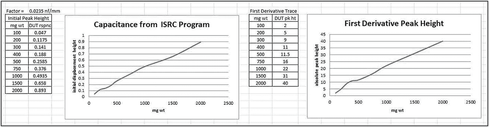

`图 9-12` 一阶导数与初始偏转的数据比较

尽管初始偏转基线位移图和电容值轨迹的一阶导数图具有大致相同的斜率，但导数图的线性度低于初始偏转绝对高度的绘图。

第二组校准数据是在更高的灵敏度下收集的，当时一个简单的黑色建筑用纸板空气隔热罩保护了锥形器件除 1¼ 英寸（32 毫米）尖端外的所有部分。校准轨迹如图 9-13 所示。

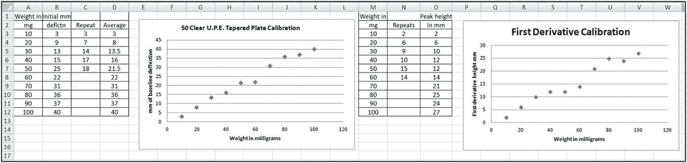

`图 9-14` 初始基线位移与一阶导数峰高的数据图

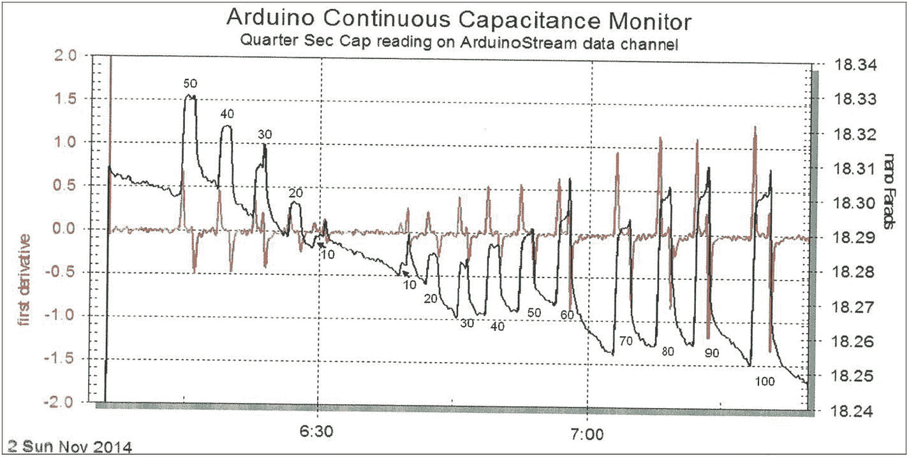

`图 9-13` 一阶导数与初始偏差的高灵敏度数据对比

从这两幅图中可以看出，初始位移值相比一阶导数显示中的峰值高度具有更好的线性度。一阶导数的价值在于确定测量聚乙烯介质器件中重量引起电容变化的起点和终点。

收集图 9-14 中的数据后，在大多数超市果蔬区使用的“购物袋”中发现了薄聚乙烯材料的来源。采用薄聚乙烯以及后来设计的四柱式板与介质安装技术，称重灵敏度可低至 `10 mg`。图 9-15 绘制了大重量范围的曲线以及该范围的线性部分。图 9-15 中绘制的数据点存在噪声，但通过一阶导数追踪，仍可测量电容追踪的初始偏转高度。

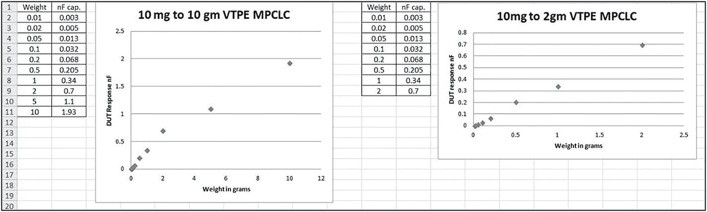

`图 9-15` 一阶导数斜率变化引起的初始基线位移数据图

### 简单系统：铝–玻璃纸层

从当地花店购得的玻璃纸片（`23½ in × 19½ in` 或 `58 cm × 48 cm`）（聚合木纤维素经挤压制成的薄片，添加甘油作为增塑剂），按标称尺寸裁剪以适配使用的铝箔板和安装基座。在组件装配过程中，使用直径为 `1¼ in`、长度为 `4 in`（`3 × 10 cm`）的硬橡胶辊（用于丝网印刷，见图 9-6 中的第 7 项）将箔板滚压平整。

玻璃纸器件经砝码校准后，生成的数据以表格形式列出，并在图 9-16 中以图形方式呈现。

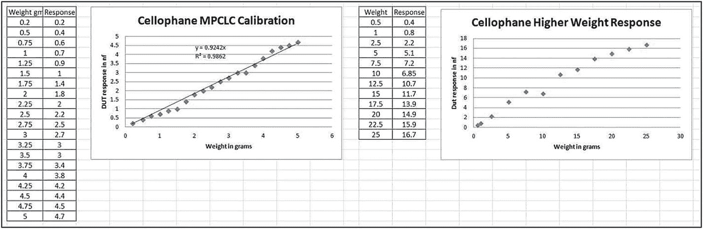

`图 9-16` 玻璃纸 MPCLC 重量与电容关系图

### 简单系统：铝–新旧新闻纸

采用 `3¾ in`（`9.5 cm`）方形有效面积的铝箔板，搭配 `4¼ in`（`10.5 cm`）方形介质，组装了一个由 50 层介质和 51 层导电极板组成的多板电容器。介质材料取自普通印刷报纸页面，20 层叠放厚度为 `0.060 in`，平均厚度 `0.030 in`（`0.76 mm`）。在标定前，使用 `3 lb` 砝码（`1.4 kg`）对 50 个单元组成的传感器进行压缩，并让其松弛三次，最终稳定在标称 `30.25 nF` 电容值，随后在 `29` 至 `31 nF` 的量程上出现 `0.05 nF` 的基线噪声。在 `3 lb` 负载下，该单元测得电容为 `92 nF`。在数天内对已知重量的电容值进行了三次重复测量。首次校准的数据如图 9-17 所示。

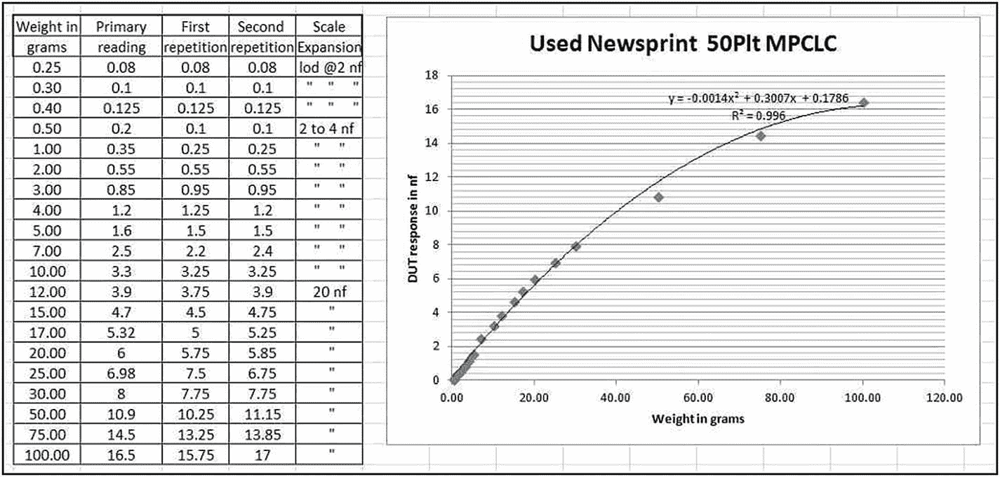

`图 9-17` 废旧新闻纸 MPCLC 重量与电容关系图

新新闻纸比印刷材料更厚。印刷过程中滚筒产生的大压缩力会压紧纸料。废旧材料的厚度为 `0.0025 in` 或 `0.06 mm`，而新新闻纸为 `0.005 in` 或 `0.12 mm`。新新闻纸的类似重量-电容关系图如图 9-18 所示。

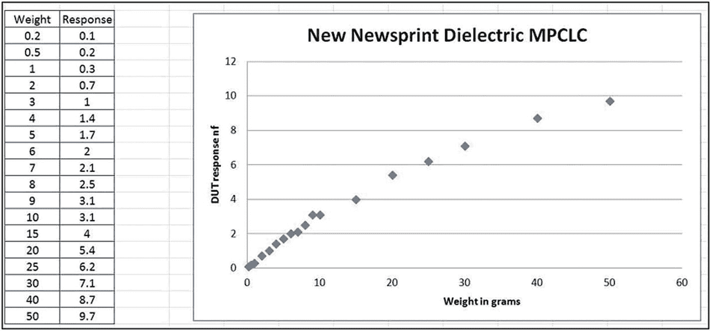

`图 9-18` 新新闻纸 MPCLC 重量与电容关系图

### 复杂系统：铝-聚酯薄膜复合材料

一个包含 50 个电介质和 51 个导电极板的多层板电容器，由从铝-聚酯薄膜“救生毯”上裁剪下来的、有效面积为 3¾英寸（9.5 厘米）见方的铝箔-聚酯薄膜复合板组装而成。该救生毯购自一家大型零售商店的露营用品区，并被裁剪成正方形，左右两侧各留有 1 平方英寸（2.45 厘米）的接线片用于电接触。为了组装一个可靠且可重复使用的器件，必须将沉积在聚酯薄膜外边缘的铝金属蚀刻掉，以避免各个极板之间发生短路。

通过从每个极板边缘蚀刻掉标称的八分之一英寸，得到了一个形状略不规则的 3¼英寸（8.3 厘米）见方的铝导电板。聚酯薄膜电介质则作为 3¾英寸（9 厘米）见方的片材，支撑着沉积的铝导体。由于铝沉积在聚酯薄膜膜的一侧，而聚酯薄膜现在是器件的主要结构材料，每个器件极板上的铝层必须使用铝箔“桥接”进行连接，如图 9-7 所示。

由“救生毯”材料裁剪而成的 30 层极板堆叠厚度为 0.06 英寸，单片厚度为 0.002 英寸或 2 密耳（0.051 毫米）。与简单系统一样，在校准之前，这个 50 单元的组件先用一个 3 磅的重物压缩，然后让其松弛，重复三次后，最终稳定在标称值为 96 nF 的电容值，在 96 至 96.5 nF 的满量程偏转范围内，基线噪声为 0.05 nF。在 3 磅负载下，测得的电池电容值为 410、425 和 420 nF。

电容值由 `Arduino` 电容计程序以每秒四次循环的频率连续测定。流式传输的 `Arduino` 数据通过 `DAQFactory` 显示，并使用了 32 点平均值进行平滑处理。

已知重量的电容值在数天内进行了多次测量。校准数据被绘制成图，如图 9-19 所示。

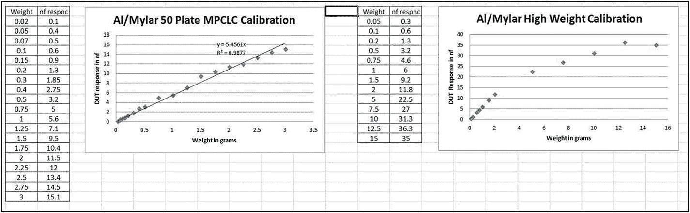

`图 9-19` 蚀刻边缘的聚酯薄膜-铝 MPCLC 在大重量和小重量下的重量与电容关系图

除了更复杂的蚀刻板电容器外，还使用几种不同材料作为电介质进行了大量实验。使用铝箔和不同电介质片材制成的简单矩形器件用于收集数据。各项实验的结果汇总于表 9-1。

`表 9-1` 使用各种不同电介质材料的 50 层板电容器测力传感器的特性

| -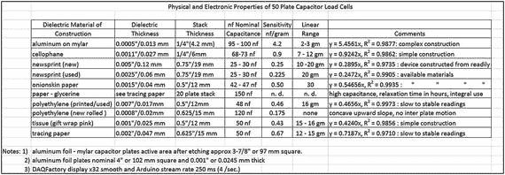 |

为了确定这种称重技术的可重复性，分别对铝-聚酯薄膜、纤维素和洋葱皮纸器件在较大量程内进行了三次校准，然后在其线性量程内再次进行校准。铝-聚酯薄膜系统的数据代表了其他两种器件观测到的典型情况，并显示在图 9-20 中。

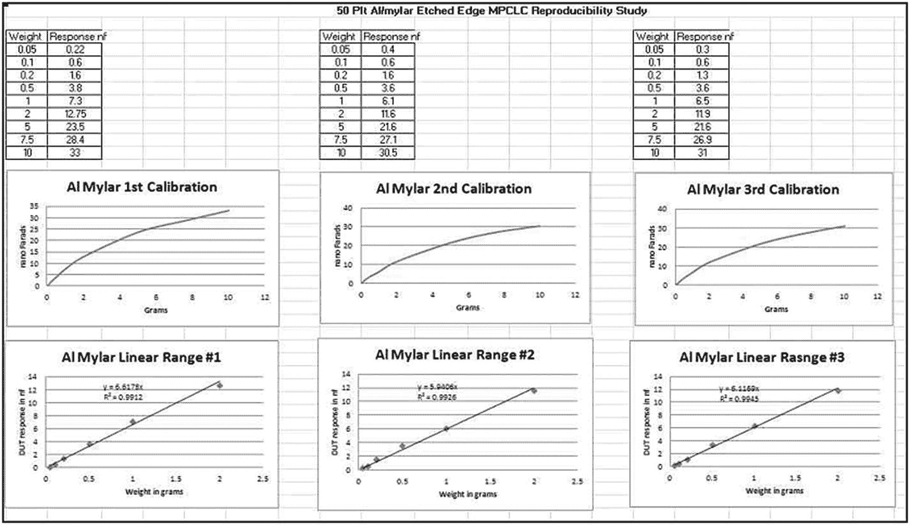

`图 9-20` 典型的系统可重复性

针对洋葱皮纸、纤维素和铝-聚酯薄膜器件，分别在其线性量程内进行了一系列校准，以测定其各自的响应。在这些器件上观测到的典型数据如图 9-21 所示。

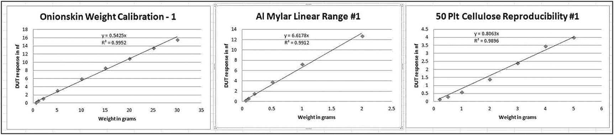

图 9-21 洋葱皮纸、纤维素薄膜和铝-聚酯薄膜复合材料的线性响应

## 异形系统

虽然器件的电容值取决于极板和电介质的接触面积，但在这种类型的器件应用中，更大的面积也导致极板相互滑动时产生的摩擦力增大。如果极板和电介质是三角形，那么随着极板宽度的减小，摩擦力和弯曲力也应减小，从而使器件对重量更敏感。

三角形极板应对较小重量更敏感，但必须验证其线性度。异形器件也给组装带来了困难。在制造过程中可能需要用于切割和组装的夹具。

最初，为了帮助组装锥形器件，在支撑底座上安装了木块，以帮助对准所制造器件的尖端。

初步实验使用 4 英寸（10.2 厘米）见方的铝板，将其修剪成锥形至英寸（1 厘米），作为导电板，电介质的切割则使其每侧与导体重叠英寸（3 毫米）。

器件的电容与所用极板的面积成正比，而减小面积以减少摩擦并提高重量灵敏度，就需要提高测量`DUT`响应微小变化的能力。为了适应当器件本身和所施加的重量都减小时，系统电容可能会产生的更小变化，使用了`ICFT`程序和重量处理设备来收集数据。

用于数据收集和小重量操作的典型实验装置如图 9-22 所示，并描述如下。

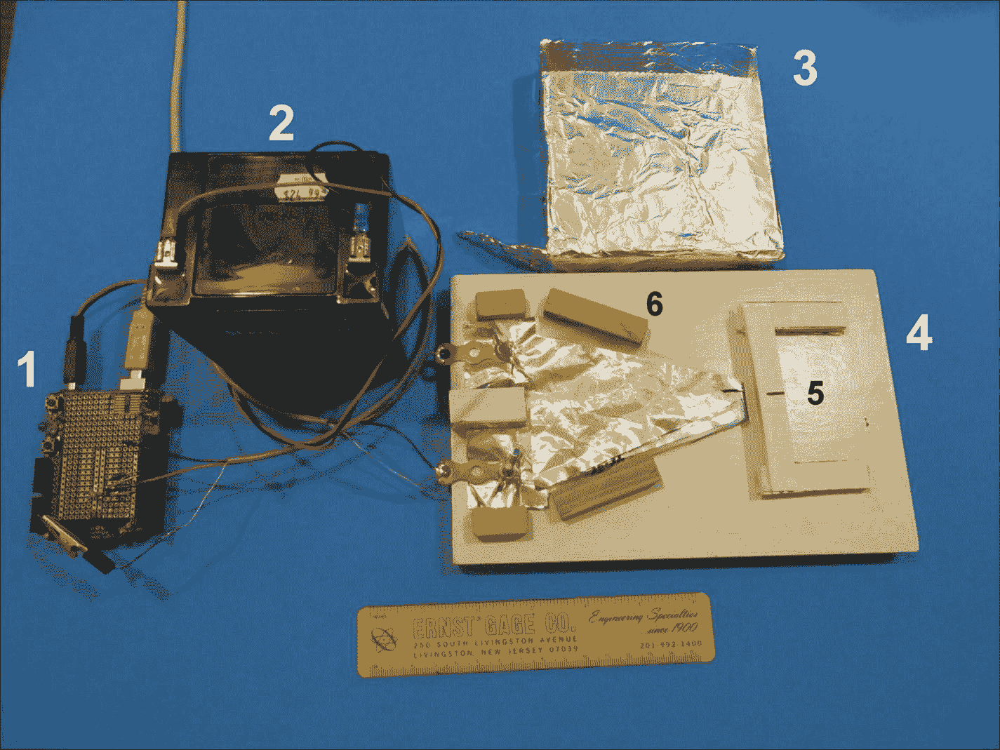

图 9-22 锥形 MPCLC

*   项目 1 是`Arduino`和一块`Arduino`“扩展板”，其顶部安装了外部充放电和分压参考电阻电路。

*   项目 2 是为`Arduino`供电的 12 V、2.4 Ah、可充电、密封式铅酸电池电源。

*   项目 3 是空气-电磁屏蔽罩，由一个完全覆盖铝箔的薄纸板底座构成。铝箔在屏蔽罩左下角有一个可见的锥形接线片，用于连接到连接至`Arduino`接地引脚的绞合输入信号电缆的屏蔽层。

屏蔽罩后部有两个矩形开口槽，用于容纳多层板电容器的穿孔铜带电接触点。为了操作砝码及其滑动桥架，屏蔽罩并未覆盖整个异形器件。

*   项目 4 是底板，带有两个螺纹金属柱和左端居中的白色间隔块，它们既用于定位，也用于为电容器的左右导电板提供电接触。

*   项目 5 是滑动在电容器尖端上的一个纸板桥架的中心。在照片中，桥架的俯视图类似于一个方形的“C”形。“C”形的顶部和底部臂是由薄纸板垫片堆叠而成，这些垫片逐渐粘合在一起，以抬高桥架，使其刚好能跨过电容测力传感器的顶层叶片。

桥架是一块薄纸板，与桥架平台成直角折叠。从侧面看，桥架平台的横截面呈“L”形，长臂形成平台。桥架平台和测力传感器尖端的中心都标记了一条中心线，以确保每次测量时定位的可重复性。

在电容尖端右侧放置桥式结构后，将砝码装载至桥面中心线上。随后将桥向左移动，直至两条中心线的尖端对齐，并小心地将砝码从桥上拉下或推下，使其置于称重传感器上极板上。完成测量后，将桥向右拉回，砝码便会从称重传感器上滑落。

- 项目 6 表示在设备组装期间用于定位导电板和电介质的一组木块。

砝码操纵桥是为配合单个电容式称重传感器而定制建造的。在每个上臂和下臂上添加垫片，直至桥刚好能越过传感器上极板而不产生机械干扰。如果上极板与电容器之间的距离过大，则当桥向右移动进行重新加载时，砝码将无法从称重传感器上被推落。您必须手动尝试移动砝码，同时避免干扰传感器的配置。

桥与称重传感器之间的近距离会影响基线轨迹，如图 9-23 所示。

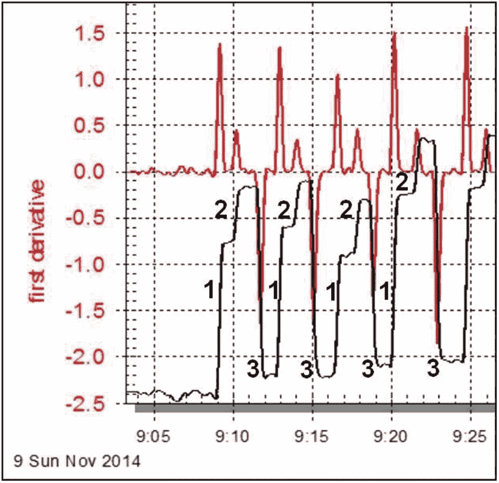

**图 9-23** 砝码操纵桥移动的基线响应

最初位于图左下角的基线，通过将桥向左移动并覆盖称重传感器尖端，如标注为 1 的轨迹部分所示，基线被抬高。经过短暂时间后，砝码被从桥上推至称重传感器上极板，砝码引起的电容变化被记录为部分 2。将桥向右滑动，砝码被推离传感器上极板，基线回到标注为 3 的位置。电容轨迹的红色一阶导数峰值标记了记录中的拐点。

## 锥形 MPCLC 器件的实验改进

后期使用锥形单元进行的实验结合了多种技术，以开发出一种灵敏、廉价且易于组装的器件。

聚乙烯薄膜可能是最便宜、最容易获得，且由于其化学和物理惰性，是 MPCLC 实验中最理想的绝缘体之一。使用薄“保鲜膜”聚乙烯薄膜进行的实验因组装后的器件缺乏柔韧性而未获成功。

第二种来源是用于包装杂货店新鲜农产品的袋子中使用的极薄、半透明、非粘性聚乙烯薄膜。16 层薄膜的典型总厚度为 0.0075 英寸（0.184 毫米），平均单层薄膜厚度为 0.00047 英寸（0.011 毫米）。

早期的锥形器件实验，如图 9-22 所示，试图将组装后的电容式称重传感器尖端宽度缩小至 `` 英寸（1 厘米），但在图像中，器件各层之间的对齐偏差导致组装后的器件尖端宽度远超 1 英寸（2.45 厘米）。

为了辅助导电板和电介质的对齐，在底板设计中增加了两个钢销，用于通过张力定位绝缘体，而不是依赖聚乙烯薄膜几乎不存在的刚性来使用木块。通过在底板上仔细定位两个钢销，并在电介质的锥形侧边添加两个带孔突片，绝缘体可以被更牢固地固定就位。

除了更牢固地安装电介质外，通过翻转绝缘薄膜以更好地对齐正在组装的器件尖端部分，可以最大限度地减少因切割和穿孔电介质而引起的偏差。

通过在底板上增加两个钢销来固定电介质，使得器件的多项额外实验和应用成为可能。

早期使用滑动桥进行砝码操作的高灵敏度器件的初始实验，导致了图 9-23 中描绘的基线偏差。为避免徒手添加砝码干扰器件板锥形部分定位的影响，设计出了第二种技术，该技术利用了电子学中的偏置概念。在器件设计中引入锥度以减少摩擦力，从而产生了横截面积逐渐变窄的极板。一个带有螺纹支腿和中心大孔的小型三脚架装置被安装在称重传感器尖端上方，并调整其高度，直至器件极板的尖端处于轻微压缩状态。

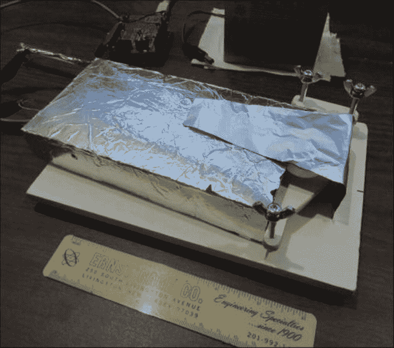

**图 9-25** 薄聚乙烯锥形 MPCLC 盖闭合状态

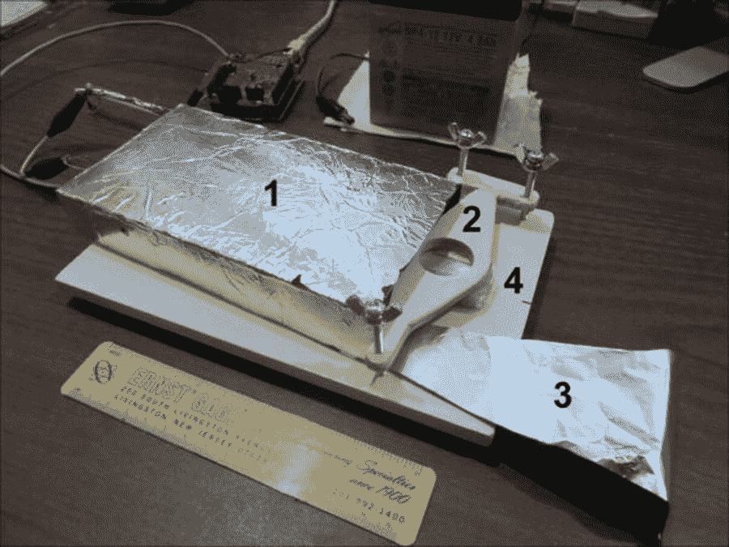

**图 9-24** 薄聚乙烯锥形 MPCLC 打开状态

图 9-24 和 9-25 显示了在 MPCLC 应用中评估薄聚乙烯薄膜电介质的初始设置。该电容器件类似于图 9-22 中的锥形器件；然而，它采用等腰三角形配置，其底边长度为侧边的一半，这与早期锥形器件实验中方形板被切割成 `` 英寸（9 毫米）尖端不同。

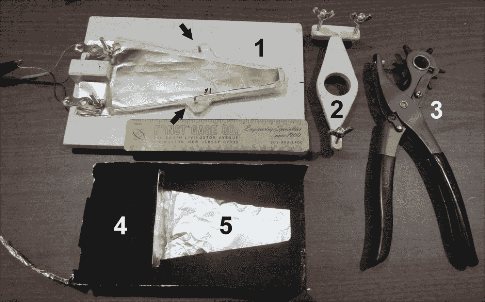

**图 9-26** 薄聚乙烯锥形 MPCLC

在图 9-26 中，两个黑色箭头指示了定位销柱，在这些销柱之间，薄介电体被紧密安装，大约位于三角形器件底部向上三分之一处，并且比此类成型器件介电体的标准宽度宽出``（3 毫米）。加宽的销柱用于固定绝缘体。一个三脚架桥（件 2）轻微压缩了电容器的尖端，以建立可调电容的基准值，其方式与通过电压偏置来建立晶体管工作点的方式非常相似。

三脚架中央的大开口允许使用镊子辅助添加和移除砝码。三脚架的形状经过设计，以最大化锥形尖端面积，并尽可能远地伸入热屏蔽和电磁屏蔽（件 4 和件 5）下方。件 3 是一个孔径可调的“皮革”打孔器，用于在成型的介电体和导体板上打出 3.5 毫米（``英寸）的孔。

使用图 9-25 和图 9-26 所示的装置，进行了从 50 毫克到 600 毫克（mg 或 mgm 代表毫克，即 0.001 或 1/1000 克）的电容与重量校正实验。校正过程中测得的数据以表格和图形形式展示在图 9-22 中。

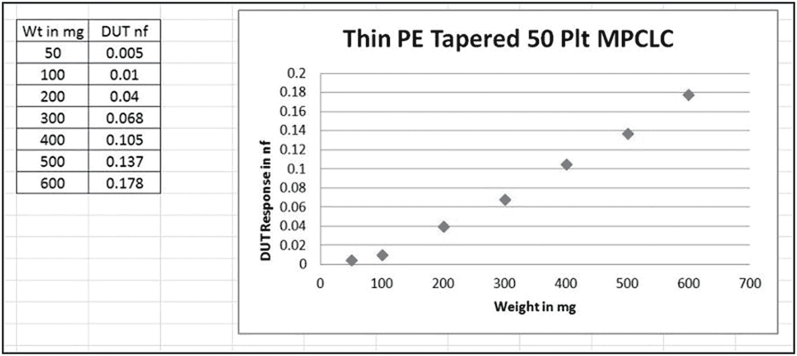
**图 9-27**
50 至 600 毫克重量校正

图 9-28 展示了由北美冬季住宅集中供暖的循环效应所引起的环境室温变化的影响。

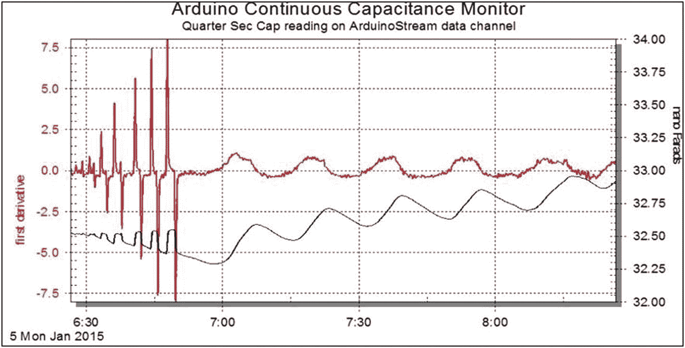
**图 9-28**
由集中供暖引起的基线漂移

如图 9-28 所示，为了在高灵敏度下进行实验时维持一个足够稳定的基线，需要显著增加隔热措施。

为了确认器件组装过程中没有短路，我们注意到，随着 MPCLC 中极板数量的增加，器件电容似乎变得异常大。为了在更高的器件灵敏度下工作，我们构建了一个更厚的隔热罩。在安装热-电动势屏蔽并对底板进行修改以固定压缩“偏置”桥的位置时，薄聚乙烯器件被拆解。

在重新组装这个 50 极板、薄聚乙烯器件的过程中，通常在用电压-欧姆表每添加五个介电体和六个导体板后进行电容验证测量，本次则在 MPCLC 上分别施加 2 克、1 克、0.5 克和无砝码负载的情况下进行了测量。多次增量测量及其数值差异的结果（标记为“ΔC”，即`Δ C`）已列于表 9-2 中。

**表 9-2**
MPCLC 电容随极板增加的变化

| 图片 |
| :---: |
| 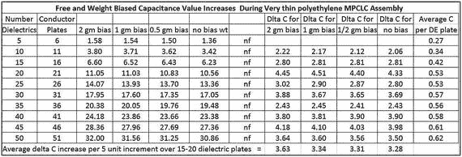 |

在该表的右侧，基于堆叠中介电体数量的平均电容随着器件中“叶片”的增加而稳步上升。平均电容似乎在增加，因为增加的“叶片”重量压缩了其下方的电容单元。

测量了聚乙烯和铝箔极板的平均重量，以了解器件组装过程中增加的重量，并确定新增“叶片”会导致多少压缩。十片极薄聚乙烯 (VT-PE) 薄膜介电体重 0.6604 克。十片锥形铝箔导体板重 2.9186 克。单个平均重量分别为 0.0660 克和 0.2919 克，这表明随着 MPCLC 尺寸的增加，铝箔导体板的重量不可忽略，并且可能是导致观察到的总电容随器件极板数量增加而增加的原因。

将观察到的总电容与介电体和箔导体板的数量进行绘图，得到图 9-29 所示的曲线。

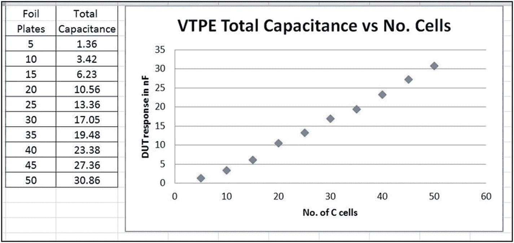
**图 9-29**
MPCLC 中观察到的总电容与箔导体板数量的关系

在图 9-29 中，图形并非线性。它呈现出略微向上的凹形曲率，这很可能是由于顶部极板累积的重量对下方极板产生的自压缩效应所致。

构建更长、锥度更大的器件时遇到的一个问题是保持铝箔导体板尖端的对齐。介电体可以拉伸覆盖在对准销柱上，只要它们与箔导体板边缘重叠足够远以避免器件短路，就无需精确对齐。

如果箔板未仔细对齐，那么每添加一个新单元时电容的变化会导致在器件构建过程中进行的测量出现过多差异，并可能掩盖在表格数据中观察到的任何趋势。

在收集表 9-2 的数据时，极板的错位变得相当明显，并从预期的``英寸（1 厘米）宽度扩散到远超过 3/4 英寸（2 厘米）。

将介电体固定于两个钢制销柱之间后，进行了一项一式三份的简单实验，以评估自压缩对 15 VT-PE 介电体器件观察电容的影响。通过将电容器旋转 90 度，重力对电容器产生的向下力应按照倾斜角度的余弦值成比例减小（参见“斜面”讨论），如表 9-3 所示。

**表 9-3**
15 极板 VT-PE 器件中电容随仰角增加的变化

| 仰角（度） | 电容实验#1 (`nF`) | 电容实验#2 (`nF`) | 电容实验#3 (`nF`) | 平均值 (`nF`) |
| :---: | :---: | :---: | :---: | :---: |
| 0 | 9.18 | 9.11 | 9.02 | 9.10 |
| 45 | 8.97 | 8.94 | 8.91 | 8.94 |
| 90 | 7.35 | 7.16 | 7.14 | 7.22 |

器件的旋转导致观察到的电容从 9.10 `nF` 降至 7.22 `nF`，降低了 1.88 `nF`（关于 MPCLC 观察电容与倾斜角之间的理论关系，请参见图 9-43）。

基于双柱概念，为导电板和绝缘介质开发了一种四柱安装方案，以提高器件的可重复性和灵敏度。底板设有四个线性等距安装点（中心间距为 3/4 英寸（18 毫米）），包括两个用于电接触的外侧带蝶形螺母的螺纹金属 #8 × 32 TPI（`` 英寸或 3 毫米直径螺栓，每英寸 32 牙或 2.45 厘米）螺杆安装柱，以及两个直径为 1/4 英寸（3 毫米）的内侧木质销钉。介质对称设置，套在两个内侧木质销钉上。导电板则为左右镜像结构，分别套在导电端子和远端木质销钉上。

通过从两个支撑点支撑介质和导电板，即使倾斜角度增大，器件各组件也能保持相对对齐。

在对 MPCLC 器件的压缩行为有了基本了解之后，我们进行了一系列附加实验，通过在力臂末端悬挂重物的杠杆来增强施加给重量传感器的压缩效应。

#### 称重操作产生的力的增强

利用物理学中传统上称为“胡桃夹子”的二级杠杆原理，最大化了称重操作的灵敏度和可重复性。如图 9-30 示意图所示，该杠杆随后与一个用于升降承重梁的简单机械机构相连。图 9-30 所示的方形蚀刻边缘铝制聚酯薄膜器件，在图 9-6 中被标记为项目 #2。

板安装和电桥连接信息如图 9-7 所示。一个由矩形纸板结构构成、外覆接地铝箔且内部涂黑的开放式屏蔽罩被制作出来，以覆盖器件的大部分结构。屏蔽罩的开口端尺寸足够大，以便手动升降称重梁。

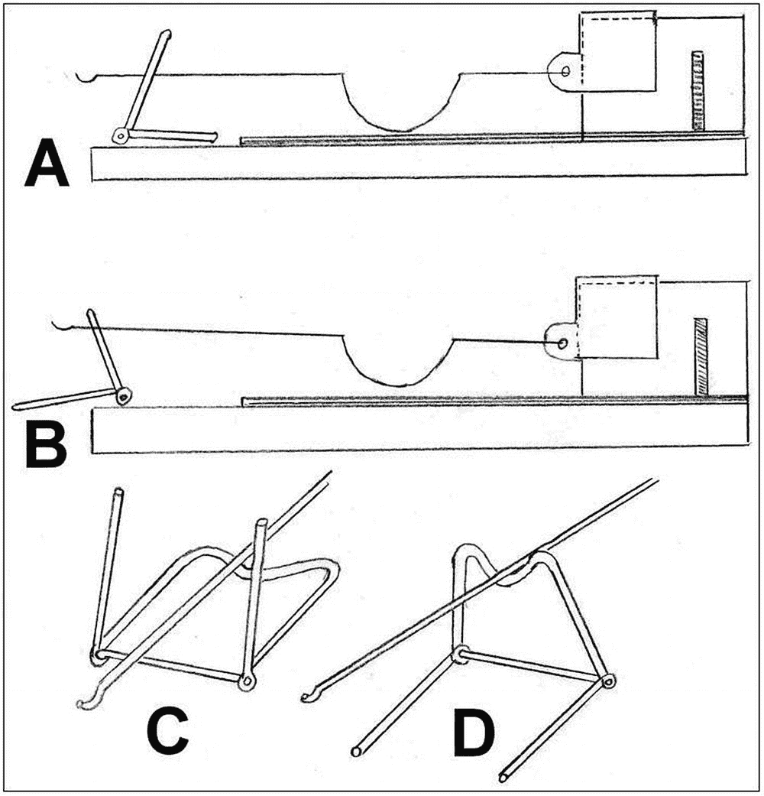
**图 9-30**
一种简单的杠杆式重量测定装置

在每次称重之间将杠杆从传感器上抬起，可使电容器弹回其静止位置并重新建立基线。基线状态的视觉确认通过`DAQFactory`条带图记录仪显示进行监测。当显示画面在视觉上看起来随时间恒定不变时，读取输入通道值表上的实际电容数值以定义基线。当承重梁处于抬高位置时，将待测重物装载到梁上。装载抬高位置的承重梁可确保电容器板不被意外扰动或压缩。

开始称重时，将承重梁和重物一起降低回到传感器上，传感器随即开始响应压缩。`DAQFactory`显示也监测传感器因新负载而产生的电容增加。当增加的负载迹线随时间变得恒定时，再次读取并记录`DAQFactory`通道表的实际数值。

为了确定器件对施加重量的实际响应，必须从总重量测量值中减去空梁的皮重。根据现行良好实验室规范（cGLP）规程，在处理一批样品前后，均需称量一个“标准”重量以确定其重量。遵循 cGLP 规程，可以在开始称量一系列已知或未知重量之前多次测量空梁重量校正值，并在完成整批称量操作之后测量一到两次。在称量一批校准砝码或未知重量之前和之后，观测到的空梁重量值之间良好的相关性，能确保你相信当前批次观测数据的可靠性和可重复性（参见《水和废水检验标准方法》第 23 版（美国自来水厂协会，2017））。

然后，可以从测得的总值中减去梁重量校正因子，以生成所处理批次的重量与电容校准曲线，或未知重量（参见关于杠杆使用的讨论）。

尝试使用杠杆测定低于 20 至 10 毫克的重量受到限制，因为待测小质量产生的向下的力无法弯曲或移动用作重量传感器的 MPCLC 的簧片。为了测量 10 至 100 毫克之间的重量，可以配合电池供电的 Arduino 和辅助供电的 USB 连接，使用图 9-33 中标记为项目 A 的小型三角形 MPCLC，以生成在此低重量范围内使用所需的校准数据，无需任何额外的机械辅助装置。

## 称重装置设计参数

为了设计、构建和验证称重装置，实验者可能会发现模块化系统最为灵活和实用。在电容式传感器、微处理器数据采集以及上位机`Windows`或`Python`/`Linux`图形化轨迹-数值显示方面，已经实现了一定程度的模块化。

电容式传感器的设计取决于具体应用。涉及克级称重要求的系统，可以使用由铝箔和电介质制成的分立极板来实现，具体可参考表 9-1。对于质量非常小的样品以及涉及分数克测量的称重任务，可以使用更难以制造和组装的更小的方形板或三角形电容极板（参见图 9-3 中的设备 A 和 B）。

简单的方形和矩形装置是迄今为止最容易构建的。如果在设备构造中投入额外的精力添加额外的支撑片，则传感器可以在垂直平面内使用，以测量力或倾斜角度。矩形或方形装置在使用时也是最坚固的，尤其是用铝制聚酯薄膜复合材料制成的装置，其部件数量更少，每单位重量的电容变化灵敏度更高（参见表 9-1）。

直觉上，传感器越厚，可用于测量的压缩范围就越大。如果将方形极板设计成锥形以最小化极板之间的滑动摩擦，传感器灵敏度似乎会增加。在图 9-31 中，灵敏度的提升是以牺牲测量动态范围为代价的。

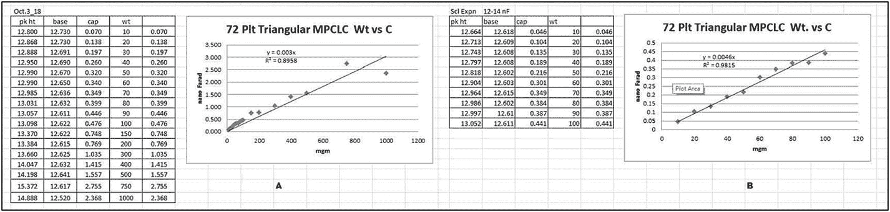
`图 9-31` 小型三角形 `Al-Mylar` 传感器的重量与电容关系图

图 9-31 显示，随着被称量质量的增加，最小二乘法线性拟合的质量会下降。在范围 A 的 1000 mg 量程内，`R²` 方差为 0.8958。在 100 mg 量程内，该值上升到 0.9815。（回想一下，在统计分析理论中，完美的最小二乘拟合的方差为 1。）

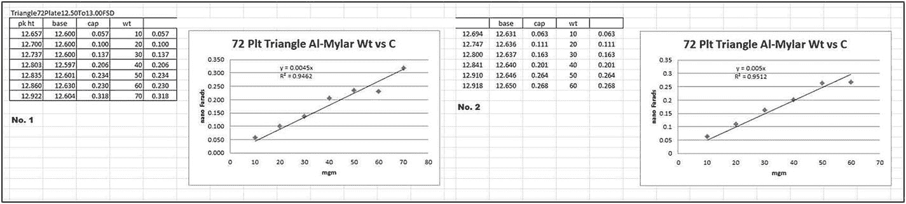
`图 9-32` 小型三角形 `Al-Mylar` 传感器的重复性研究

图 9-32 是一个双图形显示，它是根据重复测定锥形电容器从 10 mgm 到 60 mgm 加载所测得的电容值数据而绘制的。

在图 9-33 中，图 9-34 中标注为项目 B 的方形电容器装置，被用于不同量程扩展下，以测量传感器对 10 至 100 mgm 电容器加载的响应。

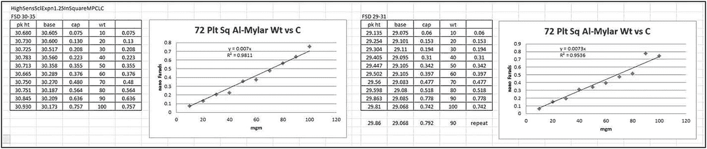
`图 9-33` 小型方形 `Al-Mylar` 传感器的高灵敏度显示

在使用方形和三角形装置进行了大量实验后，为 `MPCLC` 设想了一种折衷方案。矩形极板比带接片的方形极板更容易制造。如果矩形的长宽比很大，则可以消除导致方形装置变形的“楔形”形成问题。通过将传感器的矩形极板彼此垂直组装，而非平行配置，极板的长度方向可以相互平放，只形成一个可压缩的电容器，其末端重叠形成方形区域。

可以将大量极板轻松地组装成一个相对平坦、均匀的小面积表面。图 9-34 中的设备 C 是长叶片、末端重叠式传感器的首次迭代。需要使用矩形胶合板加强筋，以防止在较重的砝码施加到传感重叠极板区域时长极板发生弯曲。

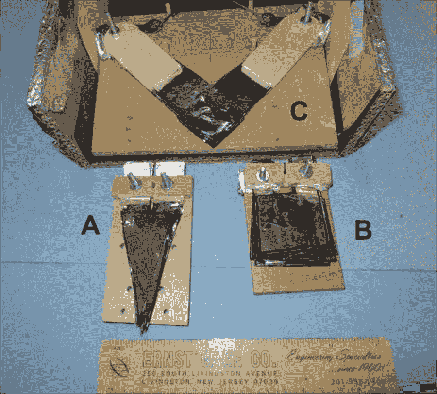
`图 9-34` 三个 `Al-Mylar` 实验性传感器

图 9-35 展示了设备电容与施加在传感器上的重量的关系图。整体响应曲线显示出这些设备预期的反向曲率，正如最初在图 9-2 中预测的那样。

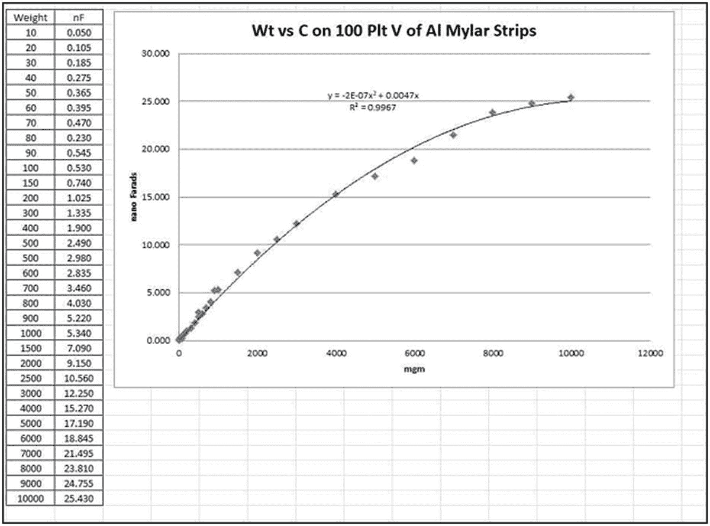
`图 9-35` 100 层 `Al-Mylar` V 型 `MPCL` 的重量与电容关系图

图 9-36 描绘了图 9-35 中观测到的探测器响应的线性部分。

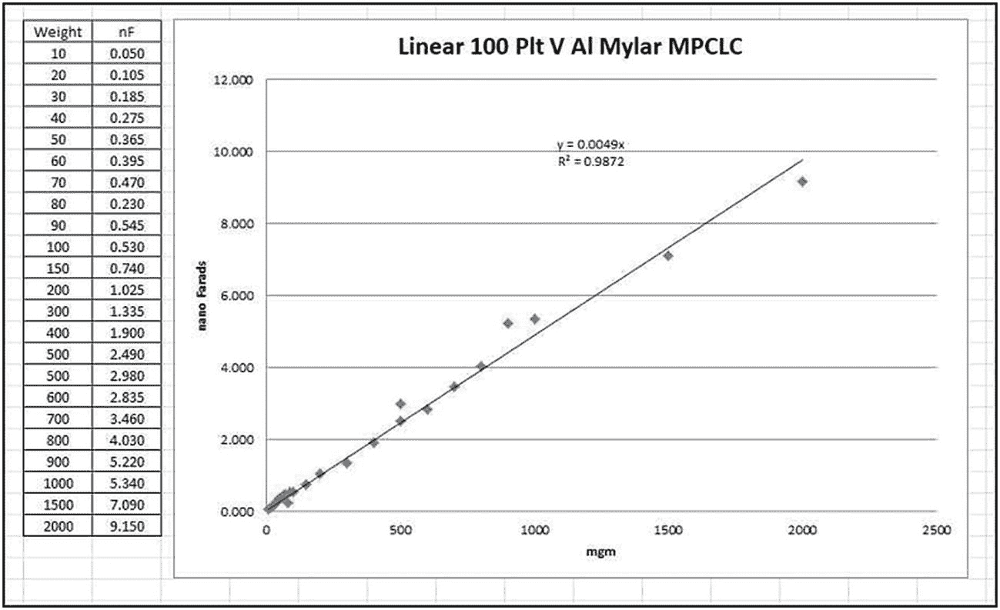
`图 9-36` 图 9-34 的线性部分

图 9-37 表明，如果设置能够分辨小于 0.050 nF 的电容值，则探测器应该能够检测到个位数毫克的重量。

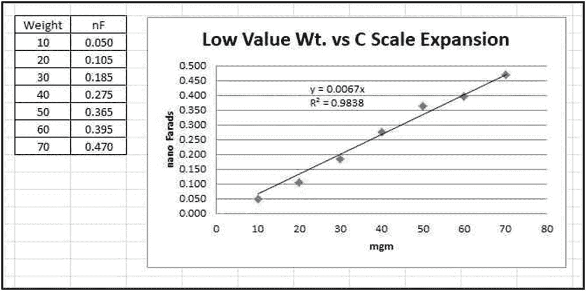
`图 9-37` 图 9-35 和 9-36 的高量程扩展

在图 9-38 中，显示了一次校准测量会话的典型记录仪迹线。每个数据点被测量了两次。在数据对中进行了第三次重复测量，其中两次重复测量之间的差异似乎比预期要大。

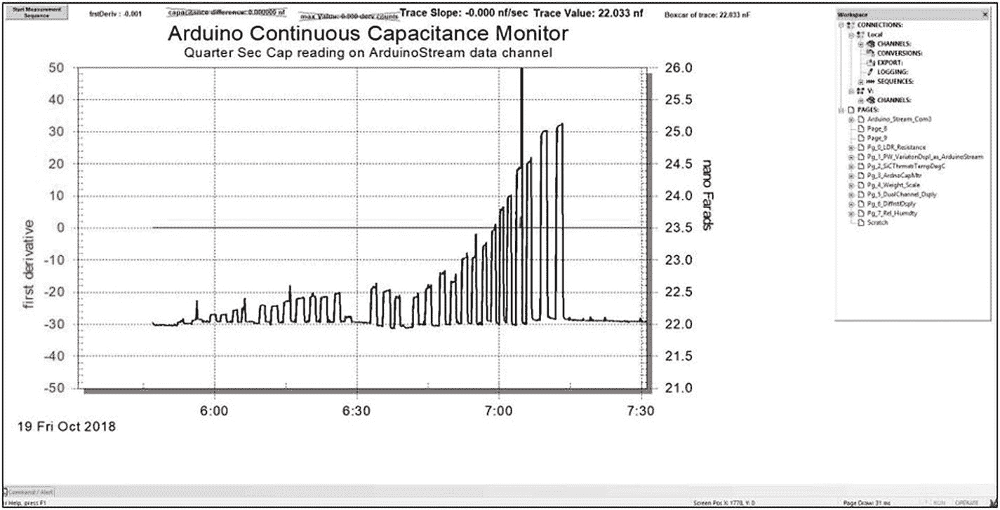
`图 9-38` 重量与电容实验的典型 `DAQFactory` 记录仪迹线

在尝试将称重技术扩展到更低极限时，100 极板装置开始表现出不稳定的响应，有时对 10 到 20 mg 范围的重量完全无响应。怀疑是微小的重量没有足够质量来克服电容器极板的刚度，从而产生可测量的压缩。在移除较重的砝码后，极板通过以合理可重复的方式膨胀回其原始配置而恢复。

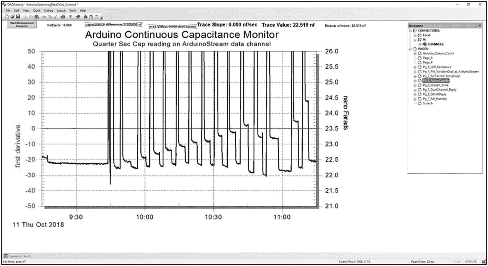
`图 9-40` 压缩-膨胀重量校准的记录仪迹线

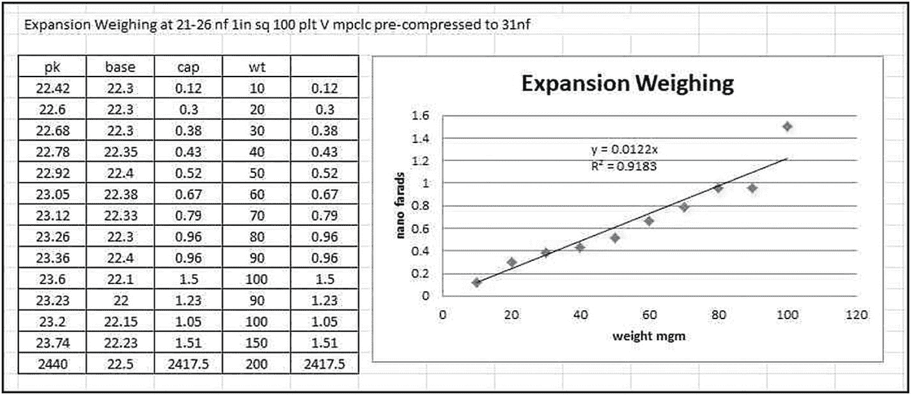
`图 9-39` 传感器膨胀称重

膨胀称重是通过用一根带有两个可调节支撑的压杆压缩传感器，直到设备显示值为 31 nF 的点来进行的。在压缩状态下，当轨迹线超出量程顶部时，将一个砝码放置在传感器上。然后移除压杆，让传感器膨胀，从而承载待测砝码。下降的轨迹线值回到量程内，并下降到一个高于原始基线的位置，在那里它可以稳定下来。从传感器上移除砝码允许进一步膨胀，轨迹线下降到原始基线附近。最终基线值与“平台”值之间的差值就是被测砝码引起的感应电容差值。

当从传感器上移除测试砝码时，膨胀测定有时似乎也受到无法移动设备极板的相同问题的困扰。

为了明确探索 100 极板“V”型传感器的下限，用普通等级的铝箔准备了一系列毫克砝码。图 9-41 描绘了一组标称重量从 12.9 毫克到 1.07 毫克的砝码。

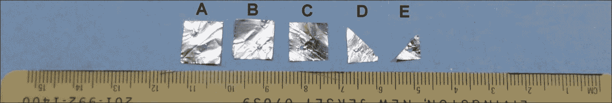
`图 9-41` 代表性的毫克砝码（12.9 mg 至 1 mg）

普通等级铝箔的轧制厚度为 0.016 mm。铝的密度为 2.70 g/cm³，每平方厘米铝箔重 4.3 mg。在图 9-42 中，A、B 和 C 分别是面积为 3 cm²、2 cm² 和 1 cm² 的折叠单层试样。D 和 E 分别是二分之一和四分之一平方厘米的分数试样。

当 `Arduino` 由电池或 12 V 稳压电源供电时，USB 产生的噪声从系统显示中移除，并且可以使用高量程扩展（参见图 9-4）。当在 `FSD` 为 0.150 nF 下运行时，图 9-42 中编号的峰值显示了 A 到 E 毫克砝码的电容变化双次读数的 `DAQFactory` 迹线。

在编号偏转的右侧完成了一组第二次读数。尽管受到基线漂移的困扰，但这些读数的基本数值电容差值与初始测量值并无显著差异。

使用标称质量值为 1 mg 的砝码表明，铝-聚酯薄膜极板能够响应如此微小的实体，并且具有合理的重复性。

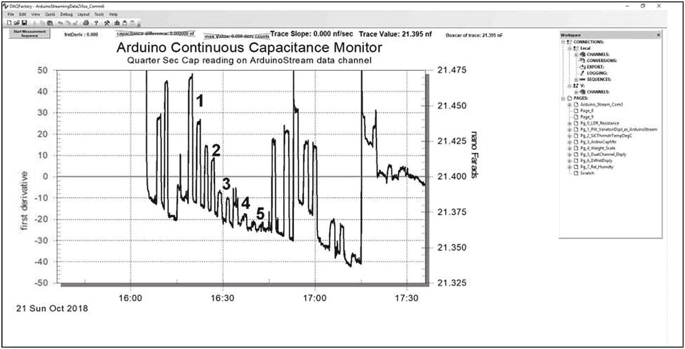
`图 9-42` 标称重量 12.9 mg 至 1.07 mg 砝码的记录仪迹线

## 讨论

### 静摩擦与自压缩

尽管传感器没有活动部件，但其表面之间会相互运动。直接接触的表面之间的运动会受到摩擦力的阻碍。摩擦力可进一步分为静摩擦和滑动摩擦。滑动摩擦力通常低于静摩擦力，这符合我们的物理观察：一旦物体开始运动，维持其运动比“摆脱静止”要容易。

关于大型平板电容器的物理原理见解可在物理学文献中找到（参见 [`https://pdfs.semanticscholar.org/ff77/36f012a67a6d29fe3a6da29d46a7a51af930.pdf`](https://pdfs.semanticscholar.org/ff77/36f012a67a6d29fe3a6da29d46a7a51af930.pdf)）。

提高多板电容式测力传感器的灵敏度是开发方法学的一个实例，该方法中，一个初步实验成功的简单概念可以逻辑地发展出更精良、更实用的设备。

最初使用多层电容器替代“弹簧”或“水平杠杆”的概念，设想的是一种简单的方形装置，安装在一块平板上，通过电容器左上角和右上角的接片带有两个螺栓固定的电触点。初步的成功促成了进一步的工作，其中加入了更精密的电子电容测量技术和可视化显示程序，以便在向待测设备施加重量或压缩力时，持续监测并显示电容的变化。

# 电容器设计与测试

随着灵敏度的提高以及随时间监测和记录电容器电容变化的能力增强，方形、大表面积构型的局限性变得明显。不同的电介质和复合“金属-塑料”薄膜用于测量电容器的响应，同时改变电介质的化学性质以及设备的物理尺寸或形状。

在使用大型方形设备时，遇到了由金属和电介质板的摩擦力及刚度引起的限制。后来通过将设备逐渐收窄成尖头状来减小这种限制。收窄设备减少了板的面积。这就需要更灵敏的电子检测系统，而一旦实施，便产生了预期的更高灵敏度。

随着设备和电子显示系统灵敏度的提高，锥形导电极板尖端的物理对准效果及其光滑平坦的表面纹理变得重要。为改善锥形设备中的对准问题而进行的尝试，导致在基板上增加了额外的销钉来固定导体和电介质。在设备板上使用双接片，并在螺纹电触点柱之间增加对准销钉，使得对准更加一致。

结构材料的易碎特性表明，随着导体板和电介质数量的增加，新设备应仔细组装并测试是否短路。随着每个新组装的设备层数增加，预计设备电容应成比例增加；然而，观察结果显示，增量电容的增加速度高于新增板数和电介质数量所预期的速度。对观察到的电容异常增加的一个简单解释是，尽管易碎的锥形铝箔板和电介质非常薄且轻，但其重量不可忽略。随着电板数量增加，它们的总重量压缩了下面的层，使得观察到的设备总电容高于仅由新增电板数量预期的值。

### 确定自压缩与倾斜角度

在尝试定量评估电容随电板增加而增加的关系时，我意识到自压缩增加了设备的总电容。通过将待测设备绕其夹紧端的轴线从水平旋转至垂直，可以消除自压缩。使用迄今为止产生最佳灵敏度的材料组装而成的锥形设备，在旋转时表现符合预期，并将设备固有电容分为有自压缩和无自压缩两个值。

一组使用绘图三角板将待测设备设置为 `30` 度、`45` 度和 `60` 度常见角度的简单实验表明，设备自压缩电容可以粗略近似地测量设备倾斜角度。

``

`图 9-43` 电容值与倾斜角度

在图 `9-43` 中，当待测设备绕基板平面内且垂直于三角形中心线的轴线旋转时，总观察电容下降。旋转将设备的固有电容与因自压缩产生的电容分离开来。左上方的图显示，电容从倾斜 `0` 度时的 `10.26` 纳法变化到垂直位置时的 `6.98` 纳法。将因自压缩产生的电容（即总观察电容减去设备固有电容）对倾斜角度作图，得到图 `9-43` 右上方图中所示的预期曲线。

如果对该系统进行严格的物理分析，那么在无倾斜角度时，向下的重量矢量是由重力对电容器中电板质量的作用引起的。将设备在与重力矢量成直角的方向上旋转出平面，会将力分解为两个分量，如图 `9-44` 的斜面图所示。重力由公式 `F = m × g × cosθ` 给出，其中 `θ` 是以弧度表示的入射角，`m` 是物体的质量，`g` 是当地重力常数。

``

`图 9-44` 斜面

由（由入射角决定的）向下重力产生的电容作图，得出图 `9-44` 中所示的线性关系。

### 器件电容

在图表 `9-45` 和 `9-46` 的四张图中，展示了由分立元件组装而成的多板电容器的典型渐进式装配过程。每幅图中，导电板均按字母顺序标记，绝缘介质则按数字编号。图示器件中的每个增量单元都是一个由两块导电板之间的介质构成的单一电容器单元。

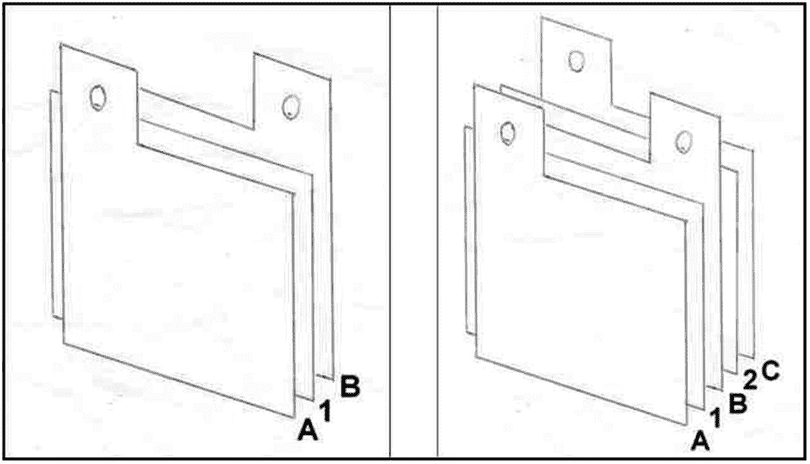

`图 9-45`
两板与三板器件构成单电容及双电容传感器

在图表 `9-45` 和 `9-46` 中，电容器单元的总数比传感器单元中的板数少一。导电板的存在将电荷收集或电容效应限制在单个绝缘板内。对于采用分立元件构建的器件，每个绝缘板的两侧均存在空气间隙。

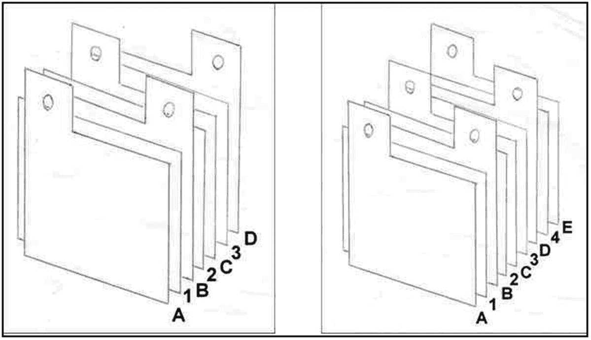

`图 9-46`
四板与五板器件构成三电容及四电容传感器

经典物理学提供了关于三板器件电容存储能力与其导电板之间介质及空间的物理化学性质之间的数学关系，其数学模型如下：

```
C = kA/d
```

其中，`C` 为器件电容，`k` 是由板间介质性质、自由空间及空气介电常数决定的比例常数，`A` 为导电板的面积，`d` 为导体之间的距离。

对于三板器件，该方程可写作：

```
C[总] = k * A[A-B] / d[A-B]
```

由于两个并联器件的总电容具有累加性，对于五板器件可写出如下表达式：

```
C[总] = (k * A[A-B] / d[A-B]) + (k * A[B-C] / d[B-C])
```

对于水平放置的器件，板 `B`、`C` 及介质 `2` 的重量会压缩器件，减小距离 `d[A-B]`，使得总器件电容高于两个并联平板器件电容的简单总和。

当电容器数量增至三个并联单元时，总板数增至七块。最底部的器件受到其上方两个单元重量的压缩，中间的器件则受到最顶部单元的压缩。

若三板电容器增量单元重量相对均匀，则重量引起的压缩将随着水平叠层厚度的增加而增强。正在装配的水平单元的总器件电容的增加，应是并联电容器数量的线性函数，同时也是器件下部构件因重量压缩导致电容增加量的线性函数。

通过将器件旋转 `90` 度，可对自压缩引起的总电容贡献进行半定量估算。观察到由自压缩引起的含 `15` 个介质层的 `VT-PE` 器件的电容为 `1.88 nF`。当器件从水平旋转至垂直时，水平总电容值从 `9.10 nF` 降至 `7.22 nF`。更大的 `50` 板锥形 `VT-PE` 器件，水平电容从 `27.72 nF` 降至垂直时的 `22.71 nF`。含 `15` 个介质层的器件在旋转过程中观测到的电容下降了 `20.6%`，含 `50` 个介质层的器件下降了 `18.1%`。一个精心制作、边缘蚀刻的 `80` 层 `Al-Mylar` 三角器件，从水平旋转至垂直时，电容从 `85 nF` 降至 `52 nF`，下降了 `39%`。

装配好的传感器因紧固螺纹连接件而存在固有的楔形空气间隙，以确保电气接触。每个器件在装配后其电容值都是唯一的。旋转似乎会扩大或缩小“楔形”的角度，从而将固有电容值改变约 `20%` 至 `40%`。

早期对带有短电气连接片的器件进行的实验，导致 `MPCLC` 传感器形成楔形空气间隙。楔形空气间隙在锥形板传感器中破坏性最大。尖端对齐不良、板片柔韧性过大以及下层电容器板缺乏机械支撑，使得早期锥形传感器在负载操作中容易发生板片变形。直到后来才意识到需要更长的连接片，以减少或最小化重量传感器有效区域内的楔形。从侧面观察，具有楔形轮廓的 `MPCLC` 与杠杆轮廓相同。被测重量离支点越远，力臂越大。该器件变得对重量位置敏感。

直觉表明，增加板片数量应能形成“更大的弹簧”，具有更宽的动态范围。如果制作更长的连接片，并在板片上添加定位片，则可以最大限度地减少楔形空气间隙和板片尖端错位的问题。板片上更长的及多个连接片会增加构建、组装和验证器件所需的时间与精力。

### 结构材料

要将力转换为电容，必须压缩多极板传感器以减小极板间距，从而导致器件电容升高。金属被视为不可压缩材料。极板之间的电介质和气隙是承担大部分压缩作用的主要部件。在此应用中，优质的重型铝箔不如价格较低、更灵活的更薄等级材料理想。

同样的“越薄越好”准则也适用于电介质材料的选择。新型的薄型“拉伸密封”聚乙烯薄膜在该应用中几乎不起作用。“拉伸密封”薄膜的设计初衷是粘附在其覆盖的基材上，而这恰好与该应用所需的物理作用完全相反。用于“农产品”袋或众多其他利用这种惰性塑料“不粘”特性的聚乙烯薄膜袋或包装应用中的极薄聚乙烯薄膜，可以组装成成本相对较低且功能完整的器件。

组装完成后，在进行任何实验测量之前，应使用万用表（`VOM`）测试器件，检查是否存在因极板和电介质未对准或其它泄漏源（如螺纹连接器或接线片夹紧过度导致结构脆弱电介质或箔极板机械失效）引起的短路。

电容式测力传感器最初的构想概念是由一组独立的平行导电板与绝缘电介质堆叠而成。实验改进表明，更长的接线片、带附加对位片的极板以及锥形复合材料可以制造出灵敏度更高的器件。

最简单且最容易组装的重量传感器形式是由矩形铝箔极板和多种常见材料作为绝缘体制成。每个器件都必须在其预期使用范围内检验线性度或实用性。每个单独器件的 `电容` 与重量的关系曲线形状都必须经过检测，以确定其可用的线性或曲线范围。

这些传感器的灵敏度受到小重量的限制，因为小重量施加的力不足以克服堆叠极板之间的静摩擦系数。一个小重量必须能压下堆叠体。由于该器件是由从共同点引出的一组等长且交错排列的极板组成，从横截面看，堆叠组件形成一个放射状排列或一个圆弧段。压下顶部极板会使接触表面相互滑动。如果静摩擦系数过高，极板将不会移动，也就测不到电容变化。

（如在单层镀铝聚酯薄膜制成的测力传感器中发现的）最小化摩擦很可能是这些传感器高灵敏度的主要贡献因素之一（除了每个极板只有一个气隙之外）。与 `铝/聚酯薄膜` 器件相比，由铝箔极板和“拉伸膜”制成的测力传感器无法弯曲或发生形变，因此表现出向上弯曲的、有限的、重量与电容变化的响应函数。

如表 `9-1` 所示，将电介质的性质改为更柔软、更易压缩的介质（如纸类材料），可以极大地扩展器件的动态范围。

### 重量操作、数据生成与解释

```

由于这些器件的电容随施加在顶板上的压力变化，手动放置和移除砝码时，若因手不稳导致极板被压下或侧向移动，可能会引起尖峰和基线漂移。对于较大且易于抓取和操作的砝码，扰乱极板是相对较小的问题。而对于 10 毫克这样的小砝码，在灵敏度设置较高时扰乱极板对准或压下极板，可能会破坏重现性和采集可用数据的能力。使用机械传输装置，将砝码放置在滑过电容器的桥上，可以得到图 9-47 所示的实验电容记录曲线。

尽管滑动桥可以最大程度地减少对极板的干扰，但它会导致图 9-47 中看到的复杂轨迹。即使有桥支撑着小砝码，在将砝码从桥上滑下时，极板也常常会被不经意地下压，如重复实验 10 和 12 所示。

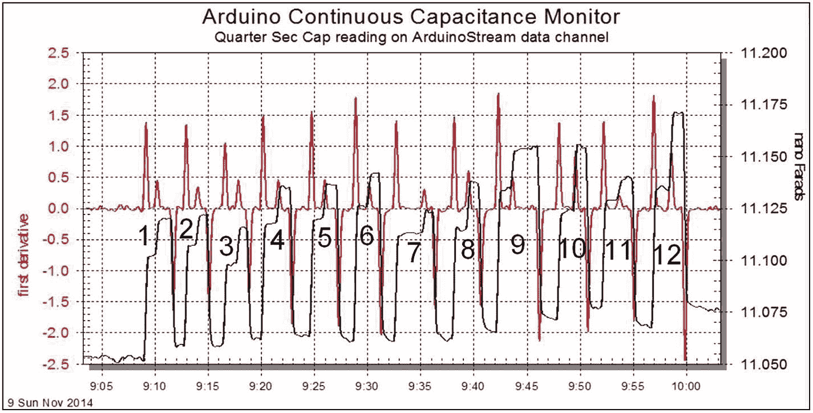

图 9-47

10 毫克砝码测量重复实验

可以设计一种带有仅向上提升的砝码托盘的直接向上提升系统，以最小化更换砝码时对极板的干扰。使用第二类杠杆或钩环结构可以实现仅垂直方向的运动。另一种选择是使用轻压板“偏置”基线并最小化极板扰动（参见图 9-39（膨胀加权法）、9-72、9-73 和 9-74）。

您必须准备好进行实验并探究为特定目的而制造的器件的特性。在创建重量传感器时，必须评估诸如：器件在压缩下稳定所需时间、卸载后重新建立基线、是否需要实施重新调零机构、系统线性度、系统噪声（包括随机噪声和系统噪声）以及灵敏度和“极板粘连”问题等。

## 力的测量

## 一种实验性风速计与风压传感器

当垂直安装时，`MPCLC` 传感器会对任何压缩多板电容叶片阵列的力产生响应。如果将 `MPCLC` 垂直安装在一个通风盒内，并让移动的气流以直角方向撞击悬挂阵列的垂直前表面，气流流经板面并从传感器后部排出盒子，即可产生一个与风速成比例的信号。

可以使用一个电动风扇进行简单的“风力”概念验证实验，将风扇置于垂直安装传感器的顶板平面的直角方向。

当风扇电机的功率由 `PWM` 信号调节时，袖珍风速计可以测量风扇产生的气体流速。传感器的电容变化可以在水平位置上用一系列已知重量的砝码进行校准。一旦校准完毕并恢复垂直位置，即可通过在不同 `PWM` 功率设置下产生的各种风速或气流速度下测得的电容变化，将风速或气流速度与由此产生的压力关联起来。

在垂直位置时，传感器电容主要不受导电板或介电材料重量的影响。板间距离预计仍呈楔形，向设备顶部夹紧的电触点处逐渐缩小至几乎为零。在传感器的另一端或称为“底部”，自由悬挂的板仅受板重量的影响，该影响通过垂直方向与“楔形角”之间形成的微小角度体现（见图 9-43）。直觉表明，且观察证实，当设备从水平旋转到垂直时，板间距离，尤其是底部边缘的距离，会增大。

垂直方向上的设备灵敏度预计与水平称重应用中的灵敏度相似，并受限于电容板的柔韧性。无论板的刚度是由静摩擦系数还是结构材料的刚性决定，变形力都必须弯曲这些板。

## 实验

为在垂直平面上工作，一个带有双接头三角板的 `MPCLC` 由 80 片铝-聚酯薄膜复合材料板组装而成。板件底部宽 3.5 英寸（9 厘米），顶部宽 4 英寸（10.2 厘米）。按照常规方式建立电接触，左右两侧板的外侧接头通过必要的电接触箔桥安装在螺纹杆上。每块板的内侧接头则套在一个固定的木销上，该木销用于将板件固定在统一的对齐位置上。

在设备的垂直安装组装和测试过程中，用 `Extech EX505` 万用表测得静止状态下的最终传感器电容为 94 nF。当设备投入与 `DAQFactory` SCR 显示屏配合使用时，基线稳定在 90 nF。倾斜支架上的电连接调整过程对传感器板造成了干扰。在传感器水平位置校准时，用 `DAQFactory` 显示确认了第二次读数为 84 nF。图 9-48 记录了 20 mg 至 1½ g 一系列砝码的双重测量轨迹。

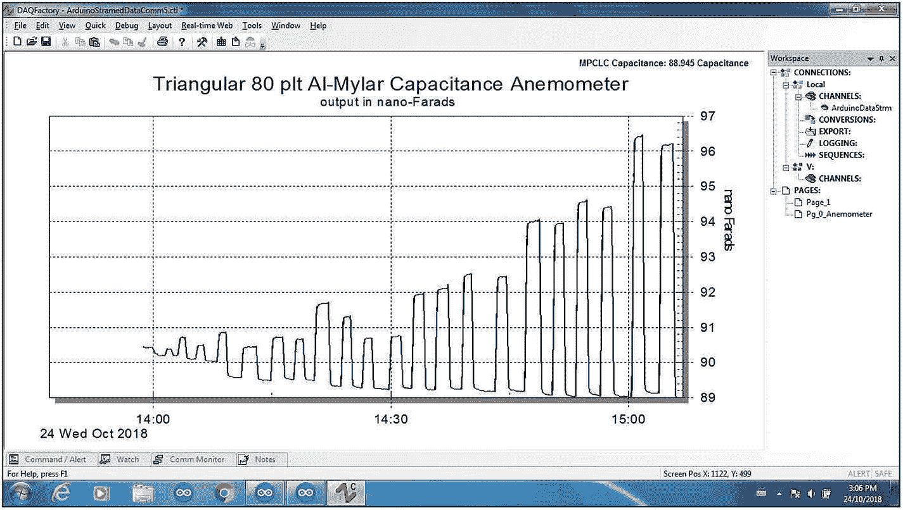

图 9-48

风速计传感器水平方向 20 mg 至 1½ g 校准（偏转顺序未按质量递增排列）

对应于图 9-48 中图表偏转的数值数据代表了图 9-49 中展示的重量与电容变化数据。

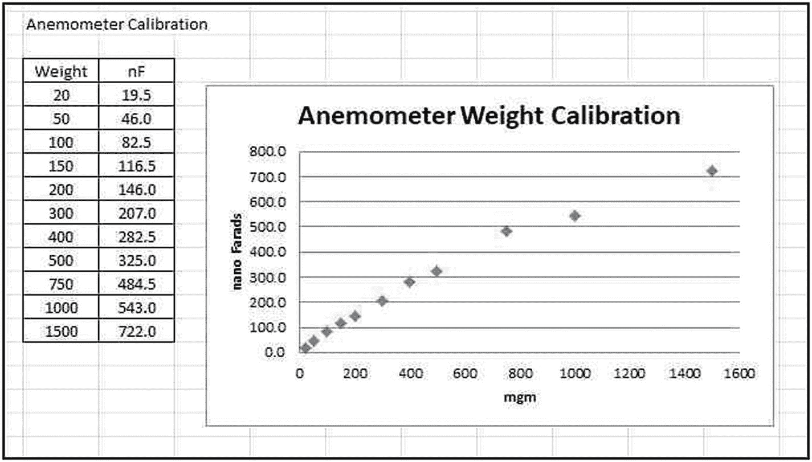

图 9-49

风速计传感器水平重量校准

当风速计传感器在垂直与水平位置之间移动时产生的数据如图 9-50 所示。

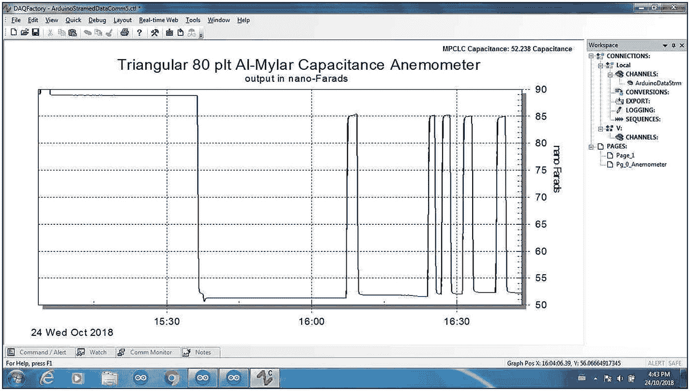

图 9-50

风速计传感器水平到垂直过渡的电容变化

### 变速风力发电机

为了提供可控但可变的风速，可以使用由 12V 直流无刷电机（`BLDC`）驱动的风扇，并结合微控制器或计算机生成的脉宽调制（`PWM`）信号，以提供可编程的风压。

采用脉宽调制（`PWM`）技术的电流控制方法，使用`TIP 122`达林顿对管晶体管和`RPi GPIO`脉冲发生器构建完成，如图 9-51 所示。代码库中一个简单的 Python `Tkinter` 滑块图形用户界面（`GUI`）用于控制风扇电机速度，其 `PWM` 脉宽由该 `Python-Tkinter Slider GUI` 设定。实际应用时，`RPi-GPIO`库数组的输出仅能对电机速度进行粗略控制，并证明不适合所需的控制要求（见图 9-55）。

最初，使用`TIP122`达林顿对管与 3.3V 输出的`RPi GPIO`组成的控制电路，不得不替换为标称 5V 输出的 `Arduino PWM` 信号，以便配合代码清单 9-3 实现对风扇电机更好的控制。

图 9-51 展示了最初用于控制风速计风源的原理图。


**图 9-51**
风速计风扇电机速度控制电路

在图 9-52 中，一个袖珍风速表被用来关联风扇产生的空气速度。该风速表安装在一对螺纹杆上，用于估算风扇不同距离处的空气速度。


**图 9-52**
风速与风扇电机速度的关联关系

进行了一系列实验程序，将施加到风扇电机的功率以 10%为单位递增，以评估和记录随着风速增加而变化的电容值。风扇电机起初似乎对`RPi-GPIO`的 `PWM` 增量有响应，但伴随着明显的振动和噪音，并且在接近 100%功率施加水平时速度下降（见图 9-55 中 17:05 及之后的时间点）。

该实验还表明需要修改设置，因为气流会导致易碎的电容板抬起、分离，甚至被吸入上游旋转的风扇叶片中。图 9-53 和图 9-55 展示了添加一个纸板盖板来保护电容片免受气流湍流影响。

图 9-53 描绘了垂直的未受保护的风压传感器、风扇，以及带有三组绿色螺钉接线端子的小电路板。这些螺钉端子用于连接带有 `PWM` 信号的导线、12V 电源以及到风扇电机的连接。这块万用板用作图 9-50 所示电路中的`TIP 122`晶体管、二极管和电阻元件的安装基座。

在图 9-53 中，三角形盖板是从薄纸板上切割下来的，类似于办公文件夹所用的那种。它上面只有两个穿孔，用于套在螺纹杆接线柱上。盖板松散地悬挂在接线柱上，距离底板 3/4 英寸（18 毫米），这个距离由木质圆棒电容板定位柱的长度决定。

图 9-54 展示了安装在压力传感器上方位置的传感器盖板。


**图 9-54**
安装了气流湍流保护装置的风速测量装置


**图 9-53**
带有气流湍流保护装置的风速传感器装置

第二次风速实验使用来自 `Arduino Uno` 的 `PWM` 驱动进行。对于递增风扇功率的程序，其脉宽值通过串口传输所需的数值，被手动输入到代码清单 9-3 的 `Arduino` 代码中。使用一系列 16 个数字值条目，这些值以 16 个单位为间隔从 0 递增到 255，用于收集作为风压函数的被测电容值。

当 `PWM` 信号由微处理器生成时，风扇电机从零到全功率实现了平稳、安静且几乎无振动的功率递增响应。

## 观察结果


**图 9-56**
在指定的 `RPi-Arduino PWM` 功率水平下测量的电容值


**图 9-55**
在 `RPi GPIO` 引脚 `18` 输出的 `PWM` 风扇电机功率每增加 10% 时测量的电容值

未观察到或测量到手持式风速计测量的气流速度与施加到风扇电机的 `PWM` 功率之间存在连续的相关性。在低功率水平应用中，产生的风速无法将风速计指针驱动到稳定、明确界定的数值范围内。当风速值低于 3 米/秒时，风速计的读数波动不可靠。功率设定为 `240` 和 `255` 时，风速计指针指示为 4 米/秒（9 英里/小时）。

如果图 9-49 中的数据估算了 50 毫克和 100 毫克标准砝码之间重量与压缩电容校准曲线的线性部分的斜率，那么：

```
斜率 = (543) / (1000)
     = 0.543 nF/mg
```

将该斜率除以从图 9-55 中观察到的、在全风扇功率下压缩产生的估计电容值 69 nF，可推算出压缩力约为 127 毫克。

## 讨论

图 9-55 是在两个不同的场合下复制的。从图中可以看出，树莓派发出的 `PWM` 信号受到了已知由操作系统引起的定时误差的影响。与图 9-56 相比，图 9-55 显示了更多的噪音以及不稳定的增量功率响应。

如果安装了任何旨在修正或绕过 `GPIO` 阵列定时冲突的软件升级，则无需用 `Arduino` 替代树莓派的 `GPIO PWM` 信号源。

图 9-48 至 9-56 分别描绘并记录了利用 `MPCLC` 作为传感器的概念验证风速计和风压计的研发过程。该装置由为本工作中的其他练习而开发或组装的、经改造再利用的组件拼装而成。

图 9-49 显示，重量与纳法（nF）的关系图呈相当好的线性关系，计算得出的该图斜率为 `0.543 nF/mg`。在图 9-49 中，传感器电容的变化是可重复的，变化范围在 85 nF 至 52 nF 之间。

在水平位置时，由于自身压缩，测得传感器的电容为 85 nF；当设备旋转至垂直构型，且重量方向不再构成压缩因素时，该值变为 53 nF。根据图 9-49，对于施加到传感器顶板的、增量高达约 1500 mg 的重量，测得的电容变化率保持恒定。

如果在一系列重量测定中，在 100 mg 至 300 mg 之间进行测量，图形轨迹显示，对于在 400 mg 至 500 mg 之间进行的一系列重量测定，其每单位重量增量所对应的电容变化率是相同的。图 9-48 表明，在校准曲线的线性部分内，于两个或更多点进行的一系列称重测量，必须具有相同的斜率或传感器响应因子。

如果除了将一个经过校准的 `MPCLC` 传感器从水平方向旋转至垂直方向之外，不对实验装置做任何其他改动，那么传感器响应因子保持不变。图 9-50 记录了传感器在水平方向和垂直方向之间存在 32 nF 的差值损失。这种位置变化将使表观的垂直传感器响应值相较于水平位置观察到的值降低 32 nF。在图 9-50 中，电容轴上 32 nF 的偏移完全处于传感器校准的线性范围内。

图 9-56 表明，以全功率驱动风扇会在 `MPCLC` 上产生足够的压力，使其产生 69 nF 的响应，并记录到 9 英里每小时（4 米/秒）的风速。

经计算，在风扇全功率下，传感器在垂直方向上的响应为 127 mg，这相当于施加在传感器顶板整个表面积上的总重量。每个三角形板的底边为 3.5 英寸（8.8 厘米），高为 4 英寸（10.1 厘米），顶部尖端宽英寸（1 厘米）。这些三角形板构成了一个面积为 7.75 平方英寸或 48.8 平方厘米的梯形，据此可以计算单位面积基础上的风压。

图 9-56 表明，风扇电机功率范围的上半部分可能存在线性关系，这对于测量风速和风压可能很有用。最初对风速增加响应微弱可能是由几个因素造成的。必须给传感器顶板加装一个防护罩，以防止叶片在较高风速下移位。相对较重的纸板可能吸收了部分风能。

导致低风速下斜率低的第二个因素可能是传感器中多达 80 个的板片数量。回想一下，在尝试测量较小重量值时，采用板片数量更少、表面积更小的 `MPCLC` 能够提供更好的灵敏度。

图 9-49、9-50 和 9-51 表明，该概念是可行的，并且该系统可以通过实验开发程序进行缩放以满足您的需求。

## 压力

从数学上讲，压力可以建模为力与面积之商，因此压力的量纲是单位面积上的力。气体、液体或固体对表面施加压力时均可产生压力。

### 压力测量

回顾固体、液体和气体的基本物理性质定义，在重力场中对不可压缩液体和细碎固体进行压力测量相对简单。这些材料中任一深度处的压力，等于该点上方材料的总重量除以支撑该重量的面积。

气体压力的测量需要比测量重量和面积更精密的传感器。1634 年，E. 托里拆利描述了一根 34 英尺高（10.4 米）的水柱气压计，用于测量大气压力。托里拆利后来发明了一种更紧凑的装置，使用水银，高度仅约 80 厘米，这就是后来的水银气压计。

1646 年，帕斯卡提出空气有重量，因为当观察者向上攀登时，其位置上空大气的重量会减小，大气压力也随之降低。1654 年，奥托·冯·居里克公开演示了他发明的气泵，并展示了大气压力将一对接触面光滑的铜半球紧密密封在一起的巨大力量。该演示使用了后来被称为马德堡半球的装置，这些装置至今仍用于物理教学。

为地球科学、天气预报、海拔确定和医疗应用，已发展出多种测量大气压或气压的单位。在海平面和 20°C 条件下，各种大气压单位列于表 9-4。

**表 9-4** 大气压

| 英制单位 | 公制单位 |
| :--- | :--- |
| 14.696 磅/平方英寸 | 101325 帕斯卡 (N/m²) |
| 29.9212 英寸汞柱 | 760 毫米汞柱 |

大气压和巴是通常用于表示高气压的单位，其数值是标准温度 0°C 或常温 20°C 下海平面压力单位的倍数。

由于已知大气压力会随海拔升高而以特定速率降低，因此可以使用气压计作为海拔指示器。以下公式用于计算海拔高度（米）。

`压力高度 = 44330 × [1– (P / P[o])^(1/5.255)]`

`P` 是测量点高度处的压力。`P[o]` 是海平面处的大气压力。如果进行压力测量点的海拔高度已知，则可以重新排列上述公式，得到海平面大气压如下。

`P[o] = P / [ 1 – (海拔 / 44330)]^(5.255)`

已知海拔高度以米为单位。工程学和气候学参考文献中提供了相应的计算，可使用英制压力单位以及英寸或毫米汞柱高度。

博世公司利用第 6 章讨论的压电晶体，开发了`BMP180`和`BMP280`压力传感器。这些微型传感器是尺寸为 3 毫米见方、1 毫米厚的 `SMT IC` 器件，可从多家制造商处购得，通常安装在 1.5 厘米见方的原型板或分线板上。`Adafruit Industries` 提供板载传感器和 `Arduino` 库，用于实现大气压力监测系统。(`Adafruit BMP280 I2C or SPI Barometric Pressure and Altitude Sensor`，型号 `2651`，售价 10 美元。)

大气压通常会在数小时或数天内变化，除非遇到极端天气。对于这些设备，更有用的读数方式是传统的带状图记录。通过将传感器板供应商提供的 `Arduino` 代码修改为仅以连续顺序流的形式将原始温度和压力数据打印到串口，如图 9-56 所示，`DAQFactory` 图表模块即可用于长时间记录。


**图 9-57** 用于`DAQFactory`绘图的 `Arduino` 串口监视器温度与压力输出

程序清单 9-5 和 9-6 提供了两个用于处理串口上连续多个数据值的`DAQFactory`序列代码。程序 9-5 最初是为处理图 9-57 中的数据流而开发的。经过几次测试后，该程序的简单逻辑会随机互换绘图显示上的气压和温度数据，因为它只是读取了清空缓冲区中的第一个数字。

检查代码可知，`Arduino` 发送的每个数据点都附带有一个换行符和一个回车符，以表示数据传输结束。`DAQFactory` 序列的编写方式是，第一个基于`ReadUntil(13)`的解析定位第一个数据点，并将数据传输到名为`data0`的通道，该通道保存来自第一个被绘制变量的数据。第二个解析代码定位被绘制的两个参数的第二个值，并将其传输到名为`data1`的第二个通道，保存要被绘制的第二个变量的数据点。此序列中的代码仅适用于数值大小差异明显的双数据点。环境温度只能在零下到 45°C 之间变化，因此由于温度是自明的，所以需要区分要绘制哪个通道。每次开始新的绘图会话时，可能都需要更改绘图通道分配，因为这个简单的代码可以在第一个通道中开始读取温度或压力数据。

在尝试修改算法以始终将较大的数字分配给代表气压的通道、较小的数字分配给温度通道的过程中，我们开发了一个更有用、更通用的串口处理工具。程序清单 9-6 期望数据流以连续的逗号分隔格式到达串口。在轮询算法中，代码通过回车/换行组合（`CHR13`）找到逗号分隔数据字符串的结尾，然后解析出单个数据值，并将每个值分配到一个数据通道以供绘图。

这两个程序都要求微处理器代码将格式正确的数据发送到串口。如果使用图 9-57 所示的数据格式，则可能需要调整绘图仪分配。程序清单 9-6 中更通用且可重复的 `DAQFactory` 代码序列可以读取流入串口的两个或多个逗号分隔的数据点。

图 9-58 展示了一个 `DAQFactory` 页面，其中包含我桌面上传感器板周围温度和大气压力的图形显示。在图形记录中添加了三个变量值显示，用于当迹线漂移出刻度范围时调整温度和压力的图形刻度，并确定所记录本地大气压力的海平面压力。


图 9-58 一个典型的 `DAQFactory` 大气温度与压力显示

使用液体柱测量大气压力的仪器不够灵活、便携也不坚固。笨重的液体柱促使了无液（无流体）系统的开发。无液气压计利用隔膜或波纹管的弯曲运动来测量压力。气体和液体压力通常用一种称为波登管的紧凑型无液装置来测量。法国钟表匠兼工程师尤金·波登于 1849 年发明了这种管。弯曲扁平的波登管是大多数表盘式压力表中的弹性元件，如图 9-59 所示，至今仍普遍使用。

波登压力表的工作原理是：当扁平管内部被加压时，管子会试图重新膨胀。由于被制成“C”形，管的膨胀会导致结构扩张。产生的机械力用于移动一个连杆，该连杆连接到在刻度圆表盘上摆动的指示器。波登管制成 C 形、螺旋形和盘旋形。用于制造扁平管的材料厚度和类型决定了这些设备能够测量的压力范围。


图 9-59 波登压力表

波登管通常由不锈钢和磷青铜制成。

# 第三部分：传感器构造、校准与优化

## 传感器构造

为了构建更小巧、灵敏的装置，建议使用夹具以确保所制造组件的尺寸和形状一致。对于组装铝-聚酯薄膜装置（可能需要大量铝箔和电接触桥）的实验者来说，可以利用现成材料制作几个有助于切割和穿孔的夹具。图 9-60 展示了在重量传感装置构建中使用的几种夹具。


图 9-60 组件制备用夹具

项目 A 是三层厨房用或普通级铝箔，宽度为一英尺（30.5 厘米），通常剪成约 14 至 16 英寸（34 至 39 厘米）的长度。如图所示，将三片铝箔对齐并用纸夹夹紧。然后使用标记笔，借助铝箔下方透明塑料板底部可见的标记，画出平行于电桥长度方向（3 英寸或 76 毫米）的线条。

在与宽间距线垂直的方向上，利用密集的标记压痕画出宽度为 3/4 英寸（18 毫米）的电桥平行线。然后沿 3/4 英寸线切割夹紧的铝箔，形成一英尺长（30.4 厘米）、宽 3/4 英寸（18 毫米）的铝箔条，并在其上以 3 英寸（76 毫米）为间隔做出标记。接着，从长条上剪下电桥“坯料”，得到 3/4×3 英寸（18×76 毫米）的铝箔条。然后将这些坯料堆叠成 100 个一组，如夹紧的束 B 所示。（或者，也可以切割出 3 英寸或 76 毫米宽的列，再将其分割成 3/4 英寸或 18 毫米宽的条，用于在夹具 C 中穿孔。）

切割并堆叠后，将坯料夹紧在 C（角钢夹具面）之间，并拧紧螺栓，直到铝箔形成一个坚硬的铝块。然后用 1/4 英寸（6 毫米）的钻头对该硬压块进行钻孔，形成最终的电桥箔片，如白色 B 旁边所示（另见图 9-61 和图 9-62）。

项目 D 是用于在矩形铝-聚酯薄膜板上穿孔的夹具。从较大的板材上切割出复合材料矩形坯料，并将其装入底部带有钻孔金属板的胶合板模具中。当所有坯料都装入夹具后，将钻孔的金属插件放在坯料顶部，再加上夹具顶板，并根据需要使用垫片，用穿过整个组件的螺栓将坯料压紧。压紧后，可在顶部孔中使用锤子和皮革冲头，在坯料上冲出所需数量的孔。（冲孔时应在下方垫木块，以免损坏冲头的刃口。）


图 9-62 箔片电桥制备夹具详图


图 9-61 箔片电桥制备夹具详图

## 传感器校准

由不锈钢或黄铜制成的、具有确定质量的认证砝码可能价格昂贵且难以获取。在北美，家庭和商业用电线因安全原因受到监管。各种供电系统中允许使用的铜线尺寸由美国线规系统定义。表 9-5 列出了在轻型家用布线应用中常见的一部分美国线规铜线的一些物理特性。

**表 9-5** 铜线物理特性

| - |

铜在室温（20°C/68°F）下的密度为 8.96 g/cm³，并且如果保持在室温及中等相对湿度下，相对不易腐蚀。例如，住宅应用中使用的 14 号铜线是一种易于获取的材料，可以用来制备一系列相对精确的已知质量铜块。

如表 9-5 所示，电线是大量生产的，其直径相对恒定。一根 `#14 ga Cu` 线的标称恒定直径为 1.628 mm。如果线径恒定且已知，则给定长度电线的重量可通过以下公式计算。

```
质量 = ((直径/2)² × π × 长度) × 密度
```

公式中，`直径` 是测得的电线直径，π 近似为 3.1416，`长度` 是精确已知的电线样品的长度，`密度` 是已知的铜金属密度。

在生成昂贵校准砝码组的廉价替代品时，必须接受一系列折衷方案。这种廉价、易得、易加工且成分恒定的材料，仅以长细线的单一物理形式存在。可用易处理的短电线制作的质量标准范围是有限的。处理长度小于四分之一英寸或 6 毫米的线材比较困难。重量下限由 6 毫米长的线样代表。长度超过 2 英寸或 48 毫米的线样，在某些情况下对重量、质量和力测试传感器而言过长，这定义了质量标准组的质量上限。如果需要，可以制备长度超过 2 英寸或 50 毫米的线样，并小心地将其弯成两折或任何所需的形状。

为了评估制备一组已知铜质量标准时可能出现的误差，我在我的工作坊中制备了四组校准单元，每组八个，然后用实验室的 1/10 毫克分析天平或秤进行称重。所剪线样的标称长度为最接近的整毫米数，对应长度从四分之一英寸（6 毫米）到 2 英寸（48 毫米）不等的电线。线样以 1/4 英寸（6 毫米）为增量进行切割。图 9-63 展示了我制备的四组测试样本。


图 9-63 用于典型制备统计分析的铜线质量标准

各个单元由线材切割而成，切割长度比待制备标准件的预期最终长度长几毫米。初始线材切割使用手动斜口钳，在切下的线段上产生一对斜角端面（见图 9-64 中的大钳子）。然后，用方头钳夹住正在制备的线材标准件，使斜角端以垂直于钳口边缘形成的平面方向伸出（见图 9-65）。接着，用手工将伸出的斜角铜端锉成光滑的圆形横截面，且与线材长度垂直。

图 9-64 和图 9-65 展示了用于制备和修整所需线材长度以制造标准铜块的手动工具和技术。


图 9-65 – 夹持并定位用于端面锉削的铜线


图 9-64 – 制备铜线质量标准的常用手动工具

然后，将切割后标准件的第二个斜角端锉成平整的方形端面，并在毫米刻度上测量线段的长度。制备中线段的长度的调整，是通过用钳子垂直夹住线材并锉削其两端来完成的。在夹持制备中的线段时必须小心，以尽量减少对部件外表面的损伤，并确保端面尽可能接近“平切”。

图 9-66 和图 9-67 是斜角端的放大图像，左侧为切割后的状态，右侧为准备进行长度测定时的状态。


图 9-67 – 铜线端部


图 9-66 – 铜线端部

表 9-6 列出了为四组制备的标准砝码所收集和计算的数据。铜线直径测量值为 `1.61 mm`，与电缆绝缘皮上标注的 `#14 ga` 相符。该直径与各个线段的标称长度以及公布的室温下铜的密度一起用于计算标准件的质量。

表 9-6 – 制备的铜线质量标准件的测量与计算物理特性


表 9-6 中有一列标为“平均值差值”，计算的是下一个较长线段与前一个线段的平均值之间的增量差值。该系列长度中每个增量为 `6 mm`。`6 mm` 增量的理论重量为 `0.1094`。该列中较为接近的值验证了平均值数据中质量增量的有效增加。

平均值数据相对于理论值的百分比误差也表明该技术具有相对可重复性。通过检查观察到的质量值相对于预期理论值的分散程度，可以估计该技术可能产生的典型误差。表 9-7 列出了从四组制备的标准铜线质量测量值分散程度中观察到的典型预期误差。

表 9-7 – 铜标准件观测质量值分散程度产生的典型误差


检查“百分比误差”列中的数值，符合一个常观察到的现象：随着被测设备 (`DUT`) 总长度的增加，误差分析显示确定线段长度时所产生的误差影响在减小。最短的实体和最长的实体分别具有最高和最低的误差。

较低线规的铜电线，由于单位长度材料更粗或更重，可用于制造更重的砝码。可以对较长的高线规或细电线进行称重，以确定其单位长度的近似重量，然后切割成所需的长度来制造较低质量的标准件。

制造完成后，应用肥皂水或溶剂清洗铜棒，以去除标准件表面可能存在的任何手指油脂、油污或灰尘。清洁后，良好实验室规范 (`GLP`) 建议仅使用镊子或小镊子夹持标准砝码。

对于标称质量低于 `100 mg` 铜单元的标准件，可以使用宽度为 `1.0` 厘米的普通级铝箔条。普通级铝箔的厚度为 `0.016 mm`。每平方厘米铝箔的体积为 `1.0 × 1.0 × 0.0016` 或 `0.0016 cm³`。铝的密度为 `2.70 g/cm³`。每厘米铝箔条的质量为 `4.32 mg`（见图 9-41）。

## 重量或力传感器优化

总而言之，`MPCLC`是一种扁平、超薄、廉价的传感器，易于制作和使用。该器件可以做成小巧或异形格式，用于对质量敏感的轻载应用，也可以制成更大、更坚固的器件，用于处理更重的质量与力。

`MPCLC`在其大部分敏感范围内呈非线性，需要花费时间和精力进行组装和校准，并且通常需要多次读数才能提高精度。

作为本次重量、质量和力测试的最后部分，我们利用多年来在研究此类传感器特性过程中开发的几种技术和方法，搭建了仪器系统。

为优化从`MPCLC`获取的信号，建议执行以下操作和技术。

-   为尽量减少记录电容变化时的噪声，应为`Arduino`使用电池供电，并且连接 USB 电缆时应带有铁氧体磁珠或磁环，以降低高频噪声。
-   电容器的导电板可能充当电磁干扰的天线，会受到气流的干扰，并因温差而膨胀和收缩。这些由局部环境暴露引起的扰动，可以通过将传感器封装在隔热、接地的金属屏蔽中来降低。
-   将传感器放置在水平、无振动的表面上。
-   对于离散的铝箔板和绝缘电介质或铝-聚酯薄膜复合材料，电容器绝缘体必须足够宽，以防止导电板之间短路（铝-聚酯薄膜要蚀刻或涂覆边缘）。
-   在所有板上设置对位柱以及电接触柱，有助于板的对齐，并减少压缩和膨胀过程中的信号变化。
-   使用薄镀铝聚酯薄膜的高灵敏度系统需要某种机械机构，该机构的作用能够可重复且均匀地将被测质量产生的力施加到压缩电容器板上，同时在对被测质量进行更换时，不会干扰交错式传感器的对齐。
-   简单的矩形板最容易制造和组装。
-   制作`MPCLC`时，承受压缩力的顶板应为非导电电介质，所使用的任何压力分布板都可以钻上 1/4 英寸（6 毫米）的减重孔。

到目前为止，`MPCLC`的电容是通过使用`Arduino`测量电容器达到一个时间常数等效电压（即预期充满电压的 63.2%，标称值为充电电源的 5 V）的点来监测的。

另一种进行高分辨率温度测量的技术也可以与`555`定时器 IC 配合使用来测量电容。

第 3 章的图 3-1 展示了一个`555`定时器的非稳态配置，其中`R1-R2` RC 网络中的上部电阻被替换为`NTC`热敏电阻，从而在定时器 IC 输出端产生脉冲宽度差异，因为热敏电阻的阻值随温度变化。

任何典型`555`定时器的数据手册都表明，非稳态下的输出频率可表示为：

`频率 = 1 / 周期 = 1.44 / ((R1 + 2R2) * C)`

如果将已知精确的电阻值分别放置在`Ra`和`Rb`位置，则上述频率表达式可以重排为：

`电容 = (1.443 * T) / (R1 + 2*R2)`

由于`555`IC 输出的周期与频率成反比，任何能够测量定时器 IC 输出频率的程序都可以修改用来测量`MPCLC`的电容。如上式所示，充电电阻的值位于表达式的分母中。如果改变这些元件的值，频率和周期也会随之改变。

代码清单 9-4 针对`10 kΩ`和`1 kΩ`电阻编写，这些电阻与一个`25 nF`的`MPCLC`配合，可产生大约`6 KHz`的频率。

`Arduino`具有`pulseIn()`函数，可以返回施加到微处理器指定数字引脚上的矩形波高低电平部分的微秒级时间。定时器芯片的输出频率可以通过以下三行代码获得：

```
hiTime = pulseIn(2, HIGH);
lwTime = pulseIn(2, LOW);
freq = 1 / (hiTime + lwTime);
```

代码清单 9-4 实现了使用`555`定时器 IC 频率监测`MPCLC`电容的高低脉冲宽度求和法。（另一个类似但分辨率更高的脉冲宽度测量函数是`pulseInLong()`，它以微秒为单位进行测量。这个长函数有其他程序要求。在实现该函数之前，应查阅`Arduino`关于该表达式的文档。）

关于使用外部已知电子波形源（例如`555`定时器输出）同时通过两个`MPCLC`（一个作为负载传感器，另一个作为参考以创建差分测量，从而获得更高灵敏度以测定小质量）概念的初步实验，取得的成功有限。复杂的、元件数量多的差分电子系统以及多个`MPCLC`难以组装和协调。后来开发了一种更好、更简单的方法来确定小质量的重量。

表 9-2 整理记录了在组装`MPCLC`器件过程中，由于自身压缩导致的电容微小异常增加。直观上，器件的响应预计与可压缩电容器板“堆”的厚度成正比。具有更多板数的较厚器件应表现出更高的电容、更高的可压缩性，以及在压缩下电容的显著增加。

表 9-2 显示，当板数从 5 片增加到 10 片、且无压缩重量时，器件的电容变化为`2.06 nF`。该器件每片的电容为`0.206 nF`（206 pF）。而从 45 片过渡到 50 片时，无重量下的电容变化为`3.50 nF`，即每片`0.07 nF`（70 pF）。较少的板数应能提供更大的信噪比，从而更有利于称量较小的质量。

## 实验

为最大程度减少对堆叠极板对齐的干扰并降低电磁干扰，设计了一种接地的金属外壳顶置式称重装置原型，如图 9-68、9-69、9-70 和 9-71 所示。


**图 9-69** – OH-MPCLC 的金属后壳面板


**图 9-68** – 顶置式多极板电容式称重传感器 (OH-MPCLC) 称重系统原型

铝制电磁干扰屏蔽与绝缘后盖的上表面可见一个红色的“香蕉插头”，它与图 9-71 中所示的 V 形 MPCLC 电气连接。此设计提供了直接接触称重传感器的通道，以便使用外部仪表验证电容测量值，这常见于低重量测定中，或用于调用诊断程序以定位称重操作中潜在的机电故障。


**图 9-70** – 微处理器安装、USB 线缆及辅助电源连接

在图 9-70 中，短绝缘蓝色 USB 线缆上的大型白色圆柱体是一个附加的铁氧体磁珠和用于将电磁能转化为热量的高频噪声衰减器。一个金属盒完全包裹微处理器和 MPCLC，以最大限度地减少大气和电磁干扰的影响。金属盒连接到 Arduino 排针上的接地引脚。红色和绿色引线是辅助电池电源的连接线，用于减少 Arduino 内部电源产生的噪声（见图 9-4 和 9-5）。

在图 9-71 中，您可以看到一个带有减重孔的透明塑料菱形“压力板”。一根细弹簧钢丝用氰基丙烯酸酯胶粘合到该板上，形成一个两端带挂钩的连接轭。挂钩的凹槽中心正对着轭端下方的孔，以便支撑薄铝盘（见图 9-68）的铝丝（用于放置昆虫外骨骼）能够连接到轭和压缩传感器上。

“称重盘”是一个薄的铝制圆盘，用氰基丙烯酸酯胶粘合到 U 形铝丝悬挂结构上。所有氰基丙烯酸酯粘合点都通过将连接处的金属丝部件弯成“Z”形来最大化接触面积，从而在固定组件所需形状的同时，最大化粘合结构的强度。

薄胶合板覆盖在长的电容器极片上，以防止极片弯曲。在传感器后部，螺纹杆压缩微处理器铜连接器、铝箔桥接片、电容器极片、载荷分布垫圈和红色外部香蕉插头连接。载荷分布垫圈仅在胶合板盖下方呈现为灰色弧形。与香蕉插头的外部连接终止于公母分离式电气接线配件的公头部分，这样带有固定香蕉插头馈通的原型仪器后盖就可以与设备主体分离，以便进行任何必要的维修或改装。


**图 9-71** – OH-MPCLC 的顶板

选择了一种带有矩形直角重叠压缩区域的电容式传感器极片，以便于制造和组装（参见图 9-34 中的项目 C）。

一个弹簧钢丝轭最初被环氧树脂粘合到一个薄铝压力板上，以最大程度减少对传感器堆叠极片的局部干扰。轭的每一端都弯成钩状，以容纳支撑称重盘的铝丝“U”型框架的末端。

“U”型框架的臂穿过顶置平台上的两个英寸（1 厘米）孔，与重量传递轭连接。随后，为 OH 传感器制作了一块带有 ¼ 英寸（6 毫米）减重孔的薄 PET 塑料压力分布板，以减轻样品及支撑组件对电容式传感器总负载的贡献。该原型单元包含一个 160 极板 `MPCLC`。

简单的偏置中心圆杆杠杆可以垂直升高称重盘，以最大程度减少机械干扰向传感器极片的传递。实际的升降平台“浮动”在一个水平销上，可以根据需要升高或垫片调整，以调整平台接触称重盘底部的高度。图 9-72、9-73 和 9-74 展示了垂直升降装置处于升起和降下位置的状态，并提供了升降部件的特写视图。


**图 9-74** – 称重盘锁定装置的组件


**图 9-73** – 称重盘锁定装置（升起位置）


**图 9-72** – 称重盘锁定装置（降下位置）

此处未提供施工图纸，因为锁定装置应根据实际使用的设备按比例缩放，并使用手头可得的材料制作。我的升降装置由胶合板和木销制成，为避免静电积聚，打磨后保持未上漆状态。

在图 9-74 中，项目 A 是庞大的基座块，上面钻有孔以容纳一根英寸（15 毫米）的销钉作为升降柱和 5 根英寸（3 毫米）的定位销。项目 B 是升降柱，其底部有提升轴，顶部有支撑可移动顶板的销钉。项目 C 是顶板。项目 D 上方和下方的部件是一对偏置中心升降杆，分别提供英寸（1 厘米）和 ¾ 英寸（19 毫米）的升程。外侧的四个成对销钉用于在升降柱升降过程中固定其轴的位置。紧邻升降柱的内侧销钉用作偏置杠杆轴的内部挡块，该杠杆轴位于图 9-74 项目 A 中最左侧和最右侧两个外侧柱销对之间。

图 9-77 显示，在 `OH-MPCLC` 上无需进一步校准或设备修改即可称量大于 100 毫克至 5 克的物体。原型设备对 20 至 10 毫克的响应已接近基线噪声水平，因此对于这些较低重量值的实用性有限。

为了确定 10 毫克级别及以下的砝码重量，使用了两种设备：一个由锥形左右叶片组装而成的 10 片式 `MPCLC`（见图 9-33 项目 A）和一个基线调节桥（见图 9-26 项目 2）。偏置桥和重量传感器如下图所示。


**图 9-76**  
带有偏置桥的低质量称重组件


**图 9-75**  
10 片式等腰三角形低重量 `MPCLC` 和偏置桥

在图 9-76 中，直径为 `3 mm`（1/8 英寸）的销钉将桥固定在锥形叶片重量传感器上方。通过升高或降低桥长臂上的两个螺丝，可以调整基线。桥孔左侧边缘还能确保每次进行质量-电容测量时，校准砝码或测试砝码都放置在相同位置。

## 观察结果

一个 `OH-MPCLC` 原型（见图 9-68）生成了图 9-77 中的曲线。在使用 USB 电源、无空气或电磁场屏蔽，并对描记迹线进行 `DAQFactory` 64 点平滑处理后，该原型能够分辨出 20 毫克的重量。将 `Arduino` 的电源从 USB 改为 9V 电池后，噪声得以降低，因此使用该 1 英寸（24.5 毫米）`V` 形传感器刚好可以分辨出 10 毫克的重量。


**图 9-77**  
`OH-MPCLC` 原型 5 克至 20 毫克重量校准

在图 9-78 中，当 `Arduino` 电源从噪声较大的 USB `+5 V` 更换为 9V 电池（在 6:47 时刻）时，记录迹线中的噪声再次减少。当内部电源被电池供电取代时，基线从 `34.9 nF` 显著变化至 `35.4 nF`。（`Arduino` 可接受 7 至 12V 之间的任何电池或稳压电源。）


**图 9-80**  
使用 `RCTC` 方法进行 12 次重复的 100 毫克重量测定


**图 9-79**  
使用脉宽测定法进行 10 次重复的 100 毫克重量测定


**图 9-78**  
`OH-MPCLC` 基线中的电池供电噪声抑制

对图 9-79 和图 9-80 中迹线的检查显示，当秤盘、秤盘支撑线和测试砝码（如果存在）被秤盘制动器从传感器上移开时，较低基线水平与较高测量水平被迹线从底部超出量程所分隔（见图 9-68、9-72 和 9-73）。

**表 9-8**  
12 次数值高度测量重复记录的 10 毫克重量测定描记迹线

| 重复次数 | `pF` 值 | 差值 | 重复次数 | `pF` 值 | 差值 |
| --- | --- | --- | --- | --- | --- |
| 1 | 157–152 | 5½ | 7 | 157–150 | 7 |
| 2 | 159–152 | 7 | 8 | 156–149 | 7 |
| 3 | 158–151 | 7 | 9 | 155–147 | 8 |
| 4 | 157–151 | 6 | 10 | 156.5–149.5 | 7 |
| 5 | 156–149 | 7 | 11 | 159–151.5 | 7½ |
| 6 | 158–148.5 | 9½ | 12 | 158.5–152 | 6½ |


**图 9-82**  
12 次重复的 10 毫克重量测定记录图


**图 9-81**  
在 72 片 1¼ x 2¼英寸等腰三角形 `MPCLC` 上的 100 毫克至 10 毫克校准

## 讨论

使用优化后的称重传感器原型与操作任何精密科学仪器类似，操作员需要熟悉系统的特性和小毛病。

1.  不要将称盘抬升到高于分离铝丝挂钩与弹簧钢轭弯头所需的高度。
2.  缓慢移动升降杆，确保弹簧钢轭始终保持在平台通孔的中心位置。
3.  小心放置和移除砝码/样品。如果压力板受到扰动，在重新悬起称盘进行质量测定前，请仔细重新对齐所有部件。

图 9-79 和图 9-80 中，微处理器用于连续测量电容的单个时间常数测量程序和 555 定时器占空比变化程序，在复现重量-电容相关性方面的能力似乎没有显著差异。我更喜欢 `RC-TC` 测量技术实现的简洁性。

使用头顶式传感器技术似乎有几个优点和缺点。每个传感器在调平、静止且无额外压缩载荷时具有固定的电容，该电容由板自身重量引起的自压缩决定。随着砝码堆叠到顶部，板间距离减小。理论上，设备灵敏度应在图 9-2 所描绘的曲线中向左移动，或者随着板间距离减小而朝向灵敏度增加的方向移动。由传感器负载增加引起的板间距减小，同时会降低被压缩传感器的动态范围，因为随着板间距离减小，曲率会趋向垂直方向。

较重的砝码比较轻的质量更能压缩多层板堆叠，如果电容-板间距图的曲率没有过于接近垂直方向，则会导致电容产生更大的可测量变化。

为了监测较重的砝码或力，相同的矩形板易于制造和安装，并且在与压力板配合使用时，在使用过程中不易受到机械干扰。传感器和质量的头顶式配置允许使用垂直升降装置，以最小化对传感器堆叠叶片的干扰。在重量变化过程中，压缩力垂直施加方式的变化会在设备每次进行测量时重置基线。

对于弯曲力较小的较轻质量，最好使用由锥形、左侧和右侧带凸片的板组成的更薄、更灵敏的传感器进行监测。异形叶片更难制造和安装，但对于灵敏度更高、厚度更薄的堆叠来说，所需的叶片数量更少。

在图 9-82 中，微处理器的连续电容监测软件会根据输入信号值的改变，自动从测量纳法切换到皮法。从纳法切换到皮法需要重新配置 `DAQFactory` 显示界面。

我们曾尝试使用杠杆进行实验以增加灵敏度，但只取得了有限的成功。在传感器位于支点下方的正常杠杆配置中，杠杆的重量会压缩 `MPCLC`，从而需要更厚的传感器。关于反转杠杆和传感器的初步实验表明，当静止时，传感器在重力作用下伸展，当重量施加到传感器长臂上时被压缩，但该设置的复杂性未被进一步发展，因为我更喜欢图 9-75 和图 9-76 中所示的那种更灵敏、更薄的传感器。

图 9-34A 和图 9-75 显示，具有更高灵敏度的 10 板锥形传感器已被切去板尖，以形成 2 英寸（49 毫米）的均匀板长。去除单个板上弯曲和变形的尖端点，应能使它们彼此平放，从而在传感器使用过程中弯曲时产生更平滑、更可重复的弯曲动作。

图 9-34 中 72 板传感器的尖端在各个方向上弯曲，并在水平和垂直方向上散布超过八分之一英寸或几毫米，因此当尖端弯曲时，设备的灵敏尖端区域无法平滑地相互滑动。更多的板数产生了 14 至 15 `nF` 范围内的电容，这可能掩盖了传感器尖端部分在压缩较厚板部分时的粗糙行为。

在图 9-81 中，72 板设备的噪声水平约为 0.05 `nF` 或 50 `pF`。在图 9-81 中修剪过的 10 板设备中，噪声水平约为 1 `pF`。

表 9-8 表明，使用 10 板三角形设备，对 10 `mg` 质量的多次重复称重测定记录到 7 `pF` 的响应。对于此质量范围内的重量测定，可以通过开发程序以及 `SCADA` 软件的 `DSP` 和显示标尺扩展，来优化载荷传感器的面积、形状和厚度。可能需要开发传感器和软件优化方法，以处理和操作非常少量的材料。

用于优化电容式测力传感器灵敏度的实验开发程序仅受限于你可用的时间，因为测力传感器所用材料的成本很低。

## 代码清单

```
// 按照发送顺序解析来自串行端口的多个值。
// 该序列自动轮询 COM3 以获取以逗号分隔的 Arduino 数据流。
// 数据流中要解析第 1、第 2 等数据点的顺序。
// 对数据绘图进行排序可确保同一变量始终分配给同一迹线。
// 确保在协议窗口中已选择空协议
// 并且正确的数据正流入 DAQFactory 串行
// 端口。串行端口上的数据必须是以回车/换行分隔的 n 个逗号分隔值的流。
// 创建 n 个通道来保存用于绘制 ardyValu_1、ardyValu_2 等的数据。
// 要解析数据，使用循环查找 cr/nl 分隔符，将其转换为数字，并使用 Parse(datin, position #, ",")。
// 将数据转换为 data1、data2 等值，然后使用 channel.addValue(datan) 将数值分配给通道。
//
// 清空缓冲区
device.Com3.Purge()           // 清除旧数据行
device.Com3.ReadUntil(13)     // 清除任何不完整的行读取
//
while(1)
try
//解析第一个数据点用于绘图
private string datain = device.Com3.ReadUntil(13)
//?datain
private data1 = StrToDouble(Parse(datain,0,","))
ardyValu_1.AddValue(data1)
private data2 = StrToDouble(Parse(datain,1,","))
ardyValu_2.addValue(data2)
private data3 = StrToDouble(Parse(datain,2,","))
ardyValu_3.addValue(data3)
catch()
delay(0.5)
endcatch
endwhile
```
**清单 9-6**  
用于解析多个串行端口数据点以进行绘图的 `DAQFactory` 序列代码

```
// 此序列自动轮询 Comm7 以获取流式 Arduino 数据
// 确保在协议窗口中已选择空协议
// 并且正确的数据正流入 DAQFactory 串行
// 端口
// 清空缓冲区
device.comm7.Purge()
while(1)
try
private string datain = device.comm7.ReadUntil(13)
private data = strToDouble(datain)
ArduinoStream.addValue(data0)
private string datain = device.comm7.ReadUntil(13)
private data = strToDouble(datain)
ArduinoStream.addValue(data1)
catch()
delay(0.1)
endcatch
endwhile
```
**清单 9-5**  
用于解析双重顺序串行端口数据点的 `DAQFactory` 序列代码
