# 4. 光、光学与光电效应

人类的视觉在文明出现之前的白昼中进化，因此需要人工照明来在夜晚看清事物，并照亮封闭的居所。最初基于碳的不完全燃烧的人工照明，产生了木柴炊火、动物油脂和蜡烛特有的红黄色光线。后来，人们开发出了预混氧气燃料气体火焰，可以调节出更明亮、更洁净的光线。最终，电能通过电弧、白炽灯丝以及后来的电子跃迁产生的热量，生成了白光。

物理学建立了黑体被加热至白炽状态时发出的光线颜色与温度之间的关系，从而能够根据热辐射体的温度（以开尔文度为单位）来定义颜色。可见光的颜色介于 `1000°K` 和 `10,000°K` 之间。

尽管人工照明已经发展到使用白炽灯丝、碳弧、石英碘化学循环、气体放电激发和固态发光等技术，但所有这些照明技术都无法复现人眼在日光下所见到的颜色。

除了照明之外，光还可以用作科学测量工具、视觉记录介质、数据传输媒介或能源。来自太阳的光线，随着与太阳的轨道距离变化以及地球的自转，产生了季节性的气候变化和每天的天气。日光和人工光被用于农业和温室作业。光合作用将二氧化碳和水转化为生物质和氧气。

本章讨论光、光学和光电效应。它探讨了光在简单光谱测量应用中的使用，并介绍了基础量子物理学、简单计算机成像、计算机视觉以及能量收集与转换。

关于人眼可见的电磁频谱范围（即颜色）的讨论，通常以其波长来衡量，该波长通常介于电磁频谱的 `390 nm` 至 `700 nm`（纳米，即 `10^(–9)` 米）部分之间。在较长波长处，该电磁辐射区域被称为红外线。在较短波长处，该辐射被称为紫外线。鸟类、鱼类和夜行动物能够部分看到红外线和紫外线区域，而这些区域对于人类来说，只有通过光电光度测量仪器才能看见。

对电磁频谱的研究以及新技术的发展，不断推动着电磁频谱应用的进步。因此，针对电磁频谱不同部分所蕴含的能量，出现了许多不同的术语。

表 4-1 列出了电磁频谱中各个已命名部分的名称，以及用于定量描述光子能量的测量单位。

**表 4-1**
**电磁频谱各部分的能量表达**

| - |

表 4-1 仅涵盖了电磁频谱的一小部分。科学与工程领域已经发展出众多技术，用于制造仪器来监测和使用所列波长的电磁辐射。当以纳米表示时，这些波长的差异可达六个数量级。

从可见光和紫外光的利用发展而来的定量和定性光谱学方法，传统上以其测量波长（单位为纳米，`10^(–9)` 米，写作 `nm`）来指定这些应用中使用的辐射。红外光谱及其“指纹区”（`1500 cm^(–1)` 到 `500 cm^(–1)`）使用每厘米长度内的波数作为单位，称为波数（`cm^(–1)`）。在指纹区，红外辐射会被构成有机分子的分子结构所吸收。

碳基有机化合物的许多结构特征都会在指纹区产生独特、可识别的红外辐射吸收模式。波数用于理解有机分子结构特征与入射红外辐射光子能量之间的物理化学相互作用。波数越高，表示能量越高。

通过测量红外光子吸收的能量，可以将有机分子振动模式中的伸缩、弯曲和摇摆等振动方式归属于特定的振动模式。`nm` 与 `cm^(–1)` 之间的换算系数是 `10⁷`，这使得红外光谱中一位数和两位数的波数值更易于使用。

质谱学、半导体物理学和固态物理学主要关注那些通过磁场或电势进行物理操控或加速的电子的能量；这些能量以电子伏特（`electron-volts`）为单位进行评估和衡量。以电子伏特为单位测量或评估的高能紫外光光子，会从气体分子中移除电子以产生离子，然后可以通过静电计检测这些离子，并以收集到的离子流形式进行物质质量的定量测量。超过特定阈值的收集电流可以触发警报。使用光电离检测器（`PID`）的电池供电手持式仪表，能够在极低相对丰度水平下检测和定量危险或有毒气体。

利用太赫兹波段辐射的仪器，正被开发为一种用于 X 射线扫描和材料识别的非电离、低能量的替代技术。

对光的行为及其与物质相互作用的研究，构成了实验科学的一大部分。各种各样的固态器件可用于光能与电能之间的相互转换，从而实现对各种物理和化学参数的测量。`LED`、光电晶体管、光电二极管、光敏电阻和光电管，能够以不同的灵敏度与不同光谱波长的光进行电子交互，可用于定性和定量的光测量。

利用大面积固态`PN`结，可以将太阳光转化为电能，为电网补充电力，或为离网的独立电力负载供电。

秉承本书简化的宗旨，我们只考察在环境条件下使用现成电子元件即可触及的电磁频谱部分。在环境条件下，有源器件的工作光谱范围从较长波长的红外线（`IR`），穿过可见光区的各种颜色，到较短波长的紫外线（`UV`）。

本节将简要探讨光伏电池或太阳能电池对人工光源的敏感度。它们作为太阳能电源的应用将在第 11 章中介绍。

## 光电元件

### 光敏电阻（LDR）

`LDR`（光敏电阻）是一种半导体，在黑暗环境中仅有少数自由电子可移动，因此呈现高电阻——通常为数百、数千或数兆欧姆。当有光照射时，其晶体结构会吸收光能。部分晶格电子被激发到足以挣脱束缚并移动的能级（即晶格的导带），从而降低器件电阻，降幅常达数千欧姆。

常见的`LDR`器件是硫化镉（`CdS`），它对波长为 `545` 纳米（`nm`）的绿光敏感。硒化镉（`CdSe`）器件则对 `725` 纳米的红光敏感。还可购得混合型`CdS-CdSe`器件，其对约 `640` 纳米的红橙光敏感。

从开始吸收光到电阻下降之间，存在约 `10` 毫秒的时间延迟。然而，当高强度的入射光停止后，导电电流衰减、电阻回升的过程可能长达一秒钟。光敏电阻具有温度敏感性，且光通量与电阻之间的关系是非线性的。器件电阻与光通量之间的关系可用如下指数公式描述：

```
R = A × e^a -- (1)
```

其中，`R`是器件电阻。`A`是与材料受光面积成正比的常数，`e`是自然对数底数 `2.718`。`a`也是一个与材料有关的常数，对于`CdS`，其值在 `0.7` 至 `0.8` 之间。（为便于设计或计算，应测量并绘制出该器件电阻对数与照度对数的关系图，并用直线近似表示。）

`LDR`不适用于高速监测光照变化，且其工作范围局限于可见光和近红外辐射波段。硫化铅和硒化铅则是适用于电磁波谱中远红外波段的电阻敏感型器件。

### 光电二极管

光电二极管具有一个反向偏置的`PN`结，在器件未被适当能量光子照射前，仅有漏电流或“暗电流”通过。暗电流或漏电流通常处于纳安级。部分光电二极管采用`PIN`结结构制造，该结构在`P`结和`N`结之间特意形成了一层厚而宽的本征区域。增大本征区域面积会降低整流性能，但会增强光敏性能。

撞击本征区域的光子会按入射光子数量成比例地产生电子-空穴对。所产生的电流几乎与光子通量成线性比例响应。其响应速度非常快，频率响应通常可达低两位数吉赫兹范围（`1,000,000,000` 或 `10⁹ Hz`）。

根据是否存在偏置电压，`PN`结可作为光导器件或光伏器件使用。太阳能电池就是具有大表面积的光电二极管（见第 11 章）。

### 光电晶体管

光电晶体管类似于普通的双极晶体管，但其基极电接触点被一个光敏表面所取代。器件受光照后，会激发基极电流，进而控制更大的集电极-发射极电流。许多光电晶体管仅有两个引脚，因为基极本身即为光敏表面。（光电晶体管的发射极引脚通常有一侧是平的，或者其引脚长度较短。）其`PN`结对可见光辐射的响应范围从 `400` 纳米波长一直延伸到近红外区域，在约 `840` 纳米处灵敏度最高。光电晶体管利用光敏基极结构来产生与入射光强度成正比的基极电流，从而在器件内部激活普通晶体管的电流放大作用。光电晶体管对光的灵敏度比光电二极管高多个数量级。

图 4-1 显示了基于镉的`LDR`和光电晶体管的光谱灵敏度。硫化镉器件在可见光谱的 `550` 纳米范围（即绿光区域）表现出最高灵敏度。光电晶体管的最高灵敏度则在可见光谱的 `850` 纳米（即红光/近红外）部分。与光电晶体管类似，光电二极管呈现出较宽的光谱灵敏度，其最大值范围在 `800` 纳米至 `1000` 纳米之间。

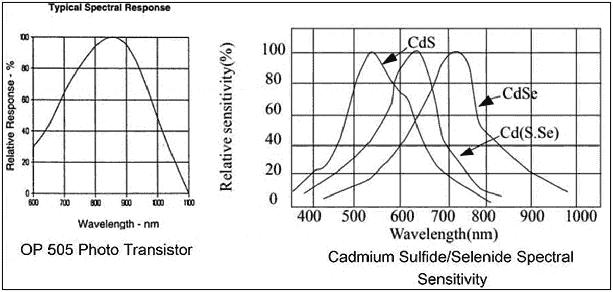

**图 4-1** 基于镉的 LDR 与光电晶体管的光谱灵敏度

### 电光应用

`LED`（发光二极管）通常用作视觉指示灯或光源中的耗能元件，也可用于计数和定时事件。`IR`（红外）光电二极管已被用于光学断开式光束系统，作为高速事件的指示器/探测器。`LDR`（光敏电阻）和光电二极管是安防系统的核心部件。

对实验科学尤其有价值的是发光二极管（`LED`）在多种颜色和波长能力上的发展。借助一系列体积小巧、成本低廉、易于使用且随处可得的器件，实验者能够生成并测量覆盖从近红外到紫外范围的电磁波谱离散段。许多传统的比色仪器需要棱镜或笨重的滤光片，以及沉重的大功率光源来分离所需颜色或辐射能量波段以进行实验。而`LED`、光敏电阻或光电二极管、低电压电源和简单的遮光箱体，能够利用现成的材料和组件轻松组装成低成本、可正常工作的光谱和光度测量仪器。

许多物质具有与可见光谱部分相互作用的分子或原子结构，从而呈现出颜色。许多与光相互作用的物质可溶解在溶剂中，形成有色液体溶液；早在 19 世纪末，人们就发现这些溶液的物理和化学性质遵循明确的数学关系。多项科学出版物最终推导出了今天被称为稀溶液比尔-朗伯定律的公式。其表达式为：

```
A = ɛcl -- (2)
```

`A` 是吸光度，衡量被吸收的入射辐射量。`ɛ` 是吸收物质的摩尔消光系数。`l` 是有色溶液的光程长度。`c` 是有色物质的浓度，单位为摩尔/升。

当阳光穿过玻璃棱镜或因雨滴折射时，会分散成构成可见光的各色彩虹。如果来自单色光源（如红色`LED`）的光线穿过稀释的甜菜汁溶液，根据比尔-朗伯定律，会发生若干物理化学过程。

甜菜及其汁液的红色源于名为`甜菜红素`的复杂分子，它是甜菜红苷（一种红色色素）和甜菜黄素（一种黄色色素）的混合物。红色甜菜红苷可吸收波长为 `535 nm` 的红色光，其摩尔消光系数为 `60,000 L/(mol-cm)`。（吸光度是一个无量纲概念，`ɛ`的量纲必须为`1/c-l`。）

溶液中部分甜菜红苷分子位于入射红光光子的路径上，光线因此被吸收。部分入射光子则完全穿过溶液。随着单位体积溶液中甜菜红苷分子数量的增加，吸收概率成比例增加。随着光子必须穿过的溶液层厚度增加，吸收概率也会增加。

比尔-朗伯定律描述了溶液中光的吸光度如何受三个因素控制：溶液中有色物质的浓度、光线必须穿过的光程长度，以及由引起吸收的有色物质性质决定的常数因子。红色甜菜红苷的摩尔消光系数很大，为 `60,000 L/(mol-cm)`。这个大的常数值表明该分子具有很强的红光吸收倾向。为保持该定律描述的数学关系有效，它只能应用于非常稀释的溶液。

比色分析法广泛应用于众多需要定性和定量识别与测量物质的科学学科中。比色分析法最常以液体形式应用，需要设备精确称量样品、稀释溶剂体积并测量溶液吸光度。为演示溶液吸光度分析，本书设计了一个干膜固态系统和一个基于简单水体积的实验。

图 4-2 是光吸收实验的基本框图。

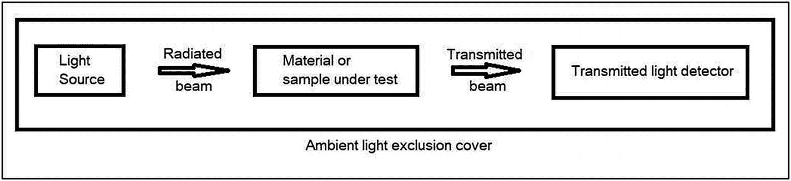

图 4-2
光吸收实验

对于使用可见光吸收的实验，通常需要一个环境光屏蔽箱以避免外部辐射干扰。红外和紫外实验通常在人工照明条件下进行，但可能需要避免阳光或含有长波和短波辐射的荧光灯照射。

在进行定性或定量光吸收实验所需的电学、光学和机械配置方面，会使用一种称为`光学平台`的装置。光学平台为安装和调节图 4-2 中的三个基本组件提供了手段，这些组件可以在桌面上或实验室工作台上于环境条件下组装，也可放置在避光、温控的封闭箱体中。

## 实验

### 简易微型光学实验台

基于图 4-2 所示通用流程配置的光吸收实验，需要使用图 4-3 所示的微型简易光学实验台，这就要求同时开发有源光源和透射光量测定方法。

一套基础入门级的光源与探测器组合，由恒流驱动的 `LED` 构成，可提供带宽极窄、近乎单色的光源。微控制器或人机界面可为光敏电阻供电或偏置，同时监测其输出来量化透射光量。下文介绍的基本装置，是一个能够测量多种电光器件实际光电特性的简易设备示例。

“微型光学实验台”可用一条刚性材料小条、两个螺丝接线端子排和若干导线制成，如图 4-3 所示。我的系统采用挤压铝角材制成，这种材料易得、便宜、轻质、耐腐蚀且相对易于加工。两个双连接器端子排面对面安装在实验台上，可在光源与探测器之间形成可调共线配置。

使用实验台时，将探测器和光源安装到相应的端子排中。通过螺丝端子固定元件并对准，调整器件使其共线。

尽管装置简单，但只要仔细对准并重现光源与探测器之间的距离，它就能产生可靠且有用的数据。通过改变光源与探测器之间的距离，或控制施加给发射光源的功率，均可调节照射到探测器上的辐射光能量。

我制作的组装件，其 `LED` 光源顶端与光敏电阻光电探测器上表面之间的间距（如图所示）可延伸至约六英寸（`153` 毫米）。

由于每个 `LED` 产生单一波长的可见光，且探测器响应本质上由微处理器或 `LabJack` 的 `10` 位模数转换器量化，因此探测器计数可作为所研究系统简单量化测量的依据。

本练习中的简易装置能对可见和不可见 `LED` 光源生成经验性数值测量值，这些测量值展示了典型光敏电阻器件的光谱波长灵敏度，如图 4-1 所示。

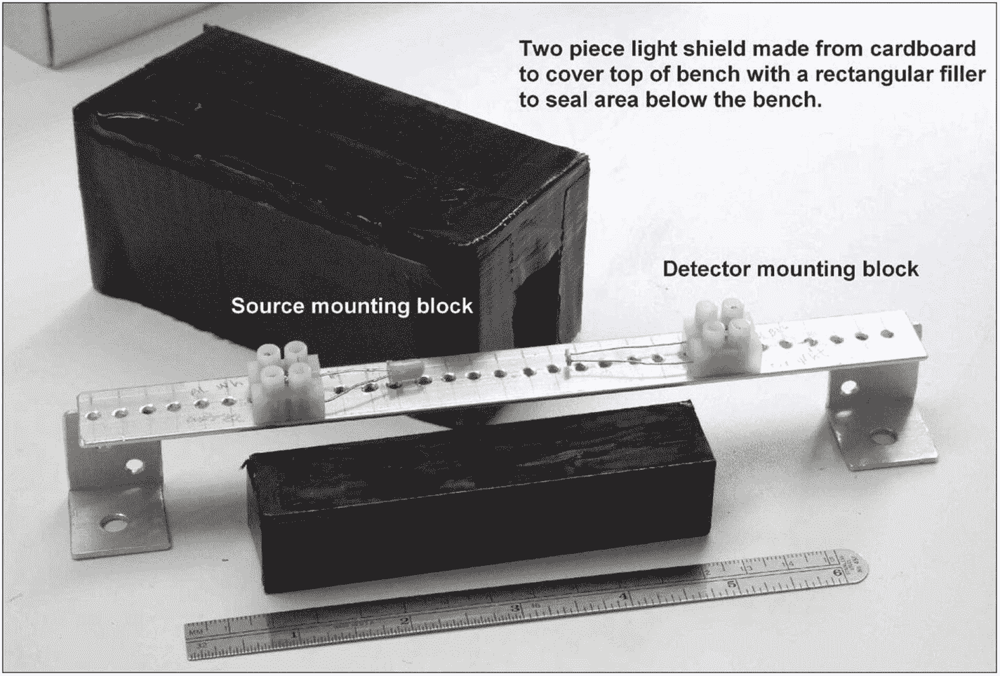

**图 4-3**  
简易微型光学实验台

利用图 4-2 和图 4-3 所示的基本系统，可以对 `CdS` 光敏电阻对入射光波长或颜色的典型灵敏度进行粗略评估。

一个 `DAQFactory` SCADA 软件图形用户界面程序可实现测量 `LDR` 颜色灵敏度的实际数据生成、采集和图形显示过程。图 4-4 展示了一个正在运行的 GUI 控制页面示例。图 4-4 所示的控制面板可通过清单 4-2 中的 `DAQFactory` 代码和一个 `U12 LabJack` 激活。（注意：所有代码清单均附于本章末尾。）`DAQFactory` 绘图器可配置为接收 `LabJack` 或 `Arduino` 的流式数据进行绘图。

在简易设置中，光源功率由 `LabJack` 上的 `AO 0`（模拟输出端子 `0`）控制。探测器输出由 `Arduino` 微控制器监测，并对探测器信号应用数字信号处理（`DSP`）程序。清单 4-1 包含一个简单的十元素平均代码，理论上，该代码可将探测器信号流式输出到连接串口的设备时，其信噪比提升约三倍。`DAQFactory` 图形显示程序和 `Raspberry Pi` 绘图器可进行适配，以提供基于时间的图形化显示，展示到达串口的增强数据。

最初，实验台的探测器是硫化镉光敏电阻与一个 `10 kΩ`、`1%`精度的金属膜电阻串联。该分压器由 `Arduino` 微控制器提供 `5.0 V` 偏置，微控制器在通过串口将数据流式传输到运行速度较低的 `DAQFactory` 图形显示主机之前，运行了一个十元素平均 `DSP` 程序。在图 4-3 中，一个黄色 `LED` 安装在光源端子排中，一个 `1/8` 英寸（`3` 毫米）见方的硫化镉（`CdS`）光敏电阻安装在探测器端子排中。

### 硬件

光学实验台可用任何足够坚硬的材料制成，以牢固固定端子条，使光源和探测器器件保持共线配置。金属、木材、塑料，甚至刚性较重纤维板都可使用。

为了在可见光测量中从所用光源和探测器获得最大灵敏度和选择性，最好用实验台盖或遮光罩排除干扰环境光。罩盖可用任何足够坚硬或刚度足够的非透明材料制成，以承受实验搭建或拆卸过程中的机械操作。无光黑色涂层有助于减少杂散光泄漏和反射的影响。

#### 电路原理图

如果使用指示灯二极管，如 `5 mm T-1¾`（见图 4-3 中的黄色 `LED`）或 `3 mm T1`  `LED` 器件作为光源，则通过二极管的电流通常限制在 `20 mA` 至 `50 mA` 范围内。`LabJack` 或微控制器的模拟输出可编程为在 `0` 到 `5 V` 之间变化，因此应安装一个合适的限流电阻值，以确保实验过程中任何电压编程时，二极管电流仍保持在制造商规格范围内。限流电阻还能确保 `LabJack` 或微控制器不会抽取过大或启动浪涌电流（通常小于 `30` 至 `40 mA`）。一个典型的分压电路，使用硫化镉光敏电阻作为上拉电阻，并使用 `10 kΩ` 电阻接地，可为 `Arduino` 的模数转换器提供可测量的信号进行处理。

### 软件

为了进行光电测量，必须对发射源、辐射能量探测器以及控制用个人电脑进行适当的编程。

为演示此处介绍的光学平台的实现，我同时使用了`LabJack`和`Arduino`微控制器来提供双向交互式控制系统。光源由清单 4-2 中的`DAQFactory`脚本控制，该脚本改变`LabJack`上`AO 0`输出的电压以驱动光源。探测器由`Arduino`提供偏置并进行监测，该`Arduino`负责模数转换（ADC），并运行一个数字信号处理（DSP）的 10 元素移动平均程序，如清单 4-1 所示。

`Arduino`通过串口将数据流式输出，以便在主机 PC 上的`DAQFactory`二维图形屏幕组件上进行采集和显示。`DAQFactory`绘图仪同时显示施加到光源的`LabJack`电压和从`Arduino`转换器接收的 ADC 值。（`LabJack`的模拟输出信号与`Arduino`的模拟输出信号之间存在显著差异。`LabJack U12`的模拟输出具有 10 位分辨率，并经过一个截止频率约为 22 Hz 的一阶低通滤波器。

`Arduino`上的`analogWrite(m,n)`指令未经滤波，微处理器会向引脚`m`施加一个频率为 488 Hz、占空比为`n`的 PWM 方波信号，其中`n`是 0 到 255 的 8 位分辨率值。在比色测量中，由`LabJack`产生的阶梯模拟信号与`Arduino`产生的脉冲方波之间的差异，可能会导致高速光电探测器测量到不稳定的数值。在某些分光光度测量中，可能需要采用信号平均 DSP 来获得稳定的读数。）

图 4-4 展示了在实验模式下操作光学平台的主显示屏幕。

我的光学平台主 GUI 控制面板屏幕包含以下内容。

-   一个基于时间的二维图形显示，其中施加到光源的电压绘制在左侧轴上，满量程偏转（FSD）范围为 0 至 5 V；探测器输出绘制在右侧轴上，满量程偏转范围为 0 至 1025，这是由`Arduino`微控制器上的 10 位 ADC 产生的。
-   三个编辑框，用于输入要施加到光源的电压起始值、每次迭代电压斜坡的增量值以及程序循环的重复次数。
-   一个用于启动光源功率程序的启动按钮。
-   一个显示功率施加间隔时间的文本。
-   一个用于手动控制施加到光源电压的旋转控件和文本。
-   一个用于跟踪光源电压值的进度条。
-   两个用于数字显示光源电压和探测器响应的变量值显示区。

旋转控件、进度条和两个变量值显示组件并非原始控制面板的一部分，而是后来为其他工作添加的，并且对于评估组件电气特性很有用。

#### 必要的脚本编写与微控制器编程

清单 4-2 是当按下`运行电压程序`按钮时启动的自动测试`DAQFactory`脚本。清单 4-1 是一个可根据需要调整以处理探测器信号的`Arduino`移动平均程序。


**图 4-4**：典型的`DAQFactory`光学平台 GUI 控制面板及数据记录

### 观测结果

在光源探测器距离为 1.25 英寸（32 mm）时，自动测试程序通过一个 180 Ω的金属膜 1%精度电阻将二极管电压递增至 5.0 V。硫化镉光敏电阻（LDR）信号由一个与 LDR 串联的 10 kΩ 1%精度金属膜电阻产生，该电阻由微控制器的 5 V 电压偏置，并由`Arduino`的 ADC 监测。信号经过一个十元素移动平均程序处理后，以数据流形式输出到主机 PC，主机 PC 上显示归一化的 1024 ADC 单位图形界面。各种光源二极管产生了表 4-2 中列出的数据。

**表 4-2**：CdS LDR 对 LED 颜色的响应

| LED 颜色 | 典型波长 | 响应描述 |
| :------- | :------- | :------- |
| 红色     | 620-630 nm | 较高响应 |
| 绿色     | 520-530 nm | 中等响应 |
| 蓝色     | 470-480 nm | 较低响应 |

二极管功率的电流限制限制了器件的光输出，从而限制了可监测光束的实用距离。使用一颗明亮的纯绿色 8000 mcd LED 作为光学平台光源，以及一个正面表面积为 1/8 英寸 × 1/8 英寸（3 mm × 3 mm）的 CdS LDR 进行的实验，为图 4-5 提供了数据。


**图 4-5**：强度随 LED 探测器距离的衰减

## 讨论

为了演示如何使用现成且易于构建的机械设备，通过 SCADA 软件 GUI 实现变量的基本管理，我们测量了典型 CdS 光敏电阻在可见光光谱范围内的灵敏度。观测到的数据已整理在表 4-2 中。根据表中的数据可以看出，该探测器对可见光谱的各个成分及其上下波长的边缘区域均表现出较好的灵敏度。

图 4-4 中的`DAQFactory` GUI 屏幕配置了手动可调的数字调节旋钮和关联的进度条，允许您在对二极管和电路（例如遮断光束中断电路等配置）进行测试时调整施加的电压。对于简单的定量测量，例如使用亮绿色 LED 测量信号随光源-探测器距离的衰减情况，可以在进行实际实验时使用遮光罩排除杂散可见光。

编辑框条目允许在屏幕上方便地改变测试程序的参数。如有需要，可以修改序列代码，以改变电压斜坡循环之间的默认延时。默认时间在`AutoTest`序列（见代码清单 4-2）第 23 行的`delay(10)`代码中设置为 10 秒，可根据需要手动更改。

控制屏幕还同时以进度条和数值的形式显示施加在被测器件（DUT）上的电压。在程序周期的任何时刻，都可以根据限流电阻的阻值和图形输出记录中的电压迹线，计算出流过 DUT 的电流。

如图 4-4 显示的迹线所示，光输出-探测器响应是施加到二极管及其限流电阻上的电压的线性函数。除了良好的可重复性外，对三次重复测量的仔细检查表明，亮绿色 LED 仅在电压斜坡升至约 2.25 V 时才会点亮。LED 亮度可以通过将电压设置为与所需 LED 输出相对应的期望水平来控制，或者也可以通过`Arduino`的 PWM 或 555 定时器电路来控制。使用`Arduino`微控制器的 PWM 控制可将功率范围划分为 255 个增量，而使用 555 IC 的电位器则可以在整个占空比范围内提供连续可变的脉冲宽度（参见 [`www.electronics-tutorials.ws/waveforms/555-circuits-part-1.html`](https://www.electronics-tutorials.ws/waveforms/555-circuits-part-1.html)）。

`Arduino`和`LabJack`上的 ADC 均为 10 位器件（2¹⁰ = 1024），理论上可提供 1/1024 的测量能力。千分之一的精度通常足以在图形显示中跟踪大多数物理现象，使观察者能够捕捉到记录信号中的任何显著变化。通过精心选择图形记录和 DSP 条件，可以实现量程扩展，从而大幅提高灵敏度，例如，可用于监测信号输出中的噪声。

图 4-5 中的图形展示了大功率亮色 LED 集中的光功率。在测量的短距离内，探测器响应呈平缓的线性下降趋势，强度随分离距离的增加而降低。这种高度集中的 LED 光束是可以预料的，因为其透明透镜以及二极管阳极和阴极的物理布局设计旨在将发射的光尽可能紧密地聚焦成一束。通常，点辐射源的强度会随着光源与探测器之间距离的增加而呈平方反比指数衰减。

已有研究表明，LED 是不遵循欧姆定律的二极管。它们需要施加约 1.5 V 至 3 V 或 4 V 的电压才能导通电流并以特征颜色发光。同时，也已证实，通过对 LED 施加 PWM 功率技术，可以利用电源提供的全电压的可变占空比应用来克服最小激活电压。然而，某些光电探测器的响应可能会受到变化的脉冲波信号的影响。

对于差分比色分析，对探测器信号进行时间平均可以减轻 PWM 信号对收集到的光谱数据的影响。另一种简单易行的解决 PWM 影响探测器输出的方法是使用直流信号为 LED 光源供电。

图 4-18 展示了一种使用可变电阻器来改变施加于二极管的电压的技术，调节范围介于所用有色二极管所需的导通电压与电源可提供的最大电压之间。如果在最低亮度下，二极管发出的光对于所使用的光源来说仍然太亮，则可以在光学平台上增加二极管到探测器的距离，如图 4-5 所示，直至探测器输出恢复到可用值。虽然使用可变直流电源可以显著提高探测器输出信号的稳定性，但可能需要一些信号平均处理来减少电噪声和漂移。

文献中讨论了发光度、辐射度和色温的概念，在处理可见光和不可见辐射单位时必须谨慎。表 4-2 将所有不同波长的 LED 辐射转换为任意单位的 1024 ADC 计数。LED 强度以毫坎德拉（mcd 或 cd/1000）为单位指定，其中坎德拉是国际单位制中亮度或明度的基本单位。流明和坎德拉之间的关系并非一个简单问题。两者之间的换算需要定义视角、波长和其他因素，如果当前的实验工作需要用到这些单位，则研究人员最好查阅相关文献进行审阅。

LED 是典型的二极管，它们是不遵循欧姆定律的器件。通常，随着二极管颜色从红色向蓝色移动，发光的起始电压从大约 1.5 V 增加到 4 V。除非制造商另有规定，电流应限制在 20 mA 到 30 mA 之间。

带有微控制器-计算机读数与绘图仪显示的简易光学平台，是测量单个电光器件电学特性和光谱波长相对灵敏度测量的基础。通过将半透明材料放置在光源和探测器之间的光束中，该光学平台就构成了一个实验性光吸收测量仪器的框架。吸收仪器在定性和定量的理化实验测量中都扮演着重要角色。

# 一种采用硫化镉或光电晶体管探测器的固态比色计

顾名思义，比色计是一种能够测量颜色变化的光谱设备。大量文献详细阐述了针对天文学、生物学、化学、工程学、地质学和医学领域中目标分析物的比色测量技术的发展。为了开发更灵活的比色计，可以用单个红绿蓝三色 LED 替代分立波长二极管，从而形成连续可变的颜色光源。可以为光学实验平台开发一个图形用户界面控制屏幕，将光源的三原色配置成几乎任何可见光颜色。这里开发的流程可应用于为任何实验科学研究或调查开发比色分析法。

能够发出红、绿、蓝三色的复合发光二极管，可以与微控制器的脉冲宽度调制功能（例如`Arduino`所具备的功能）配合使用，充当可变波长的比色光谱光源。一个已发表的视觉实验表明，当三束强度相等的彩色聚光灯斜向照射白色屏幕上的同一区域时，会形成图 4-6 所示的三种原色重叠效果。通过生成三原色，`RGB` `LED` 可以提供广泛分布的合成色光。这些颜色可通过原色的重叠或混合获得。图 4-11 展示了将标称 0–255 的 `PWM` 功率设置应用于 `RGB` 单个二极管元件时预期产生的近似颜色。


**图 4-6** 原色光组合的效果（来源：[`https://en.wikipedia.org/wiki/Image:RGB_illumination.jpg`](https://en.wikipedia.org/wiki/Image:RGB_illumination.jpg)）

二极管的三种原色各自由不同波长的电磁波组成。一个三色 `LED` 的典型 `RGB` 波长分别为 624 纳米、525 纳米和 470 纳米，正向电压分别为 2.25 伏、3.5 伏和 3.5 伏，采用透明环氧树脂封装，视角为 20 度。如果在同一光源中同时产生两束或三束波长不同但振幅恒定的波，这些波会组合成独特的和，形成新的波长。图 4-6 中的重叠区域显示了将各个原色辐射等量混合后产生的各种组合颜色。为了用肉眼看到这些不同的颜色，通常使用漫射器来“混合”颜色以便显示。从短距离观察多色 `LED` 时，人眼通常只能看到被点亮的单个二极管颜色。

为了获得可能的全部可见光颜色范围，三种原色中的每一种强度都必须能从零变化到全亮度（见图 4-11）。

尽管图 4-2 中描述的概念在理论上很简单，但要制造出一台能够利用 `PWM` 控制光源照明、并使用光敏电阻或光电晶体管进行光探测来测量光强度的仪器，需要考虑并适应若干额外的因素。

`PWM`是一种成熟的控制功率技术，大多数电子学参考资料中都有讨论，包括霍洛维茨和希尔的《电子学艺术》（剑桥大学出版社，2015 年）以及《发明家实用电子学》（麦格劳-希尔出版社，2013 年）。

`Arduino`引脚的`PWM`频率为 488 赫兹。施加到 `RGB` 二极管引脚上的 5 伏 `PWM` 脉冲，远高于该器件中每个单独彩色 `LED` 的最低典型“开启”电压。在 488 赫兹的频率下，二极管会在选定的脉冲宽度时间内导通，然后关闭。`RGB` `LED` 中各个颜色光源以 488 赫兹的频率循环变化，对于人眼来说太快而无法察觉，但对于光敏电阻或光电晶体管探测器则不然。

硫化镉/硒化镉光敏电阻的规格书通常会报告“延迟”时间。光敏电阻可能对入射光在 10 毫秒内做出响应，电阻急剧下降，但在暴露于高强度光照后，重新建立高电阻状态所需的时间要长得多。光电晶体管的频率响应特性在几千赫兹范围内，这取决于器件所驱动的负载大小。硫化镉/硒和光电晶体管器件都具有足够快的响应速度，足以受到`Arduino`的`PWM`频率影响。

解决光电探测器跟随脉冲宽度变化曲线的简单方法是，对探测器响应进行时间平均，或使用可调值的直流电压为光源供电。一个大型滑动平均窗口（例如列表 4-1 中通用的`Arduino`代码）可以生成平滑的探测器平均数值输出。

为了测量透射光强度的差异，需要两个稳定的数值来获得数值差。列表 4-1 和 4-5 是针对`Arduino`微控制器的数字信号处理代码，分别采用通用（列表 4-1）和特定应用格式。

## 实验：硫化镉或光电晶体管比色计

可以使用基于 Windows 系统的`DAQFactory`图形用户界面和小型光学实验平台，或者稍加改进的封闭式仪器来进行可见光实验，所有这些都可以用现成的材料制作。在以下练习中，将为简单型和封闭型颜色测量设备开发基于 Windows 和 Linux 计算平台的软件管理系统。

### 硬件：小型光学实验平台

为了使用图 4-3 中的光学实验平台，并获取图 4-11 中所有可用的颜色，可以使用红绿蓝（`RGB`）`LED` 作为仪器光源。为了适配 `RGB` 二极管，光学实验平台上的光源模块必须扩展，以容纳典型的四引脚共阴极器件。如果单个 `LED` 就能提供进行吸收实验所需的颜色，则无需对光学实验平台进行改动。可能需要调整遮光罩，以确保排除来自环境光的杂散光。

`LED` 的每个颜色引脚都可以串联一个合适的限流电阻，并连接到`Arduino`的 `PWM` 输出引脚上。（或者，为了进行精度稍低的颜色强度控制，可以在公共引脚和电源地之间串联一个合适的电阻。）所需的最小限流电阻值，可根据用作光源的 `RGB` 或单个 `LED` 数据手册中列出的安全运行推荐最大工作电流计算得出。

硫化镉探测器无需对其原始的分压器配置做任何改动。如果使用诸如`OP-505`之类的光电晶体管作为探测器，则 5 伏偏置电压必须通过一个 10 千欧的“上拉”电阻和光电晶体管降到地。光电晶体管的发射极接地，用于`Arduino` `A0`引脚的模数转换器信号从集电极与 10 千欧电阻的连接点取出（见图 4-18）。

### 软件：DAQFactory – Arduino

要选择单一或复合颜色，`RGB` 二极管的每个元件都需要独立控制。串行通信链路在设备与主机显示屏之间来回传输控制信息和观测数据。

`Arduino` 微控制器在色度计配置中扮演多重角色，既作为智能编程的源控制器、`DSP` 计算器，又作为串行通信终端。`Arduino` 的草图代码如代码清单 4-5 所示。

在完全控制每种基色强度的同时，`Arduino` 的 `PWM` 功能通过向光源施加 5V 定时宽度脉冲，避免了单个二极管的“导通电压”要求。

图 4-8 所示的 `GUI` 控制面板屏幕主区域，以条图记录仪的形式显示 `CdS` 或 `OP505` 探测器响应，显示内容从右向左移动。需注意，左侧的探测器响应量程可通过在 `DAQFactory` 软件的二维图形组件配置窗口的迹线选项卡中，从轴下拉列表选择所需位置来移至右侧，如图 4-7 所示。

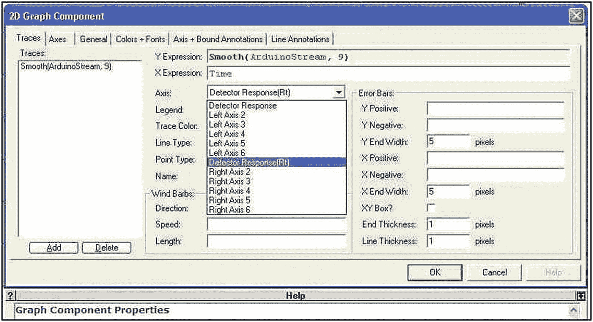
**图 4-7** `DAQFactory` 轴选择

图 4-8 描绘了 `DAQFactory` `GUI` `OP505` 色度计控制面板屏幕。从 `GUI` 控制面板的左上角开始，有三个带标签的编辑框和按钮，用于将复合 `LED` 光源 `RGB` 二极管的期望功率值输入到 `DAQFactory` 软件中。需注意，用于向 `Arduino` 传输 `RGB` 值的三个变量，必须在任何脚本编写中使用前声明。图 4-8 中的控制屏幕使用了编辑框、变量值显示、按钮、图形显示和静态文本显示来提供和接收信息。

一旦所需信息输入控制屏幕，按下“`RGB` 传输”按钮将激活序列代码，通过串行端口传输所需的红、绿、蓝数据值，供微控制器读取并执行所请求的功率级别。代码清单 4-2a 包含了用于按钮激活传输的 `DAQFactory` 代码。


**图 4-8** 色度计 `GUI` 及 `OP505` 探测器在 `RGB` `LED` 全 `PWM` 功率下的响应

控制面板的使用本身并不涉及脚本编写。已编写并驱动操作的脚本，在按下 `RGB` 传输按钮时，期望接收三个数值。所有编辑框必须包含一个从 0 到 255 的数值。必须使用脚本页面和代码的自动启动功能（类似于图 4-9），以确保变量已被声明。


**图 4-9** 声明所需变量的自动运行 `DAQFactory` 代码

图 4-8 显示了标记为“`RGB` 传输”和“光源关闭”的按钮，这些按钮被配置为激活代码清单 4-2a 和 4-2b 中的序列代码。

代码清单 4-5 是 `Arduino` 的草图代码，用于接收并执行 `DAQFactory` 控制面板的串行传输。

#### 观察

如果不小心忽略了自动启动选项和声明代码，使用色度计时可能会出现一些奇怪的错误。

图 4-8 描绘了 `OP505` 探测器对标称颜色以及输入到 `GUI` 的 `RGB` 编辑框中的全 `PWM` 功率级别的响应。如表格 4-2 所观察到，与 `CdS` 探测器对明亮 `LED` 颜色的响应相比，不同的颜色会对 `OP505` 产生不同的响应。

在图 4-10 中，使用 `OP-505` 光电晶体管探测器获得的 `ADC` 计数数据已与 `Arduino` `PWM` 标称值进行了对比绘制。

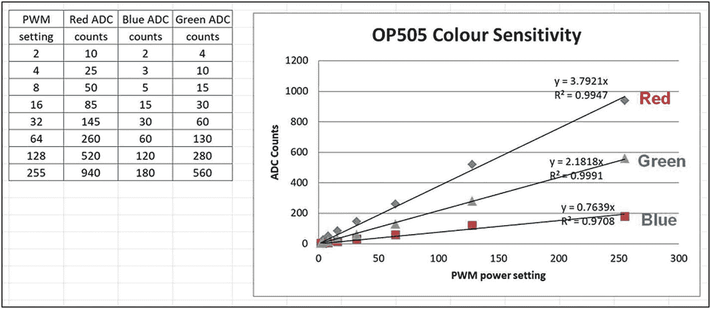
**图 4-10** `OP505` 光电晶体管在 `RGB`-`PWM` 功率级别下的响应

### 讨论

`Auto-Start`复选框的作用是，当`DAQFactory`程序创建 `GUI` 页面时，让短序列代码自动加载并运行。几乎所有包含变量的编程语言都必须在内存中预留空间来存放数值变量。通常，在编写程序、脚本或草图时，语言中会包含用于声明和可能初始化代码中符号变量的规定。在`DAQFactory`等 `SCADA` 软件中，数据的主要容器是存储带时间戳数值的通道。通道通过通道表来创建和激活。脚本页面的`Auto-Start`功能允许编写和运行代码序列，在控制屏幕组件的软件代码使用变量之前，声明并初始化这些变量。

硫化镉探测器具有广泛的电阻值范围，从受光时的数千欧姆到黑暗中的数千万欧姆不等。请回顾，如果将传感器配置为分压器以获得最佳性能，实验者应选择一个固定电阻值，该值应近似等于传感器在其工作范围中点处的电阻值。

使用 `PWM` 进行 `LED` 功率控制会导致光源设备产生的光出现一定程度的“闪烁”。由供电加热引起的局部温度波动以及 `USB` 总线上的电子噪声，都会增加信号传输中的噪声。

在所有定量光谱学方法和应用中，可重复性至关重要。为了在比较光测量中获得所需的可重复性，通常需要对 `ADC` 信号进行时间平均，以平滑电子干扰和杂散光干扰。时间平均会增加连续监测显示的响应时间。静态比色测量不会影响实验结果。

一张使用成比例 `PWM` 功率的粗略 `RGB` `LED` 颜色生成图已经发布，该图以十六进制表示了产生相应光所需的比例，如图 4-11 所示。


**图 4-11** 通过对各个 `RGB` `LED` 二极管施加 `PWM` 功率而产生的典型颜色（参见[`en.wikipedia.org/wiki/RGB_color_model`](https://en.wikipedia.org/wiki/RGB_color_model)）

颜色及其感知通常严格地用黑体辐射来表示，其中色温以开尔文为单位，对于可见光来说，通常在数千开尔文量级。颜色图表和 `PWM` 设置并非对最终颜色的严格定义，当从图表中选取相应的数值输入`DAQFactory`控制面板时，最终颜色便得以确定。`RGB` 二极管中三个发光源各自发出的光的波长和强度都可能因器件而异。

在比色比较的许多实验应用中，并不要求光源的光谱与待分析样品的完全匹配。一种黄色材料或溶液，可以在略有不同的黄色色调下使用比尔-朗伯定律来检测其颜色深度。通过在略有不同的黄色色调下，对不同样品厚度或浓度进行多次测量，只要光源发出的黄色的色调或色度不改变，就能获得准确的数据。光源与样品颜色之间的任何微小差异，都会通过差分比较技术而被抵消。

## 使用 Raspberry Pi 和 Arduino 实现光具座技术

一个 `Arduino`-`RPi` 组合可用于搭建一个装置，该装置为 `LED` 光源和光电探测器组合供电，这些组件可以安装在一个简单的光具座上，既可以暴露在环境光照条件下（如图 4-3 所示），也可以封装在一个不透明的外壳内（如图 4-12 至 4-17 所示）。

一个由 `RPi` 托管的 `Arduino` `IDE` 可以为当前的实验工作提供图形或数值显示选项。反应动力学通常通过跟踪光活性化合物的衰变速率来研究。过去 100 年间，在生物学、化学、地质学和医学领域，已经发表了大量描述定量比色分析方法的文献。

市面上有可发射窄带可见光的 `LED`，其波长范围从可见光谱的深红色端一直到蓝色端。各个彩色 `LED` 可以作为定量吸收测量的光源，用于确定溶液中以及某些半透明固相中有色材料的相对含量。

将 `RPi` 强大的计算能力和图形数据展示能力，与 `Arduino` 微控制器的光源功率控制、数据采集、转换及数字信号处理能力相结合，可以构建一个廉价、简单且易于组装的比色分析系统。

请回想一下，如果有色可见光的光束穿过颜色相同的溶液或固体时，一部分光子会被吸收，另一部分则会穿过。入射光强度与穿过吸收介质后的透射光强度之比，称为*透射率*。透射率与研究介质中吸收的光量之间通过以下关系式关联。

```
透射率 = I[i] / I[t] 并且 吸光度 = – log(T) = – log( I[i] / I[t] )
```
或
```
吸光度 = log 1/T -- (3)
```

`I[i]` 是入射到介质上的光强度。`I[t]` 是穿过待研究介质（即透射出的）的光强度。

吸光度常被称为光密度，可以看出，随着吸光度的增加，穿过有色介质的光量必然减少，这导致了吸光度与透射率之间的反比对数关系。

透射率可以被测量，而吸光度则必须计算得出。比尔-朗伯定律将恒定光程下稀溶液的吸光度与浓度联系起来。如果吸光度和浓度成正比，那么针对一系列已知浓度测量得到的吸光度绘制出的图形应该是一条直线。对于严格的定量分析分光光度法，必须建立吸光度与浓度之间的线性校准关系。然而，半定量的比色分析可以使用能够测量光透射的简单基础设备来实现，只需在溶液浓度与透射光强度之间建立线性关系即可。

一个像本项目中开发的这样简单、基础的比色分光光度计，可以测量光穿过待测样品后照射到光电探测器上的光量。监控光电探测器的微处理器的 `ADC` 会产生一个数字值，该值与样品透射的光量成正比，如果已经建立了线性关系，那么这个值就可以与浓度相关联。

对于更高级的研究人员，可以对本项目中开发的仪器中的微处理器进行编程，使其计算并显示吸光度单位，以进行更严格、更定量的研究。

## 实验环境与光学实验台准备

在使用光电晶体管作为光敏探测器的光学测量系统中，为获得真实的零读数，测量实验期间必须排除环境光或杂散光。应使用不透明外壳将容纳光源和探测器组件的光学实验台完全封闭。该外壳还必须能在光源与探测器之间的光路中放置吸收样品，并允许电信号进入被封闭的系统有源组件。

为光强度测量提供暗室环境，我们使用了一个带铰链盖的金属糖果罐，尺寸为 3½ × 11¼ × 2½ 英寸（86 × 276 × 61 毫米）（见图 4-12 至 4-17）。一块 3/8 英寸（9 毫米）厚的胶合板被切割成与罐底紧密配合的尺寸。底板的中心线被标记出来，同时在中心线两侧各画一条相距 ½ 英寸（12 毫米）的平行线。外侧的两排孔从底板底部钻入。这些孔经过沉孔和攻丝处理，以接纳 1 英寸 #6 平头机用螺钉（25 × 3 毫米），这些螺钉交替分布在右侧和左侧偏离中心线 ½ 英寸（12 毫米）的线上，间距为 ½ 英寸（见图 4-13）。当将底板装回避光盒后，底板上便有了两排孔，每排孔的间距均为 ½ 英寸（12 毫米）。这种交替定位孔位的技术使得对于定位在中心线上的组件而言，安装柱的孔位间距变为 ¼ 英寸（6 毫米）。

## 光学组件安装与布局

注意图 4-12 中的以下内容。

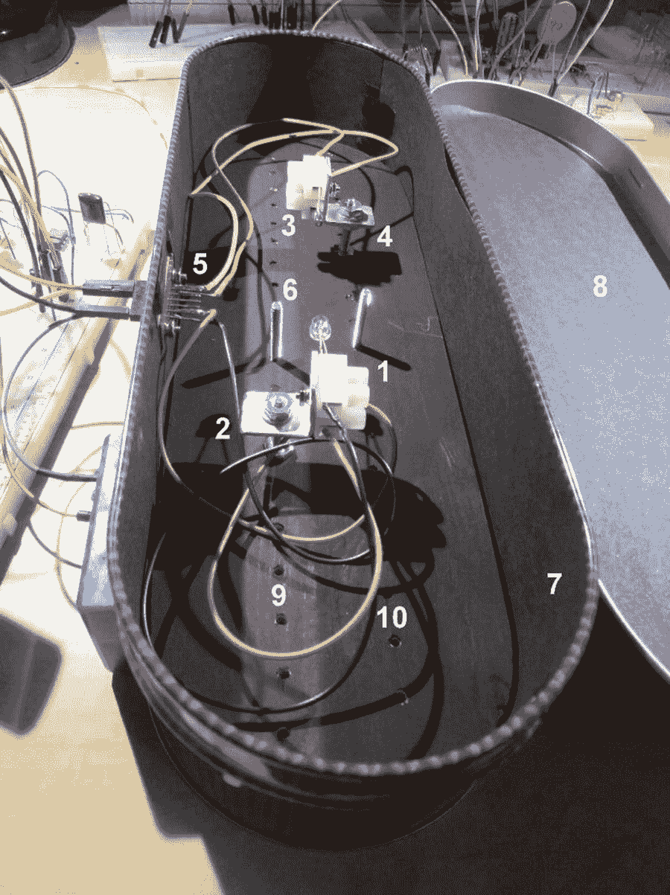

图 4-12 比色计的内部组件

- 标注 1 为 LED 光源（另见图 4-17），由一个双端子螺丝连接条组成，该连接条螺栓固定在一个直角支架上，能够接彩色二极管的阳极和阴极。
- 标注 2 为安装柱，位于中心线铰链对侧那排孔中的一个孔内，其上用一对六角螺母固定了一个直角支架，以确保光源组件的高度正确，并与探测器光电管保持共线性。
- 标注 3 为探测器光电管，安装在一个双螺丝端子连接条内，同样螺栓固定在一个直角支架上，以保持与光源的共线性。
- 标注 4 为带螺纹的安装柱，位于中心线铰链侧的那排孔内，其上装有一个直角支架，可调节至所需高度，以保持光源-探测器的共线性。
- 标注 5 为电气“穿通件”，用于将光源和探测器的接线连接到各自的微控制器输入和输出端（另见图 4-14 和 4-15）。
- 标注 6 为一对安装柱中左侧的一根，用于安装样品架（另见图 4-16）。
- 标注 7 为用于使外壳内壁变黑的哑光黑纸或纸板衬里。
- 标注 8 为用于顶盖内部的黑色纸或纸板衬里。
- 标注 9 为左侧安装孔排，位于中心线铰链对侧，孔距为 ½ 英寸（12 毫米）（另见图 4-13）。
- 标注 10 为右侧安装孔排，位于中心线铰链侧，孔距交替为 ½ 英寸（12 毫米）（另见图 4-13）。

探测器和各种光源安装在螺丝端子连接器中，这些连接器固定在铝制支架上，支架上钻有孔以套在 #6 机用螺钉上。一个锁定螺母将安装柱固定在底板的所需高度上。第二个螺母旋入安装柱下方，以便光源或探测器能够与其对应组件进行共线性调整。第三个螺母将支架组件锁定到位。

图 4-13 展示了我在避光容器内组装光学实验台所采用的技术。钻出适合 #6 平头（3 毫米）机用螺钉的孔（#35 钻头或 7/64 英寸），并进行沉孔和攻丝，以接纳预设的螺钉，这些螺钉位于平行于中心线的两条线上，间距为 ½ 英寸（12 毫米）。各个孔以 ½ 英寸（12 毫米）的间距交替钻出，这样组件便可调整到光学实验台上分辨率可达 ¼ 英寸（6 毫米）的距离。用于光源、探测器的十字槽头单螺钉安装柱，以及用于样品架的一对安装柱，可见于下排左起第七个位置、上排右起第五个孔位，以及上排和下排左起第十个位置。

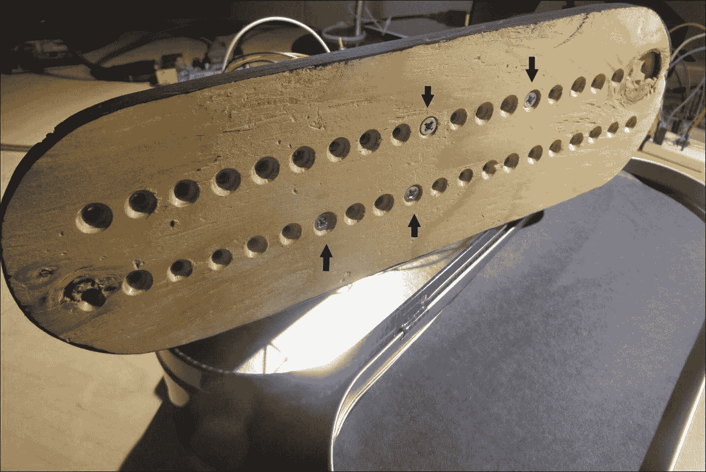

图 4-13 底板底部视图，展示了已就位的光源、探测器和样品架安装柱

## 电气连接与信号接口

图 4-14 和 4-15 描绘了电气穿通件的内部和外部视图，用于提供进入盒子内部的隔离电子接口。在避光盒侧面切割一个槽，以容纳一个四位或六位的堆叠式接头连接器。该连接器块用环氧树脂粘合在一小块万能板上，该板上钻有两个小孔以容纳两颗小螺栓，从而将组件固定在盒子侧面，为光源和探测器连接形成电气穿通件。

最初，堆叠式接头引脚被焊接到光源和探测器的连接线上。后来版本的仪器使用了标准的 0.1 英寸（2.5 毫米）间距堆叠式接头，该接头可接纳 Arduino 和原型开发板上常用的标准跳线（见图 4-19、4-20 和 4-21）。


图 4-14 避光电子连接器的内部视图

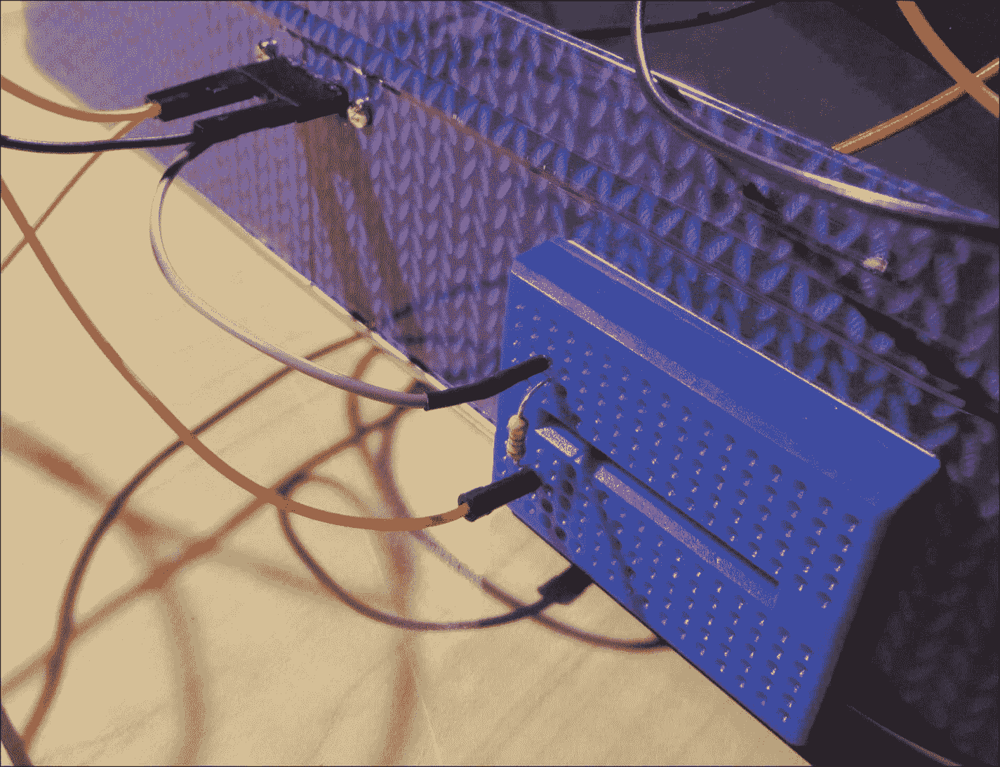

图 4-15 不透明电子连接器和辅助面包板的外观视图

盒子的内部以及底板的顶面全部用黑色纸衬里或涂料变黑，以阻止任何内部反射。

## 样品架安装

一对安装柱用于定位样品架。样品架由一个 ½ 英寸（12 毫米）的铝制角件构成，其上钻有一对偏置孔，以便套在安装柱上，并将固体玻璃纸片固定在光路中。样品纸片用 5/8 英寸（15 毫米）的弹簧夹（鳄鱼夹）固定，如图 4-16 所示。


图 4-16 带夹子的样品架


图 4-17 光学实验台的基本组件

## 电路与测量系统

Arduino 与 RPi 的组合可控制并为 LED 光源供电。Arduino 上的 ADC 能够确定照射在检测器上的光量。Arduino 的 5 V 电源为装置上的 LED 和检测器供电。5 V 电源、OP-505 的集电极、发射极以及 10 kΩ 电阻器按照图 4-18 所示串联连接。通过 `A0` 连接至 Arduino 上的 ADC，记录下 10 kΩ 电阻器两端的电压降，并通过串口监视器读取。

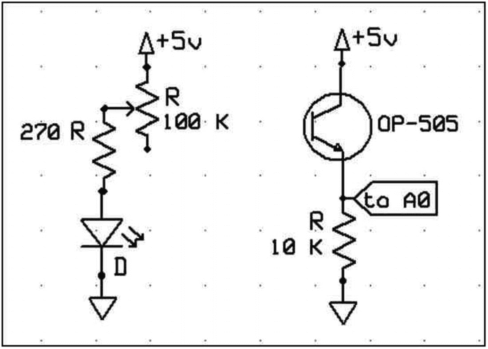

图 4-18 比色计的光源和检测电路

光源由 Arduino 的 5 V 电源供电。电流流经一个 270 Ω 的限流电阻和一个 100 kΩ 电位器的一半。通过调节电位器上的滑片位置，可以改变施加在二极管上的电压。加入 270 Ω 限流电阻可确保保护二极管。

要开始吸光度实验，您有几种选择。清单 4-3 中的光敏晶体管读数 —— 该清单最初是为本章 DAQFactory 控制面板的静态显示而编写 —— 或清单 4-3a 可与 RPi 的 PIXEL 主屏幕配合使用，以显示静态吸光度读数。从 PIXEL 屏幕上的 Arduino 图标可以启动 Arduino IDE。在“工具”菜单中，串口监视器可以直接显示 Arduino ADC 的吸光度或透射率值。更高级的研究人员也可以使用第 1 章清单 1-3、第 2 章清单 2-1，以及第 3 章清单 3-2、3-5、3-7 或 3-8 中的任何 Python 串口绘图程序，来记录适用于可见光光学监测的动力学数据。

在光路中放置空的样品架并关闭遮光盒后，调节电位器，使红色玻璃纸实验中的 ADC 计数近似达到 900 个单位。接近 900 的 ADC 计数代表 100% 透射率。将一个适当尺寸的不透明材料片插入样品架，应能完全阻挡光路，从而确定 0% 透射点。

然后，可以对红色玻璃纸等样品进行透射光测量。通过从 RPi 上 Arduino 的串口监视器显示中读取不同厚度材料的数值，可以确定层数或模拟液体中的浓度变化。

完成所需数量的测量后，应检查 100% 透射率的 ADC 值，以确定系统设置是否已偏离其原始设定点。

## 液体样品改装

为了适应有色液体样品，仪器内部可以改装，以容纳外径 3/4 英寸、高 2 英寸（2 厘米 × 5 厘米）的透明玻璃瓶，如图 4-19、4-20 和 4-21 所示。

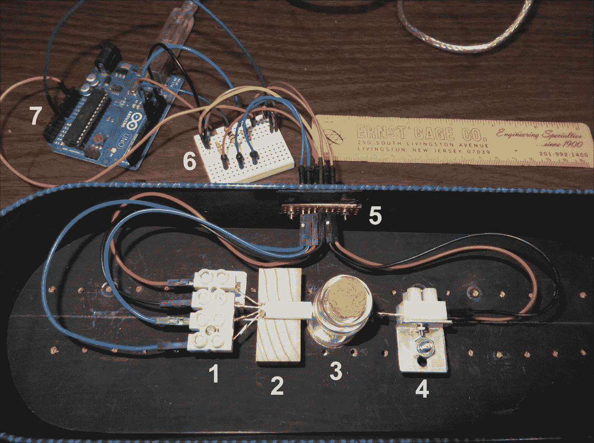

图 4-19 用于液体样品的光源、准直器、样品瓶和检测器改装

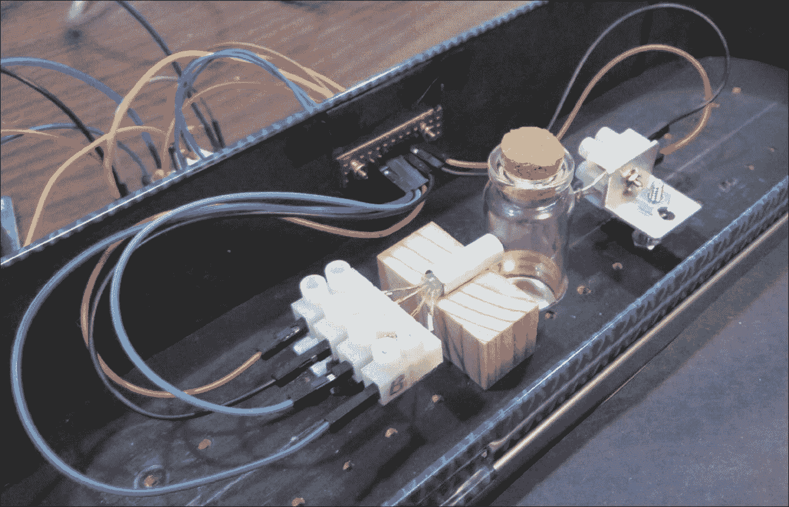

图 4-20 液体样品改装


图 4-21 液体样品改装视图 2

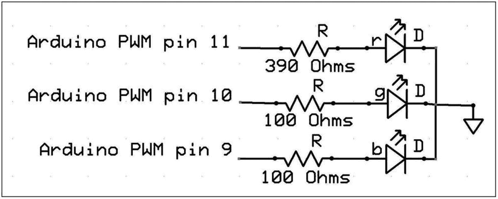

图 4-22 用于大型液体池比色计的 RGB LED 光源的优化电流源

下文描述了图 4-19 中的组件。

- 组件 1 是一个四端子螺钉连接器块，由标准的 12 单元端子排切割而成，用于连接公母跳线的公头端。该端子块安装在一个螺纹柱上，如图 4-12、4-16 和 4-17 所示。该块用螺栓固定在一个铝制支架上，该支架可容纳电气连接，并在进行共线性调整时将 RGB LED 牢固地固定到位。
- 组件 2 是一个木质块，支撑着一个直径为 5 毫米（1/4 英寸）的铝箔准直器，该准直器将 LED 发出的光汇聚成大致与样品瓶另一侧的检测器（4）共线的一束光。（3）（准直器支撑块在投入使用前已被涂成黑色。）
- 组件 3 是一个钠钙玻璃瓶，直径 3/4 英寸（20 毫米），高 2 英寸（50 毫米）。该样品瓶通过在其中心位置的光学平台底座上切割出的一个直径为 3/4 英寸（20 毫米）的孔固定。
- 组件 4 是检测器组件，由一个安装在铝制支架上的 2 端子聚乙烯螺钉连接器块组成。同样，端子排提供了两个电气连接，并将 OP-505 光电晶体管检测器牢固地固定在与光源和样品瓶共线的位置。
- 组件 5 是一个 6 引脚排针，已用环氧树脂/氰基丙烯酸酯胶粘剂粘合到一块万用板上，用于安装在遮光盒的侧壁上。排针通常用于将分线板安装到原型实验板上，其两侧均有公针（参见第 10 章的图 10-2）。一条双排公针可以为承载电流和检测器信号的母跳线提供遮光的电气连接。
- 组件 6 是一块小型原型实验板，用于容纳优化的限流电阻，以便为大型液体池仪器中的光源供电（参见图 4-22）。
- 组件 7 是 Arduino，它根据输入到串口监视器并通过 Arduino 串口屏幕上的“发送”按钮读入 Arduino 代码的数值，提供 PWM 信号以提供所需的 RGB 二极管电流。该微处理器使用 10 位 ADC 监测 OP-505 光电晶体管的输出，并将 0 到 1023 的数值发送到串口，以供 Python 处理。

# 比色法光强度测定

使用图 4-20 和图 4-21 所示的仪器，可以进行一系列基于 `LDR`、光电晶体管或 `OPT101` 单片光电二极管跨阻放大器 IC 探测器的基本比色测量。为验证该技术，可使用浓缩食用色素或由甜菜、蓝莓等高色素食物加工而成的水基制备液，配制一系列红色、绿色和蓝色溶液。

能够滴出单滴液体的工具，例如一体式塑料滴管、分体式玻璃管橡胶球滴管或眼药水滴瓶，可用于制备一系列已知浓度的体积比有色溶液。一种简便技术是：统计填充已知体积所需的液滴数量，然后通过除法计算出每滴液体的平均体积。价格实惠的玻璃或塑料量筒以及 3 mL 移液管（巴斯德吸管）可从在线零售商处购得，有各种尺寸和材质可选。图 4-23 展示了一个典型的 10 mL 量筒和一根塑料巴斯德吸管，这些是常用于测量药液的小体积分液工具。


*图 4-24：滴液工具、稀释甜菜提取物及食用色素校准溶液*

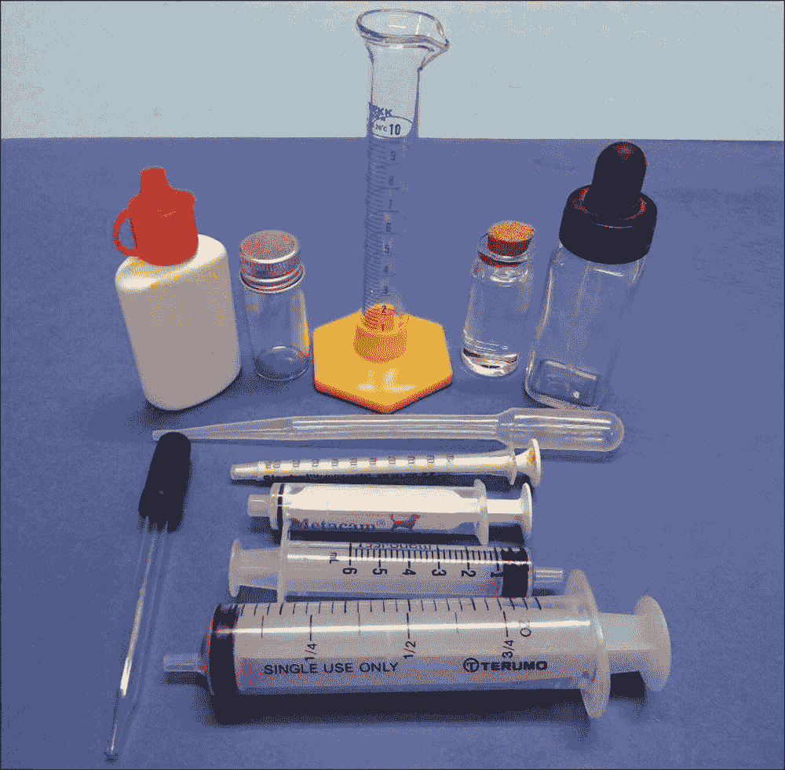

*图 4-23：用于体积校准的常用工具*

在利用简单有色固体引入有色材料吸收光的概念后，可以进一步探讨使用灵敏探测器测量溶液中颜色的方法。尽管目前搭建的仪器尚未涉及主动光学（即光的方向被折射），但使用装满水的圆柱形玻璃瓶作为样品池会产生透镜效应，这一效应必须被识别并加以考虑。弯曲的样品瓶必须精确放置在光学平台的中心线上，以确保最大量的折射光均匀地落在探测器上。

在图 4-24 中，支架上盛放红色溶液的样品瓶已用黑线标记，以确保每次读取吸收/透射读数时，样品瓶都能放置在样品固定块的同一位置。每个样品瓶均装满水后放入仪器中，记录样品瓶每旋转 45 度位置时的 `ADC` 值。然后对样品瓶进行标记，以确保在使用时，当指示标记指向与电气馈通相反的一侧时，各样品瓶的 `ADC` 值尽可能接近。

德州仪器（Texas Instruments）生产了一款专用于可见光和近红外光强度测量的特定集成电路，芯片型号为 `OPT101`（13 美元）。图 4-25 包含了来自制造商数据手册的框图，说明了构成该器件内部电路的组件。光电导模式下的光电二极管（输出电流与入射光强度成正比）与跨阻放大器配合使用，产生与落在二极管窗口上的光强度成正比的输出电压。入射光的光谱响应范围可延伸至约 400 nm 至 10000 nm，并在近红外区 850 nm 处达到最大灵敏度峰值。


*图 4-25：德州仪器 `OPT101` IC 的内部配置与光谱响应*

图 4-26 展示了该 IC 的机械布局，并标明了用于电路实现的电气引脚连接。用于将探测器与 Arduino 连接的电路如图 4-27 所示。在电路实现中，引脚 2、6 和 7 未被使用。Arduino 提供电源和模数转换器，为 `OPT101` 跨阻放大器提供数值读数。电源连接中的 100 Ω电阻用于保护集成电路，两个电容器用于最大限度地减少电源线上的噪声。由于需要手动读取和记录单个 `ADC` 吸光度/透射率值，Arduino 还提供了移动平均数字信号平滑功能。

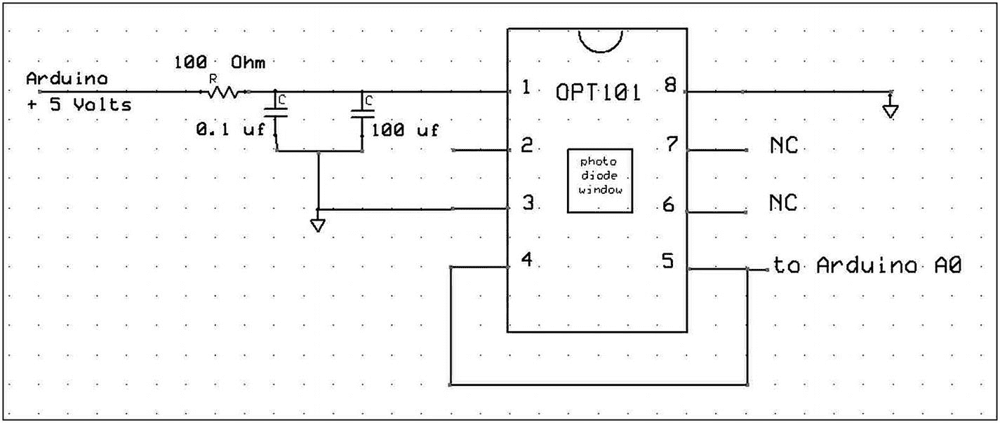

*图 4-27：用 Arduino 读取 `OPT101` 的电路图*

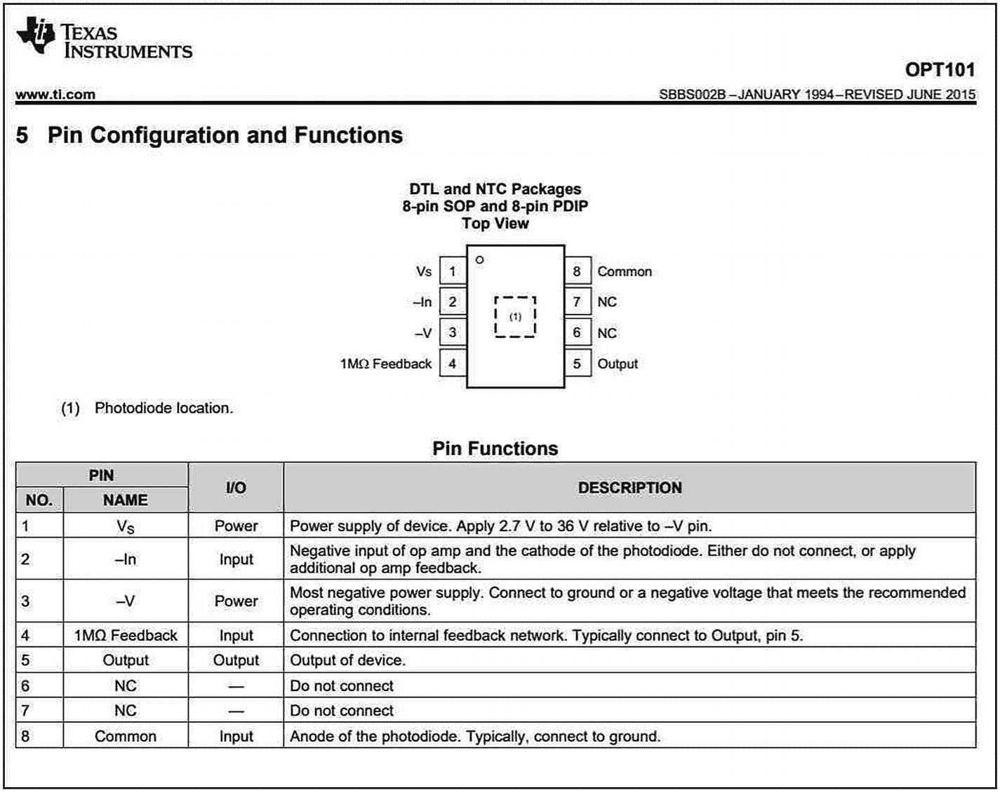

*图 4-28：`OPT101` 引脚分配*

在图 4-28 和图 4-29 中，数字编号标识了为使仪器适配 `OPT101` 探测器而进行的各项更改。

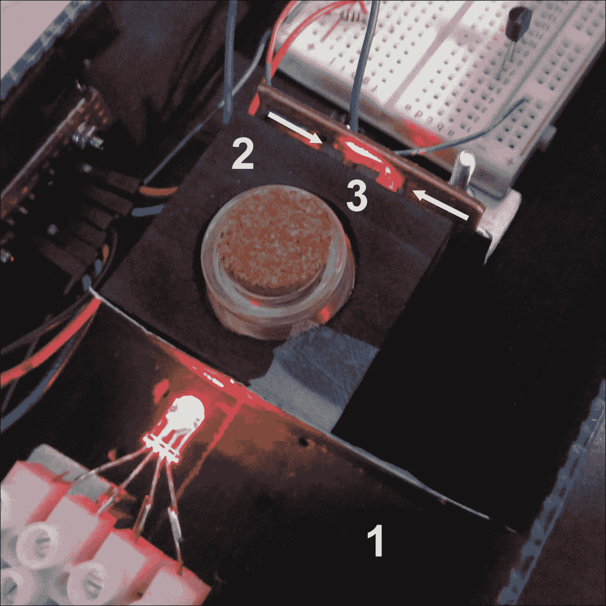

*图 4-31：光源穿过装有样品的样品瓶后光被汇聚*


*图 4-30：光路中无玻璃样品瓶时光源光发散*


*图 4-29：`OPT101` 安装——探测器端视图*


*图 4-28：`OPT101` 安装——光源端视图*

-   标号 1 标识了 RGB LED 光源支架，在图 4-28 中，一块不透明板上有一个直径为 1/4 英寸（6 毫米）的孔径，紧挨在 LED 透镜盖前方。
-   标号 2 是一个涂漆的木块，上面钻孔用于牢固固定样品瓶。木块底部有两个销钉，可紧密嵌入仪器底部的定位孔中（见图 4-13）。
-   标号 3 是一块小型洞洞板，上面安装了一个 8 引脚 DIP 插座，用于容纳 `OPT101` 芯片。图 4-29 显示了探测器板的背面，左侧是螺纹可调支架，右下角是探测器板的绿色端子连接器。
-   标号 4 是一个用于电源连接和元件安装的小型面包板。
-   标号 5 是蓝色食用色素染料的二元浓度梯度。

图 4-30 和图 4-31 展示了样品瓶在装满水性溶液时的透镜效应。在图 4-30 中，光源孔径位于白色箭头尖端处，位于标号 1 标识的不透明板上。在图 4-30 中，当样品架内没有玻璃样品池时，由标号 2 标识的样品固定块内部似乎被从光源孔径扩散出的光线完全照亮。当放入样品池后，光束似乎被汇聚成图 4-31 中可见的较小椭圆形，如标号 3 标识的双箭头所示。

测量工作通过组装待用的 LED 光源和探测器，并将两者与合适的样品支架对准来完成。机械部件安装完毕后，即可进行电气连接。使用 `Arduino IDE` 配合相应的软件和电源连接，可以点亮并测试光源。当光源发出测量所需的正确颜色光后，即可关闭外壳，并检查 `Arduino ADC` 的读数。需要获得稳定的读数，并且可能需要调整 `Arduino` 软件所平均的读数次数，以达到所需的稳定性。在这类光强度对比测量中，因使用更大的移动平均窗口而导致探测器响应时间增加的问题并不需要特别关注。

为了获得稳定的探测器响应，可能需要进行一定的开发调试。当装有水溶剂的样品瓶置于样品支架中时，探测器响应应尽可能接近但小于 `1024`。如有必要，可以通过调整二极管功率、光源与探测器的距离，或两者同时调整，以达到稳定、可测量的 `0%` 吸光度/`100%` 透光率的基线状态。在完成了针对低端吸光度测量的仪器配置后，可将一个不透明物体放入样品支架中，以建立 `100%` 吸光度/`0%` 透光率的读数。

`ADC` 值之间的差异需要足够大，以便从有色标准品梯度液中测得的各个吸光度/透射率值能够在感兴趣的浓度范围内形成一条线性校准曲线。

## 观察结果

在图 4-32 和 4-33 中，简单的有色干玻璃纸系统在测量的 `ADC` 计数值与四层红色聚合物之间建立了线性关系。随着玻璃纸层数的增加而进行的额外实验开始偏离线性，这是因为偏离了正常应用比尔-朗伯定律所需的稀溶液条件。

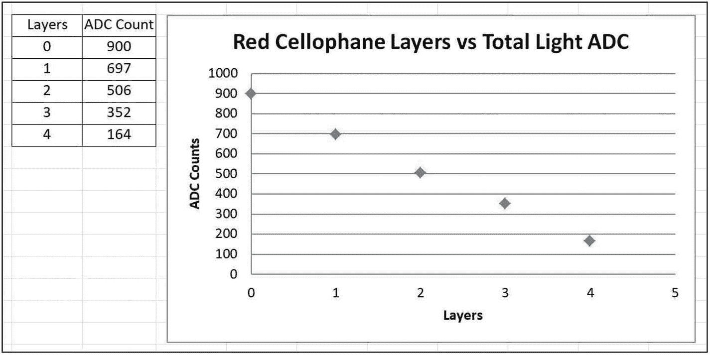

图 4-32

`ADC` 计数值与红色玻璃纸层数的关系

图 4-33 绘制了使用八层半透明红色玻璃纸测量得到的完整数据集。如曲线所示，当超过四层厚度后，由于过度吸收，线性开始变差。


图 4-33

因颜色密度过大导致的线性损失

红色、绿色和蓝色 LED 光源被安装在仪器的单二极管配置中，所有光源都与 `CdS LDR` 产生了足够的响应，将 `100%` 透光率时的 `ADC` 计数值设定在接近 `900` 的稳定值，从而生成了图 4-34 至 4-37。

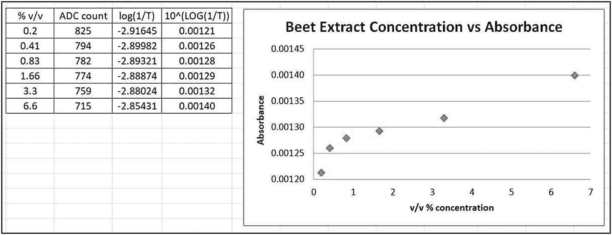

图 4-37

使用 `CdS LDR` 探测器及信号平均的 RGB 二元稀释吸光度校准

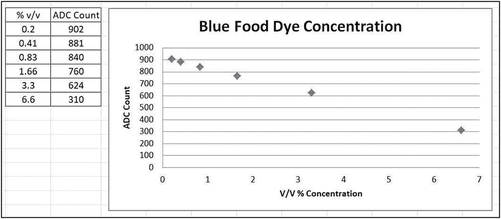

图 4-36

使用 `CdS LDR` 探测器及信号平均的 RGB 二元稀释校准

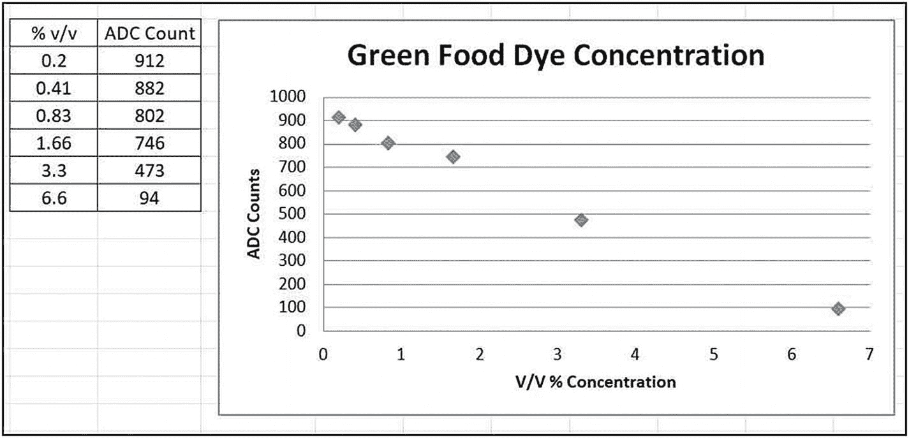

图 4-35

使用 `CdS LDR` 探测器及信号平均的 RGB 二元稀释校准


图 4-34

使用 `CdS LDR` 探测器及信号平均的 RGB 二元稀释校准

在图 4-34 中，红甜菜提取物的光密度过高，无法形成探测器 `ADC` 计数值或透光率与浓度之间的线性图。在图 4-37 中，尝试将透光率转换为吸光度以改善线性，但效果不佳，因为溶液浓度过高，且物理化学参数引起次要光学问题，这些问题只能通过稀释来消除。

在图 4-38 和 4-39 中，仪器已重新配置，使用高灵敏度的 `OPT101` IC 光电探测器来测量作为蓝色食用色素浓度函数的光透射率。

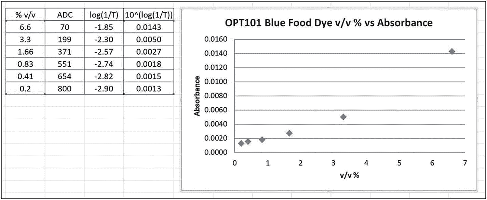

图 4-39

使用 `OPT101` 探测器的蓝色食用色素二元浓度与吸光度校准


图 4-38

使用 `OPT101` 探测器的蓝色食用色素二元浓度与 `ADC` 校准

图 4-38 和 4-39 展示了当测量光密度的方法或技术改变时，线性度可以得到改善。

图 4-40 是使用直流供电的单色蓝色 LED 光源，在比色计中测量已知标称体积浓度的稀释甜菜提取物时，`OPT101` 探测器以 `ADC` 单位计的响应。图 4-42 是对一份经体积校准的库存蔬菜烹饪提取物（三滴等分试样）进行二元稀释的结果。测量了三个低增量浓度稀释液，其中第三个显示了图 4-40 中描述的系统响应。浓度低至 `50` 百万分之一（`ppm`）的范围是可以测量的。


图 4-40

使用 `OPT101` 探测器对甜菜提取物进行三次连续浓度的校准

## 讨论

为了降低本入门级工作的成本和复杂性，我们对传统的比色分析法实验室方法进行了一些改进，形成了一种没那么严格的半定量分光光度技术。将浓缩溶液通过校准的滴量体积进行分配，用于系列体积稀释或稀释至已知体积，以生成已知体积比稀释浓度颜色梯度。

标准溶液的制备，首先需要数出所选用的分液器具填充一个已知体积所需的滴数。例如，图 4-23 和图 4-24 所示的塑料聚乙烯一体式移液管，向 10 ml 量筒中滴液至 9 ml 刻度线处需要 350 滴。该移液管每滴为 0.025 ml。一旦分液装置校准完毕，应加标记以避免错误。从实验室购买的同一批次散装塑料移液管中取出的另一支移液管，其滴液大小为：280 滴占据 9.6 ml 体积，即每滴为 0.034 ml。

为配合电子吸光度测量系统的实验工作，我们制备了两个系列的彩色溶液。从工艺品商店获得了金属螺帽和窄颈软木塞密封瓶（见图 4-23 和图 4-24）。它们的内腔体积为 12 ml。窄颈瓶更易于操作，因为瓶颈收缩处的肩部可作为恒定的填充标记，类似于实验室的容量瓶。（一系列标称体积相同的实验室级容量瓶，其窄颈上的填充标记高度也各不相同。假设这些 12 ml 瓶子的体积相等是随机误差或系统误差的来源之一。）

用于确定线性校准存在的浓度范围的溶液，可以通过向六个瓶中依次加入二进制递增滴数的有色浓缩液来制备。图 4-24 中的蓝色溶液代表一个浓度梯度：第一个瓶中加入 1 滴市售食品染料，第二个瓶中加入 2 滴，第三个瓶中加入 4 滴，依此类推，直至第六个瓶中含有 32 滴染料。染料浓度与通过溶液的蓝光递减值之间的关系图，如图 4-34 和图 4-35 所示。

在一个如此大的浓度范围内，光透射的 `ADC` 值对 `V/V`% 的简单作图并非线性。绘制透射率倒数的对数（称为*吸光度*）与浓度的关系图可以改善线性。在某些情况下，轻微的平滑曲线也是可以接受的。对于需要线性关系的调查研究，可以使用更小的颜色梯度来进行浓度测量。

对于稀溶液，比尔-朗伯定律被假定为吸光度、分析物浓度和溶液光程之间的线性关系模型。然而，在许多实验测量系统中，校准曲线并非线性而是略微弯曲的。如果校准结果可重现，那么只要浓度随测量的吸光度没有剧烈变化，测量参数之间相关性的形状或曲率并不重要。

`LED` 不是激光器。其光线虽然有方向性，但却是以锥形向外辐射的。对简单系统的测试表明，在光源与探测器（`OP-505` 光电晶体管）之间大约 2 英寸（50mm）的距离处，绿色、蓝色和紫外光产生的功率足以将 `Arduino` 的 `ADC` 稳定在约 900 值，这足以进行一系列吸光度测量。

尽管 `OP-505` 光电晶体管的峰值光谱灵敏度（如同大多数 `PN` 结一样）位于红外区域（如图 4-1 所示），但高亮度输出可见光的 5 mm 直径 `LED` 所产生的辐射足以利用 `Arduino` 10 位 `ADC` 的大部分范围来进行吸光度测量（见图 4-10）。

对三种探测器类型的光谱灵敏度曲线进行考察表明，`LDR` 在可见光谱的绿色区域最为敏感。基于 `PN` 结的器件在近红外区域具有最大灵敏度。`OPT101` 可以在光谱的蓝色区域工作（见图 4-38），并且在红色区域也相当灵敏（见图 4-40）。

`LDR` 的光敏面积为 1/4 英寸 × 5/16 英寸（6 mm × 9 mm），`OP-505` 的直径为 1/8 英寸（3 mm），而 `OPT101` 光电导二极管的面积为 0.090 英寸（2.29 mm）见方。使用 `LED` 作为光源，凭借其亮度和集中的定向输出，使得实验者可以组装一个仪器，其中各组件应对准成一直线以获得最佳性能。

图 4-32 和图 4-33 展示了当标称波长处的光密度增加时存在的非线性现象，这会产生固体玻璃纸片效应——与液体溶液中分析物浓度增加时发生的那种偏差效应相同。

图 4-34 至图 4-37 所示的校准曲线说明了目标有色物质浓度过高的影响。在所有四张图中，红色、绿色和蓝色的灵敏度都足以生成校准曲线，但只有绿色和蓝色两者是线性的。红色系列稀释液浓度过高，因此在透射率或吸光度数据绘图模式中均不呈现线性关系。

图 4-38 和图 4-39 说明了通过将数据呈现模式从透射率改为吸光度可能获得的线性度改善。

可以制备这样的溶液：其浓度梯度标准液是通过在连续的瓶中依次加入线性递增数量的滴数来创建的。尝试通过在连续的瓶中依次加入单滴和双滴来制备校准液，未能产生甜菜提取物观测到的 `ADC` 值的可靠、可重复的下降。当使用三滴增量时，得到了图 4-40 所示的校准曲线。该校准曲线在浓度低至约 0.025% `V/V`时似乎仍是线性的。该红色植物提取物校准曲线的可用跨度涵盖了 20 至 250 ppm（百万分之一体积比）的浓度范围。

尽管所组装的系统没有使用任何有源光学元件，但如果使用一个简单的手持放大镜收集通过样品的光（见图 4-31）并将其聚焦在探测器上，灵敏度应该会有显著提高。

# 一种使用反向偏置 LED 的六波长光谱仪

## 半导体与PN结基础

LED 是由 `crystalline` 硅或锗制成的首批固态信号或整流二极管的进一步发展。金属和绝缘体由那些在形成固体时，其多原子晶体结构会形成部分填充（允许电子移动）或完全填充（禁止导电）的能带的元素制成。某些元素可以混合形成在受控条件下能像金属导体一样行为的材料。

诸如硼（`B`）、铝（`Al`）和镓（`Ga`）等元素，其最外层只有三个电子。诸如碳（`C`）、硅（`Si`）和锗（`Ge`）等元素则有四个。磷（`P`）、砷（`As`）和锑（`Sb`）则有五个。如果将硅或锗这类材料与少量硼、铝或镓混合并结晶，就会形成 P 型半导体。P 型材料由一种体基质构成，其中由四个外层电子组成的连续原子结构会零散地被晶体原子只有三个电子的位点打断。在体晶体基质中，一个缺电子的位点可以被视为一个带正电的空穴。

如果将一种四电子材料与少量外层有五个电子的元素混合并结晶，就会形成 N 型半导体。N 型材料由一种体基质构成，其中原子结构中由四个外层电子组成的连续结构会零散地被晶体原子有五个电子的位点打断。一个具有多余电子的位点可以被视为一个带负电的实体。

通过将 P 型半导体材料与 N 型材料的晶体熔合在一起，就形成了一个 PN 结。


**图 4-41** 一个 PN 结

这两种晶体的熔合导致沿接触界面的空穴和多余电子相结合，从而形成一个没有可移动载流子的区域，称为 `耗尽区`。只有当在结的 P 侧施加一个强度足以克服耗尽区能隙（根据制造材料的不同，在 0.3 V 到 0.7 V 之间）的正电压时，电流才能被迫流过该结。

作为固态电路的基本构建块，单个 PN 结形成只允许电流单向流动的二极管，仅起整流器的作用。两个 PN 结可以形成诸如 PNP 或 NPN 型晶体管来控制电流。四个 PN 结串联形成晶闸管或可控硅整流器。反向偏置的 PN 结则形成光电池和光电二极管。

正常电流流过 PN 结时，空穴和电子载流子越过耗尽区会以红外辐射的形式释放能量。由体半导体材料和微量元素（如镓（`Ga`）、砷（`As`）、磷（`P`）、氮（`N`）、铟（`In`）和铝（`Al`））制成的 PN 结二极管，可以被制造为在可见光、近红外和紫外光范围内产生辐射。

## 利用LED的反向偏置特性进行感测

LED 在正向偏置时光致发光，在反向偏置时光电导。在光电导模式下，该器件通过的电流与照射到其 PN 结上的光量成正比，前提是光能量小于 PN 结的带隙能量。

已经开发出一种固态比色计，它利用正向偏置的 LED 作为单色光源用于吸收测量。这些相同的二极管也可以用作光谱检测器，来测量它们自身标称颜色的强度。

自 1988 年以来，F. W. Mimms 一直使用普通 LED 中的反向偏置 PN 结进行光感测，用于太阳监测。这是目前正在开发的可见光通信（VLS）系统的基础。M. Cook 博士于 2008 年提出了一种在 Arduino 上实现 LED 感测用于实验的方法（参见 [`www.thebox.myzen.co.uk/Workshop/Introduction.html`](http://www.thebox.myzen.co.uk/Workshop/Introduction.html)）。

图 4-42 包含了三个带有标题的简单原理图，以便更好地理解将 Arduino 编程为使用普通 LED 的光传感器的算法和代码。


**图 4-42** 作为颜色传感器的 LED 偏置

通过反转 LED 上的偏置，可以使得 PN 结具备电容器的特性和能力，其结电荷由两个半导体材料面之间的绝缘体维持。该结的电容通常在皮法量级（`10^(-12)` F）。如果一个反向偏置的发光二极管暴露在能量大于 PN 结带隙的入射光下，则电子被拉入导带，在原位留下空穴。放松结两端的反向偏置电压会导致空穴和电子迁移，从而产生一个与收集到的入射光强度成正比的电流。

通过让累积的电荷流过已知电阻并测量电流流动的时间，可以测量累积电荷的量。计时计数可以用微控制器来确定，即由 PN 结形成的电容器两端的标称 `5 V` 偏置电压通过已知电阻衰减回标称 `0 V` 或逻辑 `0` 所需的时间。回想一下，电压随时间变化的积分是电流或电荷的度量（参见第 1 章公式 3）。

已有几篇发表的报告，其中来自放电二极管的定时电压衰减/电流流动已被归一化为 `ADC` 计数，作为环境光照的度量，方法是测量放电前后二极管两端的电压。Arduino 草图列表 4-5 测量单个反向偏置 `LED` 上累积的电荷。此外，测量的放电时间已被反转，以表示为黑暗程度的度量，从而根据环境光照条件按比例表示二极管的发射情况。

由于二极管的颜色由其 `PN` 结带隙的能量差决定，因此可以预期该结对其自身波长的入射光敏感。

随着电磁辐射波长变短，光子能量增加。原本为较长波长制造的反向偏置 `PN` 结，应对其自身波长及更短的波长敏感。

## 感测技术与Arduino实现

有两种技术使用反向偏置的 `LED` 作为微处理器的光传感器。这两种技术都将反向偏置的 `PN` 结暴露于入射光，使其收集电荷，然后通过一个电阻将二极管放电到地，测量电压差或对放电进行计时。实验表明，使用电压差作为入射光的度量适用于单个 `LED`，但不适用于监测多个二极管。

大多数微处理器都有一个 `ADC` 和六个或更多多路复用测量通道。当在单个 `ADC` 上使用多个二极管时进行的观察表明，一个通道的变化通常会在其他通道中反映出来。有人提出，多路复用器通道中的残余电荷可能是造成这种效应（通常称为 `串扰`）的原因。

在 Arduino 微处理器的两个数字引脚上串联一个 `LED` 和一个限流电阻，可以避免使用 `ADC` 多路复用器，并通过清单 4-4 中的代码独立监控各 `LED`。编写一个相对简单的程序，即可测量照射到二极管结上的、波长短于其发光波长的入射光量。由于 Arduino 拥有 12 个易于访问的数字 I/O 引脚，最多可使用清单 4-4 中的代码，通过测量放电时间来监控多达六种不同波长的 `LED`。

在图 4-10 中，`OP-505` 光电晶体管对三种原色的响应各不相同。可以合理预期，制造过程中存在差异，使得同一批次中每个二极管的耗尽区尺寸略有不同，其 `PN` 结上的电压差也略有不同。除了微小的制造电压差异外，由于制造不同颜色 `PN` 结使用了不同材料，还会产生更大的数值差异。要在任何定量或定性应用中使用感光 `LED`，最好在入射光收集量最小的黑暗环境中开始任何实验测量。

表 4-3 列出了在反向偏置感光模式下，以放电时间计数作为入射照度指标时，`LED` 中测得的响应变化（有色器件标为 `(clrd)`，透明二极管标为 `(clr)`）。

**表 4-3** 反向偏置 `LED` 的定时响应变化

| - |

利用反向偏置 `LED` 进行波长选择性感光，可用于组装一个廉价的演示装置，展示两项重要的科学概念：一项涉及理论物理学，另一项涉及天文学。感光 `LED` 可以选择性地监控热物体发出的量子化黑体辐射。来自加热物体的量子化辐射演示，被用作理论物理学中量子力学基本概念的支持证据之一。对恒星物体可见光颜色发射的天文观测，常被用来确定物体的温度。

颜色通常被描述为与炽热或热黑体在特定温度（以开尔文度表示）下发出的辐射相对应。一种易于获得且能加热到特定温度的黑体，就是白炽灯泡的钨丝。

一个易于管理、小巧、安全、便于使用的带灯丝灯泡，可以从任何汽车供应商处获得，例如 12 V 车辆尾灯，如 Sylvania/Osram 1156（加元 3 元；最大电压 `12.8`，额定功率 `26.9` 瓦），以及相应的带引线灯座（称为 `pig tail`，加元 2.50 元）。这种小灯泡在全功率下通常消耗略低于 `2 A` 的电流，这通常完全在大多数套件构建的 `30 V` 直流稳压电源的能力范围内，并且小灯泡尺寸只需极少的屏蔽即可防止被热玻璃外壳烫伤。

关于温度与可见光、红外和紫外范围内辐射电磁能量之间关联的研究，已通过白炽钨丝灯泡进行了广泛研究。钨丝的白炽是通过对金属元件施加 `DC` 或 `AC` 电能进行电阻加热而产生的。钨丝温度是通过将金属元件的电阻变化与已知的温度变化相关联来测量的。

为了使用感光 `LED` 进行实验，用于定性和定量测量的简单仪器系统的构建和组装可分为两个阶段：光源的创建和选定光色的检测。

### 实验：光源组装与校准

为了使用钨丝/电阻温度关系（表示为 `T = T[0] + (R/R[0] – 1)/α` -- (4)），必须在环境或定义的 `T[0]` 条件下测量的室温电阻 `R[0]`，与根据钨丝收集的电流和电压数据计算出的灯丝电阻 `R` 值一起使用。`α` 是钨的电阻温度系数，报道值为 `0.004403`。

检查用于计算钨丝温度的温度电阻关系，需要测量环境条件下的导线电阻值 `R[0]`。通常，低功率 `12 V` 灯丝的电阻值接近半欧姆，需要仔细测量。

该技术的低电流适应方法可用于精确测量灯丝的低质量和小分数欧姆电阻（参见 [`www.semanticscholar.org/paper/The-Ohmic-Region-of-a-Lightbulb-Grasel-Mudd/38ae1fbdf536b916adbc2965e3ad93eb6c79dbf7?p2df`](http://www.semanticscholar.org/paper/The-Ohmic-Region-of-a-Lightbulb-Grasel-Mudd/38ae1fbdf536b916adbc2965e3ad93eb6c79dbf7%253Fp2df)）。

为了最大限度地减少螺旋灯丝中低质量材料的热效应和电阻扰动，并充分利用成本合理的仪表，仅测量电路元件上的电压降。

在图 4-43 中，一个低压电源（`3 V`）与一个 `10 KΩ` 可变电阻器、一个高精度 `1% 1 Ω` 功率电阻器以及灯泡灯丝串联。两个价格合理的仪表随后测量灯丝和精密电阻器上的电压降，同时调整可变电阻器以逐渐增加电路中的电流。在一个典型实验中，可变电阻器以 `0.1 mV` 的增量进行调整，使灯丝两端的电压从 `0` 增至 `5.0 mV`，并记录每个增量下精密电阻器两端的毫伏压降。

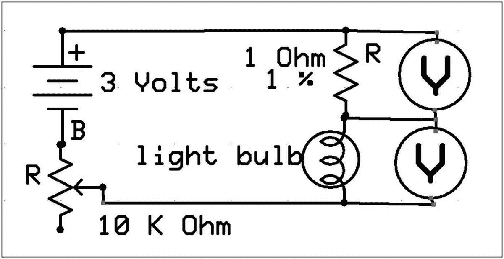
**图 4-43** 低质量钨丝灯泡灯丝电阻测量电路

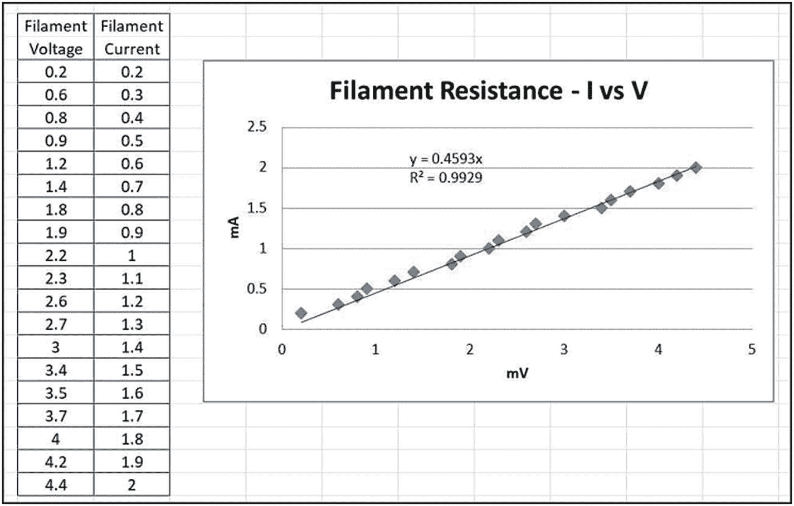
**图 4-44** 由电流-电压曲线得出的灯丝电阻

图 4-43 和图 4-44 展示了在这些实验中，为 Sylvania 1156 灯泡灯丝供电的电路以及灯丝电阻的图形化测定方法。一台高灵敏度 Siglent SDM3055 数字台式仪表使用低欧姆量程测得的灯丝电阻为 `0.46 Ω`。低功率图形化程序得出的值为 `0.4593 Ω`。

### 实验：利用反向偏置 `LED` 进行选择性色光感测

# 确定温度：钨丝灯丝的电阻相关性

一个 12V 的小型钨丝灯泡，例如 26.9W 的 Sylvania/Osram 1156 汽车尾灯，由可调电压 2A 电源供电，是一个极好的白炽光源。图 4-45 中的电路 A 描述了用于测量输送至灯丝的电流和电压的电路配置，从而能够确定每个灯丝功率设置下的灯丝电阻。

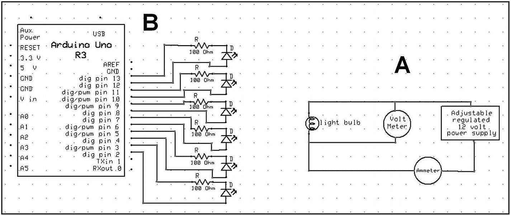

**图 4-45** 选定光感应实验的源电路和检测电路

使用图 4-45A 所示的电路，并将灯泡安装在合适的支架上，当电源电压从 0 V 以 0.2 V 的增量升至 12 V 时，记录了观察到的仪表读数。在灯泡灯丝中心部分开始发光的时刻，对灯丝功率设置做了特别标注。

表 4-4 列出了在电源设置从 0.2 V 到 12.0 V 以 0.2 V 增量变化时，测得的灯丝电压和电流。该表格还包含了通过简单应用欧姆定律计算出的电阻值，以及根据钨丝电阻值近似估计的温度（关于电阻温度系数或 TCR 的更多信息，请参见`方程式 4`和第 7 章）。

> **注意：** 校准常数：钨(W) α系数 = 0.0045，室温灯丝电阻 = 0.46 Ω，室温 = 20.2°C。


**图 4-47** Sylvania 1156 灯泡的电阻与温度关系


**图 4-46** Sylvania 1156 钨丝灯丝电阻随施加功率的变化

**表 4-4** 钨丝灯丝电阻与温度校准

| 参数 | 值 |
| :--- | :--- |
| 校准常数 | 钨(W) α系数 = 0.0045 |
| 室温灯丝电阻 | 0.46 Ω |
| 室温 | 20.2°C |

# 使用反向偏置 LED 进行选择性色彩光感应

为了独立测量由排列成阵列的不同颜色反向偏置二极管（见图 4-49）所感应到的光，可以组装一个遮光外壳来封装光源和传感器。图 4-45 中的光源和检测电路可以封装在一个由易得组件制成的遮光箱内，如图 4-48 所示。

图 4-48 中描绘的组件由易得且易于加工的材料制成，例如 1/4 英寸（6 毫米）胶合板和纤维鼓食品容器，所有这些都涂有哑光黑色丙烯酸涂料以减少内部光线反射。

组件 1 是装置的基板，如果在实验过程中移动组装单元，它为 `Arduino` 微处理器提供支撑。组件 2 和 3 是垫片，为微处理器提供足够的空间，并与小矩形块一起，很大程度上阻止了杂散光渗入微处理器腔室。组件 4 是微处理器隔间的顶板，也是圆柱形曝光室的底板。

组件 4 和组件 5 的左半部分都有一个 1/8 英寸（3 毫米）宽、1½英寸（40 毫米）长的槽，用于容纳微处理器排针与二极管阵列之间的电气连接。组件 1、4、2、5 和 7 由 1/4 英寸（6 毫米）胶合板切割而成。标为组件 3 的一对组件由 3/8 英寸（9 毫米）胶合板切割而成，以便为 `Arduino` 排针阵列提供足够的间隙。构成曝光室底座的所有木质组件均为 4½英寸（11.5 厘米）见方。

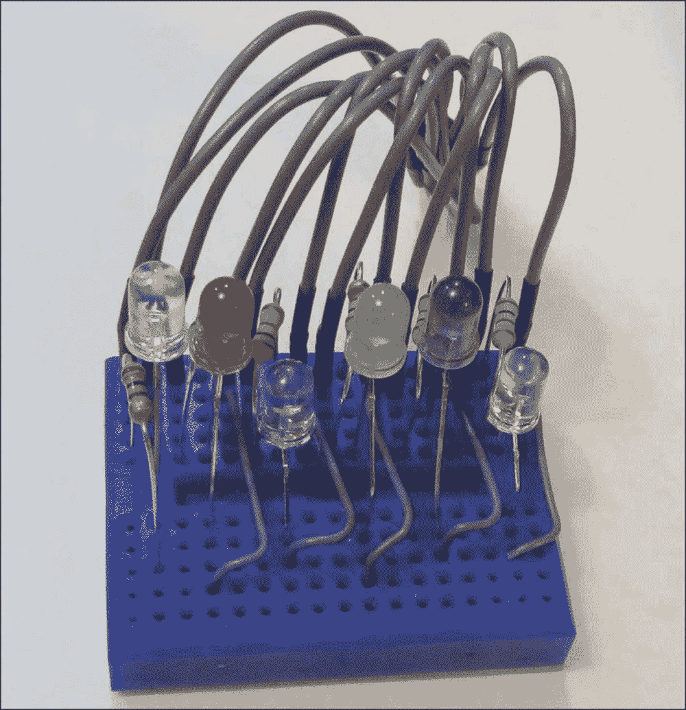
`图 4-49` 彩色 LED 二极管阵列


`图 4-48` 曝光室组件

组件 5 由两块板组成，这两块板经过切割以贴合 1¾英寸（45 毫米）x 1¼英寸（34 毫米）原型板的底部，如图 4-9 所示。这两块板安装在内径为 4 英寸的纤维板圆筒内，使得原型板和组件 7 中的孔口在长度不同的圆筒 6 和 6a 内保持同心。组件 6 和 6a 是直径为 4 英寸（10.2 厘米）、长度分别为 3¾英寸（95 毫米）和 5½英寸（14 厘米）的纤维板圆筒，由带金属边圈的食品包装桶切割而成。组件 4 和 5 上的白色箭头指示了用于容纳二极管引线与 `Arduino` 数字引脚访问排针之间电气连接的槽口。该图还描绘了二极管阵列、`Arduino` 微处理器，以及显示两个备用光源规格数据的包装背面。

一旦遮光箱组装完成，并且 `Arduino` 加载了清单 4-4 中的五元件或六元件光感应草图，`Arduino` 串行监视器应显示指定二极管的流式列表（见图 4-50）。

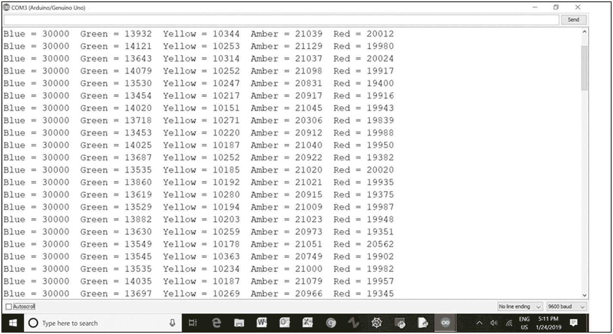
`图 4-50` 五元件反向偏置二极管阵列串行监视器输出

请记住，串行监视器输出的默认选项是实时流式传输数据，并手动记录或检查单个数值。可以激活屏幕窗口左下角的 `autoscroll` 复选框来“冻结”显示并停止滚动。（使用 `Ctrl+C` 将选中的数据复制到剪贴板。）

一个 4 英寸（10.2 厘米）高的圆筒是大约 30W 灯泡和 1/4 英寸（5 毫米）反向偏置 LED 光传感器的合适曝光长度，如图 4-49 所示。请记住，点光源的辐射强度遵循距离的平方反比定律。

最初，在灯泡灯丝未通电的情况下，所有二极管元件的最大时间计数值应为 30,000 或更少（取决于器件）。按照灯丝电阻-温度数据收集实验中的方式，以电压增量向灯丝供电。随着源电压和电流的升高，可以使用串行监视器找出每个反向偏置二极管开始响应由加热灯丝产生的光子时的功率设置。表 4-5 列出了观察到标称颜色敏感 PN 结开始响应灯丝辐射时的功率设置。

# 反向偏置 LED 用作光学高温计

非接触式光学高温计是目前测量高温物体温度的唯一方法。一百多年来，定量测量加热钨丝所需的功率被用于测量高达钨熔点的热表面温度。当以白炽背景为参照时，热钨丝在其温度与被测加热表面温度匹配时会变得不可见。“隐丝式”光学高温计只能用于温度足够高、能产生足够光线以供观察的表面。

在本节的主要和次要部分，热钨丝的温度和电阻已被标定。标定后，炽热的钨丝用于确定反向偏置 LED 看到来自灯丝发射的特定波长光时的温度。与选择性光发射检测实验相反，反向偏置 LED 的响应可以构成一个基本的光学高温计。

图 4-51 展示了一个小实验的结果。图中绘制了标称颜色二极管在对应灯丝温度下的反向偏置 LED 放电时间响应。

除了多个 LED 的曲线图外，还绘制了红光 LED 放电时间响应与温度关系的指数拟合趋势线（见图 4-52）和自然对数拟合趋势线（见图 4-53）。从红色二极管的反向偏置放电时间可以看出，放电时间或电流的自然对数可以在二极管存储电荷与计算出的炽热灯丝温度之间形成合理的线性相关关系。

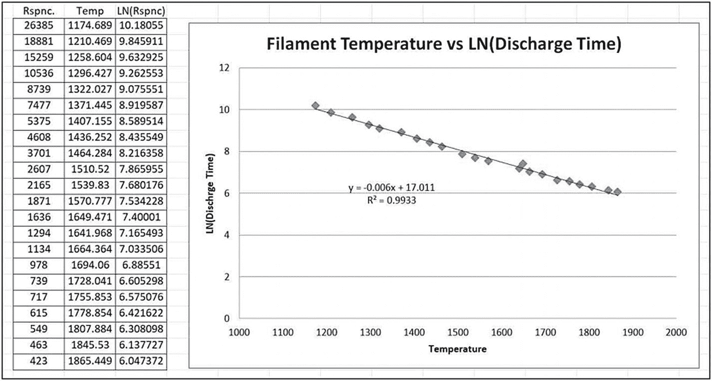

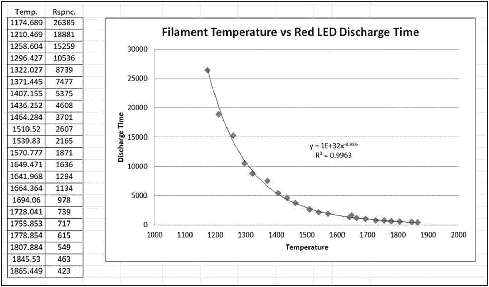

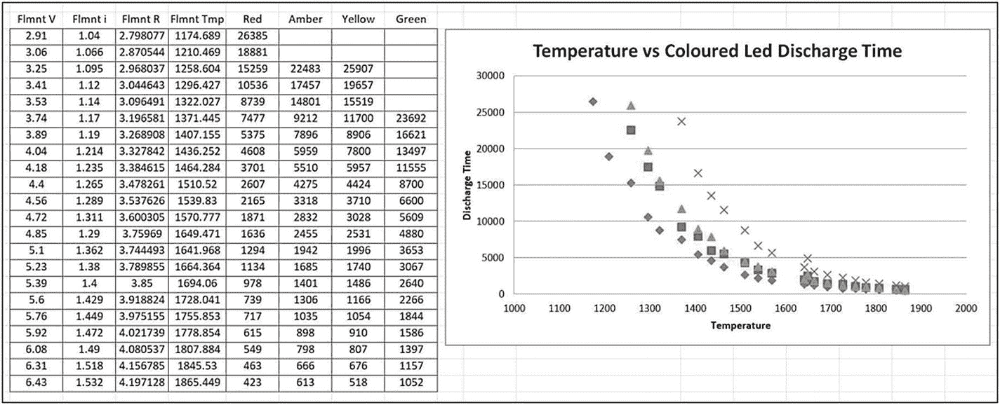

如果反向偏置 LED 的光收集测量基于电压差技术，则 LED 可在颜色选择性光电二极管模式下工作。光电二极管的响应应与入射光量呈更线性的关系。对反向偏置 LED 上的电压差进行单通道读取，可以消除 ADC 多路复用器的“串扰”问题。这应能在热表面温度和反向偏置 PN 结感测到的定量光收集量之间提供更可用的相关性。

为了记录热灯丝发射与反向偏置 LED 收集的选定波长光之间的关系，可以将`Listing 4-5`（用于 Arduino 微处理器）与`DAQFactory`或`RPi`绘图程序配合使用以记录数据。每个待测二极管可以安装在小原型板中心，如图 4-48 和 4-49 所示，并放置在 4 英寸（10.2 厘米）的曝光盒中，以 12 V Sylvania 1156 灯泡作为发射源。数据记录实验从将灯丝电压-电流设置到略低于二极管被激活的点开始，如表格 4-5 中的数据所示。使用`DAQFactory`绘图工具进行的典型基于时间的数据记录过程如图 4-54 所示。

我测试了手头库存中四种颜色的二极管，典型结果如图 4-54 所示，该二极管为直径 5 毫米（¼ 英寸）的透明绿色高亮度器件。

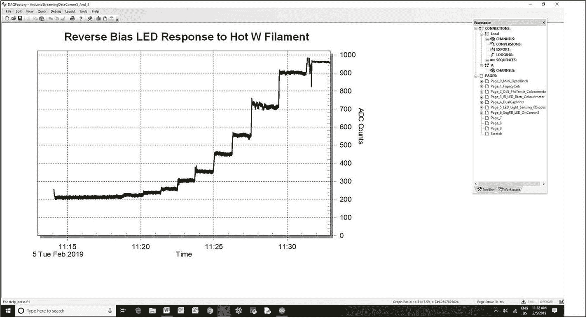

为了建立灯丝温度与反向偏置绿色 LED 响应之间的相关性，电源增量电压设置和测量的灯丝电流可以确定数据记录期间在已知时刻的灯丝电阻和相应温度。为了可视化，将灯丝温度与相应的记录探测器响应绘制成图。图 4-55 展示了观察到的反向偏置绿色、高亮度、透明、5 毫米直径 LED 的 ADC 计数与距 4 英寸（10.2 厘米）距离处炽热的 Sylvania 1156、12 V 灯泡灯丝的计算温度之间的图形相关性。为了涵盖不同的温度范围，还为老式绿色 LED、红外二极管和透明高亮度蓝色器件生成了类似的相关曲线。

## 观察结果

表格 4-5 列出了电源值以及计算出的灯丝电阻和温度。在每个标称颜色标题下方是反向偏置 LED 从无响应 (n/r) 转变为主动测量波长比正向偏置二极管发射的光更短的光的起始时间计数。

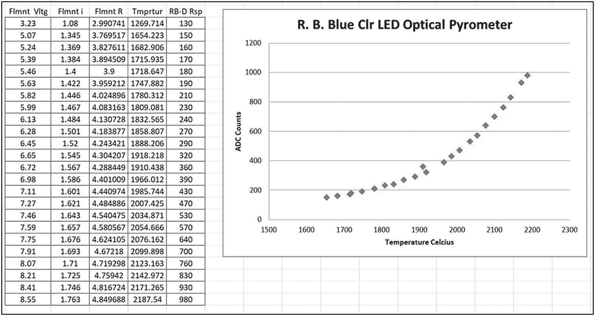

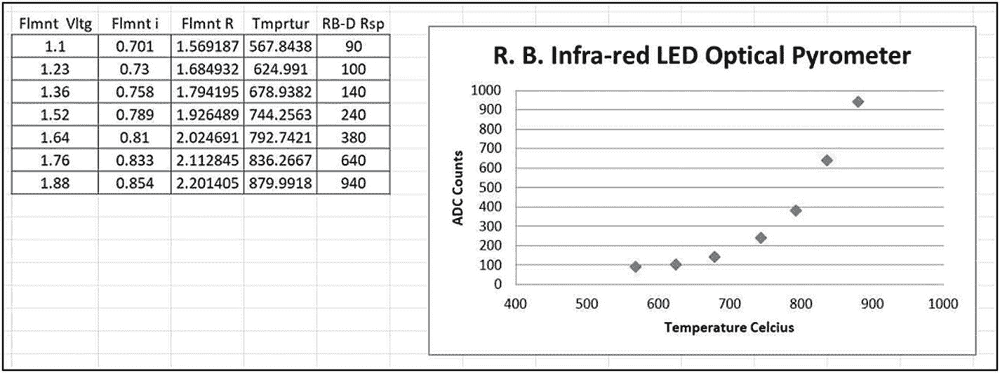

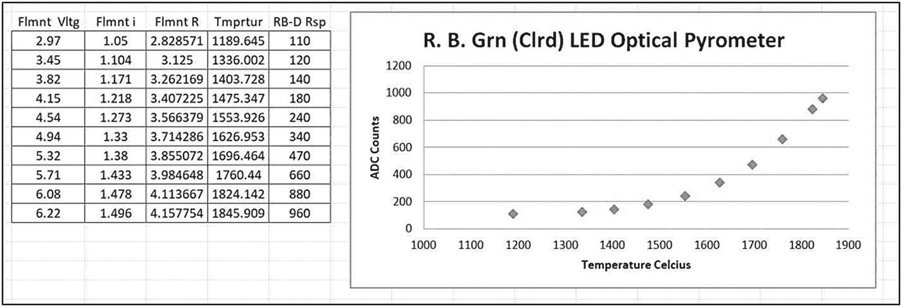

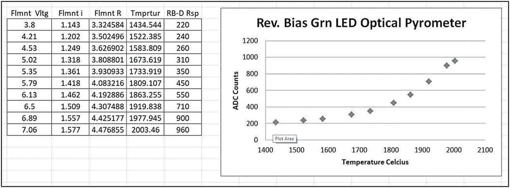

**表 4-5 – 反向偏置 LED 对热钨丝辐射发射的响应**

| 参数值 |
| :--- |
| [数据表格图片](img/503604_1_En_4_Fige_HTML.jpg) |

## 讨论

我们视觉感知所利用的大部分光线来自炽热的白炽元素。对光与色的研究至少需要涉及一小部分关于热和温度的研究。白炽物体发光时的温度，只能通过非接触式光学方法，或根据测量到的导体电阻随温度的变化来近似估算功耗来确定。（大多数金属、合金和许多元素都提供了电阻温度系数`TCR`。）

K 型和 J 型热电偶可以测量 1200°C 至 1300°C 范围内的温度，但在更高温度下接近传感器的熔点。在反向偏置 LED 光学高温计项目的开发阶段，将图 4-51 和图 4-52 所示的曲线数据转换为图 4-53 中的数据，提出了一种测量 1150°C 至 1900°C 范围内温度的方法。尽管图 4-52 中描绘的平滑曲线在 1400°C 至 1900°C 之间是可读的，但在 1400°C 至 1150°C 之间，放电时间与温度的变化率很大且定义不清。图 4-53 中放电时间与温度的自然对数绘图则更为明确和精确。

代码 4-5 和 4-4 测量了一个或多个已反向偏置以收集特定颜色光的 LED 的放电时间。放电的衰减时间与收集到的光量成反比。收集的光量越大，产生的电荷越大，放电时间越短，如图 4-51 和图 4-52 所示，放电时间和温度曲线呈向下凹形。

代码 4-5 测量微处理器 ADC 电压差，即在充电的反向偏置 LED 放电过程中的差异。回顾一下，电容器上的电荷`Q`等于电容乘以电压。因此，存储在 PN 结中的电荷越大，放电时产生的 ADC 值就越大。温度与 ADC 计数的曲线呈向上凹形，如图 4-55 至图 4-58 所示。

图 4-55 和图 4-56 展示了透明 LED 和彩色 LED 略微不同的灵敏度。图 4-55 中描绘的曲线，通过将透明的绿色环氧树脂反向偏置二极管暴露在 1430°C 的加热灯丝下产生，得到了 200 的 ADC 计数值。一个彩色的绿色反向偏置二极管在 1530°C 时产生 200 的 ADC 计数值。

图 4-51、4-55、4-57 和 4-58 中的温度标尺表明，使用反向偏置 LED 时，应采用非接触式测量方法，温度范围约为 550°C 至 2200°C。

本主题的讨论中介绍了非欧姆电阻，因为它对于通过电加热白炽灯丝产生人造光至关重要。白炽钨灯丝作为灯泡中的主要光源，温度约为 2700°C。石英碘灯也使用钨丝，并结合碘来重新沉积蒸发的钨，此时钨丝温度额外升高 250°C 至约 2950°C，以获得更亮的光线，其照明特性更接近日光。

在所有金属元素中，钨的熔点最高，为 3695°K、3422°C 或 6182°F。钨金属的电阻温度系数为 0.004403。其高熔点允许在感兴趣的温度范围内，根据金属电阻值进行近似的温度计算。众多数值分析技术提高了本工作中提出的简单温度-电阻近似的精度。^(³)

欧姆定律定义了在恒定温度下，导体中电流、导体电阻和施加在系统上的电压之间的固定关系。电阻随温度变化。在细钨丝导体中，通过加热导线可以实现电阻的较大变化。

在图 4-4 中，当灯丝开始发出可见的红光时，斜率发生了明显变化，这标志着可以说灯丝电阻正从欧姆行为过渡到非欧姆行为。

在图 4-43 和图 4-44 中，利用相对较冷灯丝的明显欧姆行为，仅使用低电流和低电压功率应用，来精确确定微小灯丝在环境温度下的分数欧姆电阻值，该值用于温度电阻近似。

在获得了小钨丝电阻的合理数值后，可以建立受控功率输入加热下的灯丝电阻与灯丝温度之间的相关性，如表 4-4 所示，并在图 4-46 和图 4-47 中展示。能够控制施加到灯丝上的热量，并了解该加热灯丝所发射辐射的最终温度，使得可以通过使用反向偏置 LED 进行特定颜色光感测，来演示黑体辐射的基本辐射能量量子化解释。

如图 4-45 所示布线，将不同颜色的反向偏置 LED 组装成一个阵列，如图 4-49 所示，然后封装在如图 4-48 所示的曝光室中，演示了黑体辐射量子化。实验从环境条件开始，此时未对 Sylvania/Osram 1156 灯泡灯丝施加任何功率。此时，二极管阵列的输出应全部指示经验确定的最大 30,000 单位时间计数。逐步增加为灯丝供电的电源电压。短时间内，当灯丝电压和电流稳定后，记录灯丝电压和电流的功率读数，以及每个二极管阵列元件上反向偏置 PN 结的放电时间计数。数据采集过程持续至灯丝达到全功率。数据缩减过程包括将记录的功率设置和各个平均二极管时间计数输入如图 4-59 配置的电子表格中。

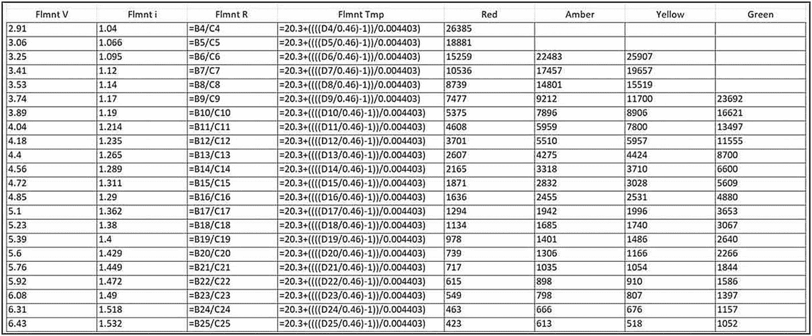

表 4-5 列出了在标称反向偏置二极管中，能够通过发射的黑体辐射产生光电流的温度。如果发射的辐射波长能量过低，无法激发彩色 PN 结中的电子，那么二极管就不会对灯丝辐射产生响应。随着灯丝功率增加、温度升高，二极管会根据其 PN 结导通起始电压，按照红色、橙/琥珀色、黄色、绿色和蓝色的顺序依次激活。对观测到的二极管行为的一个简单解释是：发射的辐射相对于其发射温度来说是量子化的。

反向偏置的红外和紫外二极管会对灯丝温度低于和高于可见光谱中红色和蓝色波段时所发射的辐射产生响应。

ADC 计数值与计算出的灯丝温度呈现平缓的连续曲率，这提供了一种在恒定定义条件下，通过查表法或趋势线计算法对热表面温度进行非接触测量的方法。每个用作光学温度传感器的二极管都必须进行校准，如表 4-3 所示。

需要一定量的实验才能选出最适合特定温度范围的二极管。必须针对手头的系统，通过实验来确定施加于灯丝上的电压或电流的正确增量大小，这些增量应能生成具有平缓曲率或线性度的最终相关性图，从而能够根据 ADC 响应合理准确地估算热表面温度。在标定和实验测量过程中，必须固定二极管与发射器表面的距离。请务必记住，大多数二极管都是环氧树脂封装且对热敏感的。

## 荧光照明

现代照明中使用的大部分人造光都依赖于荧光过程。荧光是指物质或材料在吸收光或其他电磁辐射后发出光线的现象。这种吸收能量的材料通常被称为`荧光粉`。多年来，荧光一直被用作一种更节能的人造照明方式。电流通过含有氩气和微量汞的玻璃管，会激发强烈的汞 254 nm 辐射。这种汞辐射被玻璃管内壁的荧光粉涂层吸收，并重新发射为混合色，人眼将其感知为白光。白光 LED 也使用各种荧光粉材料，将初始的强二极管发射（例如蓝色）转换为人眼感知为白光的混合色。白炽灯、荧光灯和固态白光光源对颜色的影响均与日光不同，其中 LED 被认为最接近日光效果。

## 计算机成像

人类是视觉导向的。本书反复出现的一个主题是，通过可视化观察数据趋势来帮助理解现象，实时显示数值数据的图形化非常有价值。在不同时间帧内顺序采集的图像，以人类可理解的速度重放时，能揭示在“实时”中错失的事件。对构成图像的数值差异进行数学分析，可以引导计算机模拟出类似人类的视觉理解能力。

远程成像能够观测到人类无法亲临或无法在维持人类生存的环境中观测的事件和现象。

在本基础实验中，设备仅限于易于获取且价格低廉的 RPi 计算机、简单的网络摄像头以及诸如 Python 编程语言和 CV 计算机视觉项目之类的开源软件。

### 实验

RPi 基于智能手机的集成电路构建。它可以连接数码相机外设。已经编写了一个 Python 库，用于直接与 Raspberry Pi 基金会的`picamera`接口，并通过软件适配与许多其他 USB 网络摄像头交互。

一个关于计算机视觉的开源项目始于 20 世纪 90 年代末。可以在 OpenCV 网站（[`opencv.org`](http://opencv.org)）上找到它。一个有用的 Python 衍生版叫做`SimpleCV`，它可以作为图像捕获、处理和解释工具。

有三个图像捕获和显示库可以轻松下载到 RPi 上。这些库分别是`fswebcam`（图 4-60）、Raspberry Pi 基金会的`picamera`软件以及 OpenCV 项目的`SimpleCV`。

所有这三个软件包都可以下载到 RPi 上。网上有教程和支持文档。这三个包在使用的难易程度、功能强大性和灵活性方面有所不同。

`SimpleCV`需要下载多个依赖项。在撰写本文时，存在几种可用的安装步骤版本。在我执行常规更新和升级操作后，以下命令在 RPi 上成功运行。

```bash
$ sudo apt-get install ipython python-opencv python-scipy
$ sudo apt-get install python-numpy python-setuptools python pip
$ sudo pip install svgwrite
然后通过以下命令安装 SimpleCV；
$ sudo pip install https://github.com/sightmachine/SimpleCV/zipball/master
```

该软件包大约 54 MB，可能需要几分钟才能完成下载。可以将 USB 摄像头连接到系统，并通过输入`SimpleCV`命令激活软件，以调出图 4-61 所示的控制台。

`SimpleCV`教程位于 [SimpleCV.org](http://simplecv.org)。任何不熟悉计算机视觉和该软件的人都应该查看这些教程。图 4-61 展示了用于采集和显示 USB 摄像头图像的四条命令行指令。

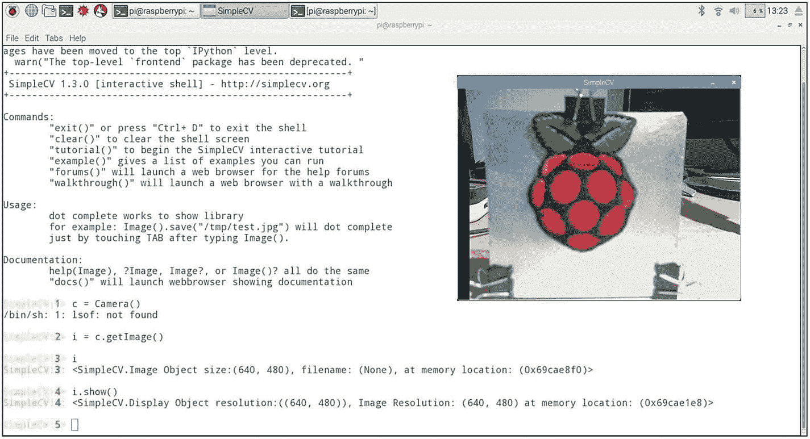

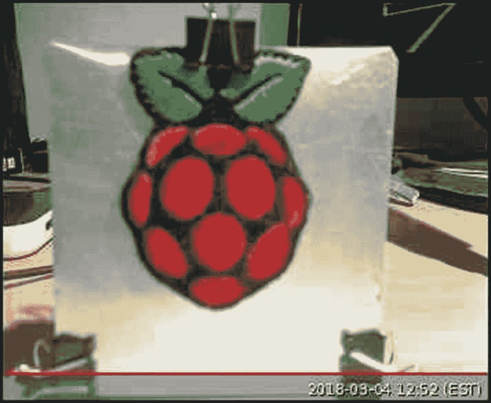

### 讨论

`fswebcam`包是一个相对简单的软件包，用于处理与 Linux 操作系统兼容的摄像头。图 4-60 和图 4-61 是使用罗技 VUBM46 2Mp 自动对焦摄像头拍摄的。

该软件下载速度快，使用简单，且具备有限的图像编辑功能。USB 摄像头可以捕捉单张图像，如图 4-60 所示。可以消除或编辑横幅，调整图像分辨率，并利用 Linux 的`cron`时间管理功能拍摄延时序列。

`picamera`是树莓派基金会提供的一款图像采集设备和软件包。该摄像头通过一条短排线连接到 RPi 的图形处理单元（GPU）。GPU 承担了部分本应由 CPU 处理的图像处理计算负载。而 USB 摄像头的数据仅由 CPU 处理。尽管使用专用的`picamera`图像处理速度更快，但排线在物理上限制了其安装位置，而 USB 摄像头的安装位置则几乎不受限制。

在完成`picamera`的机械安装后，必须重新配置 RPi，以便在 RPi 配置窗口中识别摄像头。通过 PIXEL 桌面主菜单的“Preferences”选项，可以进入图 1-16 所示的窗口以及第 1 章图 1-17 中的摄像头选择框。如图 1-17 所示，在“Interfaces”选项卡中启用摄像头选择。启用摄像头后，必须重启 Pi。

Python 摄像头控制软件支持摄像头图像捕获、录制简单的无声视频、30 毫秒延时摄影，以及静态和视频图像中的各种图像编辑效果。

OpenCV 是一个计算机视觉项目，它通过分析构成图像的数值数据文件之间的差异，使计算机能够“看见”。图像文件可能很大，分析数值差异的计算量也会很大，因此需要强大的计算能力。

OpenCV 是用 C 和 C++编写的。SimpleCV 是一个`Python 封装器`，它基于 OpenCV 计算机视觉代码构建。

图 4-61 是一个最小化控制台会话的截图，能够捕获并显示罗技网络摄像头的图像。[SimpleCV.org](http://simplecv.org)上的教程涵盖了以下主题：安装基础、与显示器交互、加载图像目录、宏、二值视觉、计时、监测空间或视野内的变化、操作或编辑图像、图像算术，以及叠加或分层图像。

Simon Monk 在《Raspberry Pi Cookbook》（O'Reilly Media，2019）的第 8 章中讨论了涉及使用 SimpleCV 进行硬币计数、运动检测和人脸识别的一系列计算机视觉练习。

## 代码清单

```c
// Single LED Light Sensor
// Light sensed with A0 voltage measurement of discharge of reverse
// biased LED thru 220 ohm resistor. Anode to pin 2 (long lead)
// cathode (short lead) to A0.
//
// define variables
byte anodePin = 2;                    // led anode pin connection
byte cathodePin = 14;                 // A5 digital pin number
int vltg_s = 0;                       // starting voltage
int vltg_f = 0;                       // final voltage
//
void setup() {
// global disable pull up resistors
_SFR_IO8(0x35) |= 0x10;
digitalWrite(anodePin, LOW);          // initialize pin as low on output declaration
pinMode(anodePin, OUTPUT);            // declare anode pin as output
pinMode(cathodePin, INPUT);           // declare cathode as input
//
Serial.begin(9600);                   // start serial port
//
}
void loop() {
digitalWrite(anodePin, HIGH);       // configure pins
pinMode(cathodePin, OUTPUT);        // to turn led on
digitalWrite(cathodePin, LOW);      // discharging capacitor residual
//
// allow led to accumulate charge
digitalWrite(cathodePin, HIGH);
digitalWrite(anodePin, LOW);
// put cathode into measuring state
pinMode(cathodePin, INPUT);
// read initial voltage level
vltg_s = analogRead(14);
// set led discharge time
delay(30);
//
vltg_f = analogRead(14);  // read the voltage after discharge
//
pinMode(cathodePin, OUTPUT);
digitalWrite(cathodePin, LOW);
Serial.println(vltg_s - vltg_f);
}
```

### 清单 4-5
一个使用放电电压差测量入射光的 Arduino 单反向偏置二极管光传感器

```c
// 一种六波长、反向偏置 LED 电磁光谱仪。
// 6 种不同颜色的 LED 在 Arduino 的数字引脚上反向偏置，形成二极管阵列。
// 5V 接阴极，阳极通过一个 100 欧姆的限流电阻接地。数字引脚反向偏置二极管，
// 在 PN 结电容上定时收集光子电荷，然后测量放电时间。
// 在光电二极管模式下，更多的光会使二极管导通，
// 并缩短通过 100 欧姆电阻放电的时间。
//
// 在引脚分配定义和串口监视器输出代码中标识二极管
//
// 定义 Arduino 引脚分配
#define LED1_n_side 2     // 第一个二极管阳极（长引脚）     蓝色
#define LED1_p_side 3     // 第一个二极管阴极（短引脚/扁平外壳 + 电阻）
#define LED2_n_side 4     // 第二个二极管阳极（长引脚）     绿色
#define LED2_p_side 5     // 第二个二极管阴极（短引脚/扁平外壳 + 电阻）
#define LED3_n_side 6     // 第三个二极管阳极（长引脚）     黄色
#define LED3_p_side 7     // 第三个二极管阴极（短引脚/扁平外壳 + 电阻）
#define LED4_n_side 8     // 第四个二极管阳极（长引脚）     琥珀色/橙色
#define LED4_p_side 9     // 第四个二极管阴极（短引脚/扁平外壳 + 电阻）
#define LED5_n_side 10    // 第五个二极管阳极（长引脚）     红色
#define LED5_p_side 11    // 第五个二极管阴极（短引脚/扁平外壳 + 电阻）
#define LED6_n_side 12    // 第六个二极管阳极（长引脚）     UV 或红外发射器
#define LED6_p_side 13    // 第六个二极管阴极（短引脚/扁平外壳 + 电阻）
//
void setup() {
Serial.begin(9600);  // 启动串口用于显示
}
void loop() {
unsigned int j; // 为第一个二极管声明时间计数索引
unsigned int k; // 为第二个二极管声明第二个计数索引
unsigned int l; // 为第三个二极管声明第三个计数索引
unsigned int m; // 为第四个二极管声明第四个计数索引
unsigned int n; // 为第五个二极管声明第五个计数索引
unsigned int o; // 为第六个二极管声明第六个计数索引
//
// 第一个二极管读数
//
//
// 施加反向电压并允许 LED 电容充电
pinMode(LED1_n_side, OUTPUT);
pinMode(LED1_p_side, OUTPUT);
digitalWrite(LED1_n_side, HIGH);
digitalWrite(LED1_p_side, LOW);
// 通过将二极管的阴极短路端从
// OUTPUT HIGH 改为 INPUT LOW（高阻抗输入，内部上拉电阻关闭）来隔离它
pinMode(LED1_n_side, INPUT);
digitalWrite(LED1_n_side, LOW);  //关闭内部上拉电阻
// 计算将阴极短路端电荷放电至逻辑 0 的时间
for (j = 0; j < 30000; j++){
//Serial.println(j);  // 调试诊断
if(digitalRead(LED1_n_side) == 0)break;
}
// int avg_timeCnt[jc] += timeCnt[jc]/avrg;
int timeCnt1 = j;
//
//  第二个二极管读数
//
// 施加反向电压并允许 LED 电容充电
pinMode(LED2_n_side, OUTPUT);
pinMode(LED2_p_side, OUTPUT);
digitalWrite(LED2_n_side, HIGH);
digitalWrite(LED2_p_side, LOW);
// 通过将二极管的阴极短路端从
// OUTPUT HIGH 改为 INPUT LOW（高阻抗输入，内部上拉电阻关闭）来隔离它
pinMode(LED2_n_side, INPUT);
digitalWrite(LED2_n_side, LOW);  //关闭内部上拉电阻
// 计算将阴极短路端电荷放电至逻辑 0 的时间
for (k = 0; k < 30000; k++){
//Serial.print(k,DEC);  // 调试诊断
if(digitalRead(LED2_n_side) == 0)break;
}
int timeCnt2 = k;
//Serial.print("Green = ");
//Serial.println(timeCnt2,DEC);
//
//   第三个二极管读数
//
// 施加反向电压并允许 LED 电容充电
pinMode(LED3_n_side, OUTPUT);
pinMode(LED3_p_side, OUTPUT);
digitalWrite(LED3_n_side, HIGH);
digitalWrite(LED3_p_side, LOW);
// 通过将二极管的阴极短路端从
// OUTPUT HIGH 改为 INPUT LOW（高阻抗输入，内部上拉电阻关闭）来隔离它
pinMode(LED3_n_side, INPUT);
digitalWrite(LED3_n_side, LOW);  //关闭内部上拉电阻
// 计算将阴极短路端电荷放电至逻辑 0 的时间
for (l = 0; l < 30000; l++){
//Serial.print(l,DEC);  // 调试诊断
if(digitalRead(LED3_n_side) == 0)break;
}
int timeCnt3 = l;
//Serial.print("Yellow = ");
//Serial.println(timeCnt3,DEC);
//
//   第四个二极管读数
//
// 施加反向电压并允许 LED 电容充电
pinMode(LED4_n_side, OUTPUT);
pinMode(LED4_p_side, OUTPUT);
digitalWrite(LED4_n_side, HIGH);
digitalWrite(LED4_p_side, LOW);
// 通过将二极管的阴极短路端从
// OUTPUT HIGH 改为 INPUT LOW（高阻抗输入，内部上拉电阻关闭）来隔离它
pinMode(LED4_n_side, INPUT);
digitalWrite(LED4_n_side, LOW);  //关闭内部上拉电阻
// 计算将阴极短路端电荷放电至逻辑 0 的时间
for (m = 0; m < 30000; m++){
//Serial.print(m,DEC);  // 调试诊断
if(digitalRead(LED4_n_side) == 0)break;
}
int timeCnt4 = m;
//Serial.print("Amber = ");
//Serial.println(timeCnt4,DEC); // 调试诊断
//
//    第五个二极管读数
//
// 施加反向电压并允许 LED 电容充电
pinMode(LED5_n_side, OUTPUT);
pinMode(LED5_p_side, OUTPUT);
digitalWrite(LED5_n_side, HIGH);
digitalWrite(LED5_p_side, LOW);
// 通过将二极管的阴极短路端从
// OUTPUT HIGH 改为 INPUT LOW（高阻抗输入，内部上拉电阻关闭）来隔离它
pinMode(LED5_n_side, INPUT);
digitalWrite(LED5_n_side, LOW);  //关闭内部上拉电阻
// 计算将阴极短路端电荷放电至逻辑 0 的时间
for (n = 0; n < 30000; n++){
//Serial.print(n,DEC);  // 调试诊断
if(digitalRead(LED5_n_side) == 0)break;
}
int timeCnt5 = n;
//
//    第六个二极管读数
//
// 施加反向电压并允许 LED 电容充电
pinMode(LED6_n_side, OUTPUT);
pinMode(LED6_p_side, OUTPUT);
digitalWrite(LED6_n_side, HIGH);
digitalWrite(LED6_p_side, LOW);
// 通过将二极管的阴极短路端从
// OUTPUT HIGH 改为 INPUT LOW（高阻抗输入，内部上拉电阻关闭）来隔离它
pinMode(LED6_n_side, INPUT);
digitalWrite(LED6_n_side, LOW);  //关闭内部上拉电阻
// 计算将阴极短路端电荷放电至逻辑 0 的时间
for (o = 0; o < 30000; o++){
//Serial.print(o,DEC);  // 调试诊断
if(digitalRead(LED6_n_side) == 0)break;
}
int timeCnt6 = o;
//
//
// 数据输出
//
// 水平数据显示
Serial.print("Blue = ");
Serial.print(timeCnt1, DEC);
Serial.print("  ");
Serial.print("Green = ");
Serial.print(timeCnt2, DEC);
Serial.print("  ");
Serial.print("Yellow = ");
Serial.print(timeCnt3,DEC);
Serial.print("  ");
Serial.print("Amber = ");
Serial.print(timeCnt4,DEC);
Serial.print("  ");
Serial.print("Red = ");
Serial.print(timeCnt5,DEC);
Serial.print("  ");
Serial.print("I-Rd = ");
Serial.println(timeCnt6,DEC);
}
```

### 清单 4-4
用于反向偏置 LED 光收集的 Arduino 代码

## 清单 4-3a
一个简单的 Arduino RGB LED 二极管控制器

```c
// 串口控制 RGB LED
// 从串口输入 3 个介于 0 到 255（PWM 限制）之间的整数。
// 逗号分隔的值分别代表红色、绿色和蓝色贡献值。
// 颜色值以及检测器对发射光的响应会打印回串口。
//
char buffer[18]; // 缓冲区的最大长度
#define red 11
#define green 10
#define blue 9
//
int tred = 0;
int tgreen = 0;
int tblue = 0;
int analogPin = 0;
int reading = 0;
//
//
void setup() {
  pinMode(red, OUTPUT);
  pinMode(green, OUTPUT);
  pinMode(blue, OUTPUT);
  Serial.begin(9600);
  color(0,0,0); // 调用颜色创建函数
}
//
void loop()
{
  if (Serial.available() > 0) {  // 一旦有字符到达
    //
    tred = Serial.parseInt();
    tgreen = Serial.parseInt();
    tblue = Serial.parseInt();
    color(tred,tgreen,tblue);
    Serial.println("red " + (String)tred + " green " + (String)tgreen + " blue " + (String)tblue);
    // 读取检测器值
    int reading = analogRead(analogPin);
    Serial.print(reading);
  }
}
//
void color(int cred, int cgreen, int cblue){
  analogWrite(red, cred);
  analogWrite(green, cgreen);
  analogWrite(blue, cblue);
}
```

## 清单 4-3
用于 RGB LED 控制的 Arduino 代码

```c
// CdS_RGB_DAQF_Serial_Photometer  2012 年 3 月 5 日
// 一条双向串行链路将 DAQF 控制屏幕连接到光学平台或光度计。
// 通过从控制屏幕选择 RGB 分量，并将选择结果串行传输到为 LED 供电的 Arduino，来选定光源波长。
// 光源点亮后，读取 CdS 的响应，并串行传回控制屏幕进行显示。
// CdS 采用 10K 欧姆分压器配置，偏置电压为 5 伏。
// 采用移动平均平滑程序来改善输出到 DAQFactory 控制屏幕显示的数据流。
// 要设置/选择光源颜色和强度，请在 DAQF 光度计控制屏幕的编辑框中输入 0-255 之间的值。
// 如果不使用 DAQFactory GUI，请在串口监视器发送框中输入所需数据，格式为
// "r nnn,g nnn,b nn"。
//
//
// LED 接在引脚 9、10 和 11 上，并串联 470 欧姆限流电阻。检测器接 5V 电源、GND 和模拟输入 A0。
//
char buffer[18]; // 缓冲区最大长度
int red, green, blue;
int RedPin = 11;
int GreenPin = 10;
int BluePin = 9;
// 全局变量声明
long totalCnt = 0;
long avrg = 0;
int ttcntr = 0;
void setup()
{
  Serial.begin(9600);
  Serial.flush(); // 清除行中的任何字符
  pinMode(RedPin, OUTPUT);
  pinMode(GreenPin, OUTPUT);
  pinMode(BluePin, OUTPUT);
}
void loop()
{
  if (Serial.available() > 0) {  //一旦有字符到达
    // 执行以下代码
    int index = 0; // 数组索引
    delay(100); // 等待缓冲区填满
    int numChar = Serial.available(); // 输入字符计数
    // 再加上末尾的 NULL
    if (numChar > 15) {
      numChar = 15;
    }
    while (numChar--) {  // 后置递减运算符
      buffer[index++] = Serial.read();
    }
    splitString(buffer); // 点亮源 LED
  }
  //
  //
  //
  // 十次平均计算代码
  ttcntr = ttcntr + 1;
  if (ttcntr <= 10) {
    totalCnt = totalCnt + analogRead(0);
  }
  else {
    avrg = totalCnt/10;
    Serial.println(avrg);
    delay(250); // 降低循环速度
    // 重置或归零计数器和累加和
    ttcntr = 0;
    totalCnt = 0;
  }
}
void splitString(char* data)  {
  //Serial.print("输入的数据: ");
  //Serial.println(data);
  char* parameter;
  parameter = strtok (data, ",");
  while (parameter != NULL)  {
    setLED(parameter);
    parameter = strtok (NULL, ",");
  }
  // 清除文本和串行缓冲区
  for (int x=0; x<16; x++) {
    buffer[x] = '\0';
  }
  Serial.flush();
}
void setLED(char* data) {
  if ((data[0] == 'r') || (data[0] == 'R')) {
    int Ans = strtol(data+1, NULL, 10);
    Ans = constrain(Ans, 0, 255);
    analogWrite(RedPin, Ans);  // 点亮红色 LED
    //  Serial.print("红色设置为: ");
    //  Serial.println(Ans);
  }
  if ((data[0] == 'g') || (data[0] == 'G')) {
    int Ans = strtol(data+1, NULL, 10);
    Ans = constrain(Ans, 0, 255);
    analogWrite(GreenPin, Ans);  // 点亮绿色 LED
    //  Serial.print("绿色设置为: ");
    //  Serial.println(Ans);
  }
  if ((data[0] == 'b') || (data[0] == 'B')) {
    int Ans = strtol(data+1, NULL, 10);
    Ans = constrain(Ans, 0, 255);
    analogWrite(BluePin, Ans);  // 点亮蓝色 LED
    //  Serial.print("蓝色设置为: ");
    //  Serial.println(Ans);
  }
}
```

## 清单 4-2b
用于关闭 RGB 二极管电源的 DAQFactory 序列代码

```c
// 关闭光源 2012 年 3 月 4 日
// 该代码将三个颜色值均发送为 0，以关闭三色 LED。
//
device.Comm3.Write("r")
device.Comm3.Write(0)
device.Comm3.Write(",")
device.Comm3.Write("b")
device.Comm3.Write(0)
device.Comm3.Write(",")
device.Comm3.Write("g")
device.Comm3.Write(0)
```

## 清单 4-2a
在使用的串行端口上传输 RGB 数据的 DAQFactory 序列代码

```c
// RGB 串行传输 2012 年 3 月 4 日
// 该代码串行传输所需的 RGB 值。
//
//
global RedVlu
global BluVlu
global GrnVlu
//
//
device.Comm3.write("r")
device.Comm3.Write(RedVlu)
device.Comm3.Write(",")
device.Comm3.Write("b")
device.Comm3.Write(BluVlu)
device.Comm3.Write(",")
device.Comm3.Write("g")
device.Comm3.Write(GrnVlu)
```

## 清单 4-2
DAQFactory 序列代码：电光自动测试

```c
// "电光自动测试", 2012 年 2 月 15 日。2012 年 2 月 18 日修订版 2。该序列
// 设定施加到被测光源和检测系统的功率。
// 该程序由 for 循环中的变量值计数器驱动。
// 已经创建了一个页面，用于以图形和数字格式显示光电探测器的输出。
// 手动滑块控制和微调按钮允许手动设置施加到被测源设备的电压。
// 页面上的编辑框、启动按钮和变量值读数，提供了在选定电压变量之间
// 进行单次或多次循环测试协议的功能，具体取决于输入到各个按钮激活的编辑框中的值。
// 增量之间的时间延迟默认为 10 秒。
// 可以通过更改源代码中 Delay()语句的值来修改时间延迟。
//
global VltgVlu = 0       // 施加到被测设备上的电压值
global Start             // 施加到 DUT 的初始电压
global Increment         // 每次迭代的电压增量
global cycles            // 程序重复次数
//
for (private.counter = 0, counter < cycles; counter++)
//
VltgVlu = start
while (VltgVlu < 5)
  device.Comm3.Write(VltgVlu)
  delay (10) // 延迟时间，单位为秒，范围 1-10000
  VltgVlu = VltgVlu + Increment
  if (VltgVlu > 5)   // 测试递增的电压变量值，若达到上限
    VltgVlu = 0     // 则将变量重置为零，终止 while 循环
  endif
endwhile
//
AppldVltg = 0
VltgVlu = 0
Endfor
```

## 清单 4-1
Arduino 移动平均数字信号处理代码

```c
// 移动平均 2011 年 4 月 3 日
// 平均数组的大小为 numReadings
//
const int numReadings = 10;
//
int readings[numReadings];   // 从模拟输入采集的读数数量
int index = 0;               // 索引值
int long total = 0;          // 累计总和
int average = 0;             // 平均值
int inputPin = A0;           // 传感器输入，位于模拟输入 0
void setup()
{
  // 初始化与计算机的串行通信：
  Serial.begin(9600);
  // 将所有读数初始化为 0：
  for (int thisReading = 0; thisReading < numReadings; thisReading++) {
    readings[thisReading] = 0;
  }
}
void loop() {
  // 减去上一次读数：
  total = total - readings[index];
  // 从传感器读取数据：
  readings[index] = analogRead(inputPin);
  // 将读数加到累计总和：
  total = total + readings[index];
  // 前进到数组中的下一个位置：
  index = index + 1;
  // 如果到达数组末尾……
  if (index >= numReadings)
    // …则回绕到起始位置：
    index = 0;
  // 计算平均值：
  average = total / numReadings;
  // 将其发送到计算机（以 ASCII 数字形式）
  Serial.println(average);
  // 降低 Arduino 传输速度
  delay(100);
}
```

# 总结

现代光敏固态电子器件和集成电路能够与电磁波谱中的可见光部分，以及近红外和近紫外范围内波长较长和较短的一小部分辐射进行交互。

固态电子器件、简单光学平台和 SCADA 软件系统被配置成用于比色分析的光谱测量系统。

本文介绍了`PN`结及其一般的构造方法、光电相互作用及应用。

反向偏置的 LED 器件被用作定性和定量的颜色选择光传感器，以演示量子物理学的基本概念及其在天文学中的实际应用。

简要讨论了人工照明技术、色温概念以及入门级计算机视觉。

测量磁场的较简单方法将在第[5]章中介绍。

脚注[1]

