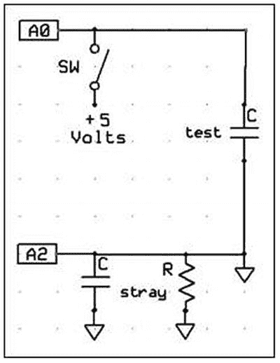
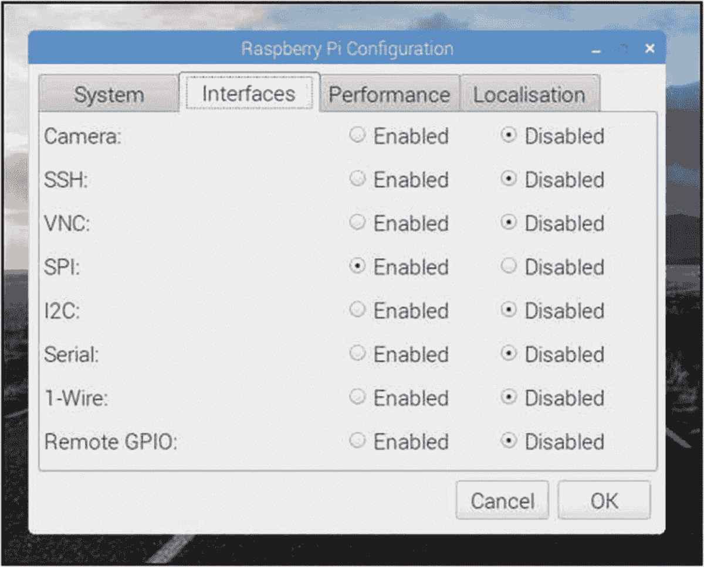
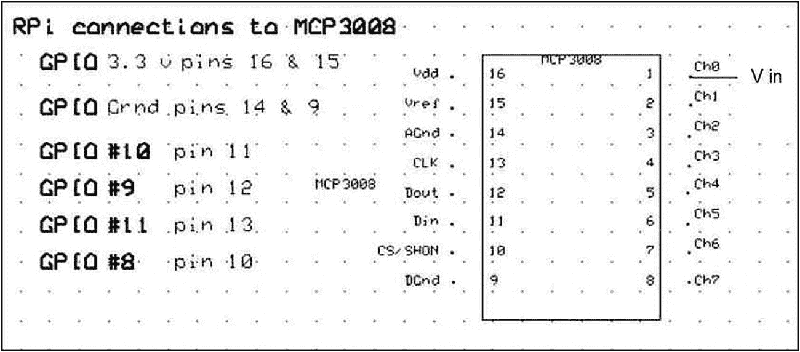
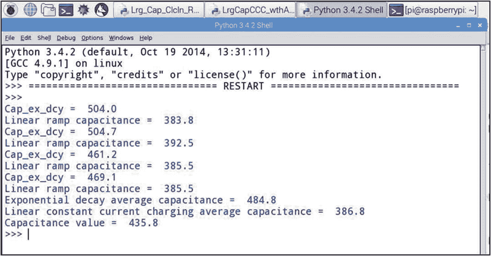

# 实验 C：电容自动量程测量

#### 引言

有几种技术可以使用 Arduino 微控制器作为电容计。早期的技术是通过一个精确已知的外部充电电阻对器件进行充电，然后确定电容充电达到 5 V 充电电压的 66%所需的时间，以计算`C`的值。后期版本的测量技术使用已知电容值来校准 Arduino 板的内部上拉电阻和内部寄生电容。当使用内部寄生电阻/电容值时，无需任何外部元件即可对较小的电容器件进行相当准确的电容测量。为本书修改的原始代码的更新版本位于`https://wordpress.codewrite.co.uk/pic/2014/01/21/cap-meter-with-arduino-uno/`和`https://wordpress.codewrite.co.uk/pic/2014/01/25/capacitance-meter-mk-ii/`。

好的，作为高级文档工程师和翻译员，我将严格按照您的要求和示例格式，将给定的英文文本翻译成中文，并保留所有 Markdown 格式。

---

### Arduino Uno 的软件代码

清单 1-2 是根据 mk-ii 版本发布的原始程序修改而成，以便在我的 Windows 7 系统上运行。

每个 Arduino Uno 板都不同，其内部杂散电容和实际“上拉”电阻都会有细微差异，因此需要进行设备校准才能达到合理的精度。系统校准需要使用已知精确值的电容器来评估杂散电容和内部“上拉”电阻值。图 1-13 展示了电容器充电电路的代表性电路原理图。描述被测器件 (DUT) 电压的数学公式，以及对杂散电气效应的合理假设，可以在前面提到的网页中找到。

**图 1-13** Arduino 内部组件电容测量电路

应使用已知电容值的低漏电介质器件（如聚酯薄膜、聚酯或聚苯乙烯电容器）来校准系统。当用于连续、自动量程电容测量的程序代码在 Arduino 上成功运行，并且将低漏电测试电容器插入 `A0` 和 `A2` 后，串行监视器上显示电容值时，就可以开始校准实验了。

清单 1-2 允许对杂散电容和杂散电阻进行调整。我成功地使用了杂散电阻调整，发现 35.9 到 37.0 之间的值可以使大多数实验设置达到合理的精度。您可以先使用清单 1-2 中的默认值开始校准过程，然后少量增加或减少该值，观察这个变化对已知标准值测量结果的影响。我只调整了三到四次，就使系统达到了合理的精度。

系统应在尽可能接近实际操作的预期点范围内进行校准。

如果只有电解电容器可用于在您所需的操作范围内进行校准，请务必小心。

### 观测结果

对一组不同标称值的电容器进行测量，结果汇总于表 1-3。

**表 1-3** 电容测量误差

| 电容值 | 测量值 |
| --- | --- |
| 10 pF | 10.5 pF |
| 1 nF | 0.69 nF |
| 1 μF | 0.989 μF |
| 22 μF | 25.6 μF / 2-3 秒 |
| 470 μF | 475.4 μF / 3 秒 |

22 μF 和 470 μF 器件的数据在串行监视器上显示缓慢，这可能是由于电压达到测量三分之二点所需的充电时间较长。

## 讨论

从 pF 到 F 的电容测量涵盖十二个数量级的动态范围。在实验工作中，跨越这个范围内 12 个数量级的测量，可能最好使用几种不同的技术来测量，这些技术更适合于较窄的关注范围。

pF 到 nF 的范围非常适合 Arduino 的自动量程程序，因为在这个范围内，电容器充电时间可以在“一秒以内”的时限内实现。高于 1 μF 的电容值在测量过程中表现出更长的充电时间，可能通过更大的充电电流以及根据数据图形记录进行的计算来获得更精确的确定。

诸如用于电路板中的电容器件，大致可分为固态和液态电解电介质器件两类。钽、铝和碳是主要的液态电化学电荷存储器件。来自 USB 总线或 LabJack 类型设备的可用电流不足以在合理时间内对大型电容器件充电。然而，随着电容值的增加，可以施加在电介质上的电压会降低。考虑到可以施加在其离子层上的电压有限，以及电解电介质系统可提供的大存储容量，您必须对所用电源的电压水平、用于控制充电电流的电阻器的功耗，以及器件的漏电流或电阻保持谨慎。

### 电容测量的校准

如果在 555 定时器的定时网络中使用精密电阻，则测得的电容值可以预期与振荡器系统数学模型预测的值成比例或相当接近。如果没有精密元件，则可能需要使用已知电容值对系统进行校准，以建立一定的精度水平。

测得的电容值可以以多种形式显示。可以直接从 Arduino 串行输出监视器读取数值视觉显示和相应的测量单位，以确定器件或组件的电容。然而，对于任何需要通过串行总线传输的数字信号处理或图形显示记录，测量软件的输出格式必须符合串行协议。

## 使用树莓派进行电容测量

只有使用 `PIGPIO` 库及其 C 语言接口守护进程，才能通过 RPi GPIO 阵列实现精确计时。实现更精确电容测量的另一种方法是将计时职责转移到微控制器的晶振时钟上，该微控制器充当 RPi 的“智能传感器”。在 Arduino 上运行的自动量程电容测量程序是一个健壮且完善的工具，可以将数据流式传输到 RPi 上的 Python 实现以进行显示。

到达 Python 串行端口的 Arduino 格式化电容数据，需要转换为数值格式，以便在 Python 控制台显示数值或在监视器屏幕上进行图形显示。

本练习代码清单中的清单 1-3 包含用于读取连接到 Arduino ADC 的 `A0` 和 `A2` 输入端之间的电容器值的 Python 代码。

## 实验

为了使用 Arduino 板连续测量电容，将电容测量程序（参见清单 1-2）加载到 IDE 的微控制器上，并将用于从串行端口接收数据的 Python 程序（参见清单 1-3）加载到 RPi 中。

然后，将待测电容器安装到 Arduino ADC 的 `A0` 和 `A2` 输入接口。流式传输到串行端口的值在 Arduino 串行端口监视器上进行验证。在 RPi 上启动 Python 程序之前，需要关闭端口监视器。

### 观测结果

在图 1-14 和 1-15 中，来自串口读取程序的字符串、字符串长度和电容数值输出被流式传输到 Python 交互终端或控制台上，以便在终止 (`Ctrl+C`) 前进行记录，这会触发系统以红色输出。

**图 1-15** 1μF 标准电容的控制台输出

**图 1-14** 330 pF 器件的控制台输出

## 讨论

对任何测量系统进行校准时，若待测值存在多个数量级的变化，都应谨慎操作，并对测量值进行严格检验。从`1 μF`电容器流出的数据是聚苯乙烯标准电容器，基于此进行了杂散泄漏估算。图 1-14 中标称`330 pF`元件的实测值为`323 pF`。

一台鼎阳科技`5.5`位台式万用表测得该`330 pF`元件的电容值为`0.364 nF`。

对于如此廉价且易于获取的系统而言，Arduino–RPi 组合提供了非常出色的数据。

当涉及极小或极大的量值时，任何测量都难以实现绝对精度。绝对精度依赖于往往无法获取的标准。如有可能，应将绝对测量需求重新表述为差分测量问题，这通常可以消除对绝对标准的需求。

Arduino 的连续小电容监测功能提供了有用且灵敏的差分电容测量能力。

## 使用 Python 和树莓派测量大电容值

在 Arduino 上运行的连续电容测量程序可以测量超过微法级的电容值，但随着电容器容量的增大，测量速度会开始减慢。当时间跨度达到分钟级或更长，且采用恒流、线性电压斜坡监测技术测量电容值时，涉及 RPi、GPIO 阵列及相应 Python 库的计时问题就变得不那么重要了。

较大的充电电流和更高电压的电源可以部分抵消由 RC 时间常数增大所引起的问题。用于大电容的高功率充电电源必须与 RPi GPIO 阵列和 MCP3008 ADC 的低压、低电流电路隔离。

在测量电容值之前，对大型电解器件中液体介质的受控预处理进行可视化记录，有助于获得更一致、可重复的数据。清单 1-4 提供了一种方法，用于对大型电解电容器充电的可重复性进行可视化验证。

## 实验

创建线性电压斜坡的传统方法是用恒流源给电容器充电。电流镜可以提供恒流电源，结合`555`定时 IC，可以对大容量被测器件中的介质层进行交替充电/放电的循环修复。

两个`2N3906`晶体管以电流镜配置连接，配合`LM555`定时器 IC 和`6 V`电池组（`4`节`12,000 mA`碱性 D 型电池），可与 RPi 及`gpiozero`库一起使用，读取`MCP3008`ADC，以记录和显示大型电解电容器的充电历史及电容值（见图 1-7）。循环修复程序的代码见清单 1-4。

要使用 Python RPi 的测量前预处理、数据显示或记录程序，必须通过主菜单选择在 RPi 上调用 MCP3008 串行外设接口（SPI）协议，如图 1-16 和 1-17 所示。

图 1-17
从接口选项卡选择 SPI

图 1-16
性能菜单的子菜单选项

图 1-18 是一个连接图，展示了 RPi GPIO 阵列与 MCP3008 ADC 之间的电源、控制和数据传输。`Vin`是在图 1-7 中箭头所示点测量的电压斜坡。

图 1-18
MCP3008 10 位 ADC 与 RPi GPIO 的连接图

为简化实现，大电容测量可使用两个程序：第一个用于对被测器件的电解层进行预处理，第二个用于测量器件的电容。配置好电流镜、`555`定时器 IC 和 RPi，并用清单 1-5 中的 Python 代码进行编程后，应能产生一系列重复的线性上升电压斜坡（由恒流充电产生），随后是指数衰减的电压放电曲线（见图 1-19）。

在通过基于硬件的循环充放电对电解介质进行预处理以获得可重复、可预测的电压行为模式后，即可启动软件，按照定时器控制的循环进行测量。

## 观察结果

图 1-19 展示了一个典型的大型电解电容器六循环介质修复程序。相对均匀的峰值高度表明其具有合理的可重复性，适用于对器件电容进行定量测量。

图 1-19
电解电容器介质修复的电压循环轨迹记录

图 1-19 展示了一个典型的循环模式，该模式对标称`470 μF`电解电容器的液体介质进行了预处理。图 1-20 展示了典型四循环测量的数据输出。

图 1-20
大型电解电容器恒流充电技术的控制台输出

## 讨论

以 6 伏大号 D 型电池组作为电源，`LM555`定时器应在`V[cc]`的三分之一或三分之二之间，即 2 伏至 4 伏之间循环——这完全在`RPi`和`MCP3008`的电气限制范围内。`MCP3008`的`gpiozero`实现会输出 0 到 1.0 的归一化结果。ADC 输出乘以 6，以生成充放电循环期间电容器上的实际电压。

通过对被测器件中液体电介质的预测量调节进行可视化图形记录，可以极大地简化大容量电容器的测量。当记录到一系列均匀的线性斜坡和指数衰减曲线后，可以关闭图形程序，启动电容评估程序，以数值方式测量器件的电荷存储能力。

仔细观察由电解电容器调节产生的锯齿波右侧下降斜率（尤其是迹线较低部分附近），可以观察到预期曲率或偏离线性状态的迹象。

我最初使用的程序采用双入口点算法，分别在上升或下降斜率的迹线上启动。然而，由于数值误差（如负值）、硬件与软件程序之间的同步丢失以及观测到的单个数据点离散度较大，最终采用了仅在迹线的线性上升恒流充电（CCC）部分开始电容测量的代码。

通过在尽可能接近恒流充电段起点处启动程序，可获得测量系统的最佳整体性能。该起始点通过观察定时器输出电路中的红色和绿色二极管来确定：红色二极管在循环的指数衰减阶段点亮，绿色二极管则在恒流充电阶段点亮。

考虑到已知的`RPi` GPIO 定时不规则性，更长的定时序列有望带来更高的精度和准确度。一个标称值为 470 μF 的器件通常需要 56 秒的时间周期才能生成一个结果，如图 1-20 所示，而一个 1000 μF 的器件则需要 1.75 分钟。

从一盒混合电容器中取出的五个电解电容器，其标称值为 470 μF（使用鼎阳科技 5.5 位台式万用表测量），实测值在 423 至 430 之间。对一个标称值为 470 μF 的单元进行了六次重复的`RPi`测量。生成的数据列于表 1-4 中。

此外，对五个标称值为 1000 μF 的单元进行的一系列万用表测量值在 955 至 961 之间。对 1000 μF 单元进行的一系列五次重复`RPi`测量则在表格中产生了较大的数值。

**表 1-4** 470 μF 和 1000 μF 器件的电容器实测值

| 测量次数 | 数值 |
| --- | --- |
| 1 | 429 – 936 |
| 2 | 443 – 940 |
| 3 | 431 – 940 |
| 4 | 427 – 937 |
| 5 | 436 – 940 |
| 6 | 425 |

表 1-5 是一个表格对比。

**表 1-5** 鼎阳科技台式万用表与树莓派的数据对比

| - |

将`RPi`生成的各个数值与台式万用表生成的数值进行比较，考虑到这两种测量系统之间近两个数量级的成本差异，二者在精度和准确度上显示出显著的相关性。

对于使用较大电容器的实验工作，可以减小电流镜的电流调节电阻以产生更大的充电电流。`2N3906`可处理 200 mA 的连续集电极-发射极电流。如果使用更小的电流编程电阻来增大恒流充电值，则必须更改计算代码中的电流定义以及 555 定时器上的放电电阻。调节程序的图形显示可以调整定时器放电电阻，以保持计算程序的对称性，从而跟踪变化的电容器电压。您还应适当调整电流镜和放电电路的功率额定值，以适应任何增加的电流，从而测量更大容量的电容器器件。

