# 10. 数据收集、存储与组网

本书的编写围绕一个核心理念，即使用 SCADA 软件系统来监控和控制科学实验。许多实验系统都通过实时监控进行，通常借助一种称为人机界面（HMI）的实验可视化图形表示来实现。

HMI 允许操作员观察实验，并可能在必要时进行干预。对于在极短或极长时间尺度内、在孤立或偏远地点、或在特殊条件下进行的无人监控实验，通常无法通过 HMI 进行跟踪。对于无法追踪其进程的实验数据，则需要数据收集或采集系统来读取、添加时间戳并存储数值，以便日后检索、审查和解读。

数据记录是一个统称术语，用于描述为积累和存储来自远程、孤立、自主或无人监控研究的全部结果历史所需的所有单元操作。

进行某些类型的实验以及永久记录质量控制和质量保证测量结果时，也需要执行数据记录操作。在诸如食品或药品制剂等有机材料被干燥至特定水分活度水平以防止微生物腐败的单元处理过程中，通过测量和记录密封隔离测试腔内产品的水分活度来进行监控。配备传感器的自主电池供电数据采集模块可放置在密封腔内，用于测量和记录腔内随时间变化的理化条件概况。这提供了永久的书面证据，证明在过去的生产或测试操作中，正确的理化条件已经实现并得以维持。

遵循本书力求简单易行的特点，只采用易得且廉价的组件，本练习中的数据采集速率仅限于 Arduino 微控制器所能提供的范围。

对于本书目前介绍的所有主题，以及本着本书入门性质的原则，使用带有安全数据（SD）存储介质为数据添加时间戳的 Arduino 微控制器所能提供的数据收集速率已经足够。（市面上有几种更新的高容量 SD 卡。您必须确保这些卡及其更高的容量与您的存储系统兼容。）

如需进行高速数据采集，建议读者参考有关 `LabJack` HMI 设备数据流功能的文献，或化学光谱分析的文献。

## 时间测量

对于并非由人员持续监控的传感器或设备，其自主实验数据收集需要一个独立且精确的计时数据源。独立的计时数据可通过被称为实时时钟（RTC）的数字集成电路获得。

有多种精确计时信号源可用于数据收集。

- 全球定位系统（GPS）播发来自轨道卫星的时间信号
- 协调世界时（UTC）需要一个 GPS 接收器模块。
- 互联网网络时间协议（需要以太网连接器访问互联网）
- 广播无线电时间信号使用无线电接收器监测来自原子钟的时间信号（需要 `DCF77` 接收器硬件）
- 来自计算机的串行时间消息

`555` 定时器是集成电路振荡器，只要为其电路供电，就能产生固定或可变频率的连续方波输出。外部组件决定了该集成电路定时器产生的矩形波输出的频率或高低电平周期。通过计数或比较脉冲来确定相对时间信息。产生的时间信息仅限于单个变化的数字信号。像 Arduino 这样的微控制器，通过在适当大小的二进制寄存器中从当前会话开始时间起计数微秒和毫秒间隔，来记录相对时间流逝。毫秒计数器和微秒计数器分别每 70 分钟和约 50 天溢出并重置一次。

来自远程或非常长时间实验的自主数据收集，必须在收集和存储时打上“时间戳”，以便日后能够重构准确的记录实验值历史，用于审查、解读、显示或数值处理。打时间戳的数据通常由标准纪元时间定义，即自 1970 年 1 月 1 日以来的秒数。时间戳表达式包含当前年份、月份、星期、日期、小时、分钟和秒。

专用集成电路（ASIC），例如表面贴装的 Maxim IC `DS1307`，是一款低功耗、串行、二进制编码的十进制日历时钟设备。这款常用的实时时钟（RTC）芯片能提供年、月、日、时、分、秒信息，精度为每月误差在一分钟以内。（一种名为 `ChronoDot` 的类似温度补偿设备，精度可达每年误差在一分钟以内。）

## 附录：代码清单

```c
// N 元素滑动平均频率测定电容
// 测量，2019 年 8 月 16 日 使用 pulseIn(pin#，HIGH/LOW) 读取高电平和低电平脉宽。
// 将高电平时间和低电平时间相加，得到总周期时间，再取其倒数得到 555 输出频率。
// 电容值通过公式 Cv = 1.44/(21000 * freq) 计算。（乘以 10 的 9 次方得 nF）（注意：浮点除法需将整数强制转换为浮点数再除）
// 为便于 DAQFtry Python 通过串口数据绘制曲线，已将诊断打印行和数值标识注释掉。
//
unsigned long duration;                    // 第 1 个脉宽，高电平信号
unsigned long duration_L;                  // 第 2 个脉宽，低电平信号
unsigned long tmSum;                       // 脉宽之和
float freq;                                // 频率变量
int const numReadings = 16;                // 平均的读数个数，必须声明为 "const"
unsigned long readings[numReadings];       // 各个读数
int index = 0;                             // 读数数组索引
unsigned long total = 0;                   // 运行总和
unsigned long average = 0;                 // 平均值
//
int inputPin = 2;                          // 用于脉冲计数的数字 PWM 引脚 #2
float capTnc = 0;                          // 被测设备的电容值
int Rc = 10000;                            // 555 RC 电路中第一个充电电阻的阻值
int Rd = 1000;                             // RC 电路中第二个充电或放电电阻的阻值
//
void setup()
{
Serial.begin(9600);                      // 初始化串口通信
for (int thisReading = 0; thisReading = numReadings)                // 若到达数组末尾，则回绕
{
index = 0;
}
average = total / numReadings;           // 计算平均值
freq = 1 / (float)average;               // 根据方波周期计算频率
// 注意：C/C++ 要求在除法前将整数强制转换为浮点数
capTnc = (1.44/(21000 * freq)) * 1000;   // 计算 nF
//Serial.print("average  ");             // 诊断
//Serial.println(average);
Serial.println(capTnc, 2);               // 向串口输出数值，保留两位小数
//Serial.print("duration_L  ");          // 诊断
//Serial.println(duration_L, DEC);       // 用于 DAQFactory Python 串口使用时注释掉
//Serial.print("duration   ");
//Serial.println(duration, DEC);
delay(50);                               // 降低速率？
}
代码清单 9-4
基于 555 定时器输出频率变化的电容测量
```

```c
// 通过串口手动设置 PWM
// 从串口输入的整数（0 到 255 之间）设置 PWM 引脚 9 的值。（PWM 引脚 3、5、6、9、10 和 11）
//
int pwmPin = 9;
//
void setup() {
// 设置引脚模式并激活串口
pinMode(pwmPin, OUTPUT);
Serial.begin(9600);
}
//
void loop() {
// 检查串口输入
if (Serial.available())
{
int pulsWdth = Serial.parseInt();
analogWrite(pwmPin, pulsWdth);
}
}
代码清单 9-3
通过手动串口输入控制 Arduino 风速计风扇电机速度
```

```c
// 电容表输出（单位：纳法）
// 分压器产生 2/3 或 66% 的最终 5 伏充电参考电压。可以使用 Arduino 的内部定时器来测量 tau
// 即 RC 时间常数。使用已知精度的 10K 欧姆电阻，可计算电容。
//
#define Rc 10000.0 // 通过测量或购买确定实际电阻值
#define Rd 55.0
#define R1 40100.0
#define R2 21000.0
#define clockRate_us 16.0
//
const float k = 1/(clockRate_us*Rc*log((R1+R2)/R2));
volatile uint8_t TIFR1_Copy;
volatile uint16_t ICR_Copy;
volatile uint8_t ICR_Flag = 0;
volatile uint16_t TOV1_Ctr;
//****************************滑动平均变量*****************************
const int numReadings = 64; //噪声改善 5 倍
float capacitance = 0;
int index = 0; //MA 索引变量
float total = 0; // MA 总和
float avrgdVlu = 0; //MA 值
float readings[numReadings]; //MA 数组
void setup() {
Serial.begin(9600);
//Serial.println("OK");
//清除 MA 数组
for(int thisReading = 0; thisReading = numReadings) // 检查数组位置
{
index = 0;
}
float avrgdVlu = total/numReadings; //计算平均值
C = 1000 * (avrgdVlu); // 将微法转换为纳法
//
Serial.println(C, 6);
//Serial.print( "uF");Serial.println();
dischargeTime = 1 + (uint16_t)(10.0*Rd*C/1000.0);
delay(dischargeTime); // 等待至少 10 个时间常数
if (dischargeTime < 250) {
delay(250-dischargeTime); // 额外等待以限制打印频率
}
}
ISR(TIMER1_CAPT_vect){
TCCR1B = 0;  //停止定时器 1 - CS12:CS10 = 0
TIFR1_Copy = TIFR1; // 获取溢出中断状态
TIFR1 = (1 << TOV1); // 清除溢出标志
ICR_Copy = ICR1; // 获取 ICR 值
ICR_Flag = 1;  //设置标志
}
ISR(TIMER1_OVF_vect) {
TOV1_Ctr++; // 增加溢出计数器
}
代码清单 9-2
用于定时 RC 的 ICFT 测量的 Arduino 代码
```

```c
//带滑动平均的电容监视器
//基本程序通过已知电容标定以确定内部电阻值
const int OUT_PIN = A2;
const int IN_PIN = A0;
const int numReadings = 32;   // MA 数组大小
//IN_PIN 与地之间的电容
//杂散电容值会因板子而异。
//使用已知电容标定此值。
const float IN_STRAY_CAP_TO_GND = 24.48;
const float IN_CAP_TO_GND = IN_STRAY_CAP_TO_GND;
//上拉电阻会因板子而异
//使用已知电容标定此值。
const float R_PULLUP = 35.9;  // 单位 K 欧姆
const int MAX_ADC_VALUE = 1023;
float capacitance = 0;
float uFcapacitance = 0;
//滑动平均参数
int index = 0;
float avrgdVlu = 0;           // MA 值
float total = 0;              // MA 数组之和
float MovAvrg = 0;
float readings[numReadings];    // MA 中的读数个数
//
void setup()
{
pinMode(OUT_PIN, OUTPUT);
//digitalWrite(OUT_PIN, LOW; //这是输出引脚的默认状态
pinMode(IN_PIN, OUTPUT);
//digitalWrite(IN_PIN, LOW);
Serial.begin(9600);
//
// 清除 MA 数组
for (int thisReading = 0; thisReading = numReadings)        // 检查数组位置
index = 0;                       // 回绕
float average = total / numReadings;  // 计算平均值
Serial.println(average, 6);
}
else
{
//大电容 - 因此使用 RCX 充电方法
//
// 放电（来自小电容测试）
pinMode(IN_PIN, OUTPUT);
delay(1);
//
// 使用内部上拉开始给电容充电
pinMode(OUT_PIN, INPUT_PULLUP);
unsigned long u1 = micros();
unsigned long t;
int digVal;
//
//充电到一个相当随意的水平，介于 0 和 5 伏之间
//最好不要在这里使用 analogRead()，因为它不够快
//接下来是一个 do - while 循环
do
{
digVal = digitalRead(OUT_PIN);
unsigned long u2 = micros();
//下一行选择：或
t = u2 > u1 ? u2 - u1 : u1 - u2;
} while ((digVal  1000.0)
{
// **************************滑动平均 *****************************
float uFcapacitance = capacitance/1000.0;
total = total - readings[index];  // 减去上一次读数
readings[index] = uFcapacitance;   // 下一次电容读数
total = total + readings[index]; // 数组中的下一个位置
index = index + 1;
if (index >= numReadings)        // 检查数组位置
index = 0;                       // 回绕
float average = total / numReadings;  // 计算平均值
Serial.println(average, 6);
}
else
{
//*************************** 滑动平均 ******************************
total = total - readings[index];  // 减去上一次读数
readings[index] = capacitance;   // 下一次电容读数
total = total + readings[index]; // 数组中的下一个位置
index = index + 1;
if (index >= numReadings)        // 检查数组位置
index = 0;                       // 回绕
float average = total / numReadings;  // 计算平均值
Serial.println(average, 6);
}
}
while (millis() % 1000 != 0);
}
代码清单 9-1
使用 ISRC 方法进行 Arduino 电容测量
```

## 摘要

本文提出了一种新颖的方法，通过微处理器和上位机 SCADA 系统，跟踪可压缩电容式重量传感器中的电容变化来测定重量。

压缩式重量感应电容器可由各种廉价、易得的材料组装而成，用于在较宽的重量值范围内测定样品重量。

文中讨论了如何使用简单的手动工具，利用廉价易得的材料构建微处理器控制的称重秤和仪器校准砝码。

还介绍了使用商用和实验者自行组装的设备进行压力和力测量的应用。

收集与存储实验数据的技术将在第 10 章中进行探讨。

# 实时时钟

实时时钟是一组组件的集合，它不仅为客户软件提供连续、按需的时间功能，而且在客户软件或微控制器关闭时，也能保持精确的时间计算。来自`DS1307`芯片的数据通过I²C（集成电路间互联）二进制编码十进制（`BCD`）双向总线和软件协议进行串行传输，该协议仅使用两根线来实现总线和数据传输。（对应Arduino上的模拟输入引脚5和4。）通常，RTC由USB或微控制器供电；然而，时钟日历芯片的电路设计使其在客户软件或微处理器关闭时，能够自动由一块3伏锂一次电池供电。该3伏锂电池可为时钟日历芯片提供长达三年的持续供电，从而确保多年的精确计时。

多家商业供应商提供完整的RTC组件，可直接用于快速原型开发，或以套件形式提供，只需最少的组装即可使用。

最新版本的Arduino IDE在`RTClib`条目下的示例菜单中提供了一系列简单的程序。最值得关注的演示程序是简单的`ds1307`程序（见代码清单10-1），该程序将当前时间和日期打印到串行监视器，然后在通过调用主机设置RTC后，执行几个示例性的日期和时间计算。

还有一个名为`Time.h`的附加时间库，可下载为zip文件，它为Arduino控制器提供了额外的功能，无论是否使用外部硬件均可。`Time`库允许设置微控制器并使其与RTC同步，以连接到互联网时间服务、GPS系统以及来自计算系统的串行时间消息。`Time`库中还提供了时间函数的额外说明和附带示例程序的示例。

# 数据存储

经适当时间戳标记、跨越数天、数周甚至数月收集的实验数据，可存储于大容量、非易失性存储器——SD卡上。SD卡是一种可互换的存储设备，能够作为计算机和微控制器的辅助驱动器进行读写操作。用于数据记录的SD卡可采用`FAT 16`或`32`文件系统格式化，以逗号分隔值（`CSV`）格式存储数据，该格式可被众多电子表格、数据处理或显示软件读取。这些存储卡坚固耐用、易于操作、价格低廉、便于获取、存储容量大，且物理尺寸小巧紧凑，提供常规尺寸和微型尺寸两种规格。所有尺寸的SD卡配合简易适配器/卡托，均可兼容运行Windows、Apple或Linux操作系统的台式机、工作站及笔记本电脑硬件。

SD卡采用`3.3V`技术，而Arduino是`5V`系统。在将SD卡与微控制器连接时，读写电子电路需要适配电路。微型化和表面贴装技术正迅速取代传统的插座安装和“通孔”格式电路板。

为适应原型设备的面包板组装，微型表面贴装系统提供了转接板（BoB），使得这些微小电路能够在传统原型设计设备上进行操作和安装。转接板既可用于实时时钟（RTC），也可用于SD卡托——这些卡托可容纳电池提供辅助电源，并配备适配器，使实验者能在数据采集系统中使用任意一种SD卡尺寸。

专为Arduino设计的特殊电路板称为扩展板，它们安装在Arduino上，插入微控制器的I/O、电源引脚和排针，从而构建出完整、紧凑、专用的设备。这类扩展板可用于数据记录应用。Arduino数据记录扩展板同时集成了电池供电的实时时钟和SD卡托。Arduino微控制器与数据记录扩展板的组合，形成了一个紧凑系统，封装在坚固外壳中，可在恶劣野外或独立实验室条件下自主运行。

SD卡的数据传输采用串行外设接口协议（SPI）。SPI实现使用四线总线，以主从拓扑结构连接设备。在本练习中，编写了SPI代码并创建了一个可工作的数据记录系统，用于监测拟密封在密闭腔室内的固态温湿度传感器的输出。I²C和SPI编程在Paul Scherz和Simon Monk所著的《实用电子学（发明者用）》（McGraw-Hill，2016年）中有详细介绍。本练习的重点是修改已发布的数据记录代码，以满足记录来自不同传感器或传感器阵列数据的需求。

用于Arduino编程的SD库定义了一个SD类，包含用于在SD卡上定义和操作文件及目录的函数，以及一个File类，用于对SD卡上的单个文件进行读写操作。以下库功能的简要概述，可通过Arduino语言参考网站和在线论坛获取更多信息进行补充。

## SD类

* `begin()` – `SD.begin()` 或 `SD.begin(cspin)` 初始化SD卡和SD库，并准备数字输入/输出（DI/O）引脚11、12和13上的SPI总线以供操作。该函数还会将SS（从设备选择）引脚（默认为Arduino板上的DI/O引脚10）设置为输出。如果SS DI/O引脚被更改为由`cspin`（芯片选择引脚）指定的唯一值，则必须将其设置为输出，否则SD库将无法工作。

* `exists()` – 如果文件名存在，`SD.exists(filename)` 返回 true。通过在文件名字符串中组合正斜杠表示法，可以确认目录的存在。

* `mkdir()` – `SD.mkdir("a/b/c")` 在SD卡上创建三个目录 `a`、`b` 和 `c`。

* `open()` – `SD.open(filepath, mode)` 默认以读取模式打开文件。读取默认从文件开头开始，写入则追加到文件末尾。

* `remove()` – `SD.remove(filename)` 从卡目录中移除指定文件。

* `rmdir()` – `SD.rmdir(directory)` 仅从SD卡中移除空目录。

## File类

* `available()` – `file.available()` 返回指定文件中可供读取的字节数。

* `close()` – `file.close()` 关闭文件，并确保所有数据都已写入SD卡。

* `flush()` – `file.flush()` 确保所有写入的字节都已保存到SD卡。

* `peek()` – `file.peek()` 从文件中读取一个字节，但不前进到下一个字节。

* `position()` – `file.position()` 返回一个无符号长整数，指示下一个要读取或写入的字节的位置。

* `print()` – `file.print(data)` 或 `(data, BASE)` 将标称数据打印到已打开用于写入的文件中，并可为数值指定可选的进制基数。

* `println()` – `file.println()` 打印数据，并在打印后添加回车换行符。

* `seek()` – `file.seek(pos)` 在当前文件中寻找一个新位置，其中位置是一个介于0和文件大小之间的无符号长整数。

* `size()` – `file.size()` 以无符号长整数形式返回文件大小。

* `read()` – `file.read()` 返回文件的下一个字节，如果没有可用字节则返回 -1。

* `write()` – `file.write(data)` 或 `(buffer, len)` 将数据写入文件，其中数据可以是待写入的字节、字符或字符串（`char *`）。或者，也可以将一个长度为 `len` 的缓冲区或字符数组写入文件。

* `isDirectory()` – `file.isDirectory()` 返回一个布尔值，指示一个条目是否为目录。目录（或文件夹）是一种特殊类型的文件。此函数报告当前文件是否为目录（代码示例请参见Arduino语言库参考中的“SD库”条目）。

* `openNextFile()` – `file.openNextFile()` 返回目录中的下一个文件或文件夹（代码示例请参见Arduino语言库参考中的“SD库”条目）。

* `rewindDirectory()` – `file.rewindDirectory()` 将焦点返回到目录中的第一个文件，与 `openNextFile()` 配合使用。

仅在必要时才对SD卡进行格式化，以延长其有效使用寿命。

遵循从简单基础逐步构建复杂系统的良好科学实践，本章首先开发一个可通过Arduino串口读取的RTC，然后在多行LCD上直观显示时间和日期，之后再进入数据记录功能的组装阶段——在此阶段中，时间戳和传感器数据均从相应来源读取，并写入SD卡进行存储。清单10-3是本章末尾提供的用于带时间戳数据记录的Arduino草图。

# 液晶显示器（LCD）

LCD是一种多层薄膜技术，其原理是：当通过两个呈90度交叉的偏振滤光片观察时，位于另一多层组件两侧的照明光源会被遮挡，该多层组件中含有一种称为液晶的材料。液晶层位于两个光学透明的氧化铟锡（ITO）电极之间。当对透明ITO电极施加电压时，液晶的分子结构发生改变，导致穿过晶体的光的偏振面发生旋转，使得电极之间的发光区域变得可见。

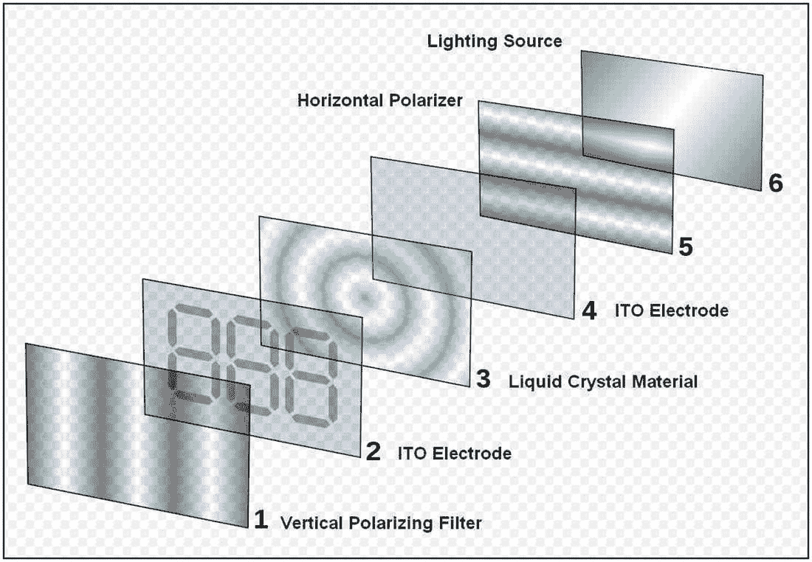

图10-1

一个三位字符的LCD

通过在玻璃基底上以像素化矩形阵列的形式沉积ITO电极，可以显示自定义创建和标准的字母数字字符。LCD以各种形式制造，从单行字符显示器到大尺寸图形显示器以及计算机或电视屏幕。（图10-1图片来自维基百科）

LCD显示器可由微控制器驱动。Arduino软件拥有一整套命令和库，适用于所有与日立`HD44780`芯片兼容的显示器。Arduino的串行监视器和LCD共享许多通用命令，因为它们本质上都是基于串行通信的设备。

本练习基于使用一个配置为固定四行、每行 16 个字符的廉价 LCD。市面上有更昂贵的具有图形功能的 LCD，但本项目不需要用到。

向 LCD 打印文本类似于向串行监视器打印的指令。矩阵中的任何位置都由行号（0 到 3）和列号（0 到 15）确定。

市面上有许多基于标准 HD44780 芯片的 LCD 系统。有几种不同的内存映射软件/硬件系统实现方式来控制多行显示器。由于不同厂商制造的 LCD 内存管理系统存在差异，滚动显示的屏幕常常会产生意想不到和令人困惑的结果。对于大多数科学数据记录操作来说，滚动显示的视觉效果并非必需，在本练习中也不予考虑。用于带 RTC 时间戳的 LCD 数据显示的 Arduino 程序见`代码清单 10-2`。

随着更多组件被添加到数据记录项目中，Arduino 微控制器上可用的引脚会被占用，原型板上的接线也变得复杂。随着项目复杂性的增加，必须小心确保 RTC、SD 卡和 LCD 显示器都正确连接，并且软件已为相应的芯片引脚分配了正确的功能。通过使用可安装在 Arduino I/O 引脚上的扩展板，可以简化项目日益增加的复杂性。包含 RTC、降压电路和 SD 卡的完整数据记录板，可以作为套件或完全组装好的成品从不同供应商处获得。

本练习的最后部分将使用一个完全组装好的数据记录扩展板，来构建一个电池供电的自治模块，用于测量隔离腔室内的条件。自治数据记录器可用于冰箱、冷藏库、具有特殊气氛的密封腔室，或封闭系统生物学实验中，以测量或验证密封腔室内的环境条件。

作为开发练习，我们将使用 Arduino Uno 作为控制器来开发一个数据记录应用。该控制器驱动一个四行 16 字符的 LCD 显示器，以直观显示正在记录或存储的实验数据；从 RTC 获取当前时间以组装一行带时间戳的数据；然后将带时间戳的数据记录并存储到 SD 卡上。数据由 DHT–22 温湿度传感器生成并流式传输，用于测定有机材料中的水分活度。（参见第 7 章中关于相对湿度传感器的讨论。）

一个自治数据记录器由 Arduino、数据记录扩展板、光敏电阻、`Analog Devices TMP 36` 固态温度传感器和电池组组装而成。最初，将设备连接到主机电脑，并将`代码清单 10-4`（本章末尾提供）中所需的程序上传到 Arduino 控制器。在通过 USB 和电池组供电，并通过串行监视器提供的显示确认系统运行后，断开数据记录设备与 USB 线的连接，让其仅靠电池供电运行。

通过记录自治数据记录实验开始的时间，并遮挡照射到 LDR 上的室内光线，可以人为创造数据变化，并通过取出 SD 卡并使用电子表格检查其上的数据来确认。这种简单的遮光测试和记录数据检查，可以在将设备应用于更长时间的监控程序之前，验证系统的运行。

## 实验

### 硬件

集成电路采用表面贴装技术制造，用于自动化电路板组装线。为了在原型实验中单独使用表面贴装微型集成电路的单个芯片，需要准备被称为`转接板`的小型电路板来使用这些芯片。转接板通常包含感兴趣的 IC 以及其他各种电子元件、电源、数据 I/O 接口，以及将板集成到项目或原型设置中所需的安装硬件。

本练习中用于容纳实时时钟和 microSD 卡的两块转接板，可从多个供应商处获得，形式为完全组装好的微型电路板或需要组装安装硬件的套件。这些套件组装起来相当容易，但由于其尺寸较小，在焊接时需要格外小心。

### 实时时钟与转接板

本练习可以使用多个供应商提供的 DS 1307 实时时钟芯片（RTC）套件，本项目使用的是 Adafruit Industries 的套件，产品编号为 264。当 RTC 通常获取电源的主设备关闭时，RTC 必须依靠电池供电运行。Adafruit 套件包含一个锂纽扣电池，当 Arduino 微控制器断电时，它会自动切换为电池供电。该锂电池可为消耗 500 nA 电流的 RTC 持续供电长达三年。日期和时间从秒到年的计数有效期至 2100 年。（电路板和套件价格从 10 加元到 30 加元不等）。

图 10-2 和图 10-3 分别展示了组装好的转接板的顶部和底部，并附有毫米刻度尺作为参照。

作为对 RTC 的初始测试，在组装好 RTC 转接板并连接到 Arduino 后，可以加载并运行 Arduino IDE 示例列表中名为`DS1307`（位于`RTCLib`菜单下）的程序。将转接板上的接地和 5V 排针连接到 Arduino 板上。将`SCL`连接到模拟输入引脚 5，将`SLA`连接到模拟输入引脚 4。

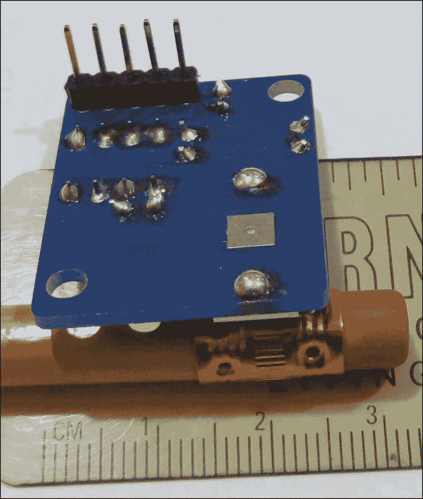
图 10-3 RTC 转接板底部

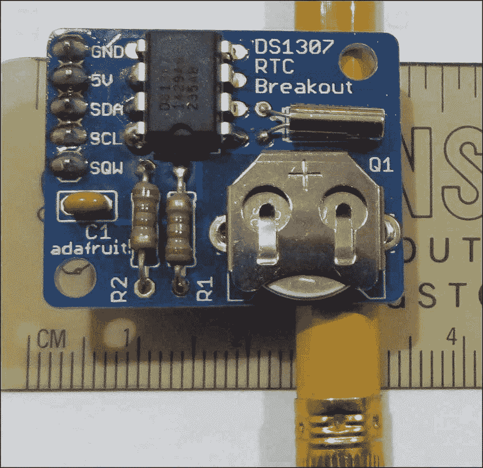
图 10-2 RTC 转接板顶部

`RTCLib`库中的函数`now()`会返回一个`DateTime`对象。该对象描述了调用该函数时的年、月、日、时、分、秒。

### SD 卡座与转接板

数据记录练习选用了 Adafruit Industries 的产品编号为 254 的套件，该套件使用 microSD 卡，且与 Arduino 微控制器完全兼容，内置了 5V 转 3.3V 的转换器。microSD 卡宽 3/8 英寸（1 厘米），长 5/8 英寸（1.5 厘米），厚 1/16 英寸（1 毫米）。转接板的尺寸为 1 英寸（2.45 厘米）x 1¼ 英寸（3 厘米），厚度为 1/16 英寸（1 毫米）。SD 转接板及一块 8 GB 的 microSD 卡如图 10-4 所示。

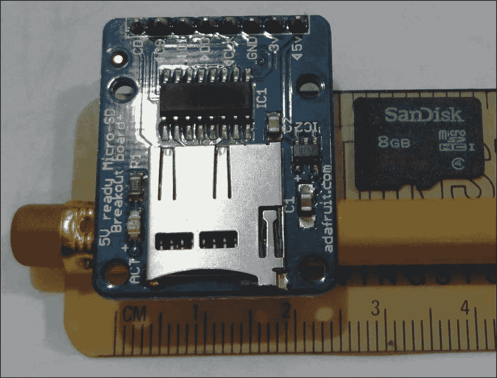
图 10-4 转接板及 microSD 卡的俯视图

下一张照片展示了 SD 转接板的底部，上面带有间距为 1/10 英寸（2.45 毫米）的排针。这些排针的间距设计为与原型面包板上的标准 1/10 英寸间距兼容，如图 10-5 和图 10-6 所示。

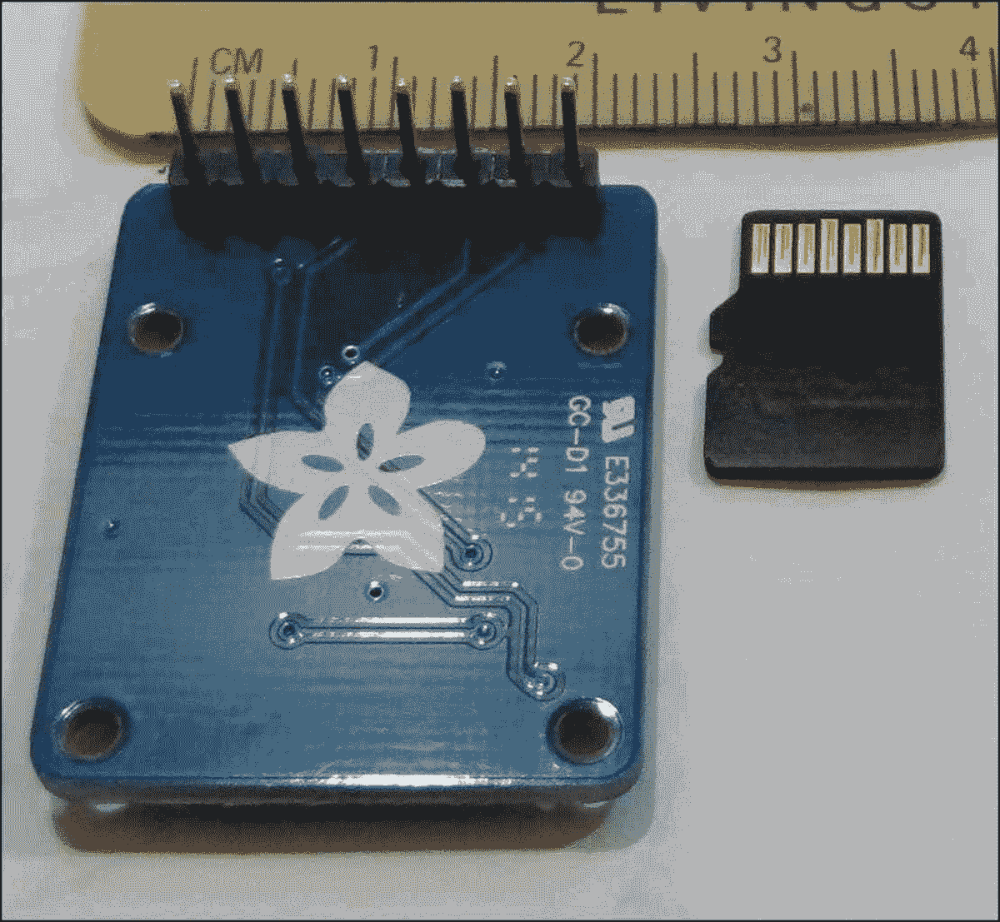
图 10-5 转接板及 8 GB microSD 卡的底视图

新的 SD 卡通常以 FAT16 格式出售（容量小于 2 GB 时），若容量大于 2 GB 则以 FAT32 格式出售。要复用曾用于记录数据或作其他用途（如相机或音乐录制）的 SD 卡，可以利用计算机上的格式化工具清除卡上的文件，并为该卡创建大小合适的新文件系统。

不建议过于频繁地重新格式化 SD 卡。对于已写入 SD 卡且不再需要的文件，可以通过 Windows 资源管理器或等效的文件管理器，使用 Delete 键进行删除，其操作方式与通常从 C 盘删除文件的方法相同。

### 液晶显示屏

数据记录项目选用了来自 Jameco Electronics 的三星 DCM 16433 显示屏，这是一款四行十六字符、无背光的显示屏，兼容 HD44780 标准。使用四行显示屏，可以同时观察来自实时时钟的时间和日期，以及安装在窗口式密封腔体中传感器传来的温湿度数据流，这些数据正在被记录到 microSD 卡上。密封腔体用于测量被测材料的水分活度。四行显示屏既允许监控数据，也能显示腔体内的平衡条件。

LCD 集成电路有一个 14 引脚的连接排或排针用于控制和数据传输，并且可能额外有两个引脚用于背光功能。Arduino 的 IDE 中有一个名为 `LiquidCrystal.h` 的内置库，其中包含一系列共十九个编程函数，用于控制字符显示，涵盖显示照明、接收串行输入、闪烁以及创建自定义字符等功能。（请参见 Arduino LCD 库语言参考）。（目前已有使用 I²C 的 LCD 显示屏，它们仅使用 `VCC`、`GND`、`SDA` 和 `SCL` 引脚，从而为 Arduino 留下了四个数字引脚）。

一块 LCD 需要电源和接地连接，这通常是 LCD 端子板上的前两个连接。应查阅制造商的参考文献，以确认控制和激活显示屏所需的其余连接。除了电源连接外，我所使用的四行十六字符显示屏还采用了一个 10 kΩ 电位计的滑动端连接在地线和 5V 电源之间，并连接到显示屏排针的第 3 引脚，以控制图像对比度。在本练习所用的显示屏中，图像对比度控制电压被称为 `V[o]`。

除了控制电源、接地和图像对比度的电气连接外，操作 LCD 还需要另外六个连接。

尽管 LCD 可以接受 8 位数据用于显示，但通常只使用 4 位。对于大多数应用而言，8 位和 4 位操作在显示效果上没有明显差异，而使用 4 位方式可以为微处理器上的其他用途保留四个数字 I/O 线。Arduino 数字 I/O 与 LCD 排针之间的 6 引脚分配可根据应用需求而变化，只要在相应的代码行中进行了正确的分配即可。

`LiquidCrystal lcd(RS, enable, D4, D3, D2, D1); // lcd 连接分配`

Arduino 的 IDE 中提供了几个简单的 LCD 使用演示代码示例，而以下代码则演示了在科学应用中实用的 LCD 编程。

## 软件

为便于文本与代码清单之间的交叉引用，清单 10-1 和 10-2 已整合到以下讨论该主题的相关段落中，而非单独列出。

## 清单 10-1 涉及一个 Arduino 实时时钟的串口监视器显示
数据记录项目的初始阶段是组装或获取一个基于 Maxim 1307 器件的实时时钟。这款时钟芯片在成本与性能之间取得了平衡。对于本书练习中设计的实验可能用到的多数数据记录操作，它都能提供足够的精度。使用 Maxim 1307 的 RTC 的 Arduino 代码可以在 IDE 提供的示例中找到，如下所述。

以下来自 IDE 示例 `ds1307` 菜单选择的代码，在首次运行时，通过使用 `rtc.adjust()` 函数从宿主机设置时间和日期。一旦 RTC 初始设置为正确的时间和日期，只要有电，RTC 就会运行。电源可以来自 USB、辅助 Arduino 电源（例如，为 Arduino 供电的电池或独立电源），或者如果 Arduino 关闭，则来自 RTC 自身的纽扣电池。当前时间/日期可以通过 `rtc.now()` 函数获取。

```
// 使用通过 I2C 和 Wire 库连接的 DS1307 RTC 的日期和时间函数
#include 
#include "RTClib.h"
RTC_DS1307 rtc; // 声明 rtc 对象
void setup () {
Serial.begin(9600);
#ifdef AVR
Wire.begin();
#else
Wire1.begin(); // Shield I2C 引脚连接到 Arduino Due 上的备用 I2C 总线
#endif
rtc.begin();
if (! rtc.isrunning()) {
Serial.println("RTC 未运行！");
// 以下行将 RTC 设置为此草稿编译时的日期和时间
rtc.adjust(DateTime(F(__DATE__), F(__TIME__)));
// 此行使用显式的日期和时间设置 RTC，例如要设置
// 2014 年 1 月 21 日凌晨 3 点，请调用以下代码：
// rtc.adjust(DateTime(2014, 1, 21, 3, 0, 0));
}
}
void loop () {
DateTime now = rtc.now();
Serial.print(now.year(), DEC);
Serial.print('/');
Serial.print(now.month(), DEC);
Serial.print('/');
Serial.print(now.day(), DEC);
Serial.print(' ');
Serial.print(now.hour(), DEC);
Serial.print(':');
Serial.print(now.minute(), DEC);
Serial.print(':');
Serial.print(now.second(), DEC);
Serial.println();
Serial.print(" 自 1970/1/1 午夜以来的秒数 = ");
Serial.print(now.unixtime());
Serial.print("s = ");
Serial.print(now.unixtime() / 86400L);
Serial.println("d");
// 计算未来 7 天又 30 秒后的日期
DateTime future (now.unixtime() + 7 * 86400L + 30);
Serial.print(" 现在 + 7d + 30s: ");
Serial.print(future.year(), DEC);
Serial.print('/');
Serial.print(future.month(), DEC);
Serial.print('/');
Serial.print(future.day(), DEC);
Serial.print(' ');
Serial.print(future.hour(), DEC);
Serial.print(':');
Serial.print(future.minute(), DEC);
Serial.print(':');
Serial.print(future.second(), DEC);
Serial.println();
Serial.println();
delay(3000);
}
清单 10-1
设置时间和日期
```

在清单 10-2 中，可以通过提取上一程序描述的时间数据并显示在 LCD 的前两行，来创建一个当前时间的可视化显示。以下代码提供了一个 RTC LCD 时间时钟。

```
// 使用通过 I2C 和 Wire 库连接到 Arduino 和 LCD 的 DS1307 RTC 实现日期和时间功能（数字时间可在串口监视器上显示，但会快速滚动）。
#include 
#include "RTClib.h"
#include 
// 初始化 LCD 和引脚分配
LiquidCrystal lcd(9, 8, 7, 6, 5, 4);
RTC_DS1307 rtc;
void setup () {
Serial.begin(9600);
#ifdef AVR
Wire.begin();
#else
Wire1.begin(); // 防护板 I2C 引脚连接到 Arduino Due 的备用 I2C 总线
#endif
rtc.begin();
lcd.begin(16, 4);
if (! rtc.isrunning()) {
Serial.println("RTC 未运行!");
// 以下行将 RTC 设置为此草图编译时的日期和时间
rtc.adjust(DateTime(F(__DATE__), F(__TIME__)));
// 此行使用明确的日期和时间设置 RTC，例如设置为 2014 年 1 月 21 日凌晨 3 点，可调用：
// rtc.adjust(DateTime(2014, 1, 21, 3, 0, 0));
}
}
void loop () {
DateTime now = rtc.now();
lcd.clear();
Serial.print(now.year(), DEC);
lcd.print(now.year(), DEC);
Serial.print('/');
lcd.print("/");
Serial.print(now.month(), DEC);
lcd.print(now.month(), DEC);
Serial.print('/');
lcd.print("/");
Serial.print(now.day(), DEC);
lcd.print(now.day(), DEC);
Serial.print(' ');
lcd.print(' ');
lcd.setCursor(0,1);
Serial.print(now.hour(), DEC);
lcd.print(now.hour(), DEC);
Serial.print(':');
lcd.print(":");
Serial.print(now.minute(), DEC);
lcd.print(now.minute(), DEC);
Serial.print(':');
lcd.print(":");
Serial.print(now.second(), DEC);
lcd.print(now.second(), DEC);
Serial.println(); // 串口监视器中的滚动显示。
delay(10);
}
清单 10-2
RTC LCD 时钟
```

## 清单 10-3 数据记录代码
清单 10-3 从固态湿度和温度传感器读取数据，并将带时间戳的数据记录到格式化的 8 GB 微型 SD 卡上。相对湿度温度传感器有其专属的库 `DHT.h`，使 Arduino 能够读取传感器的输出。`DHT 22` 是一种平衡传感器，仅每三秒读取一次。

`DHT-22` 传感器周围的局部大气条件的连续可视化显示将在一个四行十六字符的 LCD 上显示，同时记录实验条件。

### 图 10-6 展示了带有 LCD 显示屏、Arduino 板和 USB 电缆的拥挤原型板
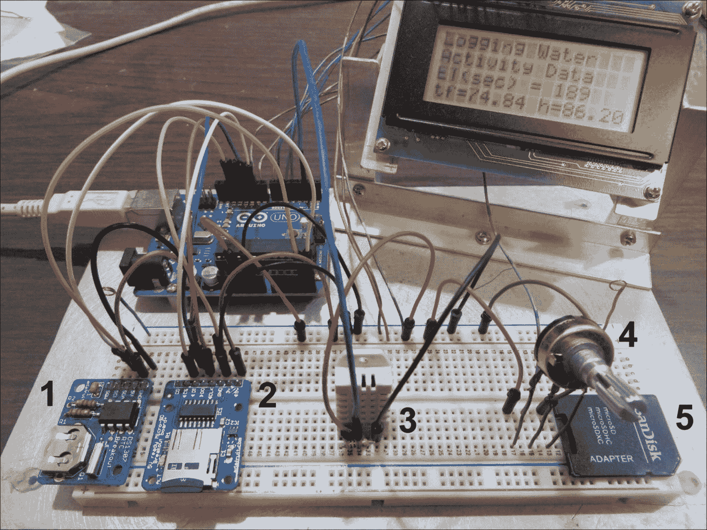

图 10-6 带时间戳的相对湿度和温度数据采集及微型 SD 卡数据存储

数据记录项目的代码如下。

### 图 10-7 展示了带防护板的 Arduino 紧凑型、电池供电、自主数据采集系统
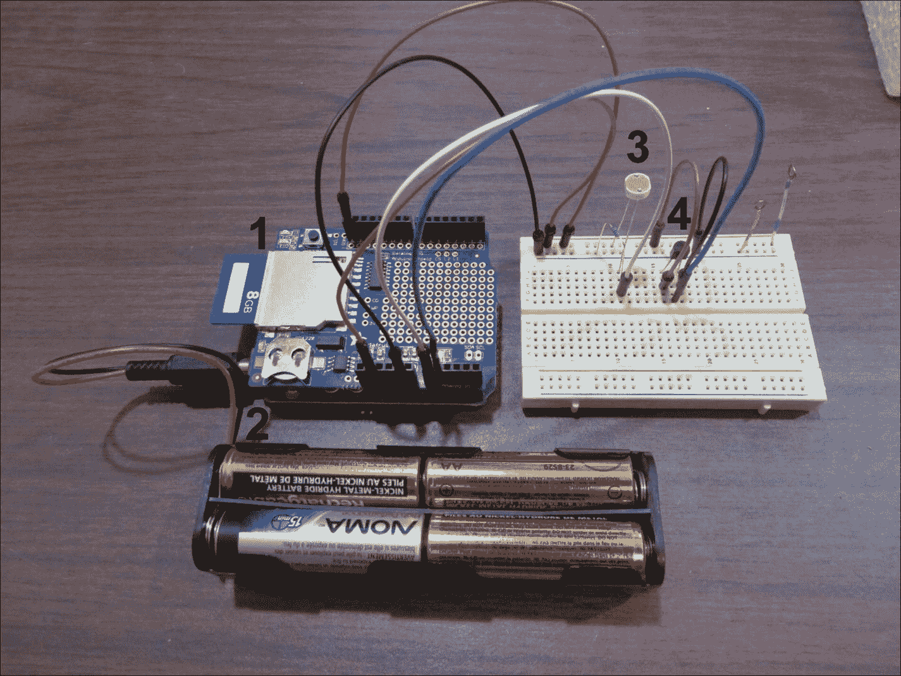

图 10-7 自主光照和温度数据采集模块

在图 10-7 中，(1) 标注指示用于记录或记录数据的常规尺寸 SD 卡，(2) 指示电池供电的 RTC，(3) 是光敏电阻，(4) 是固态温度传感器。

图 10-8 展示了插入式数据记录防护板及 Arduino 控制板的底部。

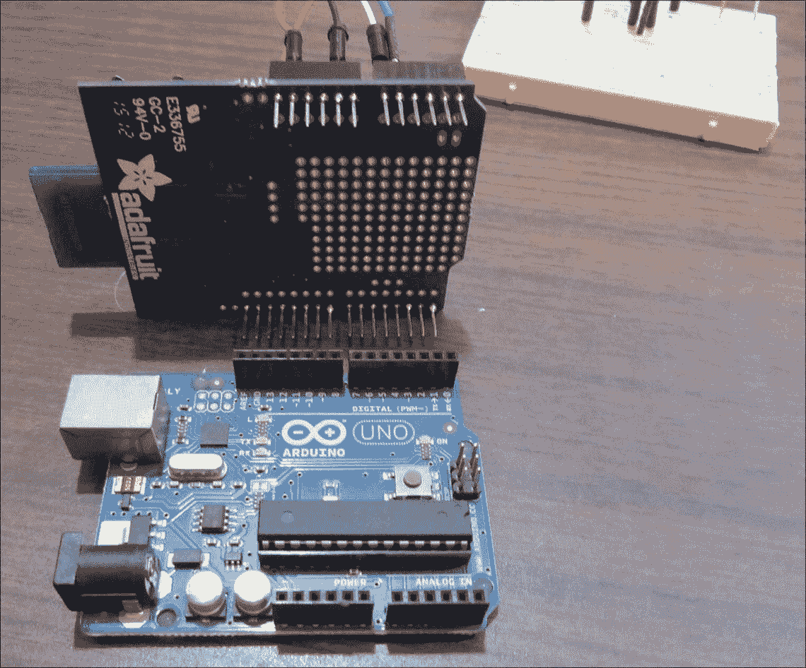
图 10-8 数据记录防护板的连接引脚

图 10-8 中的 Arduino 数据记录防护板是从 Adafruit Industries 购买并完全组装好的。它配备了可选的堆叠式排针，以便记录组件能够与其他防护板或原型面包板一起使用。

使用我的带有可选堆叠式排针的组件，`LDR` 和 `LM 35` 温度传感器按照图 10-9 所示的电路安装在一块小型原型面包板上。

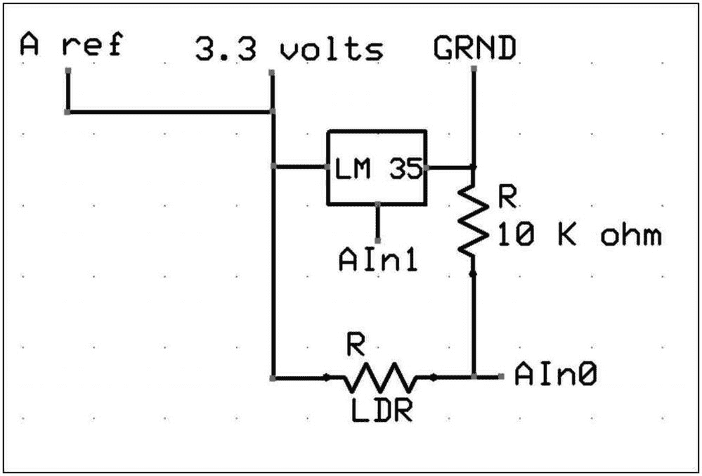
图 10-9 Arduino `LDR` 和温度传感器电路

该系统按照供应商提供的示例软件所建议的配置进行组装。系统由 3.3 V 电源供电，该电源的优势在于它是由噪声较大的 USB 5 V 电源调节而来的，应为一个噪声水平低得多的电压源。

建议的光照和温度传感器电路包括将 `LDR` 配置在分压电路中，以将光照强度转换为可测量的电压。此类传感器配置的非线性和异常行为在《电子发明者实用电子学》第 6 章中有所介绍并进行了数学建模。

组装自主系统的目的是将设备放入冷藏容器中，以验证内部温度是否回到设定点，并确认有无光照。`LDR` 的阻值应在腔室打开受光照时从低阻值变化，到腔室关闭黑暗时达到最大阻值。因此，`SD` 卡上记录的数据应表现为温度数据中的模拟漂移，以及光照数据中从低到高的“数字”类型切换。

清单 10-4 中的 Arduino 草图已根据数据记录防护板制造商提供的示例进行了修改。它以 10 位 `ADC` 缩放数值的形式记录时间、温度和光照强度。

要使用记录器，请组装系统，连接到电池组，然后通过访问串口监视器开始数据记录会话。当串口监视器显示所有初始化和启动消息并开始列出数据时，可以断开 USB 电缆，并将模块放置到待监测的环境中。

在连接到 USB 期间，每次访问串口监视器时都会创建一个新文件。使用操作系统的文件管理实用程序清除 `SD` 卡上的旧文件，可重置数字文件识别程序。

## 观察结果

将 Arduino 微控制器、`RTC` 和 `SD` 数据卡座组装在原型面包板上，并将 `DHT-22` 传感器连接到 Arduino 的数字 I/O 引脚 2 后，记录了 41 分钟的室内温度和湿度。数据记录程序中的默认采集时间为每分钟 20 个样本。在 41 分钟内收集了 820 条读数记录。

通过从其卡座中取出 8 GB microSD 卡来终止数据收集。将 microSD 卡安装到标准尺寸的 `SD` 卡座/适配器中，以便插入台式工作站来检查收集的数据。主机将 `SD` 卡识别为额外的常规驱动器，并分配相应的驱动器号或盘符。根据 `SD` 卡上的标头信息，41 分钟的数据收集产生的文件大小为 34 KB。

使用计算机的文件属性实用工具检查真实文件大小，显示总文件大小为 65,536 字节，其中包括文件系统开销。以 3 秒的数据采集速率和 41 分钟的采集间隔，产生 820 行数据，系统总共消耗约 1.5 kB/分钟。这张 8 GB 的卡有空间容纳 8 GB / (1.5 KB/分钟) = 5,293,211 分钟，即 3,675 天的连续数据收集。

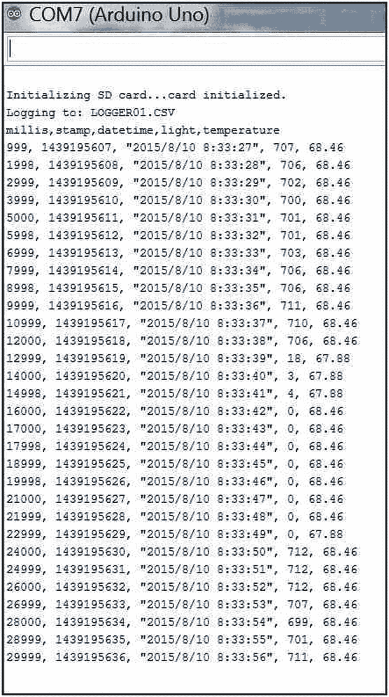
图 10-11 — 自主模式下的串口监视器数据采集显示

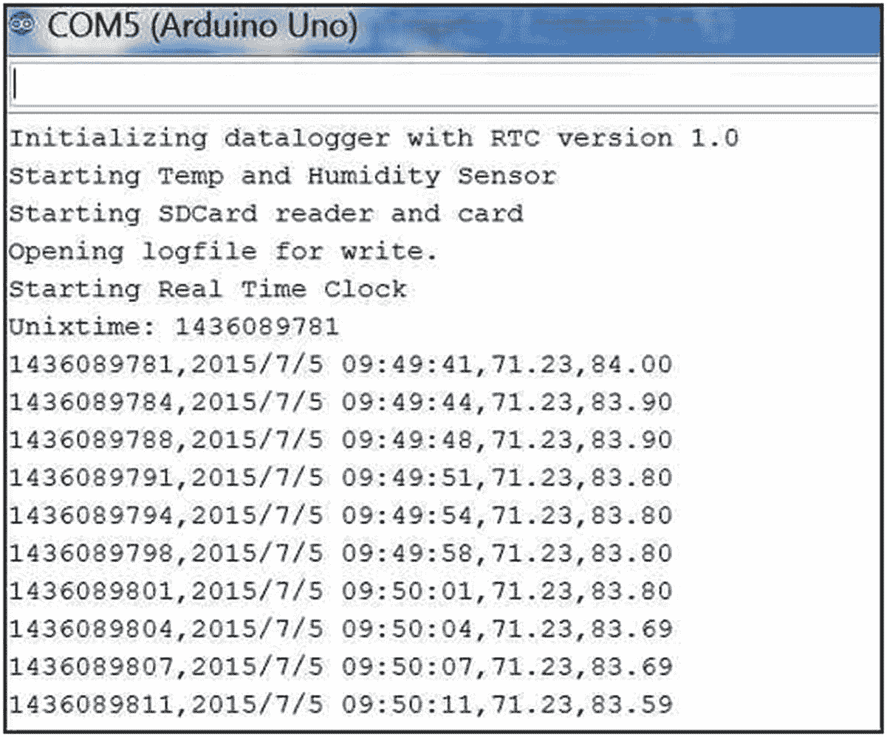
图 10-10 — 温度和湿度数据的串口监视器记录

从电池供电的自主模块收集的数据显示，当 `LDR` 暴露在室内照明下时，记录的 Arduino `ADC` 值。来自白炽灯的正常顶部照明产生的光照值在 700 `ADC` 计数范围内，而用笔帽盖住 `LDR` 则会将读数降至零。

要恢复在数据收集模块自主运行期间收集的数据，需从模块中取出卡并将其插入计算系统的 `SD` 卡插槽或 `SD` 卡读卡器中。卡上的文件如图 10-12 所示。

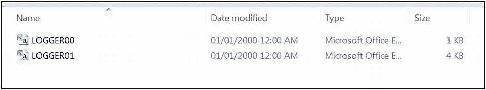
图 10-12 — 电池供电的自主数据收集模块生成的 `SD` 文件

在 Microsoft Excel 中打开 `Logger01` 文件可得到图 10-13 所示的表格数据阵列。电子表格的标题由以下代码行创建。

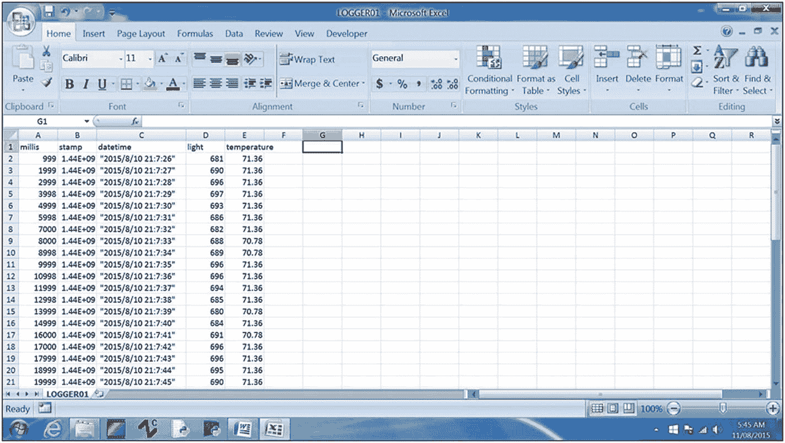
图 10-13 — 来自自主采集的记录数据在 Excel 中的显示

```
logfile.println("millis,stamp,datetime,light,temperature");
```

该代码行位于 Arduino 代码 `DataLoggingLightAndTemperature_Rvn1_rtsketch_jul21b` 中。

首次打开时，Excel 电子表格处于默认配置状态。`millis` 和 `stamp` 列（可能为 5 到 10 位数字范围）会以指数表示法显示，直到调整列宽以适应更大的数字位数。

### 使用 RPi 进行数据记录

来自 Sense HAT 板的数据记录在第 6 章中讨论。Sense HAT 板配备了一个可编程 `LED` 阵列，用于视觉通信或报警，并通过连接到 `RPi` `GPIO` 阵列提供导航和环境传感器数据。数据记录不存储在 `SD` 卡上，而是存储在 `RPi` Linux 操作系统的主存储驱动器上。带时间戳的数据以逗号分隔值（`CSV`）格式存储，该格式与大多数电子表格软件程序兼容。可以从 GitHub 仓库获取完整的教程，用于记录来自 Sense HAT 板的所有或特定数据流，该板可从 Raspberry Pi 基金会和许多供应商处获得。

Arduino 微控制器、`RTC` 和 `SD` 数据收集系统与 `RPi`/Python 平台完全兼容。

## 网络

网络是构建监控和数据采集系统的基础。在网络中，各个计算机可能具有同等的地位，并以客户端-服务器的方式交换文本、图形或数据等信息。一台设备发送，另一台设备接收。网络可以简单到连接两台计算机以共享信息，也可以涉及以各种配置连接的大量计算单元，所有这些单元都通过称为*路由器*的特定设备连接在一起，这些设备控制着通过连接系统的信息流。

一种常见的配置是几台计算机通过一个路由器连接，该路由器允许在各个单元之间进行有线和无线连接。这使得计算机能够在局域网中自由通信。

使用有线或无线配置路由器的局域网受到物理限制的限制。如果系统有电且电缆物理完好，则有线连接是有保证的。无线网络连接取决于发送和接收站是否有电、功能正常的发送和接收设备以及不间断的无线电传输。如果保持无线电接触，无线系统具有几乎无限的本地移动性的优势。通常，本地无线系统必须使用中继器来确保在整个期望的操作区域内都有强大的无线电信号。

家庭、企业和各种机构使用路由器连接的局域网来连接各种固定和移动计算设备以处理信息。除了构建局域网外，路由器还可以连接到互联网以访问全球可用的资源。控制局域网并提供互联网连接的路由器通常被称为*网关*。

有线网络将信息流或网络流量限制在系统的工作站和局域网电缆上。无线连接将网络流量广播到局域网有效广播范围内的任何接收站。无线连接需要一个安全系统，以防止对客户端和服务器之间的控制信息流造成意外干扰。

SCADA 系统最初设计用于较长距离的运行，允许中央位置监控和控制远程设施，例如发电站和公共事业。微小型化的持续进步使得对本地和全球远程设备的远程控制变得司空见惯。当通过互联网连接使用时，`HMI` 以及涉及硬件和软件语言（如超文本标记语言 `HTML`）的特殊计算机通信，创造了从本地到全球的远程控制能力。

通信由两个实体之间的信息传输组成。一个实体发送数据，而另一个实体接收信息。通信集成电路使用一种涉及比特的低级主从（`I²C`）数据传输协议。联网的计算设备使用更高级别的语言客户端-服务器协议来交换网页信息。在互联网客户端-服务器通信中，客户端向服务器请求信息，信息交换涉及整个或部分网页的交换。

一个廉价、易获得的 Arduino 微控制器可以被编程为充当互联网连接的 `Web` 服务器组件，从而允许在 `PC` 主机和远程实验之间进行数据收集和监控命令的双向流动。

本练习旨在构建与实验操作相关的网络连接，首先从集成一个 `Arduino` 微控制器并将其定位到局域网（`LAN`）中开始。一旦微控制器集成到局域网中，连接将进一步扩展，通过具备全球通信能力的互联网连接，在台式机与微控制器之间传输数据和控制信号。与所有计算技术一样，配置开发过程正不断趋向于更加自动化。

深入的网页设计、用于实现客户端-服务器编程或交互的脚本语言，以及为防止无线系统中广播无线电信号意外交互所需的额外安全考虑，本书仅通过简单示例进行介绍，以保持其入门性质。以下列出一些互联网接入中使用的术语和缩写词。

`客户端-服务器模型`：互联网信息通常以网页形式存储和传输。服务器是存储信息并向请求访问页面的客户端设备分发信息页面的计算机。当客户端向服务器请求信息时，信息传输即被启动。Web 服务器持续监听客户端的请求，并在收到请求后以完整或部分网页的形式提供所需信息。

`DHCP`：动态主机配置协议是一种自动为设备分配互联网地址的程序。当设备集成到局域网时，驻留在`Arduino Ethernet`库中的 DHCP 程序会为微控制器定位并分配一个 IP 地址。

`表单`：用于收集用户输入的网页，包含多种可视化显示元素，如复选框、单选按钮、文本输入框、滑块条以及其他用于输入用户信息的元素，称为表单。当主机的 Web 浏览器程序运行一段用`HTML`编写的代码时（示例如下），表单即被显示。在`HTML`中，表单的起始和结束由`<form>`和`</form>`标签定义。计算单元之间的数据传输由`GET`和`POST`方法控制。

`GET/POST`：向远程服务器传输信息以及从远程服务器接收信息的两种方法是`GET`和`POST`。网址（`URL`）以`/?s=arduino`等序列结尾的请求是`GET`请求，其中变量`s`被设置为值`arduino`。`GET`定义了`URL`中`?`后面的一系列变量。`GET`和`POST`的功能代表了数据在客户端和服务器之间移动的两种方式。

`HTML`：超文本标记语言是创建网页的标准`脚本`或`标记`语言。Web 浏览器程序读取`HTML`文件并将其代码渲染为网页。`HTML`描述了如何在网站中显示页面，它被称为`标记语言`而非编程语言。

`HTML`代码元素是所有网站的结构化细节。`HTML`将图像和对象融合到页面元素中，这些元素可以创建交互式表单，并提供通过基于文本的结构化语义（描述标题、段落、列表、链接、引用及其他项目）生成结构化文档的方法。

`HTML`元素由包含在尖括号（如`</p>`）中的不可见标签组成，这些标签配置了浏览器程序显示页面内容的方式。

还有许多其他`HTML`功能可用于网站创建。请参考万维网联盟的标准，该联盟自 1997 年起一直负责`HTML`的创建、修改和实现工作。

`HTTP`：超文本传输协议旨在实现客户端与服务器之间的通信，并作为两者之间的请求-响应协议运作。驻留在任何计算系统上的 Web 浏览器程序可以作为客户端，向运行着 Web 服务器程序（用于根据网络连接的客户端请求分发网页信息）的任何其他计算系统请求基于网页的信息。在一个典型的互联网或局域网交换示例中，客户端（浏览器程序）以标准化格式向服务器提交一个`HTTP`请求，服务器在确认该请求后完成所请求的网页事务。

`IP 地址`：互联网上的位置通过互联网协议地址来标识，该地址由四个分组数字值组成，取值范围为 0 到 255（一个字节，即`2⁸`）。

`MAC 地址`：媒体访问控制地址是连接到互联网的网络接口设备的唯一标识符。在本练习中，它是`Arduino Ethernet Shield`上的六组十六进制数字对。（在我的开发板上，它是`90-A2-DA-0D-79-2A`）。

`路由器`：早期的网络通过将电缆连接的计算单元或工作站连接到集线器来形成局域网。带有修改后硬件的集线器被创建，以允许通过无线和有线方式连接工作站形成局域网；而逻辑电路的加入则形成了路由器，然后路由器可以引导局域网成员与全球互联网之间的网络消息信号流。

`URL`：统一资源定位符指的是网页地址。这些地址由统一资源定位符和统一资源名称组成。

要使用下面这一系列逐步增强`Arduino`互联网连接功能的练习，所编写的代码（sketches）的复杂度会显著增加。关于功能如何实现的基础解释可能需要实验者学习或回顾`HTML`、`C`、`C++`、网页创建以及高级`Arduino`编程等底层技术。（参考文献以及与原始代码来源相关的资料均已提供。）

### 将 Arduino 连接到网络

`Ethernet shield`（以太网扩展板）是一种电路板，它通过排针堆叠在 `Arduino` 顶部，既可以访问微控制器的所有 I/O 引脚，也提供了将微控制器连接到局域网所需的电路。该扩展板配有一个用于有线连接的 `RJ-45` 线缆插座。通过 `Arduino USB` 连接可以访问主机上的 `IDE`（集成开发环境），以创建所需的草图程序。一旦草图程序加载到 `Arduino`，微控制器便可通过 `Ethernet` 连接与局域网或互联网上的任何设备进行通信。

图 10-14 展示了一个安装在 `Arduino UNO` 上的 `Ethernet` 扩展板。图像左侧分别是 USB 线缆和网线，分别标注为 (2) 和 (1)。

当配置为网络服务器时，用于在客户端浏览器上显示网页所需的代码可以由 `Arduino` 草图提供，或存储在 SD 卡 (3) 上。该扩展板上安装的 SD 卡还可以记录来自连接互联网的实验数据。原型实验可以通过原型板 (4) 和相应的接线在 `Arduino-Ethernet Shield` 堆叠上进行组装和连接。在图 10-14 中，一个音频音调发生器 (5) 和一个带有长引线的 `RGB LED` (6) 是电子元件，它们可以通过互联网连接的数据传输进行监控或控制。

在图 10-14 中，SD 卡 (3) 松散的存放在其卡槽内。当不主动使用时，SD 卡不应安放在读卡器中，因为它可能会干扰任何不需要访问该设备而运行的草图程序的预期操作。

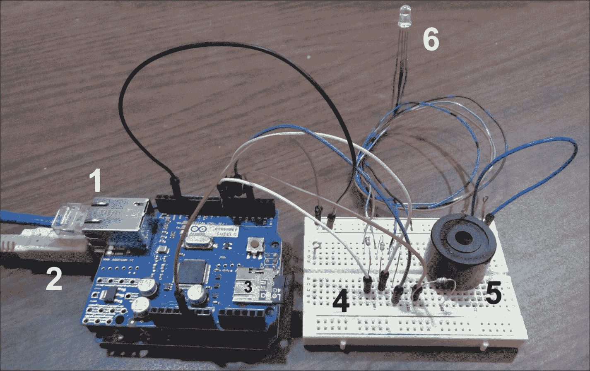

**图 10-14** — 一个 `Arduino Ethernet Shield` 和原型面包板。

以下介绍的代码、硬件和技术具有可扩展性。它们可以被使用或轻松修改，以便通过互联网在连接到 `Arduino` 的实验过程与观察者之间传递信息、数据和命令。后续的程序汇编整理自书籍、在线教程、论坛或参考文献，并经过修改以演示可用于互联网监控和管理的技术。

### 简单网页

本练习首先在主机 PC 上创建一个基本网页，以演示网络浏览器如何解释 `HTML`。

`HTML` 使用简单的文本编辑器编写，例如 Windows 附件中的 `WordPad` 或 RPi 的文本编辑器，并以 `.htm` 扩展名保存，形成一个可供浏览器程序读取的文件。`HTML` 也可以在功能更高级的文本编辑器（如 `WordPad++`，免费软件）中编写。

配置微处理器以处理通过其串行端口传输的字符，并提供适当的识别逻辑来响应字符序列，是一种稳健的技术，它允许设备按实验者的要求工作。当互联网连接到设备串行端口时，可以从微处理器调用网络服务器或客户端响应。能够读取串行端口字符的草图可以重新组合命令来操作微控制器的 I/O 引脚，或者读取并返回选定引脚的电压电平。

本练习中研究的网页是“扩展”自以下来源的代码和方法：

-   《编程 Arduino：草图入门》，作者：Simon Monk（McGraw-Hill, 2011）
-   《编程 Arduino：下一步，深入草图》，作者：Simon Monk（McGraw-Hill, 2018）
-   《探索 Arduino》，作者：Jeremy Blum（Wiley, 2013）
-   《树莓派烹饪书》，作者：Simon Monk（O'Reilly Media, 2019）
-   [`arduino.cc/en/reference/ethernet`](http://arduino.cc/en/reference/ethernet)

互联网技术和物理计算硬件在不断演变。关于 `Arduino` 微控制器的最新信息来源可在互联网上找到。

## 实验

### 创建一个简单的 HTML 网页

任何现成的文本编辑程序，例如 Windows 记事本、RPi 文本编辑器或多功能文本编辑器 Notepad++，都可以用来编写 `HTML` 文档。所有网页都需要至少最少的代码才能在浏览器中实现和显示。

在文本编辑器中输入以下 `HTML` 代码。

```html
 Arduino Measurements in Science
Physical Computing with Integrated Circuits for
the Experimental Sciences.
```

使用合适的标题和扩展名 `.html` 将代码保存到易于访问的存储位置。保存文件后，启动一个网络浏览器，如 Google Chrome。在键盘上按 `Ctrl+O` 并导航到存储的文件。打开它，您应该会看到图 10-15 中的屏幕。


**图 10-15** — 在 web 浏览器中显示的一个简单 `HTML` 文件。

将使用独立的 `HTML` 文件以及浏览器对这些文件的查看来开发网页。实验者可以使用 `HTML` 文件创建运行实验的、已连接互联网的微控制器所需的用户界面。然后，显示实验者所需用户界面所必需的 `HTML` 代码可以集成到微控制器的网页服务器草图代码中，以便在实际的联网研究操作期间交付给主机 web 浏览器。

`HTML` 由标签组成，这些标签由小写字母和符号组成，并包含在尖括号（`<` 和 `>`）中。成对使用的标签，如 `<p>` 和 `</p>`，用于开始和结束一个显示特性，例如段落。Web 浏览器程序通过解释 2012 年创建的 `HTML 5` 中可用的大量标签，使用这些标签来创建可视页面显示。

### 网络设备位置

要定位网络上的设备，必须识别出位置。`Arduino Ethernet` 库提供了一个 `DHCP` 服务，用于分配适当的设备位置。下面的草图找到了我局域网中 `Arduino Ethernet Shield` 的 IP 地址，该局域网配置了一个带有 `D-Link`、`DIR–615` 无线和电缆连接的路由器。要使用该代码，必须在 `MAC` 定义数组行中以十六进制格式输入每个 `Ethernet Shield` 的 `MAC` 地址。

```c
byte mac[] = { 0x90, 0xA2, 0xDA, 0x0D, 0x79, 0x2A };
```

在验证并将草图代码加载到 `Arduino` 并激活串行监视器后，`Arduino Ethernet Shield` 的 IP 地址应该会出现。我的板子被分配了 IP 地址 `192.168.0.103`，该地址用于清单 10-3、10-4 和 10-5 中。

这个简单的草图使用 `Ethernet` 库的命令来提供串行监视器显示分配给 `Arduino` 服务器的地址。该库中完整的命令集可在参考的在线 `Arduino` 网站上找到。

### 从连接 Arduino 服务器的实验中读取数据

您可以在主机电脑与连接到微控制器的远程设备之间建立双向的客户端-服务器 IP 通信链路。双向客户端-服务器对话始于主机电脑浏览器向 Web 服务器微控制器发送信息请求。编写 Arduino 代码来监听浏览器请求，并在监听到请求时发送确认信息。通过读取客户端请求中的代码，将包含所需信息的页面发送回主机上的浏览器程序。

基于 HTML 的互联网通信采用固定格式，每行以回车符和换行符结尾，在传输的代码中用 `\r\n` 序列表示。传输一个空行表示传输结束。

在以太网库中，包含 `EthernetServer` 和 `EthernetClient` 类，它们提供了服务与接收网页所需的所有函数和命令。

清单 10-6 读取了 Arduino 模拟输入端口的前两个模拟输入值。该 Arduino 程序为主机浏览器提供了创建图 10-16 中网页所需的 HTML，该网页显示了代码执行时两个输入端的值。

图 10-16 展示了由连接到互联网的 Arduino 上的程序发送给 Web 浏览器的 HTML 代码所生成的简单静态网页。

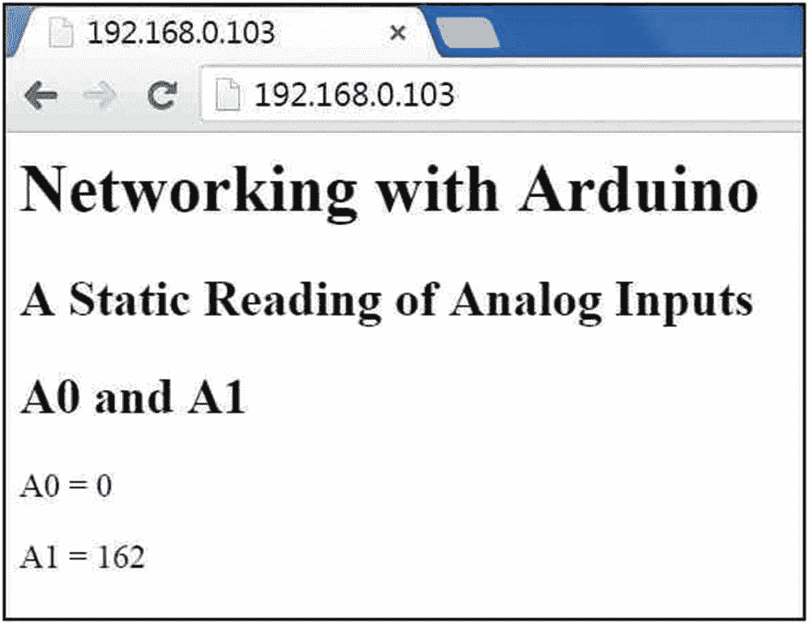

**图 10-16**
由 Arduino Web 服务器读取数据并提供的页面

Arduino 模拟输入端的信号变化可以通过定期“刷新”浏览器显示的页面，或者在主机显示的网页上安装一个刷新按钮来实现更新。

在标记响应报头结束的空行之后添加注释和一行代码，会导致 A0 和 A1 上的模拟电压值每 5 秒更新一次。

```
// add a meta refresh tag for an auto page refresh
client.println("");
```

Meta 元素是用于 HTML 头部的标签，其中包含关于数据的信息。使用 metatag 时必须附带众多属性。5 秒的“刷新”选项会更新数据。meta 标签刷新技术是一种简单的方法，但它会导致网页明显闪烁。更复杂的方法（涉及 JavaScript 编程）可以在无闪烁的显示中仅更新变化的数据。

更新显示数据的第二种方法是使用浏览器显示页面上的按钮图像、单选按钮或复选框。使用主机上显示的按钮或复选框来激活连接到传感器或实验的远程 Arduino 上的 I/O 接口，现在涉及客户端和服务器之间的双向对话。以下程序演示了使用按钮来激活 LED 并更新模拟输入读数。主机上的按钮表格显示可以控制和监控远程设备上的 I/O 引脚。双向对话需要显著增加用于传输数据的代码量。

网页是承载客户端和服务器之间信息或内容的媒介，对于双向数据传输，会使用网页“表单”。表单可以在 HTML 中使用 `<form> </form>` 标签进行配置，并通过 `GET` 和 `POST` 方法来来回回地传输。当用户点击页面显示中的“更新”按钮时，填写了所需传感器或控制设备信息的表单会进行来回传输。

图 10-17 是一个典型的流程图，描述了从主机电脑上显示的网页来切换微控制器上输出引脚所需的过程。

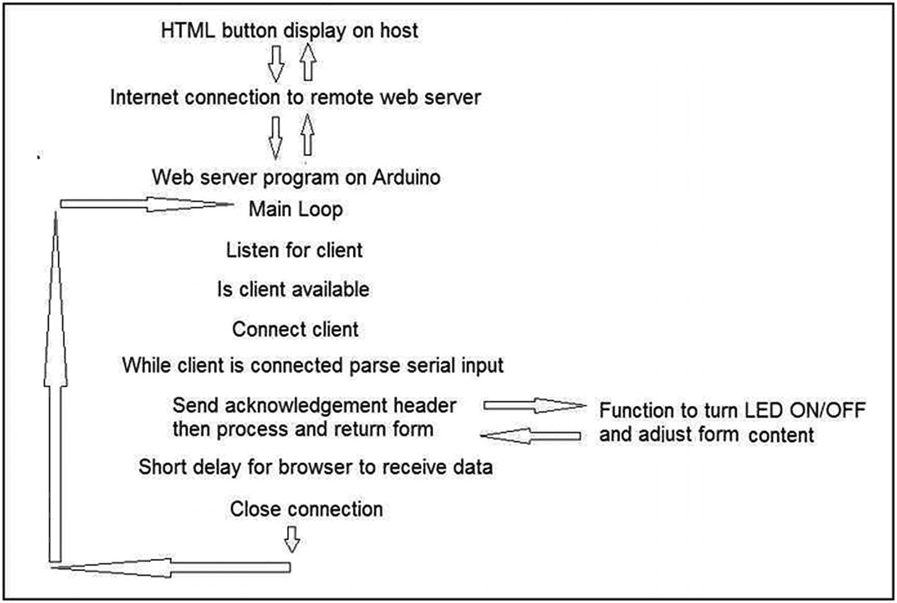

**图 10-17**
激活微控制器输出的流程图

该流程图很简洁，但无意中低估了处理和返回更新表单所需的代码量。微控制器程序必须写入主机浏览器程序以显示所请求的更新信息的 HTML 代码量可能会很庞大，具体取决于所需用户界面的复杂性。

诸如按钮、可变滑块控件和显示屏框传感器读数之类的控制元素，可以通过表单交换来监控和激活连接到远程、可访问互联网的 Arduino 微控制器上的设备。

GitHub 仓库中的两个程序使用了简单、易于获取的组件，演示了如何使用 Arduino Web 服务器作为远程实验设置的互联网控制器（参见 `github.com/simonmonk/programming_arduino/blob/master/sketch_10_02/sketch_10_02.ino` 和 `github.com/sciguy14/Exploring_Arduino_1st_Edition/tree/master/Chapter%2014`）。

引用的第一个程序包含 148 行代码，为实验者提供了一个类似于图 10-16 的屏幕。屏幕底部有一个“更新”按钮。该代码允许系统操作员从控制屏幕或网页上打开和关闭原型板上的 LED。“更新”按钮将引脚设置发送到 Arduino 以供执行。屏幕上的五个引脚按钮可以在开和关状态之间切换。在测试系统时，我通过修改代码和硬件来仅处理两个 LED，从而减少了组件数量。

参考中的第二个程序有 165 行代码，包含三个用于控制 RGB LED 的按钮和一个用于输入频率的编辑框，该频率用于安装在带有二极管的原型板上的音调发生器产生的声音。

这两个程序都有文档说明，但假定代码用户对 Arduino 和 HTML 结构及格式相当熟悉。如果您没有足够背景来重现这些程序，可以参考参考文献 2-1（《电子学实用手册（第 3 版）》，Sherz 和 Monk 著，McGraw Hill 出版，ISBN 978-0-07-177133-7）和 2-3（《探索 Arduino》，Blum 著，Wiley 出版，ISBN 978-1-118-54936-0）中的原始文献。

# 讨论

数据记录应用可以用于多种不同的场景。本练习在一个封闭且密封的小型腔室内收集湿度和温度数据，以测量被测材料中的水分活度。数据记录可用于食品安全质量控制系统中，以验证系统性能。数据记录证明，隔热金属板外壳或带冷却、避光室的生物敏感材料，在打开添加或移除储存材料后，能在一定时间限制内恢复到所需的温度和黑暗条件（参见第 7 章中的相对湿度测定）。使用红外运动传感器，数据记录系统可以记录人或动物通过入口或通道的情况（参见第 6 章）。

所展示的数据记录系统的初期开发工作包括组装所需的硬件，并将 `Arduino` 代码上传到实验装置上，以启动正在开发中的操作。对于实验室或某些现场实验的实际应用，这种用于激活和停用数据记录活动的粗略方法是可以接受的。典型的 `RTC` 依赖其自身电池为计时集成电路供电。该 `IC` 的功耗决定了时间戳功能的寿命。

从 3 秒平衡相对湿度传感器记录数据，大约需要 3600 天才能填满一张 8 GB 的卡。`SD` 卡的读写速度分别为 10 和 30 兆比特每秒（`MB/s`），而较新的设备建议速度可达 98 `MB/s`。在制造商标称的高使用速度下，一张 1 GB 的 `SD` 卡可能在 10 秒内被填满。在相对较短的分钟、小时、天或月的时间范围内，典型的 2 至 3 年 `RTC` 电池寿命不是问题，但对于按年收集数据的实验来说，这可能是一个问题。

# 代码清单

与所有复杂项目一样，您应从简单的教程和实验开始，以获得对所评估系统的基本理解。一旦理解并掌握了系统的基本原理，就可以研究和测试下一个更复杂的应用。从硬件和软件的角度来看，网络和互联网扩展是`SCADA`类型过程管理中变化较快的方面之一。刚开始接触这项技术的研究人员应从最简单的练习开始，然后再进入更高级的有线、无线或无人值守的自主实验监测。如果没有透彻理解构成近期创新基础的基本原理，就无法欣赏新技术。监测远程或难以接近的实验可能需要投入大量时间和精力。您必须确保收获可靠的数据。

## 代码清单 10-6 读取模拟输入

```
// A simple reading from an Arduino web server.
#include    // the SPI library for Arduino shield communication
#include  // Ethernet communications
// MAC address from the Arduino ethernet shield
byte mac[] = { 0x90, 0xA2, 0xDA, 0x0D, 0x79, 0x2A };
// The LAN IP address for Arduino shield determined by library DHCP program
byte ip[] = { 192, 168, 0, 103 };
EthernetServer server(80);      // declare an instance of the server on port 80
void setup() {
Ethernet.begin(mac, ip);        //start ethernet
server.begin();                 // start server program
Serial.begin(9600);             // start serial
}
void loop() {
// listen for incoming clients
EthernetClient client = server.available();
if (client)                    // true when a client becomes available
{
while (client.connected())   // true as long as connection maintained
{
// acknowledge connection by sending a standard http response header
client.println("HTTP/1.1 200 OK"); // 200 indicates a connection, 400 is an error
client.println("Content-Type: text/html");
client.println();     // empty line for end of acknowledgement transmission
// send the body
client.println("");
client.println("Analog Inputs");
client.println("Read from an Arduino Server");
client.print("A0 = ");
client.print(analogRead(0));
client.println("");
client.print("A1 = ");
client.print(analogRead(1));
client.println("");
client.println("");
client.stop();
}
delay(1);
}
}
```

## 代码清单 10-5 IP 地址 192.168.0.103

```
//DHCP - Dynamic Host Configuration Protocol
#include
#include
//
byte mac[] = { 0x90, 0xA2,0xDA, 0x0D, 0x79, 0x2A };
//
void setup() {
Serial.begin(9600);
while (!Serial) {};  // for Leonardo compatibility
//
if (Ethernet.begin(mac))
{
Serial.println(Ethernet.localIP());
}
else
{
Serial.println("Could not connect to network");
}
}
void loop() {
}
```

## 清单 10-4 将数据记录为 10位ADC缩放数值

```cpp
#include <SD.h>
#include <Wire.h>
#include "RTClib.h"
#include <SPI.h>

// 一个简单的数据记录示例，用于记录光敏电阻和固态温度传感器（TMP 36 或 LM 35）的
// Arduino 模拟引脚数据。数据带有时间戳，并通过将毫秒值设置为 1000 来实现每秒记录一次。

#define LOG_INTERVAL  1000 // 根据实际应用需求调整

#define STOR_INTERVAL 1000 // 实际将数据写入 SD 卡的 close() 调用之间的毫秒时间间隔
// 数据写入 SD 卡

uint32_t storTime = 0; // 上次数据写入时间

#define ECHO_TO_SERIAL   1 // 将数据回显到串口
#define WAIT_TO_START    0 // 在 setup() 中等待串口输入

// 连接到 LED 的数字引脚
#define redLEDpin 2
#define greenLEDpin 3

// 连接到传感器的模拟引脚
#define photocellPin 0           // 模拟口 0
#define tempPin 1                // 模拟口 1
#define aref_voltage 3.3  // Aref 连接到 3.3 伏电源

RTC_DS1307 RTC; // 定义实时时钟对象

// 对于数据记录盾板，我们使用数字引脚 10 作为 SD 卡片选线
const int chipSelect = 10;

// 日志文件
File logfile;

void error(char *str)
{
  Serial.print("错误: ");
  Serial.println(str);

// 红色 LED 指示错误
  digitalWrite(redLEDpin, HIGH);

while(1);
}

void setup(void)
{
  Serial.begin(9600);
  Serial.println();

// 使用调试 LED
  pinMode(redLEDpin, OUTPUT);
  pinMode(greenLEDpin, OUTPUT);

#if WAIT_TO_START
  Serial.println("输入任意字符开始");
  while (!Serial.available());
  #endif //WAIT_TO_START

// 初始化 SD 卡
  Serial.print("正在初始化 SD 卡...");
  // 确保默认的片选引脚设置为输出，即使未使用：
  pinMode(10, OUTPUT);

// 检查卡片是否存在并初始化：
  if (!SD.begin(chipSelect)) {
    error("卡片失败或未检测到");
  }
  Serial.println("卡片初始化完成.");

// 创建一个新文件
  char filename[] = "LOGGER00.CSV"; //注意 FAT SD 文件名的 8.3 命名限制
  for (uint8_t i = 0; i < 100; i++) {           // 为每个存储在 SD 卡上的数据文件
    filename[6] = i/10 + '0';                   // 生成唯一的数字标识
    filename[7] = i%10 + '0';
    if (! SD.exists(filename)) {
      // 仅在文件不存在时打开新文件
      logfile = SD.open(filename, FILE_WRITE);
      break;  // 退出循环！
    }
  }

if (! logfile) {
    error("无法创建文件");
  }

Serial.print("日志记录到: ");
  Serial.println(filename);

// 连接到 RTC
  Wire.begin();
  if (!RTC.begin()) {
    logfile.println("RTC 失败");
    #if ECHO_TO_SERIAL
    Serial.println("RTC 失败");
    #endif  //ECHO_TO_SERIAL
  }

logfile.println("毫秒,时间戳,日期时间,光照,温度");
  #if ECHO_TO_SERIAL
  Serial.println("毫秒,时间戳,日期时间,光照,温度");
  #endif //ECHO_TO_SERIAL

// 如果你想将参考电压设置为 5v 以外的值
  analogReference(EXTERNAL);
}

void loop(void)
{
  DateTime now;   //声明一个 DateTime 实例

// 按照我们想要的两次读数之间的时间量进行延迟
  delay((LOG_INTERVAL -1) - (millis() % LOG_INTERVAL));

digitalWrite(greenLEDpin, HIGH);

// 记录自启动以来的毫秒数
  uint32_t m = millis();
  logfile.print(m);    // 自启动以来的毫秒数
  logfile.print(", ");
  #if ECHO_TO_SERIAL
  Serial.print(m);     // 自启动以来的毫秒数
  Serial.print(", ");
  #endif

// 获取时间
  now = RTC.now();
  // 记录时间
  logfile.print(now.unixtime()); // 自 1970/1/1 以来的秒数
  logfile.print(", ");
  logfile.print('"');
  logfile.print(now.year(), DEC);
  logfile.print("/");
  logfile.print(now.month(), DEC);
  logfile.print("/");
  logfile.print(now.day(), DEC);
  logfile.print(" ");
  logfile.print(now.hour(), DEC);
  logfile.print(":");
  logfile.print(now.minute(), DEC);
  logfile.print(":");
  logfile.print(now.second(), DEC);
  logfile.print('"');
  #if ECHO_TO_SERIAL
  Serial.print(now.unixtime()); // 自 1970/1/1 以来的秒数
  Serial.print(", ");
  Serial.print('"');
  Serial.print(now.year(), DEC);
  Serial.print("/");
  Serial.print(now.month(), DEC);
  Serial.print("/");
  Serial.print(now.day(), DEC);
  Serial.print(" ");
  Serial.print(now.hour(), DEC);
  Serial.print(":");
  Serial.print(now.minute(), DEC);
  Serial.print(":");
  Serial.print(now.second(), DEC);
  Serial.print('"');
  #endif //ECHO_TO_SERIAL

analogRead(photocellPin);
  delay(10);
  int photocellReading = analogRead(photocellPin);

analogRead(tempPin);
  delay(10);
  int tempReading = analogRead(tempPin);

// 将该读数转换为电压，对于 3.3v Arduino 使用 3.3，对于 5.0v 使用 5.0
  float voltage = tempReading * aref_voltage / 1024;
  float temperatureC = (voltage - 0.5) * 100 ;
  float temperatureF = (temperatureC * 9 / 5) + 32;

logfile.print(", ");
  logfile.print(photocellReading);
  logfile.print(", ");
  logfile.print(temperatureF);
  #if ECHO_TO_SERIAL
  Serial.print(", ");
  Serial.print(photocellReading);
  Serial.print(", ");
  Serial.print(temperatureF);
  #endif //ECHO_TO_SERIAL

logfile.println();
  #if ECHO_TO_SERIAL
  Serial.println();
  #endif // ECHO_TO_SERIAL

digitalWrite(greenLEDpin, LOW);

// 现在数据被写入到卡片中。
  if ((millis() - storTime) < STOR_INTERVAL) return;
  storTime = millis();

// 闪烁 LED 以表示我们正在向卡片写入数据并更新 FAT 表！
  digitalWrite(redLEDpin, HIGH);
  logfile.flush();
  digitalWrite(redLEDpin, LOW);
}
```

```markdown
//将带有时间戳的数据记录到 SD 卡存储介质上。
// Arduino 的电气连接
// RTC 模块 - SCL -> 模拟引脚 4；SDA -> 模拟引脚 5；+5v 及 gnd
// SD 模块 - CLK -> 数字 I/O 引脚 13，D0 -> 数字 I/O 引脚 12，D1 -> 数字 I/O 引脚 11，CS -> 数字 I/O 引脚 10
//
const int `chipSelect` = 10;
//RTC 库需要 Wire 库
#include `<Wire.h>`
#include `"RTClib.h"`
`RTC_DS1307` rtc; // 定义 rtc 时间对象
//SD 库需要 SPI 库
#include `<SPI.h>`
#include `"SD.h"`
// LCD 库
#include `<LiquidCrystal.h>`
// LCD 的行列常量
const int `numRows` = 4;
const int `numCols` = 16;
// 使用接口引脚编号初始化 LCD 库
`LiquidCrystal` `lcd(9,8,7,6,5,4)`;
//
//
// 使用 SD 实用库函数设置变量：
`File` dataFile;
#define `LOGFILE` "datalog.txt"     // "DATALOG"将成为 SD 卡上的文件名标题
//
//读取温湿度传感器的库
#include `"DHT.h"`
#define `DHTPIN` 2     // Arduino 到 DHT 的连接
// DHT 22 是具有所需灵敏度和分辨率的传感器
// 用于水分活度测量。
#define `DHTTYPE` `DHT22`   // DHT 22 数据类型定义
//
// 将传感器引脚 1（左侧）连接到+5V，格栅位于设备正面
// 将传感器引脚 2 连接到 `DHTPIN` 2（Arduino 数字 I/O 引脚 2）
// 将传感器引脚 4（右侧）连接到 GND
// 在传感器引脚 2（数据）和引脚 1（电源）之间连接一个 10K 电阻
//
`DHT` dht(`DHTPIN`, `DHTTYPE`); // 声明一个 `DHT` 类的实例
//
void setup() {
  `Serial.begin(9600)`;
  `lcd.begin(numCols, numRows)`;
  dht.begin();
  //
  lcd.print("记录水分"); // 向 LCD 打印消息
  `lcd.setCursor(0, 1)`;
  lcd.print("活度数据");
  //
  //初始化传感器
  Serial.println("初始化带 RTC 版本 1.0 的数据记录器");
  //
  Serial.println("启动温度和湿度传感器");
  dht.begin();
  //
  Serial.println("启动 SD 卡读取器和卡片");
  `pinMode(chipSelect, OUTPUT)`;
  `pinMode(SS, OUTPUT)`;
  //
  if (!`SD.begin(chipSelect)`) {
    Serial.println("SD 卡初始化失败！");
    return;
  }
  //
  Serial.println("打开日志文件进行写入。");
  // 打开用于写入要记录或记录的数据的文件。
  dataFile = `SD.open(LOGFILE, FILE_WRITE)`;
  if (! dataFile) {
    Serial.println("打开日志文件出错");
    // 检查连接并测试读取器中的卡片。
    while (1) ;
  }
  //
  //
  Serial.println("启动实时时钟");
  #ifdef AVR
    `Wire.begin()`;
  #else
    `Wire1.begin()`;
  #endif
  //
  rtc.begin();
  //rtc.adjust(DateTime(F(__DATE__), F(__TIME__)));
  //如果使用的 RTC 尚未与所需时区同步
  //有两个选项可用。可以取消上面两行的 rtc.adjust 函数注释
  //并重新启动此程序。当 RTC 显示
  //主计算机的时间时，重新应用注释指示符，RTC
  //将随后保持时间。
  //
  if (! rtc.isrunning()) {
    Serial.println("RTC 未运行！");
    // 第二个时间设置选项，将 RTC 设置为显式的
    // 所需日期和时间的临时点，使用以下代码
    // 设置 2014 年 1 月 21 日凌晨 3 点的参数，调用此未注释的
    // 代码一次，然后在 RTC 显示调查员所需的时间时将其注释掉。
    // rtc.adjust(DateTime(2014, 1, 21, 3, 0, 0));
  }
  DateTime now = rtc.now();
  Serial.print("Unix 时间戳：");
  Serial.println(now.unixtime());
}
//
void loop(){
  char temp[6]; //2 个整数, 2 个小数, 1 个点, 以及\0
  char hum[6];
  char msg[13];
  //
  //将温度和湿度浮点数转换为字符以格式化
  `ftoa(temp, readTemp())`;
  `ftoa(hum, readHumidity())`;
  //
  //编译一个逗号分隔的字符串以发送到日志
  `sprintf(msg, "%s, %s" ,temp, hum)`;
  `logThis(msg)`;
  `delay(3000)`;// DHT 读数之间所需的平衡时间间隔
}
//
void logThis(char* logmessage){
  char message[120];
  DateTime now = rtc.now();
  long epoch = now.unixtime();
  int Year = now.year();
  int Month = now.month();
  int Day = now.day();
  int Hour = now.hour();
  int Minute = now.minute();
  int Second = now.second();
  `sprintf(message, "%ld,%d/%d/%d %02d:%02d:%02d,%s",epoch,Year,Month,Day,Hour,Minute,Second,logmessage )`;
  //将条目写入日志文件。
  `dataFile.println(message)`;
  `dataFile.flush()`;// 请注意，消息直到缓冲区被刷新时才实际写入。
  // 打印到串口：
  Serial.println(message);
}
//
//
float readTemp(){
  // 实际的温度和湿度读数需要 250 毫秒，但
  // 传感器基于传感器表面与顶部空间气氛之间达到平衡，
  // 这可能需要几秒钟才能稳定。
  float t = `dht.readTemperature()`;
  float tf = t * 1.8 +32;  //如果需要，从摄氏度转换为华氏度
  `lcd.setCursor(0, 3)`;
  lcd.print("tf=");
  `lcd.setCursor(3, 3)`;
  lcd.print(tf);
  return   tf;
}
//
float readHumidity(){
  float h = `dht.readHumidity()`;
  `lcd.setCursor(9, 3)`;
  lcd.print("h=");
  `lcd.setCursor(11, 3)`;
  lcd.print(h);
  return h;
}
//
//
int ftoa(char *a, float f)  //将浮点数读数转换为字符串
{
  int left=int(f);
  float decimal = f-left;
  int right = decimal *100; //2 位小数
  if (right > 10) {  //如果小数已有两位。
    `sprintf(a, "%d. %d", left, right)`;
  } else {
    `sprintf(a, "%d.0%d", left, right)"; //用前导 0 填充
  }
  // LCD 显示代码
  {
    // 设置光标
    `lcd.setCursor(0,2)`;
    //打印自复位以来的秒数
    lcd.print("ET(秒) = ");
    `lcd.setCursor(10, 2)`;
    lcd.print(`millis()/1000`);    // 除以 60,000 将得到分钟数
  }
}
```
**清单 10-3** 数据记录

## 总结

在非常长的时间跨度内或在 `SCADA` 系统无法实时访问以进行过程或实验控制的环境中进行的实验，必须自主收集和存储数据以供未来审查。

配备实时时钟和安全数据存储卡的电池供电微处理器可以形成一个紧凑、移动、自主的数据收集和存储模块，能够激活和控制由独立单元携带的过程或环境传感器的输出。

为主机驻留的 `SCADA` 系统提供互联网连接，可以访问几乎覆盖全球的通信设施。

在第 11 章中，将探讨许多为 `SCADA` 系统本地或远程的过程和实验供电的各种方法。
