# 11. 为实验供电

作为科学方法核心部分的实验通常必须是可移动的，在偏远地点或在隔离实验室干扰的条件下进行。隔离实验必须携带或从其周围环境中获取生成、收集、处理、存储或传输数据所需的能量。

按字母顺序，现成可用的较长期电源包括电池、机械发电机、光伏电池、热电堆和热电发电机。旋转电磁体的风力或水力发电机可以是使用电刷的直流电流源，也可以是无刷设备中的交流电能来源。有刷系统产生脉冲直流电，而能够产生可用交流电的无刷设备需要整流器来产生直流电。

在本节中，我们对电源的讨论集中在更简单、便携的技术上，包括电池、光伏电池以及风力或水力发电机。机械-电能发电机可以由小型电机组装用于低功率直流电能，或使用汽车交流发电机产生更大的电流以提供交流电。热电系统的理论和应用已在测量电压和热现象的章节中解释。

在许多应用中，由环境条件的零星或随机变化产生的能量通过给电池充电来收集和存储。

### 电池

电池是将化学能转化为电能的电源，可分为一次性电池和充电电池两大类。这两种电池类型通常被称为一次电池和二次电池。

1800 年，亚历山德罗·伏打描述了第一个实用电池，该电池由堆叠的银和锌圆盘对组成，圆盘之间用浸透盐水的布层隔开。被盐水浸湿的布隔开的银盘和锌盘被称为`极板`，金属被称为`电极`，盐水则被称为`电解质`。后来，银被铜取代，通过将多个极板串联和并联以形成被称为`电池组`的结构，从而改变电压和电流的能力在整个十九世纪得到了发展。

在最初的锌铜基装置中，锌电极通过自发的化学反应产生电能，该反应中锌金属溶解于电解质并释放出两个电子。与电解质接触的金属板区域表面的锌金属原子溶解在液态水基溶液中，形成 `Zn^(2+)` 离子，并同时向连接该电池锌电极与铜电极的电路释放两个电子。

在银或铜电极处，两个各带一个正电荷的氢离子从连接正负极的电路中接收这两个电子，成为中性原子，进而形成氢气。

```
Zn → Zn^(2+) + 2e^- (氧化反应)

2H^+ + 2e^- → H[2] (还原反应)
```

发生在两个金属表面的化学反应被称为`氧化反应`和`还原反应`。在氧化反应中，金属原子的氧化态发生变化，对于伏打电堆中的锌而言，是从零价变为正二价。随着电堆产生电流，锌金属的总质量减少。在还原反应中，带正电荷的氢原子（称为`质子`）接收来自铜电极的电子，使其净原子电荷从正一价转变为零价，形成中性的氢原子，这些氢原子迅速结合形成氢气（`H[2]`）。

在伏打电堆内部，锌电极的质量从金属态转变为氧化态，同时水被分解为其组成元素氢和氧。

在伏打电池中，锌氧化形成水合氧化锌化合物的作用会消耗金属电极。最终，由于为电堆提供电驱动力的化学反应造成的若干干扰，电池会丧失供应能量的能力。

所有材料都会对电流的流动产生电阻。对于由金属和电解质构成的电池，由于结构材料和电解质的化学导电性，电池内部存在固有的内阻。在电堆的生命周期中，新组装的电堆具有最小的内阻。

随着氧化产物在电解质和电极表面积累，电堆的内阻会增加。随着液相中氧化产物负载持续增加并降低导电性，进一步放电会导致电解质的性质发生变化。最终，电阻增大以及反应物移动和相互接触以进行所需电化学反应的难度增加，导致电堆不再是有用的电源。

对于伏打电堆的两种化学反应，反应产物必须能够在电解质中自由扩散到发生化学反应的金属电极处。化学反应物和产物在电池电解质中从化学反应区扩散出来的速度决定了电池提供电能的速率。

电池的有效总内阻是结构材料的电阻与电解质的离子电阻之和。用于构建电池的所有金属部件对电流流动都有电阻，并对电池内阻做出相对恒定的贡献。影响电解质电导率、离子迁移率和电极表面积的电化学反应产物的积累，是电池内阻的主要贡献因素。在液态电解质与固体电极相互接触的电极表面，存在两个离子双电层（见第 7 章中的图 7-5），它们代表两个电容元件。这两个电容元件的存在代表一种阻抗，使得通过简单应用欧姆定律来测量电池电阻只能作为近似值。然而，当电池放电时，其表观电阻的增加可以作为电池剩余能量的有用近似度量。电池内阻可以通过欧姆定律计算，方法是同时测量电池通过已知电阻负载放电时产生的电流和观察到的电压降。

电池容量是存储在设备中的电能总量。`C` 倍率，也称为`小时率`，是用于确定电池可安全循环的最大持续放电或充电速率的数值。安培小时也用于衡量电池向负载输送电流的能力，该能力表示为在规定时间段内产生固定电流的能力。

较低的放电速率允许化学反应产物通过电解质扩散，从而延长电池在负载下的性能。

产生电能的化学作用不可逆的电池被称为`一次电池`。由这些电池组装而成的电池组只能使用或放电一次。

利用可逆化学反应作为电能来源的电池被归类为二次电池，并且是可充电的。可充电电池的化学原理已有一百多年的历史。第一个可充电电池于 1859 年问世，使用的是铅-硫酸化学体系。镍镉可充电电池的化学原理于 1898 年公布。可充电电池利用的化学反应中，反应产物会形成不溶性物质，附着在高表面积的电极上。

所有利用化学反应产生电能的电池，其可放电次数都有限。一次性电池只能放电一次，而镍镉电池可以放电数百次，铅酸电池偶尔可以达到数千次。电池的最终失效通常可追溯到机械故障、制造电池所用材料中的杂质，以及最常见的原因——过充电。

不同的电池化学体系会产生不同的电池特性。在选择电池类型时，最好是在考虑所需的电气服务以及相关成本之后进行。通常，成本、重量以及充电便利性和电池耐用性方面的便捷性，是决定在实验应用中使用何种电池类型的主要参数。

电池成本通过标准尺寸的大规模生产得以最小化。圆柱形的 `AAA`、`AA`、`C` 和 `D` 型电池以及长方形的 `9V` 电池是最常见的单元。目前生产中存在的电池尺寸和形状多种多样，从用于手表或计算机内存应用的轻量级纽扣电池，到用于电话的矩形、薄型扁平棱柱电池，再到重型、盒状的汽车和叉车电池。前四种标准尺寸通常仅为单电芯化学体系，电压从 `1.2V` 到 `3.4V` 不等，如表 11-1 所列。`9V` 电池是由多个 `1.5V` 的单电芯单元串联而成的电池。铅酸 `12V` 电池也是多电芯系统，由六个每单元 `2` 伏的单元组成，以产生标称的、熟悉的 `12V` 实体。

`12V` 铅酸电池因其坚固性、提供高电流的能力、易于充电以及易于获取的制造材料，被制造成多种不同的尺寸或安时容量。标准尺寸的一次电池和单电芯可充电版本在当今使用的大多数电化学系统中都有供应。不同的化学体系产生不同的储能能力，如表 11-1 所示。采用碱性、镍或锂离子化学体系的 `AA` 电池在不同电压水平下具有不同的电流存储容量。

电池容量以一小时内的电流产生能力来衡量，表示为安时（`Ah`）或更小系统的毫安时（`mAh`）。`C` 通常表示电池的标称电荷或容量，并经常用于讨论充电或放电速率。

尽管通过大规模生产的电池具有均匀的特性，但单个单元在产生的电压和内阻方面存在差异（见表 11-2）。单个电池的差异在一次性应用（如手电筒）中是微小差别，但当用于由多个可充电电芯组装而成的可充电电池组时，这就会成为一个问题。由市售标准尺寸的单电芯单元组装而成的多二次电芯电池组，旨在提供单电芯单元无法获得的电压和电流能力，其内阻应保持一致。

当接入电路时，在电池组中并联配置以提供更高电流的多个单电芯可充电电池单元，其作用类似于并联电阻。如果并联配置中单个电池的内阻没有尽可能均匀匹配，则该组中阻值最低的成员将通过最大的电流，产生最多的热量并首先失效。

所有电池必须具有阴极、阳极和电解质，才能在连接到电路时为负载供电。在电芯能够产生电能之前，阳极和阴极之间必须存在电势差。电势差形式的能量是通过发生在电池阴极和阳极上的电化学氧化和还原反应的配对而产生的。

为了测量单个电化学反应产生的电压，开发了标准氢电极。一个浸入酸性水溶液中并用氢气饱和的铂电极被选为电化学反应比较的零（0）电压参考点。通过将标准参考电极定义为 `0V`，当与`标准氢电极`（`SHE`）结合时，可以测量单个电化学反应产生的电势差或电压。

当 `SHE` 被配置为与某个电化学反应组成半电化学电池时，可以测量单个半电池反应产生的电压。当将测得的某个化学反应的 `EMF` 与第二个反应的 `EMF`（两者均相对于 `SHE` 确定）结合时，可以计算出由这两个测试反应组合形成的电芯的总 `EMF`。

标准氢电极创建了电动势序列，这是一个按序排列的列表，列出了各种元素和化合物的氧化和还原反应所产生的电动势。^(¹¹)

如下文讨论的电化学反应所列出的，针对各种常见电池类型的半电池电势差，是相对于标准氢电极给出的。

## 碱性

碱性电芯于 1959 年首次作为锌碳电池的替代品商业推出。碱性电芯的能量密度高于锌碳电池，内阻低于锌碳电池，且更不易腐蚀。当氯化铵电解质因腐蚀从锌碳电池泄漏时，设备常常被毁坏。

碱性负极半反应为：

```
Zn[(s)] + 2OH^-[(aq)] → ZnO[(s)] + H[2]O[(l)] + 2e^-  [e° = 1.28 V]
```

正极半反应为：

```
2MnO[2(s)] + H[2]O[(l)] + 2e^- → Mn[2]O[3(s)] + 2OH^-[(aq)]  [e° = +0.15 V]
```

它们可以组合成总化学反应：

```
Zn[(s)] + 2MnO[2(s)] ⇌ ZnO[(s)] + Mn[2]O[3(s)]  [e° = 1.43 V]
```

碱性电芯可以制成可充电形式，但此类电芯与其他二次电池相比并不耐用。

# 铅酸电池

铅酸电池是最古老的可充电电池系统，最早于 1859 年被描述。当今最常见的铅酸电池采用 12V 矩形结构，通常由浸没在惰性聚合物外壳中的薄铅矩形极板组成，其中含有体积比为 35%/65%的硫酸/水溶液或凝胶电解质。铅酸系统成本低廉、坚固耐用，且能提供极高的电流。随着免维护密封铅酸系统的制造成本降低，液体填充电池已逐渐不受欢迎。所有铅酸系统的缺点在于其重量。此类电池化学体系的电流产生能力极具价值与实用性，因此这些系统从其最初的简单构型开始，便经历了深入研究、改进和广泛改造。

阳极或正极反应（氧化反应）为：

```
Pb(s) + HSO[4]^-(aq) → PbSO4 + H^+(aq) + 2e^−  [e° = 1.685 V]
```

阴极或负极反应为：

```
PbO2 + HSO[4]^-(aq) + 3H^+(aq) + 2e^− → PbSO4 + 2H[2]O(l)  [e° = -0.356 V]
```

总反应可写为：

```
Pb(s) + PbO2 + 2H[2]SO4 → 2PbSO4 + 2H[2]O(l)  [e° = 2.041 V]
```

铅金属从中性态被氧化至+2 价态，在阴极形成`PbSO[4]`时释放两个电子；同时，二氧化铅`PbO[2]`中的铅从+4 价态被还原至+2 价态，生成`PbSO[4]`。放电过程会消耗电解液中的硫酸，因此在冬季，低电量可能导致电池因冻结而损坏。对铅酸电池充电可恢复电解液中的硫酸，因此电解液的密度可指示电池的荷电状态。

在液体系统中，需监测电解液的液位和密度以维护电池，而密封铅酸系统则是免维护的。铅酸电池通过将六个 2V 单体串联来实现 12V 电位。

铅酸电池针对两种不同应用场景制造。启动电池（SLI：启动、照明和点火）比"深循环"电池拥有更多且更薄的极板。SLI 电池使用数量更多但更薄的极板以提供更大的表面积，从而降低电池内阻，使初始需求时能流出更多电流。启动单元能快速提供大电流。深循环单元则使用数量较少但更厚的极板，适用于叉车、轮椅和高尔夫球车等需要中等但更持久恒定电流输出的场景，且电池在充电前会被放电至极低电压。

传统形式的铅酸电池使用可接触的液体硫酸作为电解液，如今正被更安全的密封免维护系统所取代。尽管密封系统封装了腐蚀性液体且无法接触酸性电解液，但电池并非完全气密。在电池安装过程中必须采取适当措施，以容纳从电池中渗出的氢气。只有在电池内部电化学反应产生的气体得以重新复合的条件下，才能实现电池壳体的密封。

阀控式密封铅酸电池（VRSLA）需要一个调节阀，以便产生的氢气和氧气能在电池壳体内重新复合生成水。内部和外部催化剂在低压下有助于水的生成。调节阀可排出因过充而产生的任何多余内部压力。

密封系统电池还有胶体电池和吸附式玻璃纤维隔板（AGM）两种变体，其中没有游离液体。密封和胶体电解质电池可通过电池盖上没有注液盖轻易识别。胶体电池分为两类：一类是使用硅化合物增稠电解液，另一类是使用玻璃纤维隔板吸收酸液。与液体电池相比，固定化电解液的硫酸盐化问题要小得多。胶体电池储存性能良好，自放电速度不如富液式电池快，但其成本可能高达富液式电池的两倍。

胶体电池和 AGM 技术之间存在差异，这决定了特定应用中应使用哪种类型的电池。胶体电池含有增稠的电解液，而 AGM 系统的电解液分散在分隔极板的玻璃纤维布中。胶体电池的电解液体积大于同等 AGM 电池，这使得胶体电池更适合深循环应用。AGM 电池可制成更低的内阻，使其成为 SLI 应用的优选系统。

无论现场使用何种类型的铅酸电池，都应严格遵守制造商推荐的充电要求，因为过充是导致电池过早失效的主要原因之一。在液体系统中，必须保持电解液液位。电池的荷电水平必须保持在制造商规定的最低允许值以上。

# 锂电池

锂是碱金属系列中最轻、最小的原子，具有–3.045 V 的最高电位。（在适当环境条件下，该金属原子表现出 3V 的电位驱动力，以摆脱其外层电子。）

锂电池以一次电池和二次电池两种形式制造，均使用相对昂贵的材料。一次电池用于需要长寿命和可靠供电的关键应用，例如外科植入式起搏器以及需要实时时钟的便携式电子设备（见第 10 章）。

锂一次电池中使用了大约二十多种不同的化学体系，其中锂金属或化合物作为负极。在许多锂一次电池中，电池制造所用某些材料具有毒性和反应性，限制了其在消费类应用中的普及。

锂二次电池通过让微小的锂离子在电解液中于正负极之间来回移动，来储存和释放电荷。原子或分子被储存于层状结构中的化学现象称为`嵌入`，这也是锂离子电池的工作原理。

锂离子电池具有目前可用的最高能量存储密度之一，有人和无人电动飞行器的激增便是明证。

## 可充电锂离子电化学

锂离子迁移是锂离子电池中运作的电荷转移过程。

正极层状电极的半反应为：

```
LiCoO[2] ↔︎ Li[1-x]CoO[2] + xLi^+ + xe^-
```

负极插层石墨电极的半反应为：

```
xLi + xe^- + xC[6] ↔︎ xLiC[6]
```

这种化学体系被用于索尼公司在 1990 年开发的首款商用可充电锂离子电池。

锂电池的电解质通常是溶解于碳酸丙烯酯或二甲氧基甲烷溶剂中的`LiPF[6]`（六氟磷酸锂）、`LiBF[4]`（四氟硼酸锂）或`LiClO[4]`（高氯酸锂）。所有使用有毒复合无机盐以及易燃、有毒有机液体作为电解质的锂和锂离子电池，在设计、构造、应用以及生命周期末期的处理中都需要格外谨慎。这类电池特有的较高电压和电流，加上电解质的挥发性易燃特性，当这些大功率电池系统发生机械故障时，可能引发一些骇人的火灾。

采用锂、钴、氟和高氯酸盐化学体系的电池昂贵、有毒且可能具有反应活性。研究团队一直在探索减轻锂基电池这些不良特性的方法。因此，市场上存在多种锂离子电池系统，每种都各有其性能取舍和特性。

### 锂离子钴电池

自 1991 年起，基于层状钴氧化物正极和石墨负极的锂离子电池便开始投入使用，其充放电过程依赖于锂离子穿过电池电解质并进入层状电极的微结构。

### 锂离子锰电池

自 1999 年起，尖晶石矿物或锂二氧化锰之类的层状结构便被用作锂石墨离子电池的电极。

### 锂离子镍锰钴电池

镍锰钴氧化物（`LiNi[x]Mn[y]Co[2]O[2]`）是一种与石墨负极配合使用的混合金属正极，旨在兼顾高电流、高容量和较低成本，于 2008 年首次问世。

### 锂离子磷酸盐电池

锂离子磷酸盐（`LiFePO[4]`）电池（LFP）是一种使用磷酸铁锂作为正极材料的锂离子可充电电池。与更常见的锂离子设计相比，LFP 电池的能量存储容量稍低，但寿命更长，可提供略高的放电速率，并且更安全。LFP 电池于 1996 年实现商业化。

# 镍镉电池

镍镉电池化学是一项较老的、成熟的技术。镍镉可充电电池使用寿命长，在低温下性能良好，能提供高放电速率以及在放电过程中保持相对稳定的电压。但在某些情况下，恒压放电会给那些利用电压降来测量电池组剩余电量的应用带来问题。

镍镉电池能以相对较高的放电速率提供额定容量。镍镉电池比铅酸电池更昂贵，且自放电率更高，约为每月 15%至 20%的电量。镍镉电池的能量密度大约是铅酸电池的两倍。

当使用细粉状材料制造时，镍镉电池具有很高的表面积。如果电池过充且未定期深度放电，细小的活性材料会结晶成更大的聚集体，从而减少活性表面积，有时会大幅降低电池存储容量。如果因过充导致容量损失，请查阅制造商资料，了解推荐的脉冲充电程序以恢复大部分电池容量。镍镉电池是密封系统，过充会导致过度析气，可能损坏电芯。

放电过程中的化学反应在镉电极上如下所示：

```
Cd + 2OH^- → Cd(OH)[2] + 2e^-  [e^o = -0.88 v]
```

放电过程中的化学反应在镍电极上如下所示：

```
2NiO(OH) + 2H[2]O + 2e^- → 2Ni(OH)[2] + 2OH^-  [e^o = + 0.52 v]
```

放电过程中的净反应为：

```
2NiO(OH) + Cd + 2H[2]O → 2Ni(OH)[2] + Cd(OH)[2] [cell = 1.2 v]
```

充电时，反应逆向进行，从右向左进行。碱性电解质（通常是氢氧化钾`KOH`）在此反应中不被消耗，因此其密度不能作为衡量电池荷电状态的指标。

# 镍氢电池

自 1989 年商用金属氢化物问世以来，镍氢电池（NiMH）在很大程度上已取代了较老的镍镉技术。该电池将镍镉电池化学体系中涉及羟基氧化镍的正极反应，与由稀土元素组成的负极吸氢合金配对，从而制造出一种不含镉、能量存储能力是镍镉系统两到三倍的电池。

镍氢电池中发生的负极反应为：

```
H[2]O + M + e^− ⇌ OH^− + MH  [e^o = +0.52 v]
```

该平衡代表充放电反应。当电流施加到电池时，一个额外的电子使水在混合金属稀土电极的存在下分解为氢氧根阴离子和金属氢化物。放电时，金属氢化物中的氢原子与氢氧根离子结合，并向连接电池电极的电路释放一个电子。

羟基氧化镍，`NiO(OH)`，在正极上形成：

```
Ni(OH)[2] + OH^− ⇌ NiO(OH) + H[2]O + e^−  [e^o = +0.83 v]
```

一个电池通常产生 1.25V 的电压，并且像早期的镍镉电池一样，在整个放电过程中提供相对稳定的电压。一些制造商建议，在充电前，不应将这些电池用于使其电压降至 1 伏以下的应用。应按照制造商的规格进行充电，并且与所有类型的电池一样，应避免过充。

采用镍化学体系的可充电电池具有已知最高的一些自放电率。2005 年，自放电率降低了十倍的新型镍氢电池已上市。

研究不断在改进镍氢电池的化学体系、结构材料，并且在撰写本文时，其电池性能仅逊于锂系统。

# 锌碳电池

锌碳电池是首批商业化生产的便携式电池，用于 1900 年销售的首批手电筒中。锌碳*干电池*是当今生产的最廉价的电池。虽然名为*锌碳*，但碳在电池电化学中并不起活性作用。金属`Zn`被用作电池外壳和负极接线端。电池接线端的腐蚀可能导致内部电解液泄漏，从而使设备电池仓被液体氯化铵电解液污染。

与所有锌电化学能量生产过程一样，锌金属被氧化，如电池半电池反应所示。

`Zn(s) → Zn^(2+)(aq) + 2e^− [E° = −0.7626 V]`

正极是一根不腐蚀的石墨棒，周围包裹着二氧化锰粉末和细颗粒碳，以增加导电性。半反应如下。

`2MnO2 + 2e^− + 2NH[4]Cl(aq) → Mn[2]O3 + 2NH3 + H[2]O(l) + 2Cl^− [E° ≈ +0.5 V]`

在该化学方程式中，氯化铵生成氯阴离子、氨气和水，同时锰从(+4)价被还原至(+3)价。

还存在其他可能的副反应，但锌碳电池的总体化学过程可表示如下：

`Zn(s) + 2MnO2 + 2NH[4]Cl(aq) → Mn[2]O3 + Zn(NH[3])[2]Cl2 + H[2]O(l)`

在上个世纪，人们进行了许多机械和化学方面的改进，以提升锌碳电池系统的性能，其中包括使用氯化锌作为电解液以及采用塑料涂层来防止泄漏。

### 锌锰电池

锌锰电池或碱性电池与锌碳电池的不同之处在于，它们使用氢氧化钾而非腐蚀性的酸性氯化铵或氯化锌电解液。这类电池于 20 世纪 60 年代末首次作为一次电池实现商业化。虽然较不易泄漏，但此类电池仍可能释放出腐蚀性的氢氧化钾，因此应与不常用的设备分开存放。

碱性电池的电压在放电过程中会持续下降。

表 11-1 总结了常见市售电池系统的一些特性。

**表 11-1** 常见市售电池类型的特性

| `Item` | `图片` |
| :--- | :--- |
| `` | `...` |

### 二次电池的充电

要为二次电池充电，必须提供电能以逆转在放电过程中产生电流的化学反应。由于能量产生反应受扩散控制，因此电池能够输送和接收能量的速率也是固定的。除扩散外，电池自身还有内阻，该内阻决定了在给定充电电压下电流流入电池的速率，并且在长时间充电时可能产生热量。

每个制造商都有推荐的充电程序，必须遵循这些程序才能从单节可充电电池中获得最佳性能。

尽管是批量生产的，但每个电池单体在多个变量上存在内部差异，例如制造材料、所用化学品的数量和质量、尺寸变化以及其他参数，这些差异应导致每个电池单体具有不同的电荷存储容量。

对从一包 24 节装的电池中随机选取的 6 节 `AAA` 电池进行的高分辨率电压测量，显示了表 11-2 中列出的数值。

**表 11-2** `AAA` 电池电压的差异

| 电池 | 电压   | 电池 | 电压   |
|------|--------|------|--------|
| 1    | 1.609  | 4    | 1.607  |
| 2    | 1.611  | 5    | 1.609  |
| 3    | 1.606  | 6    | 1.609  |

在 `AAA` 电池中测量到的这些差异，适用于所有单体电池，可能会导致由多个单体电池以串联或并联方式构成的电池组在充电时出现问题。当使用多个单体电池设计更高电压或电流的电池组时，对于非关键实验，建议使用合适的电池盒，以便能够取出单个电池进行充电。

当在电池组中使用一系列可拆卸电池时，应有选择地匹配电池组中的电池，以便单个电池的内阻或容量尽可能接近。

当多节可充电电池组要在偏远地区或难以接近的实验中使用时，应使用电池均衡充放电系统。单个电池具有不同的电压和电荷存储容量。电荷均衡系统通过分配充放电电流，使每个电池的荷电状态（`SoC`）保持在相同水平。该系统在充电和放电过程中主动地最小化单个电池不同容量的影响。一个较弱或容量较低的电池不会决定整个电池组的性能，也不会因过载而过早失效。电荷均衡电路可以集成在充电器或电池组中。

电荷均衡由微处理器单元控制，该单元可避免任何一节电池过充，平衡对所有电池的充电，并且当配备热敏电阻传感器时，还能在充电和放电循环期间监控电池组的温度。

电荷均衡使得电池组能够接受和释放最大可能的能量，同时为该系统的提供最长的可能使用寿命。

`Li-ion`（锂离子）、`NiMH`（镍氢）和`Pb-acid`（铅酸）电池可能是最常用的存储电能来源。线路电压供电的智能充电系统是恢复这些设备中能量最常见的方式。

使用寿命的需求常常决定了在特定应用中所使用的电池类型，例如用于启动或深循环电力输送的两种铅酸电池。使用可编程充电系统以适应不同的电池化学体系和电池组配置，是从这些电源中获得最大电力和最长使用寿命的最佳方法。

图 11-1 展示了一系列可充电电源和电池。

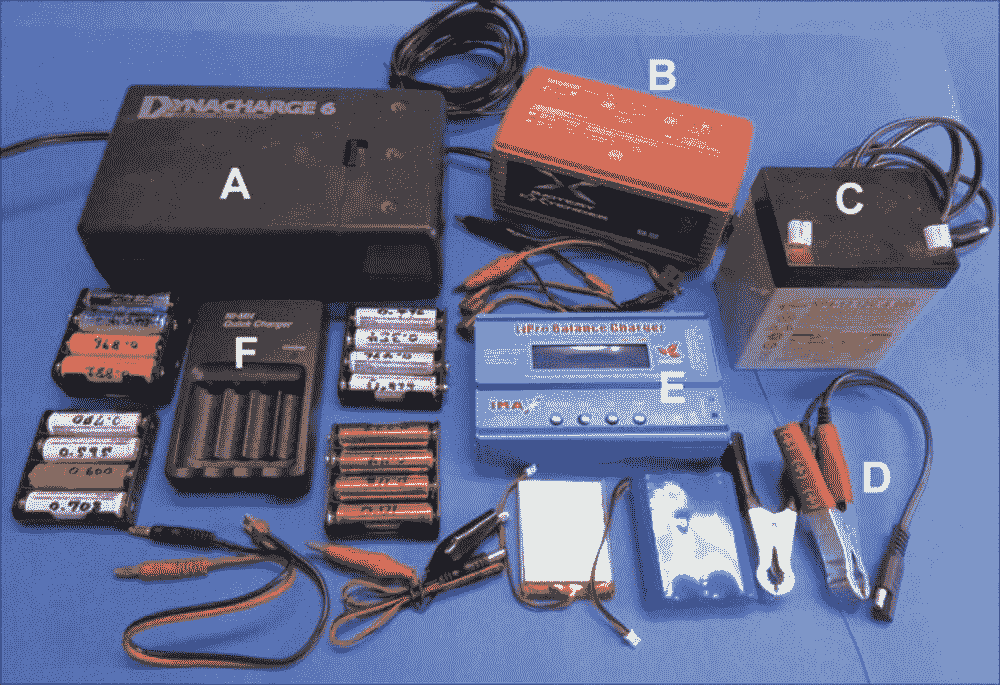

#### 图 11-1
### 可充电电源与电池

`Item A` 是一款镍镉电池充电器，可处理所有规格的 `NiCd` 电池，支持单体电池或最多六节串联电池组，涵盖 `AAA` 至 `D` 规格以及单节 `9 V` 电池。

`物品 B`、`C` 和 `D` 分别为 `12 V` 铅酸充电电源、密封铅酸电池以及大电流电缆。

`Item E` 是一套微控制器“智能”或均衡充电系统。充电器下方紧邻着两块磷酸锂电池组，容量分别为 `4000`（蓝色）和 `2600`（白色）`mAh`。充电器周围分布着一些用于连接不同电池类型与充电器的连接线缆（黑色和红色）。

几乎市面上所有消费级电池类型及电池组均可通过此均衡充电器进行充电。锂电池及电池组在放电和充电过程中都需要特殊的控制电路。锂电池不能完全放电，也绝不能过充。每个电池组都需配备电池管理系统（`BMS`），其形式可为内部或外部电路板，用于监测电池组电压下降并将其限制在安全水平。`BMS` 还必须监控充电过程，以防止过充损坏锂电池。对于锂电池组，这款“智能”充电器可充当 `BMS` 的功能。

`Item F` 是一款可充 1 至 4 节镍氢电池的充电器。围绕 `NiMH` 充电器的是四节电池组，其电池的内阻在数年前投入使用时已测定并标记在外壳上。为了最大限度地延长使用寿命，当组合成可充电电池组使用时，内阻相近的电池会被归为一组。

四节可充电电池组，尤其是 `AA` 规格的，在进行台架或桌面原型数字-模拟电路开发时极为有用。

多年来，在开发本书中的项目以及为民事法医学实践创建新型理化测试方法的过程中，我积累了大量的 `AA` 规格电池，其中一部分如图 11-1 所示。镍镉电池的使用历史已久，常见于许多老式便携式电池供电电子产品中。我所积累的许多基于镍化学物质的电池，因“记忆效应”和过充，已丧失了保持有效电量的能力。

在图 11-1 中的五个电源中，有些在使用图 11-1 中的 `NiCd` 和 `NiMH` 充电器 `A` 和 `F` 充电时，已无法保留太多电量。大多数性能不佳的镍基电池在经历图 11-2 所示设备的充放电循环后，已恢复到可用状态，在某些情况下，性能甚至可与新电池相媲美。

图 11-2 中的 `物品 A` 和 `E` 是廉价的 `DMMs`（数字万用表），用于测量开路电压（`OCV`）、负载电压以及通过负载的电流，从而提供计算电池或电池组表观内阻所需的数据。`Item B` 是一个负载测试电路，配有接线板，可根据需要更换电阻负载，并通过必要的仪表连接，将电阻负载接入或切出压降测试电路，以监测负载电流和电压差。该电路原理图如图 11-12 所示。`Item C` 是六节 `AA` `NiMH` 电池组，`D` 是采用 `Imax B6` 微处理器的“智能”电池充放电系统。

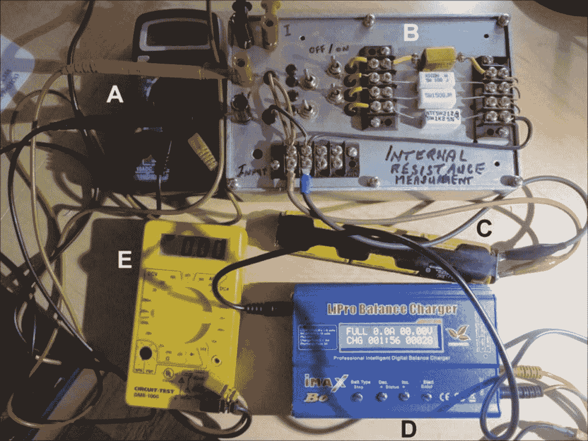

#### 图 11-2
### 可充电电池维护、监控与测试设备

放电后的电池通过施加足够高的电位来充电，该电位需克服已放电电池的 `EMF`（电动势）及其内阻，强制电流流入电池，逆转原始的放电化学反应，从而以化学形式储存电荷。当电池电量接近其设计容量水平时，必须终止电能输入，以防止过充——这是缩短电池使用寿命的主要原因。

### 光伏电池

在中纬度地区，阳光照射到地球表面的功率约为每平方米一千瓦（93 瓦/平方英尺）。光伏（`PV`）太阳能电池板在最佳条件下可回收每平方米 130 瓦的功率。

光伏电池直接将阳光转化为电能。大多数光伏电池是大面积的 `PN` 结二极管，采用传统方法制造，通过向硅晶体晶格结构中添加少量能够产生空穴和多余电子的元素制成。

该 `PN` 结存在一个带隙，可在硅光伏电池两端形成½伏的电势差。光伏电池由半导体材料制成，入射阳光能够将电子的能量提升至足以跃迁过该化学改性半导体材料中形成的 `PN` 结带隙。能量升高并穿越带隙的电子数量与照射到电池上的阳光强度成正比。因此，光伏发电功率取决于物理因素，包括太阳能阵列的地理位置、与入射阳光的夹角、一天中的具体时间，以及用电需求时的当地天气状况。

# 光伏电池及其应用

## 光伏电池的串并联组合
与构成电池组的电化学电池类似，光伏电池可以串联或并联组合，以产生实验应用所需的电压和电流。光伏二极管产生的电压较低，这意味着必须组合更多的电池才能产生电池电源中常见的标称 `5V`、`6V`、`9V` 和 `12V` 标准系统。

## 光伏电源的串并联组合条件
为了在电池阵列中通过串并联组合光伏电源以获得额外的电压或电流，各电源必须电压相等以累加电流，且额定电流相等以使电压可以累加。

## 太阳能充电系统
许多太阳能收集系统用于为蓄电池或电池组充电。那些依赖于持续能源供应才能连续运行的电气负载，便可在黑暗或恶劣天气降低或消除太阳辐射时继续工作。光伏电池板产生的电能必须通过控制器才能为耗尽的电池或电池组充电，同时避免因过度充电而损坏储能电池。

当没有电流从受光照的光伏电池中流出时，电池两端的电压被称为*开路电压*（`OCV`）。光照强度决定了电池的电流大小；试图获取超过电池供电能力的电流会导致电压降至零，而所能获取的最大电流称为*短路电流*（`SCC`）。当太阳能用作充电电源时，需要一个集成电路来控制充电器对电池的电流汲取，使其最大汲取电流刚好低于电压明显受影响的那个点。许多制造商都有提供充电控制器，用于管理低电流和高电流光伏电池板。

处理安培级电流的大电流光伏电池板控制器采用 `PWM`（脉冲宽度调制）或最大功率点跟踪/转移技术（`MPPT`）。`PWM` 根据使用中的电池放电后低于正常工作电压的程度，按比例施加充电功率。随着电池或电池组接近其正常工作电压，脉冲宽度变窄，施加的电流减小，从而避免对储能设备过度充电。

`MPPT`，即最大功率点跟踪技术，可将电压转换为电流，使光伏充电系统始终以最高效率运行。

`PWM` 和 `MPPT` 系统仅适用于大电流应用，且价格昂贵，其中 `PWM` 系统的成本约为 `MPPT` 的一半。在涉及大电流电能收集和管理的昂贵系统选型时，最好先研究相关技术对现有集热器和储能设备的适用性后再做决定。

## 光伏电池的电气特性
如图 11-3 中的示意图 A 所示，光伏电池在黑暗中可视为一个二极管，而在受光照时则能成为一个可为负载供电的电压源。在图 11-3 的示意图 B 中，光伏电池可表示为一个与二极管并联的电流源，并呈现出示意图 C 中绘制的半导体二极管典型的电流-电压特性曲线。

### 开路电压与短路电流
当暴露在阳光下时，光伏电池吸收的光子会激发电子跃迁过 PN 结，从而导致电荷分离。当电流流经阻抗与光伏电源匹配的外部电路时，空穴和电子会重新结合。光伏阵列的内部阻抗可以通过测量和记录电路中不同总电阻值下的电流和电压来确定。通常情况下，光伏电池的内阻较高，约为 `1Ω/cm²`。

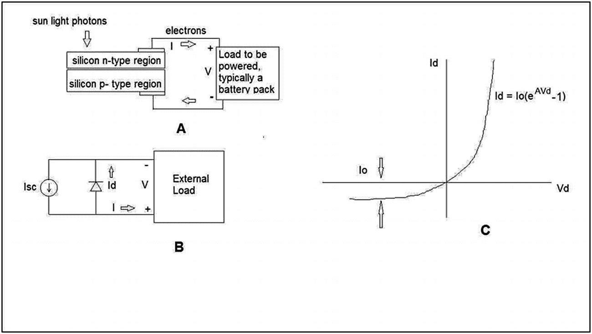

图 11-3
光伏发电

### 光伏电池板及其应用
光伏阵列面板的供应商众多，面向露营、划船、家居装修爱好者以及电子元件供应商等不同领域。图 11-4 展示了一块标称 `12V`、`7W` 的非晶硅太阳能电池板，适用于为汽车、船舶及动力运动车辆的 `12V` 电池充电。这块大面板尺寸为 `16 英寸×12 英寸×¾英寸（40 厘米×30 厘米×2 厘米）`，重 `4 磅（约 2 公斤）`，购自一家大型汽车用品商店，价格为 `40 加元`。通常，光伏电池板的价格为每瓦 `4 到 5 美元`。

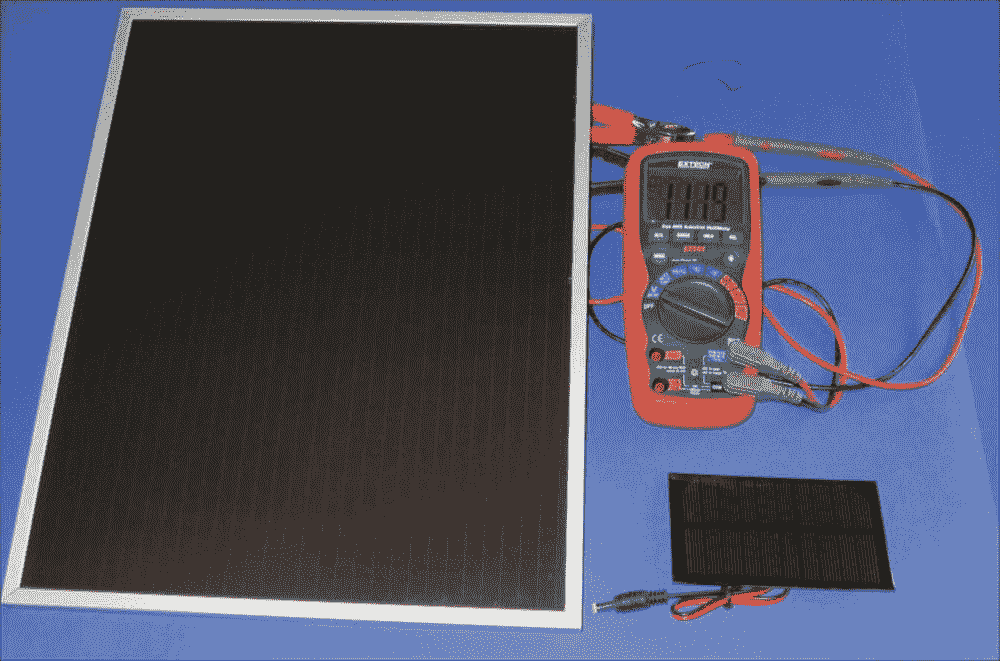

图 11-4
光伏电池板

图 11-4 中较大的面板连接着一个万用表，显示仅凭头顶的荧光灯照明，其电压输出就达到了 `11.19V`。在户外白天，即使天空完全阴霾，电压也能升至 `20.5V`，但仅能产生个位数毫安的电流。

较小的 `12 厘米×7 厘米（2¾英寸×4¾英寸）`面板配备了一个桶形插孔，可用于连接 `Arduino`。

在阳光明媚的日子里，该面板可在 `5V` 电压下提供 `200mA` 电流——足以满足微控制器的辅助电源需求。（`Arduino` 内置电压调节电路，可处理高达 `12V` 的非稳压输入。）

较大的面板配备了两个重型大电流电池夹，旨在为 `12/24V` 电池充电器提供 `7W` 功率。较小的面板则是专门为给 `Arduino` 内置的辅助电源调节电路供电而设计的。

### 温度系数影响
提供最大 PN 结活性的直射阳光也会加热集热器阵列的整体质量，从而降低其效率。光伏电池板在 `25°C（77°F）` 条件下进行测评，并具有指定的温度系数，该系数预示着与 `25°C` 标准温度相比，每升高一度温差所导致的效率损失。典型值为每度百分之零点二，如果面板在炎热晴朗的夏日升温至 `50°C` 或 `75°C`，或者在接近冰点的温度下工作，这个值会造成显著差异。

### 涓流充电
铅酸电池的充电可分为几类，包括补充因电池大电流放电而消耗的电量，以及通过充电来抵消长期存放期间的自放电效应。在存放或长时间不活动期间向电池添加少量电荷通常被称为*涓流充电*。区分补充充电需求与维护或涓流充电需求，是太阳能充电系统必须通过精心设计的充电电路向储能设备供电的两个主要原因。

# 风力和水力发电机
## 步进电机的发电机原理
电动机已投入使用超过 `125 年`，通常将电能转化为旋转运动。连续旋转的电动机可以制造成各种尺寸，为计算机芯片上的散热风扇供电或驱动有轨电车。实际上，各种尺寸的电动机都可以反向使用，将旋转运动转化为电流。

电动机（也称为*步进电机*）被设计为能够部分或完全旋转。步进电机的旋转方向和速度可以通过微处理器和集成电路控制，这些电路操控输送到电机绕组的脉冲电能。步进电机有多种尺寸，并针对特定应用配备了多种内部布线和成型线圈。本演示练习中仅使用结构较为简单的步进电机，来利用风力或水力发电。

制作更小、更简单的步进电机电源的目的是使用易于获取的廉价组件，让实验者熟悉基本设计流程。如有必要，该流程可在日后按需放大，用于更严苛的现场应用。

风力或流动的水可以驱动专用发电机或汽车交流发电机，产生交流电能。旋转装置内部线圈的尺寸决定了能产生多少电力。由超过 `100 马力` 的动力源驱动时，汽车和轻型卡车发动机驱动的交流发电机通常能产生 `50 A` 至 `70 A` 的电流。而可以握在手中的较小步进电机，产生的电力输出也相应较小。

步进电机由多组相连且带中心抽头的线圈构成，这些线圈均匀分布在电机圆形外壳的周边。图 11-5 展示了典型六线电机的接线示意图。这种中心抽头六线配置被称为*单极绕组*。在五线电机中，两条公共线合并为一条。双极电机具有连续绕组，需要 `H桥` 电路来反转通过线圈的电流，从而改变旋转方向。双极电机通常更大，扭矩也更大。步进电机的转子由永磁体段或齿状结构构成，这些磁体受到电机壳体内表面最近的通电电磁铁的磁力吸引。通过控制外围线圈的通电顺序，电机可以向任一方向旋转，速度可以从单步变化到每分钟数百转。

对步进电机施加旋转力，会将其转化为一个小型多极交流发电机/磁电机，能够在相对较低的转速（通常低于每分钟数百转）下发电。步进电机能在较低转速下产生电能，这使其成为一个良好的实验开发项目。手摇曲柄可以模拟风或水流的不稳定性，有助于在实验室工作台上进行步进电机发电机的原型开发。为了研究输出功率随转速变化的函数关系，可以使用由主电源供电的控制器或变速电钻（见图 11-14 和 11-20）驱动第二个步进电机，来旋转作为发电机的电机，从而收集数据并在现场部署前优化系统性能。

要将步进电机用作直流电源，可以利用转子分段式永磁体经过内部线圈时产生的交流电脉冲，并使用整流器和电容器进行处理。一个典型的小型步进电机在其转子上有 `12 个磁极`（见图 11-13）。旋转一个边缘带有 `12 个磁体` 的转子，会向连接到电机绕组引线的任何负载产生复杂的电脉冲模式（见图 11-14）。

步进电机中的线圈具有较大的电感。随着转速增加，输出频率升高，线圈阻抗倾向于限制电流。

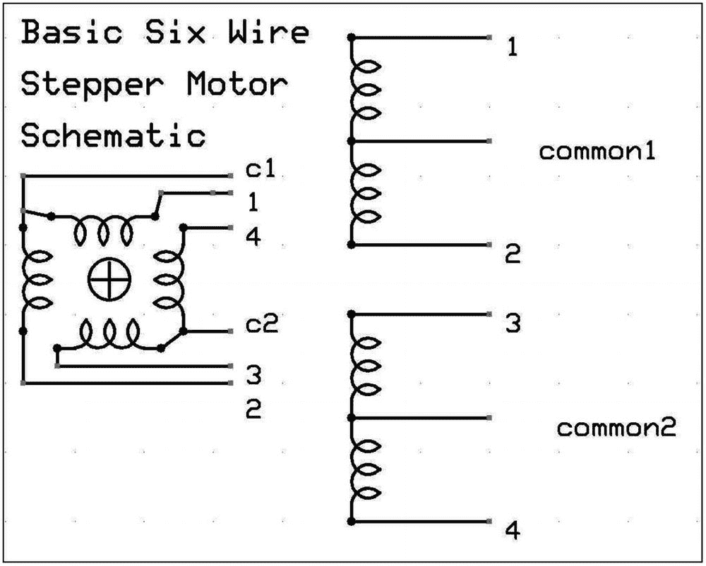

图 11-5
六线步进电机示意图

## 简单风力/水力发电系统设计
图 11-6 展示了一个简单的示意图，用于从风力或水力驱动的涡轮产生脉动直流输出。

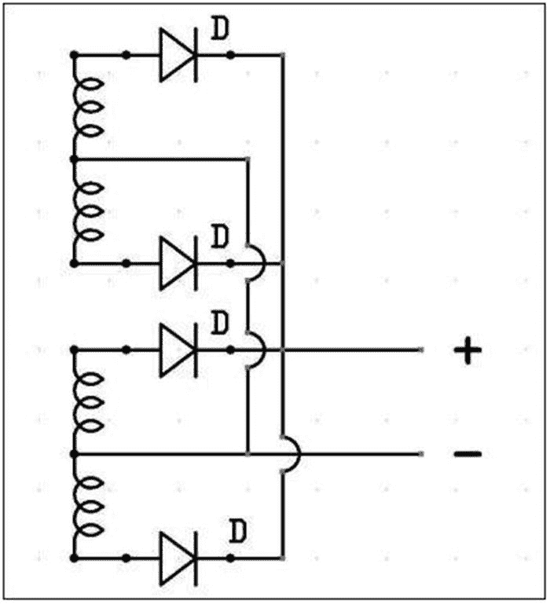

图 11-6
步进电机整流器

由于风力或水力驱动的交流发电机或磁电机产生的电力是交流形式，可以使用图 11-7 中的倍压电路来提升交流发电机的电压。

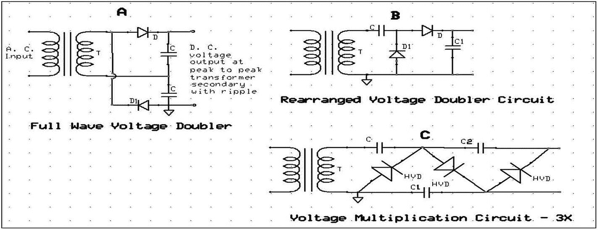

图 11-7
倍压电路

## 电压提升电路
在图 11-7 的示意图中，变压器被描绘为交流电源，其输出将由后续的二极管-电容器电路处理。对于由自然动力源驱动小型步进电机产生的低电压，要简单地进行二倍压或三倍压，电机的绕组就充当了变压器的输出绕组，可以使用所需的二极管-电容器电路。在设计放大电路时，必须牢记能量守恒定律。电压加倍时，可用电流减半。随着电压升高，必须相应地调整二极管的击穿电压限制和电容器的耐压限制。

## 项目入门实验
要开始设计基于步进电机的能量收集项目，可以先使用 `LED`、合适的限流电阻和原型开发板进行一个简单的定性评估实验。步进电机的公共线（一条或多条）可以插入板上的地线或公共条。将带有合适阻值限流电阻的 `LED` 与二极管以及电机线圈的各色引线串联起来。

## 步进电机发电

当二极管和电阻连接好后，用手旋转电机轴，所有二极管会按照与轴旋转速率成比例的速度闪烁。由于产生的是交流电，该实验表明无论轴朝哪个方向旋转，无论二极管在电路中如何连接，发电机系统都能点亮二极管。我使用一个 Howard Industries 生产的 12 V 直流、步进角 3.6°、1.5 英寸（37 毫米）见方的步进电机，用拇指和食指拧动其 3/16 英寸（5 毫米）的轴，产生了 2 V 的交流电压。

通过安装一组四个二极管（如图 11-8 所示），并在正极和负极输出引线之间放置一个大容量电解电容器，该系统可以得到极大改进。二极管提供半波整流，产生变化的直流电压，电容器的储能能力则平滑了输出纹波，并提供了一定程度的能量存储。

在轴上安装一个手摇柄后，旋转电机可在 16 V 1000 μF 的电解电容器两端产生 4 V 至 5 V 的充电电压。在没有额外输入且不带负载的情况下，该电容器显示出典型的持续数分钟的电压衰减曲线。当通过添加一个 25 V 大容量电解电容器将电容量增加到 11,000 μF，并用两个全桥整流器替代四个二极管时，该系统可以通过手摇曲柄在电容器上存储 6.75 V 的电压。手摇电机以预期方式为电容器充电。电容器上测得的电压迅速增加，但随着电压的升高，增速开始放缓。一个 47 μF 35 V 的电解电容器在不带负载的情况下，可通过手摇曲柄充电至 7.25 V。

通过将电路修改为图 11-8 所示的结构，在电路中加入两个 1 μF 400 V 的电解电容器，手摇发电可在无负载的情况下，短暂产生略高于 24 V 的电压。

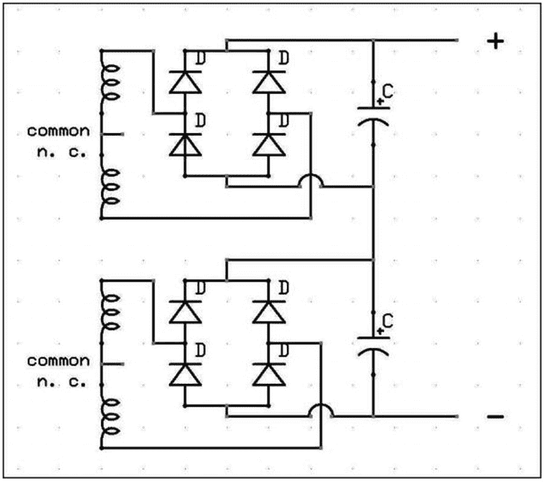

`图 11-8` 用于步进电机发电的倍压器

或许，利用步进电机产生的电能的最佳策略是：先对其进行整流，尽可能滤除电流中的纹波，然后配合稳压器使用经过整流的直流电，为电池充电。

电池充电电路可由`LM317`等稳压器集成电路（IC）搭建而成，并且应遵循电池制造商建议的充电方式。

## 温差发电

运行在废热源附近的实验设备，可利用碲化铋固态系统来产生直流电。碲化铋片主要用于泵送热量（参见第 3 章）并产生低电压电能。

温差发电系统与光伏（PV）系统类似。每个发电元件或阵列都有一个有限的低压能量供应，其产生的功率与板两端的温差成正比。与其他电化学和光伏发电方式一样，必须确定其开路电压、内阻、发电变化情况以及待供电的负载。

温差发电（`TEG`）效率不高（即 2%–3%），仅适用于能在发电板两侧产生显著温差的情况（发电板最高耐受温度 < 100°C）。碲化铋 `TEG` 板具有高内阻，若使用低阻抗负载抽取电流，会导致电压下降并在板内部产生更多热量。

只有当电源阻抗与负载匹配时，才能实现最大功率传输。为了使用现成的`TEG`板向负载提供最佳电力，必须对板进行并联/串联组合，使`TEG`阵列的内阻与负载的内阻相匹配。串联电压和并联电流的连接规则同样适用于`TEG`板，如同对光伏和电化学电源一样。在实践中，当负载电阻大于`TEG`阵列的内阻时，系统性能更佳。

由多个串联热电偶组成的热电堆，最常见于燃气器具的引火安全电路中。热电堆被火焰加热，该火焰作为主加热燃烧器的点火源。来自热电堆的低电压信号由一个电路监测，该电路控制着主电源，进而控制电磁阀，而电磁阀则负责控制通往主燃烧器的燃气流量。如果引火火焰熄灭，电磁阀就会关闭，燃气便无法供应到燃烧器。要将热电堆用作电源，则需要数百度的热源才能产生可用的电能。

## 高电压、低电流电能的产生、控制与测量

### 引言

尽管用于计算和电子设备的集成电路具有破坏性，高电压低电流的电能却已成为生命科学领域的支柱。高电压被广泛用于液相中电离生物结构的分离。色谱分离（最早由茨维特在十九世纪初报道）最初依靠重力驱动，随后在二十世纪中期由马丁和辛格发展为压力驱动的气相分离。为了提高分离能力，技术逐步演进至高压液相色谱，最终发展为利用电势驱动液相系统中带电物种进行分馏的技术，即目前所称的电泳。高电压还被用于气相色谱的火焰离子化检测器，以收集氢气火焰燃烧产生的离子。在气相离子迁移率分离技术中，高电压起着驱动力的作用。

利用电势驱动的化学分离技术，对生物材料进行分析级和批量级的分离，催生了以化学工程中采用内回流板的蒸馏塔概念为基础的分离数学理论。对于各种不同的物理化学分离方法，其化学分离效率在数学上以不同术语定义，所有品质因数均以`理论塔板等效高度`（HETP）表示。

在高效毛细管电泳中，一次实验的分离效率用`N`表示，其中：

```
N = μV/2D[m]
```

`μ` 是分离介质中的表观迁移率。`V` 是施加的电压。`D[m]` 是分离介质中的扩散系数。在分离方程中，分离效率 `N` 与施加的电压成正比。

实际应用中的限制因素将施加的电场强度限制在几百伏/厘米以内。分离的最佳分辨率通常是在焦耳热效应可忽略不计的最大场强点获得的。

高电压是电离型检测器、离子光学器件以及云室等设备所必需的。

有几种不同的技术可以产生高电压。范德格拉夫起电机、威姆斯赫斯特起电机，以及由 A. D. 摩尔教授描述的迪罗德机等装置，能够产生高静电电压，最常用于课堂演示。^(¹²) 对于定量和定性实验，大多数高压电源必须进行控制和调节。可以利用倍压电路从较低电压源构建受控且稳定的高压电源，例如图 11-7 所示的电路。

一种完全固态、开关模式的`DC`转`DC`升压转换器（不含变压器）是目前已知最高效的电源转换器，广泛应用于便携式电池供电设备。开关模式系统使用电感或电容储能介质，其设计和实现需要相当丰富的电气工程知识。

麻省理工学院物理系开发了一种基于传统方法的、廉价、更易于理解和构建的高压电源。幸运的是，下文中描述的高压、低电流`DC`电源符合研究人员的`安全`考虑——如果您意外短路电源输出端，只会产生非常令人不适的电击或轻微但疼痛的灼伤。

### 高压电源组件

利用紧凑、轻便、绕线式铁氧体磁芯变压器，可以产生高压、低电流的电能。这类变压器在物理特性上与用于干井加热器和电动机应用、产生大电流、低电压直流电源的重型、庞大单元截然相反。高压、低电流变压器的工作交流频率远高于用于低压应用的常见 60 Hz 单元。

变压器利用电磁感应，在两个机械和电气隔离的电路之间传输能量。在如图 11-7 所示的原理图中，简单的变压器用一个由两个朝向相反的螺旋线组成、中间隔着一系列平行线的三元件符号表示。左侧的螺旋线代表器件的输入或初级线圈；一系列平行线代表绕制线圈的变压器铁芯，而右侧的螺旋线代表该元件符号的输出或次级线圈（见图 11-7）。

利用初级和次级线圈绕线匝数相差很大的变压器，可以从较高电流的较低电压产生较低电流的高电压。

变压器是一种需要交流电才能工作的器件。通过使用可变的直流电源为连接至高压变压器初级绕组的高频振荡器供电，就会在器件的次级绕组中产生一个更高电压、低电流的信号。通过在初级和次级线圈中使用不同匝数的绕线导体，就可以根据需要“升高”或“降低”电动势或电压水平。

为了产生在电泳和高压静电积累实验中常见的高电压，理想的选择是一台能够在几乎空载条件下产生千伏级电场的可调输出电压电源。

2005 年，麻省理工学院物理系公布了一份实验室组装的可调高压电源方案。这些文件描述了如何使用可变的低压直流电源作为输入电源来产生受控的高压电势。

图 11-9 是一个框图，说明了组装可调高压源所使用的电子元件。首先，使用可变的低压、大电流电能为射频变压器初级绕组中的高频振荡器电路供电。当来自高频振荡电路的电流通过一个特殊绕制变压器的初级绕组时（该变压器次级与初级匝数比很大），在与次级绕组相连的电路中就会产生一个高频、高压的电信号。

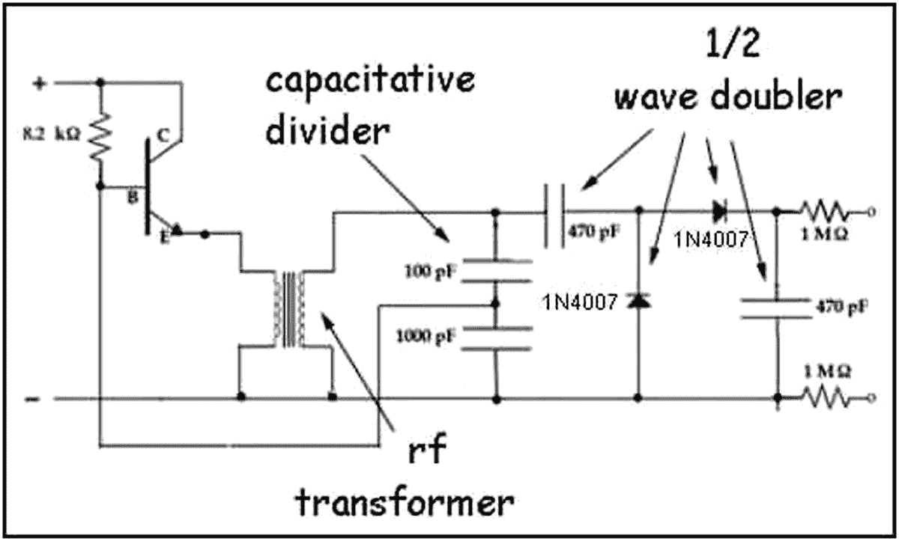

`图 11-10` 麻省理工学院高压电源

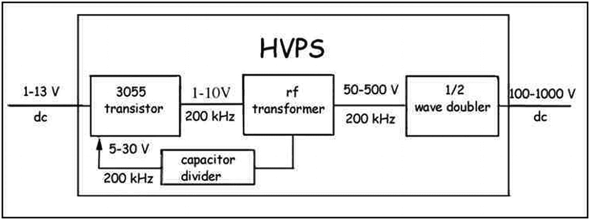

`图 11-9` 麻省理工学院高压电源框图

2005 年公布的麻省理工学院电路使用一个绕线式 4 mH 电感器，学生用几圈更粗的导线缠绕该电感器，作为高压变压器的初级绕组，而该电感器本身则充当次级线圈。

我修改了最初的麻省理工学院设计，采用了来自 Information Unlimited 公司、型号为`28K077`的高压变压器，其升压比为`1:135`。除了新的射频变压器，次级输出中使用了`1N4007`、`1 kV`二极管，这使得输出略高于原始电路。

图 11-9 和 11-10 中的高压电源使用 1 至 13 V 的可调输出低压直流电压，为采用`2N3055`功率晶体管和射频变压器初级绕组的振荡器供电。该振荡器的工作频率远高于线路电压，同时驱动电流通过变压器的初级绕组，因此输出可以在标称 100 V 到 1000 V 之间变化，且电流安全，低于 1 毫安。次级绕组有一个分压器，取输出的`1/11`反馈给基于`2N3055`的振荡器，电压最高可达 30 V（200 kHz 下）。使用新的射频变压器将电源范围的上限提高到了 1.3 kV。

高压变压器初级绕组中的高频振荡器电路功率，经过高压绕组升压至 600 V 范围，然后施加到一个半波倍压电路，以产生千伏输出。

一个典型的可调低压电源电路原理图见图 11-11。该高压电源可与任何能够提供 2 至 12 V 可调输出并能提供高达 1 A 电流的低压电源配合工作。

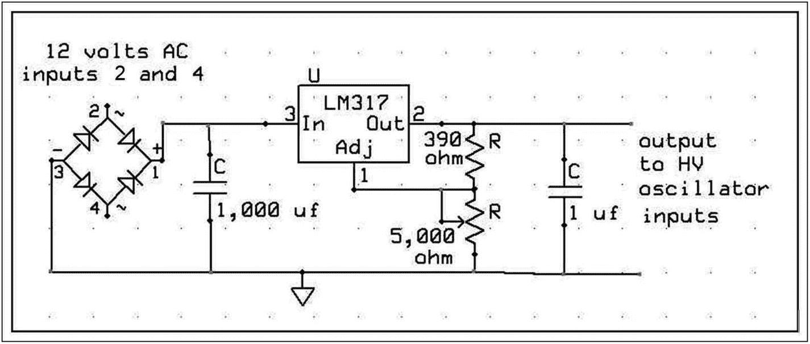

`图 11-11`

低压振荡器电源

科学实验中的大多数高压应用，例如电离探测器的极化电压、离子光学中的加速电压以及云室，都用于极高阻抗的情况下，并且预期几乎无电流流动。

用于分离生物活性材料的电泳系统需要分离出足量的材料用于进一步的实验工作。它们可能以毫安级别的电流工作，因此需要在高压电源中使用额外更重的元件，并格外小心地处理高压稳压器可能产生的致命电压-电流功率水平。^(¹³)

小电流高压电源的一个简单应用可以在用于静电演示的经典验电器的设计和半定量校准中实现。我的高压系统是按照图 11-10 和 11-11 所示的电路构建的，用于测试镀铝聚酯薄膜验电器（参见第 8 章图 8-19 和 8-20 中的项目 1）。

将高压输出的正极引线直接连接到验电器的铝收集板上，用于确定金属化薄膜开始与支撑板分离时所施加的直流电压，该电压起始点约为 400 V。从金属箔反射的低功率激光笔可以提高测量的灵敏度，并为半定量测量提供校准标尺。

## 高压测量

许多手持式和台式数字万用表及伏欧表可以安全测量 600 V 至 1000 V 之间的电压。在尝试测试电路之前，您应确认电表的规格。超过电表量程的电压可以通过分压器进行衰减，将电源输出分压到与电表规格兼容的范围内。用于组装分压网络的电阻应尽可能具有高阻值和精确的已知值，以最大限度地减少从电源汲取的负载电流，同时最大限度地减少电阻发热，并提供合理精确的被测电压分压。电阻分压器电路和负载阻抗的影响在《电子学艺术》一书中有所讨论。

不应尝试对带电的高压电路进行测试测量。应始终在电源关闭且电压测试点接地的情况下，将测试探头或分压器网络连接到电路组件。

一旦确认测试探头连接到电路或分压器网络，并且所有连接牢固且无短路，即可恢复电路电源并从电表读取读数。高电压可能致命。

# 实验

## 确定电源的内阻

### 电池组

随着电池组和电池放电，氧化产物会生成并积聚在电解液中，从而增加溶液电阻。放电电池的内阻在其整个使用寿命期间都会升高，直到达到电路中负载无有用电流流过的临界点。通过测量电池或电池组的内阻，您应该能够判断电源中剩余的电量或使用寿命。

电池由浸没在液体电解质中的两个隔开的不同金属电极组成（参见第 7 章的图 7-5）。每个电极周围都有一个液体离子“双电层”，在电池内部形成两个电容器。电容元件的存在需要采用阻抗测量技术来正确确定电池或电池组的内阻。

尽管电池内部发生的复杂电化学过程需要特殊技术来确定真实内阻，但有两种更简单的技术可以估算电池或电池组的表观内阻。

驱动负载的电源构成一个完整的电路。理论电子学计算表明，当负载阻抗与电源阻抗匹配时，电源到负载的功率传输达到最优。欧姆定律适用于驱动已知负载的电源的完整电路，并可以通过多种方法确定电源的表观内阻。

通过测量开路电压和已知负载下的电路电压，可以通过以下推理计算电源的内阻。当无电流流出时，电源产生最大电动势。当负载汲取电流时，电动势会下降，因为负载电阻和电源的内阻共同作用来调节电路中的电流。当电流在电路中流动时，电路总电阻上的电压降由欧姆定律定义，表示为 `V[cct]`。因此：

```
EMF = I(R[cct] + r[int])
```
或
```
EMF = IR[cct] + Ir[int]
```

代入 `IR[cct]`：`EMF = V[cct] + Ir[int]` 且 `EMF – V[cct] = Ir[int]`

由此得出：`(EMF – V[cct])/I = r[int]`

其中，`EMF` 是电源的开路电压或无负载电压，`r[int]` 是电源的内阻，`V[cct]` 是电路电阻两端的电压降，`I` 是通过负载电阻的电流。

图 11-12 中的测试电路可用于任何直流电源，包括电子稳压的实验室设备、小型插入式墙插电源、电池组以及光伏电池和面板。电压表用于测量已知串联电阻两端的电压降。电流表用于测量电路中的电流。

在图 11-12 的电路图中，未给出电阻 `R1` 至 `R4` 的值，因为实际使用的值由被测设备的标称电压值和电流表的电流测量能力决定。

在图 11-2 中，B 项的负载电阻阵列包含一系列为测试标称电压为 3.3 V、5 V、6 V、9 V 和 12 V 的电源而选择的大功率、低阻值器件。电阻值为 `1Ω`、`10Ω`、`150Ω` 和 `1200Ω`，容差为 1% 和 5%，功率额定值为 5 W，以适应实际测试中预期的小电压降。

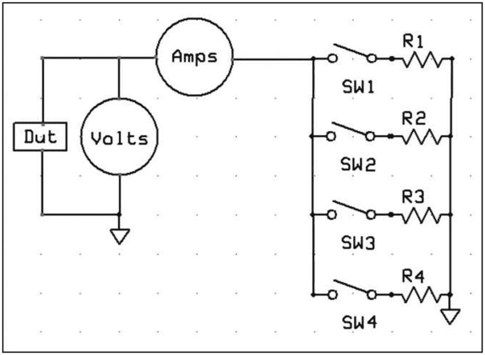

`图 11-12` 用于测定电源内阻的电路

上述公式对于充满电的大功率铅酸电池或良好稳压的电源来说用途有限。如果负载下的电压变化不足以产生 `EMF – V[cct]` 项的可靠测量值，则可能需要使用不同的负载或技术来测量电源的内阻。

使用图 11-12 中的电路时，必须小心，以避免在低负载电阻下，电流表中有破坏性电流流过。

第二种测量电池或电池组内阻的方法使用了图 11-2 中 B 项的电阻阵列，但该方法不测量开路电压。

将电池连接到电路（如图 11-12 所示，闭合顶部开关）后，负载电阻 1 在电路中建立了众所周知的电压、电流、电阻关系，如下所示。

`V[LR1] = V[oc] – I[LR1]r[ir]`

在记录包含负载电阻 1 的电路电气参数后，断开负载控制开关，将该电阻从电路中移除。下一步测量是通过闭合开关 2，将第二个阻值较低的负载电阻接入电路来进行的。当电压和电流稳定后，记录这些值，然后断开负载控制开关，以最小化被测电源的功耗。

对于第二次测量，电路中接入了一个阻值较低的负载，其电流、电压、电阻关系为：

`V[LR2] = V[oc] – I[LR2]r[ir]`

将两式相减得：

`V[LR1] – V[LR2] = rir`

或

```
r[ir] = (V[LR1] – V[LR2]) / (I[LR2] – I[LR1])
```

通过测量随负载电流增加而变化的电压降来确定内阻，无需测量被测设备的开路电压。电池制造商在其质量控制操作中使用了双负载法的自动化版本。

## 光伏电池板与阵列

要测试光伏电池板或阵列的内阻，必须使用恒定光源来产生恒定的电动势和电流供应。

光伏电池和电池板的最佳测试方式是使用可变电阻负载，首先在空载条件下测量开路电动势电压。然后在评估电路中逐步增加负载电阻，并记录电池电压和负载电流。如果负载消耗的电流小于电池所能提供的电流，则电压降很小，内阻也较低。第二次测量可使用较小阻值的负载电阻，以消耗更高的负载电流，并记录电池板或电池的电压及负载电流。重复此过程，直到电流的增量抽取导致源电压显著下降。在电池电动势几乎为零时抽取的电流即为短路电流（`SCC`）。

如有必要，可根据短路电流点之前的电流和电压数据表格计算出真实内阻（参见图 11-17）。

位于转接板上的集成电路可以调节从光伏电池板抽取的负载电流，以便为电池充电，从而将光电池的电压维持在最大功率传输点。（参见 Microchip `MCP73871` USB/AC 电池充电器（含电源路径管理）以及 Microchip 便携式电源转换设计指南，网址为[`www.microchip.com/analog`](http://www.microchip.com/analog)）。

## 机械运动发电

除太阳能外，当今可利用的大量电能还来自风力和水力等其他可再生资源。1831 年，法拉第证明了将导体穿过磁场会使其内部产生电流。法拉第感应定律表明，电能和机械能可通过电动机和发电机相互转换。

图 11-13a 和 11-13b 展示了我实验室从维修件和回收库存中收集的各种类型的小型电机。这两张图片显示了计算机、打印机、扫描仪、机器人以及冷/热烤箱循环风扇应用中所用小型电机的形状和尺寸差异。

图中所示电机的小型尺寸表明，若将这些设备用作发电机，其可产生的功率也较小。

项目 A、B 和 C 是三种可能适用于为传感器提供少量电力的设备。下方一排物品是从废弃设备中回收的不同类型的无刷步进电机的典型示例。项目 E 带有一个便捷的连接板，便于为任何所需的维护拆装电机。

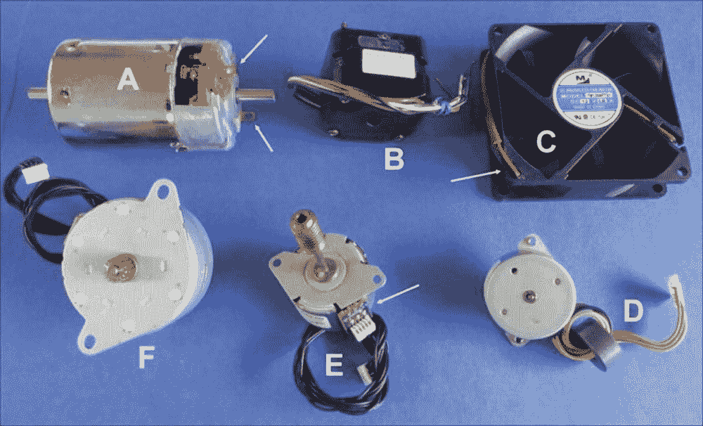

`图 11-13b`

能够发电的电机

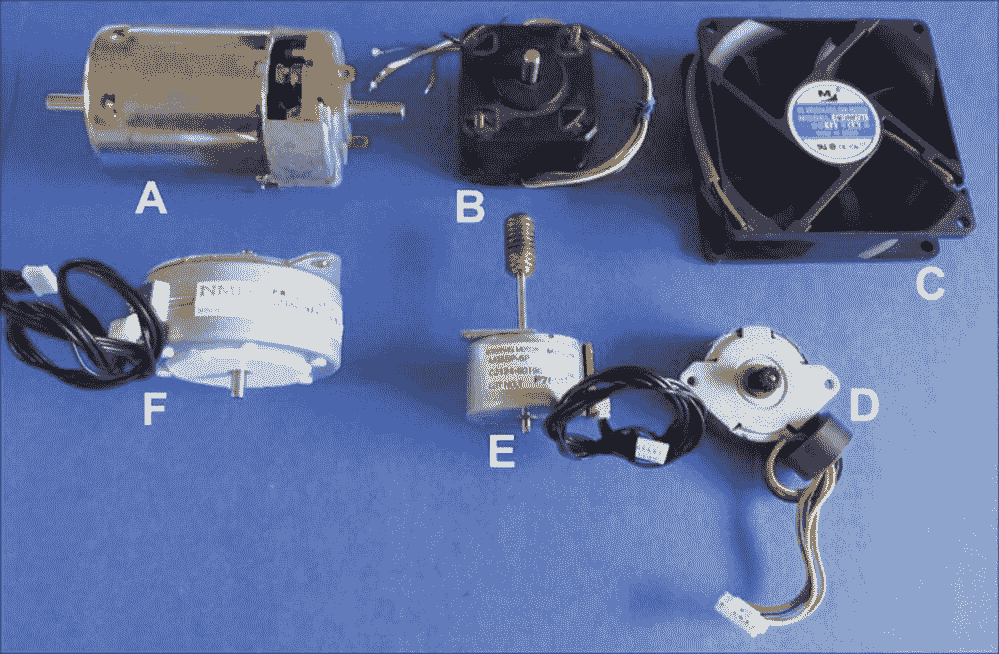

`图 11-13a`

能够发电的电机

两图中的项目 A 是一个有刷直流电机，其 12V 直流电施加于白色箭头所指的铜端子上。在 375 mA 电流下，电机空载转速为 1200 rpm。若电机转子以 600 rpm 旋转，则 1.93 V 输出可驱动 1.6 mA 电流通过 1200 Ω负载（参见图 11-20）。

项目 B 是一个 Howard 步进电机，它将每转分为 100 步，每步 `3.6°`。当装上手摇柄并用力旋转时，该 `12V` 电机（配置的电路中，两个整流桥为双 `1 μF 400` 电容倍压配置提供可变的直流电）可零星地产生 `20 V` 至 `23 V` 的电压。

为了从该电机发电机收集不同转速下的定量电流和电压数据，将第二个由电机速度控制器和市电驱动的步进电机连接到 Howard 步进电机“发电机”上，如图 11-14 所示。

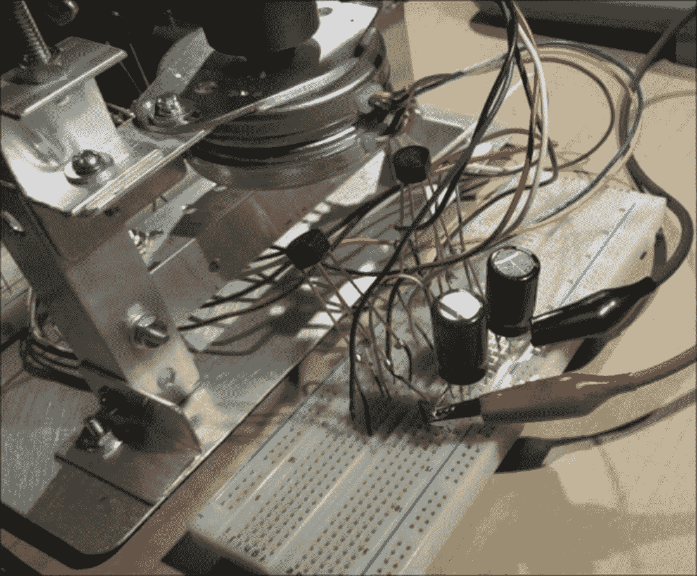

**图 11-15**
步进电机磁电机/发电机整流器与倍压器

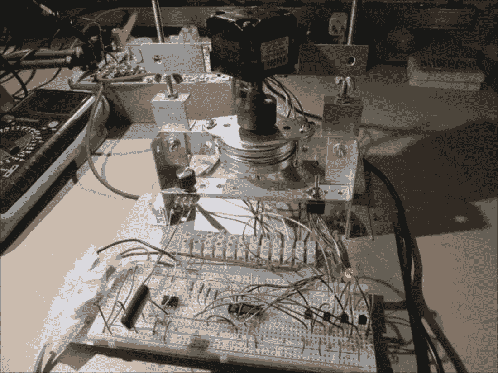

**图 11-14**
由受控步进电机驱动的步进电机磁电机/发电机

为增加整流电路的蓄电容量，在图 11-6 的电路中增加了一对 `1000 μF 35 V` 的电解电容来扩充电容组。

图 11-13b 中的项目 C 是一个简单的两线 `12V` 无刷直流电机冷却风扇。正常使用时，电力施加于电机驱动风扇，迫使冷却空气流经发热的电子元件。这种紧凑的电子可控无刷直流电机在被 `9 m/s` 的气流吹动时，仅产生 `217 mV` 的整流电压输出，几乎测不到电流。

项目 D、E 和 F 是打印机、扫描仪和机器人应用中发现的多种尺寸和形状的步进电机。

要评估如图 11-13a 和 11-13b 中此类电机的发电能力，可使用变速手电钻带动其轴旋转（参见图 11-20）。

## 观测结果

在对电池和太阳能电源的内阻进行测试之前，我们使用图 11-12 所示的电路图，对图 11-2 中标记为 B 的低压电阻箱，在一个 `12V 2A` 的壁挂式电源上进行了测试。开路电压降和电流测量技术显示其内阻为 `0.398 Ω`，而双负载下的电压降则显示内阻为 `0.170 Ω`。这两个不同的数值说明了这些简易测量方法的本质。

我对手中持有的镍氢（`NiMH`）和镍镉（`NiCd`）电池的电源进行了一系列内阻测量，结果汇总于表 11-3。收集这些数据是为了组装可充电电池组，使得每组中的四个电池单元的内阻尽可能匹配，从而在多个电池并联充电时，最大限度地减少对最低内阻电池的压力。

镍镉电池 `#12` 的内阻为 `0.444 Ω`。在内阻测量前，该电池被初次充满电后，当使用低阻测试值加载时，无法产生稳定的电压或电流读数。该电池通过 `10 Ω` 电阻放电，直到其电压降至毫伏范围，然后将其放回充电器进行第二次充电。深循环使电池恢复至开路电压 `1.376 V`。该电池在测试序列中表现正常，显示出稳定的读数，表明内阻为 `0.444 Ω`。7 号电池也通过类似的修复方法恢复了正常。

**表 11-3**
2016 年 9 月，典型在用镍可充电 AA 电池的内阻

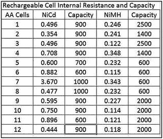

扩散在电池充放电时的电化学反应中起着重要作用，并且在电池储存期间也活跃。将四节容量相同、具有同等电能储存能力的 AA 电池（分别为镍氢和镍镉化学体系）安装在四槽电池座中，以测量每种电池类型的典型自放电率。在 60 天内测量了电池组的开路电压，并将其绘制成图表，如图 11-16 所示。

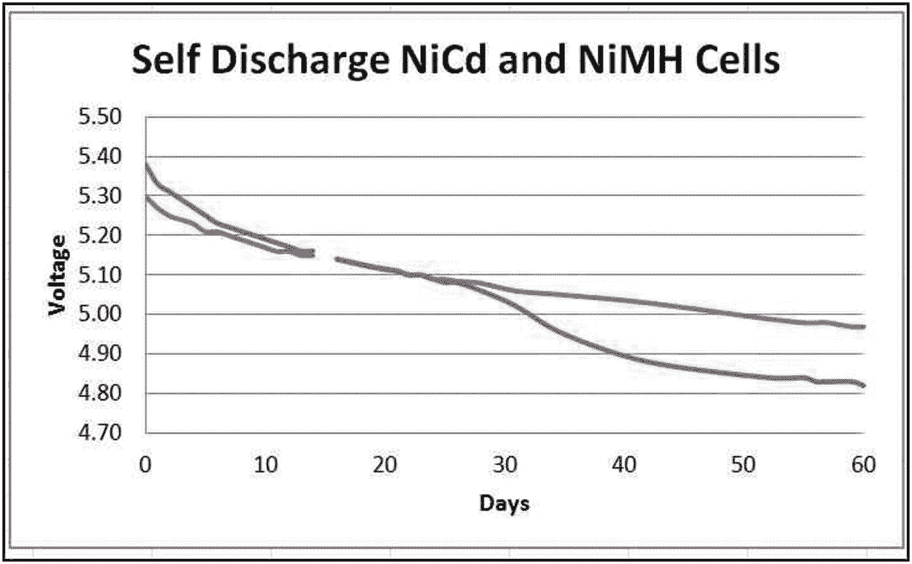

**图 11-16**
镍镉（蓝色）和镍氢（红色）电池的自放电

在编写本书期间，我们使用来自各种来源的新、旧以及修复过的镍镉和镍氢电池组装了若干电池组。这些电池组在组装时以较为随意的方式进行了标记，其中几个四节电池单元已经使用了五年或更长时间。表 11-4 的数据汇编自本次实验准备过程中收集的数据，旨在展示测量电池组内阻的实用性，并通过逐级负载技术展示开路电压下降值与电压差值之间的变化。

**表 11-4**
用两种方法测定各类电池组的内阻

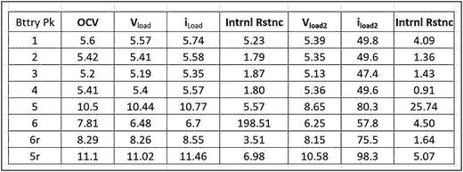

电池组 1 和 2 是镍氢电池。电池组 3 和 4 是镍镉电池。电池组 5 是一个八节电池单元，包含 4 节镍镉和 4 节镍氢电池。电池组 6 是 6 节镍镉电池。（电池组 5 中的每个“电池组”是分开充电的。）

## 电池

一次性电池和可充电电池电源可由为消费用途商业制造的标淮规格组装而成。大多数单节或多节电池组依赖电化学反应在放电模式下产生电能，对于二次电池（可充电电池），则在充电过程中吸收电能。

在许多情况下，电池电芯的电化学反应是基于液体的反应，其中离子扩散到电极表面和远离电极表面的速率，决定了电能输送到或接收自连接电芯的外部电路的速率。

电池电芯中的电化学系统通过氧化/还原反应产生电子。在全新的锌基化学电池中，大部分化学物质处于还原的金属状态，当被氧化时，会释放电子到外部电路做功。在一次电池中，氧化过程持续进行，直到没有足够的金属来维持可用的电子流。从金属原子到氧化物基化合物的转变伴随着电芯内阻的相应升高。在许多产电的电化学电池中，内阻可以衡量系统的荷电状态。

如表 11-4 所示，测量内阻的两种方法得出的品质因数大小相近，但在数值上始终存在差异。在表观内阻值较低时，两种方法的差异似乎约为 `20%`，其中双电流测量法的结果较低。在进行开路电压（`OCV`）测量时，由于没有发生氧化/还原反应，电芯内部处于静态的电化学环境。当电流开始流动时，离子在电极上的扩散控制了电荷转移到外部电路的速率。可以认为，在由静态环境变为动态系统时使用欧姆定律，会使得该技术计算出的表观内阻高于在消除高开路电压后计算出的值。

对于使用开路电压法会导致内阻值偏高这一偏向，可以从对一个不包含电化学电池的市电供电壁挂式电源所计算出的数值中得到部分支持。

这两种技术都具有相当好的可重复性，并且可以作为估算电池相对荷电状态的合理技术。当处理一种或多种类型的电池时，您应注意测量任何给定电芯表观内阻所采用的技术，以及为一次电池或刚充满电的二次电池测得的数值。使用表观内阻技术是一种比较性的操作，必须要有参考数据，该技术才有价值。

用于估算电化学储能介质内阻的两种数学方法的一个共同特点是，它们都消除了所使用负载的数值。虽然负载电阻的数值并未出现在计算中，但为测试电路选取的数值（见图 11-12）应尽可能高。高负载电阻值会产生低电流，因此电流表必须能够准确测量这些较低的电流。

两种内阻测量技术都会从储能介质中汲取电流。如果在电路故障排除过程中，被测电池是纽扣电池或昂贵的锂一次电池，则开路电压法仅汲取一次电流，而双电流法则汲取两次。如果被测的一次电池将在测试后继续使用，则首选开路电压法。

电池制造商使用一种自动化的压降法，因为它只需要在两个不同负载下测量电流和电压。

使用压降法时必须采取预防措施。

-   用作测试负载的电阻器必须按比例缩放以适应电源的电压，并且其额定功率足以处理所汲取的电流。
-   用于测量电源电压和电路电流的仪表应在其输入端具有保险丝保护，并且必须在测试期间能够承受并以其足够的精度读取电流和电压参数。
-   电流汲取应尽可能短，以最大限度地减少电路元件的发热并避免过度消耗电池/电源的电量。二次电池在测试后可以充电，但一次电池不可以。如果电池要在测试后投入使用，则应避免汲取过大的电流。

可充电电池失效的主要原因是过度充电。过度充电会导致过热，从而破坏许多使电池能够循环工作的、精细分散且具有高表面积的材料和化合物。通过使用微处理器控制的充电器（如图 11-1 中的项目 E 所示）可以避免过度充电。

对施加于电芯中不同电化学反应的充电功率进行可编程控制，可以在电芯电压从其放电状态回升到满充电水平时降低所施加的功率。微处理器可以限制施加功率的时间，并测量电池积累的电量，以避免过度充电。可以通过多种不同技术将能量恢复到电芯，例如使用恒压或恒流充电，以及在电芯恢复到满充电状态时使用 `PWM` 来降低功率输入。

微处理器可以通过脉冲式地开启和关闭充电功率，让电芯在两次电流输入之间冷却，从而避免过热。

除了充电功能，微处理器控制的充电器还可以“修复”某些类型的可充电电池，特别是镍基电池。按照充电器操作手册中所描述的，循环进行受控的放电和充电，通常可以恢复许多性能衰退的镍基电池的大部分原始容量。

在丢弃内阻高的镍镉（`NiCd`）或镍氢（`NiMH`）电池之前，使用图 11-2 中的可变电阻装置将这些电池放电至低于一伏。然后，使用图 11-1 中所示的项目 F 的专用镍氢充电器对这些电池进行充电。通过深度放电和再充电，我成功地将几节电池恢复到了可用状态。

图 11-1 中的微处理器控制单元可以通过精确的放电-充电循环自动修复镍基化学电池。

充电会在电池电化学过程中引起少量的副反应，这些副反应会累积并最终限制电池的充电次数。

关于电池和充电器的电化学及物理特性的全面摘要，请见 [`www.mpoweruk.com/index.htm`](http://www.mpoweruk.com/index.htm)。

恒压充电是以高于被充电电芯电动势（`EMF`）的电压施加直流电流。铅酸和锂离子电池使用这种简单且低成本的方法。

恒流充电系统通常用于镍基化学电池，在达到满充电时会关闭。

渐变电流仅用于 `SLI`（起动、照明、点火）电池。随着电芯电压升高以匹配充电源的固定电压，充电器电流会逐渐减小。

脉冲充电是以调制宽度的脉冲形式向电池施加电流。`PWM` 脉冲允许电极上的化学反应继续进行、允许扩散作用补充电极表面的化学物质、允许过多的热量消散，并允许在脉冲间隔期间测量开路电压（`OCV`）。

电池的充电或放电速率通常用 `C` 倍率来表示，该倍率衡量的是相对于电池容量的充电或放电速率。一个额定容量为 `250 mAh` 的电池，如果用 `25 mA` 的电流充电，其 `C` 倍率就是十分之一。而以 `2500 mA` 的速率放电，则放电倍率为 10。对于手头电池允许的充电或放电 `C` 倍率，请查阅电池制造商的说明文档。

使用二次电池作为电源的实验，如果能够使用基于可编程微控制器的充电器来为电池组充电，将获益良多，这尤其适用于有市电电压供电的台架或实验室环境。

## 光伏电池

硅光电池的每个 `PN` 结在暴露于阳光下时，能产生 `0.6 V` 的电势差。串联的电池数量决定了太阳能电池板能够提供的最大电压。电流的流动取决于光子的吸收。阳光照射越强，驱动管理负载的电流就越大。

图 11-4 中所示的两块太阳能电池板是两种现成的单元，它们专为收集太阳能以供给“下游”稳压器或电池充电器而设计。小型 `5 V` 面板的设计和制造旨在直接插入 `Arduino` 的辅助电源接口，为微控制器提供太阳能。大型 `24 V` 面板主要作为铅酸电池充电器的能源来源出售，用于补充电池组的大电流消耗，并在系统闲置期间提供“涓流”充电维护。

图 11-17 所示的曲线是太阳能电池板的典型曲线。为了利用这些器件的最大可用功率，必须控制电流消耗，将电压保持在 `I-V` 曲线的“膝点”以下。从光伏面板收集的电能必须通过充电控制器进行传输，以保持最大功率传输，同时避免电池组过充。

在汽车配件、体育用品和家装用品供应商处，有众多适用于车辆、便携式电动工具和电子产品中几乎所有类型可充电电池的太阳能充电系统可供选择。

如有需要，可以从 `Adafruit Industries` 和 `SparkFun Inc.` 等多家电子套件供应商处获得适用于实验装置、能够处理亚安培级电流的小型系统太阳能电源控制器。

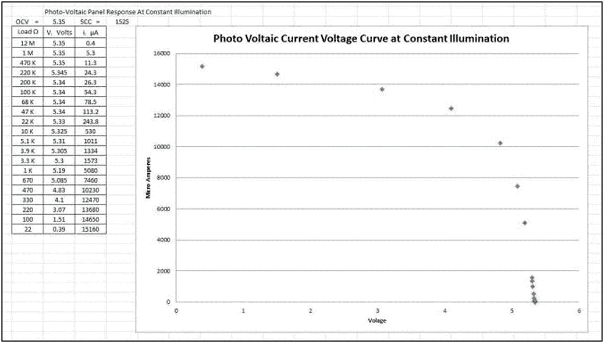

**图 11-17**
120 x 70 mm 光伏板的电流-电压曲线

在十一月一个局部多云的日子里，图 11-4 中所示的大电池板产生了 `23.9 V` 的电势差。尽管由于云层条件而波动，它仍然能向 `1200 Ω` 的负载提供大约半瓦特的功率。

## 机械能

在靠近流动水域、或缺乏阳光但能接触到流水或风力的地点进行的实验，也可以通过机械作用从环境中获取电力。水的密度是空气的 820 倍。少量的流动水就能提供巨大的力量，以有用的速度驱动涡轮机。流动的空气则需要很大的表面积才能收集到足够的力，以相同的有效速度旋转涡轮。

当电机用作发电机时，旋转速度决定了它所能产生的电压。利用电磁感应原理，通过驱动电机作为发电机来发电，效率较低。这种低效的转换过程，由于驱动力是易于获得且几乎免费的，因此得到了弥补。

由于其有限的或全旋转设计的双重用途，步进电机不适合高速连续旋转。它们主要用于分步定位旋转。将电机的用途从消耗电脉冲反转成产生电脉冲，其所能创造的能量大小受到步进电机相对较低的连续旋转速度的限制，这一点与磁电机类似。

图 11-18 展示了旋转的 Howard Industries `3.6°` 步进电机产生的电输出。多个尖峰模式是由于步进电机用于以离散旋转增量移动的大量磁极造成的。一个典型的 `7.5°` 步进电机有 12 个磁极，因此每旋转一周会产生 12 个电脉冲。

根据表中列出的转速（`RPM`）和通过 `1200 Ω` 负载的功率数据（详见表 11-5）绘制的图表如图 11-19 所示。

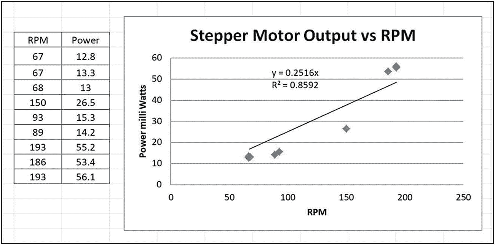

**图 11-19**
步进电机输出功率与转速的关系

图 11-19 说明了在从实验环境中收集能量时使用步进电机必须解决的几个问题。步进电机通常有一个中档“共振”频率，在此频率下其性能会下降，并且会发生过度磨损。如果实施连续旋转应用，旋转速度应高于或低于共振频率，这在风力驱动操作中可能很困难，但在流动水环境中是可行的。

使用风能或水能驱动有刷电机可以产生脉动直流电，可以通过电容器进行平滑处理，以供给稳压器或电池充电电路。要从较大的无刷直流电机中获取电力，你必须向该电源施加电力，并用整流器测量其输出，以确定特定的无刷电机是否适合用作发电机。图 11-20 展示了一种测试高速电机是否适合作为发电机的方法。

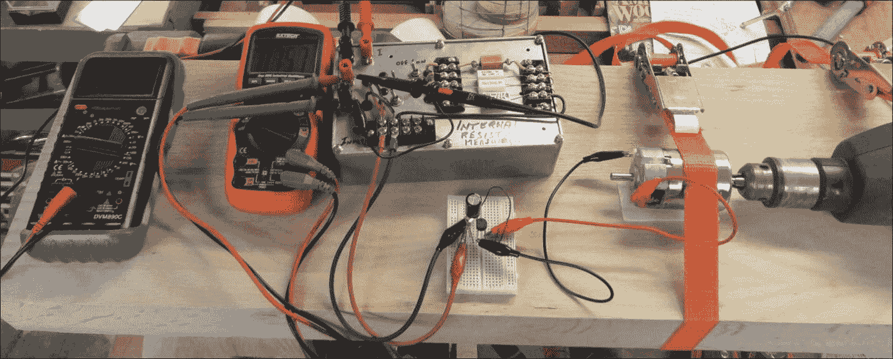

**图 11-20**
测试高速电机作为发电机

棘轮式绑带夹具可以将手钻和待测电机固定在实验台上，使其对齐，以便进行旋转发电测试。在图 11-20 中，电机是一个其额定转速为 `1200 RPM` 的 `12 V` 直流有刷电机（图 11-13a 和 11-13b 中的部件 A）。

在 `173 RPM` 的旋转速度下，电机功率输出几乎检测不到。在 `600 RPM`（手钻的最大速度）时，输出上升到 `1.93 V`，可在 `1200 Ω` 负载上产生 `1.60 mA` 的电流，功率水平为 `3.1 mW`。要获得更大的功率输出，电机轴上需要显著更高的转速。

使用新的或旧的电动机制成的发电机进行电能生产效率低下。与发电机和驱动力相关的低成本通常使得开发此类系统是值得的。

## 步进电机磁电机/发电机的内阻

图 11-18 描绘了用作磁电机/发电机电源以产生电能的步进电机的多个磁极所产生的电压“纹波”。

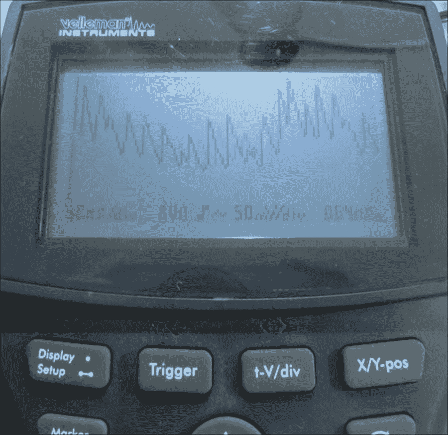

**图 11-18**
来自步进电机磁电机/发电机的整流器输出波形

使用图 11-14 和图 11-15 中的双步进电机驱动器-步进电机-发电机装置进行的一系列测试测量，产生了汇总于表 11-5 的数据。

**表 11-5**
步进电机-发电机输出

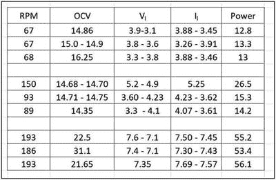

## 讨论

当实验设备远离主电源供电范围或受其存在干扰时，为其供电会变得困难。对于偏远野外地点和隔绝环境，电池通常是最实用的电源。如果在偏远地区需要延长电池寿命，可以构建一个电子充电系统，从周围环境中收集能量来补充电力。

从电池的电化学反应中获取的电源几乎是无噪声的，并且通常适用于灵敏的实验，例如那些使用静电计的实验。


## 总结

对于敏感或低电平测量，首选电池内部电化学反应产生的低噪声电源。

目前，电池生产采用六种左右的电化学工艺之一，分为可充电和一次性使用两种类型。

电池的内阻是一个重要参数，它在很大程度上决定了电池能够提供或接收电流的速率，并指示特定设备中电池的剩余使用寿命。

微处理器控制的充电站可以避免过充电，而过充电是可充电电池和电池组失效的主要原因。

光伏电池板可以维持为孤立或偏远地区的实验或过程供电的电池的电荷状态。

由电机构成的风力和水力机械发电机，虽然在电力生产方面效率低下，但其驱动力来自免费的能源。

许多科学测量和实验需要高电压、低电流的电源，这类电源需要小心操作，可以由低压可调电源、高频振荡器、高压变压器、倍压器和高压整流器构建而成。

脚注 1 2 3


