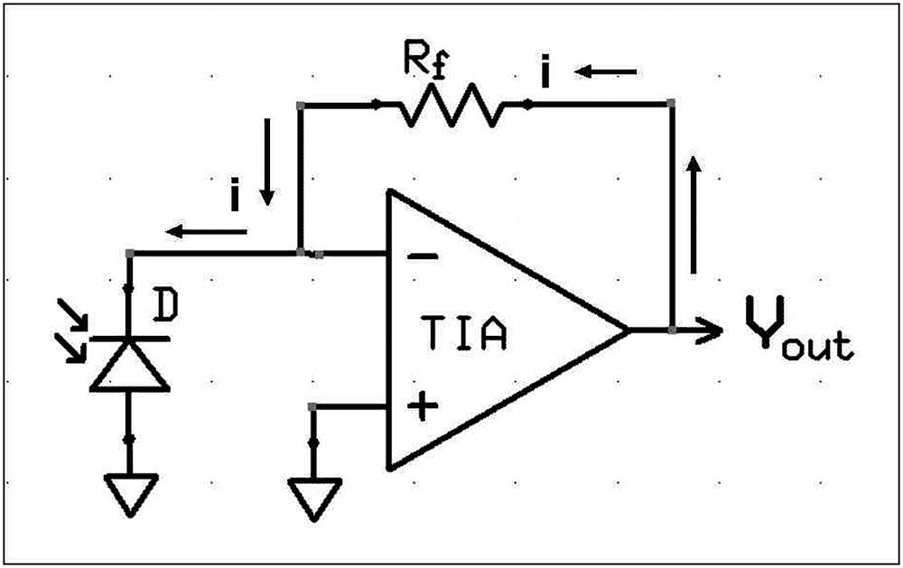
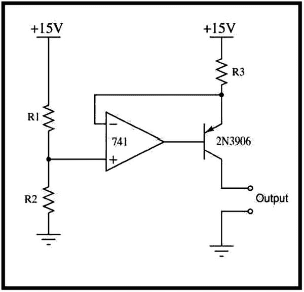
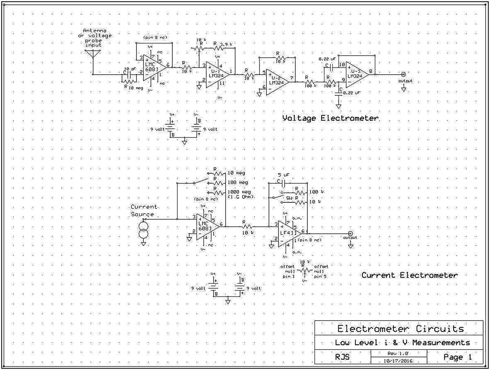
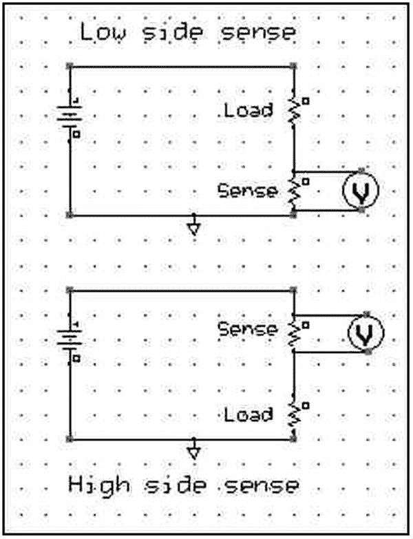
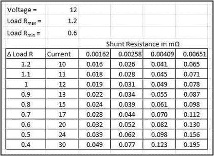
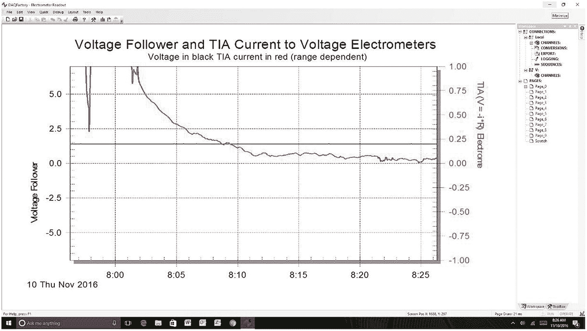
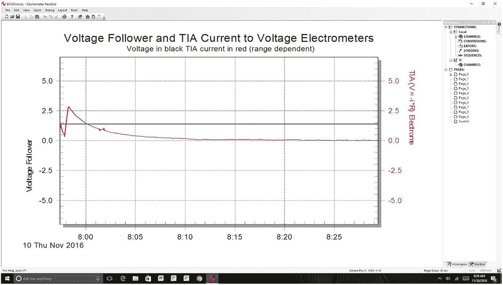
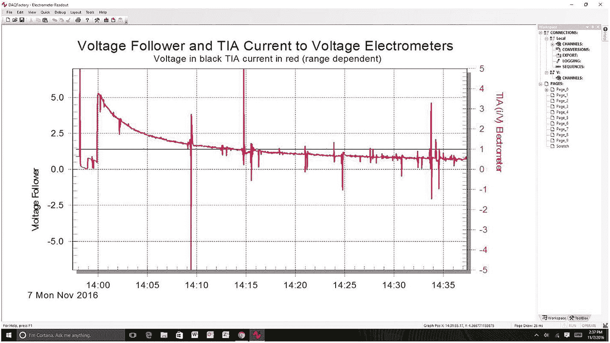

# 2. 电流

电能包含两个动态组成部分：电压和电流。电阻是材料的一种固有属性，以电压形式储存的能量通过这些材料驱动电流移动。

`电流` 这一术语指的是电荷的流动，通常以电子的形式，但也可能是液体、气体或等离子体中移动的离子。电流的测量单位是 `安培`，表示一秒钟内通过电路参考点的电荷库仑数。（1 库仑电荷相当于 6.24 × 10¹⁸个电子，每个电子携带 1.602 × 10^(−19)库仑的电荷。）

1820 年，奥斯特发现通过导线的电流会在导体周围产生磁场。研究人员很快开发出可通过测量导体周围磁场引起指南针偏转，来量化导线中电流的仪器。基于磁场偏转的电流测量仪器被称为 `检流计`，以纪念路易吉·伽伐尼——他发现电流能使青蛙腿的生物肌肉组织收缩。灵敏的电流测量检流计是通过将未知电流通过线圈发展而来的，这些线圈悬浮在由固定永磁体产生的磁场中。经过多次改进，尤其是达松伐耳和韦斯顿的贡献，最终形成了一种相当坚固的器件，成为从 19 世纪末到 20 世纪末固态系统发展之前广泛使用的伏欧表（`VOM`）的核心部件。这种器件具有固定的永磁体，包围着一个悬浮的线圈，线圈安装在螺旋弹簧上，称为 `达松伐耳/韦斯顿检流计`，可测量微安级电流。

电流测量时，将检流计与被测电路串联。待测电流流过一根细线圈，该线圈由螺旋弹簧悬挂在永磁体产生的固定磁场中。悬浮线圈中产生的磁场与永磁体的固定磁场相互作用，使悬浮线圈的偏转角度与流过其中的电流大小成正比。在基于检流计的仪器中，连接在弹簧线圈上的指针在数值刻度上移动，从而提供定量的电流测量值。

通过使用低阻值的并联“分流电阻器”来承担大部分电流，检流计的动态范围得以扩展，用于更高量程的测量，从而制成称为 `电流表` 的电流测量器件。理想情况下，电流表不应影响被测电路和电流。但是，连接导线、动圈和分流电阻器都有可测量的电阻，因此仪表需要校准。

通过电流表的部分电流会在器件中产生电压。该电压称为 `负担电压`。对于大电流值，由小的负担电压引起的损耗通常很小，不会影响被测大电流的观测值。而在测量小电流时，负担电压可能会引起显著误差。

基于动圈检流计的电流测量是模拟 `VOM` 的基础，它通过欧姆定律，测量经过精密电阻的电流，并利用已知电压源，从而能够测量电阻和电压。现代电流测量仪器是基于电压的固态器件，利用欧姆定律和模数转换器来测量精确已知阻值电阻上的电压降。

构成材料的物理特性是决定电流测量方式的限制因素。流过小电阻的极大电流会产生热量。而当测量系统中存在微小电阻时，极小的电流实际上会损失在电路中。

在几乎所有实验中，测量过程应使对被观测现象的干扰最小化。在电流测量方面，测量仪表不应产生任何电压负担。

微电流测量在是德科技的“低电平测量手册”中有详细讨论，手册地址为：[`www.tek.com/document/handbook/low-level-measurements-handbook`](http://www.tek.com/document/handbook/low-level-measurements-handbook)。该文档阐述了在微（10^(–6)）、纳（10^(–9)）、皮（10^(–12)）或飞（10^(–15)）安培范围内进行电流测量时存在的实际问题。低于微安级的电流测量需要使用静电计和皮安计，本文档对这些商用仪器进行了评述。

在数码摄影、生理学、电化学反应以及光谱和色谱分析系统中，会遇到微安及更低量级的电流。这些微小的电流——由光子收集型电荷耦合器件、神经组织、溶液中痕量移动离子、火焰离子化检测器中的离子化燃烧产物，或入射到 PN 结光电二极管上的光所释放的光电子产生——无法为普通的电阻负载供电或“驱动”，以产生可测量的信号。为了量化或测量这些微小的电流，需要特殊的仪器和技术，以最大限度地减少因试图测量这些微小电流而导致的“负载效应”影响。

运算放大器具有多种电流控制方式，也可用于电流测量应用。

运算放大器（`op-amps`）是基于理想的、理论上的直流放大器概念的集成电路。理想运算放大器具有无限大的开环增益、无限大的输入阻抗、零输出阻抗、无限大的带宽，并且当输入端子间无电压时输出电压为零。理想运算放大器有一对差分输入端，称为反相输入端和非反相输入端，它们分别将相应输入端子的电压反相或再现于器件输出端。

现代运算放大器是[模拟计算机](https://en.wikipedia.org/wiki/Analog_computers)的后继者，这些计算机在许多线性、非线性和频率相关电路中执行数学运算。集成电路，例如 1965 年推出的通用型 `μA709` 和 1968 年首次生产、至今仍在生产的 `μA741`，都是理想直流放大器的合理近似。

图 2-1 展示了一种小电流或微电流测量技术，该技术采用高质量的运算放大器，配置为 `反馈电流表` 或跨阻放大器（`TIA`）。该电路图将微小电流转换为更大的可测量电压，该电压与反馈电路中的电阻成正比。



图 2-1

跨阻放大器

运算放大器常被用作模拟计算机。在此例中，可以配置一个高质量的、具有高输入阻抗的集成电路（如 `AD 8628` 或 `LMC6081`），用于测量那些易受测量仪器负载效应导致失真的小电流源。

理论上的“运算放大器”（`op-amp`）是直流耦合、高增益的电子电压放大器，其输出由输出到输入的负反馈控制。负反馈是将输出的一部分耦合回来，以抵消部分输入的过程。运算放大器本质上是差分放大器，用于放大其反相输入端（`inverting input`）和非反相输入端（`non-inverting input`）之间的差值，在三角形放大器示意图上用 `+` 和 `–` 号表示。将输出端的条件部分反馈回反相输入端，可以改变运算放大器电路的特性，具体方式包括降低增益、改变输入和输出阻抗、改变带宽，以及减少制造差异和温度漂移的影响。

传统上，运算放大器是直流耦合放大器，其输出电压由反相输入端和非反相输入端之间的差值乘以放大器增益决定。在图 2-2 中，非反相输入端通过分压器保持固定电压。



图 2-2 运算放大器恒流配置

在用于电流控制的运算放大器恒流配置中，基极-发射极结位于负反馈回路中。它由运算放大器的输出驱动，以在反相输入端维持与非反相输入端相同的电压。非反相输入端的电压由 `R1` 和 `R2` 创建的分压器定义，改变分压器比率即可调整通过晶体管的电流。

在跨阻放大器（`TIA`）配置中，非反相输入端接地。运算放大器输出通过增益电阻反馈到反相输入端。运算放大器要求反相输入端和非反相输入端必须保持相同电位，这使得电流源将非反相输入端视为对地短路。这个看似简单的电路实现了不对被测信号产生干扰。跨阻放大器可能难以实现，并且需要高质量的运算放大器来测量低于微安和纳安级别的低电流值。

在固态电子学发展之前，基于达松瓦尔/韦斯顿检流计机电运动的安培计是测量低电平电流最常用的仪器。固态电子学和集成电路的发展使得运算放大器芯片成为可能，例如 `LM741` 和场效应管（`FET`）高阻抗输入 `LF 411`。两者都采用 `TIA` 配置来替代安培计作为电流测量设备。在电流-电压转换模式下，运算放大器 `TIA` 配置通过改变反馈电阻的值来测量毫安及更低范围的电流。

使用运算放大器 `IC` 芯片测量低电平电流的灵敏度，取决于芯片对被测电流源所呈现的输入阻抗。在表 2-1 中，列出了一些运算放大器输入阻抗以作比较。

表 2-1 运算放大器阻抗与成本

| 集成电路 | 输入阻抗（欧姆） | 成本（加元） |
| --- | --- | --- |
| `LM741` | 2 MΩ（10⁶） | < $1 |
| `LF411` | 1 TΩ（10¹²） | $1 到 $2 |
| `LMC6081` | 10 TΩ（10¹³） | $4 到 $5 |
| `OPA129` | 10T 到 100T（10¹³ 到 10¹⁵） | $12 |

随着输入阻抗在 10¹³ 欧姆到 10¹⁵ 欧姆范围内增加，集成电路运算放大器的成本显著上升。

当涉及电机或热传递操作时，会遇到远大于实验所得测量信号处理的微安和毫安范围的高电流测量。为了最大限度地减少对健康的危害和火灾引燃的可能性，有许多关于安全实施高压、大电流电气系统的规范。当应用需要高压、大电流电能时，应咨询相应的专家和适用的电气规范。后续章节中监测和讨论的较高电流为低电压性质。

固态电子系统在 3 V 到 30 V 范围内工作。因此，为常见步进电机、冷却风扇、热电热传递系统和电化学操作供电所需的较高电流很少超过此范围。

大多数手持式和台式电子测量仪器在串联连接到电流源和负载时，可测量高达 10 A 的电流。然而，涉及电解、电沉积或固态热电热传递的低压、大电流实验通常使用超过 10 A 的低压电流，而 12 V 铅酸电池（如汽车启动应用中使用的）可按需提供 500 A。

回顾一下，两个并联放置的电阻根据其阻值比例分配它们之间的总电流，你可以想象出修改固定刻度安培计以测量更高电流的方法。当传统的安培计（例如基于达松瓦尔/韦斯顿检流计运动且具有低内阻的安培计）需要测量更高电流时，会在仪表输入端子之间放置一个已知值的“分流”电阻，以形成一对并联电阻。分流电阻的阻值远低于仪表内部组件所显示的阻值，因此电路中已知较大比例的电流会流过分流电阻。

商用分流电阻有多种值、精度、物理形式和成本可供选择，从表面贴装器件到带有螺钉或螺栓型电气连接的离散平板式安装单元。本练习后续部分将介绍分流器的制作以及确定电流大小的方法。

安培定律将电流与磁场联系起来，使得通过测量连接电流源和负载的导体周围的磁场强度，能够以非接触方式测量导体电流（见第 5 章）。磁场电流确定方法称为间接测量。测量传感器与带电导体隔离。

直接测量依赖于欧姆定律。对于直接测量，分流电阻串联放置在电流源、负载或地之间。如果分流器位于电流源和负载之间，则测量被视为“高端”测量；如果位于负载和地之间，则属于“低端”测量。

电流分流器的高端和低端放置问题，会影响测量低阻值电流分流器上小电压降的技术。

## 实验

在图 2-3 中，两个用于测量低电平电能的电路原理图。这两个静电计电路强调了低电平电信号测量中常见的几个重要相似之处。在这两种情况下，测量电路必须最小化测量仪器对被测信号造成的干扰或失真。



图 2-3 基于运算放大器的静电计

### 硬件

图 2-3 中的每个电路均采用了适当配置的高输入阻抗运算放大器。电压跟随器用于测量电压，跨阻放大器用于测量电流。电路应组装在电路板上，安装于金属外壳内，并遵循制造商关于“空气绝缘”输入电路的建议¹。在这两种情况下，静电计的读数均由 `LabJack U-3 HV` 处理并显示，并通过 `DAQFactory` 条带图记录仪进行展示。满量程显示 (`FSD`) 可根据被监测的读数进行调整。使用 `+/– 9 V` 电源时，由于各 `IC` 放大器的限制，显示读数被限制在 `+/– 7 V` 至 `8 V` 的摆幅内。

电压静电计通过将一块电压精确已知的特殊电池连接到系统输入端，并调节可变微调电阻，直到仪表显示正确的电压来完成校准。

`LM411` 运放上有两个引脚标记为“失调调零”，它们连接到一只 `10 kΩ` 可变电阻器的两端，该电阻器的滑片连接到负电源电压。失调调零调节可确保当两个输入电压相同且差分输入为零时，放大器的输出也为零。在电路板上组装电路并将其安装到金属外壳中时，应确保 `LF411` 的输入端可以临时短接到公共电压或地线，并且可以在无输入时调节失调调零微调电阻以实现零输出。

称为 *分流电阻器* 的低欧姆值电阻可将电流波动转换为电压变化，以便测量大电流。低值电阻上的电压变化产生的毫伏级甚至更低的信号电平，可能需要使用如图 2-3 所示的高输入阻抗电压测量静电计来精确测量较大的电流及其波动。

跨阻放大器（见图 2-1）根据以下关系将电流转换为电压。

```
V[out] = –i[in] * R[fb] ----(1)
```

如果两个 `TIA` 级联，如图 2-3 所示，则流过连接这两级的 `10 kΩ` 电阻器的电流可通过欧姆定律求得，即用第一级放大器的输出电压除以电阻值，如下所示。

```
V[out1] / R[fb1] = -i[in2] ----(2)
```

在等式 (1) 中，第二级放大器的增益为

```
V[out2] = –i[in2] * R[fb2]
```

在等式 (2) 中，

```
V[out2] = – (V[out1] / 10k) * R[fb2]
```

由于

```
V[out1] = -i[in1] * R[fb1]
```

```
V[out2] = – ((-I[in1] * R[fb1]) / 10k) * R[fb2]
```

这可以重新整理，以便根据观察到的输出电压和适当的电阻值来测量输入电流。

```
i[in1] = V[out2] * (10k / R[fb1] * R[fb2])
```

检查图 2-3 中反馈电阻的值表明，采用双 `TIA` 配置可以测量低至 `10^(–12) A` 范围的电流。

使用直接和间接技术测量更高电流涉及分流器和磁场强度测定。

### 电流分流器

让大电流通过电阻器会导致电阻器发热，其发热功率符合以下表达式。

```
P = i * V
```

或

```
P = i² * R
```

较大的电阻器可以散发更多的热量。为了使分流电阻器保持合理的尺寸，其对电流呈现的电阻值必须很小。许多分流电阻器的阻值都在毫欧姆范围（`10^(–3) ohm`），可以从电子供应商处以几加元到几十加元的价格购得。

实验中可以使用一段长度可测量的普通铜质建筑线或漆包线，其电阻以每千英尺的欧姆数来度量。电阻值可以从参考书或在线数据库中获得，例如 [`www.engineeringtoolbox.com`](http://www.engineeringtoolbox.com) 或 [`www.arrl.org`](http://www.arrl.org)。

表 2-2 列出了铜线的特性，包括常见的美国线规尺寸、直径（毫米 (`mm`)）(1/1000 in) 以及 77°F (25°C) 下每千英尺的电阻。（1000 mls/in, 1 英寸 = 25.400051 mm, 1 英尺 = 304.8 mm 或 0.3048 m）。

表 2-2 铜线特性

| AWG | 直径 (mm) | 直径 (in) | 电阻/1000 英尺 | 最大电流 (A) |
| --- | --- | --- | --- | --- |
| 12 | 2.05 | 0.081 | 1.62 | 41 |
| 14 | 1.63 | 0.064 | 2.58 | 32 |
| 16 | 1.29 | 0.051 | 4.09 | 22 |
| 18 | 1.02 | 0.040 | 6.51 | 16 |

关于分流器的使用，举一个例子：你可以计算测量来自大型汽车型铅酸电池的 `10 A` 至 `20 A` 范围的直流电流所需的分流电阻。一个电化学电镀或机器人电机，其负载电阻在 `1.2 Ω` 至 `0.5 Ω` 之间，可以在电路中添加一个分流电阻器，如图 2-4 所示。



图 2-4 电流检测分流器的放置

就电阻值和瓦特数而言，分流电阻器的尺寸决定了其两端产生的电压以及该器件能够安全耗散的功率。选择靠近地线（电路负载的高端或低端）的位置，取决于用来测量检测电阻两端电压的技术。

检测电阻的值越低，分流器散发的热量就越少，并且在分流电阻器升温时对工作电路中电流的干扰也越小。然而，分流电阻越低，电流变化时在其两端产生的电压就越低，对电压测量的灵敏度要求就越高。

许多运算放大器配置和其他专用集成电路用于监测分流器电压。其中一些电路最适合用于电流监测的两个可用位置之一，详见图 2-4。差分放大器，以运放形式制造在称为 *电流分流监控器* (`CSM`) 或 *仪表放大器* 的专用 `IC` 中，用于监测由电流波动引起的、在分流电阻器两端产生的任何电压。

一个简单的计算表明，表 2-2 中列出的任何导线，取一英尺长，都能产生一个阻值从 `1.62 mΩ` 到 `6.51 mΩ` 的实验性分流电阻元件。当负载电阻在 `1.2 Ω` 到 `0.4 Ω` 之间变化时，电路电流大约从 `10 A` 变化到 `30 A`，产生的电压差如表 2-3 所示。

表 2-3 AWG 分流器电压

| - |

表 2-3 显示了由标称铜 `AWG` 制成的、一英尺长的分流电阻器两端产生的电压，以及相应的电路电流。为简化计算，分流器微小的附加电阻未计入变化的电路总电阻中。

对于 `10 A` 至 `30 A` 的电路电流，表中右下四分之一部分预测的、采用一英尺长导线电阻的分流器所产生的毫伏范围从 `16 mV` 到 `195 mV` 不等。对于更精密的工作，应使用第 7 章中描述的低欧姆测量技术来校准单个分流器的真实电阻。

### 观察

在需要大或可重复时间常数的定时电路中使用电容器时，经常会遇到极低水平的漏电流。漏电流可以通过图 2-3 的电流静电计电路来测量，该电路配置为第 7 章图 7-4 所示的电路。被测器件 (DUT) 替换为待测电容器。如果你记得跨阻放大器对于连接到其反相输入端的任何电流源来说，表现为对地的“短路”，那么这个配置就很容易理解。

图 2-5 是由一个来自 `LiMH` 电池组的 4.72 V 激励电压在 1 μF 钽电容器中感应出的漏电流所产生的记录仪迹线。图 2-3 中具有 10 太 (T) 欧姆输入阻抗的 `TIA` 电流静电计，在反馈增益环路中使用 1 吉 (G) 欧姆反馈电阻时处于其最大灵敏度。

比较图 2-5 至图 2-7 展示了 `DAQFactory` 显示可用的功能。顶部图形显示了未经任何数据处理时的实验数据记录，而第二个图形则对数据进行了 25 倍平均。图 2-7 展示了图形化漏电显示可用的量程扩展功能。



图 2-7 两个并联的 1 μF 聚苯乙烯电容器的扩展量程漏电流



图 2-6 两个并联的 1 μF 聚苯乙烯电容器的漏电流



图 2-5 1 μF 钽电容器的漏电流

最初尝试测量一个典型 1 μF 聚苯乙烯电容器的漏电流未能成功。在高量程扩展下，静电计电压迹线中的噪声足以掩盖迹线平均值与显示零线之间的任何差异。为了提高测量的信噪比，将两个 1 μF 电容器并联，并将这对电容器连接到测试电路，产生了图 2-6 和图 2-7 中的迹线。

表 2-4 列出了四种不同类型电容器的实测漏电流。

表 2-4 实测电容器介质漏电流与计算电阻值

| 电容器类型 | 实测漏电流 | 计算电阻值 |
| --- | --- | --- |
| 电解电容器 | 1.5 × 10^(–6) A | 3.1 × 10⁶ Ω |
| 钽电容器 | 2.5 × 10^(–10) A | 1.9 × 10¹⁰ Ω |
| 聚苯乙烯电容器 | 2.5 × 10^(–11) A | 1.9 × 10¹¹ Ω |
| 传统高压管状电容器 | 6 × 10^(–10) A | 7.8 × 10⁹ Ω |

## 讨论

电流的流动决定了电能可提供的功率。即使是在低电压下，大电流也必须通过精心设计和测试的电路进行疏导，这些电路能够安全地耗散电流通过时产生的热量。在环境温度下，所有材料都具有一定的电阻，它会阻碍电流流动并在导体中产生热量（参见第 7 章）。

电能流动会在载流导体周围产生磁场，磁场强度与电流大小成正比。在启动大电流通过之前，应评估由此产生的磁场对电路周围区域的影响。

采用机电式电流表设计的装置，可以使用 `TIA`、合适的反馈电阻以及方便的读数装置进行升级，以记录或显示测量的电流。

`IC` 运算放大器试图使其两个输入端保持在同一电压水平。当同相输入端直接接地时，连接到反相输入端的电流源会将运算放大器视为对地的“虚拟”直接短路。一个同相输入端接地，其输出通过一个固定的、已知阻值的电阻反馈到反相输入端的运算放大器，被称为`跨阻放大器` (`TIA`)。`TIA` 将输入电流转换为负输出电压。如图 2-3 所示，一对级联的高输入阻抗跨阻放大器可用于测量低电流水平。