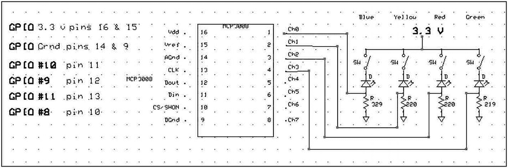
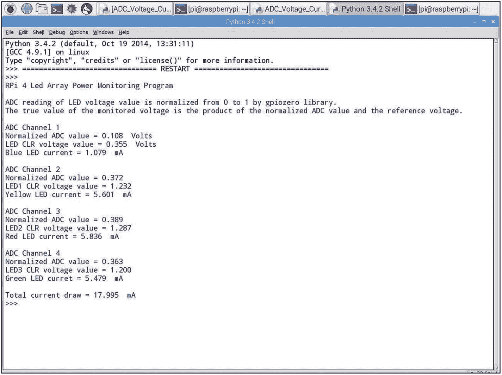
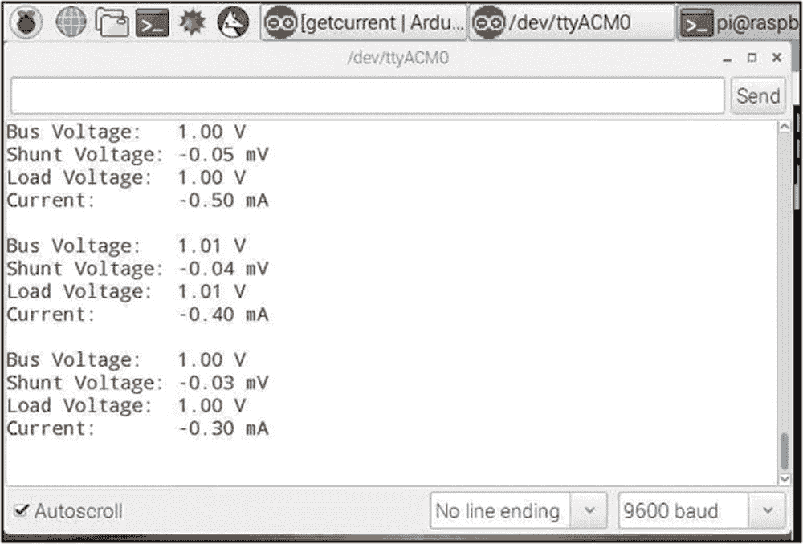
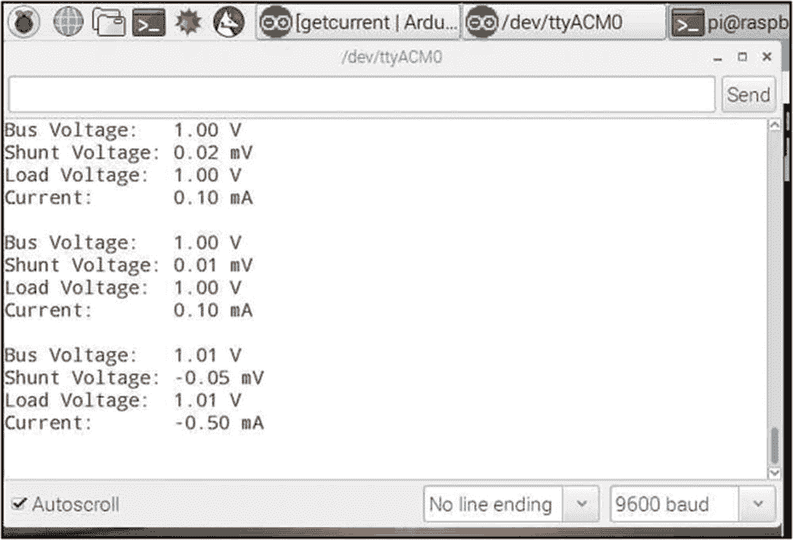

# 使用 Raspberry Pi 和 Python 进行电流测量

传统的通过在已知电阻上测量电压降的电流测量技术，需要为 Raspberry Pi (RPi) 配备一个电压监测系统。RPi 通过其通用输入/输出 (GPIO) 引脚阵列与外部外设通信，这在多部文献和参考资料中均有描述，包括：

*   《Raspberry Pi 用户指南》，作者：Eben Upton 和 Gareth Halfacree (John Wiley and Sons, 2016)
*   《实用 Raspberry Pi》，作者：Brendan Horan (Apress, 2013)
*   《学习 Raspberry Pi 与 Linux》，作者：Peter Membrey 和 David Hows (Apress, 2012)

来自传感器的电压可以通过外部 ADC 芯片，或者通过 USB 连接到配备 10 位 ADC 的 Arduino 微控制器板，由 RPi 进行测量。一个相对简单的电压测量工具可以使用 `GPIOZERO` Python 库和 Microchip Technology Inc. 的 `MCP3008` ADC 芯片来实现。

`MCP3008` 是一个八通道输入器件，可以监测电路中多达八个单电压点，或进行四次差分电压测量。该 IC 芯片的售价约为 5 加元，是一个 10 位逐次逼近寄存器 (SAR) 器件。LabJack、Arduino 和 `MCP3008` 中使用的 10 位分辨率将输入电压划分为 1024 个单元以进行量化。这个 16 引脚双列直插式塑料封装 (PDIP) IC 连接到 RPi 的 GPIO 引脚（参见图 2-8），并使用 Python 串行外设接口 (SPI) 协议来传输控制命令和数据。确保已根据第 1 章图 1-16 和图 1-17 所描述的操作，为 RPi 调用了正确的串行协议。


### 实验：典型与较低电子电路电流

图 2-8 以图形方式描绘了从 `RPi` GPIO 阵列到 `MCP3008` 的连接，并提供了四个通道的电路原理图，这些通道用于测量流经彩色二极管的电流，并配有精确数值的限流电阻。



**图 2-8**  
用于监控 LED 电流的 RPi 电路

为简化图 2-8，GPIO 引脚与 `MCP3008` 引脚之间的连接导线未在图中绘出。GPIO 阵列左上角引脚的 `RPi` 3.3 V 电源连接到 IC 的引脚 16 和 15。其余连接均按相同方式指定并连接。

用于选通（激活）ADC 芯片执行转换，然后读取并显示 10 位电压值的 Python 代码，见本章末尾的代码清单 2-1。

所有复杂的实验系统都始于对每个组件进行独立测试并验证其性能。复杂系统的构建是通过逐个添加单个组件，并在可能的情况下，在每次增量添加后测试整体组装情况，直至搭建出完整的可运行设备。

据称，早期型号的 `RPi` 被设计为在 3.3 V 逻辑电平下提供 3 mA 的输出电流，因此可用的总功耗为 17 引脚 × 3 mA = 总计 51 mA。微小的 3 mm 指示灯 LED 的最大电流限制为 20 mA，应在 16 mA 至 18 mA 范围内工作。5 mm 和 10 mm 的 LED 的电流范围为 20 mA 至 40 mA，为了延长使用寿命，应在其最大短期电流处理能力之下 15% 至 20% 的范围内工作。

LED 的发光强度与流过二极管的电流成正比。数据手册中的电流建议是基于器件在其最大亮度或接近最大亮度下工作给出的，而在实验工作中并不总是需要如此。5 mA 至 10 mA 的 LED 电流通常能产生足够的光亮，并避免过载 `RPi` GPIO 引脚的电源连接。

为了适应 `RPi` GPIO 引脚有限的电流供应，图 2-8 中的电路可以使用现成的 5 mm LED、合适的已知阻值限流电阻和单个手动电源控制开关来搭建——所有这些开关在组装时均置于断开位置。开关阵列全部断开是电源监控练习初始测试中使用的配置。

阵列中的四个 LED 应分别独立测试。确认它们在电源供电时能够点亮。（关于手动激活或测试 LED 的命令行终端方法，请参阅 [`https://gpiozero.readthedocs.io/en/stable/`](https://gpiozero.readthedocs.io/en/stable/) 上的 `gpiozero` 教程。）一旦 LED 二极管成功点亮，请在断电状态下，将二极管结及其限流电阻连接到相应的 ADC 输入通道。

在 ADC 与 LED 阵列正确连接后，即可进行 `MCP3008` 与 `RPi` GPIO 引脚之间的连接，然后运行 Python 程序。系统初始输出应指示所有通道的电流或总电流均为零。该系统的简洁性要求采用手动操作模式，以查看 LED 照明系统的功率负载和分配数据。每手动打开一个 LED 使其点亮时，都应运行电源监控程序来计算并显示各个支路电流及其总和。

通过将流过 LED 的电流保持在 12 mA 至 16 mA 范围内，`RPi` 应能充分点亮三个 LED，并在电源监控程序收集并显示更高功耗数据期间短暂点亮第四个二极管。对于使用超过 GPIO 引脚可用功率的实验，可以使用辅助电源和多个 CMOS 4050 缓冲芯片。

### 观察

本练习的目标之一是传授一种方法，以在使用 `RPi` GPIO 引脚为实验装置供电时，安全地处理系统的局限性。

图 2-9 展示了电源监控程序在 Python 控制台或终端中的典型输出。



**图 2-9**  
电源监控输出程序的 RPi 显示

图 2-8 揭示出，限流电阻（CLR）两端的电压降是由流过二极管/电阻组合的电流引起的。`MPC3008` 通道通过直接测量接地电阻两端的电压降，来间接测量在整个电路中保持恒定的电流。

## 讨论

作为一款教育用计算机，Raspberry Pi 既在信息处理模式下工作，也作为一个物理计算平台。然而，当用于物理计算模式时，必须认识到这款紧凑、廉价系统的局限性。`RPi` 操作系统是进程驱动的，如果处理器内核中运行着优先级更高的进程，它可能无法立即响应 GPIO 引脚上的事件。图形处理是计算资源的大户。因此，在物理计算模式下，`RPi` 应尽可能使用最实用或最小化的屏幕显示。

Raspberry Pi 基金会提供了多个 Python 库，使计算机能够与各种硬件设备连接，从而扩展与外部设备和传感器（例如 MCP 系列的模数转换器）的通信。

微安、纳安及更低量级的小电流测量（如光电二极管和光电晶体管电流中遇到的情况），需使用跨阻放大器静电计进行监测（见图 2-3），测量结果可读取并打印到 `RPi` 控制台，或通过对 Python 代码稍作修改后绘制成图（见第 1 章的代码清单 1-4）。

### 实验：使用分流器测量更高电流

关于使用 GPIO 阵列测量加热和热电冷却操作中遇到的更高安培级电流的信息较少。较大的电流可以使用 `INA219` IC 来测量，该 IC 利用“高端”分流电阻和灵敏放大器来读取分流器两端的电压降（见图 2-4）。`INA219` 是一种特殊的电流分流 IC，安装在 Adafruit Industries 提供的分线板上。它可以测量高达 3.2 A 的电流，并产生约 300 毫伏范围的电压信号，该信号可直接由 `MCP3008` ADC 读取。


## 实验

利用树莓派和一块市售的、搭载了德州仪器（TI）表面贴装技术（SMT）`INA219` 电流传感器的 breakout 板，可以监测大范围的电流。该板卡可从 Adafruit Industries 购得（售价 10 加元），除了 `INA219` 集成电路之外，还包含一个 0.1 Ω 的 1% 分流电阻。可以给板卡安装排针，以便将传感器安装到原型板上，用于电流监测的开发工作。

该板卡有两个螺丝接线端子，用于将传感器与被监测的电流源串联接线。为演示起见，该传感器可与树莓派–Arduino 集成开发环境以及之前搭建的电流镜电路（见图 1-7）配合使用，该电路曾被用于给第一章中的大电容充电。

来自电容充电晶体管集电极的电流被重新导向，流经 `INA219` 传感器板卡的接线端子，再流入和流出电容。

通过连接 Arduino 和 breakout 板上的标准引脚和插座，提供接地和 5V 的板卡电源。树莓派 Arduino 集成开发环境与 breakout 板之间的通信，通过将传感器板的 `SCL` 连接到微控制器的 A5 模拟输入（或 `SCL`）引脚，并将传感器板的 `SCA` 连接到 Arduino 的 A4 输入（或 `SCA`）引脚来建立。

制造商提供了一个完整的 Arduino 库用于读取该传感器。该库可提供下载。

一旦微控制器与传感器板之间的所有连接都可靠后，即可给电流镜供电，使被测电容经历充放电循环，这可通过 555 定时器输出端上的红色和绿色发光二极管来指示。

`Adafruit_INA219` Arduino 库带有一个（获取电流）`get_current` 方法或函数选项，可将数据显示在 Arduino 的串行监视器上。

### 观测结果

在图 2-9 中，Arduino 在 SPI 串行总线上监测到的电流循环得到了验证。图 2-10 显示了放电循环。



图 2-11

来自电流镜放电循环的 `INA219` 数据输出



图 2-10

来自电流镜的 `INA219` 串口数据输出

将一个 2000 μF 的电解电容连接到由 5.95 V C 型电池供电的电流镜上，并串联一个 47 kΩ 的放电电阻，该循环充电 36 秒，放电 9 秒。根据欧姆定律，理论镜像电流计算为 5.95 / (47000 + 100) 即 0.126 mA。

电流检测板显示充电电流为 0.10 mA。

555 定时器应在 6 V 电源的三分之一到三分之二之间（2 V 或 4 V）循环。因此，在 4 V 时，定时器将电容和放电电阻连接到地。镜像电流和电容上的电荷都流过电流传感器和放电电阻到地。

在图 2-10 中记录的放电电流峰值达到 -0.50 mA，并在随后的传感器读数中逐渐衰减。

## 讨论

较新的 Arduino 板卡可能在参考（ref）电压排针旁边带有用于通信连接的 `SCA` 和 `SCL` 输入排针。较旧的微控制器使用 A5 和 A4 模拟输入。

Arduino 可执行文件 `get_current`（获取电流）代码函数调用中的默认串口波特率设置为 115200，如果串口窗口未配置为接受 breakout 板的速率，则会导致串口输出随机哈希值。通过将 Arduino 程序的串口波特率重置为 9600，通常可以获得正常的读数。

尽管 breakout 板和库不是为了快速变化的电流而设计的，但对于缓慢变化的信号，仍然可以很好地跟踪双向电流流动，如图 2-9 和 图 2-10 所示。

德州仪器 (TI) 的 `INA219` 是一款电流感测监测器 (CSM) 集成电路，它带有一个可编程增益放大器 (PGA) 用于读取分流电压。PGA 的输出通过板载模数转换器转换为数字格式，并通过 I2C 或兼容 SMBus 的串行传输格式发送到 Arduino-树莓派，显示在 Arduino 串口上。库的默认输出报告总线电压（0 到 26 V）、电流、分流电压和负载电压。使用能够产生 +/- 320 mV 信号的 0.01 Ω 分流电阻，该系统可以监测高达 3.2 A 的电流。

如果某个项目需要记录和显示高或低电流测量值，可以根据需要调整 Python 串口的数据捕获代码和 Matplotlib 绘图代码（参见第一章中的列表 1-3 和列表 1-4）。列表 2-2 是绘图代码的补充且完全文档化的版本。

## 代码列表

```python
## SCR 绘制来自 MCP3008 ADC 的归一化电位器电压值。
## 使用 gpiozero 库配置 MCP3008 并生成 ADC 实例
## 用于绘图的属性。SCR 模拟被实现为一系列
## 由第 19 行的 maxt 变量控制的顺序时间窗口。
## Matplotlib 代码的默认值为 40 分钟。根据需要设置
## 所需的迹线分辨率。 y 轴由第 29 行中括号内的
## 值决定。正值和负值可用于正常
## 显示，而通过指示要在零轴上方和下方绘制的
## 值的所需符号，可以创建关于零的显示。
## 数据在 rd_data() 函数中生成，使用第 21 行创建的
## MCP3008(0) 实例 pot 的 pot.value 属性。
## x 轴和 y 轴标签分别在第 63 行和第 64 行创建。
#
import matplotlib
import numpy as np
from matplotlib.lines import Line2D
import matplotlib.pyplot as plt
import matplotlib.animation as animation
import time
from gpiozero import MCP3008
#
pot = MCP3008(0)
#
#
class Scope:
    def __init__(self, ax, maxt=4, dt=0.02):
        """显示的时间宽度 maxt"""
        self.ax = ax
        self.dt = dt
        self.maxt = maxt
        self.tdata = [0]
        self.ydata = [0]
        self.line = Line2D(self.tdata, self.ydata)
        self.ax.add_line(self.line)
        self.ax.set_ylim(-1.0,1.0)  # y 轴刻度
        self.ax.set_xlim(0, self.maxt)

    def update(self, y):
        lastt = self.tdata[-1]
        if lastt > self.tdata[0] + self.maxt: # 重置数组
            self.tdata = [self.tdata[-1]]
            self.ydata = [self.ydata[-1]]
            self.ax.set_xlim(self.tdata[0], self.tdata[0] + self.maxt)
            self.ax.figure.canvas.draw()
        t = self.tdata[-1] + self.dt
        self.tdata.append(t)
        self.ydata.append(y)
        self.line.set_data(self.tdata, self.ydata)
        return self.line,
#
#
def rd_data():
    while True:
        inPutln = pot.value
        #print("inPutln = ", inPutln)  # 用于代码开发或错误检查的打印输出
        line = inPutln
        # print(line)                  # 用于代码开发或错误检查的打印输出
        yield (line)

fig = plt.figure()
fig.suptitle("科学家的助手", fontsize = 12)
ax = fig.add_subplot(111)
ax.set_xlabel("时间")
ax.set_ylabel("电位器电压")
scope = Scope(ax)
## 使用 rd_data() 作为生成器为 update 函数生成数据，
## MCP3008 值由绘图代码在定时宽度窗口（默认分钟）中读取，
## 用于动画屏幕显示。软件开销限制了显示的响应速度。
ani = animation.FuncAnimation(fig, scope.update, rd_data, interval=50,
                              blit=False)
plt.show()
```

列表 2-2  
Python 带状图记录器绘图代码


```python
print("RPi 4 LED 阵列功率监测程序")
print() # 输出界面空行间距
print("ADC 对 LED 电压值的读数已通过 gpiozero 库归一化为 0 到 1 之间的值。")
print("监测电压的真实值为归一化 ADC 值与参考电压的乘积。")
print()
## 每次运行模块时打印一个归一化值
from gpiozero import MCP3008
## 创建一个表示设备的对象，并指定输入通道
ADC_vlu = MCP3008(0)   # 括号内的数字为设备通道号
ADC_vlu1 = MCP3008(1)
ADC_vlu2 = MCP3008(2)
ADC_vlu3 = MCP3008(3)
#
print("ADC 通道 1")
print('归一化 ADC 值 = %.3f'%ADC_vlu.value,'伏特') # 作者电路中的蓝色 LED
#
## 将对象值转换为数值参数
ledVltg = float(ADC_vlu.value) * 3.3
print('LED CLR 电压值 = %.3f'%ledVltg,'伏特')
## 根据欧姆定律计算 LED 电流
blue = (float((ADC_vlu.value) *3.3) / 329) * 1000
print('蓝色 LED 电流 = %.3f'%blue,'毫安')
#
print()
#
print("ADC 通道 2")
print('归一化 ADC 值 = %.3f'%ADC_vlu1.value) # 作者电路中的黄色 LED
#
## 将对象值转换为数值参数
led1Vltg = float(ADC_vlu1.value) * 3.3
print('LED1 CLR 电压值 = %.3f'%led1Vltg)
## 根据欧姆定律计算 LED1 电流
yellow = (float((ADC_vlu1.value) *3.3) / 220) * 1000
print('黄色 LED 电流 = %.3f'%yellow,'毫安')
#
print()
#
print("ADC 通道 3")
print('归一化 ADC 值 = %.3f'%ADC_vlu2.value) # 作者电路中的红色 LED
#
## 将对象值转换为数值参数
led2Vltg = float(ADC_vlu2.value) * 3.3
print('LED2 CLR 电压值 = %.3f'%led2Vltg)
## 根据欧姆定律计算 LED2 电流
red = (float((ADC_vlu2.value) *3.3) / 220) * 1000
print('红色 LED 电流 = %.3f'%red,'毫安')
#
print()
#
print("ADC 通道 4")
print('归一化 ADC 值 = %.3f'%ADC_vlu3.value)
## 作者电路中的绿色 LED
#
## 将对象值转换为数值参数
led3Vltg = float(ADC_vlu3.value) * 3.3
print('LED3 CLR 电压值 = %.3f'%led3Vltg)
## 根据欧姆定律计算 LED3 电流
green = (float((ADC_vlu3.value) *3.3) / 219) * 1000
print('绿色 LED 电流 = %.3f'%green,'毫安')
#
print()
#
ttl_Currnt_drw = blue + yellow + red + green
print('总电流消耗 = %.3f'%ttl_Currnt_drw,'毫安')
```
清单 2-1：树莓派 Python 代码：监测 4 个 LED 阵列的功率消耗

## 摘要

在固态系统问世之前，通过测量已知电阻上的压降来获取电流值的方法，是通过评估运动电流产生的磁场来完成的。较高安培数的电流通常通过测量分流电阻上的压降来确定。极低电流的测量则采用由高输入阻抗集成跨阻放大器组成的静电计。对可能跨越六个数量级的电流值进行静态和连续测量时，需要采用不同的技术，并结合能够适应被测设备中相应数量级极值的软件。

在许多实验装置中，电流会产生热量并改变温度，这些温度通过第 3 章概述的方法和技术进行测量。脚注 1

