# 9. 重量、质量与力

实验科学经常需要测量被测试、分析或等分材料的量。在重力场中，可以通过确定水平杠杆的平衡点来测量质量，杠杆上悬挂着被测物和已知标准质量。只有在重力场中，当力作用于物体质量上时，实验者才能确定其重量。本章包含多个部分，其目的是使用简单的电传感器以重量单位测量质量。

能够以克、毫克或微克为单位称重的现代实验室天平，使用电气和机械杠杆的组合来平衡参考砝码与负载。通常，光电电磁伺服机构会数字化并显示系统的平衡点。对于某些实验工作，这些脆弱、昂贵但非常敏感的系统必须经过适当校准后才能使用。

纯电子方法可以通过测量电阻在承受机械应变时发生的电阻变化来测量力和质量。基于电阻的“称重传感器”使用惠斯通电桥-仪表放大器配对来跟踪一个或多个桥臂的电阻变化，这些桥臂固定在承受应力的可变形机械部件上。商用“即剥即贴”式电阻称重传感器箔可以应用于承受负载的机械系统，以测量任何变形或移动。应变片通常是长、薄、薄膜状、平行或螺旋状的康铜（45% Cu – 55% Ni，用于 J 型热电偶）沉积物，在承受机械负载时会产生较大的电阻变化。电阻式称重传感器通常测量千克重量或牛顿力，并由仪表放大器读取电阻桥的不平衡信号。电阻桥通常配置多个有源传感器臂，以在基底在负载下变形时增强系统的不平衡信号。

# 重量与质量的测定

多年来，磁场物理的教学一直使用称为*电流天平*的装置。市面上有几种商用教育单元，互联网上也有大量帖子描述各种精密程度不一的学生实验演示设备，这些设备可由个人或教育工作者自行组装。在商用设备和实验者自组装的装置中，可以探究由流经导线的测量电流所产生的磁场与重力之间的相互关系。电流天平通常精密、量程有限且灵敏度高，不易用于测量未知的重量或质量。

电阻式称重传感器和电流天平要么缺乏灵敏度，要么过于精密和复杂，难以在实验装置中轻松适用于重量、力或质量的离散或连续测量。以下练习概述了一种简单、稳健的方法。一个由多层平板导体和电介质组装而成的电容器，其电容会因受到多层器件上的重量负荷压缩而发生变化。（基于电容器的称重传感器的优缺点将在本练习的后文中讨论。）

直到最近，利用特制电容器压缩作为工业称重传感器的工业应用和技术才得以实现。以下文本是我在 20 世纪 90 年代中期所做初期工作的进一步发展，当时为了科学实验需要测量亚克级重量。最初，开发工作仅限于电容值的数字读取。连续实时图形显示超出了个人或家庭可用计算设备的能力。通过监测器件输出随时间的变化，电容器作为称重传感器的进一步发展成为可能。在主计算机上显示的“条图记录仪”可确定加载器件何时达到平衡，显示器件响应的相对幅度、信号中的噪声，并指示信号值的漂移。

以下文本摘自我在开发一种相当灵敏且可重复的压缩式重量传感装置期间的研究笔记。为方便希望复制该方法或进一步开发该技术的研究人员，包含了大量细节和探索性测试。

电容器由被绝缘体隔开的两块导体板组成。通常，电容器在电路中被用于储存电能、滤除直流信号、创建定时延迟，或在交流电路中设定谐振点。器件的电容与极板面积、极板间绝缘介质的化学性质以及导体间的距离成正比。

经典理论用以下公式表示器件储存电荷的电容能力。

```
C = k A / d --- 1
```

`C` 是器件的电容。`k` 是由真空介电常数与导体板间绝缘介质的介电常数组成的比例常数。`A` 是导体和电介质板的有效面积。`d` 是导体间的距离。

商用电容器有多种物理形式（见第 1 章图 1-2）和电荷存储能力，电容值范围从皮法（写作`pF`，表示`1/10¹²`法拉）到许多法拉（如第 1 章所述）。极高电阻、低漏电流的器件由卷绕的金属化聚乙烯、聚苯乙烯和聚酯薄膜制成，这为我的最初实验提供了思路，如下所述。

## 开发历史

可以想象，一个用于悬挂重物称重的校准螺旋弹簧，可以被一叠带有可变形塑料电介质的电容器极板所替代，这些电介质置于导电板之间。放置于交错叠层组件顶部的质量所受重力压缩该叠层，应能压缩板间距离并改变器件的电容。

绝缘体两侧的两块导电板构成一个单一电容器件。如图 9-1 所示，五块带凸片的金属板（用字母 A 至 E 表示）分隔开四个绝缘电介质（用数字 1 至 4 表示），构成一个四电容器件。一个包含 n 个单元的多元件电容器拥有 n+1 块导电板，分隔 n 个电介质。多元件电容器称重传感器即由这些多层组件构成。

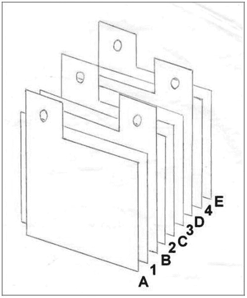

图 9-1：一个多元件电容器称重传感器

在方程 1 的电容器公式中，显示了器件电容与极板距离之间的反比关系。以任意单位绘制的器件电容与任意板间距离单调递减关系的理论曲线，会产生预期的反比例曲线形状，如图 9-2 所示。


图 9-2：电容与板间距离的关系

从图 9-2 的曲线可以明显看出，在 0 到 2 至 3 个距离单位之间的线性部分，是测量的器件电容与压缩程度之间的关系合理可预测的区域。

图 9-3 描绘了电容-压缩曲线所属的幂函数数学模型。

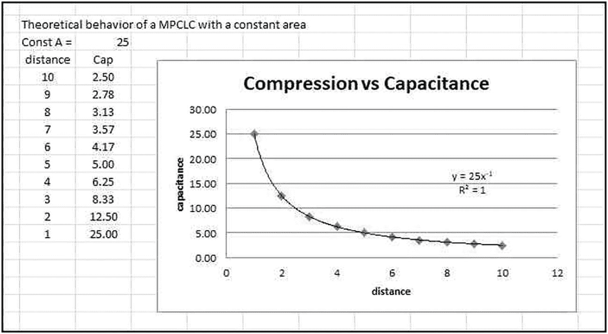

图 9-3：电容与板间距离关系的数学表达式

图 9-1 至 9-3 描绘了一组理想条件和理论考量，而使用并联连接的多个电容器单元构建的实际器件可能不会表现出这些特性。涉及构造材料、组装差异、电子、机械和环境噪声或扰动等一系列变量，都会导致偏离理想行为。构造材料、极板形状、器件层数以及器件取向对组装后器件性能的影响将在后文探讨。

在组装第一批实验单元进行测试时，观察到了一个意想不到的概念验证。将极板和绝缘体逐层堆叠，会使器件的总电容以与所用绝缘体和导体数量成比例的方式过度增加。随着器件层数的增加，上层材料的重量压缩了下层，从而过度增加了传感器观察到的“静态”电容。这种自压缩效应的贡献可以通过监测在水平平面上组装器件时总电容的增加来测量，也可以通过观察器件围绕其凸片端或各层自由端轴线从水平旋转到垂直平面时电容的变化来测量。

## 简单的单舌板式装置

如图 9-1 所示的简单、单舌片、方形板式装置，是最容易构建且能测量较大重量的装置。单舌片三角形板更难制备，但对重量更敏感（见图 9-26 和 9-27）。单舌片方形或锥形形状仅限于水平实验。在垂直平面上使用的高灵敏度装置则需要单独的悬臂安装，以便在装置从水平位置旋转到垂直位置时，能牢固地将组件固定并对齐。

本章将讨论用于在垂直与水平之间任意角度进行实验测量的更复杂装置的构建方法。

### 电容测量要求

要将多板电容器用作称重传感器、测力传感器或可能的倾斜仪，就需要一种能够连续测量或显示装置电容的方法。许多价格相对低廉的万用表都具有电容测量档位。目前已有大量程序可供实验者使用微控制器或个人电脑作为电容计。

实验研究通常涉及测定极少量难以获取的有机、生物或医学材料的物理化学性质，以及某种物质仅存的一点点材料。在开发一种能将压缩力转换为可变电容的重量敏感型传感器时，我们希望测量尽可能小的重量。除了传感器能响应微小的重量变化增量外，软件和显示器也应能跟随这些微小变化，并以最小的时延用于热力学研究。

### 电容测量技术

在第 1 章中，介绍了一种使用单个 Arduino 板校准过的内部杂散电阻和电容（`ISRC`）的 Arduino 电容测量草图。使用内部 Arduino 组件校准的电容计除了被测设备（`DUT`）外，无需任何外部电路。

## 实验

在此重量测量练习中，另一个灵敏的电容测量草图需要一些外部电路。2013 年，Arduino 论坛的几位贡献者提出了一种电容测量技术，该技术利用 Arduino 的 `ATmega328` 微处理器芯片定时器（ICFT）的输入捕获功能，并结合外部电路，于 2013 年 7 月实现了灵敏且准确的连续电容测量（参见 `gammon.com.au/forum/?id=12075`）。

### 重量测量程序与数据处理

在以下文本中，重量测量程序探索了使用不同介电材料和装置物理参数，以评估装置构造与施加重量引起的电容变化之间的关系，涉及线性动态范围和传感器灵敏度。这两种微处理器电容测量程序均与 Arduino 微控制器和 `DAQFactory` 显示器中的数据平滑代码一同使用，以实现最大程度的降噪，同时保持合理的传感器响应时间。

针对特定实验或校准的电容测量微处理器编码草图，已从原始的 ISRC 或 ICFT 代码修改而来。这些草图被修改为包含移动平均数字信号处理（DSP），并每隔四分之一秒（250 毫秒）进行一次电容测量。`DAQFactory` 显示器对 Arduino 数据采用 16 点或更高的平滑处理。（请记住，平均会降低响应时间，而平均带来的信噪比提升或噪声降低与平均点数目的平方根成正比。）

下文给出的一些数据不需要大量的数字信号处理（DSP）来降噪，但随着所需重量测量灵敏度的提高，数据的 DSP 平滑处理变得重要。

### 降噪与电源

为了在提高灵敏度时降低噪声，必须使用 Arduino 的电池供电选项。在图 9-4 中，于 9:03 处可见黑色记录迹线的噪声显著降低，这是将 Arduino 的电源从 USB 的标称 5 V 切换到标称 12 V 的可充电铅酸电池所致（参见第 11 章关于电池的讨论）。

电池是一个储存电能的“水库”。要利用恒定直流电源带来的好处，这个“水库”需要足够大，以便在从中取电时表现为一个“恒压源”。我使用的电池是 4.0 和 4.5 安时规格的（尺寸为 3½ × 2½ × 4 英寸，或 9 × 6.5 × 10 厘米，重 3 磅或 1.4 千克）。这些电池可以为 Arduino 供电 12 到 16 小时甚至更久，直到输出电压降至 12 V 以下。铅酸电池充电后，电压可能会升至 13 V 以上，但几小时后会稳定在 12 V 区间的高位。为防止损坏任何电路，在新充电电池的输出电压降至 13 V 以下之前，不会用它来为微控制器供电。当电压降至 12 V 以下时，停止使用电池供电，并对电源进行充电。


**图 9-4** 使用 12 V 电池供电降低信号噪声

在图 9-4 中，虽然黑色基线噪声从 0.02 nF 降低到了 0.007 nF，但漂移不受影响。

### 其他噪声源与屏蔽

在使用多个平行板电容器进行高灵敏度测量时，产生的信号中还存在其他噪声和漂移源，包括气流、温度变化以及感应的电磁场或静电场。在图 9-5 中，6:35 之前的黑色信号迹线未加屏蔽，而之后的信号则受到保护。

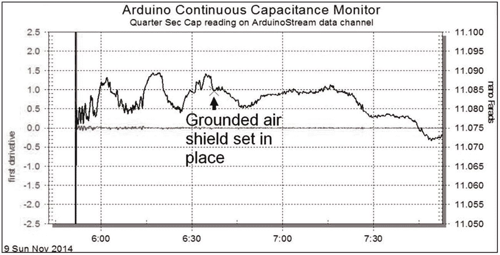

**图 9-5** 通过热、电和机械屏蔽降低信号噪声

图 9-5 中的信号噪声降低是通过一个薄纸板结构实现的，其内表面涂成黑色，外部覆盖铝箔。外部表面的铝箔被切割成比有效覆盖纸板总面积所需更大的形状。多余的铝箔包裹部分被折叠成一个扁平舌片，或卷成一个“猪尾巴”，连接到连接被测设备（`DUT`）与 `Arduino` 板的双绞线电缆的屏蔽层上。一根带有鳄鱼夹的跳线建立了所需的电气接地连接（见图 9-6 中的第 3 项）。

屏蔽组件的设计由研究人员组装的装置配置决定。在开发这些装置的过程中，我组装了许多不同的屏蔽配置，图 9-6 描绘了其中一种。图中所示的屏蔽罩是一个折中方案，它覆盖并保护了传感器的大部分有效区域。屏蔽罩的开口端设计允许传感器的尖端被加载和清除测试砝码负载，可手动操作或使用专用夹具进行，以尽量减少称重操作期间对上极板的干扰。

本书概述的 MPCLC 装置的开发，是典型实验序列的结果，在该序列中，为改进简单装置所做的小尝试，会引出对被测设备（`DUT`）工作机制的进一步见解。对工作机制认识的加深，会带来进一步的实验改进，从而增加对装置的理解，并随后通过增加或降低其复杂性来提升性能。

在开发电容式称重传感器时，从第一个由方形、易于组装的装置构成的简单设备，演变成了更复杂、难以组装的锥形、薄层及复合薄膜设备，其灵敏度大幅提升。

重量灵敏度成为实验者决定构建何种类型装置的关键因素。一个使用现成材料、可手工裁剪的简单方形装置，就能展示效应并测量克和盎司的重量。若要测量克的分数值，则可能需要构建和组装更敏感的锥形设备，这些设备需要更多的细心、时间和精力来制作和使用。对于极低质量，传感器中极板的刚度决定了灵敏度的下限。

标题图 9-6 描绘了几种不同的多板电容式称重传感器（MPCLC）以及最初用于制造和操作这些设备的各种附件。


**图 9-6**

各种 MPCLC 与附件

*   项 1 是最初的设备。它由带接头的方形（约 4 英寸或 10 厘米）铝箔导电板组成，左右两侧有公共连接，并由从塑料袋裁切的聚乙烯片材电介质隔开。
*   项 2 是一个用镀铝层 Mylar 薄膜制成的方形板设备。该设备的叶片是从镀铝 Mylar“救生毯”上裁切下来的。（发现成卷的“银色”铝-Mylar 礼品包装纸厚度为 0.0011 英寸（0.029 毫米），几乎是救生毯材料厚度的两倍）。复合材料仅单面有涂层，因此左右两侧的板都必须从库存片材上裁切下来。板的边缘可能需要清除金属，以避免设备短路。

由于仅单面金属化，必须在板之间建立电接触。该电接触由一个折叠的铝箔条构成，两端各打一个孔（参见图 9-7）。尝试使用折返接头以消除锡箔桥接，但未能提供可靠、耐久的电接触，这种接触在组装过程中或在使用中经常失效。尽管聚合物薄膜在传感器叶片的折叠或弯曲处内侧或外侧曲率上会拉伸或压缩，但当铝膜位于传感器叶片折叠或弯曲的外侧时，铝膜经常会断裂。

*   项 3 显示了一个为适配项 4 而制作的空气流和电磁场干扰屏蔽罩的内部视图。敞开盒子的内部涂成哑光黑色，外部包裹铝箔，并将铝箔折叠以提供一个接地连接头，可见于罩子的顶部边缘。
*   项 4 是一个灵敏度更高的设备，由镀铝 Mylar 制成的三角形、蚀刻边缘、锥形板组装而成。通过定制的可滑动纸板“桥”（在电容器板顶端正下方可见，处于缩回位置）将砝码从设备尖端加入或移除。

要使用桥，将砝码放在跨度的中心，桥的左臂或右臂将砝码托架滑动足够远，使其越过电容器尖端，以便砝码可以被拉或推离跨度中心，从而放置在下方称重传感器的中间尖端上。测量完成后，桥臂可以将桥移回缩回位置，在此过程中通常会将砝码从称重传感器上推落。

照片中还可见用于传输电信号的屏蔽双绞线的两端。导电板的端接头通过一个 32 牙/英寸的 `#10` 号螺栓连接，使用蝶形螺母来压紧左右板叠。（`#10` 号螺栓直径为 3/16 英寸，即 4.6 毫米。）

电接触通过一个大面积的铜带适配器实现，该适配器焊接到信号传输电缆的红线和黑线上。连接到 `Arduino` 的电缆末端有两个引脚，可以紧密地插入相应的模拟输入排针，并且屏蔽层上有一个鳄鱼夹，用于夹住紧密插入 `Arduino` 接地排针之一的引脚。

*   项 5 是校准砝码组。
*   项 6 是一个 1/4 英寸（6 毫米）的纸冲孔器。
*   项 7 是一个丝网印刷滚筒，用于抚平并压平箔电容器板。
*   项 8 是锥形电介质的模板。
*   项 9 是锥形箔导电板的模板。
*   项 10 是一批锥形导电板。

项 8 和项 9 是用于裁切锥形箔导电板和电介质片的纸板模板。这些模板旨在批量制作多个均匀的、所需形状的三角形复制品，以便组装后设备的尖端（包括金属箔和电介质绝缘体）都能相互对齐。这些模板与折叠的铝箔片和电介质一起使用，可以同时制作出四到五个相同的部件。

#### 电介质成分、分立板及金属化塑料薄膜的变体

尽管最初的多板电容器称重传感器是用手头已有的材料组装而成，包括厨房级卷铝箔和从塑料袋聚乙烯薄膜裁切的电介质，但通过改变电介质的化学成分，应该有可能提高灵敏度。`Mylar`、纸和许多水溶性盐的介电常数都高于聚乙烯。通过改变电介质的化学成分，有可能制造出对重量更敏感的称重传感器。与商业电容器一样，“称重传感器”可以由复合材料组装而成，例如干纸，或浸泡在各种盐类或可极化化合物（如甘油）中的干纸，以及由沉积在绝缘塑料薄膜（如 `Mylar` 上的铝）上的金属层制成。有几个需要考虑的因素将在后面讨论。在选择用于传感器制造的材料之前，应评估设备所需的服役条件。

多板电容器的组装最好分阶段逐步进行。我组装的每个设备都是按每五或十个电介质板为一个步骤来制造的，在每个步骤之间，会确认设备的开路特性，并测量总电容。通过逐步确认电气特性，可以保证设备在尝试收集实验数据之前是完全正常工作的。实验者会发现，设备的总电容最初会以显著大于预期的增量增加，而这种预期本应是设备总电容与逐步增加的板数量之间的简单线性关系。非线性的一个来源是自压缩，这一点将在后面讨论。

边长为 2 到 4 英寸（5 到 10 厘米）的较大方形设备最容易构建，表现出合理的电容值，并且易于加载克级及更高范围的砝码。为了测量对亚克级加载的电容变化响应，需要借助机械夹具辅助加载或卸载的更小型设备，才能制造出可行、可重复、灵敏的设备。

#### 铝箔和聚乙烯薄膜

1997 年，使用家用材料组装了首个正方形概念验证实验装置。最初通过一台搭载 555 定时器附加电容测量板的`Commodore-64`计算机监测电容变化。该定时器电路读取由可变电容待测元件和已知精密电阻值产生的 RC 时间常数。通过手工绘制数据曲线实现校准和粗略测试测量。

图 9-6 中项目 1 所示的电容器金属板可从家用或厨房级铝箔卷上裁剪。电介质可从聚乙烯塑料袋、透明邮寄包装或聚乙烯防护布上裁剪。极薄的塑料薄膜"密封膜或保鲜膜"无法使导电板与电介质相互滑动，因此不能制成可用的多层板电容器称重传感器（见表 9-1）。

最初使用直径 1/4 英寸（6 毫米）的手持式纸孔打孔器在铝箔单板上打孔。按照所示模板裁剪板和电介质，并在各图片显示的涂漆木质基座上组装多层板电容器。后续实验装置改用"皮革冲子"打更小的孔（见图 9-26 中项目 3）。

#### 纸张、处理纸和纤维素薄膜

由碳水化合物组成的木纤维制成的纸张通常比聚乙烯具有更高的介电常数。纸张有不同厚度和多种形式，如证券纸、新闻纸、描图纸、玻璃纸、仿羊皮纸和洋葱皮纸。许多纸张具有"可湿性"，可被水溶性化合物渗透后再干燥，以增加用这些材料组装的装置的整体电容。食品制造商和花店使用的透明纤维素薄膜也可用作电介质以增加装置电容。

#### 镀铝聚酯薄膜

`镀铝聚酯薄膜`在户外和露营用品商店通常以"救生毯"或 30 英寸宽卷装礼品包装形式销售。这种薄膜在极其耐用的薄型拉伸聚对苯二甲酸乙二醇酯薄膜（商品名`Mylar`）单面镀有铝涂层。通过切割出带突片的方形片材可制成电容器（见图 9-7），但需采用镜像对称的左右突片以适应铝涂层的单面特性。利用左右配置的片材，可形成`Mylar`面朝上、铝面朝下的交错多层板电容器。

为了用铝箔板和独立电介质片材组装可用的多层板电容器，绝缘体的裁剪尺寸应略大于铝板的有效面积。左右侧板分别安装在定位块两侧的固定端子上，绝缘电介质交错插入固定板之间，以避免导电板相互接触导致装置短路。

为避免沉积铝层组装的装置发生板间短路，可去除各复合板边缘的导电金属条带。或者，在铝层边缘沉积绝缘涂层（如油漆、墨水或蜡）以最大限度减少交错板短路的可能性（参见噪声产生相关讨论）。

可使用铝蚀刻溶液去除镀膜箔片上约`1/8`英寸（3 毫米）宽的金属条带。该溶液由 15.7 克蓝色硫酸铜、10 克食盐（氯化钠）和 50 毫升水配制而成。为在镀膜箔片边缘施加窄条蚀刻剂，我使用了适当长度的`1/8`英寸厚矩形胶合板边缘，包裹棉布后蘸取蚀刻溶液，再按压在待处理箔片的铝面支撑侧，去除板片有效铝涂层的外缘。蚀刻过程中，待蚀刻板片需放置在湿平板玻璃上以支撑薄膜并进行清洗。必须注意避免蚀刻剂接触电容器板中央区域。作者制作的多个板片上蚀刻出了几乎完美复制的指纹图案。

两层突片之间的电气连接需要桥接相邻电容器单元铝片间的电介质层。最初用 3/4 英寸（2 厘米）× 3 英寸（7.5 厘米）的铝箔条制作连接器，条带两端各打两个 1/4 英寸（6 毫米）的孔。将条带对折后套在每个突片上，使所有打孔对齐，即可按预期方式将所有独立电容器单元并联连接。

图 9-7 展示了左右手板片及连接箔桥。每个板片（无论左右手）都需要一个连接箔桥。若试图通过简单折叠箔片突片来简化构造，会导致沉积铝箔在弯曲外侧时断裂。采用折叠突片制造的装置在实验测试中突然失效后，通过为每个箔片添加图 9-7 所示折叠箔桥进行修复后即可恢复正常工作。

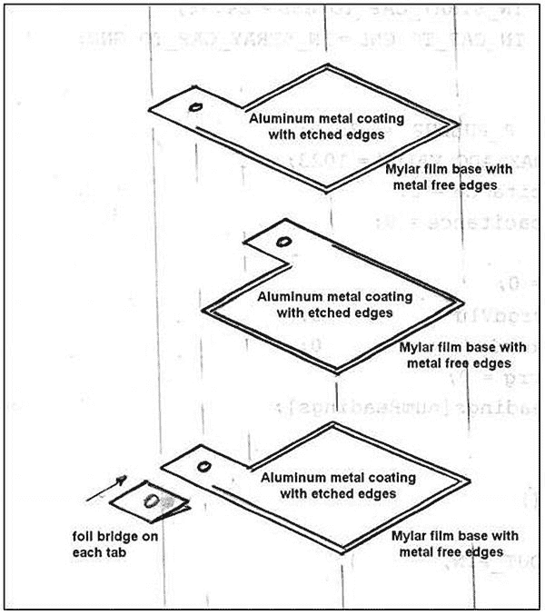

图 9-7
蚀刻边缘的镀铝聚酯薄膜板片与箔桥

`Mylar`薄膜的铝箔涂层侧可通过数字万用表（`DMM`）或伏欧表（`VOM`）的电阻测量或通断检测功能识别。从折叠坯料上一次性切割多层`Mylar`薄膜时，需在切割前确认能获得正确数量的左右手板片。

### 软件

两个 `Arduino` 草图程序可用于持续监控这些传感器。清单 9-1 利用精确已知的电阻和电容来评估 `Arduino` 板的内部杂散阻容 (`ISRC`)。内部校准通过第 1 章中介绍的公式完成。`ISRC` 代码可持续监控器件电容，用于图形显示。

清单 9-2 是第二个电容测量程序，它利用定时器 (`ATmega328`) 的输入捕获功能 (`ICFT`) 方法，并在练习清单中提供了一个移动平均 DSP 代码。通过使用精确定义的外部电路和 `ICFT` 代码进行电容测量，可以实现精确灵敏的测量（见图 9-8）。

为方便使用并降低噪声，图 9-8 中所示的分压电路、电容充放电电阻在原型开发板上完成初步开发后，被焊接到了一个 `Arduino` 扩展板上。`D*x*` 标识是 `Arduino` 板上的标称数字信号 I/O 引脚。

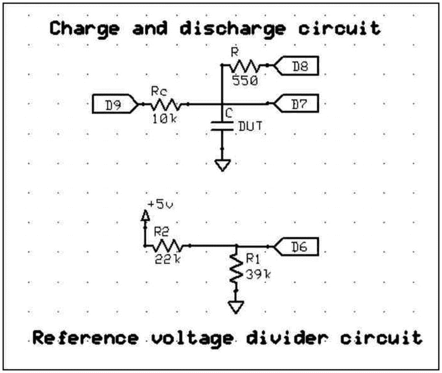

**图 9-8** 用于使用 `Arduino` 输入定时器捕获功能的外部电路

#### 斜率或一阶导数软件

除了测量 `DUT` 电容的两种不同技术外，能够测量被记录信号的一阶导数对于此类测量来说也是一项有用的功能（参见第 3 章，其中讨论了在 `DAQFactory` 的通道事件选项卡中一阶导数的数字实现）。

基本的导数软件可以通过以下长、短两行代码编写到通道的事件选项卡中。

```
private frstDiff = (Smooth (ArduinoStream[0],4) - (Smooth (ArduinoStream[25],4))) / (Smooth (ArduinoStream.Time[0],4) - (Smooth (ArduinoStream.Time[25], 4)))
frstDeriv.AddValue(frstDiff)
```

就 `DAQFactory` 程序显示的 `x` 对时间图而言，导数即为“纵增量”除以“横增量”，或 `x` 值随时间的变化率。这两行代码是在实验碳化硅高温电阻时开发的。“纵增量”的高度和“横增量”的长度值是通过经验得出的。根据来自 `Arduino` 数据流的 25 个数据点计算出的斜率值，再乘以另一个经验推导的比例因子，以生成视觉上有用的一阶导数轨迹。图 9-11 展示了导数轨迹在定位因施加重量可能导致的主电容变化方面的应用。（参见关于聚乙烯介电材料的讨论。）

`Smooth(Value, Amount)` 是 `DAQFactory` 的“移动平均”命令。（`Value` 是被绘制的实体或通道。`Amount` 是要进行平均或平滑处理的点数。）在用于 `frstDerv` 的 `DAQFactory` 代码中，对最近的四个数据点进行平均。减去 25 个数据点之前记录的四个点的平均值，以确定 `x` 值的差值（即“纵增量”跨越“横增量”时间长度内的差值）。将 `x` 的差值除以当前数据值与 25 个数据值之间的时间索引差，即得到斜率或一阶导数值。

在图 9-11 中，一阶导数轨迹值乘以 50，然后显示在屏幕上的 `+/– 3` 范围内，屏幕满量程偏转为 2.0 nF，对应 `MPCLC` 值在 19.3 至 21.3 nF 之间，即当 100 mg 至 1 g 的重量压缩器件时（参见关于量程扩展的讨论）。

## 观察结果

### 简单系统：铝-聚乙烯板

尽管 1997 年开发的原始系统在测量电容和称重传感器上的重量之间呈现出粗略的线性关系，但相对简单的计算系统仅提供单一数值的数字读数，缺乏足够的分辨率或连续记录能力来显示一种固有的现象，该现象限制了聚乙烯板在此类电容式称重传感器应用中的简单使用。随着校准实验中使用的重量增加，系统响应趋于稳定所需的时间也越来越长。图 9-9 显示了一个典型的响应。

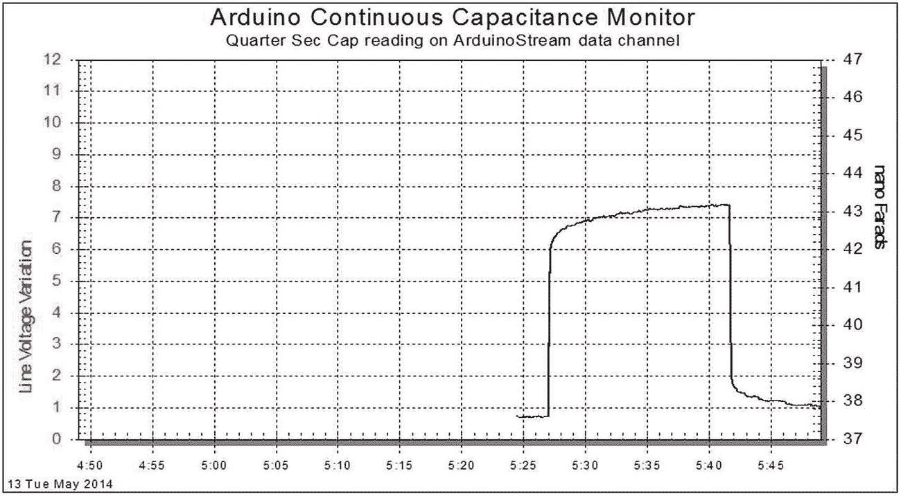

**图 9-9** 使用聚乙烯介电材料时的信号漂移

图 9-10 中的数据是在发现长时间平衡现象并确认其可重复性后收集的。


**图 9-10** 聚乙烯漂移研究

系统达到恒定测量电容所需的时间似乎随着负载大小的增加而增加，并且在连续显示模式下使用较高重量时需要小心。

补偿长期漂移的另一种选择（这种漂移可能是器件聚乙烯介电层某种形式二次压缩的结果）是监控传感器输出的一阶导数。可以计算一阶导数，并将其传输到第二个通道，配合 `DAQFactory` 代码的最后两行进行显示。

为了评估在已使用的聚乙烯 `MPCLC` 初始位移期间观察到的电容变化的一阶导数映射的实用性，记录了一次从 100 mg 到 2 g 的校准，如图 9-11 所示。

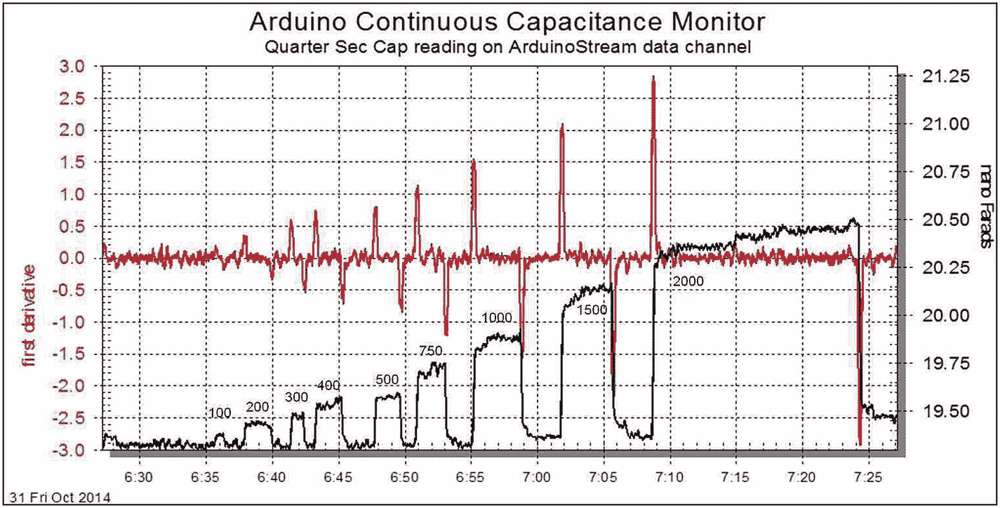

`图 9-11` 聚乙烯 `MPCLC` 重量响应的一阶导数记录

校准轨迹使用一个 50 介电常数、锥形板器件记录，该器件由用过的透明聚乙烯杂志邮寄包装袋和薄铝箔制成。Arduino 运行经过校准的 `ICFT` 电阻测量程序，在将数据发送到 `DAQFactory` 程序显示之前，使用 32 点移动平均平滑处理。`DAQFactory` 对通道输入采用 8 点平均，对电容值采用 32 点平滑，并对一阶导数采用 64 点平滑，用于图形条带记录仪显示。一阶导数的幅度通过将平滑后的绘图乘以一个任意值 250 来调整到显示比例。用于 100 mg 至 2 g 数据收集的器件暴露在室内环境条件下。

图 9-12 中的数据是在以毫米 (mm) 为单位测量初始偏转和三角形一阶导数轨迹的绝对高度，并相对于标称重量绘制时获得的。

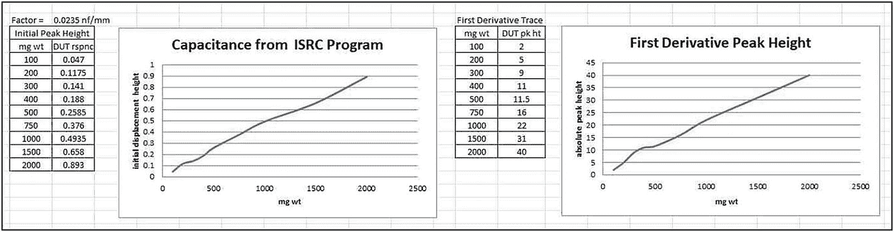

`图 9-12` 一阶导数与初始偏转的数据比较

尽管初始偏转基线位移图和电容值轨迹的一阶导数图具有大致相同的斜率，但导数图的线性度低于初始偏转绝对高度的绘图。

第二组校准数据是在更高的灵敏度下收集的，当时一个简单的黑色建筑用纸板空气隔热罩保护了锥形器件除 1¼ 英寸（32 毫米）尖端外的所有部分。校准轨迹如图 9-13 所示。

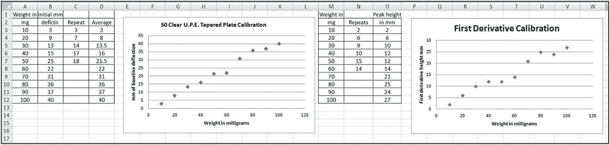

`图 9-14` 初始基线位移与一阶导数峰高的数据图


`图 9-13` 一阶导数与初始偏差的高灵敏度数据对比

从这两幅图中可以看出，初始位移值相比一阶导数显示中的峰值高度具有更好的线性度。一阶导数的价值在于确定测量聚乙烯介质器件中重量引起电容变化的起点和终点。

收集图 9-14 中的数据后，在大多数超市果蔬区使用的“购物袋”中发现了薄聚乙烯材料的来源。采用薄聚乙烯以及后来设计的四柱式板与介质安装技术，称重灵敏度可低至 `10 mg`。图 9-15 绘制了大重量范围的曲线以及该范围的线性部分。图 9-15 中绘制的数据点存在噪声，但通过一阶导数追踪，仍可测量电容追踪的初始偏转高度。

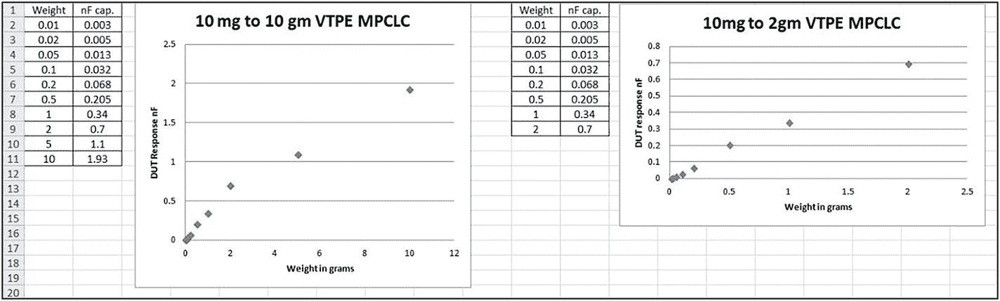

`图 9-15` 一阶导数斜率变化引起的初始基线位移数据图

### 简单系统：铝–玻璃纸层

从当地花店购得的玻璃纸片（`23½ in × 19½ in` 或 `58 cm × 48 cm`）（聚合木纤维素经挤压制成的薄片，添加甘油作为增塑剂），按标称尺寸裁剪以适配使用的铝箔板和安装基座。在组件装配过程中，使用直径为 `1¼ in`、长度为 `4 in`（`3 × 10 cm`）的硬橡胶辊（用于丝网印刷，见图 9-6 中的第 7 项）将箔板滚压平整。

玻璃纸器件经砝码校准后，生成的数据以表格形式列出，并在图 9-16 中以图形方式呈现。

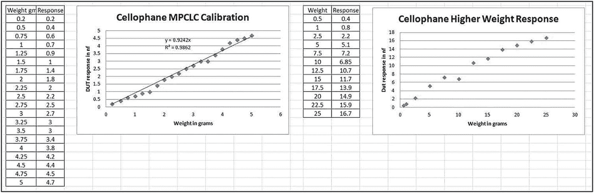

`图 9-16` 玻璃纸 MPCLC 重量与电容关系图

### 简单系统：铝–新旧新闻纸

采用 `3¾ in`（`9.5 cm`）方形有效面积的铝箔板，搭配 `4¼ in`（`10.5 cm`）方形介质，组装了一个由 50 层介质和 51 层导电极板组成的多板电容器。介质材料取自普通印刷报纸页面，20 层叠放厚度为 `0.060 in`，平均厚度 `0.030 in`（`0.76 mm`）。在标定前，使用 `3 lb` 砝码（`1.4 kg`）对 50 个单元组成的传感器进行压缩，并让其松弛三次，最终稳定在标称 `30.25 nF` 电容值，随后在 `29` 至 `31 nF` 的量程上出现 `0.05 nF` 的基线噪声。在 `3 lb` 负载下，该单元测得电容为 `92 nF`。在数天内对已知重量的电容值进行了三次重复测量。首次校准的数据如图 9-17 所示。

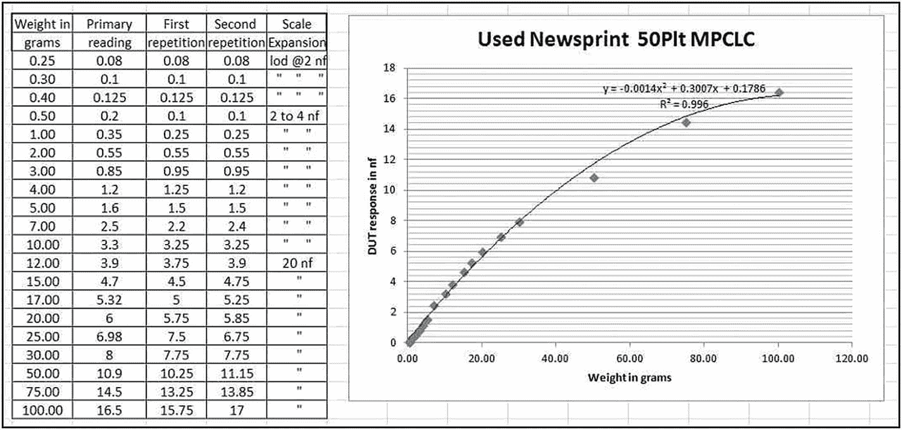

`图 9-17` 废旧新闻纸 MPCLC 重量与电容关系图

新新闻纸比印刷材料更厚。印刷过程中滚筒产生的大压缩力会压紧纸料。废旧材料的厚度为 `0.0025 in` 或 `0.06 mm`，而新新闻纸为 `0.005 in` 或 `0.12 mm`。新新闻纸的类似重量-电容关系图如图 9-18 所示。


`图 9-18` 新新闻纸 MPCLC 重量与电容关系图

### 复杂系统：铝-聚酯薄膜复合材料

一个包含 50 个电介质和 51 个导电极板的多层板电容器，由从铝-聚酯薄膜“救生毯”上裁剪下来的、有效面积为 3¾英寸（9.5 厘米）见方的铝箔-聚酯薄膜复合板组装而成。该救生毯购自一家大型零售商店的露营用品区，并被裁剪成正方形，左右两侧各留有 1 平方英寸（2.45 厘米）的接线片用于电接触。为了组装一个可靠且可重复使用的器件，必须将沉积在聚酯薄膜外边缘的铝金属蚀刻掉，以避免各个极板之间发生短路。

通过从每个极板边缘蚀刻掉标称的八分之一英寸，得到了一个形状略不规则的 3¼英寸（8.3 厘米）见方的铝导电板。聚酯薄膜电介质则作为 3¾英寸（9 厘米）见方的片材，支撑着沉积的铝导体。由于铝沉积在聚酯薄膜膜的一侧，而聚酯薄膜现在是器件的主要结构材料，每个器件极板上的铝层必须使用铝箔“桥接”进行连接，如图 9-7 所示。

由“救生毯”材料裁剪而成的 30 层极板堆叠厚度为 0.06 英寸，单片厚度为 0.002 英寸或 2 密耳（0.051 毫米）。与简单系统一样，在校准之前，这个 50 单元的组件先用一个 3 磅的重物压缩，然后让其松弛，重复三次后，最终稳定在标称值为 96 nF 的电容值，在 96 至 96.5 nF 的满量程偏转范围内，基线噪声为 0.05 nF。在 3 磅负载下，测得的电池电容值为 410、425 和 420 nF。

电容值由 `Arduino` 电容计程序以每秒四次循环的频率连续测定。流式传输的 `Arduino` 数据通过 `DAQFactory` 显示，并使用了 32 点平均值进行平滑处理。

已知重量的电容值在数天内进行了多次测量。校准数据被绘制成图，如图 9-19 所示。


`图 9-19` 蚀刻边缘的聚酯薄膜-铝 MPCLC 在大重量和小重量下的重量与电容关系图

除了更复杂的蚀刻板电容器外，还使用几种不同材料作为电介质进行了大量实验。使用铝箔和不同电介质片材制成的简单矩形器件用于收集数据。各项实验的结果汇总于表 9-1。

`表 9-1` 使用各种不同电介质材料的 50 层板电容器测力传感器的特性

| -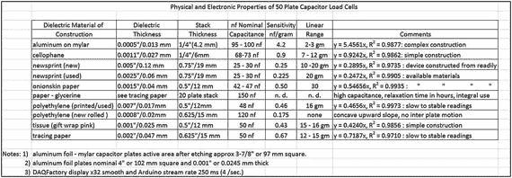 |

为了确定这种称重技术的可重复性，分别对铝-聚酯薄膜、纤维素和洋葱皮纸器件在较大量程内进行了三次校准，然后在其线性量程内再次进行校准。铝-聚酯薄膜系统的数据代表了其他两种器件观测到的典型情况，并显示在图 9-20 中。

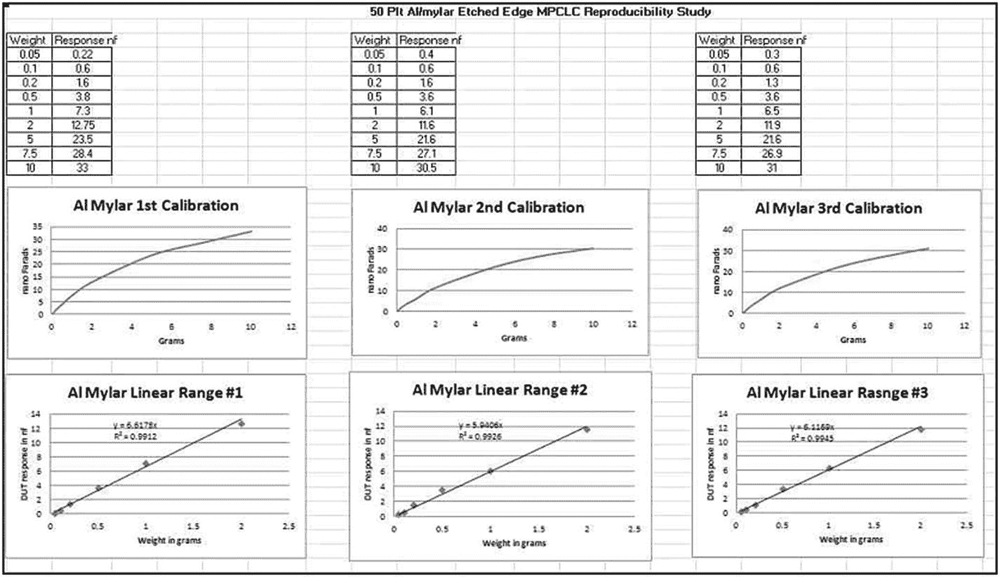

`图 9-20` 典型的系统可重复性

针对洋葱皮纸、纤维素和铝-聚酯薄膜器件，分别在其线性量程内进行了一系列校准，以测定其各自的响应。在这些器件上观测到的典型数据如图 9-21 所示。

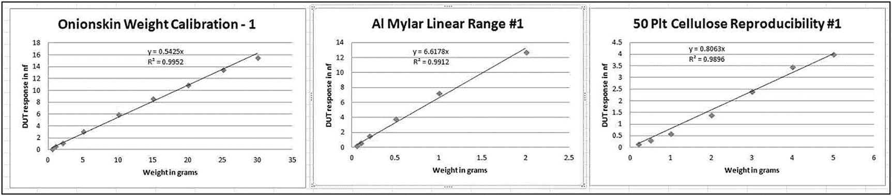

图 9-21 洋葱皮纸、纤维素薄膜和铝-聚酯薄膜复合材料的线性响应

## 异形系统

虽然器件的电容值取决于极板和电介质的接触面积，但在这种类型的器件应用中，更大的面积也导致极板相互滑动时产生的摩擦力增大。如果极板和电介质是三角形，那么随着极板宽度的减小，摩擦力和弯曲力也应减小，从而使器件对重量更敏感。

三角形极板应对较小重量更敏感，但必须验证其线性度。异形器件也给组装带来了困难。在制造过程中可能需要用于切割和组装的夹具。

最初，为了帮助组装锥形器件，在支撑底座上安装了木块，以帮助对准所制造器件的尖端。

初步实验使用 4 英寸（10.2 厘米）见方的铝板，将其修剪成锥形至英寸（1 厘米），作为导电板，电介质的切割则使其每侧与导体重叠英寸（3 毫米）。

器件的电容与所用极板的面积成正比，而减小面积以减少摩擦并提高重量灵敏度，就需要提高测量`DUT`响应微小变化的能力。为了适应当器件本身和所施加的重量都减小时，系统电容可能会产生的更小变化，使用了`ICFT`程序和重量处理设备来收集数据。

用于数据收集和小重量操作的典型实验装置如图 9-22 所示，并描述如下。


图 9-22 锥形 MPCLC

*   项目 1 是`Arduino`和一块`Arduino`“扩展板”，其顶部安装了外部充放电和分压参考电阻电路。

*   项目 2 是为`Arduino`供电的 12 V、2.4 Ah、可充电、密封式铅酸电池电源。

*   项目 3 是空气-电磁屏蔽罩，由一个完全覆盖铝箔的薄纸板底座构成。铝箔在屏蔽罩左下角有一个可见的锥形接线片，用于连接到连接至`Arduino`接地引脚的绞合输入信号电缆的屏蔽层。

屏蔽罩后部有两个矩形开口槽，用于容纳多层板电容器的穿孔铜带电接触点。为了操作砝码及其滑动桥架，屏蔽罩并未覆盖整个异形器件。

*   项目 4 是底板，带有两个螺纹金属柱和左端居中的白色间隔块，它们既用于定位，也用于为电容器的左右导电板提供电接触。

*   项目 5 是滑动在电容器尖端上的一个纸板桥架的中心。在照片中，桥架的俯视图类似于一个方形的“C”形。“C”形的顶部和底部臂是由薄纸板垫片堆叠而成，这些垫片逐渐粘合在一起，以抬高桥架，使其刚好能跨过电容测力传感器的顶层叶片。

桥架是一块薄纸板，与桥架平台成直角折叠。从侧面看，桥架平台的横截面呈“L”形，长臂形成平台。桥架平台和测力传感器尖端的中心都标记了一条中心线，以确保每次测量时定位的可重复性。

在电容尖端右侧放置桥式结构后，将砝码装载至桥面中心线上。随后将桥向左移动，直至两条中心线的尖端对齐，并小心地将砝码从桥上拉下或推下，使其置于称重传感器上极板上。完成测量后，将桥向右拉回，砝码便会从称重传感器上滑落。

- 项目 6 表示在设备组装期间用于定位导电板和电介质的一组木块。

砝码操纵桥是为配合单个电容式称重传感器而定制建造的。在每个上臂和下臂上添加垫片，直至桥刚好能越过传感器上极板而不产生机械干扰。如果上极板与电容器之间的距离过大，则当桥向右移动进行重新加载时，砝码将无法从称重传感器上被推落。您必须手动尝试移动砝码，同时避免干扰传感器的配置。

桥与称重传感器之间的近距离会影响基线轨迹，如图 9-23 所示。


**图 9-23** 砝码操纵桥移动的基线响应

最初位于图左下角的基线，通过将桥向左移动并覆盖称重传感器尖端，如标注为 1 的轨迹部分所示，基线被抬高。经过短暂时间后，砝码被从桥上推至称重传感器上极板，砝码引起的电容变化被记录为部分 2。将桥向右滑动，砝码被推离传感器上极板，基线回到标注为 3 的位置。电容轨迹的红色一阶导数峰值标记了记录中的拐点。

## 锥形 MPCLC 器件的实验改进

后期使用锥形单元进行的实验结合了多种技术，以开发出一种灵敏、廉价且易于组装的器件。

聚乙烯薄膜可能是最便宜、最容易获得，且由于其化学和物理惰性，是 MPCLC 实验中最理想的绝缘体之一。使用薄“保鲜膜”聚乙烯薄膜进行的实验因组装后的器件缺乏柔韧性而未获成功。

第二种来源是用于包装杂货店新鲜农产品的袋子中使用的极薄、半透明、非粘性聚乙烯薄膜。16 层薄膜的典型总厚度为 0.0075 英寸（0.184 毫米），平均单层薄膜厚度为 0.00047 英寸（0.011 毫米）。

早期的锥形器件实验，如图 9-22 所示，试图将组装后的电容式称重传感器尖端宽度缩小至 `` 英寸（1 厘米），但在图像中，器件各层之间的对齐偏差导致组装后的器件尖端宽度远超 1 英寸（2.45 厘米）。

为了辅助导电板和电介质的对齐，在底板设计中增加了两个钢销，用于通过张力定位绝缘体，而不是依赖聚乙烯薄膜几乎不存在的刚性来使用木块。通过在底板上仔细定位两个钢销，并在电介质的锥形侧边添加两个带孔突片，绝缘体可以被更牢固地固定就位。

除了更牢固地安装电介质外，通过翻转绝缘薄膜以更好地对齐正在组装的器件尖端部分，可以最大限度地减少因切割和穿孔电介质而引起的偏差。

通过在底板上增加两个钢销来固定电介质，使得器件的多项额外实验和应用成为可能。

早期使用滑动桥进行砝码操作的高灵敏度器件的初始实验，导致了图 9-23 中描绘的基线偏差。为避免徒手添加砝码干扰器件板锥形部分定位的影响，设计出了第二种技术，该技术利用了电子学中的偏置概念。在器件设计中引入锥度以减少摩擦力，从而产生了横截面积逐渐变窄的极板。一个带有螺纹支腿和中心大孔的小型三脚架装置被安装在称重传感器尖端上方，并调整其高度，直至器件极板的尖端处于轻微压缩状态。


**图 9-25** 薄聚乙烯锥形 MPCLC 盖闭合状态

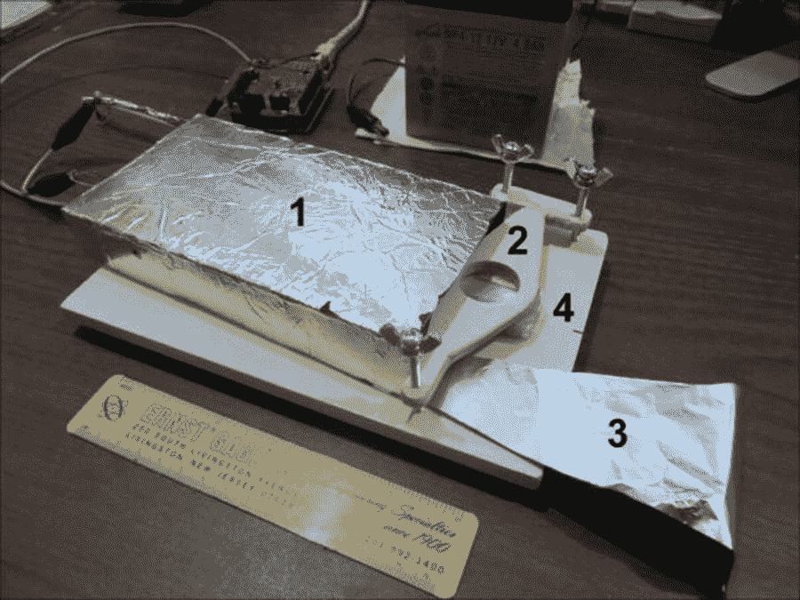

**图 9-24** 薄聚乙烯锥形 MPCLC 打开状态

图 9-24 和 9-25 显示了在 MPCLC 应用中评估薄聚乙烯薄膜电介质的初始设置。该电容器件类似于图 9-22 中的锥形器件；然而，它采用等腰三角形配置，其底边长度为侧边的一半，这与早期锥形器件实验中方形板被切割成 `` 英寸（9 毫米）尖端不同。

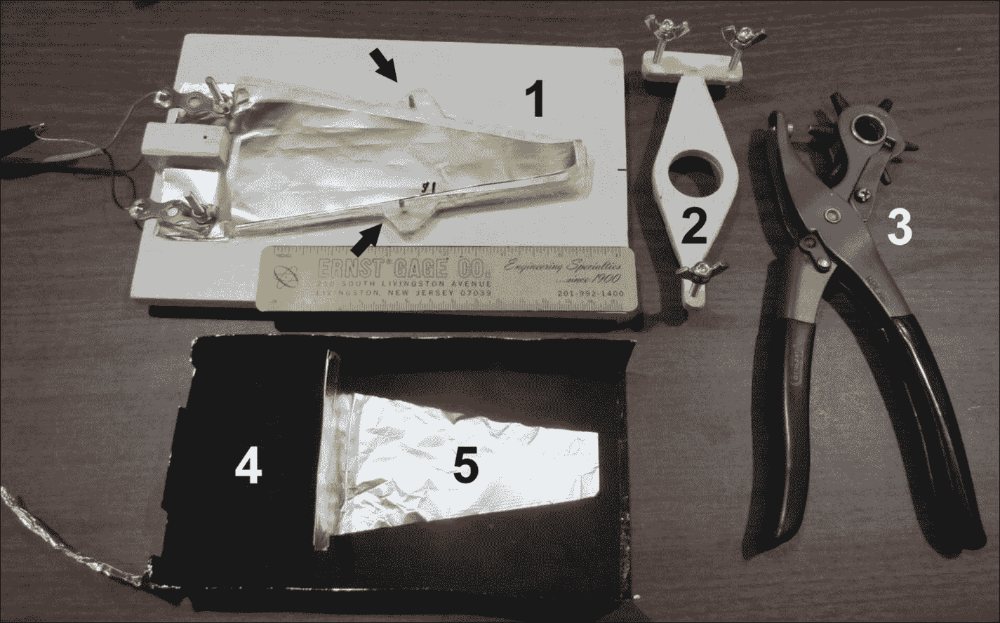

**图 9-26** 薄聚乙烯锥形 MPCLC

在图 9-26 中，两个黑色箭头指示了定位销柱，在这些销柱之间，薄介电体被紧密安装，大约位于三角形器件底部向上三分之一处，并且比此类成型器件介电体的标准宽度宽出``（3 毫米）。加宽的销柱用于固定绝缘体。一个三脚架桥（件 2）轻微压缩了电容器的尖端，以建立可调电容的基准值，其方式与通过电压偏置来建立晶体管工作点的方式非常相似。

三脚架中央的大开口允许使用镊子辅助添加和移除砝码。三脚架的形状经过设计，以最大化锥形尖端面积，并尽可能远地伸入热屏蔽和电磁屏蔽（件 4 和件 5）下方。件 3 是一个孔径可调的“皮革”打孔器，用于在成型的介电体和导体板上打出 3.5 毫米（``英寸）的孔。

使用图 9-25 和图 9-26 所示的装置，进行了从 50 毫克到 600 毫克（mg 或 mgm 代表毫克，即 0.001 或 1/1000 克）的电容与重量校正实验。校正过程中测得的数据以表格和图形形式展示在图 9-22 中。


**图 9-27**
50 至 600 毫克重量校正

图 9-28 展示了由北美冬季住宅集中供暖的循环效应所引起的环境室温变化的影响。


**图 9-28**
由集中供暖引起的基线漂移

如图 9-28 所示，为了在高灵敏度下进行实验时维持一个足够稳定的基线，需要显著增加隔热措施。

为了确认器件组装过程中没有短路，我们注意到，随着 MPCLC 中极板数量的增加，器件电容似乎变得异常大。为了在更高的器件灵敏度下工作，我们构建了一个更厚的隔热罩。在安装热-电动势屏蔽并对底板进行修改以固定压缩“偏置”桥的位置时，薄聚乙烯器件被拆解。

在重新组装这个 50 极板、薄聚乙烯器件的过程中，通常在用电压-欧姆表每添加五个介电体和六个导体板后进行电容验证测量，本次则在 MPCLC 上分别施加 2 克、1 克、0.5 克和无砝码负载的情况下进行了测量。多次增量测量及其数值差异的结果（标记为“ΔC”，即`Δ C`）已列于表 9-2 中。

**表 9-2**
MPCLC 电容随极板增加的变化

| 图片 |
| :---: |
|  |

在该表的右侧，基于堆叠中介电体数量的平均电容随着器件中“叶片”的增加而稳步上升。平均电容似乎在增加，因为增加的“叶片”重量压缩了其下方的电容单元。

测量了聚乙烯和铝箔极板的平均重量，以了解器件组装过程中增加的重量，并确定新增“叶片”会导致多少压缩。十片极薄聚乙烯 (VT-PE) 薄膜介电体重 0.6604 克。十片锥形铝箔导体板重 2.9186 克。单个平均重量分别为 0.0660 克和 0.2919 克，这表明随着 MPCLC 尺寸的增加，铝箔导体板的重量不可忽略，并且可能是导致观察到的总电容随器件极板数量增加而增加的原因。

将观察到的总电容与介电体和箔导体板的数量进行绘图，得到图 9-29 所示的曲线。


**图 9-29**
MPCLC 中观察到的总电容与箔导体板数量的关系

在图 9-29 中，图形并非线性。它呈现出略微向上的凹形曲率，这很可能是由于顶部极板累积的重量对下方极板产生的自压缩效应所致。

构建更长、锥度更大的器件时遇到的一个问题是保持铝箔导体板尖端的对齐。介电体可以拉伸覆盖在对准销柱上，只要它们与箔导体板边缘重叠足够远以避免器件短路，就无需精确对齐。

如果箔板未仔细对齐，那么每添加一个新单元时电容的变化会导致在器件构建过程中进行的测量出现过多差异，并可能掩盖在表格数据中观察到的任何趋势。

在收集表 9-2 的数据时，极板的错位变得相当明显，并从预期的``英寸（1 厘米）宽度扩散到远超过 3/4 英寸（2 厘米）。

将介电体固定于两个钢制销柱之间后，进行了一项一式三份的简单实验，以评估自压缩对 15 VT-PE 介电体器件观察电容的影响。通过将电容器旋转 90 度，重力对电容器产生的向下力应按照倾斜角度的余弦值成比例减小（参见“斜面”讨论），如表 9-3 所示。

**表 9-3**
15 极板 VT-PE 器件中电容随仰角增加的变化

| 仰角（度） | 电容实验#1 (`nF`) | 电容实验#2 (`nF`) | 电容实验#3 (`nF`) | 平均值 (`nF`) |
| :---: | :---: | :---: | :---: | :---: |
| 0 | 9.18 | 9.11 | 9.02 | 9.10 |
| 45 | 8.97 | 8.94 | 8.91 | 8.94 |
| 90 | 7.35 | 7.16 | 7.14 | 7.22 |

器件的旋转导致观察到的电容从 9.10 `nF` 降至 7.22 `nF`，降低了 1.88 `nF`（关于 MPCLC 观察电容与倾斜角之间的理论关系，请参见图 9-43）。

基于双柱概念，为导电板和绝缘介质开发了一种四柱安装方案，以提高器件的可重复性和灵敏度。底板设有四个线性等距安装点（中心间距为 3/4 英寸（18 毫米）），包括两个用于电接触的外侧带蝶形螺母的螺纹金属 #8 × 32 TPI（`` 英寸或 3 毫米直径螺栓，每英寸 32 牙或 2.45 厘米）螺杆安装柱，以及两个直径为 1/4 英寸（3 毫米）的内侧木质销钉。介质对称设置，套在两个内侧木质销钉上。导电板则为左右镜像结构，分别套在导电端子和远端木质销钉上。

通过从两个支撑点支撑介质和导电板，即使倾斜角度增大，器件各组件也能保持相对对齐。

在对 MPCLC 器件的压缩行为有了基本了解之后，我们进行了一系列附加实验，通过在力臂末端悬挂重物的杠杆来增强施加给重量传感器的压缩效应。

#### 称重操作产生的力的增强

利用物理学中传统上称为“胡桃夹子”的二级杠杆原理，最大化了称重操作的灵敏度和可重复性。如图 9-30 示意图所示，该杠杆随后与一个用于升降承重梁的简单机械机构相连。图 9-30 所示的方形蚀刻边缘铝制聚酯薄膜器件，在图 9-6 中被标记为项目 #2。

板安装和电桥连接信息如图 9-7 所示。一个由矩形纸板结构构成、外覆接地铝箔且内部涂黑的开放式屏蔽罩被制作出来，以覆盖器件的大部分结构。屏蔽罩的开口端尺寸足够大，以便手动升降称重梁。

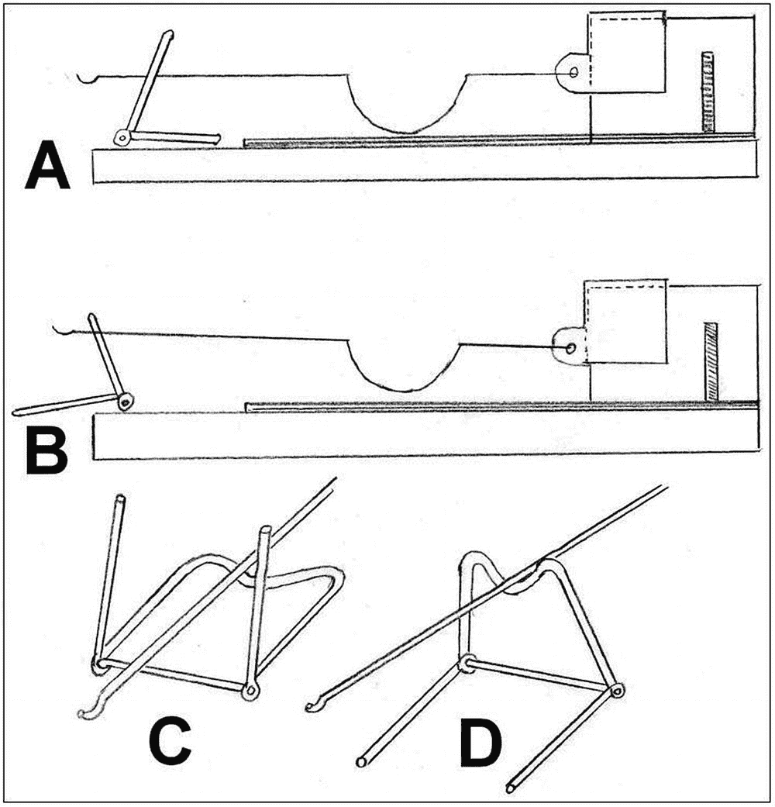
**图 9-30**
一种简单的杠杆式重量测定装置

在每次称重之间将杠杆从传感器上抬起，可使电容器弹回其静止位置并重新建立基线。基线状态的视觉确认通过`DAQFactory`条带图记录仪显示进行监测。当显示画面在视觉上看起来随时间恒定不变时，读取输入通道值表上的实际电容数值以定义基线。当承重梁处于抬高位置时，将待测重物装载到梁上。装载抬高位置的承重梁可确保电容器板不被意外扰动或压缩。

开始称重时，将承重梁和重物一起降低回到传感器上，传感器随即开始响应压缩。`DAQFactory`显示也监测传感器因新负载而产生的电容增加。当增加的负载迹线随时间变得恒定时，再次读取并记录`DAQFactory`通道表的实际数值。

为了确定器件对施加重量的实际响应，必须从总重量测量值中减去空梁的皮重。根据现行良好实验室规范（cGLP）规程，在处理一批样品前后，均需称量一个“标准”重量以确定其重量。遵循 cGLP 规程，可以在开始称量一系列已知或未知重量之前多次测量空梁重量校正值，并在完成整批称量操作之后测量一到两次。在称量一批校准砝码或未知重量之前和之后，观测到的空梁重量值之间良好的相关性，能确保你相信当前批次观测数据的可靠性和可重复性（参见《水和废水检验标准方法》第 23 版（美国自来水厂协会，2017））。

然后，可以从测得的总值中减去梁重量校正因子，以生成所处理批次的重量与电容校准曲线，或未知重量（参见关于杠杆使用的讨论）。

尝试使用杠杆测定低于 20 至 10 毫克的重量受到限制，因为待测小质量产生的向下的力无法弯曲或移动用作重量传感器的 MPCLC 的簧片。为了测量 10 至 100 毫克之间的重量，可以配合电池供电的 Arduino 和辅助供电的 USB 连接，使用图 9-33 中标记为项目 A 的小型三角形 MPCLC，以生成在此低重量范围内使用所需的校准数据，无需任何额外的机械辅助装置。

## 称重装置设计参数

为了设计、构建和验证称重装置，实验者可能会发现模块化系统最为灵活和实用。在电容式传感器、微处理器数据采集以及上位机`Windows`或`Python`/`Linux`图形化轨迹-数值显示方面，已经实现了一定程度的模块化。

电容式传感器的设计取决于具体应用。涉及克级称重要求的系统，可以使用由铝箔和电介质制成的分立极板来实现，具体可参考表 9-1。对于质量非常小的样品以及涉及分数克测量的称重任务，可以使用更难以制造和组装的更小的方形板或三角形电容极板（参见图 9-3 中的设备 A 和 B）。

简单的方形和矩形装置是迄今为止最容易构建的。如果在设备构造中投入额外的精力添加额外的支撑片，则传感器可以在垂直平面内使用，以测量力或倾斜角度。矩形或方形装置在使用时也是最坚固的，尤其是用铝制聚酯薄膜复合材料制成的装置，其部件数量更少，每单位重量的电容变化灵敏度更高（参见表 9-1）。

直觉上，传感器越厚，可用于测量的压缩范围就越大。如果将方形极板设计成锥形以最小化极板之间的滑动摩擦，传感器灵敏度似乎会增加。在图 9-31 中，灵敏度的提升是以牺牲测量动态范围为代价的。

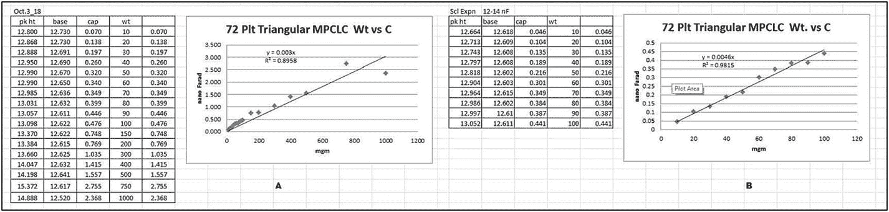
`图 9-31` 小型三角形 `Al-Mylar` 传感器的重量与电容关系图

图 9-31 显示，随着被称量质量的增加，最小二乘法线性拟合的质量会下降。在范围 A 的 1000 mg 量程内，`R²` 方差为 0.8958。在 100 mg 量程内，该值上升到 0.9815。（回想一下，在统计分析理论中，完美的最小二乘拟合的方差为 1。）


`图 9-32` 小型三角形 `Al-Mylar` 传感器的重复性研究

图 9-32 是一个双图形显示，它是根据重复测定锥形电容器从 10 mgm 到 60 mgm 加载所测得的电容值数据而绘制的。

在图 9-33 中，图 9-34 中标注为项目 B 的方形电容器装置，被用于不同量程扩展下，以测量传感器对 10 至 100 mgm 电容器加载的响应。


`图 9-33` 小型方形 `Al-Mylar` 传感器的高灵敏度显示

在使用方形和三角形装置进行了大量实验后，为 `MPCLC` 设想了一种折衷方案。矩形极板比带接片的方形极板更容易制造。如果矩形的长宽比很大，则可以消除导致方形装置变形的“楔形”形成问题。通过将传感器的矩形极板彼此垂直组装，而非平行配置，极板的长度方向可以相互平放，只形成一个可压缩的电容器，其末端重叠形成方形区域。

可以将大量极板轻松地组装成一个相对平坦、均匀的小面积表面。图 9-34 中的设备 C 是长叶片、末端重叠式传感器的首次迭代。需要使用矩形胶合板加强筋，以防止在较重的砝码施加到传感重叠极板区域时长极板发生弯曲。


`图 9-34` 三个 `Al-Mylar` 实验性传感器

图 9-35 展示了设备电容与施加在传感器上的重量的关系图。整体响应曲线显示出这些设备预期的反向曲率，正如最初在图 9-2 中预测的那样。


`图 9-35` 100 层 `Al-Mylar` V 型 `MPCL` 的重量与电容关系图

图 9-36 描绘了图 9-35 中观测到的探测器响应的线性部分。


`图 9-36` 图 9-34 的线性部分

图 9-37 表明，如果设置能够分辨小于 0.050 nF 的电容值，则探测器应该能够检测到个位数毫克的重量。

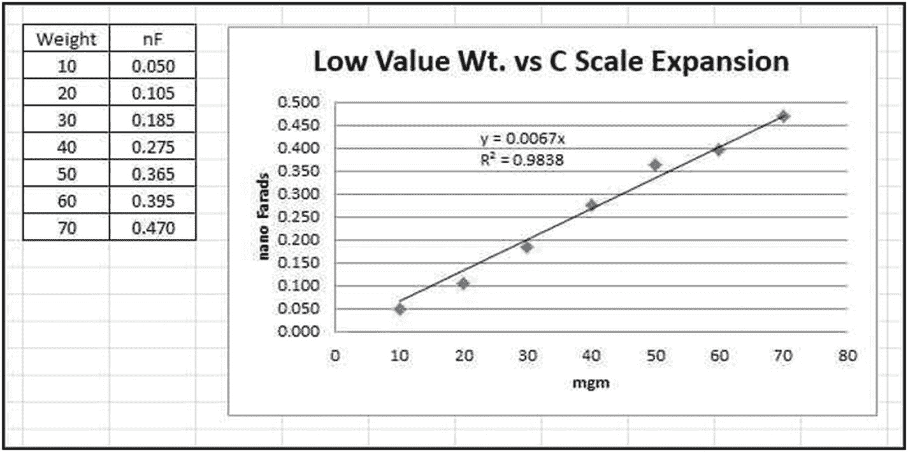
`图 9-37` 图 9-35 和 9-36 的高量程扩展

在图 9-38 中，显示了一次校准测量会话的典型记录仪迹线。每个数据点被测量了两次。在数据对中进行了第三次重复测量，其中两次重复测量之间的差异似乎比预期要大。

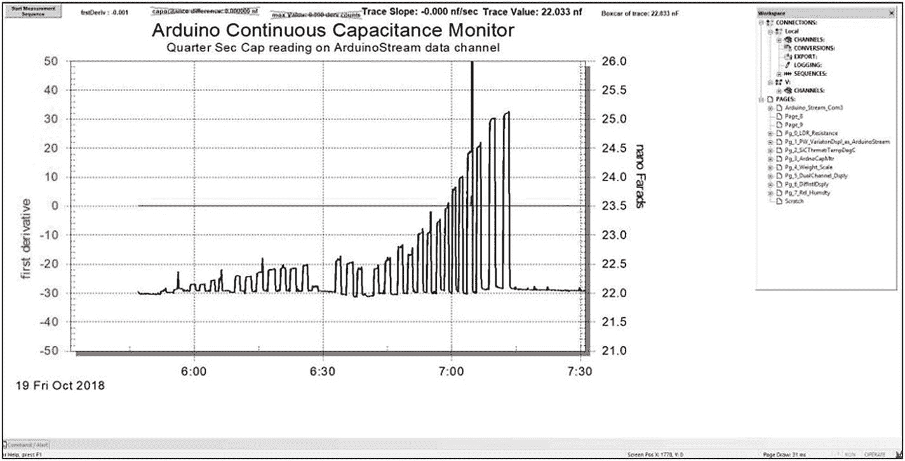
`图 9-38` 重量与电容实验的典型 `DAQFactory` 记录仪迹线

在尝试将称重技术扩展到更低极限时，100 极板装置开始表现出不稳定的响应，有时对 10 到 20 mg 范围的重量完全无响应。怀疑是微小的重量没有足够质量来克服电容器极板的刚度，从而产生可测量的压缩。在移除较重的砝码后，极板通过以合理可重复的方式膨胀回其原始配置而恢复。

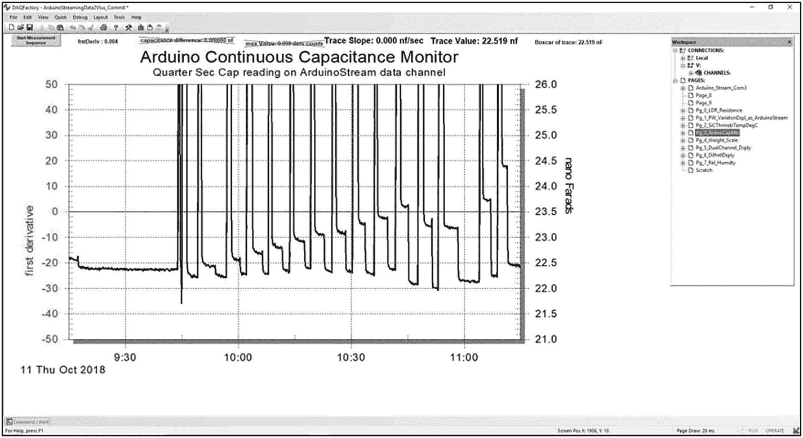
`图 9-40` 压缩-膨胀重量校准的记录仪迹线

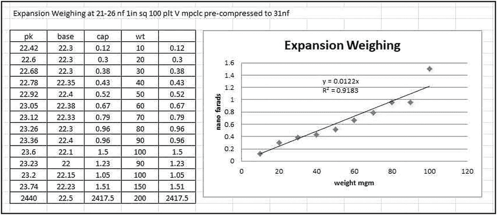
`图 9-39` 传感器膨胀称重

膨胀称重是通过用一根带有两个可调节支撑的压杆压缩传感器，直到设备显示值为 31 nF 的点来进行的。在压缩状态下，当轨迹线超出量程顶部时，将一个砝码放置在传感器上。然后移除压杆，让传感器膨胀，从而承载待测砝码。下降的轨迹线值回到量程内，并下降到一个高于原始基线的位置，在那里它可以稳定下来。从传感器上移除砝码允许进一步膨胀，轨迹线下降到原始基线附近。最终基线值与“平台”值之间的差值就是被测砝码引起的感应电容差值。

当从传感器上移除测试砝码时，膨胀测定有时似乎也受到无法移动设备极板的相同问题的困扰。

为了明确探索 100 极板“V”型传感器的下限，用普通等级的铝箔准备了一系列毫克砝码。图 9-41 描绘了一组标称重量从 12.9 毫克到 1.07 毫克的砝码。


`图 9-41` 代表性的毫克砝码（12.9 mg 至 1 mg）

普通等级铝箔的轧制厚度为 0.016 mm。铝的密度为 2.70 g/cm³，每平方厘米铝箔重 4.3 mg。在图 9-42 中，A、B 和 C 分别是面积为 3 cm²、2 cm² 和 1 cm² 的折叠单层试样。D 和 E 分别是二分之一和四分之一平方厘米的分数试样。

当 `Arduino` 由电池或 12 V 稳压电源供电时，USB 产生的噪声从系统显示中移除，并且可以使用高量程扩展（参见图 9-4）。当在 `FSD` 为 0.150 nF 下运行时，图 9-42 中编号的峰值显示了 A 到 E 毫克砝码的电容变化双次读数的 `DAQFactory` 迹线。

在编号偏转的右侧完成了一组第二次读数。尽管受到基线漂移的困扰，但这些读数的基本数值电容差值与初始测量值并无显著差异。

使用标称质量值为 1 mg 的砝码表明，铝-聚酯薄膜极板能够响应如此微小的实体，并且具有合理的重复性。


`图 9-42` 标称重量 12.9 mg 至 1.07 mg 砝码的记录仪迹线

## 讨论

### 静摩擦与自压缩

尽管传感器没有活动部件，但其表面之间会相互运动。直接接触的表面之间的运动会受到摩擦力的阻碍。摩擦力可进一步分为静摩擦和滑动摩擦。滑动摩擦力通常低于静摩擦力，这符合我们的物理观察：一旦物体开始运动，维持其运动比“摆脱静止”要容易。

关于大型平板电容器的物理原理见解可在物理学文献中找到（参见 [`https://pdfs.semanticscholar.org/ff77/36f012a67a6d29fe3a6da29d46a7a51af930.pdf`](https://pdfs.semanticscholar.org/ff77/36f012a67a6d29fe3a6da29d46a7a51af930.pdf)）。

提高多板电容式测力传感器的灵敏度是开发方法学的一个实例，该方法中，一个初步实验成功的简单概念可以逻辑地发展出更精良、更实用的设备。

最初使用多层电容器替代“弹簧”或“水平杠杆”的概念，设想的是一种简单的方形装置，安装在一块平板上，通过电容器左上角和右上角的接片带有两个螺栓固定的电触点。初步的成功促成了进一步的工作，其中加入了更精密的电子电容测量技术和可视化显示程序，以便在向待测设备施加重量或压缩力时，持续监测并显示电容的变化。

# 电容器设计与测试

随着灵敏度的提高以及随时间监测和记录电容器电容变化的能力增强，方形、大表面积构型的局限性变得明显。不同的电介质和复合“金属-塑料”薄膜用于测量电容器的响应，同时改变电介质的化学性质以及设备的物理尺寸或形状。

在使用大型方形设备时，遇到了由金属和电介质板的摩擦力及刚度引起的限制。后来通过将设备逐渐收窄成尖头状来减小这种限制。收窄设备减少了板的面积。这就需要更灵敏的电子检测系统，而一旦实施，便产生了预期的更高灵敏度。

随着设备和电子显示系统灵敏度的提高，锥形导电极板尖端的物理对准效果及其光滑平坦的表面纹理变得重要。为改善锥形设备中的对准问题而进行的尝试，导致在基板上增加了额外的销钉来固定导体和电介质。在设备板上使用双接片，并在螺纹电触点柱之间增加对准销钉，使得对准更加一致。

结构材料的易碎特性表明，随着导体板和电介质数量的增加，新设备应仔细组装并测试是否短路。随着每个新组装的设备层数增加，预计设备电容应成比例增加；然而，观察结果显示，增量电容的增加速度高于新增板数和电介质数量所预期的速度。对观察到的电容异常增加的一个简单解释是，尽管易碎的锥形铝箔板和电介质非常薄且轻，但其重量不可忽略。随着电板数量增加，它们的总重量压缩了下面的层，使得观察到的设备总电容高于仅由新增电板数量预期的值。

### 确定自压缩与倾斜角度

在尝试定量评估电容随电板增加而增加的关系时，我意识到自压缩增加了设备的总电容。通过将待测设备绕其夹紧端的轴线从水平旋转至垂直，可以消除自压缩。使用迄今为止产生最佳灵敏度的材料组装而成的锥形设备，在旋转时表现符合预期，并将设备固有电容分为有自压缩和无自压缩两个值。

一组使用绘图三角板将待测设备设置为 `30` 度、`45` 度和 `60` 度常见角度的简单实验表明，设备自压缩电容可以粗略近似地测量设备倾斜角度。

``

`图 9-43` 电容值与倾斜角度

在图 `9-43` 中，当待测设备绕基板平面内且垂直于三角形中心线的轴线旋转时，总观察电容下降。旋转将设备的固有电容与因自压缩产生的电容分离开来。左上方的图显示，电容从倾斜 `0` 度时的 `10.26` 纳法变化到垂直位置时的 `6.98` 纳法。将因自压缩产生的电容（即总观察电容减去设备固有电容）对倾斜角度作图，得到图 `9-43` 右上方图中所示的预期曲线。

如果对该系统进行严格的物理分析，那么在无倾斜角度时，向下的重量矢量是由重力对电容器中电板质量的作用引起的。将设备在与重力矢量成直角的方向上旋转出平面，会将力分解为两个分量，如图 `9-44` 的斜面图所示。重力由公式 `F = m × g × cosθ` 给出，其中 `θ` 是以弧度表示的入射角，`m` 是物体的质量，`g` 是当地重力常数。

``

`图 9-44` 斜面

由（由入射角决定的）向下重力产生的电容作图，得出图 `9-44` 中所示的线性关系。

### 器件电容

在图表 `9-45` 和 `9-46` 的四张图中，展示了由分立元件组装而成的多板电容器的典型渐进式装配过程。每幅图中，导电板均按字母顺序标记，绝缘介质则按数字编号。图示器件中的每个增量单元都是一个由两块导电板之间的介质构成的单一电容器单元。

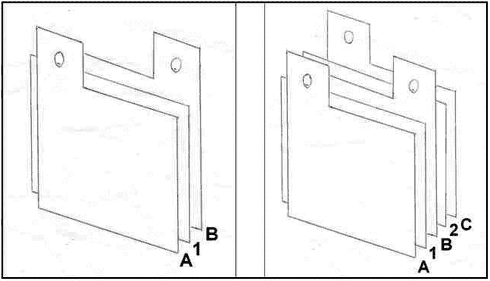

`图 9-45`
两板与三板器件构成单电容及双电容传感器

在图表 `9-45` 和 `9-46` 中，电容器单元的总数比传感器单元中的板数少一。导电板的存在将电荷收集或电容效应限制在单个绝缘板内。对于采用分立元件构建的器件，每个绝缘板的两侧均存在空气间隙。


`图 9-46`
四板与五板器件构成三电容及四电容传感器

经典物理学提供了关于三板器件电容存储能力与其导电板之间介质及空间的物理化学性质之间的数学关系，其数学模型如下：

```
C = kA/d
```

其中，`C` 为器件电容，`k` 是由板间介质性质、自由空间及空气介电常数决定的比例常数，`A` 为导电板的面积，`d` 为导体之间的距离。

对于三板器件，该方程可写作：

```
C[总] = k * A[A-B] / d[A-B]
```

由于两个并联器件的总电容具有累加性，对于五板器件可写出如下表达式：

```
C[总] = (k * A[A-B] / d[A-B]) + (k * A[B-C] / d[B-C])
```

对于水平放置的器件，板 `B`、`C` 及介质 `2` 的重量会压缩器件，减小距离 `d[A-B]`，使得总器件电容高于两个并联平板器件电容的简单总和。

当电容器数量增至三个并联单元时，总板数增至七块。最底部的器件受到其上方两个单元重量的压缩，中间的器件则受到最顶部单元的压缩。

若三板电容器增量单元重量相对均匀，则重量引起的压缩将随着水平叠层厚度的增加而增强。正在装配的水平单元的总器件电容的增加，应是并联电容器数量的线性函数，同时也是器件下部构件因重量压缩导致电容增加量的线性函数。

通过将器件旋转 `90` 度，可对自压缩引起的总电容贡献进行半定量估算。观察到由自压缩引起的含 `15` 个介质层的 `VT-PE` 器件的电容为 `1.88 nF`。当器件从水平旋转至垂直时，水平总电容值从 `9.10 nF` 降至 `7.22 nF`。更大的 `50` 板锥形 `VT-PE` 器件，水平电容从 `27.72 nF` 降至垂直时的 `22.71 nF`。含 `15` 个介质层的器件在旋转过程中观测到的电容下降了 `20.6%`，含 `50` 个介质层的器件下降了 `18.1%`。一个精心制作、边缘蚀刻的 `80` 层 `Al-Mylar` 三角器件，从水平旋转至垂直时，电容从 `85 nF` 降至 `52 nF`，下降了 `39%`。

装配好的传感器因紧固螺纹连接件而存在固有的楔形空气间隙，以确保电气接触。每个器件在装配后其电容值都是唯一的。旋转似乎会扩大或缩小“楔形”的角度，从而将固有电容值改变约 `20%` 至 `40%`。

早期对带有短电气连接片的器件进行的实验，导致 `MPCLC` 传感器形成楔形空气间隙。楔形空气间隙在锥形板传感器中破坏性最大。尖端对齐不良、板片柔韧性过大以及下层电容器板缺乏机械支撑，使得早期锥形传感器在负载操作中容易发生板片变形。直到后来才意识到需要更长的连接片，以减少或最小化重量传感器有效区域内的楔形。从侧面观察，具有楔形轮廓的 `MPCLC` 与杠杆轮廓相同。被测重量离支点越远，力臂越大。该器件变得对重量位置敏感。

直觉表明，增加板片数量应能形成“更大的弹簧”，具有更宽的动态范围。如果制作更长的连接片，并在板片上添加定位片，则可以最大限度地减少楔形空气间隙和板片尖端错位的问题。板片上更长的及多个连接片会增加构建、组装和验证器件所需的时间与精力。

### 结构材料

要将力转换为电容，必须压缩多极板传感器以减小极板间距，从而导致器件电容升高。金属被视为不可压缩材料。极板之间的电介质和气隙是承担大部分压缩作用的主要部件。在此应用中，优质的重型铝箔不如价格较低、更灵活的更薄等级材料理想。

同样的“越薄越好”准则也适用于电介质材料的选择。新型的薄型“拉伸密封”聚乙烯薄膜在该应用中几乎不起作用。“拉伸密封”薄膜的设计初衷是粘附在其覆盖的基材上，而这恰好与该应用所需的物理作用完全相反。用于“农产品”袋或众多其他利用这种惰性塑料“不粘”特性的聚乙烯薄膜袋或包装应用中的极薄聚乙烯薄膜，可以组装成成本相对较低且功能完整的器件。

组装完成后，在进行任何实验测量之前，应使用万用表（`VOM`）测试器件，检查是否存在因极板和电介质未对准或其它泄漏源（如螺纹连接器或接线片夹紧过度导致结构脆弱电介质或箔极板机械失效）引起的短路。

电容式测力传感器最初的构想概念是由一组独立的平行导电板与绝缘电介质堆叠而成。实验改进表明，更长的接线片、带附加对位片的极板以及锥形复合材料可以制造出灵敏度更高的器件。

最简单且最容易组装的重量传感器形式是由矩形铝箔极板和多种常见材料作为绝缘体制成。每个器件都必须在其预期使用范围内检验线性度或实用性。每个单独器件的 `电容` 与重量的关系曲线形状都必须经过检测，以确定其可用的线性或曲线范围。

这些传感器的灵敏度受到小重量的限制，因为小重量施加的力不足以克服堆叠极板之间的静摩擦系数。一个小重量必须能压下堆叠体。由于该器件是由从共同点引出的一组等长且交错排列的极板组成，从横截面看，堆叠组件形成一个放射状排列或一个圆弧段。压下顶部极板会使接触表面相互滑动。如果静摩擦系数过高，极板将不会移动，也就测不到电容变化。

（如在单层镀铝聚酯薄膜制成的测力传感器中发现的）最小化摩擦很可能是这些传感器高灵敏度的主要贡献因素之一（除了每个极板只有一个气隙之外）。与 `铝/聚酯薄膜` 器件相比，由铝箔极板和“拉伸膜”制成的测力传感器无法弯曲或发生形变，因此表现出向上弯曲的、有限的、重量与电容变化的响应函数。

如表 `9-1` 所示，将电介质的性质改为更柔软、更易压缩的介质（如纸类材料），可以极大地扩展器件的动态范围。

### 重量操作、数据生成与解释

```

由于这些器件的电容随施加在顶板上的压力变化，手动放置和移除砝码时，若因手不稳导致极板被压下或侧向移动，可能会引起尖峰和基线漂移。对于较大且易于抓取和操作的砝码，扰乱极板是相对较小的问题。而对于 10 毫克这样的小砝码，在灵敏度设置较高时扰乱极板对准或压下极板，可能会破坏重现性和采集可用数据的能力。使用机械传输装置，将砝码放置在滑过电容器的桥上，可以得到图 9-47 所示的实验电容记录曲线。

尽管滑动桥可以最大程度地减少对极板的干扰，但它会导致图 9-47 中看到的复杂轨迹。即使有桥支撑着小砝码，在将砝码从桥上滑下时，极板也常常会被不经意地下压，如重复实验 10 和 12 所示。


图 9-47

10 毫克砝码测量重复实验

可以设计一种带有仅向上提升的砝码托盘的直接向上提升系统，以最小化更换砝码时对极板的干扰。使用第二类杠杆或钩环结构可以实现仅垂直方向的运动。另一种选择是使用轻压板“偏置”基线并最小化极板扰动（参见图 9-39（膨胀加权法）、9-72、9-73 和 9-74）。

您必须准备好进行实验并探究为特定目的而制造的器件的特性。在创建重量传感器时，必须评估诸如：器件在压缩下稳定所需时间、卸载后重新建立基线、是否需要实施重新调零机构、系统线性度、系统噪声（包括随机噪声和系统噪声）以及灵敏度和“极板粘连”问题等。

## 力的测量

## 一种实验性风速计与风压传感器

当垂直安装时，`MPCLC` 传感器会对任何压缩多板电容叶片阵列的力产生响应。如果将 `MPCLC` 垂直安装在一个通风盒内，并让移动的气流以直角方向撞击悬挂阵列的垂直前表面，气流流经板面并从传感器后部排出盒子，即可产生一个与风速成比例的信号。

可以使用一个电动风扇进行简单的“风力”概念验证实验，将风扇置于垂直安装传感器的顶板平面的直角方向。

当风扇电机的功率由 `PWM` 信号调节时，袖珍风速计可以测量风扇产生的气体流速。传感器的电容变化可以在水平位置上用一系列已知重量的砝码进行校准。一旦校准完毕并恢复垂直位置，即可通过在不同 `PWM` 功率设置下产生的各种风速或气流速度下测得的电容变化，将风速或气流速度与由此产生的压力关联起来。

在垂直位置时，传感器电容主要不受导电板或介电材料重量的影响。板间距离预计仍呈楔形，向设备顶部夹紧的电触点处逐渐缩小至几乎为零。在传感器的另一端或称为“底部”，自由悬挂的板仅受板重量的影响，该影响通过垂直方向与“楔形角”之间形成的微小角度体现（见图 9-43）。直觉表明，且观察证实，当设备从水平旋转到垂直时，板间距离，尤其是底部边缘的距离，会增大。

垂直方向上的设备灵敏度预计与水平称重应用中的灵敏度相似，并受限于电容板的柔韧性。无论板的刚度是由静摩擦系数还是结构材料的刚性决定，变形力都必须弯曲这些板。

## 实验

为在垂直平面上工作，一个带有双接头三角板的 `MPCLC` 由 80 片铝-聚酯薄膜复合材料板组装而成。板件底部宽 3.5 英寸（9 厘米），顶部宽 4 英寸（10.2 厘米）。按照常规方式建立电接触，左右两侧板的外侧接头通过必要的电接触箔桥安装在螺纹杆上。每块板的内侧接头则套在一个固定的木销上，该木销用于将板件固定在统一的对齐位置上。

在设备的垂直安装组装和测试过程中，用 `Extech EX505` 万用表测得静止状态下的最终传感器电容为 94 nF。当设备投入与 `DAQFactory` SCR 显示屏配合使用时，基线稳定在 90 nF。倾斜支架上的电连接调整过程对传感器板造成了干扰。在传感器水平位置校准时，用 `DAQFactory` 显示确认了第二次读数为 84 nF。图 9-48 记录了 20 mg 至 1½ g 一系列砝码的双重测量轨迹。


图 9-48

风速计传感器水平方向 20 mg 至 1½ g 校准（偏转顺序未按质量递增排列）

对应于图 9-48 中图表偏转的数值数据代表了图 9-49 中展示的重量与电容变化数据。


图 9-49

风速计传感器水平重量校准

当风速计传感器在垂直与水平位置之间移动时产生的数据如图 9-50 所示。

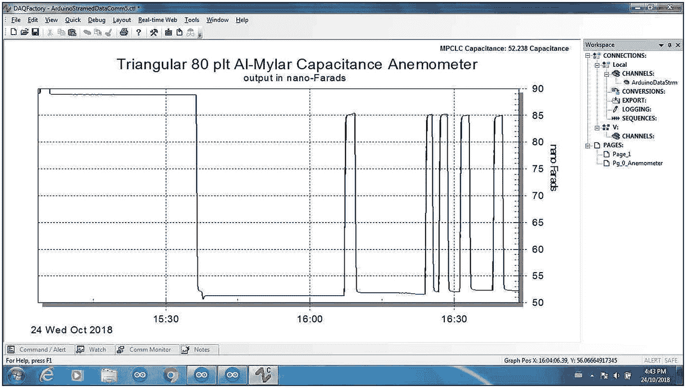

图 9-50

风速计传感器水平到垂直过渡的电容变化

### 变速风力发电机

为了提供可控但可变的风速，可以使用由 12V 直流无刷电机（`BLDC`）驱动的风扇，并结合微控制器或计算机生成的脉宽调制（`PWM`）信号，以提供可编程的风压。

采用脉宽调制（`PWM`）技术的电流控制方法，使用`TIP 122`达林顿对管晶体管和`RPi GPIO`脉冲发生器构建完成，如图 9-51 所示。代码库中一个简单的 Python `Tkinter` 滑块图形用户界面（`GUI`）用于控制风扇电机速度，其 `PWM` 脉宽由该 `Python-Tkinter Slider GUI` 设定。实际应用时，`RPi-GPIO`库数组的输出仅能对电机速度进行粗略控制，并证明不适合所需的控制要求（见图 9-55）。

最初，使用`TIP122`达林顿对管与 3.3V 输出的`RPi GPIO`组成的控制电路，不得不替换为标称 5V 输出的 `Arduino PWM` 信号，以便配合代码清单 9-3 实现对风扇电机更好的控制。

图 9-51 展示了最初用于控制风速计风源的原理图。


**图 9-51**
风速计风扇电机速度控制电路

在图 9-52 中，一个袖珍风速表被用来关联风扇产生的空气速度。该风速表安装在一对螺纹杆上，用于估算风扇不同距离处的空气速度。

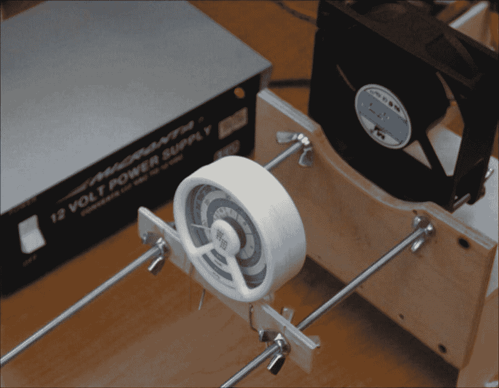

**图 9-52**
风速与风扇电机速度的关联关系

进行了一系列实验程序，将施加到风扇电机的功率以 10%为单位递增，以评估和记录随着风速增加而变化的电容值。风扇电机起初似乎对`RPi-GPIO`的 `PWM` 增量有响应，但伴随着明显的振动和噪音，并且在接近 100%功率施加水平时速度下降（见图 9-55 中 17:05 及之后的时间点）。

该实验还表明需要修改设置，因为气流会导致易碎的电容板抬起、分离，甚至被吸入上游旋转的风扇叶片中。图 9-53 和图 9-55 展示了添加一个纸板盖板来保护电容片免受气流湍流影响。

图 9-53 描绘了垂直的未受保护的风压传感器、风扇，以及带有三组绿色螺钉接线端子的小电路板。这些螺钉端子用于连接带有 `PWM` 信号的导线、12V 电源以及到风扇电机的连接。这块万用板用作图 9-50 所示电路中的`TIP 122`晶体管、二极管和电阻元件的安装基座。

在图 9-53 中，三角形盖板是从薄纸板上切割下来的，类似于办公文件夹所用的那种。它上面只有两个穿孔，用于套在螺纹杆接线柱上。盖板松散地悬挂在接线柱上，距离底板 3/4 英寸（18 毫米），这个距离由木质圆棒电容板定位柱的长度决定。

图 9-54 展示了安装在压力传感器上方位置的传感器盖板。

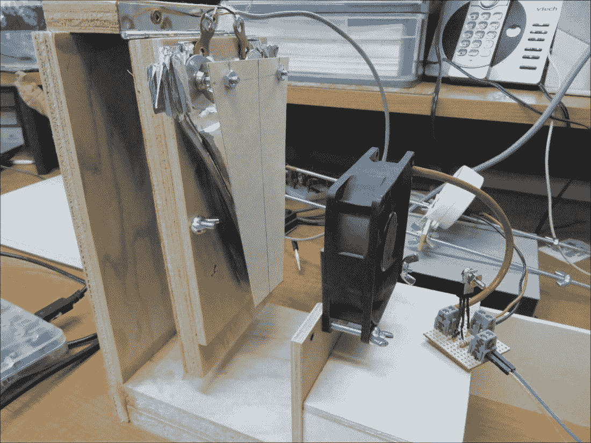

**图 9-54**
安装了气流湍流保护装置的风速测量装置

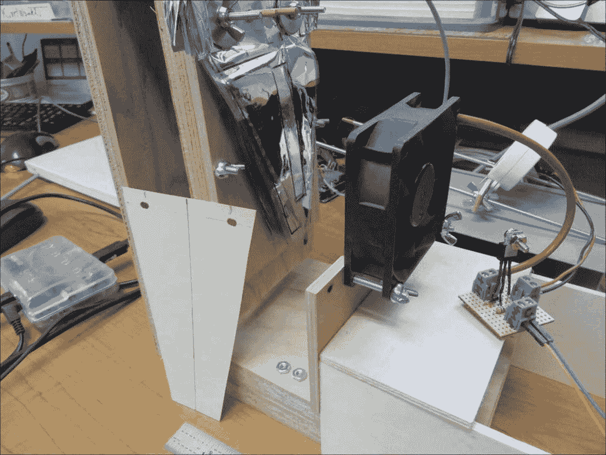

**图 9-53**
带有气流湍流保护装置的风速传感器装置

第二次风速实验使用来自 `Arduino Uno` 的 `PWM` 驱动进行。对于递增风扇功率的程序，其脉宽值通过串口传输所需的数值，被手动输入到代码清单 9-3 的 `Arduino` 代码中。使用一系列 16 个数字值条目，这些值以 16 个单位为间隔从 0 递增到 255，用于收集作为风压函数的被测电容值。

当 `PWM` 信号由微处理器生成时，风扇电机从零到全功率实现了平稳、安静且几乎无振动的功率递增响应。

## 观察结果


**图 9-56**
在指定的 `RPi-Arduino PWM` 功率水平下测量的电容值


**图 9-55**
在 `RPi GPIO` 引脚 `18` 输出的 `PWM` 风扇电机功率每增加 10% 时测量的电容值

未观察到或测量到手持式风速计测量的气流速度与施加到风扇电机的 `PWM` 功率之间存在连续的相关性。在低功率水平应用中，产生的风速无法将风速计指针驱动到稳定、明确界定的数值范围内。当风速值低于 3 米/秒时，风速计的读数波动不可靠。功率设定为 `240` 和 `255` 时，风速计指针指示为 4 米/秒（9 英里/小时）。

如果图 9-49 中的数据估算了 50 毫克和 100 毫克标准砝码之间重量与压缩电容校准曲线的线性部分的斜率，那么：

```
斜率 = (543) / (1000)
     = 0.543 nF/mg
```

将该斜率除以从图 9-55 中观察到的、在全风扇功率下压缩产生的估计电容值 69 nF，可推算出压缩力约为 127 毫克。

## 讨论

图 9-55 是在两个不同的场合下复制的。从图中可以看出，树莓派发出的 `PWM` 信号受到了已知由操作系统引起的定时误差的影响。与图 9-56 相比，图 9-55 显示了更多的噪音以及不稳定的增量功率响应。

如果安装了任何旨在修正或绕过 `GPIO` 阵列定时冲突的软件升级，则无需用 `Arduino` 替代树莓派的 `GPIO PWM` 信号源。

图 9-48 至 9-56 分别描绘并记录了利用 `MPCLC` 作为传感器的概念验证风速计和风压计的研发过程。该装置由为本工作中的其他练习而开发或组装的、经改造再利用的组件拼装而成。

图 9-49 显示，重量与纳法（nF）的关系图呈相当好的线性关系，计算得出的该图斜率为 `0.543 nF/mg`。在图 9-49 中，传感器电容的变化是可重复的，变化范围在 85 nF 至 52 nF 之间。

在水平位置时，由于自身压缩，测得传感器的电容为 85 nF；当设备旋转至垂直构型，且重量方向不再构成压缩因素时，该值变为 53 nF。根据图 9-49，对于施加到传感器顶板的、增量高达约 1500 mg 的重量，测得的电容变化率保持恒定。

如果在一系列重量测定中，在 100 mg 至 300 mg 之间进行测量，图形轨迹显示，对于在 400 mg 至 500 mg 之间进行的一系列重量测定，其每单位重量增量所对应的电容变化率是相同的。图 9-48 表明，在校准曲线的线性部分内，于两个或更多点进行的一系列称重测量，必须具有相同的斜率或传感器响应因子。

如果除了将一个经过校准的 `MPCLC` 传感器从水平方向旋转至垂直方向之外，不对实验装置做任何其他改动，那么传感器响应因子保持不变。图 9-50 记录了传感器在水平方向和垂直方向之间存在 32 nF 的差值损失。这种位置变化将使表观的垂直传感器响应值相较于水平位置观察到的值降低 32 nF。在图 9-50 中，电容轴上 32 nF 的偏移完全处于传感器校准的线性范围内。

图 9-56 表明，以全功率驱动风扇会在 `MPCLC` 上产生足够的压力，使其产生 69 nF 的响应，并记录到 9 英里每小时（4 米/秒）的风速。

经计算，在风扇全功率下，传感器在垂直方向上的响应为 127 mg，这相当于施加在传感器顶板整个表面积上的总重量。每个三角形板的底边为 3.5 英寸（8.8 厘米），高为 4 英寸（10.1 厘米），顶部尖端宽英寸（1 厘米）。这些三角形板构成了一个面积为 7.75 平方英寸或 48.8 平方厘米的梯形，据此可以计算单位面积基础上的风压。

图 9-56 表明，风扇电机功率范围的上半部分可能存在线性关系，这对于测量风速和风压可能很有用。最初对风速增加响应微弱可能是由几个因素造成的。必须给传感器顶板加装一个防护罩，以防止叶片在较高风速下移位。相对较重的纸板可能吸收了部分风能。

导致低风速下斜率低的第二个因素可能是传感器中多达 80 个的板片数量。回想一下，在尝试测量较小重量值时，采用板片数量更少、表面积更小的 `MPCLC` 能够提供更好的灵敏度。

图 9-49、9-50 和 9-51 表明，该概念是可行的，并且该系统可以通过实验开发程序进行缩放以满足您的需求。

## 压力

从数学上讲，压力可以建模为力与面积之商，因此压力的量纲是单位面积上的力。气体、液体或固体对表面施加压力时均可产生压力。

### 压力测量

回顾固体、液体和气体的基本物理性质定义，在重力场中对不可压缩液体和细碎固体进行压力测量相对简单。这些材料中任一深度处的压力，等于该点上方材料的总重量除以支撑该重量的面积。

气体压力的测量需要比测量重量和面积更精密的传感器。1634 年，E. 托里拆利描述了一根 34 英尺高（10.4 米）的水柱气压计，用于测量大气压力。托里拆利后来发明了一种更紧凑的装置，使用水银，高度仅约 80 厘米，这就是后来的水银气压计。

1646 年，帕斯卡提出空气有重量，因为当观察者向上攀登时，其位置上空大气的重量会减小，大气压力也随之降低。1654 年，奥托·冯·居里克公开演示了他发明的气泵，并展示了大气压力将一对接触面光滑的铜半球紧密密封在一起的巨大力量。该演示使用了后来被称为马德堡半球的装置，这些装置至今仍用于物理教学。

为地球科学、天气预报、海拔确定和医疗应用，已发展出多种测量大气压或气压的单位。在海平面和 20°C 条件下，各种大气压单位列于表 9-4。

**表 9-4** 大气压

| 英制单位 | 公制单位 |
| :--- | :--- |
| 14.696 磅/平方英寸 | 101325 帕斯卡 (N/m²) |
| 29.9212 英寸汞柱 | 760 毫米汞柱 |

大气压和巴是通常用于表示高气压的单位，其数值是标准温度 0°C 或常温 20°C 下海平面压力单位的倍数。

由于已知大气压力会随海拔升高而以特定速率降低，因此可以使用气压计作为海拔指示器。以下公式用于计算海拔高度（米）。

`压力高度 = 44330 × [1– (P / P[o])^(1/5.255)]`

`P` 是测量点高度处的压力。`P[o]` 是海平面处的大气压力。如果进行压力测量点的海拔高度已知，则可以重新排列上述公式，得到海平面大气压如下。

`P[o] = P / [ 1 – (海拔 / 44330)]^(5.255)`

已知海拔高度以米为单位。工程学和气候学参考文献中提供了相应的计算，可使用英制压力单位以及英寸或毫米汞柱高度。

博世公司利用第 6 章讨论的压电晶体，开发了`BMP180`和`BMP280`压力传感器。这些微型传感器是尺寸为 3 毫米见方、1 毫米厚的 `SMT IC` 器件，可从多家制造商处购得，通常安装在 1.5 厘米见方的原型板或分线板上。`Adafruit Industries` 提供板载传感器和 `Arduino` 库，用于实现大气压力监测系统。(`Adafruit BMP280 I2C or SPI Barometric Pressure and Altitude Sensor`，型号 `2651`，售价 10 美元。)

大气压通常会在数小时或数天内变化，除非遇到极端天气。对于这些设备，更有用的读数方式是传统的带状图记录。通过将传感器板供应商提供的 `Arduino` 代码修改为仅以连续顺序流的形式将原始温度和压力数据打印到串口，如图 9-56 所示，`DAQFactory` 图表模块即可用于长时间记录。


**图 9-57** 用于`DAQFactory`绘图的 `Arduino` 串口监视器温度与压力输出

程序清单 9-5 和 9-6 提供了两个用于处理串口上连续多个数据值的`DAQFactory`序列代码。程序 9-5 最初是为处理图 9-57 中的数据流而开发的。经过几次测试后，该程序的简单逻辑会随机互换绘图显示上的气压和温度数据，因为它只是读取了清空缓冲区中的第一个数字。

检查代码可知，`Arduino` 发送的每个数据点都附带有一个换行符和一个回车符，以表示数据传输结束。`DAQFactory` 序列的编写方式是，第一个基于`ReadUntil(13)`的解析定位第一个数据点，并将数据传输到名为`data0`的通道，该通道保存来自第一个被绘制变量的数据。第二个解析代码定位被绘制的两个参数的第二个值，并将其传输到名为`data1`的第二个通道，保存要被绘制的第二个变量的数据点。此序列中的代码仅适用于数值大小差异明显的双数据点。环境温度只能在零下到 45°C 之间变化，因此由于温度是自明的，所以需要区分要绘制哪个通道。每次开始新的绘图会话时，可能都需要更改绘图通道分配，因为这个简单的代码可以在第一个通道中开始读取温度或压力数据。

在尝试修改算法以始终将较大的数字分配给代表气压的通道、较小的数字分配给温度通道的过程中，我们开发了一个更有用、更通用的串口处理工具。程序清单 9-6 期望数据流以连续的逗号分隔格式到达串口。在轮询算法中，代码通过回车/换行组合（`CHR13`）找到逗号分隔数据字符串的结尾，然后解析出单个数据值，并将每个值分配到一个数据通道以供绘图。

这两个程序都要求微处理器代码将格式正确的数据发送到串口。如果使用图 9-57 所示的数据格式，则可能需要调整绘图仪分配。程序清单 9-6 中更通用且可重复的 `DAQFactory` 代码序列可以读取流入串口的两个或多个逗号分隔的数据点。

图 9-58 展示了一个 `DAQFactory` 页面，其中包含我桌面上传感器板周围温度和大气压力的图形显示。在图形记录中添加了三个变量值显示，用于当迹线漂移出刻度范围时调整温度和压力的图形刻度，并确定所记录本地大气压力的海平面压力。


图 9-58 一个典型的 `DAQFactory` 大气温度与压力显示

使用液体柱测量大气压力的仪器不够灵活、便携也不坚固。笨重的液体柱促使了无液（无流体）系统的开发。无液气压计利用隔膜或波纹管的弯曲运动来测量压力。气体和液体压力通常用一种称为波登管的紧凑型无液装置来测量。法国钟表匠兼工程师尤金·波登于 1849 年发明了这种管。弯曲扁平的波登管是大多数表盘式压力表中的弹性元件，如图 9-59 所示，至今仍普遍使用。

波登压力表的工作原理是：当扁平管内部被加压时，管子会试图重新膨胀。由于被制成“C”形，管的膨胀会导致结构扩张。产生的机械力用于移动一个连杆，该连杆连接到在刻度圆表盘上摆动的指示器。波登管制成 C 形、螺旋形和盘旋形。用于制造扁平管的材料厚度和类型决定了这些设备能够测量的压力范围。

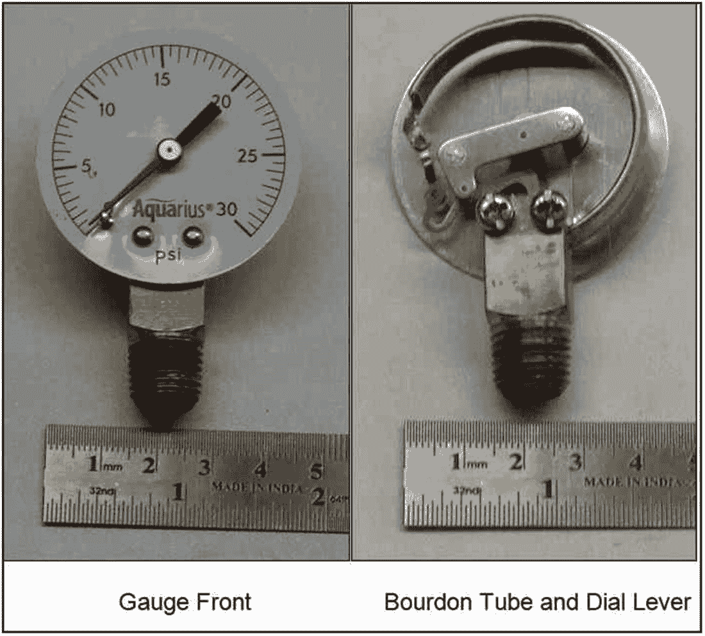

图 9-59 波登压力表

波登管通常由不锈钢和磷青铜制成。

# 第三部分：传感器构造、校准与优化

## 传感器构造

为了构建更小巧、灵敏的装置，建议使用夹具以确保所制造组件的尺寸和形状一致。对于组装铝-聚酯薄膜装置（可能需要大量铝箔和电接触桥）的实验者来说，可以利用现成材料制作几个有助于切割和穿孔的夹具。图 9-60 展示了在重量传感装置构建中使用的几种夹具。


图 9-60 组件制备用夹具

项目 A 是三层厨房用或普通级铝箔，宽度为一英尺（30.5 厘米），通常剪成约 14 至 16 英寸（34 至 39 厘米）的长度。如图所示，将三片铝箔对齐并用纸夹夹紧。然后使用标记笔，借助铝箔下方透明塑料板底部可见的标记，画出平行于电桥长度方向（3 英寸或 76 毫米）的线条。

在与宽间距线垂直的方向上，利用密集的标记压痕画出宽度为 3/4 英寸（18 毫米）的电桥平行线。然后沿 3/4 英寸线切割夹紧的铝箔，形成一英尺长（30.4 厘米）、宽 3/4 英寸（18 毫米）的铝箔条，并在其上以 3 英寸（76 毫米）为间隔做出标记。接着，从长条上剪下电桥“坯料”，得到 3/4×3 英寸（18×76 毫米）的铝箔条。然后将这些坯料堆叠成 100 个一组，如夹紧的束 B 所示。（或者，也可以切割出 3 英寸或 76 毫米宽的列，再将其分割成 3/4 英寸或 18 毫米宽的条，用于在夹具 C 中穿孔。）

切割并堆叠后，将坯料夹紧在 C（角钢夹具面）之间，并拧紧螺栓，直到铝箔形成一个坚硬的铝块。然后用 1/4 英寸（6 毫米）的钻头对该硬压块进行钻孔，形成最终的电桥箔片，如白色 B 旁边所示（另见图 9-61 和图 9-62）。

项目 D 是用于在矩形铝-聚酯薄膜板上穿孔的夹具。从较大的板材上切割出复合材料矩形坯料，并将其装入底部带有钻孔金属板的胶合板模具中。当所有坯料都装入夹具后，将钻孔的金属插件放在坯料顶部，再加上夹具顶板，并根据需要使用垫片，用穿过整个组件的螺栓将坯料压紧。压紧后，可在顶部孔中使用锤子和皮革冲头，在坯料上冲出所需数量的孔。（冲孔时应在下方垫木块，以免损坏冲头的刃口。）


图 9-62 箔片电桥制备夹具详图


图 9-61 箔片电桥制备夹具详图

## 传感器校准

由不锈钢或黄铜制成的、具有确定质量的认证砝码可能价格昂贵且难以获取。在北美，家庭和商业用电线因安全原因受到监管。各种供电系统中允许使用的铜线尺寸由美国线规系统定义。表 9-5 列出了在轻型家用布线应用中常见的一部分美国线规铜线的一些物理特性。

**表 9-5** 铜线物理特性

| - |

铜在室温（20°C/68°F）下的密度为 8.96 g/cm³，并且如果保持在室温及中等相对湿度下，相对不易腐蚀。例如，住宅应用中使用的 14 号铜线是一种易于获取的材料，可以用来制备一系列相对精确的已知质量铜块。

如表 9-5 所示，电线是大量生产的，其直径相对恒定。一根 `#14 ga Cu` 线的标称恒定直径为 1.628 mm。如果线径恒定且已知，则给定长度电线的重量可通过以下公式计算。

```
质量 = ((直径/2)² × π × 长度) × 密度
```

公式中，`直径` 是测得的电线直径，π 近似为 3.1416，`长度` 是精确已知的电线样品的长度，`密度` 是已知的铜金属密度。

在生成昂贵校准砝码组的廉价替代品时，必须接受一系列折衷方案。这种廉价、易得、易加工且成分恒定的材料，仅以长细线的单一物理形式存在。可用易处理的短电线制作的质量标准范围是有限的。处理长度小于四分之一英寸或 6 毫米的线材比较困难。重量下限由 6 毫米长的线样代表。长度超过 2 英寸或 48 毫米的线样，在某些情况下对重量、质量和力测试传感器而言过长，这定义了质量标准组的质量上限。如果需要，可以制备长度超过 2 英寸或 50 毫米的线样，并小心地将其弯成两折或任何所需的形状。

为了评估制备一组已知铜质量标准时可能出现的误差，我在我的工作坊中制备了四组校准单元，每组八个，然后用实验室的 1/10 毫克分析天平或秤进行称重。所剪线样的标称长度为最接近的整毫米数，对应长度从四分之一英寸（6 毫米）到 2 英寸（48 毫米）不等的电线。线样以 1/4 英寸（6 毫米）为增量进行切割。图 9-63 展示了我制备的四组测试样本。


图 9-63 用于典型制备统计分析的铜线质量标准

各个单元由线材切割而成，切割长度比待制备标准件的预期最终长度长几毫米。初始线材切割使用手动斜口钳，在切下的线段上产生一对斜角端面（见图 9-64 中的大钳子）。然后，用方头钳夹住正在制备的线材标准件，使斜角端以垂直于钳口边缘形成的平面方向伸出（见图 9-65）。接着，用手工将伸出的斜角铜端锉成光滑的圆形横截面，且与线材长度垂直。

图 9-64 和图 9-65 展示了用于制备和修整所需线材长度以制造标准铜块的手动工具和技术。


图 9-65 – 夹持并定位用于端面锉削的铜线

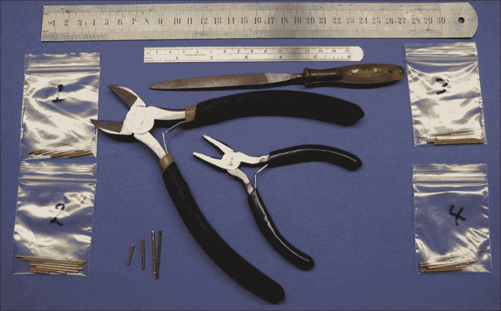

图 9-64 – 制备铜线质量标准的常用手动工具

然后，将切割后标准件的第二个斜角端锉成平整的方形端面，并在毫米刻度上测量线段的长度。制备中线段的长度的调整，是通过用钳子垂直夹住线材并锉削其两端来完成的。在夹持制备中的线段时必须小心，以尽量减少对部件外表面的损伤，并确保端面尽可能接近“平切”。

图 9-66 和图 9-67 是斜角端的放大图像，左侧为切割后的状态，右侧为准备进行长度测定时的状态。

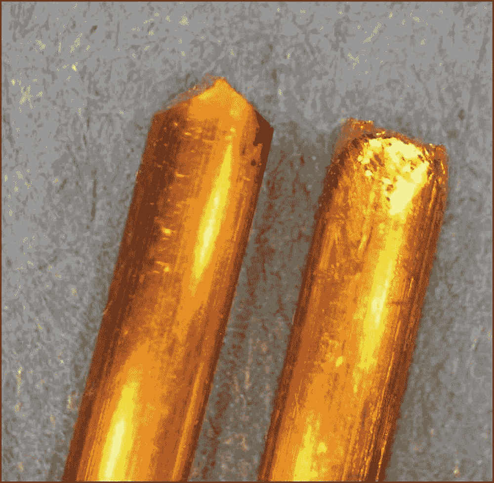

图 9-67 – 铜线端部


图 9-66 – 铜线端部

表 9-6 列出了为四组制备的标准砝码所收集和计算的数据。铜线直径测量值为 `1.61 mm`，与电缆绝缘皮上标注的 `#14 ga` 相符。该直径与各个线段的标称长度以及公布的室温下铜的密度一起用于计算标准件的质量。

表 9-6 – 制备的铜线质量标准件的测量与计算物理特性

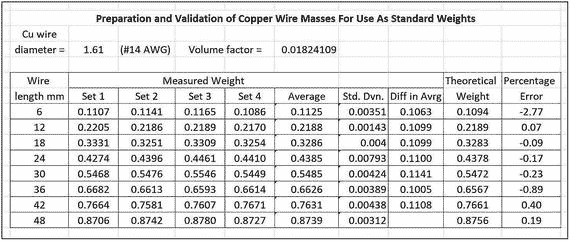

表 9-6 中有一列标为“平均值差值”，计算的是下一个较长线段与前一个线段的平均值之间的增量差值。该系列长度中每个增量为 `6 mm`。`6 mm` 增量的理论重量为 `0.1094`。该列中较为接近的值验证了平均值数据中质量增量的有效增加。

平均值数据相对于理论值的百分比误差也表明该技术具有相对可重复性。通过检查观察到的质量值相对于预期理论值的分散程度，可以估计该技术可能产生的典型误差。表 9-7 列出了从四组制备的标准铜线质量测量值分散程度中观察到的典型预期误差。

表 9-7 – 铜标准件观测质量值分散程度产生的典型误差

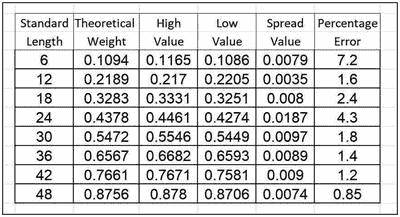

检查“百分比误差”列中的数值，符合一个常观察到的现象：随着被测设备 (`DUT`) 总长度的增加，误差分析显示确定线段长度时所产生的误差影响在减小。最短的实体和最长的实体分别具有最高和最低的误差。

较低线规的铜电线，由于单位长度材料更粗或更重，可用于制造更重的砝码。可以对较长的高线规或细电线进行称重，以确定其单位长度的近似重量，然后切割成所需的长度来制造较低质量的标准件。

制造完成后，应用肥皂水或溶剂清洗铜棒，以去除标准件表面可能存在的任何手指油脂、油污或灰尘。清洁后，良好实验室规范 (`GLP`) 建议仅使用镊子或小镊子夹持标准砝码。

对于标称质量低于 `100 mg` 铜单元的标准件，可以使用宽度为 `1.0` 厘米的普通级铝箔条。普通级铝箔的厚度为 `0.016 mm`。每平方厘米铝箔的体积为 `1.0 × 1.0 × 0.0016` 或 `0.0016 cm³`。铝的密度为 `2.70 g/cm³`。每厘米铝箔条的质量为 `4.32 mg`（见图 9-41）。

## 重量或力传感器优化

总而言之，`MPCLC`是一种扁平、超薄、廉价的传感器，易于制作和使用。该器件可以做成小巧或异形格式，用于对质量敏感的轻载应用，也可以制成更大、更坚固的器件，用于处理更重的质量与力。

`MPCLC`在其大部分敏感范围内呈非线性，需要花费时间和精力进行组装和校准，并且通常需要多次读数才能提高精度。

作为本次重量、质量和力测试的最后部分，我们利用多年来在研究此类传感器特性过程中开发的几种技术和方法，搭建了仪器系统。

为优化从`MPCLC`获取的信号，建议执行以下操作和技术。

-   为尽量减少记录电容变化时的噪声，应为`Arduino`使用电池供电，并且连接 USB 电缆时应带有铁氧体磁珠或磁环，以降低高频噪声。
-   电容器的导电板可能充当电磁干扰的天线，会受到气流的干扰，并因温差而膨胀和收缩。这些由局部环境暴露引起的扰动，可以通过将传感器封装在隔热、接地的金属屏蔽中来降低。
-   将传感器放置在水平、无振动的表面上。
-   对于离散的铝箔板和绝缘电介质或铝-聚酯薄膜复合材料，电容器绝缘体必须足够宽，以防止导电板之间短路（铝-聚酯薄膜要蚀刻或涂覆边缘）。
-   在所有板上设置对位柱以及电接触柱，有助于板的对齐，并减少压缩和膨胀过程中的信号变化。
-   使用薄镀铝聚酯薄膜的高灵敏度系统需要某种机械机构，该机构的作用能够可重复且均匀地将被测质量产生的力施加到压缩电容器板上，同时在对被测质量进行更换时，不会干扰交错式传感器的对齐。
-   简单的矩形板最容易制造和组装。
-   制作`MPCLC`时，承受压缩力的顶板应为非导电电介质，所使用的任何压力分布板都可以钻上 1/4 英寸（6 毫米）的减重孔。

到目前为止，`MPCLC`的电容是通过使用`Arduino`测量电容器达到一个时间常数等效电压（即预期充满电压的 63.2%，标称值为充电电源的 5 V）的点来监测的。

另一种进行高分辨率温度测量的技术也可以与`555`定时器 IC 配合使用来测量电容。

第 3 章的图 3-1 展示了一个`555`定时器的非稳态配置，其中`R1-R2` RC 网络中的上部电阻被替换为`NTC`热敏电阻，从而在定时器 IC 输出端产生脉冲宽度差异，因为热敏电阻的阻值随温度变化。

任何典型`555`定时器的数据手册都表明，非稳态下的输出频率可表示为：

`频率 = 1 / 周期 = 1.44 / ((R1 + 2R2) * C)`

如果将已知精确的电阻值分别放置在`Ra`和`Rb`位置，则上述频率表达式可以重排为：

`电容 = (1.443 * T) / (R1 + 2*R2)`

由于`555`IC 输出的周期与频率成反比，任何能够测量定时器 IC 输出频率的程序都可以修改用来测量`MPCLC`的电容。如上式所示，充电电阻的值位于表达式的分母中。如果改变这些元件的值，频率和周期也会随之改变。

代码清单 9-4 针对`10 kΩ`和`1 kΩ`电阻编写，这些电阻与一个`25 nF`的`MPCLC`配合，可产生大约`6 KHz`的频率。

`Arduino`具有`pulseIn()`函数，可以返回施加到微处理器指定数字引脚上的矩形波高低电平部分的微秒级时间。定时器芯片的输出频率可以通过以下三行代码获得：

```
hiTime = pulseIn(2, HIGH);
lwTime = pulseIn(2, LOW);
freq = 1 / (hiTime + lwTime);
```

代码清单 9-4 实现了使用`555`定时器 IC 频率监测`MPCLC`电容的高低脉冲宽度求和法。（另一个类似但分辨率更高的脉冲宽度测量函数是`pulseInLong()`，它以微秒为单位进行测量。这个长函数有其他程序要求。在实现该函数之前，应查阅`Arduino`关于该表达式的文档。）

关于使用外部已知电子波形源（例如`555`定时器输出）同时通过两个`MPCLC`（一个作为负载传感器，另一个作为参考以创建差分测量，从而获得更高灵敏度以测定小质量）概念的初步实验，取得的成功有限。复杂的、元件数量多的差分电子系统以及多个`MPCLC`难以组装和协调。后来开发了一种更好、更简单的方法来确定小质量的重量。

表 9-2 整理记录了在组装`MPCLC`器件过程中，由于自身压缩导致的电容微小异常增加。直观上，器件的响应预计与可压缩电容器板“堆”的厚度成正比。具有更多板数的较厚器件应表现出更高的电容、更高的可压缩性，以及在压缩下电容的显著增加。

表 9-2 显示，当板数从 5 片增加到 10 片、且无压缩重量时，器件的电容变化为`2.06 nF`。该器件每片的电容为`0.206 nF`（206 pF）。而从 45 片过渡到 50 片时，无重量下的电容变化为`3.50 nF`，即每片`0.07 nF`（70 pF）。较少的板数应能提供更大的信噪比，从而更有利于称量较小的质量。

## 实验

为最大程度减少对堆叠极板对齐的干扰并降低电磁干扰，设计了一种接地的金属外壳顶置式称重装置原型，如图 9-68、9-69、9-70 和 9-71 所示。


**图 9-69** – OH-MPCLC 的金属后壳面板


**图 9-68** – 顶置式多极板电容式称重传感器 (OH-MPCLC) 称重系统原型

铝制电磁干扰屏蔽与绝缘后盖的上表面可见一个红色的“香蕉插头”，它与图 9-71 中所示的 V 形 MPCLC 电气连接。此设计提供了直接接触称重传感器的通道，以便使用外部仪表验证电容测量值，这常见于低重量测定中，或用于调用诊断程序以定位称重操作中潜在的机电故障。


**图 9-70** – 微处理器安装、USB 线缆及辅助电源连接

在图 9-70 中，短绝缘蓝色 USB 线缆上的大型白色圆柱体是一个附加的铁氧体磁珠和用于将电磁能转化为热量的高频噪声衰减器。一个金属盒完全包裹微处理器和 MPCLC，以最大限度地减少大气和电磁干扰的影响。金属盒连接到 Arduino 排针上的接地引脚。红色和绿色引线是辅助电池电源的连接线，用于减少 Arduino 内部电源产生的噪声（见图 9-4 和 9-5）。

在图 9-71 中，您可以看到一个带有减重孔的透明塑料菱形“压力板”。一根细弹簧钢丝用氰基丙烯酸酯胶粘合到该板上，形成一个两端带挂钩的连接轭。挂钩的凹槽中心正对着轭端下方的孔，以便支撑薄铝盘（见图 9-68）的铝丝（用于放置昆虫外骨骼）能够连接到轭和压缩传感器上。

“称重盘”是一个薄的铝制圆盘，用氰基丙烯酸酯胶粘合到 U 形铝丝悬挂结构上。所有氰基丙烯酸酯粘合点都通过将连接处的金属丝部件弯成“Z”形来最大化接触面积，从而在固定组件所需形状的同时，最大化粘合结构的强度。

薄胶合板覆盖在长的电容器极片上，以防止极片弯曲。在传感器后部，螺纹杆压缩微处理器铜连接器、铝箔桥接片、电容器极片、载荷分布垫圈和红色外部香蕉插头连接。载荷分布垫圈仅在胶合板盖下方呈现为灰色弧形。与香蕉插头的外部连接终止于公母分离式电气接线配件的公头部分，这样带有固定香蕉插头馈通的原型仪器后盖就可以与设备主体分离，以便进行任何必要的维修或改装。

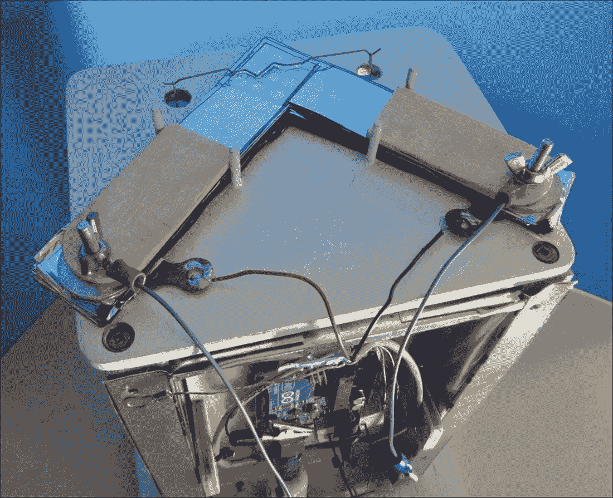
**图 9-71** – OH-MPCLC 的顶板

选择了一种带有矩形直角重叠压缩区域的电容式传感器极片，以便于制造和组装（参见图 9-34 中的项目 C）。

一个弹簧钢丝轭最初被环氧树脂粘合到一个薄铝压力板上，以最大程度减少对传感器堆叠极片的局部干扰。轭的每一端都弯成钩状，以容纳支撑称重盘的铝丝“U”型框架的末端。

“U”型框架的臂穿过顶置平台上的两个英寸（1 厘米）孔，与重量传递轭连接。随后，为 OH 传感器制作了一块带有 ¼ 英寸（6 毫米）减重孔的薄 PET 塑料压力分布板，以减轻样品及支撑组件对电容式传感器总负载的贡献。该原型单元包含一个 160 极板 `MPCLC`。

简单的偏置中心圆杆杠杆可以垂直升高称重盘，以最大程度减少机械干扰向传感器极片的传递。实际的升降平台“浮动”在一个水平销上，可以根据需要升高或垫片调整，以调整平台接触称重盘底部的高度。图 9-72、9-73 和 9-74 展示了垂直升降装置处于升起和降下位置的状态，并提供了升降部件的特写视图。

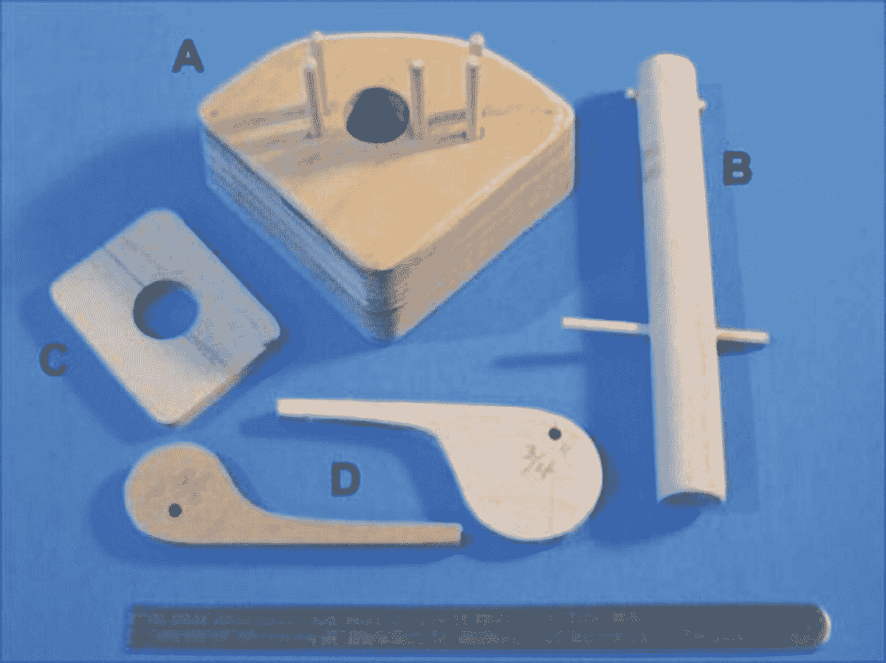
**图 9-74** – 称重盘锁定装置的组件


**图 9-73** – 称重盘锁定装置（升起位置）


**图 9-72** – 称重盘锁定装置（降下位置）

此处未提供施工图纸，因为锁定装置应根据实际使用的设备按比例缩放，并使用手头可得的材料制作。我的升降装置由胶合板和木销制成，为避免静电积聚，打磨后保持未上漆状态。

在图 9-74 中，项目 A 是庞大的基座块，上面钻有孔以容纳一根英寸（15 毫米）的销钉作为升降柱和 5 根英寸（3 毫米）的定位销。项目 B 是升降柱，其底部有提升轴，顶部有支撑可移动顶板的销钉。项目 C 是顶板。项目 D 上方和下方的部件是一对偏置中心升降杆，分别提供英寸（1 厘米）和 ¾ 英寸（19 毫米）的升程。外侧的四个成对销钉用于在升降柱升降过程中固定其轴的位置。紧邻升降柱的内侧销钉用作偏置杠杆轴的内部挡块，该杠杆轴位于图 9-74 项目 A 中最左侧和最右侧两个外侧柱销对之间。

图 9-77 显示，在 `OH-MPCLC` 上无需进一步校准或设备修改即可称量大于 100 毫克至 5 克的物体。原型设备对 20 至 10 毫克的响应已接近基线噪声水平，因此对于这些较低重量值的实用性有限。

为了确定 10 毫克级别及以下的砝码重量，使用了两种设备：一个由锥形左右叶片组装而成的 10 片式 `MPCLC`（见图 9-33 项目 A）和一个基线调节桥（见图 9-26 项目 2）。偏置桥和重量传感器如下图所示。

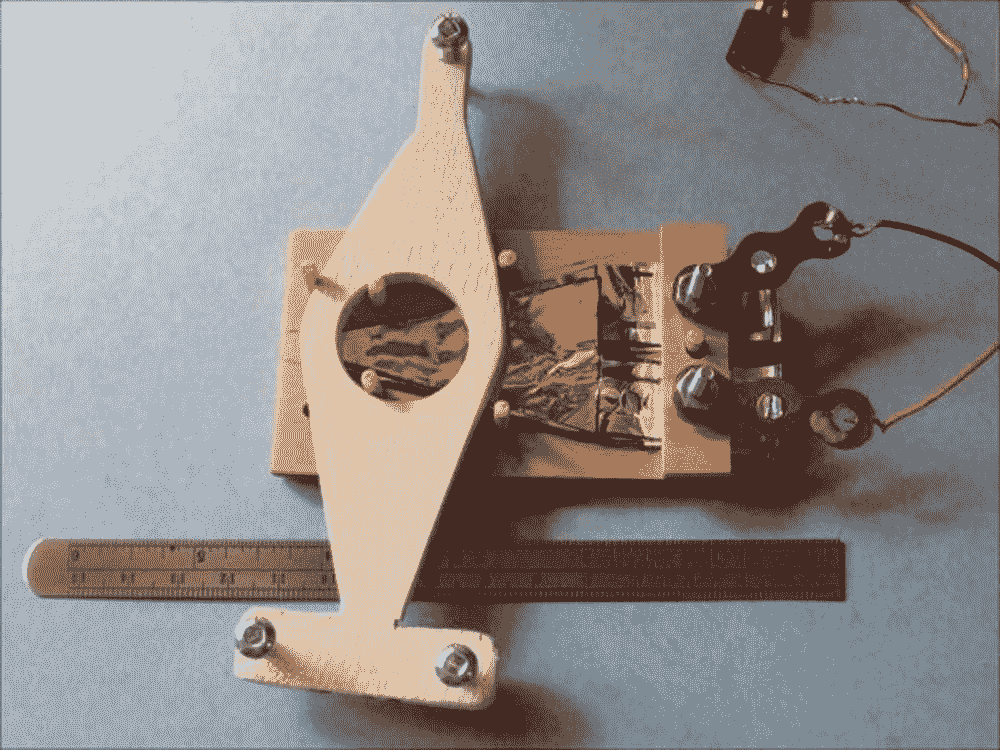
**图 9-76**  
带有偏置桥的低质量称重组件

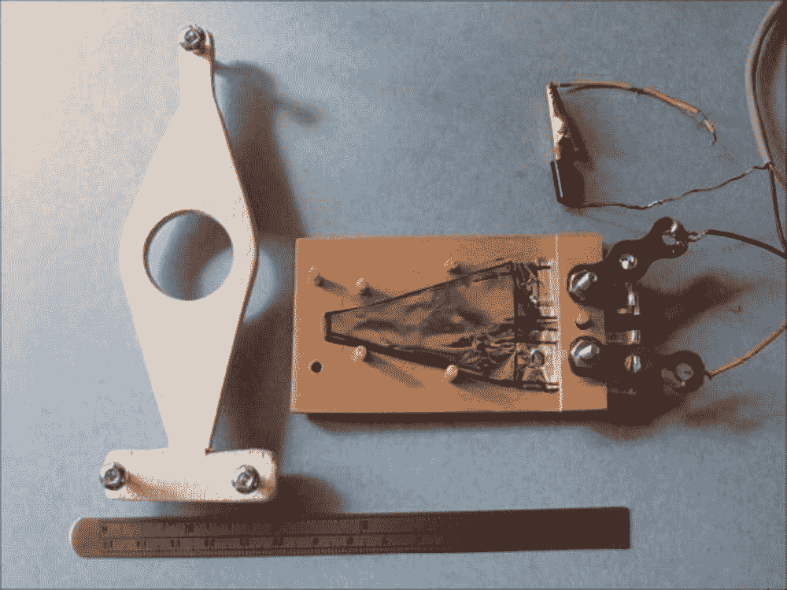
**图 9-75**  
10 片式等腰三角形低重量 `MPCLC` 和偏置桥

在图 9-76 中，直径为 `3 mm`（1/8 英寸）的销钉将桥固定在锥形叶片重量传感器上方。通过升高或降低桥长臂上的两个螺丝，可以调整基线。桥孔左侧边缘还能确保每次进行质量-电容测量时，校准砝码或测试砝码都放置在相同位置。

## 观察结果

一个 `OH-MPCLC` 原型（见图 9-68）生成了图 9-77 中的曲线。在使用 USB 电源、无空气或电磁场屏蔽，并对描记迹线进行 `DAQFactory` 64 点平滑处理后，该原型能够分辨出 20 毫克的重量。将 `Arduino` 的电源从 USB 改为 9V 电池后，噪声得以降低，因此使用该 1 英寸（24.5 毫米）`V` 形传感器刚好可以分辨出 10 毫克的重量。


**图 9-77**  
`OH-MPCLC` 原型 5 克至 20 毫克重量校准

在图 9-78 中，当 `Arduino` 电源从噪声较大的 USB `+5 V` 更换为 9V 电池（在 6:47 时刻）时，记录迹线中的噪声再次减少。当内部电源被电池供电取代时，基线从 `34.9 nF` 显著变化至 `35.4 nF`。（`Arduino` 可接受 7 至 12V 之间的任何电池或稳压电源。）


**图 9-80**  
使用 `RCTC` 方法进行 12 次重复的 100 毫克重量测定

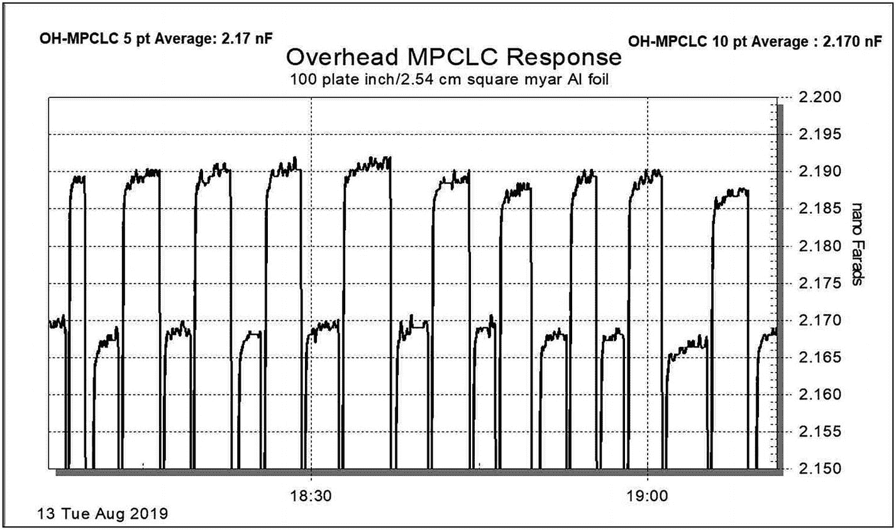
**图 9-79**  
使用脉宽测定法进行 10 次重复的 100 毫克重量测定

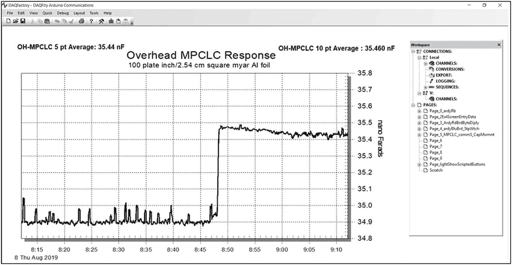
**图 9-78**  
`OH-MPCLC` 基线中的电池供电噪声抑制

对图 9-79 和图 9-80 中迹线的检查显示，当秤盘、秤盘支撑线和测试砝码（如果存在）被秤盘制动器从传感器上移开时，较低基线水平与较高测量水平被迹线从底部超出量程所分隔（见图 9-68、9-72 和 9-73）。

**表 9-8**  
12 次数值高度测量重复记录的 10 毫克重量测定描记迹线

| 重复次数 | `pF` 值 | 差值 | 重复次数 | `pF` 值 | 差值 |
| --- | --- | --- | --- | --- | --- |
| 1 | 157–152 | 5½ | 7 | 157–150 | 7 |
| 2 | 159–152 | 7 | 8 | 156–149 | 7 |
| 3 | 158–151 | 7 | 9 | 155–147 | 8 |
| 4 | 157–151 | 6 | 10 | 156.5–149.5 | 7 |
| 5 | 156–149 | 7 | 11 | 159–151.5 | 7½ |
| 6 | 158–148.5 | 9½ | 12 | 158.5–152 | 6½ |


**图 9-82**  
12 次重复的 10 毫克重量测定记录图

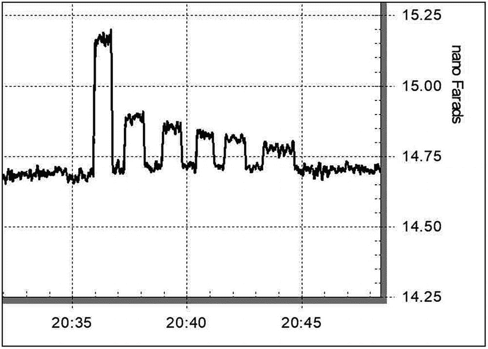
**图 9-81**  
在 72 片 1¼ x 2¼英寸等腰三角形 `MPCLC` 上的 100 毫克至 10 毫克校准

## 讨论

使用优化后的称重传感器原型与操作任何精密科学仪器类似，操作员需要熟悉系统的特性和小毛病。

1.  不要将称盘抬升到高于分离铝丝挂钩与弹簧钢轭弯头所需的高度。
2.  缓慢移动升降杆，确保弹簧钢轭始终保持在平台通孔的中心位置。
3.  小心放置和移除砝码/样品。如果压力板受到扰动，在重新悬起称盘进行质量测定前，请仔细重新对齐所有部件。

图 9-79 和图 9-80 中，微处理器用于连续测量电容的单个时间常数测量程序和 555 定时器占空比变化程序，在复现重量-电容相关性方面的能力似乎没有显著差异。我更喜欢 `RC-TC` 测量技术实现的简洁性。

使用头顶式传感器技术似乎有几个优点和缺点。每个传感器在调平、静止且无额外压缩载荷时具有固定的电容，该电容由板自身重量引起的自压缩决定。随着砝码堆叠到顶部，板间距离减小。理论上，设备灵敏度应在图 9-2 所描绘的曲线中向左移动，或者随着板间距离减小而朝向灵敏度增加的方向移动。由传感器负载增加引起的板间距减小，同时会降低被压缩传感器的动态范围，因为随着板间距离减小，曲率会趋向垂直方向。

较重的砝码比较轻的质量更能压缩多层板堆叠，如果电容-板间距图的曲率没有过于接近垂直方向，则会导致电容产生更大的可测量变化。

为了监测较重的砝码或力，相同的矩形板易于制造和安装，并且在与压力板配合使用时，在使用过程中不易受到机械干扰。传感器和质量的头顶式配置允许使用垂直升降装置，以最小化对传感器堆叠叶片的干扰。在重量变化过程中，压缩力垂直施加方式的变化会在设备每次进行测量时重置基线。

对于弯曲力较小的较轻质量，最好使用由锥形、左侧和右侧带凸片的板组成的更薄、更灵敏的传感器进行监测。异形叶片更难制造和安装，但对于灵敏度更高、厚度更薄的堆叠来说，所需的叶片数量更少。

在图 9-82 中，微处理器的连续电容监测软件会根据输入信号值的改变，自动从测量纳法切换到皮法。从纳法切换到皮法需要重新配置 `DAQFactory` 显示界面。

我们曾尝试使用杠杆进行实验以增加灵敏度，但只取得了有限的成功。在传感器位于支点下方的正常杠杆配置中，杠杆的重量会压缩 `MPCLC`，从而需要更厚的传感器。关于反转杠杆和传感器的初步实验表明，当静止时，传感器在重力作用下伸展，当重量施加到传感器长臂上时被压缩，但该设置的复杂性未被进一步发展，因为我更喜欢图 9-75 和图 9-76 中所示的那种更灵敏、更薄的传感器。

图 9-34A 和图 9-75 显示，具有更高灵敏度的 10 板锥形传感器已被切去板尖，以形成 2 英寸（49 毫米）的均匀板长。去除单个板上弯曲和变形的尖端点，应能使它们彼此平放，从而在传感器使用过程中弯曲时产生更平滑、更可重复的弯曲动作。

图 9-34 中 72 板传感器的尖端在各个方向上弯曲，并在水平和垂直方向上散布超过八分之一英寸或几毫米，因此当尖端弯曲时，设备的灵敏尖端区域无法平滑地相互滑动。更多的板数产生了 14 至 15 `nF` 范围内的电容，这可能掩盖了传感器尖端部分在压缩较厚板部分时的粗糙行为。

在图 9-81 中，72 板设备的噪声水平约为 0.05 `nF` 或 50 `pF`。在图 9-81 中修剪过的 10 板设备中，噪声水平约为 1 `pF`。

表 9-8 表明，使用 10 板三角形设备，对 10 `mg` 质量的多次重复称重测定记录到 7 `pF` 的响应。对于此质量范围内的重量测定，可以通过开发程序以及 `SCADA` 软件的 `DSP` 和显示标尺扩展，来优化载荷传感器的面积、形状和厚度。可能需要开发传感器和软件优化方法，以处理和操作非常少量的材料。

用于优化电容式测力传感器灵敏度的实验开发程序仅受限于你可用的时间，因为测力传感器所用材料的成本很低。

## 代码清单

```
// 按照发送顺序解析来自串行端口的多个值。
// 该序列自动轮询 COM3 以获取以逗号分隔的 Arduino 数据流。
// 数据流中要解析第 1、第 2 等数据点的顺序。
// 对数据绘图进行排序可确保同一变量始终分配给同一迹线。
// 确保在协议窗口中已选择空协议
// 并且正确的数据正流入 DAQFactory 串行
// 端口。串行端口上的数据必须是以回车/换行分隔的 n 个逗号分隔值的流。
// 创建 n 个通道来保存用于绘制 ardyValu_1、ardyValu_2 等的数据。
// 要解析数据，使用循环查找 cr/nl 分隔符，将其转换为数字，并使用 Parse(datin, position #, ",")。
// 将数据转换为 data1、data2 等值，然后使用 channel.addValue(datan) 将数值分配给通道。
//
// 清空缓冲区
device.Com3.Purge()           // 清除旧数据行
device.Com3.ReadUntil(13)     // 清除任何不完整的行读取
//
while(1)
try
//解析第一个数据点用于绘图
private string datain = device.Com3.ReadUntil(13)
//?datain
private data1 = StrToDouble(Parse(datain,0,","))
ardyValu_1.AddValue(data1)
private data2 = StrToDouble(Parse(datain,1,","))
ardyValu_2.addValue(data2)
private data3 = StrToDouble(Parse(datain,2,","))
ardyValu_3.addValue(data3)
catch()
delay(0.5)
endcatch
endwhile
```
**清单 9-6**  
用于解析多个串行端口数据点以进行绘图的 `DAQFactory` 序列代码

```
// 此序列自动轮询 Comm7 以获取流式 Arduino 数据
// 确保在协议窗口中已选择空协议
// 并且正确的数据正流入 DAQFactory 串行
// 端口
// 清空缓冲区
device.comm7.Purge()
while(1)
try
private string datain = device.comm7.ReadUntil(13)
private data = strToDouble(datain)
ArduinoStream.addValue(data0)
private string datain = device.comm7.ReadUntil(13)
private data = strToDouble(datain)
ArduinoStream.addValue(data1)
catch()
delay(0.1)
endcatch
endwhile
```
**清单 9-5**  
用于解析双重顺序串行端口数据点的 `DAQFactory` 序列代码

# 10. 数据收集、存储与组网

本书的编写围绕一个核心理念，即使用 SCADA 软件系统来监控和控制科学实验。许多实验系统都通过实时监控进行，通常借助一种称为人机界面（HMI）的实验可视化图形表示来实现。

HMI 允许操作员观察实验，并可能在必要时进行干预。对于在极短或极长时间尺度内、在孤立或偏远地点、或在特殊条件下进行的无人监控实验，通常无法通过 HMI 进行跟踪。对于无法追踪其进程的实验数据，则需要数据收集或采集系统来读取、添加时间戳并存储数值，以便日后检索、审查和解读。

数据记录是一个统称术语，用于描述为积累和存储来自远程、孤立、自主或无人监控研究的全部结果历史所需的所有单元操作。

进行某些类型的实验以及永久记录质量控制和质量保证测量结果时，也需要执行数据记录操作。在诸如食品或药品制剂等有机材料被干燥至特定水分活度水平以防止微生物腐败的单元处理过程中，通过测量和记录密封隔离测试腔内产品的水分活度来进行监控。配备传感器的自主电池供电数据采集模块可放置在密封腔内，用于测量和记录腔内随时间变化的理化条件概况。这提供了永久的书面证据，证明在过去的生产或测试操作中，正确的理化条件已经实现并得以维持。

遵循本书力求简单易行的特点，只采用易得且廉价的组件，本练习中的数据采集速率仅限于 Arduino 微控制器所能提供的范围。

对于本书目前介绍的所有主题，以及本着本书入门性质的原则，使用带有安全数据（SD）存储介质为数据添加时间戳的 Arduino 微控制器所能提供的数据收集速率已经足够。（市面上有几种更新的高容量 SD 卡。您必须确保这些卡及其更高的容量与您的存储系统兼容。）

如需进行高速数据采集，建议读者参考有关 `LabJack` HMI 设备数据流功能的文献，或化学光谱分析的文献。

## 时间测量

对于并非由人员持续监控的传感器或设备，其自主实验数据收集需要一个独立且精确的计时数据源。独立的计时数据可通过被称为实时时钟（RTC）的数字集成电路获得。

有多种精确计时信号源可用于数据收集。

- 全球定位系统（GPS）播发来自轨道卫星的时间信号
- 协调世界时（UTC）需要一个 GPS 接收器模块。
- 互联网网络时间协议（需要以太网连接器访问互联网）
- 广播无线电时间信号使用无线电接收器监测来自原子钟的时间信号（需要 `DCF77` 接收器硬件）
- 来自计算机的串行时间消息

`555` 定时器是集成电路振荡器，只要为其电路供电，就能产生固定或可变频率的连续方波输出。外部组件决定了该集成电路定时器产生的矩形波输出的频率或高低电平周期。通过计数或比较脉冲来确定相对时间信息。产生的时间信息仅限于单个变化的数字信号。像 Arduino 这样的微控制器，通过在适当大小的二进制寄存器中从当前会话开始时间起计数微秒和毫秒间隔，来记录相对时间流逝。毫秒计数器和微秒计数器分别每 70 分钟和约 50 天溢出并重置一次。

来自远程或非常长时间实验的自主数据收集，必须在收集和存储时打上“时间戳”，以便日后能够重构准确的记录实验值历史，用于审查、解读、显示或数值处理。打时间戳的数据通常由标准纪元时间定义，即自 1970 年 1 月 1 日以来的秒数。时间戳表达式包含当前年份、月份、星期、日期、小时、分钟和秒。

专用集成电路（ASIC），例如表面贴装的 Maxim IC `DS1307`，是一款低功耗、串行、二进制编码的十进制日历时钟设备。这款常用的实时时钟（RTC）芯片能提供年、月、日、时、分、秒信息，精度为每月误差在一分钟以内。（一种名为 `ChronoDot` 的类似温度补偿设备，精度可达每年误差在一分钟以内。）

## 附录：代码清单

```c
// N 元素滑动平均频率测定电容
// 测量，2019 年 8 月 16 日 使用 pulseIn(pin#，HIGH/LOW) 读取高电平和低电平脉宽。
// 将高电平时间和低电平时间相加，得到总周期时间，再取其倒数得到 555 输出频率。
// 电容值通过公式 Cv = 1.44/(21000 * freq) 计算。（乘以 10 的 9 次方得 nF）（注意：浮点除法需将整数强制转换为浮点数再除）
// 为便于 DAQFtry Python 通过串口数据绘制曲线，已将诊断打印行和数值标识注释掉。
//
unsigned long duration;                    // 第 1 个脉宽，高电平信号
unsigned long duration_L;                  // 第 2 个脉宽，低电平信号
unsigned long tmSum;                       // 脉宽之和
float freq;                                // 频率变量
int const numReadings = 16;                // 平均的读数个数，必须声明为 "const"
unsigned long readings[numReadings];       // 各个读数
int index = 0;                             // 读数数组索引
unsigned long total = 0;                   // 运行总和
unsigned long average = 0;                 // 平均值
//
int inputPin = 2;                          // 用于脉冲计数的数字 PWM 引脚 #2
float capTnc = 0;                          // 被测设备的电容值
int Rc = 10000;                            // 555 RC 电路中第一个充电电阻的阻值
int Rd = 1000;                             // RC 电路中第二个充电或放电电阻的阻值
//
void setup()
{
Serial.begin(9600);                      // 初始化串口通信
for (int thisReading = 0; thisReading = numReadings)                // 若到达数组末尾，则回绕
{
index = 0;
}
average = total / numReadings;           // 计算平均值
freq = 1 / (float)average;               // 根据方波周期计算频率
// 注意：C/C++ 要求在除法前将整数强制转换为浮点数
capTnc = (1.44/(21000 * freq)) * 1000;   // 计算 nF
//Serial.print("average  ");             // 诊断
//Serial.println(average);
Serial.println(capTnc, 2);               // 向串口输出数值，保留两位小数
//Serial.print("duration_L  ");          // 诊断
//Serial.println(duration_L, DEC);       // 用于 DAQFactory Python 串口使用时注释掉
//Serial.print("duration   ");
//Serial.println(duration, DEC);
delay(50);                               // 降低速率？
}
代码清单 9-4
基于 555 定时器输出频率变化的电容测量
```

```c
// 通过串口手动设置 PWM
// 从串口输入的整数（0 到 255 之间）设置 PWM 引脚 9 的值。（PWM 引脚 3、5、6、9、10 和 11）
//
int pwmPin = 9;
//
void setup() {
// 设置引脚模式并激活串口
pinMode(pwmPin, OUTPUT);
Serial.begin(9600);
}
//
void loop() {
// 检查串口输入
if (Serial.available())
{
int pulsWdth = Serial.parseInt();
analogWrite(pwmPin, pulsWdth);
}
}
代码清单 9-3
通过手动串口输入控制 Arduino 风速计风扇电机速度
```

```c
// 电容表输出（单位：纳法）
// 分压器产生 2/3 或 66% 的最终 5 伏充电参考电压。可以使用 Arduino 的内部定时器来测量 tau
// 即 RC 时间常数。使用已知精度的 10K 欧姆电阻，可计算电容。
//
#define Rc 10000.0 // 通过测量或购买确定实际电阻值
#define Rd 55.0
#define R1 40100.0
#define R2 21000.0
#define clockRate_us 16.0
//
const float k = 1/(clockRate_us*Rc*log((R1+R2)/R2));
volatile uint8_t TIFR1_Copy;
volatile uint16_t ICR_Copy;
volatile uint8_t ICR_Flag = 0;
volatile uint16_t TOV1_Ctr;
//****************************滑动平均变量*****************************
const int numReadings = 64; //噪声改善 5 倍
float capacitance = 0;
int index = 0; //MA 索引变量
float total = 0; // MA 总和
float avrgdVlu = 0; //MA 值
float readings[numReadings]; //MA 数组
void setup() {
Serial.begin(9600);
//Serial.println("OK");
//清除 MA 数组
for(int thisReading = 0; thisReading = numReadings) // 检查数组位置
{
index = 0;
}
float avrgdVlu = total/numReadings; //计算平均值
C = 1000 * (avrgdVlu); // 将微法转换为纳法
//
Serial.println(C, 6);
//Serial.print( "uF");Serial.println();
dischargeTime = 1 + (uint16_t)(10.0*Rd*C/1000.0);
delay(dischargeTime); // 等待至少 10 个时间常数
if (dischargeTime < 250) {
delay(250-dischargeTime); // 额外等待以限制打印频率
}
}
ISR(TIMER1_CAPT_vect){
TCCR1B = 0;  //停止定时器 1 - CS12:CS10 = 0
TIFR1_Copy = TIFR1; // 获取溢出中断状态
TIFR1 = (1 << TOV1); // 清除溢出标志
ICR_Copy = ICR1; // 获取 ICR 值
ICR_Flag = 1;  //设置标志
}
ISR(TIMER1_OVF_vect) {
TOV1_Ctr++; // 增加溢出计数器
}
代码清单 9-2
用于定时 RC 的 ICFT 测量的 Arduino 代码
```

```c
//带滑动平均的电容监视器
//基本程序通过已知电容标定以确定内部电阻值
const int OUT_PIN = A2;
const int IN_PIN = A0;
const int numReadings = 32;   // MA 数组大小
//IN_PIN 与地之间的电容
//杂散电容值会因板子而异。
//使用已知电容标定此值。
const float IN_STRAY_CAP_TO_GND = 24.48;
const float IN_CAP_TO_GND = IN_STRAY_CAP_TO_GND;
//上拉电阻会因板子而异
//使用已知电容标定此值。
const float R_PULLUP = 35.9;  // 单位 K 欧姆
const int MAX_ADC_VALUE = 1023;
float capacitance = 0;
float uFcapacitance = 0;
//滑动平均参数
int index = 0;
float avrgdVlu = 0;           // MA 值
float total = 0;              // MA 数组之和
float MovAvrg = 0;
float readings[numReadings];    // MA 中的读数个数
//
void setup()
{
pinMode(OUT_PIN, OUTPUT);
//digitalWrite(OUT_PIN, LOW; //这是输出引脚的默认状态
pinMode(IN_PIN, OUTPUT);
//digitalWrite(IN_PIN, LOW);
Serial.begin(9600);
//
// 清除 MA 数组
for (int thisReading = 0; thisReading = numReadings)        // 检查数组位置
index = 0;                       // 回绕
float average = total / numReadings;  // 计算平均值
Serial.println(average, 6);
}
else
{
//大电容 - 因此使用 RCX 充电方法
//
// 放电（来自小电容测试）
pinMode(IN_PIN, OUTPUT);
delay(1);
//
// 使用内部上拉开始给电容充电
pinMode(OUT_PIN, INPUT_PULLUP);
unsigned long u1 = micros();
unsigned long t;
int digVal;
//
//充电到一个相当随意的水平，介于 0 和 5 伏之间
//最好不要在这里使用 analogRead()，因为它不够快
//接下来是一个 do - while 循环
do
{
digVal = digitalRead(OUT_PIN);
unsigned long u2 = micros();
//下一行选择：或
t = u2 > u1 ? u2 - u1 : u1 - u2;
} while ((digVal  1000.0)
{
// **************************滑动平均 *****************************
float uFcapacitance = capacitance/1000.0;
total = total - readings[index];  // 减去上一次读数
readings[index] = uFcapacitance;   // 下一次电容读数
total = total + readings[index]; // 数组中的下一个位置
index = index + 1;
if (index >= numReadings)        // 检查数组位置
index = 0;                       // 回绕
float average = total / numReadings;  // 计算平均值
Serial.println(average, 6);
}
else
{
//*************************** 滑动平均 ******************************
total = total - readings[index];  // 减去上一次读数
readings[index] = capacitance;   // 下一次电容读数
total = total + readings[index]; // 数组中的下一个位置
index = index + 1;
if (index >= numReadings)        // 检查数组位置
index = 0;                       // 回绕
float average = total / numReadings;  // 计算平均值
Serial.println(average, 6);
}
}
while (millis() % 1000 != 0);
}
代码清单 9-1
使用 ISRC 方法进行 Arduino 电容测量
```

## 摘要

本文提出了一种新颖的方法，通过微处理器和上位机 SCADA 系统，跟踪可压缩电容式重量传感器中的电容变化来测定重量。

压缩式重量感应电容器可由各种廉价、易得的材料组装而成，用于在较宽的重量值范围内测定样品重量。

文中讨论了如何使用简单的手动工具，利用廉价易得的材料构建微处理器控制的称重秤和仪器校准砝码。

还介绍了使用商用和实验者自行组装的设备进行压力和力测量的应用。

收集与存储实验数据的技术将在第 10 章中进行探讨。

# 实时时钟

实时时钟是一组组件的集合，它不仅为客户软件提供连续、按需的时间功能，而且在客户软件或微控制器关闭时，也能保持精确的时间计算。来自`DS1307`芯片的数据通过I²C（集成电路间互联）二进制编码十进制（`BCD`）双向总线和软件协议进行串行传输，该协议仅使用两根线来实现总线和数据传输。（对应Arduino上的模拟输入引脚5和4。）通常，RTC由USB或微控制器供电；然而，时钟日历芯片的电路设计使其在客户软件或微处理器关闭时，能够自动由一块3伏锂一次电池供电。该3伏锂电池可为时钟日历芯片提供长达三年的持续供电，从而确保多年的精确计时。

多家商业供应商提供完整的RTC组件，可直接用于快速原型开发，或以套件形式提供，只需最少的组装即可使用。

最新版本的Arduino IDE在`RTClib`条目下的示例菜单中提供了一系列简单的程序。最值得关注的演示程序是简单的`ds1307`程序（见代码清单10-1），该程序将当前时间和日期打印到串行监视器，然后在通过调用主机设置RTC后，执行几个示例性的日期和时间计算。

还有一个名为`Time.h`的附加时间库，可下载为zip文件，它为Arduino控制器提供了额外的功能，无论是否使用外部硬件均可。`Time`库允许设置微控制器并使其与RTC同步，以连接到互联网时间服务、GPS系统以及来自计算系统的串行时间消息。`Time`库中还提供了时间函数的额外说明和附带示例程序的示例。

# 数据存储

经适当时间戳标记、跨越数天、数周甚至数月收集的实验数据，可存储于大容量、非易失性存储器——SD卡上。SD卡是一种可互换的存储设备，能够作为计算机和微控制器的辅助驱动器进行读写操作。用于数据记录的SD卡可采用`FAT 16`或`32`文件系统格式化，以逗号分隔值（`CSV`）格式存储数据，该格式可被众多电子表格、数据处理或显示软件读取。这些存储卡坚固耐用、易于操作、价格低廉、便于获取、存储容量大，且物理尺寸小巧紧凑，提供常规尺寸和微型尺寸两种规格。所有尺寸的SD卡配合简易适配器/卡托，均可兼容运行Windows、Apple或Linux操作系统的台式机、工作站及笔记本电脑硬件。

SD卡采用`3.3V`技术，而Arduino是`5V`系统。在将SD卡与微控制器连接时，读写电子电路需要适配电路。微型化和表面贴装技术正迅速取代传统的插座安装和“通孔”格式电路板。

为适应原型设备的面包板组装，微型表面贴装系统提供了转接板（BoB），使得这些微小电路能够在传统原型设计设备上进行操作和安装。转接板既可用于实时时钟（RTC），也可用于SD卡托——这些卡托可容纳电池提供辅助电源，并配备适配器，使实验者能在数据采集系统中使用任意一种SD卡尺寸。

专为Arduino设计的特殊电路板称为扩展板，它们安装在Arduino上，插入微控制器的I/O、电源引脚和排针，从而构建出完整、紧凑、专用的设备。这类扩展板可用于数据记录应用。Arduino数据记录扩展板同时集成了电池供电的实时时钟和SD卡托。Arduino微控制器与数据记录扩展板的组合，形成了一个紧凑系统，封装在坚固外壳中，可在恶劣野外或独立实验室条件下自主运行。

SD卡的数据传输采用串行外设接口协议（SPI）。SPI实现使用四线总线，以主从拓扑结构连接设备。在本练习中，编写了SPI代码并创建了一个可工作的数据记录系统，用于监测拟密封在密闭腔室内的固态温湿度传感器的输出。I²C和SPI编程在Paul Scherz和Simon Monk所著的《实用电子学（发明者用）》（McGraw-Hill，2016年）中有详细介绍。本练习的重点是修改已发布的数据记录代码，以满足记录来自不同传感器或传感器阵列数据的需求。

用于Arduino编程的SD库定义了一个SD类，包含用于在SD卡上定义和操作文件及目录的函数，以及一个File类，用于对SD卡上的单个文件进行读写操作。以下库功能的简要概述，可通过Arduino语言参考网站和在线论坛获取更多信息进行补充。

## SD类

* `begin()` – `SD.begin()` 或 `SD.begin(cspin)` 初始化SD卡和SD库，并准备数字输入/输出（DI/O）引脚11、12和13上的SPI总线以供操作。该函数还会将SS（从设备选择）引脚（默认为Arduino板上的DI/O引脚10）设置为输出。如果SS DI/O引脚被更改为由`cspin`（芯片选择引脚）指定的唯一值，则必须将其设置为输出，否则SD库将无法工作。

* `exists()` – 如果文件名存在，`SD.exists(filename)` 返回 true。通过在文件名字符串中组合正斜杠表示法，可以确认目录的存在。

* `mkdir()` – `SD.mkdir("a/b/c")` 在SD卡上创建三个目录 `a`、`b` 和 `c`。

* `open()` – `SD.open(filepath, mode)` 默认以读取模式打开文件。读取默认从文件开头开始，写入则追加到文件末尾。

* `remove()` – `SD.remove(filename)` 从卡目录中移除指定文件。

* `rmdir()` – `SD.rmdir(directory)` 仅从SD卡中移除空目录。

## File类

* `available()` – `file.available()` 返回指定文件中可供读取的字节数。

* `close()` – `file.close()` 关闭文件，并确保所有数据都已写入SD卡。

* `flush()` – `file.flush()` 确保所有写入的字节都已保存到SD卡。

* `peek()` – `file.peek()` 从文件中读取一个字节，但不前进到下一个字节。

* `position()` – `file.position()` 返回一个无符号长整数，指示下一个要读取或写入的字节的位置。

* `print()` – `file.print(data)` 或 `(data, BASE)` 将标称数据打印到已打开用于写入的文件中，并可为数值指定可选的进制基数。

* `println()` – `file.println()` 打印数据，并在打印后添加回车换行符。

* `seek()` – `file.seek(pos)` 在当前文件中寻找一个新位置，其中位置是一个介于0和文件大小之间的无符号长整数。

* `size()` – `file.size()` 以无符号长整数形式返回文件大小。

* `read()` – `file.read()` 返回文件的下一个字节，如果没有可用字节则返回 -1。

* `write()` – `file.write(data)` 或 `(buffer, len)` 将数据写入文件，其中数据可以是待写入的字节、字符或字符串（`char *`）。或者，也可以将一个长度为 `len` 的缓冲区或字符数组写入文件。

* `isDirectory()` – `file.isDirectory()` 返回一个布尔值，指示一个条目是否为目录。目录（或文件夹）是一种特殊类型的文件。此函数报告当前文件是否为目录（代码示例请参见Arduino语言库参考中的“SD库”条目）。

* `openNextFile()` – `file.openNextFile()` 返回目录中的下一个文件或文件夹（代码示例请参见Arduino语言库参考中的“SD库”条目）。

* `rewindDirectory()` – `file.rewindDirectory()` 将焦点返回到目录中的第一个文件，与 `openNextFile()` 配合使用。

仅在必要时才对SD卡进行格式化，以延长其有效使用寿命。

遵循从简单基础逐步构建复杂系统的良好科学实践，本章首先开发一个可通过Arduino串口读取的RTC，然后在多行LCD上直观显示时间和日期，之后再进入数据记录功能的组装阶段——在此阶段中，时间戳和传感器数据均从相应来源读取，并写入SD卡进行存储。清单10-3是本章末尾提供的用于带时间戳数据记录的Arduino草图。

# 液晶显示器（LCD）

LCD是一种多层薄膜技术，其原理是：当通过两个呈90度交叉的偏振滤光片观察时，位于另一多层组件两侧的照明光源会被遮挡，该多层组件中含有一种称为液晶的材料。液晶层位于两个光学透明的氧化铟锡（ITO）电极之间。当对透明ITO电极施加电压时，液晶的分子结构发生改变，导致穿过晶体的光的偏振面发生旋转，使得电极之间的发光区域变得可见。

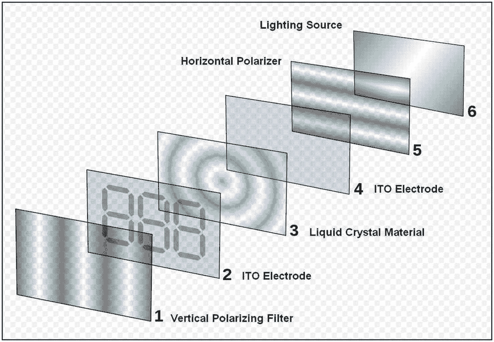

图10-1

一个三位字符的LCD

通过在玻璃基底上以像素化矩形阵列的形式沉积ITO电极，可以显示自定义创建和标准的字母数字字符。LCD以各种形式制造，从单行字符显示器到大尺寸图形显示器以及计算机或电视屏幕。（图10-1图片来自维基百科）

LCD显示器可由微控制器驱动。Arduino软件拥有一整套命令和库，适用于所有与日立`HD44780`芯片兼容的显示器。Arduino的串行监视器和LCD共享许多通用命令，因为它们本质上都是基于串行通信的设备。

本练习基于使用一个配置为固定四行、每行 16 个字符的廉价 LCD。市面上有更昂贵的具有图形功能的 LCD，但本项目不需要用到。

向 LCD 打印文本类似于向串行监视器打印的指令。矩阵中的任何位置都由行号（0 到 3）和列号（0 到 15）确定。

市面上有许多基于标准 HD44780 芯片的 LCD 系统。有几种不同的内存映射软件/硬件系统实现方式来控制多行显示器。由于不同厂商制造的 LCD 内存管理系统存在差异，滚动显示的屏幕常常会产生意想不到和令人困惑的结果。对于大多数科学数据记录操作来说，滚动显示的视觉效果并非必需，在本练习中也不予考虑。用于带 RTC 时间戳的 LCD 数据显示的 Arduino 程序见`代码清单 10-2`。

随着更多组件被添加到数据记录项目中，Arduino 微控制器上可用的引脚会被占用，原型板上的接线也变得复杂。随着项目复杂性的增加，必须小心确保 RTC、SD 卡和 LCD 显示器都正确连接，并且软件已为相应的芯片引脚分配了正确的功能。通过使用可安装在 Arduino I/O 引脚上的扩展板，可以简化项目日益增加的复杂性。包含 RTC、降压电路和 SD 卡的完整数据记录板，可以作为套件或完全组装好的成品从不同供应商处获得。

本练习的最后部分将使用一个完全组装好的数据记录扩展板，来构建一个电池供电的自治模块，用于测量隔离腔室内的条件。自治数据记录器可用于冰箱、冷藏库、具有特殊气氛的密封腔室，或封闭系统生物学实验中，以测量或验证密封腔室内的环境条件。

作为开发练习，我们将使用 Arduino Uno 作为控制器来开发一个数据记录应用。该控制器驱动一个四行 16 字符的 LCD 显示器，以直观显示正在记录或存储的实验数据；从 RTC 获取当前时间以组装一行带时间戳的数据；然后将带时间戳的数据记录并存储到 SD 卡上。数据由 DHT–22 温湿度传感器生成并流式传输，用于测定有机材料中的水分活度。（参见第 7 章中关于相对湿度传感器的讨论。）

一个自治数据记录器由 Arduino、数据记录扩展板、光敏电阻、`Analog Devices TMP 36` 固态温度传感器和电池组组装而成。最初，将设备连接到主机电脑，并将`代码清单 10-4`（本章末尾提供）中所需的程序上传到 Arduino 控制器。在通过 USB 和电池组供电，并通过串行监视器提供的显示确认系统运行后，断开数据记录设备与 USB 线的连接，让其仅靠电池供电运行。

通过记录自治数据记录实验开始的时间，并遮挡照射到 LDR 上的室内光线，可以人为创造数据变化，并通过取出 SD 卡并使用电子表格检查其上的数据来确认。这种简单的遮光测试和记录数据检查，可以在将设备应用于更长时间的监控程序之前，验证系统的运行。

## 实验

### 硬件

集成电路采用表面贴装技术制造，用于自动化电路板组装线。为了在原型实验中单独使用表面贴装微型集成电路的单个芯片，需要准备被称为`转接板`的小型电路板来使用这些芯片。转接板通常包含感兴趣的 IC 以及其他各种电子元件、电源、数据 I/O 接口，以及将板集成到项目或原型设置中所需的安装硬件。

本练习中用于容纳实时时钟和 microSD 卡的两块转接板，可从多个供应商处获得，形式为完全组装好的微型电路板或需要组装安装硬件的套件。这些套件组装起来相当容易，但由于其尺寸较小，在焊接时需要格外小心。

### 实时时钟与转接板

本练习可以使用多个供应商提供的 DS 1307 实时时钟芯片（RTC）套件，本项目使用的是 Adafruit Industries 的套件，产品编号为 264。当 RTC 通常获取电源的主设备关闭时，RTC 必须依靠电池供电运行。Adafruit 套件包含一个锂纽扣电池，当 Arduino 微控制器断电时，它会自动切换为电池供电。该锂电池可为消耗 500 nA 电流的 RTC 持续供电长达三年。日期和时间从秒到年的计数有效期至 2100 年。（电路板和套件价格从 10 加元到 30 加元不等）。

图 10-2 和图 10-3 分别展示了组装好的转接板的顶部和底部，并附有毫米刻度尺作为参照。

作为对 RTC 的初始测试，在组装好 RTC 转接板并连接到 Arduino 后，可以加载并运行 Arduino IDE 示例列表中名为`DS1307`（位于`RTCLib`菜单下）的程序。将转接板上的接地和 5V 排针连接到 Arduino 板上。将`SCL`连接到模拟输入引脚 5，将`SLA`连接到模拟输入引脚 4。


图 10-3 RTC 转接板底部

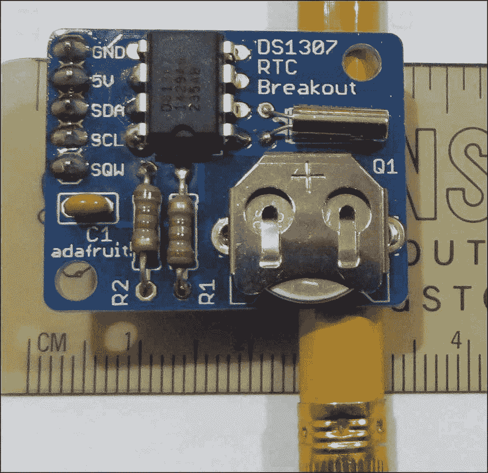
图 10-2 RTC 转接板顶部

`RTCLib`库中的函数`now()`会返回一个`DateTime`对象。该对象描述了调用该函数时的年、月、日、时、分、秒。

### SD 卡座与转接板

数据记录练习选用了 Adafruit Industries 的产品编号为 254 的套件，该套件使用 microSD 卡，且与 Arduino 微控制器完全兼容，内置了 5V 转 3.3V 的转换器。microSD 卡宽 3/8 英寸（1 厘米），长 5/8 英寸（1.5 厘米），厚 1/16 英寸（1 毫米）。转接板的尺寸为 1 英寸（2.45 厘米）x 1¼ 英寸（3 厘米），厚度为 1/16 英寸（1 毫米）。SD 转接板及一块 8 GB 的 microSD 卡如图 10-4 所示。


图 10-4 转接板及 microSD 卡的俯视图

下一张照片展示了 SD 转接板的底部，上面带有间距为 1/10 英寸（2.45 毫米）的排针。这些排针的间距设计为与原型面包板上的标准 1/10 英寸间距兼容，如图 10-5 和图 10-6 所示。


图 10-5 转接板及 8 GB microSD 卡的底视图

新的 SD 卡通常以 FAT16 格式出售（容量小于 2 GB 时），若容量大于 2 GB 则以 FAT32 格式出售。要复用曾用于记录数据或作其他用途（如相机或音乐录制）的 SD 卡，可以利用计算机上的格式化工具清除卡上的文件，并为该卡创建大小合适的新文件系统。

不建议过于频繁地重新格式化 SD 卡。对于已写入 SD 卡且不再需要的文件，可以通过 Windows 资源管理器或等效的文件管理器，使用 Delete 键进行删除，其操作方式与通常从 C 盘删除文件的方法相同。

### 液晶显示屏

数据记录项目选用了来自 Jameco Electronics 的三星 DCM 16433 显示屏，这是一款四行十六字符、无背光的显示屏，兼容 HD44780 标准。使用四行显示屏，可以同时观察来自实时时钟的时间和日期，以及安装在窗口式密封腔体中传感器传来的温湿度数据流，这些数据正在被记录到 microSD 卡上。密封腔体用于测量被测材料的水分活度。四行显示屏既允许监控数据，也能显示腔体内的平衡条件。

LCD 集成电路有一个 14 引脚的连接排或排针用于控制和数据传输，并且可能额外有两个引脚用于背光功能。Arduino 的 IDE 中有一个名为 `LiquidCrystal.h` 的内置库，其中包含一系列共十九个编程函数，用于控制字符显示，涵盖显示照明、接收串行输入、闪烁以及创建自定义字符等功能。（请参见 Arduino LCD 库语言参考）。（目前已有使用 I²C 的 LCD 显示屏，它们仅使用 `VCC`、`GND`、`SDA` 和 `SCL` 引脚，从而为 Arduino 留下了四个数字引脚）。

一块 LCD 需要电源和接地连接，这通常是 LCD 端子板上的前两个连接。应查阅制造商的参考文献，以确认控制和激活显示屏所需的其余连接。除了电源连接外，我所使用的四行十六字符显示屏还采用了一个 10 kΩ 电位计的滑动端连接在地线和 5V 电源之间，并连接到显示屏排针的第 3 引脚，以控制图像对比度。在本练习所用的显示屏中，图像对比度控制电压被称为 `V[o]`。

除了控制电源、接地和图像对比度的电气连接外，操作 LCD 还需要另外六个连接。

尽管 LCD 可以接受 8 位数据用于显示，但通常只使用 4 位。对于大多数应用而言，8 位和 4 位操作在显示效果上没有明显差异，而使用 4 位方式可以为微处理器上的其他用途保留四个数字 I/O 线。Arduino 数字 I/O 与 LCD 排针之间的 6 引脚分配可根据应用需求而变化，只要在相应的代码行中进行了正确的分配即可。

`LiquidCrystal lcd(RS, enable, D4, D3, D2, D1); // lcd 连接分配`

Arduino 的 IDE 中提供了几个简单的 LCD 使用演示代码示例，而以下代码则演示了在科学应用中实用的 LCD 编程。

## 软件

为便于文本与代码清单之间的交叉引用，清单 10-1 和 10-2 已整合到以下讨论该主题的相关段落中，而非单独列出。

## 清单 10-1 涉及一个 Arduino 实时时钟的串口监视器显示
数据记录项目的初始阶段是组装或获取一个基于 Maxim 1307 器件的实时时钟。这款时钟芯片在成本与性能之间取得了平衡。对于本书练习中设计的实验可能用到的多数数据记录操作，它都能提供足够的精度。使用 Maxim 1307 的 RTC 的 Arduino 代码可以在 IDE 提供的示例中找到，如下所述。

以下来自 IDE 示例 `ds1307` 菜单选择的代码，在首次运行时，通过使用 `rtc.adjust()` 函数从宿主机设置时间和日期。一旦 RTC 初始设置为正确的时间和日期，只要有电，RTC 就会运行。电源可以来自 USB、辅助 Arduino 电源（例如，为 Arduino 供电的电池或独立电源），或者如果 Arduino 关闭，则来自 RTC 自身的纽扣电池。当前时间/日期可以通过 `rtc.now()` 函数获取。

```
// 使用通过 I2C 和 Wire 库连接的 DS1307 RTC 的日期和时间函数
#include 
#include "RTClib.h"
RTC_DS1307 rtc; // 声明 rtc 对象
void setup () {
Serial.begin(9600);
#ifdef AVR
Wire.begin();
#else
Wire1.begin(); // Shield I2C 引脚连接到 Arduino Due 上的备用 I2C 总线
#endif
rtc.begin();
if (! rtc.isrunning()) {
Serial.println("RTC 未运行！");
// 以下行将 RTC 设置为此草稿编译时的日期和时间
rtc.adjust(DateTime(F(__DATE__), F(__TIME__)));
// 此行使用显式的日期和时间设置 RTC，例如要设置
// 2014 年 1 月 21 日凌晨 3 点，请调用以下代码：
// rtc.adjust(DateTime(2014, 1, 21, 3, 0, 0));
}
}
void loop () {
DateTime now = rtc.now();
Serial.print(now.year(), DEC);
Serial.print('/');
Serial.print(now.month(), DEC);
Serial.print('/');
Serial.print(now.day(), DEC);
Serial.print(' ');
Serial.print(now.hour(), DEC);
Serial.print(':');
Serial.print(now.minute(), DEC);
Serial.print(':');
Serial.print(now.second(), DEC);
Serial.println();
Serial.print(" 自 1970/1/1 午夜以来的秒数 = ");
Serial.print(now.unixtime());
Serial.print("s = ");
Serial.print(now.unixtime() / 86400L);
Serial.println("d");
// 计算未来 7 天又 30 秒后的日期
DateTime future (now.unixtime() + 7 * 86400L + 30);
Serial.print(" 现在 + 7d + 30s: ");
Serial.print(future.year(), DEC);
Serial.print('/');
Serial.print(future.month(), DEC);
Serial.print('/');
Serial.print(future.day(), DEC);
Serial.print(' ');
Serial.print(future.hour(), DEC);
Serial.print(':');
Serial.print(future.minute(), DEC);
Serial.print(':');
Serial.print(future.second(), DEC);
Serial.println();
Serial.println();
delay(3000);
}
清单 10-1
设置时间和日期
```

在清单 10-2 中，可以通过提取上一程序描述的时间数据并显示在 LCD 的前两行，来创建一个当前时间的可视化显示。以下代码提供了一个 RTC LCD 时间时钟。

```
// 使用通过 I2C 和 Wire 库连接到 Arduino 和 LCD 的 DS1307 RTC 实现日期和时间功能（数字时间可在串口监视器上显示，但会快速滚动）。
#include 
#include "RTClib.h"
#include 
// 初始化 LCD 和引脚分配
LiquidCrystal lcd(9, 8, 7, 6, 5, 4);
RTC_DS1307 rtc;
void setup () {
Serial.begin(9600);
#ifdef AVR
Wire.begin();
#else
Wire1.begin(); // 防护板 I2C 引脚连接到 Arduino Due 的备用 I2C 总线
#endif
rtc.begin();
lcd.begin(16, 4);
if (! rtc.isrunning()) {
Serial.println("RTC 未运行!");
// 以下行将 RTC 设置为此草图编译时的日期和时间
rtc.adjust(DateTime(F(__DATE__), F(__TIME__)));
// 此行使用明确的日期和时间设置 RTC，例如设置为 2014 年 1 月 21 日凌晨 3 点，可调用：
// rtc.adjust(DateTime(2014, 1, 21, 3, 0, 0));
}
}
void loop () {
DateTime now = rtc.now();
lcd.clear();
Serial.print(now.year(), DEC);
lcd.print(now.year(), DEC);
Serial.print('/');
lcd.print("/");
Serial.print(now.month(), DEC);
lcd.print(now.month(), DEC);
Serial.print('/');
lcd.print("/");
Serial.print(now.day(), DEC);
lcd.print(now.day(), DEC);
Serial.print(' ');
lcd.print(' ');
lcd.setCursor(0,1);
Serial.print(now.hour(), DEC);
lcd.print(now.hour(), DEC);
Serial.print(':');
lcd.print(":");
Serial.print(now.minute(), DEC);
lcd.print(now.minute(), DEC);
Serial.print(':');
lcd.print(":");
Serial.print(now.second(), DEC);
lcd.print(now.second(), DEC);
Serial.println(); // 串口监视器中的滚动显示。
delay(10);
}
清单 10-2
RTC LCD 时钟
```

## 清单 10-3 数据记录代码
清单 10-3 从固态湿度和温度传感器读取数据，并将带时间戳的数据记录到格式化的 8 GB 微型 SD 卡上。相对湿度温度传感器有其专属的库 `DHT.h`，使 Arduino 能够读取传感器的输出。`DHT 22` 是一种平衡传感器，仅每三秒读取一次。

`DHT-22` 传感器周围的局部大气条件的连续可视化显示将在一个四行十六字符的 LCD 上显示，同时记录实验条件。

### 图 10-6 展示了带有 LCD 显示屏、Arduino 板和 USB 电缆的拥挤原型板
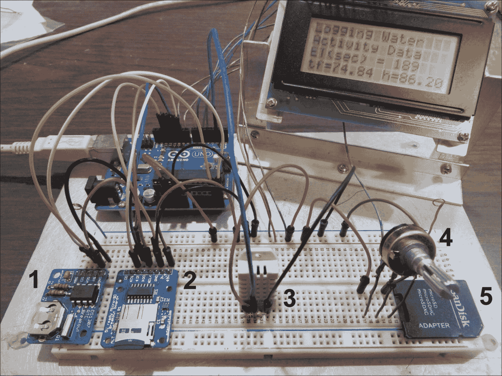

图 10-6 带时间戳的相对湿度和温度数据采集及微型 SD 卡数据存储

数据记录项目的代码如下。

### 图 10-7 展示了带防护板的 Arduino 紧凑型、电池供电、自主数据采集系统


图 10-7 自主光照和温度数据采集模块

在图 10-7 中，(1) 标注指示用于记录或记录数据的常规尺寸 SD 卡，(2) 指示电池供电的 RTC，(3) 是光敏电阻，(4) 是固态温度传感器。

图 10-8 展示了插入式数据记录防护板及 Arduino 控制板的底部。

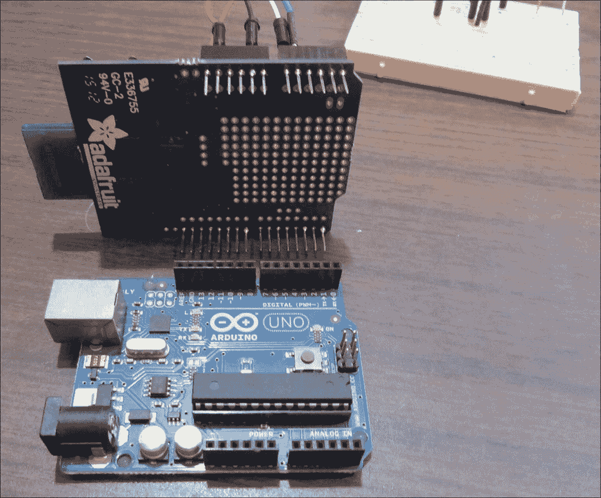
图 10-8 数据记录防护板的连接引脚

图 10-8 中的 Arduino 数据记录防护板是从 Adafruit Industries 购买并完全组装好的。它配备了可选的堆叠式排针，以便记录组件能够与其他防护板或原型面包板一起使用。

使用我的带有可选堆叠式排针的组件，`LDR` 和 `LM 35` 温度传感器按照图 10-9 所示的电路安装在一块小型原型面包板上。

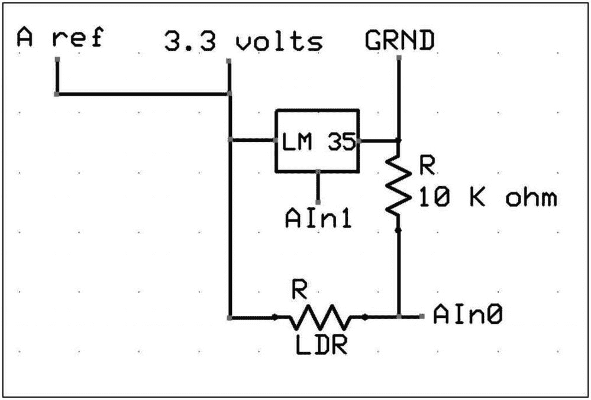
图 10-9 Arduino `LDR` 和温度传感器电路

该系统按照供应商提供的示例软件所建议的配置进行组装。系统由 3.3 V 电源供电，该电源的优势在于它是由噪声较大的 USB 5 V 电源调节而来的，应为一个噪声水平低得多的电压源。

建议的光照和温度传感器电路包括将 `LDR` 配置在分压电路中，以将光照强度转换为可测量的电压。此类传感器配置的非线性和异常行为在《电子发明者实用电子学》第 6 章中有所介绍并进行了数学建模。

组装自主系统的目的是将设备放入冷藏容器中，以验证内部温度是否回到设定点，并确认有无光照。`LDR` 的阻值应在腔室打开受光照时从低阻值变化，到腔室关闭黑暗时达到最大阻值。因此，`SD` 卡上记录的数据应表现为温度数据中的模拟漂移，以及光照数据中从低到高的“数字”类型切换。

清单 10-4 中的 Arduino 草图已根据数据记录防护板制造商提供的示例进行了修改。它以 10 位 `ADC` 缩放数值的形式记录时间、温度和光照强度。

要使用记录器，请组装系统，连接到电池组，然后通过访问串口监视器开始数据记录会话。当串口监视器显示所有初始化和启动消息并开始列出数据时，可以断开 USB 电缆，并将模块放置到待监测的环境中。

在连接到 USB 期间，每次访问串口监视器时都会创建一个新文件。使用操作系统的文件管理实用程序清除 `SD` 卡上的旧文件，可重置数字文件识别程序。

## 观察结果

将 Arduino 微控制器、`RTC` 和 `SD` 数据卡座组装在原型面包板上，并将 `DHT-22` 传感器连接到 Arduino 的数字 I/O 引脚 2 后，记录了 41 分钟的室内温度和湿度。数据记录程序中的默认采集时间为每分钟 20 个样本。在 41 分钟内收集了 820 条读数记录。

通过从其卡座中取出 8 GB microSD 卡来终止数据收集。将 microSD 卡安装到标准尺寸的 `SD` 卡座/适配器中，以便插入台式工作站来检查收集的数据。主机将 `SD` 卡识别为额外的常规驱动器，并分配相应的驱动器号或盘符。根据 `SD` 卡上的标头信息，41 分钟的数据收集产生的文件大小为 34 KB。

使用计算机的文件属性实用工具检查真实文件大小，显示总文件大小为 65,536 字节，其中包括文件系统开销。以 3 秒的数据采集速率和 41 分钟的采集间隔，产生 820 行数据，系统总共消耗约 1.5 kB/分钟。这张 8 GB 的卡有空间容纳 8 GB / (1.5 KB/分钟) = 5,293,211 分钟，即 3,675 天的连续数据收集。

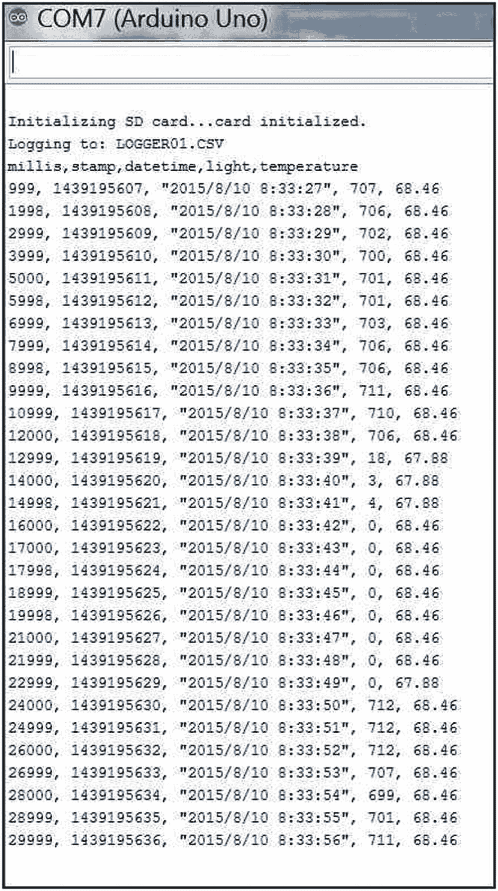
图 10-11 — 自主模式下的串口监视器数据采集显示


图 10-10 — 温度和湿度数据的串口监视器记录

从电池供电的自主模块收集的数据显示，当 `LDR` 暴露在室内照明下时，记录的 Arduino `ADC` 值。来自白炽灯的正常顶部照明产生的光照值在 700 `ADC` 计数范围内，而用笔帽盖住 `LDR` 则会将读数降至零。

要恢复在数据收集模块自主运行期间收集的数据，需从模块中取出卡并将其插入计算系统的 `SD` 卡插槽或 `SD` 卡读卡器中。卡上的文件如图 10-12 所示。

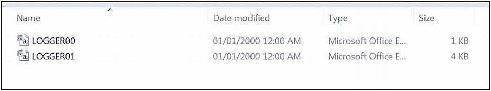
图 10-12 — 电池供电的自主数据收集模块生成的 `SD` 文件

在 Microsoft Excel 中打开 `Logger01` 文件可得到图 10-13 所示的表格数据阵列。电子表格的标题由以下代码行创建。

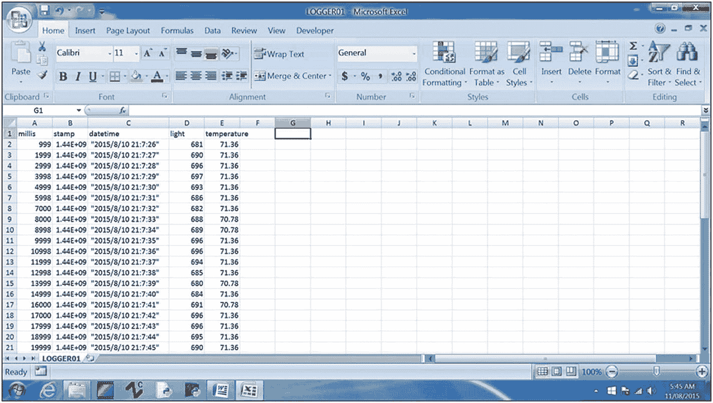
图 10-13 — 来自自主采集的记录数据在 Excel 中的显示

```
logfile.println("millis,stamp,datetime,light,temperature");
```

该代码行位于 Arduino 代码 `DataLoggingLightAndTemperature_Rvn1_rtsketch_jul21b` 中。

首次打开时，Excel 电子表格处于默认配置状态。`millis` 和 `stamp` 列（可能为 5 到 10 位数字范围）会以指数表示法显示，直到调整列宽以适应更大的数字位数。

### 使用 RPi 进行数据记录

来自 Sense HAT 板的数据记录在第 6 章中讨论。Sense HAT 板配备了一个可编程 `LED` 阵列，用于视觉通信或报警，并通过连接到 `RPi` `GPIO` 阵列提供导航和环境传感器数据。数据记录不存储在 `SD` 卡上，而是存储在 `RPi` Linux 操作系统的主存储驱动器上。带时间戳的数据以逗号分隔值（`CSV`）格式存储，该格式与大多数电子表格软件程序兼容。可以从 GitHub 仓库获取完整的教程，用于记录来自 Sense HAT 板的所有或特定数据流，该板可从 Raspberry Pi 基金会和许多供应商处获得。

Arduino 微控制器、`RTC` 和 `SD` 数据收集系统与 `RPi`/Python 平台完全兼容。

## 网络

网络是构建监控和数据采集系统的基础。在网络中，各个计算机可能具有同等的地位，并以客户端-服务器的方式交换文本、图形或数据等信息。一台设备发送，另一台设备接收。网络可以简单到连接两台计算机以共享信息，也可以涉及以各种配置连接的大量计算单元，所有这些单元都通过称为*路由器*的特定设备连接在一起，这些设备控制着通过连接系统的信息流。

一种常见的配置是几台计算机通过一个路由器连接，该路由器允许在各个单元之间进行有线和无线连接。这使得计算机能够在局域网中自由通信。

使用有线或无线配置路由器的局域网受到物理限制的限制。如果系统有电且电缆物理完好，则有线连接是有保证的。无线网络连接取决于发送和接收站是否有电、功能正常的发送和接收设备以及不间断的无线电传输。如果保持无线电接触，无线系统具有几乎无限的本地移动性的优势。通常，本地无线系统必须使用中继器来确保在整个期望的操作区域内都有强大的无线电信号。

家庭、企业和各种机构使用路由器连接的局域网来连接各种固定和移动计算设备以处理信息。除了构建局域网外，路由器还可以连接到互联网以访问全球可用的资源。控制局域网并提供互联网连接的路由器通常被称为*网关*。

有线网络将信息流或网络流量限制在系统的工作站和局域网电缆上。无线连接将网络流量广播到局域网有效广播范围内的任何接收站。无线连接需要一个安全系统，以防止对客户端和服务器之间的控制信息流造成意外干扰。

SCADA 系统最初设计用于较长距离的运行，允许中央位置监控和控制远程设施，例如发电站和公共事业。微小型化的持续进步使得对本地和全球远程设备的远程控制变得司空见惯。当通过互联网连接使用时，`HMI` 以及涉及硬件和软件语言（如超文本标记语言 `HTML`）的特殊计算机通信，创造了从本地到全球的远程控制能力。

通信由两个实体之间的信息传输组成。一个实体发送数据，而另一个实体接收信息。通信集成电路使用一种涉及比特的低级主从（`I²C`）数据传输协议。联网的计算设备使用更高级别的语言客户端-服务器协议来交换网页信息。在互联网客户端-服务器通信中，客户端向服务器请求信息，信息交换涉及整个或部分网页的交换。

一个廉价、易获得的 Arduino 微控制器可以被编程为充当互联网连接的 `Web` 服务器组件，从而允许在 `PC` 主机和远程实验之间进行数据收集和监控命令的双向流动。

本练习旨在构建与实验操作相关的网络连接，首先从集成一个 `Arduino` 微控制器并将其定位到局域网（`LAN`）中开始。一旦微控制器集成到局域网中，连接将进一步扩展，通过具备全球通信能力的互联网连接，在台式机与微控制器之间传输数据和控制信号。与所有计算技术一样，配置开发过程正不断趋向于更加自动化。

深入的网页设计、用于实现客户端-服务器编程或交互的脚本语言，以及为防止无线系统中广播无线电信号意外交互所需的额外安全考虑，本书仅通过简单示例进行介绍，以保持其入门性质。以下列出一些互联网接入中使用的术语和缩写词。

`客户端-服务器模型`：互联网信息通常以网页形式存储和传输。服务器是存储信息并向请求访问页面的客户端设备分发信息页面的计算机。当客户端向服务器请求信息时，信息传输即被启动。Web 服务器持续监听客户端的请求，并在收到请求后以完整或部分网页的形式提供所需信息。

`DHCP`：动态主机配置协议是一种自动为设备分配互联网地址的程序。当设备集成到局域网时，驻留在`Arduino Ethernet`库中的 DHCP 程序会为微控制器定位并分配一个 IP 地址。

`表单`：用于收集用户输入的网页，包含多种可视化显示元素，如复选框、单选按钮、文本输入框、滑块条以及其他用于输入用户信息的元素，称为表单。当主机的 Web 浏览器程序运行一段用`HTML`编写的代码时（示例如下），表单即被显示。在`HTML`中，表单的起始和结束由`<form>`和`</form>`标签定义。计算单元之间的数据传输由`GET`和`POST`方法控制。

`GET/POST`：向远程服务器传输信息以及从远程服务器接收信息的两种方法是`GET`和`POST`。网址（`URL`）以`/?s=arduino`等序列结尾的请求是`GET`请求，其中变量`s`被设置为值`arduino`。`GET`定义了`URL`中`?`后面的一系列变量。`GET`和`POST`的功能代表了数据在客户端和服务器之间移动的两种方式。

`HTML`：超文本标记语言是创建网页的标准`脚本`或`标记`语言。Web 浏览器程序读取`HTML`文件并将其代码渲染为网页。`HTML`描述了如何在网站中显示页面，它被称为`标记语言`而非编程语言。

`HTML`代码元素是所有网站的结构化细节。`HTML`将图像和对象融合到页面元素中，这些元素可以创建交互式表单，并提供通过基于文本的结构化语义（描述标题、段落、列表、链接、引用及其他项目）生成结构化文档的方法。

`HTML`元素由包含在尖括号（如`</p>`）中的不可见标签组成，这些标签配置了浏览器程序显示页面内容的方式。

还有许多其他`HTML`功能可用于网站创建。请参考万维网联盟的标准，该联盟自 1997 年起一直负责`HTML`的创建、修改和实现工作。

`HTTP`：超文本传输协议旨在实现客户端与服务器之间的通信，并作为两者之间的请求-响应协议运作。驻留在任何计算系统上的 Web 浏览器程序可以作为客户端，向运行着 Web 服务器程序（用于根据网络连接的客户端请求分发网页信息）的任何其他计算系统请求基于网页的信息。在一个典型的互联网或局域网交换示例中，客户端（浏览器程序）以标准化格式向服务器提交一个`HTTP`请求，服务器在确认该请求后完成所请求的网页事务。

`IP 地址`：互联网上的位置通过互联网协议地址来标识，该地址由四个分组数字值组成，取值范围为 0 到 255（一个字节，即`2⁸`）。

`MAC 地址`：媒体访问控制地址是连接到互联网的网络接口设备的唯一标识符。在本练习中，它是`Arduino Ethernet Shield`上的六组十六进制数字对。（在我的开发板上，它是`90-A2-DA-0D-79-2A`）。

`路由器`：早期的网络通过将电缆连接的计算单元或工作站连接到集线器来形成局域网。带有修改后硬件的集线器被创建，以允许通过无线和有线方式连接工作站形成局域网；而逻辑电路的加入则形成了路由器，然后路由器可以引导局域网成员与全球互联网之间的网络消息信号流。

`URL`：统一资源定位符指的是网页地址。这些地址由统一资源定位符和统一资源名称组成。

要使用下面这一系列逐步增强`Arduino`互联网连接功能的练习，所编写的代码（sketches）的复杂度会显著增加。关于功能如何实现的基础解释可能需要实验者学习或回顾`HTML`、`C`、`C++`、网页创建以及高级`Arduino`编程等底层技术。（参考文献以及与原始代码来源相关的资料均已提供。）

### 将 Arduino 连接到网络

`Ethernet shield`（以太网扩展板）是一种电路板，它通过排针堆叠在 `Arduino` 顶部，既可以访问微控制器的所有 I/O 引脚，也提供了将微控制器连接到局域网所需的电路。该扩展板配有一个用于有线连接的 `RJ-45` 线缆插座。通过 `Arduino USB` 连接可以访问主机上的 `IDE`（集成开发环境），以创建所需的草图程序。一旦草图程序加载到 `Arduino`，微控制器便可通过 `Ethernet` 连接与局域网或互联网上的任何设备进行通信。

图 10-14 展示了一个安装在 `Arduino UNO` 上的 `Ethernet` 扩展板。图像左侧分别是 USB 线缆和网线，分别标注为 (2) 和 (1)。

当配置为网络服务器时，用于在客户端浏览器上显示网页所需的代码可以由 `Arduino` 草图提供，或存储在 SD 卡 (3) 上。该扩展板上安装的 SD 卡还可以记录来自连接互联网的实验数据。原型实验可以通过原型板 (4) 和相应的接线在 `Arduino-Ethernet Shield` 堆叠上进行组装和连接。在图 10-14 中，一个音频音调发生器 (5) 和一个带有长引线的 `RGB LED` (6) 是电子元件，它们可以通过互联网连接的数据传输进行监控或控制。

在图 10-14 中，SD 卡 (3) 松散的存放在其卡槽内。当不主动使用时，SD 卡不应安放在读卡器中，因为它可能会干扰任何不需要访问该设备而运行的草图程序的预期操作。

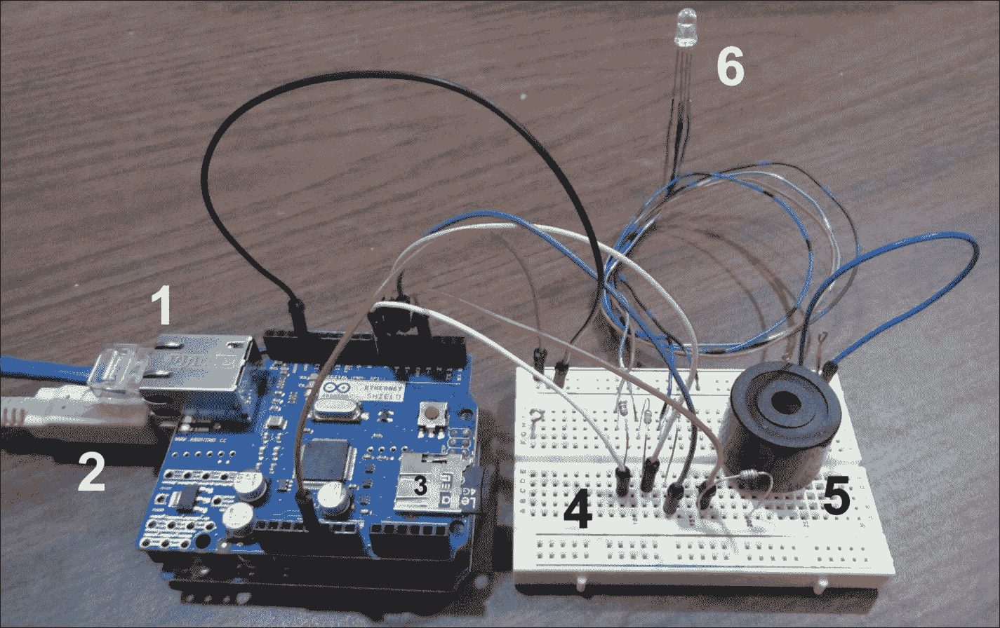

**图 10-14** — 一个 `Arduino Ethernet Shield` 和原型面包板。

以下介绍的代码、硬件和技术具有可扩展性。它们可以被使用或轻松修改，以便通过互联网在连接到 `Arduino` 的实验过程与观察者之间传递信息、数据和命令。后续的程序汇编整理自书籍、在线教程、论坛或参考文献，并经过修改以演示可用于互联网监控和管理的技术。

### 简单网页

本练习首先在主机 PC 上创建一个基本网页，以演示网络浏览器如何解释 `HTML`。

`HTML` 使用简单的文本编辑器编写，例如 Windows 附件中的 `WordPad` 或 RPi 的文本编辑器，并以 `.htm` 扩展名保存，形成一个可供浏览器程序读取的文件。`HTML` 也可以在功能更高级的文本编辑器（如 `WordPad++`，免费软件）中编写。

配置微处理器以处理通过其串行端口传输的字符，并提供适当的识别逻辑来响应字符序列，是一种稳健的技术，它允许设备按实验者的要求工作。当互联网连接到设备串行端口时，可以从微处理器调用网络服务器或客户端响应。能够读取串行端口字符的草图可以重新组合命令来操作微控制器的 I/O 引脚，或者读取并返回选定引脚的电压电平。

本练习中研究的网页是“扩展”自以下来源的代码和方法：

-   《编程 Arduino：草图入门》，作者：Simon Monk（McGraw-Hill, 2011）
-   《编程 Arduino：下一步，深入草图》，作者：Simon Monk（McGraw-Hill, 2018）
-   《探索 Arduino》，作者：Jeremy Blum（Wiley, 2013）
-   《树莓派烹饪书》，作者：Simon Monk（O'Reilly Media, 2019）
-   [`arduino.cc/en/reference/ethernet`](http://arduino.cc/en/reference/ethernet)

互联网技术和物理计算硬件在不断演变。关于 `Arduino` 微控制器的最新信息来源可在互联网上找到。

## 实验

### 创建一个简单的 HTML 网页

任何现成的文本编辑程序，例如 Windows 记事本、RPi 文本编辑器或多功能文本编辑器 Notepad++，都可以用来编写 `HTML` 文档。所有网页都需要至少最少的代码才能在浏览器中实现和显示。

在文本编辑器中输入以下 `HTML` 代码。

```html
 Arduino Measurements in Science
Physical Computing with Integrated Circuits for
the Experimental Sciences.
```

使用合适的标题和扩展名 `.html` 将代码保存到易于访问的存储位置。保存文件后，启动一个网络浏览器，如 Google Chrome。在键盘上按 `Ctrl+O` 并导航到存储的文件。打开它，您应该会看到图 10-15 中的屏幕。


**图 10-15** — 在 web 浏览器中显示的一个简单 `HTML` 文件。

将使用独立的 `HTML` 文件以及浏览器对这些文件的查看来开发网页。实验者可以使用 `HTML` 文件创建运行实验的、已连接互联网的微控制器所需的用户界面。然后，显示实验者所需用户界面所必需的 `HTML` 代码可以集成到微控制器的网页服务器草图代码中，以便在实际的联网研究操作期间交付给主机 web 浏览器。

`HTML` 由标签组成，这些标签由小写字母和符号组成，并包含在尖括号（`<` 和 `>`）中。成对使用的标签，如 `<p>` 和 `</p>`，用于开始和结束一个显示特性，例如段落。Web 浏览器程序通过解释 2012 年创建的 `HTML 5` 中可用的大量标签，使用这些标签来创建可视页面显示。

### 网络设备位置

要定位网络上的设备，必须识别出位置。`Arduino Ethernet` 库提供了一个 `DHCP` 服务，用于分配适当的设备位置。下面的草图找到了我局域网中 `Arduino Ethernet Shield` 的 IP 地址，该局域网配置了一个带有 `D-Link`、`DIR–615` 无线和电缆连接的路由器。要使用该代码，必须在 `MAC` 定义数组行中以十六进制格式输入每个 `Ethernet Shield` 的 `MAC` 地址。

```c
byte mac[] = { 0x90, 0xA2, 0xDA, 0x0D, 0x79, 0x2A };
```

在验证并将草图代码加载到 `Arduino` 并激活串行监视器后，`Arduino Ethernet Shield` 的 IP 地址应该会出现。我的板子被分配了 IP 地址 `192.168.0.103`，该地址用于清单 10-3、10-4 和 10-5 中。

这个简单的草图使用 `Ethernet` 库的命令来提供串行监视器显示分配给 `Arduino` 服务器的地址。该库中完整的命令集可在参考的在线 `Arduino` 网站上找到。

### 从连接 Arduino 服务器的实验中读取数据

您可以在主机电脑与连接到微控制器的远程设备之间建立双向的客户端-服务器 IP 通信链路。双向客户端-服务器对话始于主机电脑浏览器向 Web 服务器微控制器发送信息请求。编写 Arduino 代码来监听浏览器请求，并在监听到请求时发送确认信息。通过读取客户端请求中的代码，将包含所需信息的页面发送回主机上的浏览器程序。

基于 HTML 的互联网通信采用固定格式，每行以回车符和换行符结尾，在传输的代码中用 `\r\n` 序列表示。传输一个空行表示传输结束。

在以太网库中，包含 `EthernetServer` 和 `EthernetClient` 类，它们提供了服务与接收网页所需的所有函数和命令。

清单 10-6 读取了 Arduino 模拟输入端口的前两个模拟输入值。该 Arduino 程序为主机浏览器提供了创建图 10-16 中网页所需的 HTML，该网页显示了代码执行时两个输入端的值。

图 10-16 展示了由连接到互联网的 Arduino 上的程序发送给 Web 浏览器的 HTML 代码所生成的简单静态网页。


**图 10-16**
由 Arduino Web 服务器读取数据并提供的页面

Arduino 模拟输入端的信号变化可以通过定期“刷新”浏览器显示的页面，或者在主机显示的网页上安装一个刷新按钮来实现更新。

在标记响应报头结束的空行之后添加注释和一行代码，会导致 A0 和 A1 上的模拟电压值每 5 秒更新一次。

```
// add a meta refresh tag for an auto page refresh
client.println("");
```

Meta 元素是用于 HTML 头部的标签，其中包含关于数据的信息。使用 metatag 时必须附带众多属性。5 秒的“刷新”选项会更新数据。meta 标签刷新技术是一种简单的方法，但它会导致网页明显闪烁。更复杂的方法（涉及 JavaScript 编程）可以在无闪烁的显示中仅更新变化的数据。

更新显示数据的第二种方法是使用浏览器显示页面上的按钮图像、单选按钮或复选框。使用主机上显示的按钮或复选框来激活连接到传感器或实验的远程 Arduino 上的 I/O 接口，现在涉及客户端和服务器之间的双向对话。以下程序演示了使用按钮来激活 LED 并更新模拟输入读数。主机上的按钮表格显示可以控制和监控远程设备上的 I/O 引脚。双向对话需要显著增加用于传输数据的代码量。

网页是承载客户端和服务器之间信息或内容的媒介，对于双向数据传输，会使用网页“表单”。表单可以在 HTML 中使用 `<form> </form>` 标签进行配置，并通过 `GET` 和 `POST` 方法来来回回地传输。当用户点击页面显示中的“更新”按钮时，填写了所需传感器或控制设备信息的表单会进行来回传输。

图 10-17 是一个典型的流程图，描述了从主机电脑上显示的网页来切换微控制器上输出引脚所需的过程。

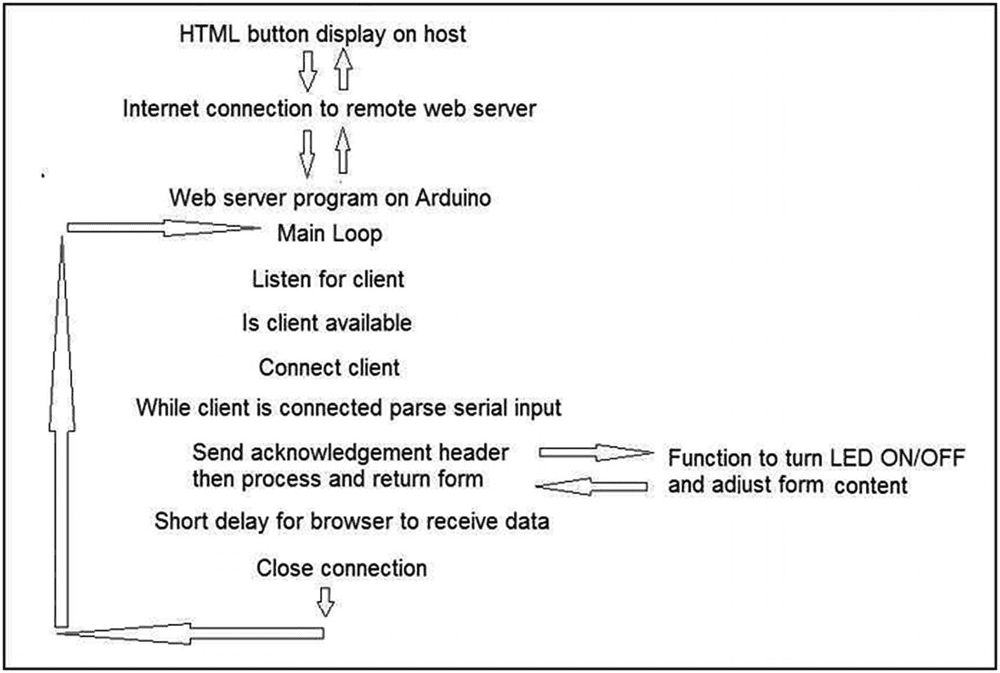

**图 10-17**
激活微控制器输出的流程图

该流程图很简洁，但无意中低估了处理和返回更新表单所需的代码量。微控制器程序必须写入主机浏览器程序以显示所请求的更新信息的 HTML 代码量可能会很庞大，具体取决于所需用户界面的复杂性。

诸如按钮、可变滑块控件和显示屏框传感器读数之类的控制元素，可以通过表单交换来监控和激活连接到远程、可访问互联网的 Arduino 微控制器上的设备。

GitHub 仓库中的两个程序使用了简单、易于获取的组件，演示了如何使用 Arduino Web 服务器作为远程实验设置的互联网控制器（参见 `github.com/simonmonk/programming_arduino/blob/master/sketch_10_02/sketch_10_02.ino` 和 `github.com/sciguy14/Exploring_Arduino_1st_Edition/tree/master/Chapter%2014`）。

引用的第一个程序包含 148 行代码，为实验者提供了一个类似于图 10-16 的屏幕。屏幕底部有一个“更新”按钮。该代码允许系统操作员从控制屏幕或网页上打开和关闭原型板上的 LED。“更新”按钮将引脚设置发送到 Arduino 以供执行。屏幕上的五个引脚按钮可以在开和关状态之间切换。在测试系统时，我通过修改代码和硬件来仅处理两个 LED，从而减少了组件数量。

参考中的第二个程序有 165 行代码，包含三个用于控制 RGB LED 的按钮和一个用于输入频率的编辑框，该频率用于安装在带有二极管的原型板上的音调发生器产生的声音。

这两个程序都有文档说明，但假定代码用户对 Arduino 和 HTML 结构及格式相当熟悉。如果您没有足够背景来重现这些程序，可以参考参考文献 2-1（《电子学实用手册（第 3 版）》，Sherz 和 Monk 著，McGraw Hill 出版，ISBN 978-0-07-177133-7）和 2-3（《探索 Arduino》，Blum 著，Wiley 出版，ISBN 978-1-118-54936-0）中的原始文献。

# 讨论

数据记录应用可以用于多种不同的场景。本练习在一个封闭且密封的小型腔室内收集湿度和温度数据，以测量被测材料中的水分活度。数据记录可用于食品安全质量控制系统中，以验证系统性能。数据记录证明，隔热金属板外壳或带冷却、避光室的生物敏感材料，在打开添加或移除储存材料后，能在一定时间限制内恢复到所需的温度和黑暗条件（参见第 7 章中的相对湿度测定）。使用红外运动传感器，数据记录系统可以记录人或动物通过入口或通道的情况（参见第 6 章）。

所展示的数据记录系统的初期开发工作包括组装所需的硬件，并将 `Arduino` 代码上传到实验装置上，以启动正在开发中的操作。对于实验室或某些现场实验的实际应用，这种用于激活和停用数据记录活动的粗略方法是可以接受的。典型的 `RTC` 依赖其自身电池为计时集成电路供电。该 `IC` 的功耗决定了时间戳功能的寿命。

从 3 秒平衡相对湿度传感器记录数据，大约需要 3600 天才能填满一张 8 GB 的卡。`SD` 卡的读写速度分别为 10 和 30 兆比特每秒（`MB/s`），而较新的设备建议速度可达 98 `MB/s`。在制造商标称的高使用速度下，一张 1 GB 的 `SD` 卡可能在 10 秒内被填满。在相对较短的分钟、小时、天或月的时间范围内，典型的 2 至 3 年 `RTC` 电池寿命不是问题，但对于按年收集数据的实验来说，这可能是一个问题。

# 代码清单

与所有复杂项目一样，您应从简单的教程和实验开始，以获得对所评估系统的基本理解。一旦理解并掌握了系统的基本原理，就可以研究和测试下一个更复杂的应用。从硬件和软件的角度来看，网络和互联网扩展是`SCADA`类型过程管理中变化较快的方面之一。刚开始接触这项技术的研究人员应从最简单的练习开始，然后再进入更高级的有线、无线或无人值守的自主实验监测。如果没有透彻理解构成近期创新基础的基本原理，就无法欣赏新技术。监测远程或难以接近的实验可能需要投入大量时间和精力。您必须确保收获可靠的数据。

## 代码清单 10-6 读取模拟输入

```
// A simple reading from an Arduino web server.
#include    // the SPI library for Arduino shield communication
#include  // Ethernet communications
// MAC address from the Arduino ethernet shield
byte mac[] = { 0x90, 0xA2, 0xDA, 0x0D, 0x79, 0x2A };
// The LAN IP address for Arduino shield determined by library DHCP program
byte ip[] = { 192, 168, 0, 103 };
EthernetServer server(80);      // declare an instance of the server on port 80
void setup() {
Ethernet.begin(mac, ip);        //start ethernet
server.begin();                 // start server program
Serial.begin(9600);             // start serial
}
void loop() {
// listen for incoming clients
EthernetClient client = server.available();
if (client)                    // true when a client becomes available
{
while (client.connected())   // true as long as connection maintained
{
// acknowledge connection by sending a standard http response header
client.println("HTTP/1.1 200 OK"); // 200 indicates a connection, 400 is an error
client.println("Content-Type: text/html");
client.println();     // empty line for end of acknowledgement transmission
// send the body
client.println("");
client.println("Analog Inputs");
client.println("Read from an Arduino Server");
client.print("A0 = ");
client.print(analogRead(0));
client.println("");
client.print("A1 = ");
client.print(analogRead(1));
client.println("");
client.println("");
client.stop();
}
delay(1);
}
}
```

## 代码清单 10-5 IP 地址 192.168.0.103

```
//DHCP - Dynamic Host Configuration Protocol
#include
#include
//
byte mac[] = { 0x90, 0xA2,0xDA, 0x0D, 0x79, 0x2A };
//
void setup() {
Serial.begin(9600);
while (!Serial) {};  // for Leonardo compatibility
//
if (Ethernet.begin(mac))
{
Serial.println(Ethernet.localIP());
}
else
{
Serial.println("Could not connect to network");
}
}
void loop() {
}
```

## 清单 10-4 将数据记录为 10位ADC缩放数值

```cpp
#include <SD.h>
#include <Wire.h>
#include "RTClib.h"
#include <SPI.h>

// 一个简单的数据记录示例，用于记录光敏电阻和固态温度传感器（TMP 36 或 LM 35）的
// Arduino 模拟引脚数据。数据带有时间戳，并通过将毫秒值设置为 1000 来实现每秒记录一次。

#define LOG_INTERVAL  1000 // 根据实际应用需求调整

#define STOR_INTERVAL 1000 // 实际将数据写入 SD 卡的 close() 调用之间的毫秒时间间隔
// 数据写入 SD 卡

uint32_t storTime = 0; // 上次数据写入时间

#define ECHO_TO_SERIAL   1 // 将数据回显到串口
#define WAIT_TO_START    0 // 在 setup() 中等待串口输入

// 连接到 LED 的数字引脚
#define redLEDpin 2
#define greenLEDpin 3

// 连接到传感器的模拟引脚
#define photocellPin 0           // 模拟口 0
#define tempPin 1                // 模拟口 1
#define aref_voltage 3.3  // Aref 连接到 3.3 伏电源

RTC_DS1307 RTC; // 定义实时时钟对象

// 对于数据记录盾板，我们使用数字引脚 10 作为 SD 卡片选线
const int chipSelect = 10;

// 日志文件
File logfile;

void error(char *str)
{
  Serial.print("错误: ");
  Serial.println(str);

// 红色 LED 指示错误
  digitalWrite(redLEDpin, HIGH);

while(1);
}

void setup(void)
{
  Serial.begin(9600);
  Serial.println();

// 使用调试 LED
  pinMode(redLEDpin, OUTPUT);
  pinMode(greenLEDpin, OUTPUT);

#if WAIT_TO_START
  Serial.println("输入任意字符开始");
  while (!Serial.available());
  #endif //WAIT_TO_START

// 初始化 SD 卡
  Serial.print("正在初始化 SD 卡...");
  // 确保默认的片选引脚设置为输出，即使未使用：
  pinMode(10, OUTPUT);

// 检查卡片是否存在并初始化：
  if (!SD.begin(chipSelect)) {
    error("卡片失败或未检测到");
  }
  Serial.println("卡片初始化完成.");

// 创建一个新文件
  char filename[] = "LOGGER00.CSV"; //注意 FAT SD 文件名的 8.3 命名限制
  for (uint8_t i = 0; i < 100; i++) {           // 为每个存储在 SD 卡上的数据文件
    filename[6] = i/10 + '0';                   // 生成唯一的数字标识
    filename[7] = i%10 + '0';
    if (! SD.exists(filename)) {
      // 仅在文件不存在时打开新文件
      logfile = SD.open(filename, FILE_WRITE);
      break;  // 退出循环！
    }
  }

if (! logfile) {
    error("无法创建文件");
  }

Serial.print("日志记录到: ");
  Serial.println(filename);

// 连接到 RTC
  Wire.begin();
  if (!RTC.begin()) {
    logfile.println("RTC 失败");
    #if ECHO_TO_SERIAL
    Serial.println("RTC 失败");
    #endif  //ECHO_TO_SERIAL
  }

logfile.println("毫秒,时间戳,日期时间,光照,温度");
  #if ECHO_TO_SERIAL
  Serial.println("毫秒,时间戳,日期时间,光照,温度");
  #endif //ECHO_TO_SERIAL

// 如果你想将参考电压设置为 5v 以外的值
  analogReference(EXTERNAL);
}

void loop(void)
{
  DateTime now;   //声明一个 DateTime 实例

// 按照我们想要的两次读数之间的时间量进行延迟
  delay((LOG_INTERVAL -1) - (millis() % LOG_INTERVAL));

digitalWrite(greenLEDpin, HIGH);

// 记录自启动以来的毫秒数
  uint32_t m = millis();
  logfile.print(m);    // 自启动以来的毫秒数
  logfile.print(", ");
  #if ECHO_TO_SERIAL
  Serial.print(m);     // 自启动以来的毫秒数
  Serial.print(", ");
  #endif

// 获取时间
  now = RTC.now();
  // 记录时间
  logfile.print(now.unixtime()); // 自 1970/1/1 以来的秒数
  logfile.print(", ");
  logfile.print('"');
  logfile.print(now.year(), DEC);
  logfile.print("/");
  logfile.print(now.month(), DEC);
  logfile.print("/");
  logfile.print(now.day(), DEC);
  logfile.print(" ");
  logfile.print(now.hour(), DEC);
  logfile.print(":");
  logfile.print(now.minute(), DEC);
  logfile.print(":");
  logfile.print(now.second(), DEC);
  logfile.print('"');
  #if ECHO_TO_SERIAL
  Serial.print(now.unixtime()); // 自 1970/1/1 以来的秒数
  Serial.print(", ");
  Serial.print('"');
  Serial.print(now.year(), DEC);
  Serial.print("/");
  Serial.print(now.month(), DEC);
  Serial.print("/");
  Serial.print(now.day(), DEC);
  Serial.print(" ");
  Serial.print(now.hour(), DEC);
  Serial.print(":");
  Serial.print(now.minute(), DEC);
  Serial.print(":");
  Serial.print(now.second(), DEC);
  Serial.print('"');
  #endif //ECHO_TO_SERIAL

analogRead(photocellPin);
  delay(10);
  int photocellReading = analogRead(photocellPin);

analogRead(tempPin);
  delay(10);
  int tempReading = analogRead(tempPin);

// 将该读数转换为电压，对于 3.3v Arduino 使用 3.3，对于 5.0v 使用 5.0
  float voltage = tempReading * aref_voltage / 1024;
  float temperatureC = (voltage - 0.5) * 100 ;
  float temperatureF = (temperatureC * 9 / 5) + 32;

logfile.print(", ");
  logfile.print(photocellReading);
  logfile.print(", ");
  logfile.print(temperatureF);
  #if ECHO_TO_SERIAL
  Serial.print(", ");
  Serial.print(photocellReading);
  Serial.print(", ");
  Serial.print(temperatureF);
  #endif //ECHO_TO_SERIAL

logfile.println();
  #if ECHO_TO_SERIAL
  Serial.println();
  #endif // ECHO_TO_SERIAL

digitalWrite(greenLEDpin, LOW);

// 现在数据被写入到卡片中。
  if ((millis() - storTime) < STOR_INTERVAL) return;
  storTime = millis();

// 闪烁 LED 以表示我们正在向卡片写入数据并更新 FAT 表！
  digitalWrite(redLEDpin, HIGH);
  logfile.flush();
  digitalWrite(redLEDpin, LOW);
}
```

```markdown
//将带有时间戳的数据记录到 SD 卡存储介质上。
// Arduino 的电气连接
// RTC 模块 - SCL -> 模拟引脚 4；SDA -> 模拟引脚 5；+5v 及 gnd
// SD 模块 - CLK -> 数字 I/O 引脚 13，D0 -> 数字 I/O 引脚 12，D1 -> 数字 I/O 引脚 11，CS -> 数字 I/O 引脚 10
//
const int `chipSelect` = 10;
//RTC 库需要 Wire 库
#include `<Wire.h>`
#include `"RTClib.h"`
`RTC_DS1307` rtc; // 定义 rtc 时间对象
//SD 库需要 SPI 库
#include `<SPI.h>`
#include `"SD.h"`
// LCD 库
#include `<LiquidCrystal.h>`
// LCD 的行列常量
const int `numRows` = 4;
const int `numCols` = 16;
// 使用接口引脚编号初始化 LCD 库
`LiquidCrystal` `lcd(9,8,7,6,5,4)`;
//
//
// 使用 SD 实用库函数设置变量：
`File` dataFile;
#define `LOGFILE` "datalog.txt"     // "DATALOG"将成为 SD 卡上的文件名标题
//
//读取温湿度传感器的库
#include `"DHT.h"`
#define `DHTPIN` 2     // Arduino 到 DHT 的连接
// DHT 22 是具有所需灵敏度和分辨率的传感器
// 用于水分活度测量。
#define `DHTTYPE` `DHT22`   // DHT 22 数据类型定义
//
// 将传感器引脚 1（左侧）连接到+5V，格栅位于设备正面
// 将传感器引脚 2 连接到 `DHTPIN` 2（Arduino 数字 I/O 引脚 2）
// 将传感器引脚 4（右侧）连接到 GND
// 在传感器引脚 2（数据）和引脚 1（电源）之间连接一个 10K 电阻
//
`DHT` dht(`DHTPIN`, `DHTTYPE`); // 声明一个 `DHT` 类的实例
//
void setup() {
  `Serial.begin(9600)`;
  `lcd.begin(numCols, numRows)`;
  dht.begin();
  //
  lcd.print("记录水分"); // 向 LCD 打印消息
  `lcd.setCursor(0, 1)`;
  lcd.print("活度数据");
  //
  //初始化传感器
  Serial.println("初始化带 RTC 版本 1.0 的数据记录器");
  //
  Serial.println("启动温度和湿度传感器");
  dht.begin();
  //
  Serial.println("启动 SD 卡读取器和卡片");
  `pinMode(chipSelect, OUTPUT)`;
  `pinMode(SS, OUTPUT)`;
  //
  if (!`SD.begin(chipSelect)`) {
    Serial.println("SD 卡初始化失败！");
    return;
  }
  //
  Serial.println("打开日志文件进行写入。");
  // 打开用于写入要记录或记录的数据的文件。
  dataFile = `SD.open(LOGFILE, FILE_WRITE)`;
  if (! dataFile) {
    Serial.println("打开日志文件出错");
    // 检查连接并测试读取器中的卡片。
    while (1) ;
  }
  //
  //
  Serial.println("启动实时时钟");
  #ifdef AVR
    `Wire.begin()`;
  #else
    `Wire1.begin()`;
  #endif
  //
  rtc.begin();
  //rtc.adjust(DateTime(F(__DATE__), F(__TIME__)));
  //如果使用的 RTC 尚未与所需时区同步
  //有两个选项可用。可以取消上面两行的 rtc.adjust 函数注释
  //并重新启动此程序。当 RTC 显示
  //主计算机的时间时，重新应用注释指示符，RTC
  //将随后保持时间。
  //
  if (! rtc.isrunning()) {
    Serial.println("RTC 未运行！");
    // 第二个时间设置选项，将 RTC 设置为显式的
    // 所需日期和时间的临时点，使用以下代码
    // 设置 2014 年 1 月 21 日凌晨 3 点的参数，调用此未注释的
    // 代码一次，然后在 RTC 显示调查员所需的时间时将其注释掉。
    // rtc.adjust(DateTime(2014, 1, 21, 3, 0, 0));
  }
  DateTime now = rtc.now();
  Serial.print("Unix 时间戳：");
  Serial.println(now.unixtime());
}
//
void loop(){
  char temp[6]; //2 个整数, 2 个小数, 1 个点, 以及\0
  char hum[6];
  char msg[13];
  //
  //将温度和湿度浮点数转换为字符以格式化
  `ftoa(temp, readTemp())`;
  `ftoa(hum, readHumidity())`;
  //
  //编译一个逗号分隔的字符串以发送到日志
  `sprintf(msg, "%s, %s" ,temp, hum)`;
  `logThis(msg)`;
  `delay(3000)`;// DHT 读数之间所需的平衡时间间隔
}
//
void logThis(char* logmessage){
  char message[120];
  DateTime now = rtc.now();
  long epoch = now.unixtime();
  int Year = now.year();
  int Month = now.month();
  int Day = now.day();
  int Hour = now.hour();
  int Minute = now.minute();
  int Second = now.second();
  `sprintf(message, "%ld,%d/%d/%d %02d:%02d:%02d,%s",epoch,Year,Month,Day,Hour,Minute,Second,logmessage )`;
  //将条目写入日志文件。
  `dataFile.println(message)`;
  `dataFile.flush()`;// 请注意，消息直到缓冲区被刷新时才实际写入。
  // 打印到串口：
  Serial.println(message);
}
//
//
float readTemp(){
  // 实际的温度和湿度读数需要 250 毫秒，但
  // 传感器基于传感器表面与顶部空间气氛之间达到平衡，
  // 这可能需要几秒钟才能稳定。
  float t = `dht.readTemperature()`;
  float tf = t * 1.8 +32;  //如果需要，从摄氏度转换为华氏度
  `lcd.setCursor(0, 3)`;
  lcd.print("tf=");
  `lcd.setCursor(3, 3)`;
  lcd.print(tf);
  return   tf;
}
//
float readHumidity(){
  float h = `dht.readHumidity()`;
  `lcd.setCursor(9, 3)`;
  lcd.print("h=");
  `lcd.setCursor(11, 3)`;
  lcd.print(h);
  return h;
}
//
//
int ftoa(char *a, float f)  //将浮点数读数转换为字符串
{
  int left=int(f);
  float decimal = f-left;
  int right = decimal *100; //2 位小数
  if (right > 10) {  //如果小数已有两位。
    `sprintf(a, "%d. %d", left, right)`;
  } else {
    `sprintf(a, "%d.0%d", left, right)"; //用前导 0 填充
  }
  // LCD 显示代码
  {
    // 设置光标
    `lcd.setCursor(0,2)`;
    //打印自复位以来的秒数
    lcd.print("ET(秒) = ");
    `lcd.setCursor(10, 2)`;
    lcd.print(`millis()/1000`);    // 除以 60,000 将得到分钟数
  }
}
```
**清单 10-3** 数据记录

## 总结

在非常长的时间跨度内或在 `SCADA` 系统无法实时访问以进行过程或实验控制的环境中进行的实验，必须自主收集和存储数据以供未来审查。

配备实时时钟和安全数据存储卡的电池供电微处理器可以形成一个紧凑、移动、自主的数据收集和存储模块，能够激活和控制由独立单元携带的过程或环境传感器的输出。

为主机驻留的 `SCADA` 系统提供互联网连接，可以访问几乎覆盖全球的通信设施。

在第 11 章中，将探讨许多为 `SCADA` 系统本地或远程的过程和实验供电的各种方法。

# 11. 为实验供电

作为科学方法核心部分的实验通常必须是可移动的，在偏远地点或在隔离实验室干扰的条件下进行。隔离实验必须携带或从其周围环境中获取生成、收集、处理、存储或传输数据所需的能量。

按字母顺序，现成可用的较长期电源包括电池、机械发电机、光伏电池、热电堆和热电发电机。旋转电磁体的风力或水力发电机可以是使用电刷的直流电流源，也可以是无刷设备中的交流电能来源。有刷系统产生脉冲直流电，而能够产生可用交流电的无刷设备需要整流器来产生直流电。

在本节中，我们对电源的讨论集中在更简单、便携的技术上，包括电池、光伏电池以及风力或水力发电机。机械-电能发电机可以由小型电机组装用于低功率直流电能，或使用汽车交流发电机产生更大的电流以提供交流电。热电系统的理论和应用已在测量电压和热现象的章节中解释。

在许多应用中，由环境条件的零星或随机变化产生的能量通过给电池充电来收集和存储。

### 电池

电池是将化学能转化为电能的电源，可分为一次性电池和充电电池两大类。这两种电池类型通常被称为一次电池和二次电池。

1800 年，亚历山德罗·伏打描述了第一个实用电池，该电池由堆叠的银和锌圆盘对组成，圆盘之间用浸透盐水的布层隔开。被盐水浸湿的布隔开的银盘和锌盘被称为`极板`，金属被称为`电极`，盐水则被称为`电解质`。后来，银被铜取代，通过将多个极板串联和并联以形成被称为`电池组`的结构，从而改变电压和电流的能力在整个十九世纪得到了发展。

在最初的锌铜基装置中，锌电极通过自发的化学反应产生电能，该反应中锌金属溶解于电解质并释放出两个电子。与电解质接触的金属板区域表面的锌金属原子溶解在液态水基溶液中，形成 `Zn^(2+)` 离子，并同时向连接该电池锌电极与铜电极的电路释放两个电子。

在银或铜电极处，两个各带一个正电荷的氢离子从连接正负极的电路中接收这两个电子，成为中性原子，进而形成氢气。

```
Zn → Zn^(2+) + 2e^- (氧化反应)

2H^+ + 2e^- → H[2] (还原反应)
```

发生在两个金属表面的化学反应被称为`氧化反应`和`还原反应`。在氧化反应中，金属原子的氧化态发生变化，对于伏打电堆中的锌而言，是从零价变为正二价。随着电堆产生电流，锌金属的总质量减少。在还原反应中，带正电荷的氢原子（称为`质子`）接收来自铜电极的电子，使其净原子电荷从正一价转变为零价，形成中性的氢原子，这些氢原子迅速结合形成氢气（`H[2]`）。

在伏打电堆内部，锌电极的质量从金属态转变为氧化态，同时水被分解为其组成元素氢和氧。

在伏打电池中，锌氧化形成水合氧化锌化合物的作用会消耗金属电极。最终，由于为电堆提供电驱动力的化学反应造成的若干干扰，电池会丧失供应能量的能力。

所有材料都会对电流的流动产生电阻。对于由金属和电解质构成的电池，由于结构材料和电解质的化学导电性，电池内部存在固有的内阻。在电堆的生命周期中，新组装的电堆具有最小的内阻。

随着氧化产物在电解质和电极表面积累，电堆的内阻会增加。随着液相中氧化产物负载持续增加并降低导电性，进一步放电会导致电解质的性质发生变化。最终，电阻增大以及反应物移动和相互接触以进行所需电化学反应的难度增加，导致电堆不再是有用的电源。

对于伏打电堆的两种化学反应，反应产物必须能够在电解质中自由扩散到发生化学反应的金属电极处。化学反应物和产物在电池电解质中从化学反应区扩散出来的速度决定了电池提供电能的速率。

电池的有效总内阻是结构材料的电阻与电解质的离子电阻之和。用于构建电池的所有金属部件对电流流动都有电阻，并对电池内阻做出相对恒定的贡献。影响电解质电导率、离子迁移率和电极表面积的电化学反应产物的积累，是电池内阻的主要贡献因素。在液态电解质与固体电极相互接触的电极表面，存在两个离子双电层（见第 7 章中的图 7-5），它们代表两个电容元件。这两个电容元件的存在代表一种阻抗，使得通过简单应用欧姆定律来测量电池电阻只能作为近似值。然而，当电池放电时，其表观电阻的增加可以作为电池剩余能量的有用近似度量。电池内阻可以通过欧姆定律计算，方法是同时测量电池通过已知电阻负载放电时产生的电流和观察到的电压降。

电池容量是存储在设备中的电能总量。`C` 倍率，也称为`小时率`，是用于确定电池可安全循环的最大持续放电或充电速率的数值。安培小时也用于衡量电池向负载输送电流的能力，该能力表示为在规定时间段内产生固定电流的能力。

较低的放电速率允许化学反应产物通过电解质扩散，从而延长电池在负载下的性能。

产生电能的化学作用不可逆的电池被称为`一次电池`。由这些电池组装而成的电池组只能使用或放电一次。

利用可逆化学反应作为电能来源的电池被归类为二次电池，并且是可充电的。可充电电池的化学原理已有一百多年的历史。第一个可充电电池于 1859 年问世，使用的是铅-硫酸化学体系。镍镉可充电电池的化学原理于 1898 年公布。可充电电池利用的化学反应中，反应产物会形成不溶性物质，附着在高表面积的电极上。

所有利用化学反应产生电能的电池，其可放电次数都有限。一次性电池只能放电一次，而镍镉电池可以放电数百次，铅酸电池偶尔可以达到数千次。电池的最终失效通常可追溯到机械故障、制造电池所用材料中的杂质，以及最常见的原因——过充电。

不同的电池化学体系会产生不同的电池特性。在选择电池类型时，最好是在考虑所需的电气服务以及相关成本之后进行。通常，成本、重量以及充电便利性和电池耐用性方面的便捷性，是决定在实验应用中使用何种电池类型的主要参数。

电池成本通过标准尺寸的大规模生产得以最小化。圆柱形的 `AAA`、`AA`、`C` 和 `D` 型电池以及长方形的 `9V` 电池是最常见的单元。目前生产中存在的电池尺寸和形状多种多样，从用于手表或计算机内存应用的轻量级纽扣电池，到用于电话的矩形、薄型扁平棱柱电池，再到重型、盒状的汽车和叉车电池。前四种标准尺寸通常仅为单电芯化学体系，电压从 `1.2V` 到 `3.4V` 不等，如表 11-1 所列。`9V` 电池是由多个 `1.5V` 的单电芯单元串联而成的电池。铅酸 `12V` 电池也是多电芯系统，由六个每单元 `2` 伏的单元组成，以产生标称的、熟悉的 `12V` 实体。

`12V` 铅酸电池因其坚固性、提供高电流的能力、易于充电以及易于获取的制造材料，被制造成多种不同的尺寸或安时容量。标准尺寸的一次电池和单电芯可充电版本在当今使用的大多数电化学系统中都有供应。不同的化学体系产生不同的储能能力，如表 11-1 所示。采用碱性、镍或锂离子化学体系的 `AA` 电池在不同电压水平下具有不同的电流存储容量。

电池容量以一小时内的电流产生能力来衡量，表示为安时（`Ah`）或更小系统的毫安时（`mAh`）。`C` 通常表示电池的标称电荷或容量，并经常用于讨论充电或放电速率。

尽管通过大规模生产的电池具有均匀的特性，但单个单元在产生的电压和内阻方面存在差异（见表 11-2）。单个电池的差异在一次性应用（如手电筒）中是微小差别，但当用于由多个可充电电芯组装而成的可充电电池组时，这就会成为一个问题。由市售标准尺寸的单电芯单元组装而成的多二次电芯电池组，旨在提供单电芯单元无法获得的电压和电流能力，其内阻应保持一致。

当接入电路时，在电池组中并联配置以提供更高电流的多个单电芯可充电电池单元，其作用类似于并联电阻。如果并联配置中单个电池的内阻没有尽可能均匀匹配，则该组中阻值最低的成员将通过最大的电流，产生最多的热量并首先失效。

所有电池必须具有阴极、阳极和电解质，才能在连接到电路时为负载供电。在电芯能够产生电能之前，阳极和阴极之间必须存在电势差。电势差形式的能量是通过发生在电池阴极和阳极上的电化学氧化和还原反应的配对而产生的。

为了测量单个电化学反应产生的电压，开发了标准氢电极。一个浸入酸性水溶液中并用氢气饱和的铂电极被选为电化学反应比较的零（0）电压参考点。通过将标准参考电极定义为 `0V`，当与`标准氢电极`（`SHE`）结合时，可以测量单个电化学反应产生的电势差或电压。

当 `SHE` 被配置为与某个电化学反应组成半电化学电池时，可以测量单个半电池反应产生的电压。当将测得的某个化学反应的 `EMF` 与第二个反应的 `EMF`（两者均相对于 `SHE` 确定）结合时，可以计算出由这两个测试反应组合形成的电芯的总 `EMF`。

标准氢电极创建了电动势序列，这是一个按序排列的列表，列出了各种元素和化合物的氧化和还原反应所产生的电动势。^(¹¹)

如下文讨论的电化学反应所列出的，针对各种常见电池类型的半电池电势差，是相对于标准氢电极给出的。

## 碱性

碱性电芯于 1959 年首次作为锌碳电池的替代品商业推出。碱性电芯的能量密度高于锌碳电池，内阻低于锌碳电池，且更不易腐蚀。当氯化铵电解质因腐蚀从锌碳电池泄漏时，设备常常被毁坏。

碱性负极半反应为：

```
Zn[(s)] + 2OH^-[(aq)] → ZnO[(s)] + H[2]O[(l)] + 2e^-  [e° = 1.28 V]
```

正极半反应为：

```
2MnO[2(s)] + H[2]O[(l)] + 2e^- → Mn[2]O[3(s)] + 2OH^-[(aq)]  [e° = +0.15 V]
```

它们可以组合成总化学反应：

```
Zn[(s)] + 2MnO[2(s)] ⇌ ZnO[(s)] + Mn[2]O[3(s)]  [e° = 1.43 V]
```

碱性电芯可以制成可充电形式，但此类电芯与其他二次电池相比并不耐用。

## 铅酸电池
```

# 铅酸电池

铅酸电池是最古老的可充电电池系统，最早于 1859 年被描述。当今最常见的铅酸电池采用 12V 矩形结构，通常由浸没在惰性聚合物外壳中的薄铅矩形极板组成，其中含有体积比为 35%/65%的硫酸/水溶液或凝胶电解质。铅酸系统成本低廉、坚固耐用，且能提供极高的电流。随着免维护密封铅酸系统的制造成本降低，液体填充电池已逐渐不受欢迎。所有铅酸系统的缺点在于其重量。此类电池化学体系的电流产生能力极具价值与实用性，因此这些系统从其最初的简单构型开始，便经历了深入研究、改进和广泛改造。

阳极或正极反应（氧化反应）为：

```
Pb(s) + HSO[4]^-(aq) → PbSO4 + H^+(aq) + 2e^−  [e° = 1.685 V]
```

阴极或负极反应为：

```
PbO2 + HSO[4]^-(aq) + 3H^+(aq) + 2e^− → PbSO4 + 2H[2]O(l)  [e° = -0.356 V]
```

总反应可写为：

```
Pb(s) + PbO2 + 2H[2]SO4 → 2PbSO4 + 2H[2]O(l)  [e° = 2.041 V]
```

铅金属从中性态被氧化至+2 价态，在阴极形成`PbSO[4]`时释放两个电子；同时，二氧化铅`PbO[2]`中的铅从+4 价态被还原至+2 价态，生成`PbSO[4]`。放电过程会消耗电解液中的硫酸，因此在冬季，低电量可能导致电池因冻结而损坏。对铅酸电池充电可恢复电解液中的硫酸，因此电解液的密度可指示电池的荷电状态。

在液体系统中，需监测电解液的液位和密度以维护电池，而密封铅酸系统则是免维护的。铅酸电池通过将六个 2V 单体串联来实现 12V 电位。

铅酸电池针对两种不同应用场景制造。启动电池（SLI：启动、照明和点火）比"深循环"电池拥有更多且更薄的极板。SLI 电池使用数量更多但更薄的极板以提供更大的表面积，从而降低电池内阻，使初始需求时能流出更多电流。启动单元能快速提供大电流。深循环单元则使用数量较少但更厚的极板，适用于叉车、轮椅和高尔夫球车等需要中等但更持久恒定电流输出的场景，且电池在充电前会被放电至极低电压。

传统形式的铅酸电池使用可接触的液体硫酸作为电解液，如今正被更安全的密封免维护系统所取代。尽管密封系统封装了腐蚀性液体且无法接触酸性电解液，但电池并非完全气密。在电池安装过程中必须采取适当措施，以容纳从电池中渗出的氢气。只有在电池内部电化学反应产生的气体得以重新复合的条件下，才能实现电池壳体的密封。

阀控式密封铅酸电池（VRSLA）需要一个调节阀，以便产生的氢气和氧气能在电池壳体内重新复合生成水。内部和外部催化剂在低压下有助于水的生成。调节阀可排出因过充而产生的任何多余内部压力。

密封系统电池还有胶体电池和吸附式玻璃纤维隔板（AGM）两种变体，其中没有游离液体。密封和胶体电解质电池可通过电池盖上没有注液盖轻易识别。胶体电池分为两类：一类是使用硅化合物增稠电解液，另一类是使用玻璃纤维隔板吸收酸液。与液体电池相比，固定化电解液的硫酸盐化问题要小得多。胶体电池储存性能良好，自放电速度不如富液式电池快，但其成本可能高达富液式电池的两倍。

胶体电池和 AGM 技术之间存在差异，这决定了特定应用中应使用哪种类型的电池。胶体电池含有增稠的电解液，而 AGM 系统的电解液分散在分隔极板的玻璃纤维布中。胶体电池的电解液体积大于同等 AGM 电池，这使得胶体电池更适合深循环应用。AGM 电池可制成更低的内阻，使其成为 SLI 应用的优选系统。

无论现场使用何种类型的铅酸电池，都应严格遵守制造商推荐的充电要求，因为过充是导致电池过早失效的主要原因之一。在液体系统中，必须保持电解液液位。电池的荷电水平必须保持在制造商规定的最低允许值以上。

# 锂电池

锂是碱金属系列中最轻、最小的原子，具有–3.045 V 的最高电位。（在适当环境条件下，该金属原子表现出 3V 的电位驱动力，以摆脱其外层电子。）

锂电池以一次电池和二次电池两种形式制造，均使用相对昂贵的材料。一次电池用于需要长寿命和可靠供电的关键应用，例如外科植入式起搏器以及需要实时时钟的便携式电子设备（见第 10 章）。

锂一次电池中使用了大约二十多种不同的化学体系，其中锂金属或化合物作为负极。在许多锂一次电池中，电池制造所用某些材料具有毒性和反应性，限制了其在消费类应用中的普及。

锂二次电池通过让微小的锂离子在电解液中于正负极之间来回移动，来储存和释放电荷。原子或分子被储存于层状结构中的化学现象称为`嵌入`，这也是锂离子电池的工作原理。

锂离子电池具有目前可用的最高能量存储密度之一，有人和无人电动飞行器的激增便是明证。

## 可充电锂离子电化学

锂离子迁移是锂离子电池中运作的电荷转移过程。

正极层状电极的半反应为：

```
LiCoO[2] ↔︎ Li[1-x]CoO[2] + xLi^+ + xe^-
```

负极插层石墨电极的半反应为：

```
xLi + xe^- + xC[6] ↔︎ xLiC[6]
```

这种化学体系被用于索尼公司在 1990 年开发的首款商用可充电锂离子电池。

锂电池的电解质通常是溶解于碳酸丙烯酯或二甲氧基甲烷溶剂中的`LiPF[6]`（六氟磷酸锂）、`LiBF[4]`（四氟硼酸锂）或`LiClO[4]`（高氯酸锂）。所有使用有毒复合无机盐以及易燃、有毒有机液体作为电解质的锂和锂离子电池，在设计、构造、应用以及生命周期末期的处理中都需要格外谨慎。这类电池特有的较高电压和电流，加上电解质的挥发性易燃特性，当这些大功率电池系统发生机械故障时，可能引发一些骇人的火灾。

采用锂、钴、氟和高氯酸盐化学体系的电池昂贵、有毒且可能具有反应活性。研究团队一直在探索减轻锂基电池这些不良特性的方法。因此，市场上存在多种锂离子电池系统，每种都各有其性能取舍和特性。

### 锂离子钴电池

自 1991 年起，基于层状钴氧化物正极和石墨负极的锂离子电池便开始投入使用，其充放电过程依赖于锂离子穿过电池电解质并进入层状电极的微结构。

### 锂离子锰电池

自 1999 年起，尖晶石矿物或锂二氧化锰之类的层状结构便被用作锂石墨离子电池的电极。

### 锂离子镍锰钴电池

镍锰钴氧化物（`LiNi[x]Mn[y]Co[2]O[2]`）是一种与石墨负极配合使用的混合金属正极，旨在兼顾高电流、高容量和较低成本，于 2008 年首次问世。

### 锂离子磷酸盐电池

锂离子磷酸盐（`LiFePO[4]`）电池（LFP）是一种使用磷酸铁锂作为正极材料的锂离子可充电电池。与更常见的锂离子设计相比，LFP 电池的能量存储容量稍低，但寿命更长，可提供略高的放电速率，并且更安全。LFP 电池于 1996 年实现商业化。

# 镍镉电池

镍镉电池化学是一项较老的、成熟的技术。镍镉可充电电池使用寿命长，在低温下性能良好，能提供高放电速率以及在放电过程中保持相对稳定的电压。但在某些情况下，恒压放电会给那些利用电压降来测量电池组剩余电量的应用带来问题。

镍镉电池能以相对较高的放电速率提供额定容量。镍镉电池比铅酸电池更昂贵，且自放电率更高，约为每月 15%至 20%的电量。镍镉电池的能量密度大约是铅酸电池的两倍。

当使用细粉状材料制造时，镍镉电池具有很高的表面积。如果电池过充且未定期深度放电，细小的活性材料会结晶成更大的聚集体，从而减少活性表面积，有时会大幅降低电池存储容量。如果因过充导致容量损失，请查阅制造商资料，了解推荐的脉冲充电程序以恢复大部分电池容量。镍镉电池是密封系统，过充会导致过度析气，可能损坏电芯。

放电过程中的化学反应在镉电极上如下所示：

```
Cd + 2OH^- → Cd(OH)[2] + 2e^-  [e^o = -0.88 v]
```

放电过程中的化学反应在镍电极上如下所示：

```
2NiO(OH) + 2H[2]O + 2e^- → 2Ni(OH)[2] + 2OH^-  [e^o = + 0.52 v]
```

放电过程中的净反应为：

```
2NiO(OH) + Cd + 2H[2]O → 2Ni(OH)[2] + Cd(OH)[2] [cell = 1.2 v]
```

充电时，反应逆向进行，从右向左进行。碱性电解质（通常是氢氧化钾`KOH`）在此反应中不被消耗，因此其密度不能作为衡量电池荷电状态的指标。

# 镍氢电池

自 1989 年商用金属氢化物问世以来，镍氢电池（NiMH）在很大程度上已取代了较老的镍镉技术。该电池将镍镉电池化学体系中涉及羟基氧化镍的正极反应，与由稀土元素组成的负极吸氢合金配对，从而制造出一种不含镉、能量存储能力是镍镉系统两到三倍的电池。

镍氢电池中发生的负极反应为：

```
H[2]O + M + e^− ⇌ OH^− + MH  [e^o = +0.52 v]
```

该平衡代表充放电反应。当电流施加到电池时，一个额外的电子使水在混合金属稀土电极的存在下分解为氢氧根阴离子和金属氢化物。放电时，金属氢化物中的氢原子与氢氧根离子结合，并向连接电池电极的电路释放一个电子。

羟基氧化镍，`NiO(OH)`，在正极上形成：

```
Ni(OH)[2] + OH^− ⇌ NiO(OH) + H[2]O + e^−  [e^o = +0.83 v]
```

一个电池通常产生 1.25V 的电压，并且像早期的镍镉电池一样，在整个放电过程中提供相对稳定的电压。一些制造商建议，在充电前，不应将这些电池用于使其电压降至 1 伏以下的应用。应按照制造商的规格进行充电，并且与所有类型的电池一样，应避免过充。

采用镍化学体系的可充电电池具有已知最高的一些自放电率。2005 年，自放电率降低了十倍的新型镍氢电池已上市。

研究不断在改进镍氢电池的化学体系、结构材料，并且在撰写本文时，其电池性能仅逊于锂系统。

# 锌碳电池

锌碳电池是首批商业化生产的便携式电池，用于 1900 年销售的首批手电筒中。锌碳*干电池*是当今生产的最廉价的电池。虽然名为*锌碳*，但碳在电池电化学中并不起活性作用。金属`Zn`被用作电池外壳和负极接线端。电池接线端的腐蚀可能导致内部电解液泄漏，从而使设备电池仓被液体氯化铵电解液污染。

与所有锌电化学能量生产过程一样，锌金属被氧化，如电池半电池反应所示。

`Zn(s) → Zn^(2+)(aq) + 2e^− [E° = −0.7626 V]`

正极是一根不腐蚀的石墨棒，周围包裹着二氧化锰粉末和细颗粒碳，以增加导电性。半反应如下。

`2MnO2 + 2e^− + 2NH[4]Cl(aq) → Mn[2]O3 + 2NH3 + H[2]O(l) + 2Cl^− [E° ≈ +0.5 V]`

在该化学方程式中，氯化铵生成氯阴离子、氨气和水，同时锰从(+4)价被还原至(+3)价。

还存在其他可能的副反应，但锌碳电池的总体化学过程可表示如下：

`Zn(s) + 2MnO2 + 2NH[4]Cl(aq) → Mn[2]O3 + Zn(NH[3])[2]Cl2 + H[2]O(l)`

在上个世纪，人们进行了许多机械和化学方面的改进，以提升锌碳电池系统的性能，其中包括使用氯化锌作为电解液以及采用塑料涂层来防止泄漏。

### 锌锰电池

锌锰电池或碱性电池与锌碳电池的不同之处在于，它们使用氢氧化钾而非腐蚀性的酸性氯化铵或氯化锌电解液。这类电池于 20 世纪 60 年代末首次作为一次电池实现商业化。虽然较不易泄漏，但此类电池仍可能释放出腐蚀性的氢氧化钾，因此应与不常用的设备分开存放。

碱性电池的电压在放电过程中会持续下降。

表 11-1 总结了常见市售电池系统的一些特性。

**表 11-1** 常见市售电池类型的特性

| `Item` | `图片` |
| :--- | :--- |
| `` | `...` |

### 二次电池的充电

要为二次电池充电，必须提供电能以逆转在放电过程中产生电流的化学反应。由于能量产生反应受扩散控制，因此电池能够输送和接收能量的速率也是固定的。除扩散外，电池自身还有内阻，该内阻决定了在给定充电电压下电流流入电池的速率，并且在长时间充电时可能产生热量。

每个制造商都有推荐的充电程序，必须遵循这些程序才能从单节可充电电池中获得最佳性能。

尽管是批量生产的，但每个电池单体在多个变量上存在内部差异，例如制造材料、所用化学品的数量和质量、尺寸变化以及其他参数，这些差异应导致每个电池单体具有不同的电荷存储容量。

对从一包 24 节装的电池中随机选取的 6 节 `AAA` 电池进行的高分辨率电压测量，显示了表 11-2 中列出的数值。

**表 11-2** `AAA` 电池电压的差异

| 电池 | 电压   | 电池 | 电压   |
|------|--------|------|--------|
| 1    | 1.609  | 4    | 1.607  |
| 2    | 1.611  | 5    | 1.609  |
| 3    | 1.606  | 6    | 1.609  |

在 `AAA` 电池中测量到的这些差异，适用于所有单体电池，可能会导致由多个单体电池以串联或并联方式构成的电池组在充电时出现问题。当使用多个单体电池设计更高电压或电流的电池组时，对于非关键实验，建议使用合适的电池盒，以便能够取出单个电池进行充电。

当在电池组中使用一系列可拆卸电池时，应有选择地匹配电池组中的电池，以便单个电池的内阻或容量尽可能接近。

当多节可充电电池组要在偏远地区或难以接近的实验中使用时，应使用电池均衡充放电系统。单个电池具有不同的电压和电荷存储容量。电荷均衡系统通过分配充放电电流，使每个电池的荷电状态（`SoC`）保持在相同水平。该系统在充电和放电过程中主动地最小化单个电池不同容量的影响。一个较弱或容量较低的电池不会决定整个电池组的性能，也不会因过载而过早失效。电荷均衡电路可以集成在充电器或电池组中。

电荷均衡由微处理器单元控制，该单元可避免任何一节电池过充，平衡对所有电池的充电，并且当配备热敏电阻传感器时，还能在充电和放电循环期间监控电池组的温度。

电荷均衡使得电池组能够接受和释放最大可能的能量，同时为该系统的提供最长的可能使用寿命。

`Li-ion`（锂离子）、`NiMH`（镍氢）和`Pb-acid`（铅酸）电池可能是最常用的存储电能来源。线路电压供电的智能充电系统是恢复这些设备中能量最常见的方式。

使用寿命的需求常常决定了在特定应用中所使用的电池类型，例如用于启动或深循环电力输送的两种铅酸电池。使用可编程充电系统以适应不同的电池化学体系和电池组配置，是从这些电源中获得最大电力和最长使用寿命的最佳方法。

图 11-1 展示了一系列可充电电源和电池。


#### 图 11-1
### 可充电电源与电池

`Item A` 是一款镍镉电池充电器，可处理所有规格的 `NiCd` 电池，支持单体电池或最多六节串联电池组，涵盖 `AAA` 至 `D` 规格以及单节 `9 V` 电池。

`物品 B`、`C` 和 `D` 分别为 `12 V` 铅酸充电电源、密封铅酸电池以及大电流电缆。

`Item E` 是一套微控制器“智能”或均衡充电系统。充电器下方紧邻着两块磷酸锂电池组，容量分别为 `4000`（蓝色）和 `2600`（白色）`mAh`。充电器周围分布着一些用于连接不同电池类型与充电器的连接线缆（黑色和红色）。

几乎市面上所有消费级电池类型及电池组均可通过此均衡充电器进行充电。锂电池及电池组在放电和充电过程中都需要特殊的控制电路。锂电池不能完全放电，也绝不能过充。每个电池组都需配备电池管理系统（`BMS`），其形式可为内部或外部电路板，用于监测电池组电压下降并将其限制在安全水平。`BMS` 还必须监控充电过程，以防止过充损坏锂电池。对于锂电池组，这款“智能”充电器可充当 `BMS` 的功能。

`Item F` 是一款可充 1 至 4 节镍氢电池的充电器。围绕 `NiMH` 充电器的是四节电池组，其电池的内阻在数年前投入使用时已测定并标记在外壳上。为了最大限度地延长使用寿命，当组合成可充电电池组使用时，内阻相近的电池会被归为一组。

四节可充电电池组，尤其是 `AA` 规格的，在进行台架或桌面原型数字-模拟电路开发时极为有用。

多年来，在开发本书中的项目以及为民事法医学实践创建新型理化测试方法的过程中，我积累了大量的 `AA` 规格电池，其中一部分如图 11-1 所示。镍镉电池的使用历史已久，常见于许多老式便携式电池供电电子产品中。我所积累的许多基于镍化学物质的电池，因“记忆效应”和过充，已丧失了保持有效电量的能力。

在图 11-1 中的五个电源中，有些在使用图 11-1 中的 `NiCd` 和 `NiMH` 充电器 `A` 和 `F` 充电时，已无法保留太多电量。大多数性能不佳的镍基电池在经历图 11-2 所示设备的充放电循环后，已恢复到可用状态，在某些情况下，性能甚至可与新电池相媲美。

图 11-2 中的 `物品 A` 和 `E` 是廉价的 `DMMs`（数字万用表），用于测量开路电压（`OCV`）、负载电压以及通过负载的电流，从而提供计算电池或电池组表观内阻所需的数据。`Item B` 是一个负载测试电路，配有接线板，可根据需要更换电阻负载，并通过必要的仪表连接，将电阻负载接入或切出压降测试电路，以监测负载电流和电压差。该电路原理图如图 11-12 所示。`Item C` 是六节 `AA` `NiMH` 电池组，`D` 是采用 `Imax B6` 微处理器的“智能”电池充放电系统。


#### 图 11-2
### 可充电电池维护、监控与测试设备

放电后的电池通过施加足够高的电位来充电，该电位需克服已放电电池的 `EMF`（电动势）及其内阻，强制电流流入电池，逆转原始的放电化学反应，从而以化学形式储存电荷。当电池电量接近其设计容量水平时，必须终止电能输入，以防止过充——这是缩短电池使用寿命的主要原因。

### 光伏电池

在中纬度地区，阳光照射到地球表面的功率约为每平方米一千瓦（93 瓦/平方英尺）。光伏（`PV`）太阳能电池板在最佳条件下可回收每平方米 130 瓦的功率。

光伏电池直接将阳光转化为电能。大多数光伏电池是大面积的 `PN` 结二极管，采用传统方法制造，通过向硅晶体晶格结构中添加少量能够产生空穴和多余电子的元素制成。

该 `PN` 结存在一个带隙，可在硅光伏电池两端形成½伏的电势差。光伏电池由半导体材料制成，入射阳光能够将电子的能量提升至足以跃迁过该化学改性半导体材料中形成的 `PN` 结带隙。能量升高并穿越带隙的电子数量与照射到电池上的阳光强度成正比。因此，光伏发电功率取决于物理因素，包括太阳能阵列的地理位置、与入射阳光的夹角、一天中的具体时间，以及用电需求时的当地天气状况。

# 光伏电池及其应用

## 光伏电池的串并联组合
与构成电池组的电化学电池类似，光伏电池可以串联或并联组合，以产生实验应用所需的电压和电流。光伏二极管产生的电压较低，这意味着必须组合更多的电池才能产生电池电源中常见的标称 `5V`、`6V`、`9V` 和 `12V` 标准系统。

## 光伏电源的串并联组合条件
为了在电池阵列中通过串并联组合光伏电源以获得额外的电压或电流，各电源必须电压相等以累加电流，且额定电流相等以使电压可以累加。

## 太阳能充电系统
许多太阳能收集系统用于为蓄电池或电池组充电。那些依赖于持续能源供应才能连续运行的电气负载，便可在黑暗或恶劣天气降低或消除太阳辐射时继续工作。光伏电池板产生的电能必须通过控制器才能为耗尽的电池或电池组充电，同时避免因过度充电而损坏储能电池。

当没有电流从受光照的光伏电池中流出时，电池两端的电压被称为*开路电压*（`OCV`）。光照强度决定了电池的电流大小；试图获取超过电池供电能力的电流会导致电压降至零，而所能获取的最大电流称为*短路电流*（`SCC`）。当太阳能用作充电电源时，需要一个集成电路来控制充电器对电池的电流汲取，使其最大汲取电流刚好低于电压明显受影响的那个点。许多制造商都有提供充电控制器，用于管理低电流和高电流光伏电池板。

处理安培级电流的大电流光伏电池板控制器采用 `PWM`（脉冲宽度调制）或最大功率点跟踪/转移技术（`MPPT`）。`PWM` 根据使用中的电池放电后低于正常工作电压的程度，按比例施加充电功率。随着电池或电池组接近其正常工作电压，脉冲宽度变窄，施加的电流减小，从而避免对储能设备过度充电。

`MPPT`，即最大功率点跟踪技术，可将电压转换为电流，使光伏充电系统始终以最高效率运行。

`PWM` 和 `MPPT` 系统仅适用于大电流应用，且价格昂贵，其中 `PWM` 系统的成本约为 `MPPT` 的一半。在涉及大电流电能收集和管理的昂贵系统选型时，最好先研究相关技术对现有集热器和储能设备的适用性后再做决定。

## 光伏电池的电气特性
如图 11-3 中的示意图 A 所示，光伏电池在黑暗中可视为一个二极管，而在受光照时则能成为一个可为负载供电的电压源。在图 11-3 的示意图 B 中，光伏电池可表示为一个与二极管并联的电流源，并呈现出示意图 C 中绘制的半导体二极管典型的电流-电压特性曲线。

### 开路电压与短路电流
当暴露在阳光下时，光伏电池吸收的光子会激发电子跃迁过 PN 结，从而导致电荷分离。当电流流经阻抗与光伏电源匹配的外部电路时，空穴和电子会重新结合。光伏阵列的内部阻抗可以通过测量和记录电路中不同总电阻值下的电流和电压来确定。通常情况下，光伏电池的内阻较高，约为 `1Ω/cm²`。


图 11-3
光伏发电

### 光伏电池板及其应用
光伏阵列面板的供应商众多，面向露营、划船、家居装修爱好者以及电子元件供应商等不同领域。图 11-4 展示了一块标称 `12V`、`7W` 的非晶硅太阳能电池板，适用于为汽车、船舶及动力运动车辆的 `12V` 电池充电。这块大面板尺寸为 `16 英寸×12 英寸×¾英寸（40 厘米×30 厘米×2 厘米）`，重 `4 磅（约 2 公斤）`，购自一家大型汽车用品商店，价格为 `40 加元`。通常，光伏电池板的价格为每瓦 `4 到 5 美元`。


图 11-4
光伏电池板

图 11-4 中较大的面板连接着一个万用表，显示仅凭头顶的荧光灯照明，其电压输出就达到了 `11.19V`。在户外白天，即使天空完全阴霾，电压也能升至 `20.5V`，但仅能产生个位数毫安的电流。

较小的 `12 厘米×7 厘米（2¾英寸×4¾英寸）`面板配备了一个桶形插孔，可用于连接 `Arduino`。

在阳光明媚的日子里，该面板可在 `5V` 电压下提供 `200mA` 电流——足以满足微控制器的辅助电源需求。（`Arduino` 内置电压调节电路，可处理高达 `12V` 的非稳压输入。）

较大的面板配备了两个重型大电流电池夹，旨在为 `12/24V` 电池充电器提供 `7W` 功率。较小的面板则是专门为给 `Arduino` 内置的辅助电源调节电路供电而设计的。

### 温度系数影响
提供最大 PN 结活性的直射阳光也会加热集热器阵列的整体质量，从而降低其效率。光伏电池板在 `25°C（77°F）` 条件下进行测评，并具有指定的温度系数，该系数预示着与 `25°C` 标准温度相比，每升高一度温差所导致的效率损失。典型值为每度百分之零点二，如果面板在炎热晴朗的夏日升温至 `50°C` 或 `75°C`，或者在接近冰点的温度下工作，这个值会造成显著差异。

### 涓流充电
铅酸电池的充电可分为几类，包括补充因电池大电流放电而消耗的电量，以及通过充电来抵消长期存放期间的自放电效应。在存放或长时间不活动期间向电池添加少量电荷通常被称为*涓流充电*。区分补充充电需求与维护或涓流充电需求，是太阳能充电系统必须通过精心设计的充电电路向储能设备供电的两个主要原因。

# 风力和水力发电机
## 步进电机的发电机原理
电动机已投入使用超过 `125 年`，通常将电能转化为旋转运动。连续旋转的电动机可以制造成各种尺寸，为计算机芯片上的散热风扇供电或驱动有轨电车。实际上，各种尺寸的电动机都可以反向使用，将旋转运动转化为电流。

电动机（也称为*步进电机*）被设计为能够部分或完全旋转。步进电机的旋转方向和速度可以通过微处理器和集成电路控制，这些电路操控输送到电机绕组的脉冲电能。步进电机有多种尺寸，并针对特定应用配备了多种内部布线和成型线圈。本演示练习中仅使用结构较为简单的步进电机，来利用风力或水力发电。

制作更小、更简单的步进电机电源的目的是使用易于获取的廉价组件，让实验者熟悉基本设计流程。如有必要，该流程可在日后按需放大，用于更严苛的现场应用。

风力或流动的水可以驱动专用发电机或汽车交流发电机，产生交流电能。旋转装置内部线圈的尺寸决定了能产生多少电力。由超过 `100 马力` 的动力源驱动时，汽车和轻型卡车发动机驱动的交流发电机通常能产生 `50 A` 至 `70 A` 的电流。而可以握在手中的较小步进电机，产生的电力输出也相应较小。

步进电机由多组相连且带中心抽头的线圈构成，这些线圈均匀分布在电机圆形外壳的周边。图 11-5 展示了典型六线电机的接线示意图。这种中心抽头六线配置被称为*单极绕组*。在五线电机中，两条公共线合并为一条。双极电机具有连续绕组，需要 `H桥` 电路来反转通过线圈的电流，从而改变旋转方向。双极电机通常更大，扭矩也更大。步进电机的转子由永磁体段或齿状结构构成，这些磁体受到电机壳体内表面最近的通电电磁铁的磁力吸引。通过控制外围线圈的通电顺序，电机可以向任一方向旋转，速度可以从单步变化到每分钟数百转。

对步进电机施加旋转力，会将其转化为一个小型多极交流发电机/磁电机，能够在相对较低的转速（通常低于每分钟数百转）下发电。步进电机能在较低转速下产生电能，这使其成为一个良好的实验开发项目。手摇曲柄可以模拟风或水流的不稳定性，有助于在实验室工作台上进行步进电机发电机的原型开发。为了研究输出功率随转速变化的函数关系，可以使用由主电源供电的控制器或变速电钻（见图 11-14 和 11-20）驱动第二个步进电机，来旋转作为发电机的电机，从而收集数据并在现场部署前优化系统性能。

要将步进电机用作直流电源，可以利用转子分段式永磁体经过内部线圈时产生的交流电脉冲，并使用整流器和电容器进行处理。一个典型的小型步进电机在其转子上有 `12 个磁极`（见图 11-13）。旋转一个边缘带有 `12 个磁体` 的转子，会向连接到电机绕组引线的任何负载产生复杂的电脉冲模式（见图 11-14）。

步进电机中的线圈具有较大的电感。随着转速增加，输出频率升高，线圈阻抗倾向于限制电流。


图 11-5
六线步进电机示意图

## 简单风力/水力发电系统设计
图 11-6 展示了一个简单的示意图，用于从风力或水力驱动的涡轮产生脉动直流输出。


图 11-6
步进电机整流器

由于风力或水力驱动的交流发电机或磁电机产生的电力是交流形式，可以使用图 11-7 中的倍压电路来提升交流发电机的电压。


图 11-7
倍压电路

## 电压提升电路
在图 11-7 的示意图中，变压器被描绘为交流电源，其输出将由后续的二极管-电容器电路处理。对于由自然动力源驱动小型步进电机产生的低电压，要简单地进行二倍压或三倍压，电机的绕组就充当了变压器的输出绕组，可以使用所需的二极管-电容器电路。在设计放大电路时，必须牢记能量守恒定律。电压加倍时，可用电流减半。随着电压升高，必须相应地调整二极管的击穿电压限制和电容器的耐压限制。

## 项目入门实验
要开始设计基于步进电机的能量收集项目，可以先使用 `LED`、合适的限流电阻和原型开发板进行一个简单的定性评估实验。步进电机的公共线（一条或多条）可以插入板上的地线或公共条。将带有合适阻值限流电阻的 `LED` 与二极管以及电机线圈的各色引线串联起来。

## 步进电机发电

当二极管和电阻连接好后，用手旋转电机轴，所有二极管会按照与轴旋转速率成比例的速度闪烁。由于产生的是交流电，该实验表明无论轴朝哪个方向旋转，无论二极管在电路中如何连接，发电机系统都能点亮二极管。我使用一个 Howard Industries 生产的 12 V 直流、步进角 3.6°、1.5 英寸（37 毫米）见方的步进电机，用拇指和食指拧动其 3/16 英寸（5 毫米）的轴，产生了 2 V 的交流电压。

通过安装一组四个二极管（如图 11-8 所示），并在正极和负极输出引线之间放置一个大容量电解电容器，该系统可以得到极大改进。二极管提供半波整流，产生变化的直流电压，电容器的储能能力则平滑了输出纹波，并提供了一定程度的能量存储。

在轴上安装一个手摇柄后，旋转电机可在 16 V 1000 μF 的电解电容器两端产生 4 V 至 5 V 的充电电压。在没有额外输入且不带负载的情况下，该电容器显示出典型的持续数分钟的电压衰减曲线。当通过添加一个 25 V 大容量电解电容器将电容量增加到 11,000 μF，并用两个全桥整流器替代四个二极管时，该系统可以通过手摇曲柄在电容器上存储 6.75 V 的电压。手摇电机以预期方式为电容器充电。电容器上测得的电压迅速增加，但随着电压的升高，增速开始放缓。一个 47 μF 35 V 的电解电容器在不带负载的情况下，可通过手摇曲柄充电至 7.25 V。

通过将电路修改为图 11-8 所示的结构，在电路中加入两个 1 μF 400 V 的电解电容器，手摇发电可在无负载的情况下，短暂产生略高于 24 V 的电压。


`图 11-8` 用于步进电机发电的倍压器

或许，利用步进电机产生的电能的最佳策略是：先对其进行整流，尽可能滤除电流中的纹波，然后配合稳压器使用经过整流的直流电，为电池充电。

电池充电电路可由`LM317`等稳压器集成电路（IC）搭建而成，并且应遵循电池制造商建议的充电方式。

## 温差发电

运行在废热源附近的实验设备，可利用碲化铋固态系统来产生直流电。碲化铋片主要用于泵送热量（参见第 3 章）并产生低电压电能。

温差发电系统与光伏（PV）系统类似。每个发电元件或阵列都有一个有限的低压能量供应，其产生的功率与板两端的温差成正比。与其他电化学和光伏发电方式一样，必须确定其开路电压、内阻、发电变化情况以及待供电的负载。

温差发电（`TEG`）效率不高（即 2%–3%），仅适用于能在发电板两侧产生显著温差的情况（发电板最高耐受温度 < 100°C）。碲化铋 `TEG` 板具有高内阻，若使用低阻抗负载抽取电流，会导致电压下降并在板内部产生更多热量。

只有当电源阻抗与负载匹配时，才能实现最大功率传输。为了使用现成的`TEG`板向负载提供最佳电力，必须对板进行并联/串联组合，使`TEG`阵列的内阻与负载的内阻相匹配。串联电压和并联电流的连接规则同样适用于`TEG`板，如同对光伏和电化学电源一样。在实践中，当负载电阻大于`TEG`阵列的内阻时，系统性能更佳。

由多个串联热电偶组成的热电堆，最常见于燃气器具的引火安全电路中。热电堆被火焰加热，该火焰作为主加热燃烧器的点火源。来自热电堆的低电压信号由一个电路监测，该电路控制着主电源，进而控制电磁阀，而电磁阀则负责控制通往主燃烧器的燃气流量。如果引火火焰熄灭，电磁阀就会关闭，燃气便无法供应到燃烧器。要将热电堆用作电源，则需要数百度的热源才能产生可用的电能。

## 高电压、低电流电能的产生、控制与测量

### 引言

尽管用于计算和电子设备的集成电路具有破坏性，高电压低电流的电能却已成为生命科学领域的支柱。高电压被广泛用于液相中电离生物结构的分离。色谱分离（最早由茨维特在十九世纪初报道）最初依靠重力驱动，随后在二十世纪中期由马丁和辛格发展为压力驱动的气相分离。为了提高分离能力，技术逐步演进至高压液相色谱，最终发展为利用电势驱动液相系统中带电物种进行分馏的技术，即目前所称的电泳。高电压还被用于气相色谱的火焰离子化检测器，以收集氢气火焰燃烧产生的离子。在气相离子迁移率分离技术中，高电压起着驱动力的作用。

利用电势驱动的化学分离技术，对生物材料进行分析级和批量级的分离，催生了以化学工程中采用内回流板的蒸馏塔概念为基础的分离数学理论。对于各种不同的物理化学分离方法，其化学分离效率在数学上以不同术语定义，所有品质因数均以`理论塔板等效高度`（HETP）表示。

在高效毛细管电泳中，一次实验的分离效率用`N`表示，其中：

```
N = μV/2D[m]
```

`μ` 是分离介质中的表观迁移率。`V` 是施加的电压。`D[m]` 是分离介质中的扩散系数。在分离方程中，分离效率 `N` 与施加的电压成正比。

实际应用中的限制因素将施加的电场强度限制在几百伏/厘米以内。分离的最佳分辨率通常是在焦耳热效应可忽略不计的最大场强点获得的。

高电压是电离型检测器、离子光学器件以及云室等设备所必需的。

有几种不同的技术可以产生高电压。范德格拉夫起电机、威姆斯赫斯特起电机，以及由 A. D. 摩尔教授描述的迪罗德机等装置，能够产生高静电电压，最常用于课堂演示。^(¹²) 对于定量和定性实验，大多数高压电源必须进行控制和调节。可以利用倍压电路从较低电压源构建受控且稳定的高压电源，例如图 11-7 所示的电路。

一种完全固态、开关模式的`DC`转`DC`升压转换器（不含变压器）是目前已知最高效的电源转换器，广泛应用于便携式电池供电设备。开关模式系统使用电感或电容储能介质，其设计和实现需要相当丰富的电气工程知识。

麻省理工学院物理系开发了一种基于传统方法的、廉价、更易于理解和构建的高压电源。幸运的是，下文中描述的高压、低电流`DC`电源符合研究人员的`安全`考虑——如果您意外短路电源输出端，只会产生非常令人不适的电击或轻微但疼痛的灼伤。

### 高压电源组件

利用紧凑、轻便、绕线式铁氧体磁芯变压器，可以产生高压、低电流的电能。这类变压器在物理特性上与用于干井加热器和电动机应用、产生大电流、低电压直流电源的重型、庞大单元截然相反。高压、低电流变压器的工作交流频率远高于用于低压应用的常见 60 Hz 单元。

变压器利用电磁感应，在两个机械和电气隔离的电路之间传输能量。在如图 11-7 所示的原理图中，简单的变压器用一个由两个朝向相反的螺旋线组成、中间隔着一系列平行线的三元件符号表示。左侧的螺旋线代表器件的输入或初级线圈；一系列平行线代表绕制线圈的变压器铁芯，而右侧的螺旋线代表该元件符号的输出或次级线圈（见图 11-7）。

利用初级和次级线圈绕线匝数相差很大的变压器，可以从较高电流的较低电压产生较低电流的高电压。

变压器是一种需要交流电才能工作的器件。通过使用可变的直流电源为连接至高压变压器初级绕组的高频振荡器供电，就会在器件的次级绕组中产生一个更高电压、低电流的信号。通过在初级和次级线圈中使用不同匝数的绕线导体，就可以根据需要“升高”或“降低”电动势或电压水平。

为了产生在电泳和高压静电积累实验中常见的高电压，理想的选择是一台能够在几乎空载条件下产生千伏级电场的可调输出电压电源。

2005 年，麻省理工学院物理系公布了一份实验室组装的可调高压电源方案。这些文件描述了如何使用可变的低压直流电源作为输入电源来产生受控的高压电势。

图 11-9 是一个框图，说明了组装可调高压源所使用的电子元件。首先，使用可变的低压、大电流电能为射频变压器初级绕组中的高频振荡器电路供电。当来自高频振荡电路的电流通过一个特殊绕制变压器的初级绕组时（该变压器次级与初级匝数比很大），在与次级绕组相连的电路中就会产生一个高频、高压的电信号。


`图 11-10` 麻省理工学院高压电源


`图 11-9` 麻省理工学院高压电源框图

2005 年公布的麻省理工学院电路使用一个绕线式 4 mH 电感器，学生用几圈更粗的导线缠绕该电感器，作为高压变压器的初级绕组，而该电感器本身则充当次级线圈。

我修改了最初的麻省理工学院设计，采用了来自 Information Unlimited 公司、型号为`28K077`的高压变压器，其升压比为`1:135`。除了新的射频变压器，次级输出中使用了`1N4007`、`1 kV`二极管，这使得输出略高于原始电路。

图 11-9 和 11-10 中的高压电源使用 1 至 13 V 的可调输出低压直流电压，为采用`2N3055`功率晶体管和射频变压器初级绕组的振荡器供电。该振荡器的工作频率远高于线路电压，同时驱动电流通过变压器的初级绕组，因此输出可以在标称 100 V 到 1000 V 之间变化，且电流安全，低于 1 毫安。次级绕组有一个分压器，取输出的`1/11`反馈给基于`2N3055`的振荡器，电压最高可达 30 V（200 kHz 下）。使用新的射频变压器将电源范围的上限提高到了 1.3 kV。

高压变压器初级绕组中的高频振荡器电路功率，经过高压绕组升压至 600 V 范围，然后施加到一个半波倍压电路，以产生千伏输出。

一个典型的可调低压电源电路原理图见图 11-11。该高压电源可与任何能够提供 2 至 12 V 可调输出并能提供高达 1 A 电流的低压电源配合工作。


`图 11-11`

低压振荡器电源

科学实验中的大多数高压应用，例如电离探测器的极化电压、离子光学中的加速电压以及云室，都用于极高阻抗的情况下，并且预期几乎无电流流动。

用于分离生物活性材料的电泳系统需要分离出足量的材料用于进一步的实验工作。它们可能以毫安级别的电流工作，因此需要在高压电源中使用额外更重的元件，并格外小心地处理高压稳压器可能产生的致命电压-电流功率水平。^(¹³)

小电流高压电源的一个简单应用可以在用于静电演示的经典验电器的设计和半定量校准中实现。我的高压系统是按照图 11-10 和 11-11 所示的电路构建的，用于测试镀铝聚酯薄膜验电器（参见第 8 章图 8-19 和 8-20 中的项目 1）。

将高压输出的正极引线直接连接到验电器的铝收集板上，用于确定金属化薄膜开始与支撑板分离时所施加的直流电压，该电压起始点约为 400 V。从金属箔反射的低功率激光笔可以提高测量的灵敏度，并为半定量测量提供校准标尺。

## 高压测量

许多手持式和台式数字万用表及伏欧表可以安全测量 600 V 至 1000 V 之间的电压。在尝试测试电路之前，您应确认电表的规格。超过电表量程的电压可以通过分压器进行衰减，将电源输出分压到与电表规格兼容的范围内。用于组装分压网络的电阻应尽可能具有高阻值和精确的已知值，以最大限度地减少从电源汲取的负载电流，同时最大限度地减少电阻发热，并提供合理精确的被测电压分压。电阻分压器电路和负载阻抗的影响在《电子学艺术》一书中有所讨论。

不应尝试对带电的高压电路进行测试测量。应始终在电源关闭且电压测试点接地的情况下，将测试探头或分压器网络连接到电路组件。

一旦确认测试探头连接到电路或分压器网络，并且所有连接牢固且无短路，即可恢复电路电源并从电表读取读数。高电压可能致命。

# 实验

## 确定电源的内阻

### 电池组

随着电池组和电池放电，氧化产物会生成并积聚在电解液中，从而增加溶液电阻。放电电池的内阻在其整个使用寿命期间都会升高，直到达到电路中负载无有用电流流过的临界点。通过测量电池或电池组的内阻，您应该能够判断电源中剩余的电量或使用寿命。

电池由浸没在液体电解质中的两个隔开的不同金属电极组成（参见第 7 章的图 7-5）。每个电极周围都有一个液体离子“双电层”，在电池内部形成两个电容器。电容元件的存在需要采用阻抗测量技术来正确确定电池或电池组的内阻。

尽管电池内部发生的复杂电化学过程需要特殊技术来确定真实内阻，但有两种更简单的技术可以估算电池或电池组的表观内阻。

驱动负载的电源构成一个完整的电路。理论电子学计算表明，当负载阻抗与电源阻抗匹配时，电源到负载的功率传输达到最优。欧姆定律适用于驱动已知负载的电源的完整电路，并可以通过多种方法确定电源的表观内阻。

通过测量开路电压和已知负载下的电路电压，可以通过以下推理计算电源的内阻。当无电流流出时，电源产生最大电动势。当负载汲取电流时，电动势会下降，因为负载电阻和电源的内阻共同作用来调节电路中的电流。当电流在电路中流动时，电路总电阻上的电压降由欧姆定律定义，表示为 `V[cct]`。因此：

```
EMF = I(R[cct] + r[int])
```
或
```
EMF = IR[cct] + Ir[int]
```

代入 `IR[cct]`：`EMF = V[cct] + Ir[int]` 且 `EMF – V[cct] = Ir[int]`

由此得出：`(EMF – V[cct])/I = r[int]`

其中，`EMF` 是电源的开路电压或无负载电压，`r[int]` 是电源的内阻，`V[cct]` 是电路电阻两端的电压降，`I` 是通过负载电阻的电流。

图 11-12 中的测试电路可用于任何直流电源，包括电子稳压的实验室设备、小型插入式墙插电源、电池组以及光伏电池和面板。电压表用于测量已知串联电阻两端的电压降。电流表用于测量电路中的电流。

在图 11-12 的电路图中，未给出电阻 `R1` 至 `R4` 的值，因为实际使用的值由被测设备的标称电压值和电流表的电流测量能力决定。

在图 11-2 中，B 项的负载电阻阵列包含一系列为测试标称电压为 3.3 V、5 V、6 V、9 V 和 12 V 的电源而选择的大功率、低阻值器件。电阻值为 `1Ω`、`10Ω`、`150Ω` 和 `1200Ω`，容差为 1% 和 5%，功率额定值为 5 W，以适应实际测试中预期的小电压降。


`图 11-12` 用于测定电源内阻的电路

上述公式对于充满电的大功率铅酸电池或良好稳压的电源来说用途有限。如果负载下的电压变化不足以产生 `EMF – V[cct]` 项的可靠测量值，则可能需要使用不同的负载或技术来测量电源的内阻。

使用图 11-12 中的电路时，必须小心，以避免在低负载电阻下，电流表中有破坏性电流流过。

第二种测量电池或电池组内阻的方法使用了图 11-2 中 B 项的电阻阵列，但该方法不测量开路电压。

将电池连接到电路（如图 11-12 所示，闭合顶部开关）后，负载电阻 1 在电路中建立了众所周知的电压、电流、电阻关系，如下所示。

`V[LR1] = V[oc] – I[LR1]r[ir]`

在记录包含负载电阻 1 的电路电气参数后，断开负载控制开关，将该电阻从电路中移除。下一步测量是通过闭合开关 2，将第二个阻值较低的负载电阻接入电路来进行的。当电压和电流稳定后，记录这些值，然后断开负载控制开关，以最小化被测电源的功耗。

对于第二次测量，电路中接入了一个阻值较低的负载，其电流、电压、电阻关系为：

`V[LR2] = V[oc] – I[LR2]r[ir]`

将两式相减得：

`V[LR1] – V[LR2] = rir`

或

```
r[ir] = (V[LR1] – V[LR2]) / (I[LR2] – I[LR1])
```

通过测量随负载电流增加而变化的电压降来确定内阻，无需测量被测设备的开路电压。电池制造商在其质量控制操作中使用了双负载法的自动化版本。

## 光伏电池板与阵列

要测试光伏电池板或阵列的内阻，必须使用恒定光源来产生恒定的电动势和电流供应。

光伏电池和电池板的最佳测试方式是使用可变电阻负载，首先在空载条件下测量开路电动势电压。然后在评估电路中逐步增加负载电阻，并记录电池电压和负载电流。如果负载消耗的电流小于电池所能提供的电流，则电压降很小，内阻也较低。第二次测量可使用较小阻值的负载电阻，以消耗更高的负载电流，并记录电池板或电池的电压及负载电流。重复此过程，直到电流的增量抽取导致源电压显著下降。在电池电动势几乎为零时抽取的电流即为短路电流（`SCC`）。

如有必要，可根据短路电流点之前的电流和电压数据表格计算出真实内阻（参见图 11-17）。

位于转接板上的集成电路可以调节从光伏电池板抽取的负载电流，以便为电池充电，从而将光电池的电压维持在最大功率传输点。（参见 Microchip `MCP73871` USB/AC 电池充电器（含电源路径管理）以及 Microchip 便携式电源转换设计指南，网址为[`www.microchip.com/analog`](http://www.microchip.com/analog)）。

## 机械运动发电

除太阳能外，当今可利用的大量电能还来自风力和水力等其他可再生资源。1831 年，法拉第证明了将导体穿过磁场会使其内部产生电流。法拉第感应定律表明，电能和机械能可通过电动机和发电机相互转换。

图 11-13a 和 11-13b 展示了我实验室从维修件和回收库存中收集的各种类型的小型电机。这两张图片显示了计算机、打印机、扫描仪、机器人以及冷/热烤箱循环风扇应用中所用小型电机的形状和尺寸差异。

图中所示电机的小型尺寸表明，若将这些设备用作发电机，其可产生的功率也较小。

项目 A、B 和 C 是三种可能适用于为传感器提供少量电力的设备。下方一排物品是从废弃设备中回收的不同类型的无刷步进电机的典型示例。项目 E 带有一个便捷的连接板，便于为任何所需的维护拆装电机。


`图 11-13b`

能够发电的电机


`图 11-13a`

能够发电的电机

两图中的项目 A 是一个有刷直流电机，其 12V 直流电施加于白色箭头所指的铜端子上。在 375 mA 电流下，电机空载转速为 1200 rpm。若电机转子以 600 rpm 旋转，则 1.93 V 输出可驱动 1.6 mA 电流通过 1200 Ω负载（参见图 11-20）。

项目 B 是一个 Howard 步进电机，它将每转分为 100 步，每步 `3.6°`。当装上手摇柄并用力旋转时，该 `12V` 电机（配置的电路中，两个整流桥为双 `1 μF 400` 电容倍压配置提供可变的直流电）可零星地产生 `20 V` 至 `23 V` 的电压。

为了从该电机发电机收集不同转速下的定量电流和电压数据，将第二个由电机速度控制器和市电驱动的步进电机连接到 Howard 步进电机“发电机”上，如图 11-14 所示。


**图 11-15**
步进电机磁电机/发电机整流器与倍压器


**图 11-14**
由受控步进电机驱动的步进电机磁电机/发电机

为增加整流电路的蓄电容量，在图 11-6 的电路中增加了一对 `1000 μF 35 V` 的电解电容来扩充电容组。

图 11-13b 中的项目 C 是一个简单的两线 `12V` 无刷直流电机冷却风扇。正常使用时，电力施加于电机驱动风扇，迫使冷却空气流经发热的电子元件。这种紧凑的电子可控无刷直流电机在被 `9 m/s` 的气流吹动时，仅产生 `217 mV` 的整流电压输出，几乎测不到电流。

项目 D、E 和 F 是打印机、扫描仪和机器人应用中发现的多种尺寸和形状的步进电机。

要评估如图 11-13a 和 11-13b 中此类电机的发电能力，可使用变速手电钻带动其轴旋转（参见图 11-20）。

## 观测结果

在对电池和太阳能电源的内阻进行测试之前，我们使用图 11-12 所示的电路图，对图 11-2 中标记为 B 的低压电阻箱，在一个 `12V 2A` 的壁挂式电源上进行了测试。开路电压降和电流测量技术显示其内阻为 `0.398 Ω`，而双负载下的电压降则显示内阻为 `0.170 Ω`。这两个不同的数值说明了这些简易测量方法的本质。

我对手中持有的镍氢（`NiMH`）和镍镉（`NiCd`）电池的电源进行了一系列内阻测量，结果汇总于表 11-3。收集这些数据是为了组装可充电电池组，使得每组中的四个电池单元的内阻尽可能匹配，从而在多个电池并联充电时，最大限度地减少对最低内阻电池的压力。

镍镉电池 `#12` 的内阻为 `0.444 Ω`。在内阻测量前，该电池被初次充满电后，当使用低阻测试值加载时，无法产生稳定的电压或电流读数。该电池通过 `10 Ω` 电阻放电，直到其电压降至毫伏范围，然后将其放回充电器进行第二次充电。深循环使电池恢复至开路电压 `1.376 V`。该电池在测试序列中表现正常，显示出稳定的读数，表明内阻为 `0.444 Ω`。7 号电池也通过类似的修复方法恢复了正常。

**表 11-3**
2016 年 9 月，典型在用镍可充电 AA 电池的内阻


扩散在电池充放电时的电化学反应中起着重要作用，并且在电池储存期间也活跃。将四节容量相同、具有同等电能储存能力的 AA 电池（分别为镍氢和镍镉化学体系）安装在四槽电池座中，以测量每种电池类型的典型自放电率。在 60 天内测量了电池组的开路电压，并将其绘制成图表，如图 11-16 所示。


**图 11-16**
镍镉（蓝色）和镍氢（红色）电池的自放电

在编写本书期间，我们使用来自各种来源的新、旧以及修复过的镍镉和镍氢电池组装了若干电池组。这些电池组在组装时以较为随意的方式进行了标记，其中几个四节电池单元已经使用了五年或更长时间。表 11-4 的数据汇编自本次实验准备过程中收集的数据，旨在展示测量电池组内阻的实用性，并通过逐级负载技术展示开路电压下降值与电压差值之间的变化。

**表 11-4**
用两种方法测定各类电池组的内阻


电池组 1 和 2 是镍氢电池。电池组 3 和 4 是镍镉电池。电池组 5 是一个八节电池单元，包含 4 节镍镉和 4 节镍氢电池。电池组 6 是 6 节镍镉电池。（电池组 5 中的每个“电池组”是分开充电的。）

## 电池

一次性电池和可充电电池电源可由为消费用途商业制造的标淮规格组装而成。大多数单节或多节电池组依赖电化学反应在放电模式下产生电能，对于二次电池（可充电电池），则在充电过程中吸收电能。

在许多情况下，电池电芯的电化学反应是基于液体的反应，其中离子扩散到电极表面和远离电极表面的速率，决定了电能输送到或接收自连接电芯的外部电路的速率。

电池电芯中的电化学系统通过氧化/还原反应产生电子。在全新的锌基化学电池中，大部分化学物质处于还原的金属状态，当被氧化时，会释放电子到外部电路做功。在一次电池中，氧化过程持续进行，直到没有足够的金属来维持可用的电子流。从金属原子到氧化物基化合物的转变伴随着电芯内阻的相应升高。在许多产电的电化学电池中，内阻可以衡量系统的荷电状态。

如表 11-4 所示，测量内阻的两种方法得出的品质因数大小相近，但在数值上始终存在差异。在表观内阻值较低时，两种方法的差异似乎约为 `20%`，其中双电流测量法的结果较低。在进行开路电压（`OCV`）测量时，由于没有发生氧化/还原反应，电芯内部处于静态的电化学环境。当电流开始流动时，离子在电极上的扩散控制了电荷转移到外部电路的速率。可以认为，在由静态环境变为动态系统时使用欧姆定律，会使得该技术计算出的表观内阻高于在消除高开路电压后计算出的值。

对于使用开路电压法会导致内阻值偏高这一偏向，可以从对一个不包含电化学电池的市电供电壁挂式电源所计算出的数值中得到部分支持。

这两种技术都具有相当好的可重复性，并且可以作为估算电池相对荷电状态的合理技术。当处理一种或多种类型的电池时，您应注意测量任何给定电芯表观内阻所采用的技术，以及为一次电池或刚充满电的二次电池测得的数值。使用表观内阻技术是一种比较性的操作，必须要有参考数据，该技术才有价值。

用于估算电化学储能介质内阻的两种数学方法的一个共同特点是，它们都消除了所使用负载的数值。虽然负载电阻的数值并未出现在计算中，但为测试电路选取的数值（见图 11-12）应尽可能高。高负载电阻值会产生低电流，因此电流表必须能够准确测量这些较低的电流。

两种内阻测量技术都会从储能介质中汲取电流。如果在电路故障排除过程中，被测电池是纽扣电池或昂贵的锂一次电池，则开路电压法仅汲取一次电流，而双电流法则汲取两次。如果被测的一次电池将在测试后继续使用，则首选开路电压法。

电池制造商使用一种自动化的压降法，因为它只需要在两个不同负载下测量电流和电压。

使用压降法时必须采取预防措施。

-   用作测试负载的电阻器必须按比例缩放以适应电源的电压，并且其额定功率足以处理所汲取的电流。
-   用于测量电源电压和电路电流的仪表应在其输入端具有保险丝保护，并且必须在测试期间能够承受并以其足够的精度读取电流和电压参数。
-   电流汲取应尽可能短，以最大限度地减少电路元件的发热并避免过度消耗电池/电源的电量。二次电池在测试后可以充电，但一次电池不可以。如果电池要在测试后投入使用，则应避免汲取过大的电流。

可充电电池失效的主要原因是过度充电。过度充电会导致过热，从而破坏许多使电池能够循环工作的、精细分散且具有高表面积的材料和化合物。通过使用微处理器控制的充电器（如图 11-1 中的项目 E 所示）可以避免过度充电。

对施加于电芯中不同电化学反应的充电功率进行可编程控制，可以在电芯电压从其放电状态回升到满充电水平时降低所施加的功率。微处理器可以限制施加功率的时间，并测量电池积累的电量，以避免过度充电。可以通过多种不同技术将能量恢复到电芯，例如使用恒压或恒流充电，以及在电芯恢复到满充电状态时使用 `PWM` 来降低功率输入。

微处理器可以通过脉冲式地开启和关闭充电功率，让电芯在两次电流输入之间冷却，从而避免过热。

除了充电功能，微处理器控制的充电器还可以“修复”某些类型的可充电电池，特别是镍基电池。按照充电器操作手册中所描述的，循环进行受控的放电和充电，通常可以恢复许多性能衰退的镍基电池的大部分原始容量。

在丢弃内阻高的镍镉（`NiCd`）或镍氢（`NiMH`）电池之前，使用图 11-2 中的可变电阻装置将这些电池放电至低于一伏。然后，使用图 11-1 中所示的项目 F 的专用镍氢充电器对这些电池进行充电。通过深度放电和再充电，我成功地将几节电池恢复到了可用状态。

图 11-1 中的微处理器控制单元可以通过精确的放电-充电循环自动修复镍基化学电池。

充电会在电池电化学过程中引起少量的副反应，这些副反应会累积并最终限制电池的充电次数。

关于电池和充电器的电化学及物理特性的全面摘要，请见 [`www.mpoweruk.com/index.htm`](http://www.mpoweruk.com/index.htm)。

恒压充电是以高于被充电电芯电动势（`EMF`）的电压施加直流电流。铅酸和锂离子电池使用这种简单且低成本的方法。

恒流充电系统通常用于镍基化学电池，在达到满充电时会关闭。

渐变电流仅用于 `SLI`（起动、照明、点火）电池。随着电芯电压升高以匹配充电源的固定电压，充电器电流会逐渐减小。

脉冲充电是以调制宽度的脉冲形式向电池施加电流。`PWM` 脉冲允许电极上的化学反应继续进行、允许扩散作用补充电极表面的化学物质、允许过多的热量消散，并允许在脉冲间隔期间测量开路电压（`OCV`）。

电池的充电或放电速率通常用 `C` 倍率来表示，该倍率衡量的是相对于电池容量的充电或放电速率。一个额定容量为 `250 mAh` 的电池，如果用 `25 mA` 的电流充电，其 `C` 倍率就是十分之一。而以 `2500 mA` 的速率放电，则放电倍率为 10。对于手头电池允许的充电或放电 `C` 倍率，请查阅电池制造商的说明文档。

使用二次电池作为电源的实验，如果能够使用基于可编程微控制器的充电器来为电池组充电，将获益良多，这尤其适用于有市电电压供电的台架或实验室环境。

## 光伏电池

硅光电池的每个 `PN` 结在暴露于阳光下时，能产生 `0.6 V` 的电势差。串联的电池数量决定了太阳能电池板能够提供的最大电压。电流的流动取决于光子的吸收。阳光照射越强，驱动管理负载的电流就越大。

图 11-4 中所示的两块太阳能电池板是两种现成的单元，它们专为收集太阳能以供给“下游”稳压器或电池充电器而设计。小型 `5 V` 面板的设计和制造旨在直接插入 `Arduino` 的辅助电源接口，为微控制器提供太阳能。大型 `24 V` 面板主要作为铅酸电池充电器的能源来源出售，用于补充电池组的大电流消耗，并在系统闲置期间提供“涓流”充电维护。

图 11-17 所示的曲线是太阳能电池板的典型曲线。为了利用这些器件的最大可用功率，必须控制电流消耗，将电压保持在 `I-V` 曲线的“膝点”以下。从光伏面板收集的电能必须通过充电控制器进行传输，以保持最大功率传输，同时避免电池组过充。

在汽车配件、体育用品和家装用品供应商处，有众多适用于车辆、便携式电动工具和电子产品中几乎所有类型可充电电池的太阳能充电系统可供选择。

如有需要，可以从 `Adafruit Industries` 和 `SparkFun Inc.` 等多家电子套件供应商处获得适用于实验装置、能够处理亚安培级电流的小型系统太阳能电源控制器。


**图 11-17**
120 x 70 mm 光伏板的电流-电压曲线

在十一月一个局部多云的日子里，图 11-4 中所示的大电池板产生了 `23.9 V` 的电势差。尽管由于云层条件而波动，它仍然能向 `1200 Ω` 的负载提供大约半瓦特的功率。

## 机械能

在靠近流动水域、或缺乏阳光但能接触到流水或风力的地点进行的实验，也可以通过机械作用从环境中获取电力。水的密度是空气的 820 倍。少量的流动水就能提供巨大的力量，以有用的速度驱动涡轮机。流动的空气则需要很大的表面积才能收集到足够的力，以相同的有效速度旋转涡轮。

当电机用作发电机时，旋转速度决定了它所能产生的电压。利用电磁感应原理，通过驱动电机作为发电机来发电，效率较低。这种低效的转换过程，由于驱动力是易于获得且几乎免费的，因此得到了弥补。

由于其有限的或全旋转设计的双重用途，步进电机不适合高速连续旋转。它们主要用于分步定位旋转。将电机的用途从消耗电脉冲反转成产生电脉冲，其所能创造的能量大小受到步进电机相对较低的连续旋转速度的限制，这一点与磁电机类似。

图 11-18 展示了旋转的 Howard Industries `3.6°` 步进电机产生的电输出。多个尖峰模式是由于步进电机用于以离散旋转增量移动的大量磁极造成的。一个典型的 `7.5°` 步进电机有 12 个磁极，因此每旋转一周会产生 12 个电脉冲。

根据表中列出的转速（`RPM`）和通过 `1200 Ω` 负载的功率数据（详见表 11-5）绘制的图表如图 11-19 所示。


**图 11-19**
步进电机输出功率与转速的关系

图 11-19 说明了在从实验环境中收集能量时使用步进电机必须解决的几个问题。步进电机通常有一个中档“共振”频率，在此频率下其性能会下降，并且会发生过度磨损。如果实施连续旋转应用，旋转速度应高于或低于共振频率，这在风力驱动操作中可能很困难，但在流动水环境中是可行的。

使用风能或水能驱动有刷电机可以产生脉动直流电，可以通过电容器进行平滑处理，以供给稳压器或电池充电电路。要从较大的无刷直流电机中获取电力，你必须向该电源施加电力，并用整流器测量其输出，以确定特定的无刷电机是否适合用作发电机。图 11-20 展示了一种测试高速电机是否适合作为发电机的方法。


**图 11-20**
测试高速电机作为发电机

棘轮式绑带夹具可以将手钻和待测电机固定在实验台上，使其对齐，以便进行旋转发电测试。在图 11-20 中，电机是一个其额定转速为 `1200 RPM` 的 `12 V` 直流有刷电机（图 11-13a 和 11-13b 中的部件 A）。

在 `173 RPM` 的旋转速度下，电机功率输出几乎检测不到。在 `600 RPM`（手钻的最大速度）时，输出上升到 `1.93 V`，可在 `1200 Ω` 负载上产生 `1.60 mA` 的电流，功率水平为 `3.1 mW`。要获得更大的功率输出，电机轴上需要显著更高的转速。

使用新的或旧的电动机制成的发电机进行电能生产效率低下。与发电机和驱动力相关的低成本通常使得开发此类系统是值得的。

## 步进电机磁电机/发电机的内阻

图 11-18 描绘了用作磁电机/发电机电源以产生电能的步进电机的多个磁极所产生的电压“纹波”。


**图 11-18**
来自步进电机磁电机/发电机的整流器输出波形

使用图 11-14 和图 11-15 中的双步进电机驱动器-步进电机-发电机装置进行的一系列测试测量，产生了汇总于表 11-5 的数据。

**表 11-5**
步进电机-发电机输出


## 讨论

当实验设备远离主电源供电范围或受其存在干扰时，为其供电会变得困难。对于偏远野外地点和隔绝环境，电池通常是最实用的电源。如果在偏远地区需要延长电池寿命，可以构建一个电子充电系统，从周围环境中收集能量来补充电力。

从电池的电化学反应中获取的电源几乎是无噪声的，并且通常适用于灵敏的实验，例如那些使用静电计的实验。

## 总结

对于敏感或低电平测量，首选电池内部电化学反应产生的低噪声电源。

目前，电池生产采用六种左右的电化学工艺之一，分为可充电和一次性使用两种类型。

电池的内阻是一个重要参数，它在很大程度上决定了电池能够提供或接收电流的速率，并指示特定设备中电池的剩余使用寿命。

微处理器控制的充电站可以避免过充电，而过充电是可充电电池和电池组失效的主要原因。

光伏电池板可以维持为孤立或偏远地区的实验或过程供电的电池的电荷状态。

由电机构成的风力和水力机械发电机，虽然在电力生产方面效率低下，但其驱动力来自免费的能源。

许多科学测量和实验需要高电压、低电流的电源，这类电源需要小心操作，可以由低压可调电源、高频振荡器、高压变压器、倍压器和高压整流器构建而成。

脚注 1 2 3