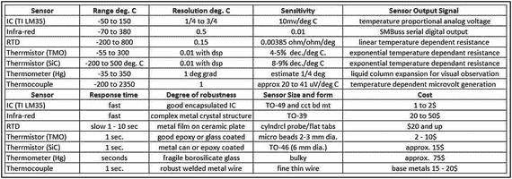
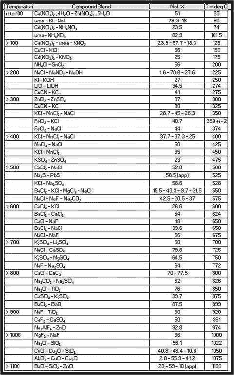
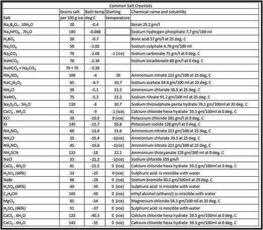

# 温度测量

我们世界中的生命是在液态水中进化并诞生的，而水的沸腾或冻结，定义了温度测量系统中的两个基准点。目前，低温超导研究和聚变研究涉及的温度范围，远大于由水相变所定义的范围。

作为一本基础实验科学导论性书籍，我们将使用相对廉价的传感器和读出系统来测量较为温和的温度范围，该系统理论上可覆盖-200°C 至 1250°C。科学中使用的温标是摄氏温标或开尔文温标，其中水的冰点是摄氏温标的零点，而绝对零度（所有分子运动停止的点）是开尔文温标的零点。摄氏温标的零点对应开尔文温标的 273.15°K。北美地区常用的第三种温度测量系统是华氏温标，其中水的冰点为 32°F，沸点为 212°F。（要将°F 转换为°C，请从华氏温度中减去 32，然后乘以 5 再除以 9。要将°C 转换为°F，请将摄氏温度乘以 9，将乘积除以 5，然后加上 32。）

```
(摄氏度 × 9/5) + 32 = 华氏度
(华氏度 – 32) × 5/9 = 摄氏度
```

华氏温标下的低温则使用兰氏温标，其中绝对零度（即 0°R）为-459.67°F。

温度会改变材料的物理和化学性质，在为特定应用选择温度测量系统时，必须考虑这些影响。除了材料熔点造成的结构强度损失外，还必须考虑到一些更细微的影响，例如 K 型热电偶中使用的铬镍-铝镍合金，由于合金金属中镍的居里点变化，在 350°C 处会出现不连续性。需要针对镍在 358°C 时从铁磁性转变为顺磁性的居里点进行小幅补偿，因为这会干扰电压-温度线性关系（参见 NIST 表中的修正值）。金属的电阻也会随温度升高而增加，这一现象是基于铂薄膜和铂丝制成的电阻温度检测器（RTD）进行精确温度测定的基础。

简而言之，热量是以原子或分子振动形式存在的能量。温度是衡量每个自由度上振动幅度的指标。如果使用温度传感器监测一个物体的温度，那么该物体中的部分热量必须传递给传感器，使其温度升至与物体相同。回顾一下，热量通过辐射、传导或对流传递，实验者必须确保热量能不受阻碍地流向传感器。完全浸入、导热液或导热膏、搅拌以及机械紧固件，可以确保物体和传感器之间有足够的热传递。对于小质量的样品，可能需要进行光学温度测量，因为任何向传感器的热传递都会干扰被测温度。

在设计实验装置时，必须谨慎使用诸如聚氯乙烯（PVC）、聚乙烯（PE）或特氟龙等塑料材料，以及其他在室温下能绝缘电导体，但在高于水沸点时软化熔化，在低于水冰点时则变得愈发脆的材料。玻璃、陶瓷和金属都有各自的上限温度，超过该温度它们会失去机械强度并熔化。其中一些材料能够承受剧烈且快速的温度变化，而另一些则不能。

温度升高会加快化学反应速率。诸如铁和钢等金属结构材料，在室温干燥条件下相当稳定，但随着温度升高并且在有氧环境下会发生氧化。高温会极大地增加不同金属接触点处的腐蚀速率。端子排上的螺丝连接、用钢制螺栓或螺钉连接铜线的螺纹紧固件，必须进行配置、定位或保护，以最大限度地减少热量暴露或空气接触。

传统的温度测量主要围绕水的沸点和冰点进行标准化。使用密封在带刻度玻璃毛细管中膨胀或收缩的水银柱温度计，是用于测量温度的传统且至今仍常用的实验室仪器之一。水银玻璃温度计易碎，但由于水银在-38°C 至 350°C 范围内呈液态，其测温范围很广。水银蒸气有剧毒，因此必须格外小心，确保水银始终被封装在玻璃毛细管内，一旦发生意外，必须彻底清理或重新封装。

通过几种方法，可以使用电子设备进行明显更可靠的温度测量。

在异种金属连接处形成的`热电偶`，能在宽温度范围内产生微小的、相对线性的电流。`热敏电阻`（或`热敏电阻器`）在有限的温度范围内表现出非线性的电阻变化。还有专门用于测量基本环境温度的固态集成电路。红外传感器可用于中等温度范围的非接触式测量。由薄膜或铂丝制成的电阻温度检测器（RTD）可用于在较大温度范围内进行灵敏的温度测量。各种传感器的一般特性总结在表 3-1 中。

**表 3-1 温度传感器**

| - |

基于铂的 RTD 通常比本书中考虑的传统设备更昂贵。但是，如果实验需要精确测量温度，而后续练习中的传统技术无法达到所需的精度，则必须使用合适的 RTD。在[`www.omega.com`](http://www.omega.com)、[`www.digikey.com`](http://www.digikey.com)和[`www.littlefuse.com`](http://www.littlefuse.com)上可以获得关于 RTD 的出色应用说明和描述。

RTD 有薄膜形式和绕线元件形式。待监测的温度范围和实验装置的限制条件，决定了要获得所需的温度分辨率必须采用哪种形式。特种 RTD 应用的复杂性在之前提到的供应商提供的文献中有所描述。`MAX31865` SMT 芯片提供了完整的系统，用于将铂电阻温度检测器（Pt-RTD）与微处理器连接，以在-200°C 至 800°C 范围内实现 0.5°C 的分辨率。US Sensor 生产的 100Ω薄膜铂 RTD 器件（料号`PPG101A`）可从分销商 DigiKey 购买，价格为 20 美元。


许多传统的实验室和临床温度测量方法仍在使用各种物理形态的水银温度计进行一般和特殊测量。经过校准的水银温度计理论上可用于测量–38.37°C 至 356.73°C 的范围，即该元素的液态区间。使用玻璃或石英温度计中的液态金属组，能够实现 0.1°C 的温度分辨率。（欧盟对水银温度计的销售进行了限制）。对于水银/液态金属膨胀法无法测量的更高或更低的温度，可以使用热电偶。被指定为 J 型和 K 型的双金属结具有可重复的、特定的电压-温度关系，其适用温度范围分别为–200°C 至 750°C 和 1250°C。

为了符合本书的预期性质，后续的练习和讨论将涉及贱金属热电偶温度传感器，而非更昂贵的铂基设备。在某些实验条件下，铂族金属是唯一可用的传感器类型。遇到这种情况时，您应查阅文献中的相关参考文献。

热电偶产生的微伏信号必须经过放大才能驱动任何形式的显示器。热敏电阻、RTD 和红外传感器需要电源提供激励或偏置，以产生与温度成比例的电子信号。

热敏电阻由过渡金属氧化物的固态混合物制成微珠形式，用于 –100°C 至 200°C 范围内的温度传感。碳化硅（`SiC`）热敏电阻可用于从 –20°C 到 450°C 的温度测量。热敏电阻有玻璃、环氧树脂和金属涂层或护套等保护形式。碳化硅传感器有金属 TO-46 “礼帽” 封装（带短引线）和环氧树脂涂层珠形式。`SiC` 热敏电阻金属器件较高的温度能力带来了一些电气连接问题。该器件温度测量范围的上限高于锡铅焊料的熔点。为了使用 TO-46 器件，必须通过机械方式建立电气上可靠的连接。

将温度传感器连接到监测设备会在被测物体的温度变化与监测设备输出的变化之间产生一个时间延迟。这个时间差就是*响应时间*。对于测量事件发生温度或随时间记录数据以检测多个热事件的简单实验而言，显示响应的时滞通常次于所测量的数值温度。如果热数据用于控制某个过程，例如将炉温保持恒定或向化学系统添加试剂，那么系统响应时间就变得至关重要，传感器响应、热传递和数据处理时间都必须最小化。

与几乎所有形式的实验测量一样，必须有一种方法来验证或确认所使用测量系统产生的数值。国际温标 (1990) 定义了各种元素标准物的沸点和凝固点，可用于验证从接近绝对零度到 1085°C 范围内的温度。

一些更方便的金属，如锡（熔点 232°C）、铅（熔点 327°C）、锌（熔点 420°C）、铝（熔点 660°C）和铜（熔点 1084°C），可以用作实用的中高温验证标准。

对能量存储的研究已经汇编了盐和氧化物的共晶混合物的熔点或凝固点数据（参见[`www.nist.gov/system/files/documents/srd/NSRDS-61_Part-1.pdf`](http://www.nist.gov/system/files/documents/srd/NSRDS-61_Part-1.pdf)）。表 3-2 根据引用的来源和多个其他来源汇编而成，整理了许多已知的共晶混合物，形成了一个覆盖从室温到 1250°C 温度范围的参考标尺。

处理熔盐时必须极度小心。熔盐会溶解某些金属、玻璃和陶瓷，导致意外故障，并引发灾难性的爆炸、火灾，通常还会造成严重烧伤。如果您不熟悉熔盐操作，应咨询熟悉熔盐的化学家或物理学家，或者查阅从 NBS 文件中提取的参考文献列表中的原始文献，表 3-2 中的许多条目即来自该文件。

铂金器皿可以盛装许多（但并非全部）熔盐。铁、镍和锆金属器皿可用于某些混合物。熔融石英、瓷器和硼硅玻璃容器可以盛装各种低于容器熔点的熔融混合物。

为表格选定的混合物均包含易于获取、价格低廉的组分，这些组分应能平稳熔融，几乎不产生或完全不产生分解。如果要验证温度测量系统，应选择熔点接近所需温度的混合物，收集各组分，并查阅原始文献或咨询熔融工艺专家，以选择合适的容器来盛装熔融物。使用合适的热源，即可将组分熔融，使其冷却，然后将得到的玻璃状或熔融物破碎成合适大小的碎块，用于测试温度测量系统的有效性。

**表 3-2 熔点混合物**

| - |

熔融表 3-2 中大多数混合物所需的高热量和高温，可以在空气中使用镍铬合金线加热元件来实现。镍铬合金的熔点为 1400°C (2550°F)，但为了安全，应极其谨慎地将其使用限制在 1250°C (2282°F) 以下，为了更高的安全性，应限制在 1100°C (2212°F) 以下。

您必须小心，因为加热系统的组件在这些高温下接近其熔点。任何结构材料的熔融都可能导致熔融物溢出或电路短路，这两种情况都可能引发火灾或熔融物的爆炸性飞散，造成灾难性后果。

用于玻璃吹制、锡焊、铜焊和焊接的安全、实用、高温加热系统在参考文本和专业出版物中有所论述（参见 John Moore 等人所著的 *Building Scientific Apparatus*，第 4 版，剑桥大学出版社，2009 年，以及 [Jacobs-online.​biz/​nichrome_​wire.​htm](http://jacobs-online.biz/nichrome_wire.htm)）。《热量与温度测量》一书中关于热电偶的最后部分，使用小型明火来产生高温以供演示和测试。尝试在 1100°C (2212°F) 以上的温度下安全工作，通常需要特殊的非金属加热元件、专用电源、惰性气体或真空腔，这些涉及的费用和技术超出了本书力求简化的性质。


## 亚环境温度与低温

除非您熟悉并能安全处理挥发性、有毒、易爆溶剂，且拥有低温固体或液体的获取条件，否则低温校准应仅限于使用盐浴和冰水浴。

可以通过物理解释溶液依数性质变化（例如沸点升高和凝固点降低）的化学原理，来为低温热测量系统的验证建立参考温度。当溶质溶解于水中时，溶液的凝固点会下降，而沸点则会升高，其变化程度与溶解溶质的浓度相关。

通过仔细控制溶质的性质、溶质浓度以及进出盛放溶液容器的热流，可以实现稳定的零下温度。冰与常见的易溶性化学盐（如氯化钠和氯化钙）混合，由于冰融化时浓度会发生变化，因此很难产生稳定且可重复的零下温度。植物生理学的研究人员曾发布过一种制备盐冰基低温恒温器的方法。这些低温浴槽选用的是在水中微溶的特定盐类进行制备。

使用杜瓦瓶（玻璃或金属真空夹套容器，即保温瓶）、搅拌设备以及适量的选定盐、细碎冰和水制备的低温恒温器，能够在从零下几分之一度到零下若干度的温度范围内长时间稳定运行。表 3-3 综合了多个来源的数据进行制表，这些来源包括 Arnold Gordon 和 Richard Ford 所著的 *《化学家指南：实用数据、技术与参考文献手册》*（J. Wiley & Sons, 1972 年出版）。

通过使用水溶性有限的化合物中过量的盐晶体，可以形成一个两相三组分体系。当冰融化时，更多的盐会溶解，从而维持恒定的盐浓度和温度。表 3-3 是综合参考来源汇编的精选数据表格。

**表 3-3** 低温恒温器混合物

| - |

亚环境温度也可以通过机电式气体膨胀/压缩系统以及能在热能与电能之间相互转换，从而在热隔离环境之间移动或“泵送”热量的固态半导体系统来实现。

## 热敏电阻：灵敏的高分辨率温度测量

### 过渡金属氧化物热敏电阻（-40°C 至 150°C）

对于涉及接近环境温度或室温溶液化学的生物学、医学和热化学分析，热敏电阻是撰写本文时最灵敏的温度传感器。除了灵敏度高之外，它还采用微型珠状封装制造，坚固耐用、化学惰性、成本低廉，并且对温度变化响应迅速。当与数据处理软件配合使用，或用于测量微小或分数级别的温度变化时，热敏电阻的非线性特性并非大问题。

意法半导体 2004 年的一份应用笔记 `AN1755` 描述了一种利用 `555` 定时器芯片、热敏电阻和微处理器来开发高分辨率温度测量系统的方法（参见 [`www.st.com/resource/en/application_note/cd00010962-a-high-resolutionprecision-thermometer-using-st7-and-ne555-stmicroelectronics.pdf`](http://www.st.com/resource/en/application_note/cd00010962-a-high-resolutionprecision-thermometer-using-st7-and-ne555-stmicroelectronics.pdf)）。该系统将热敏电阻的温度变化转换为定时器芯片输出频率的变化。

将一个 NTC 热敏电阻和一个高质量、低漏电的电容器放置在非稳态配置的 `555` 定时器的电阻/电容定时网络中，定时器芯片输出的占空比或脉宽比将随热敏电阻的温度变化而变化。当由高速微处理器以微秒级进行多次平均读数测量时，输出脉冲的宽度提供了对热敏电阻珠温度灵敏、高分辨率的测量。微处理器数字化后的信号随后可被串流输出到计算机的串行端口，以便在基于 PC 的 SCADA 程序中进行图形显示。

在 `AN1755` 中，讨论了 `555` 的周期定时，并在应用笔记内的两张图中进行了展示。然而，当定时器在电源电压的三分之一到三分之二之间循环时，会输出一个由高电平和低电平脉冲组成的方波脉冲序列。热敏电阻的阻值是其温度的函数。热敏电阻的阻值部分决定了电容器充电的速率。这可以通过高电平、低电平时间间隔 `t[1]` 和 `t[2]` 的数学表达式来证明，如下所示。

```
t[1] = 0.693(R[ntc] + R[2])C--- 1
t[2] = 0.693(R[2])C--- 2
因此
R[ntc] = R2/t[2]--- 3
```

虽然 `C` 的值并不直接参与 `R[ntc]` 值的计算，但它确实决定了高电平和低电平时间值 `t[1]` 和 `t[2]` 的大小。如果 `t[1]` 和 `t[2]` 之间的差值被用作温度变化的量度，并且该变化以微秒为单位进行测量，那么使用较大的 `C` 值可以显著提高温度测量的分辨率。

在此应用中，`C` 是一个定时电容器。它应为塑料薄膜型、低漏电的器件。低漏电的塑料薄膜电容器具有极性很低的介质材料，这意味着要制造出更高电容值的器件，需要体积大且昂贵的材料封装。通常，较小的物理尺寸对应 pF 和 nF 范围的电容值，但这些电容也可能价格昂贵且难以找到。为了最大化 `Δt` 值，应尽可能使用实际可行的、大容量的塑料薄膜电容器。我的一些开发电路曾使用 `1 μF` 的聚苯乙烯电容器组装，其尺寸为 `5/32 × ½ × 1¾ 英寸`（4 × 10 × 45 毫米）。

理论上，定时器循环的频率与 `1/ln(2)*(R1+R2)*C` 成正比。如果循环时间保持在 `4 Hz` 或更高，则电容器不应超过 `18 μF`。通常，当低漏电塑料薄膜电容器的值超过几微法时，其成本会开始显著增加。


