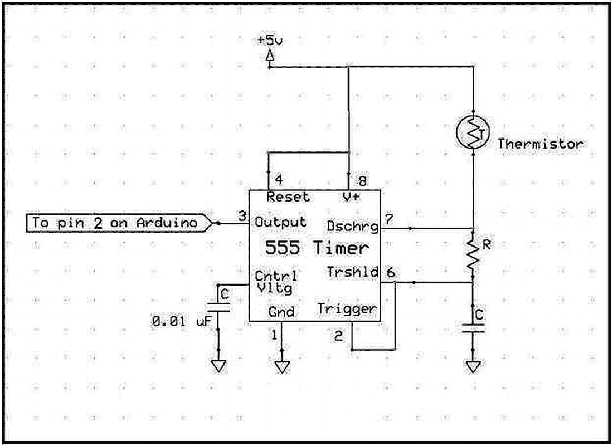

# 构建高分辨率、高灵敏度温度监测器

为组装一个高分辨率、高灵敏度温度监测器，您需为实验选择合适的`thermistor`（热敏电阻）。为了在`555定时器`输出信号中提供合理的不对称性，`RC网络`中的固定电阻应选择与传感器在其预期工作温度范围内的电阻值大致相等。固定`RC网络`的电阻值后，只需确定电容值，以提供适合微处理器数字信号处理（DSP）能力的输出频率。`RC`定时网络中的电容越大，系统的振荡频率就越低。`555定时器`输出信号的频率必须足够低，以便微控制器代码能够测量高电平和低电平的脉冲宽度，然后计算脉冲宽度差值并平均该数值差值，从而提供适当的降噪水平。

`Arduino`是一款 8 位处理器，因此使用脉冲宽度差值而非实际脉冲宽度。移动平均数字信号处理代码中的元素数量必须足够小，以避免微处理器代码中使用的长整数发生数值溢出。

热敏电阻测量系统可通过使用干井温度参考源进行校准。典型的测温化学分析过程仅涉及几度到 8°C 至 10°C 的温度变化。热敏电阻与温度关系的线性度可在较短的高分辨率范围内进行检验和验证。

## 实验 A 部分：金属氧化物 NTC 热敏电阻

为进行灵敏的高分辨率温度测量，`Arduino`或类似的微处理器板应独立使用电池或稳压电源供电，以提供几乎无噪声的+5 V 偏置电压和地线。使用合适的 NTC 热敏电阻、电容和参考电阻构成非稳态配置定时网络后，`555定时器`引脚 3 的输出可连接至`Arduino`板的数字引脚 2。`Arduino`板代码（见清单 3-1）包含一个 n 元素移动平均程序，可为`DAQFactory`图形显示提供平滑的数据流。该代码设置为采集并平均 16 个数据点。

### 硬件

`555定时器`按图 3-1 所示配置。

`图 3-1` — 热敏电阻的ΔR对`555定时器`输出信号的调制

图 3-1 电路中的`C`应选用高质量的聚酯薄膜或聚苯乙烯低漏电电容。电容值的选择需确保输出信号频率足够低，以便 DSP 代码能够测量并平均矩形（标称 5 V）输出波形的高电平和低电平部分。关于选择温度监测电路所用`R`、`C`及热敏电阻值时需考虑的定时因素，将在本实验的下一节进行讨论。