# 干井温度

干井由大型热质量块中的空腔构成。大型热质量块的作用是维持井内已知温度并减缓温度波动。加热式干井可通过金属块或多层金属层压板制作，对其进行钻孔或开槽以容纳温度测量设备和传感器，然后用任何具有显著热阻的材料（如泡沫塑料、木材、石膏或水泥）进行绝缘。如果可能，可编程温度干井应选用导热性更高的金属来制造。

温度可编程干井比静态系统更复杂，因为需要可变热源，并且包含干井的金属块需要足够的绝缘材料。在高于环境温度下运行的干井，可选择使用比例-积分-微分过程控制器（`PID`）进行控制，以帮助维持所需的运行设定点。

图 3-2 展示了一个由厚度为 3 毫米至 6 毫米（或 1/4 英寸）的铝金属板通过金属螺栓固定在一起而制成的低温干井。
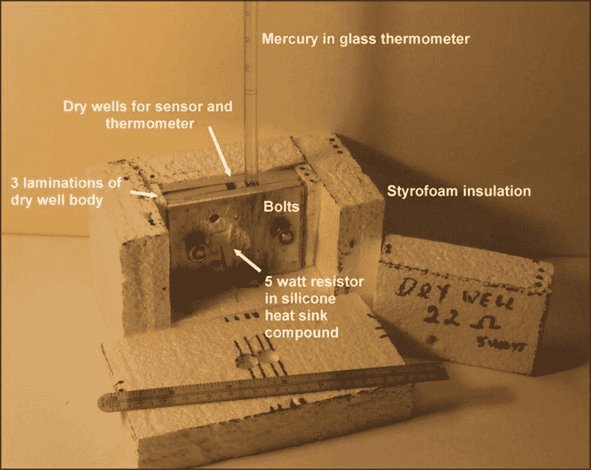
**图 3-2**  
层压铝板干井

采用层压板构造方法极大地简化了材料采购和成品干井的成型。单个板件完全可以使用手工工具成型，以容纳加热元件、温度计和传感器，或者加工成所需的外部轮廓，然后用螺栓牢固地固定在一起，并钻孔至最终配置。

除了图 3-2 中所示的三层干井外，我的实验室还有几个干井是用六层  英寸（3 毫米）厚的层压板制成，这些层压板来自当地五金店购买的 2 英寸宽的扁平铝材。无论是方形还是圆柱形的加热元件，都应尽可能紧密地贴合在金属块上，并涂覆硅酮导热膏以提供最大的热传递。确保加热电阻引线与金属块绝缘，以避免短路。

在图 3-2 中，干井的保温层是使用电烙铁上的塑料切割头从一英寸厚的聚苯乙烯泡沫板上切割下来的。金属块的保温套件部件上标有“对位标记”，并用毡尖笔做了标记，以便于组装。层压铝干井的各个板件也应标上“对位标记”，以确保设备能够快速轻松地组装。

要使用该金属块产生高温，需要电源来加热嵌入块内的电阻。我的实验室选择了低欧姆电阻值、多瓦特额定功率的低压直流电源，因为这些组件易于获取。交流系统也可以通过诸如 `Variac` 品牌的可变电压交流变压器来工作。交流电（AC）或线电压布线必须遵循当地的电气布线和建筑规范。

如图 3-2 所示设备上使用的典型干井校准过程包括：设置连接到井加热电阻或元件的电源上的低电压输出，然后等待直到干井温度稳定。记录电压和温度，然后稍微增加电压，让系统再次达到平衡。

收集第二组电压与平衡干井温度的数据。然后绘制这四个点，以获得施加电压与所得平衡干井温度之间相关性的一些概念。为了验证施加电压大小与所得平衡温度之间的相关性，绘制数据的斜率可以确定在预期运行范围内建立近似干井温度所需的施加电压。

预测在目标运行区域内建立第三个平衡温度数据点所需的电压，通常可作为电压-温度校准数据的验证。图 3-3 描绘了典型的干井温度与直流电压施加关系图。
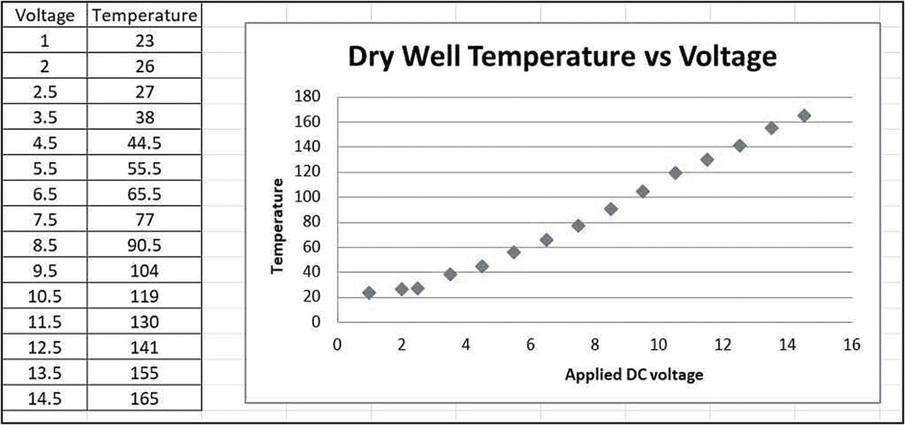
**图 3-3**  
干井温度与施加的直流电压关系图

虽然聚苯乙烯泡沫保温材料是一种易于使用且容易获得的优良材料，但其使用温度限制在 150 至 160°C 以下。然而，当用于热敏电阻的干井校准系统时，聚苯乙烯泡沫的温度限制并不会引起任何担忧，因为热敏电阻最适合用于 120°C 以下的测量。

## 软件

### 微处理器代码

清单 3-1 中的带注释代码调用了 `Arduino` 板的 `pulseIn()` 函数，以确定高脉冲和低脉冲的时间宽度，然后计算“传导”和“间隔”脉冲宽度之间的差值。然后在微处理器代码中实现的移动平均函数中对各个时间差测量值进行平均。平均后的时间值随后通过串行端口流式传输到 PC 进行图形显示。微处理器代码完全以整数格式编写，以最大程度减少数字信号处理（`DSP`）移动平均所消耗的时间。

在开发温度测量系统时，需要对微处理器代码和 555 定时器频率进行一定的实验。高/低或传导/间隔时间必须在 `pulseIn()` 函数允许的范围内。这两个值之间的差异应尽可能大，但又足够小，以便微处理器代码能够使用长整数，而不会在移动平均计算中导致整数溢出。

虽然该过程测量的是热敏电阻珠的温度，但珠式传感器和微处理器以 555 RC 定时器电路值以及微处理器代码计算所需平均值的速率所确定的速度运行。平均数据以串行格式发送到 PC，图形显示速率由数据到达串行端口的速率决定。如果串行端口接收数据的速度快于显示处理速度，则屏幕和光标响应会变慢。

为了限制数据通过串行端口发送的速率，移动平均程序代码的主循环包含一个 `delay()` 语句来降低数据发送速率。理想情况下，应通过仔细记录的实验来优化 555 频率、移动平均迭代次数和延迟常数。

## DAQFactory 图形显示界面与信号处理

高灵敏度或高分辨率的温度监测最好以图形格式呈现，以便持续显示被测参数的趋势。虽然在高灵敏度下，被测温度的绝对值相对于系统即时或实时的热量与温度变化通常处于次要地位，但绝对温度读数仍可校准至合理精度。

所有看似复杂的系统均由更简单的子系统组成。温度测量从组装 `NTC` 热敏电阻、555 定时器和 `Arduino` 硬件开始。为确保信号相对恒定，将 `NTC` 热敏电阻放置在如图 3-2 所示的隔热干井中。可将清单 3-1 中的代码加载到微处理器中运行，并使用 `Arduino IDE` 的串行输出监视器来确认通过相应通信端口或 `COM` 端口发送的数据的有效性。

接下来，配置 `DAQFactory` 程序以在相应通道上接收串行数据，并通过使用正确的串行端口监视器观察接收到的数据来确认数据流入。图 3-4 显示了数据传输时间、整型数据值，以及紧随其后的回车和换行 ASCII 字符。
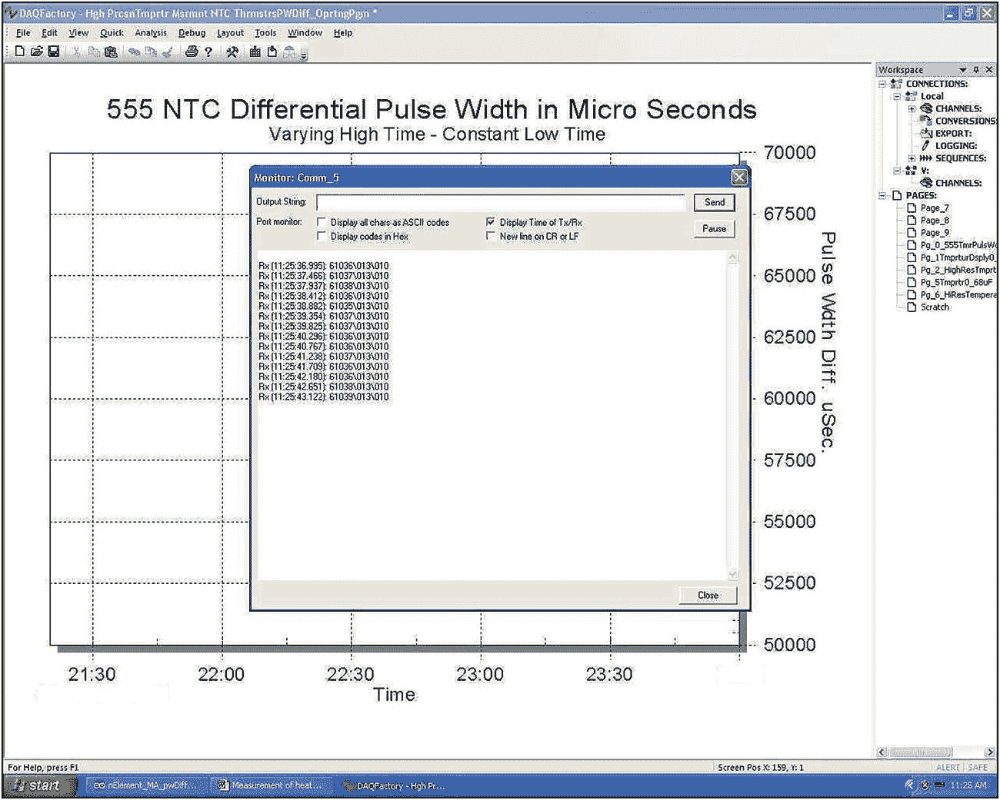
图 3-4
来自 `Arduino` 移动平均代码的 `DAQFactory` 串行端口脉宽差分数据

一旦 `DAQFactory` 界面能够记录平均脉宽时间差，即可在两个有用的温度点之间对热敏电阻进行校准。

## 观测与校准

要开发热敏电阻校准程序，必须创建一个可重复的温度程序。干井可通过从稳压电源为加热元件供电特定时长来创建温度程序。通过调整施加电压和供电时间，可以实现温度从环境温度升高到所需的高温水平。一旦建立并验证了环境温度与所需较高温度之间的可重复程序，就可以对 `DAQFactory` 显示界面进行校准。

在我的实验室中，使用放置于额外干井腔体内的玻璃水银温度计作为校准的主要标准。负温度系数热敏电阻在较高温度下将表现出较低的电阻。在我们正在开发的系统中，所测量的脉宽差值的“高电平时间”取决于流经 `NTC` 热敏电阻和参考电阻以对电容充电的电流。当定时器改变状态时，电容仅通过参考电阻放电。随着干井块的温度升高，高电平时间值会成反比地减小，`NTC` 热敏电阻的电阻也同样减小。

校准实验首先将热敏电阻浸入环境温度的干井中以建立基线。在测量并记录环境温度后，开始定时供电时段。随着块体和干井升温，`DAQFactory` 显示迹线开始下降。在定时时段结束时，切断电源，并监测块体温度，直到其达到最大值并开始下降。

温度的上限值和下限值，以及脉宽差值的初始值和最终值，定义了系统的校准范围。该过程应重复多次，以确认并证明其可重复性。图 3-5 展示了一组三次 3.0°C 温度变化的迹线。随着温度测量灵敏度的提高，温度漂移成为一个问题。

可以通过计算观测到的温差对应的脉宽差值变化率，来建立测量的脉宽差值与温度之间的相关性。对于图 3-5 中的曲线以及另外六次重复实验，平均比值为 3140 PWD 单位/°C。
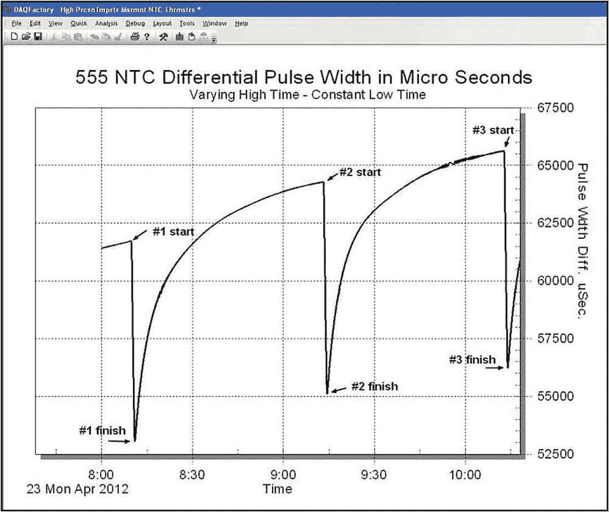
图 3-5
三度温度变化

利用计算出的斜率，以及在多次验证重复实验中观察到的精确起始点 17.0°C，构建了图 3-6 中所示的表格和图表。随后将构建的图拟合为标准 `y = mx + b` 格式，并在图表上打印出方程。在图 3-7 中，将来自 `Arduino` 555 `NTC` 定时器的流数据通道值代入方程 `y = –3140x + 117780` 的重排形式，以生成热敏电阻温度测量通道数据迹线。该迹线在图 3-7 中显示于二维图形组件窗口下方左右两侧边缘，数值为 18.55°C。
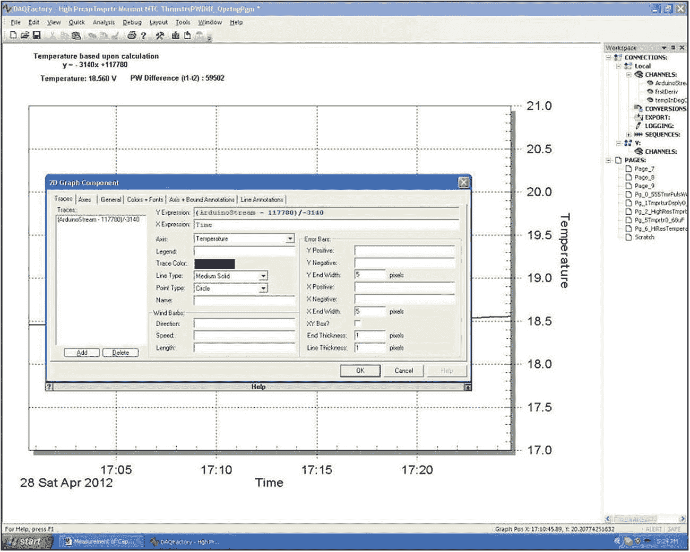
图 3-7
`DAQFactory` 图形组件 Y 表达式

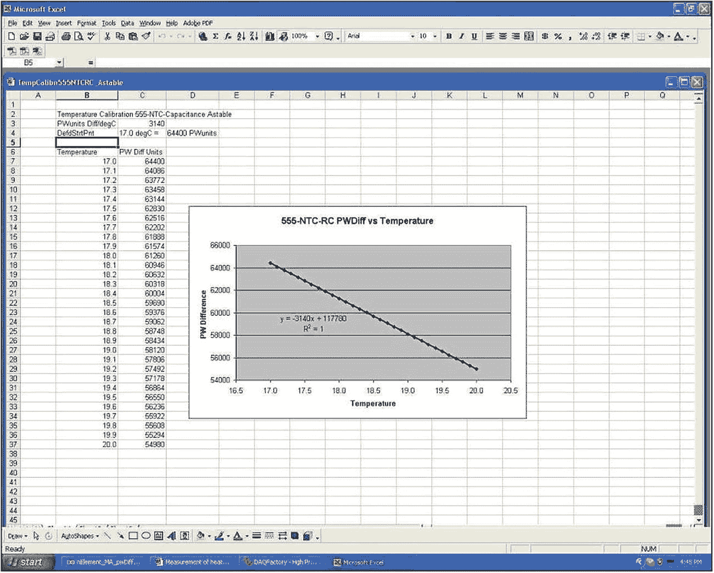
图 3-6
脉宽差值与温度的关系

### 使用一阶导数监测热现象

在滴定及其他图形化热现象监测中，一个有用的特性是主数据迹线的一阶导数，即数据的斜率。当前显示点的数据斜率，可以通过已绘制的数据点数值之间的差值，以及记录这些数据值的时间之间的差值来计算。
```
slope = (X[t1] - X[t2]) / (t1 - t2)
```
在 `DAQFactory` 中，数据以带时间戳的二维数值数组形式保存在通道中。在通道表视图中创建的每个通道都有一个属性窗口，其中包含五个选项卡：通道的基本属性、通道的可用选项、通道数据图表、通道数据表格以及一个事件选项卡。

在编写本书期间，我使用了三个通道来数学映射或转换脉冲宽度差值，以实现高灵敏度的温度记录，并显示温度记录的“屏幕上的”一阶导数。

这三个通道分别命名为 `Arduino Stream`，用于接收来自 `Arduino` 板的数据；`tempInDegC`，用于将脉冲宽度数据变化转换为图形显示值，供可视化温度监视器使用；以及 `frstDeriv`，用于计算显示数据的一阶导数的数值。

图 3-8 显示了输入到 `Arduino Stream` 事件函数选项卡中的转换代码。该代码根据测量的脉冲宽度差值数据计算热敏电阻温度，并将计算出的温度和时间值插入到 `tempInDegC` 通道中，以进行图形显示。
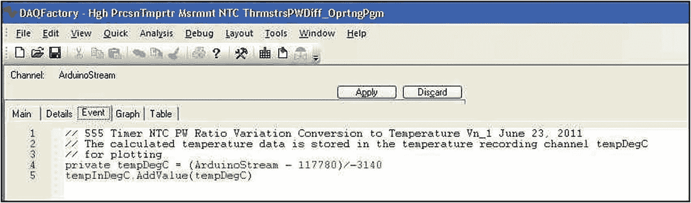
**图 3-8**
通道事件转换代码

`Arduino Stream` 通道事件函数的第 5 行将计算出的温度传输到 `tempInDegC` 通道中以供显示。第二个通道事件函数使用如图所示的两行长代码进行编程。这些长行代码计算第二个通道中温度迹线的一阶导数。第二行将数据传输到第三个通道中以供显示。
```
1) private frstDiff = (Smooth(tempInDegC[0], 5) – (Smooth(tempInDegC[25], 5)))  /  ((Smooth(ArduinoStream.Time[0], 5)) – (Smooth(ArduinoStream.Time[25],  5)))
2) frstDeriv.AddValue(frstDiff)
```
为了便于编码、控制屏幕显示和配置开发，我使用了三个通道以及正在计算的中间值的各种图形显示，以跟踪和验证数据转换。对于实验应用，这三个通道可以与单个双迹线显示一起使用。

## 讨论

`555`定时器已使用超过 40 年，目前有使用双极型晶体管或`CMOS`集成电路的芯片。芯片功耗、对外部组件的功率传输以及工作频率是生产这两种集成电路的主要考量因素，这两种电路在此信息处理、温度测量应用中均能同样良好地工作。

尽管个人电脑和`USB`总线能够提供驱动实验设置所需的电源，但其供电能力有限，并且可能产生额外的噪声。在可能的情况下，实验装置中的`Arduino`和`555`芯片应由独立的专用电源供电。对于高灵敏度的低噪声测量，电池能提供最纯净的电源。图 3-9 显示了在从计算机`USB`连接取电时，温度记录信号中出现的短期或瞬态“振铃或混叠”现象。当`Arduino`独立供电时，仍能看到这些失真，但其强度显著降低。

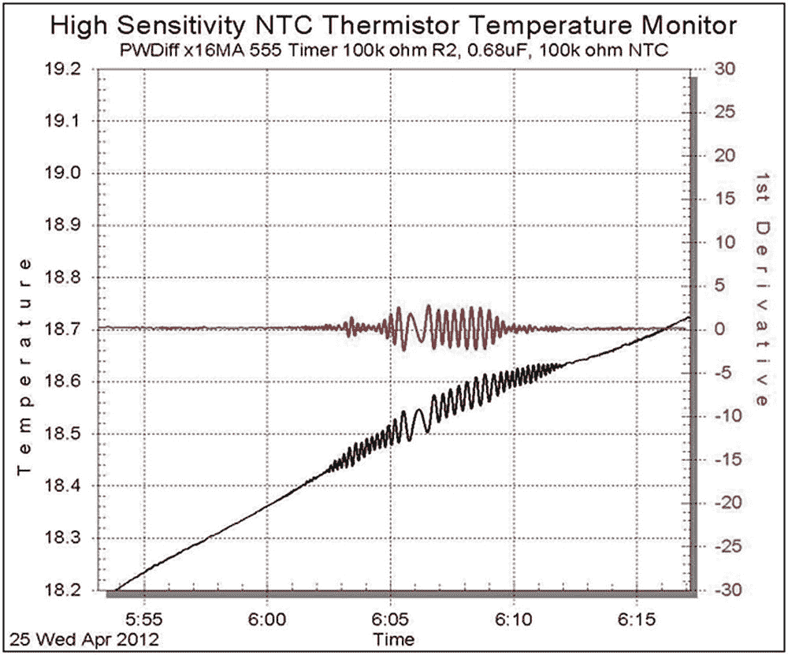

**图 3-9**

信号振铃或混叠

热敏电阻或温度敏感电阻器有多种物理尺寸和电阻值可供选择，其中在 25°C 时的电阻被认为是该元件的标称值。对于大于 10°C 至 15°C 的温度范围，温度与电阻之间的非线性关系可能需要在某些应用中进行校正。对于仅跨越几度高低温范围的高分辨率温度测量，非线性变得不那么重要。

热敏电阻是温度敏感电阻器，当电流流过时，会根据`I²R`公式自发热。通过将热敏电阻放置在非稳态`555`电路的`R1`位置（参见图 3-1 中的电路），电流仅在电容器充电时流过热敏电阻-电阻串联对，从而减轻了自发热电流效应。

通过在`RC`定时网络中安装热敏电阻，占空比成为热敏电阻温度的函数。由`555`定时器数字化的模拟温度信号，可以通过微处理器进行处理，对测得的脉冲宽度数据应用移动平均过程，从而大大改善输出信号的信噪比。

移动平均（`MA`）程序会执行一系列不正确的计算，直到其平均代码达到其标称运行值。一个九元素移动平均在处理完九个数据点之前，会产生不正确的答案。一旦数组填满并运行，用于计算平均值的数组会产生一串串行数据，其噪声值理论上降低至原来的三分之一。一旦移动平均处理了足够多的数值，它就会以微处理器时钟的速度循环执行其代码，产生一个噪声降低值与平均点数平方根成正比的串行数据流。

尽管一个典型的`MA`数字信号处理（`DSP`）可能需要 15 到 20 行代码来实现，但处理后的数据点流式输出到串行端口的速度通常远高于`DAQFactory`图形显示能够跟随的速度。通常需要在微处理器的主循环中添加一个延迟语句，以降低移动平均代码的速度，使其达到图形显示能够跟上的程度。理论上，实验者可能需要调整`MA`中的元素数量并减小延迟语句的值，以获得最佳性能。

### 微处理器平均与图形显示响应时间

除了图形显示跟上数据接收速率所需的时间外，微处理器平均还需要额外的计算时间。随着数据平均、串行传输和图形显示消耗更多时间，被研究系统的变化与图形显示移动之间的时间延迟会增加。所有这些延迟的总和就是测量或系统的“响应时间”。

增加移动平均中的元素数量时必须小心，因为显示响应的时间延迟会增加，但信噪比的改善仅随平均元素数量的平方根而提高。实验者在组装温度测量系统时，必须考虑待收集数据的性质，以及在保持数据显示合理响应时间的同时，可用于平滑数据的时间量。

根据 IC 定时器数据手册，`555`定时器非稳态配置的输出频率与`RC`网络的值成正比。大容量电容器与大阻值电阻器一起会产生大的时间常数。测量温差的脉宽差技术依赖于微处理器测量定时器输出信号中连续高电平时间之间的差值。

测量定时器输出的微处理器代码使用 8 位逻辑，因此对二进制算术能准确表示的数值的大小有限制。如果脉宽过大，连续差值测量之间的差值可能会导致微处理器算术编码中的数值溢出。`Arduino`代码中的长整数可以处理高达`2,147,483,647`的数值。几个微法的高质量、低泄漏电容器应为实验工作提供足够的温度分辨率。

### 实验 B 部分：碳化硅热敏电阻 –20°C 至 450°C

自 1833 年迈克尔·法拉第注意到硫化银中的温敏电阻现象以来，这一特性已被认知。热敏电阻的商业化生产始于 1930 年，并演变为本主题 A 部分中使用的廉价微玻璃或环氧树脂涂覆的混合过渡金属氧化物珠状器件。

碳化硅（`SiC`）最初作为磨料制造，后来用作高温炉中的电阻加热元件，它也是一种半导体。`SiC`已被制成电阻递减的温敏器件，大大扩展了常规过渡金属氧化物热敏电阻传感器所能达到的高温测量范围，并使每单位温度变化的电阻变化率大约翻倍（金属氧化物为 3% – 4% `ΔR/°C`，而`SiC`热敏电阻为 7% – 8% `ΔR/°C`）。

监测的温度范围给使用`SiC`器件可测量的上限 500°C 的实验工作带来了一些材料选择问题。混合金属氧化物热敏电阻仅限于约 150°C 以下的温度。锡铅焊料和聚苯乙烯泡沫绝缘材料也仅限于 200°C 范围的下限。

图 3-10 是典型`SiC`热敏电阻的器件电阻与温度关系图。

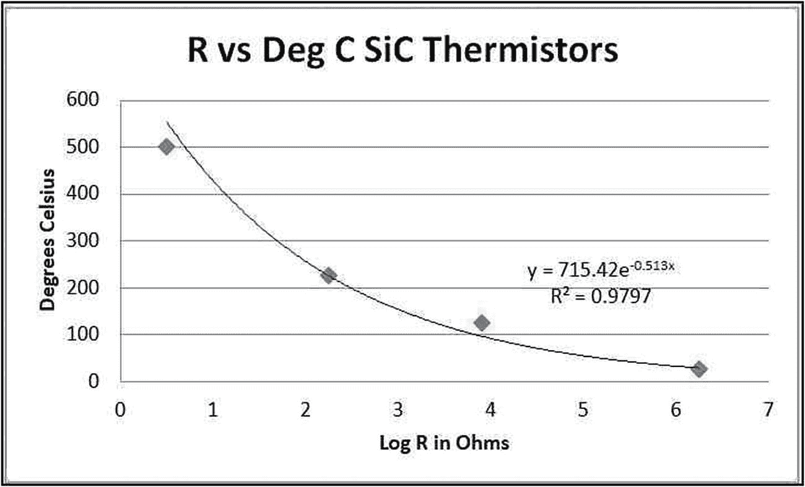

图 3-10

`SiC`温度范围

可以使用开发的`555`定时器电路或传统的高阻惠斯通电桥电路进行半导体`NTC`热敏电阻的温度测量。

### 实验：555 定时器频移温度测量

#### 硬件

将一个 National Semiconductor `CMOS LMC 555CN`配置为非稳态配置，使用一个 Adsem 碳化硅`TO-46`金属罐“顶帽”热敏电阻（其在 25°C 室温下的电阻为`1.750 MΩ`）和一个`2.2 MΩ`电阻。回顾在非稳态配置中，`R1`随`SiC`热敏电阻的温度变化，而`R2`是固定的`2.2 MΩ`参考电阻，`555`定时器的高低电平或标记-空间时间占空比约为`2:1`或`66%`。使用`10 nF`（`0.01 μF`）电容器与`SiC`及`2.2 MΩ`组合，以产生`25 Hz`的理论输出频率。（对于非稳态`555`，`f = 1.44/(R1 + 2R2)*C`。）

`SiC`热敏电阻被安装在一个`3/16`英寸（`5 mm`）直径的铝制干井中，该干井位于一个聚苯乙烯泡沫绝缘的层压铝块（`½ in × 3 in × 2 in`，即`12 mm × 76 mm × 50 mm`）内，干井由一个`22.6`欧姆、`5 W`的电阻加热。块加热器电源由`12 V`、`1 A`的直流电源提供，主温度测定由一个监测热敏电阻附近块孔的水银温度计完成。

用`12 V`加热干井`2.0`分钟产生了`4.0°C`的温差（`ΔT`），并使用三次`4.0°C`的偏转来计算每摄氏度观测偏转的平均值。然后使用该灵敏度值来关联`SiC`热敏电阻的每度偏转与观测到的温度计响应，方法与 A 部分中环氧树脂金属氧化物单元相同。

#### 观测结果

碳化硅热敏电阻偏转-温度图如图 3-11 所示。

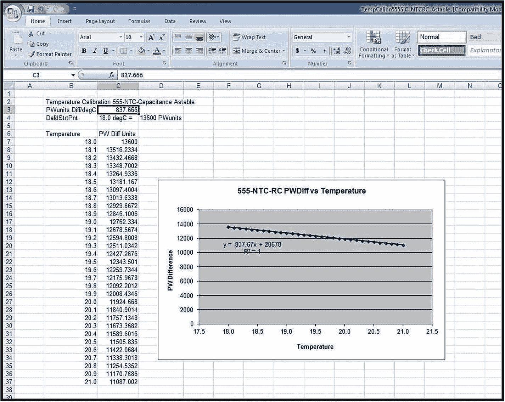

图 3-11

`SiC`热敏电阻响应数据

通过生成并记录一个微小温差的测量值，展示并评估了该温度测量系统的典型能力。`SiC`热敏电阻通过测量由`12 V`直流电压施加`2.0`分钟所产生的`4.0°C`温度跃迁引起的`PWD`（脉宽差）进行校准。为了测试该系统，一个`3`秒的电源施加应产生十分之一度的温差，如图 3-12 所示。该功率脉冲是通过手动激活电源并持续一个计时的`3`秒间隔产生的；如此短脉冲的定时误差相对较高。

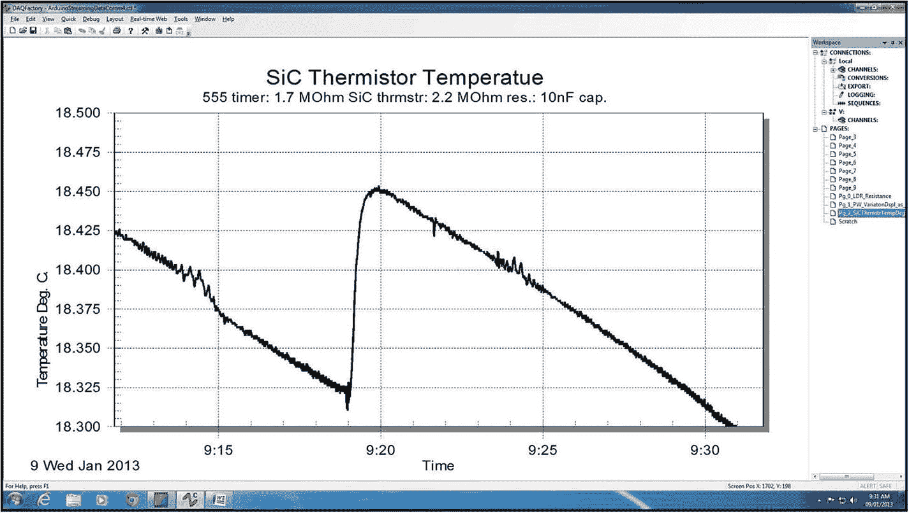

图 3-12

`SiC`热敏电阻高灵敏度温度测量

碳化硅热敏电阻的电阻值和可用温度范围都明显高于金属氧化物器件。金属氧化物器件的电阻值从几百欧姆到兆欧姆不等，每摄氏度电阻值下降 4%–5%，并且在水沸点之后会迅速失去灵敏度。碳化硅器件可在 –20°C 到 450°C 范围内使用，电阻值在兆欧姆级别，每摄氏度温度变化电阻值下降 8%。

图 3-12 中记录的迹线显示，在未平滑的迹线中，9:15 和 9:25 之前存在重复性的振铃或混叠现象。`DAQFactory`提供了多种数字信号处理功能，可用于降低数据中的噪声水平，每种 DSP 功能都有其自身的优点，同时在信号响应中增加了时间延迟。

图 3-12 显示，`DAQFactory`绘图的主要刻度相当于 0.025 度。由于基线噪声约为主刻度的五分之一，因此 0.005 度的温度分辨率应该是可行的。

高分辨率温度图说明了灵敏温度测量中固有的问题之一：热量通过绝缘层的泄漏以及由此产生的温度漂移。在充电周期中，USB-Arduino 电源的标称电压为 5 V。在环境温度下，热敏电阻和参考电阻的总和约为 4 MΩ，导致热敏电阻电流约为 1.25 μA，该电流仅在 66% 的时间内流过热敏电阻（占空比 = 高电平时间/总周期时间）。这种漂移是一种电子伪影，或者热量移入或移出干井。

### 实验：使用惠斯通电桥测量碳化硅负温度系数热敏电阻的温度

惠斯通电桥电路由克里斯蒂于 1833 年发明，最初用于测量静态系统中的未知电阻值。使用热敏电阻和 RTD 进行静态温度测量仍然存在，但动态温度测量在实验科学中有广泛的应用，也是本小节的主题。

考虑一个由两个分压器以并联方式组装而成的惠斯通电桥。如果两个分压器中的所有四个电阻值都相同，则电路两臂的分压点之间没有电压差。如果其中一个分压器电路中的电阻值发生变化，则电路中的两个分压点之间会产生电压差。在一定的电阻变化范围内，电压不平衡量与电阻变化成正比。手头系统中的电阻变化就是碳化硅热敏电阻所处环境的温度变化。

在图 3-13 中，显示了电桥配置各组件的数值关系。如果通过设置 `R1 = R2 = R` 来简化电桥输出的公式，则输出电压遵循该公式。


图 3-13

惠斯通电桥输出公式

- `V[o]` 是电桥的输出。`V[B]` 是电桥电压或偏置电压。
- `R` 是平衡时电桥电阻的阻值。
- `ΔR` 是有效电阻的变化量，或碳化硅热敏电阻阻值的变化量。

完整的公式和配置如图 3-14 所示。


图 3-14

惠斯通电桥电路和公式

### 实验

如图 3-15 中的电路原理图所示，我们使用一个可变电阻和三个固定值电阻创建了一个电桥配置。通过选择三个固定值单元的电阻值略高于碳化硅热敏电阻的室温电阻值，并添加一个适当大小的电位器，您可以组装一个围绕高阻值碳化硅热敏电阻的电桥电路，该电路可应用于加热或冷却操作。


图 3-15

碳化硅惠斯通电桥

对于初始开发工作或实验装置，可以使用任何高阻抗电压测量设备来监测电桥的不平衡。我们选择了一个双电池电源，为仪表放大器提供双极性电源。

在使用碳化硅热敏电阻开发温度测量过程时，我们保存了温度校准测量的存档记录，用于本节后续涉及热运动和热力学的工作中。数据通过监测和记录一个初始平衡的等臂惠斯通电桥所产生的偏差来收集和显示。将一个众所周知的温度程序应用于电桥的碳化硅感测元件。如图 3-16 原理图所示，使用单位增益配置的 AD 620 仪表放大器将电桥偏差信号缓冲到`LabJack U12`的差分输入上，后者为`DAQFactory`图形记录显示提供输入。

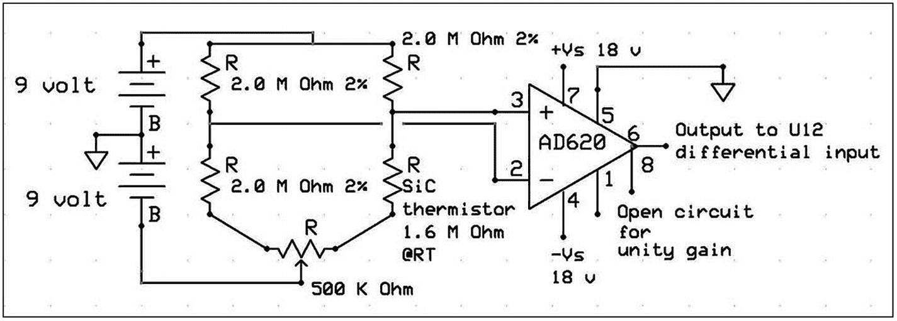

图 3-16

带碳化硅电桥的 AD620 仪表放大器

### 观察结果

对带有水银温度计、K 型热电偶和碳化硅热敏电阻的绝缘铝块干井的 22.6 Ω、5 W 电阻进行一系列定时的 12 V 直流电源施加，生成了表 3-4 中的数据。

表 3-4

碳化硅电桥校准数据

| -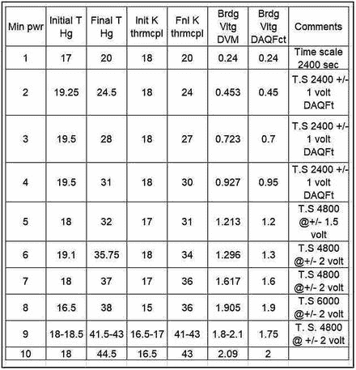 |

当施加电源时间为 8 分钟，偏差接近 2 V 而ΔT 为 24°C 时，电桥电路的线性度开始恶化。（电池电压 2 × 9 V = 18 V 电桥偏置。）

### 讨论

在室温（20°C 或 68°F）下，典型的 SiC 热敏电阻的标称电阻为 1.6 MΩ，传感器温度每变化 1°C，其电阻变化率为 7%至 8%。因此，在 19°C 或 21°C 时，SiC 热敏电阻的电阻变化量应为 1.6 MΩ × 0.075 = 120 KΩ。将 120 KΩ的值代入灵敏度公式，可以得到对于 2 MΩ电桥电路，其灵敏度为 0.261 V/°C。

理论上，由于能够轻松测量到最接近毫伏的电压，每度温度应能分辨到最接近的毫伏，即大约 1/261 °C。然而，电阻器容易产生噪声，对于 2 MΩ电桥，预计会出现显著噪声，并且如图 3-17 所示，确实发现了这种情况。

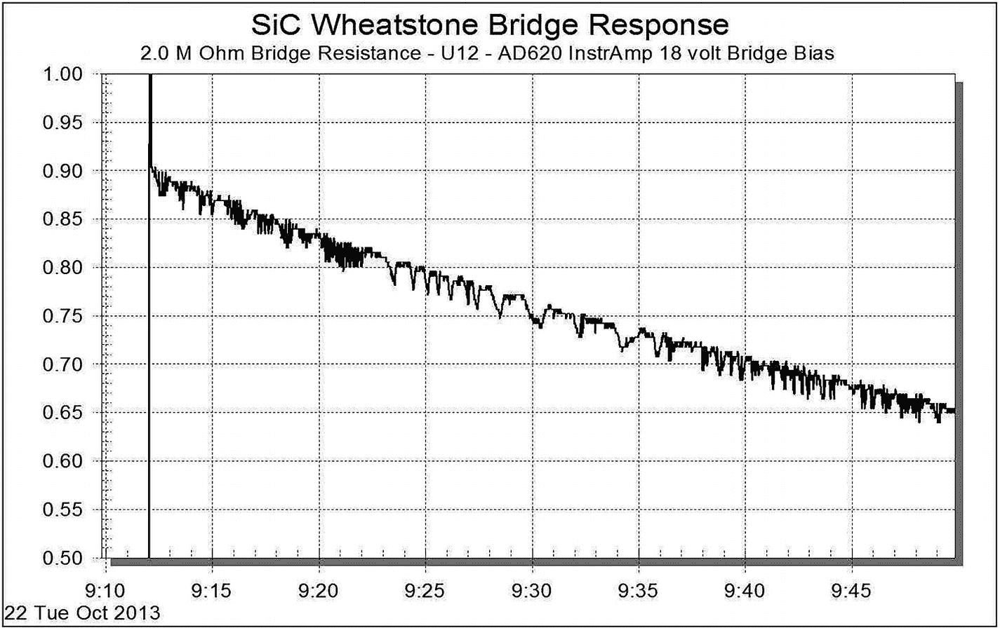

图 3-17

高灵敏度温度测量噪声

`DAQFactory`程序的平均功能可以降低迹线的噪声，同时减少信号的响应时间。

通过如图所示配置电桥，您可以通过调节电位器将电桥输出平衡至零伏。该传感器可用于测量加热或冷却操作。

在电池供电系统中，电桥电路中的较高电阻值更受青睐，因为这样可以将电流消耗降至最低，从而最大限度延长电源的使用寿命，并限制流经热敏电阻的电流，以限制自热效应。然而，电阻器产生的噪声与其电阻值的大小成正比。

尽管电桥电路在测量电桥输出电压与温度引起的电阻变化呈线性关系的范围有限，但图 3-18 显示，只要电桥偏差电压保持在线性范围内，该范围就足够大，具有实用价值。

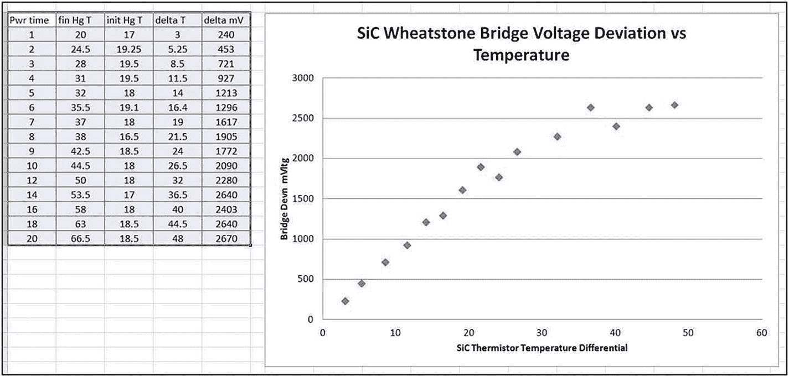

图 3-18

SiC 惠斯通电桥线性度

要将 SiC 惠斯通电桥用作连续温度监测器，需要将电桥偏差为零电压时的传感器温度，加上由电桥偏差测量的温度值。

### 非接触式红外温度测定

红外温度测量的关键优势在于能够通过光学方式，在无物理接触的情况下进行远程或“远距离”温度测量。在解读红外温度数据时，请记住这些测量是通过光学方式完成的。换能器或检测器仅将来自远处物体或电磁辐射源、在确定视场（FOV）内的不可见红外能量，转换为数字数值。整个热辐射收集系统必须遵循电磁辐射传播的规律。检测器有多种物理和光学配置可供选择，它必须拥有无遮挡、光学透明的路径，以收集并平均落入特定设备视场内的所有热辐射。

### 实验

#### 硬件

可以使用一个成本相对较低（20 加元）的红外检测器，例如 Melexis 的 `MLX90614`（可从多个在线供应商处购得），配合 Arduino、两个 4.7 KΩ 的“上拉”电阻、电源、地线和两条数据传输线，来进行非接触式温度测量。对于临时开发工作，我将该设备安装在一个迷你原型板上，并进行了以下连接（见图 3-19）。

- 引脚 1 `SCL` 连接到 Arduino 板的模拟引脚 5
- 引脚 2 `SDA` 连接到 Arduino 板的模拟引脚 4
- 引脚 3 `VDD` 连接到 Arduino 板的 3.3 V 引脚
- 引脚 4 `VSS` 连接到 Arduino 板的 GND 引脚
- 一个 4.7 KΩ 电阻连接在引脚 3（`VDD`）和 `SCL` 之间
- 第二个 4.7 KΩ 电阻连接在引脚 3 和 `SDA` 之间

原型板对于开发工作很有用，但在 3.3 V 或 5 V 电平下，原型板中“弹簧”触点的电阻可能足以导致接触电压下降，从而使电路无法按预期工作。在本书红外温度测量部分的开发过程中，有几次正确接线并供电的电路，在故障排查时用万用表探针接触后才开始工作。对于实际数据采集，更推荐使用印刷电路板或硬连线电路。

图 3-19 显示了一个电路原理图。

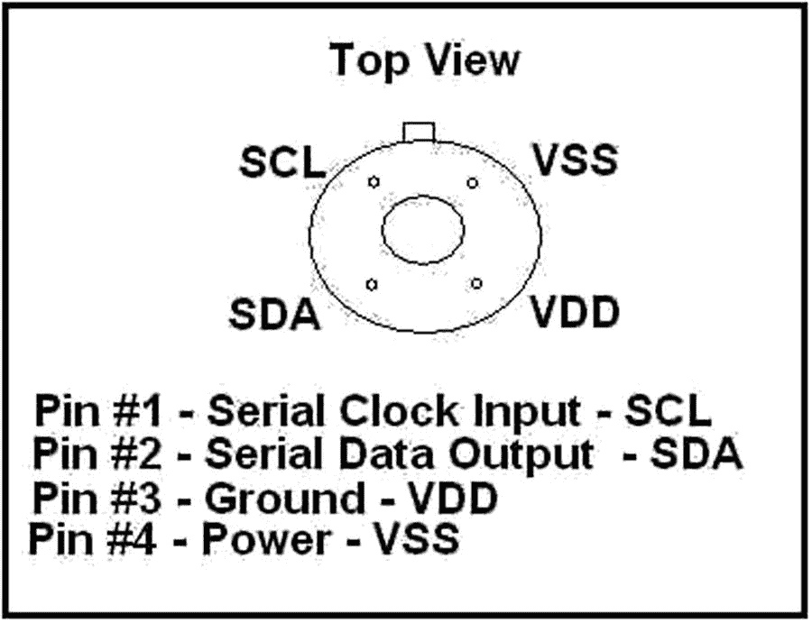

图 3-19

Melexis 90614 红外检测器引脚定义

## 软件

红外芯片可以以脉冲宽度格式，或者通过集成电路间通信格式（有时写作 `I²C`，但更常见的是 `I2C`）串行方式，提供其视场内物体的温度。Arduino 红外传感器通信所需的用于读取 Melexis 的库，是标准 Arduino 库的一部分，可从 IDE 菜单加载，其名称为 `MLX90614`。

### 所需页面组件

可以在 `DAQFactory` 中配置一个可视化温度显示，以适应红外检测器可用的范围，如图 3-20 所示。

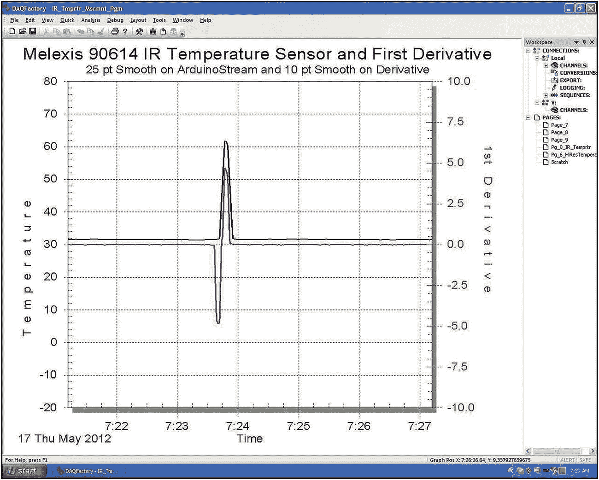

图 3-20

红外检测器温度记录及其一阶导数

### 所需脚本

从 Arduino 传输到 PC 的数据流，是检测器芯片观察到的、以摄氏度格式表示的出厂校准温度。图 3-20 显示了记录温度迹线的温度及其一阶导数。算法和代码结构与此前热敏电阻温度测量工作中使用的相同。红外检测器直接产生实际温度，因此无需进行转换。一阶导数的计算方法也与之前相同。导数函数的灵敏度是根据经验确定的，并取决于所监测的温度范围。

## 观察结果

红外探测器的响应迅速，且与热敏电阻相比，具有更大的线性范围。图 3-20 是我为开发验证而设置的一个显示屏，测量范围从 –20°C 到 80°C。通过将冰袋和热饮移入和移出探测器的视野，可以轻松展示快速且大幅度的温度变化。

使用一个面向垂直的传感器进行了几个易于操作的桌面实验，以图形方式展示了在使用红外传感器采集温度数据时必须注意的事项。由于传感器的锥形视野（FOV），如果将一个热源，例如装满热饮的杯子或马克杯，或是一个冷冻的“冰袋”，放置在探测器上方几英尺（半米）处，显示的温度测量值将是测量环境的环境温度，而不是目标物体的温度。

如果热源降低到距离探测器几英寸（5 到 6 厘米）以内，显示的温度轨迹会上升或下降，以显示热源的表面温度。然而，热源是一个辐射体。如果辐射的功率强度足够大，它可能会影响探测器外壳的温度，以及热敏探测器，并且显示的读数会发生漂移。当日光、手部热量和热饮靠近传感器外壳时，即使它们不在探测器的视野内，记录到的温度信号也会变得嘈杂并产生偏差。

与所有传感器一样，随着灵敏度的提高，信噪比会降低；而随着用于降低噪声的信号平均量的增加，显示的响应时间也会增加。

使用 `DAQFactory` 程序创建的视觉显示需要 200 毫秒的延迟，以避免过高的数据流速率，该速率会导致光标变得迟缓甚至无响应，从而降低图形显示质量。我能够在 `DAQFactory` 通道中添加一个 25 点平均值，并将 Arduino 代码中的延迟减少到 150 毫秒，而显示屏光标的性能没有明显下降。

光学温度测量依赖于“视线”观测。要测量的热源必须对探测器可见。容器内的热液体或冷液体可能需要从上方观测，以测量其内容物的温度。

## 讨论

一个 Melexis 探测器芯片被识别为型号 `MLX 90614 AAA`。根据制造商的数据手册，第一个 `A` 表示该单元由 5 V 供电（也有 3.5 V 的版本），第二个 `A` 表示视野被视为一个单一物体（也有双视区探测器可供选择）。最后一个 `A` 表示封装是行业标准的 TO-39 外壳，具有 45 度的视野（FOV）。探测器有多种视野选项可供选择，范围从 5 度到 35 度。

数据手册包含使用各种数据输出的时序信息，以及探测器物理、电子和光学参数的深入解释。容纳该设备的金属外壳上的窗口可以透过 5.5 至 14 微米之间的红外辐射。

`I2C` 库和 Arduino Melexis 代码是 Arduino 的标准库，可从 IDE 中获取。在库的某些较旧版本中，Arduino 代码的最后几行（通过三步串行打印操作）会将字符串字符和数字的混合发送到串行端口，以组装成一个两位小数值，代表探测器视野内物体的平均温度。如果遇到 Arduino 代码中输出值的混合数字和字符串字符格式，最好使用 `DAQFactory` 通道和图形显示的信号处理功能来进行平均值计算和任何所需的数据平滑处理。

工厂校准和设备固件基于 `SMBus` 数字接口，并允许访问 –70°C 到 380°C 的温度范围。`SMBus` 是一种较旧的、单端、两线通信协议，用于简单的单向数据串行传输。系统管理总线协议通常与较新的当前 `I2C` 协议兼容。

热量通过传导、对流或辐射从一个物体传递到另一个物体。辐射热传递涉及波长范围为 0.7 至 1000 微米的红外波段电磁辐射（1 微米或有时为 `μ` 等于 `10^(–6)` 米）。出于实际原因，0.7 至 14 微米之间的波长用于红外温度测量。如果视野中的物体被入射辐射照射，部分辐射会被吸收，部分会被反射。物体的反射系数可以从 0% 变化到 100%。粗糙、无光泽的表面可能具有低反射率，而抛光、有光泽的金属表面可能具有很高的反射率。

热源相对于探测器的位置，以及物体透射被测红外波长的能力，也会影响对视野中物体温度的测量（有关黑体辐射的更多信息，请参阅光谱学或物理学文献）。从视野中的物体落到探测器上的能量，受到该物体的反射、透射和吸收系数以及红外辐射波长的影响。

为了准确确定温度，需要评估物体周围的背景。需要确定表面的物理状态，并且必须考虑该表面的发射率。光滑或抛光的金属表面可以像红外辐射的镜子一样。金属表面可能指示其周围环境的温度，而不是金属本身的温度。明亮的铝表面可能需要涂上耐高温的黑色涂料，或者进行阳极氧化处理，以便让红外探测器测量到实际温度。

对于涉及红外温度测量方法的工作，必须通过观察并获取已知物体的温度来验证系统。