# 热电偶温度测定

塞贝克效应和珀尔帖效应描述了由两种不同金属构成的回路中，当接触点处于不同温度时发生的可逆电子流动。图 3-21 展示了一个典型的不同金属热电偶测量装置。
典型的电压电平在每摄氏度几微伏的范围内，具有相当好的线性和可重复性。未知温度的测量是通过测量不同金属导线回路中的电压来完成的，此时两个接点中的一个保持在已知的参考温度下，通常是冰水混合物的温度。热电偶在冰水温度下的电压具有足够的稳定性和可重复性。现代集成电路如 `MAX31855`、`AD594` 和 `595`，能够产生一个参考电压，以替代在给定的固定 0°C 温度下的第二个热电偶接点。有了集成电路提供的固定参考接点信号，单个双金属接点就可以通过测量接触点处产生的电压来确定未知温度。热电偶是自供电传感器，无需激励或外部电源。

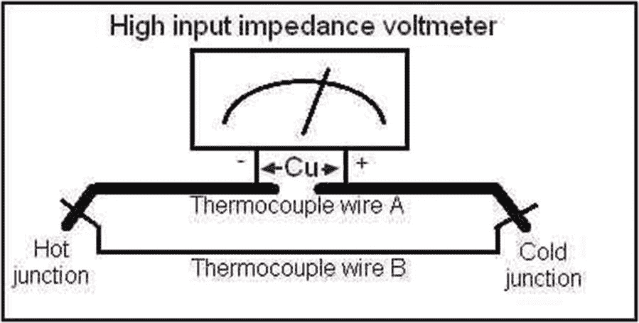

**图 3-21** 一个典型的不同金属热电偶电路

热电偶产生的小电压值所带来的困难，在一定程度上被金属所能工作的宽温度范围所弥补。相对廉价的镍、铬、铁和铜合金被用于制造 J 型和 K 型热电偶，这些是目前最常用的传感器。根据用于产生热电流的金属种类，热电偶可分为贱金属组和贵金属组。更高温度的测量范围在 1350°C 至 1700°C 或更高时，必须使用铂族金属与其他金属（如钨、金和钼）组成热电偶接点，或者研究者可以使用光学方法。关于高温工作以及昂贵合金的正确应用，可以在文献中找到更多信息。
使用表 3-5 中列出的常见金属制成的热电偶，可以实现从低温到约 1250°C 的测量范围。贱金属热电偶是后续文本中所述工作的重点。
由铬镍-铝镍合金接点组成的 K 型传感器每摄氏度产生 41 μV。K 型传感器由两根导线构成的回路组成，这根回路是通过将一根由 90%镍（Ni）和 10%铬（Cr）构成的铬镍合金导线与另一根称为`铝镍`的合金导线焊接在一起形成的，后者由 95% Ni、2% 锰（Mn）、2% 铝（Al）和 1% 硅（Si）组成。该接点呈现 41 μV/°C 的电压输出，可以测量–200°C 至 1350°C 范围内的温度。
称为`铁-康铜`的 J 型传感器由康铜（一种 55%铜（Cu）与 45%镍的合金）和纯度较高的铁（Fe）导线制成。使用磁性且化学性质相对活泼的铁将其使用范围限制在–40°C 至 750°C。铁-康铜系统的优势在于其构建材料相对廉价，以及 55 μV/°C 的信号产生率。表 3-5 是根据多个来源列出的数据编制的，包括以下来源。
- 《电子学艺术》作者：Paul Horowitz 和 Winfield Hill（剑桥大学出版社，2015 年）。
- `www.analog.com/media/en/technical-documentation/application-notes/AN-369.pdf`

**表 3-5** 热电偶类型

| -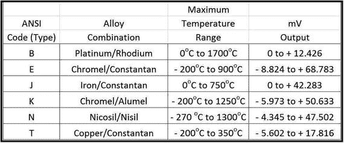 |

金属线径决定了热电偶的强度，从而决定了其“在使用中”的坚固性。线径还会影响导体的电阻和接点响应时间。表 3-6 列出了不同线径的铬镍-铝镍传感器的典型数据。

**表 3-6** 热电偶线径及其对传感器响应时间的影响

| -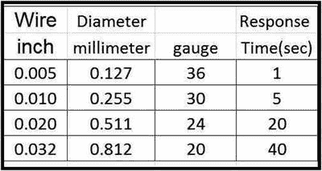 |

有关热电偶热量测量理论与实践的更多讨论，请参阅《电子学艺术》以及访问 `www.analog.com`。几乎所有主要的集成电路制造商都有专门的应用笔记，描述其可用于热电偶温度测量的电路。

## 实验

当使用热电偶实现温度测量时，微信号放大和冰水参考信号的需求，最好通过专用集成电路（ASIC）和市面上现成的点焊传感器来满足，这些传感器易于获取、价格低廉、可重复且可靠。
热电偶结经过点焊以确保完全的物理和电气接触。商用组装传感器通常配备有特制的彩色编码公插头，用于插入单个传感器系统的母连接器，或像许多工业应用那样，插入用于多传感器类型网络的集线器。（北美以外的地区颜色编码有所不同。）在本练习中，Omega Engineering 公司生产的商用 J 型和 K 型热电偶所附带的公头热电偶插头，连接到一个红色或黄色的母插座上，母插座再通过一对双绞线连接到原型面包板。
插接式面包板便于轻松组装并为 `AD595` 陶瓷 DIP 集成电路供电，该芯片为 K 型铬镍-铝镍硅传感器提供内部电子冰水参考电压、信号放大和高阻抗电压读数。（`AD594` DIP 陶瓷芯片可用于 J 型热电偶。）制造商的数据手册提供了以下主题列表的信息（见图 3-23 至 3-26）：
*   热电偶基础知识
*   `AD594` 和 `AD595` 用于 J 型和 K 型传感器的温度标度校准
*   所需显示温度范围和精度对应的电源要求
*   器件输出模式及实现热电偶故障报警
最初，本书使用了安装在原型面包板上并由 `LabJack U3-HV` 接口供电的 `AD595`。演示系统中的电气连接通过螺丝连接器和一对双绞线完成，双绞线将仪表放大器连接到行业标准的黄色 K 型热电偶插头。为了确保可靠性，还安装了一个红色 LED 连续性故障报警器。
验证或演示热电偶温度测量以及处理高温实验带来的材料问题中，比较困难的方面之一在于制造小型、可控的高温热源。
图 3-28 中接近 200°C 的温度，是通过将一个 15 W 的“负载灯”灯泡封装在锡纸包裹的瓦楞纸板辐射热烤箱中实现的，如图 3-22 所示。烤箱放置在一块底板上，底板上开有孔洞，以便将负载灯灯泡拧入其灯座。必须小心确保底板紧密地安置在 CSA 或 UL 认证灯具中包裹灯泡插座的可拆卸螺纹瓷环下方。（加拿大标准协会或美国保险商实验室——电气配件认证机构）。烤箱的壁和顶由锡箔包裹的厚重硬纸板套筒和方形锡箔覆盖的硬纸板制成。灯泡功率可以通过经认证的调光器或图 3-23 中的电路来控制。
如果选择使用 TRIAC 供电的交流 PWM 电路来控制施加到灯泡的功率，则定时电容器应为塑料薄膜型或接近 1 μF 的低漏电电容器，以使定时器 IC 输出与 60 Hz 交流线电压波形保持同步。请记住，所有交流布线和电气配件必须符合当地电气或建筑规范。

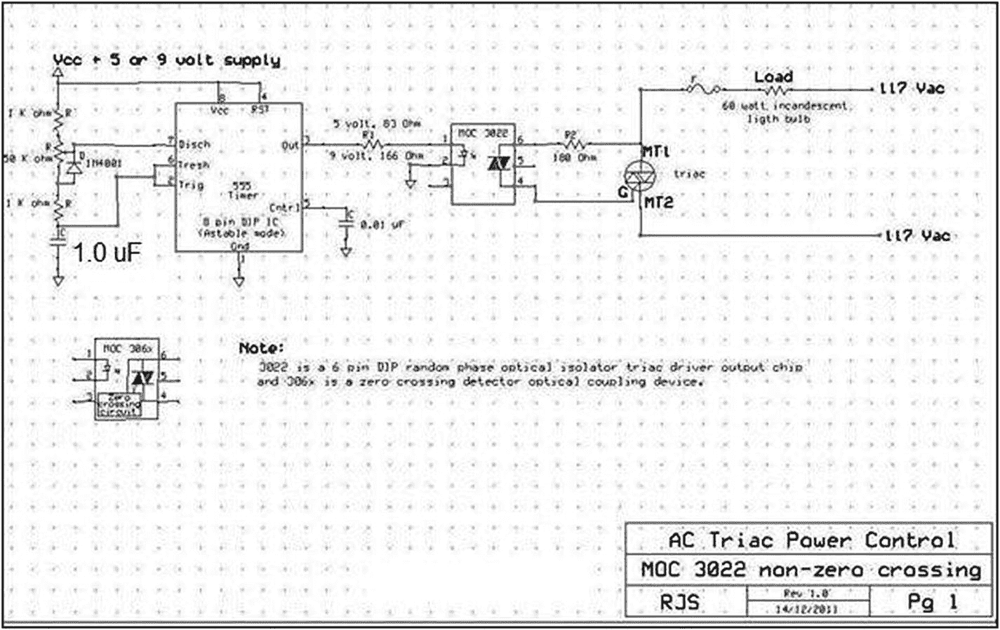

**图 3-23** 用于灯泡烤箱的基于 TRIAC 的交流电源

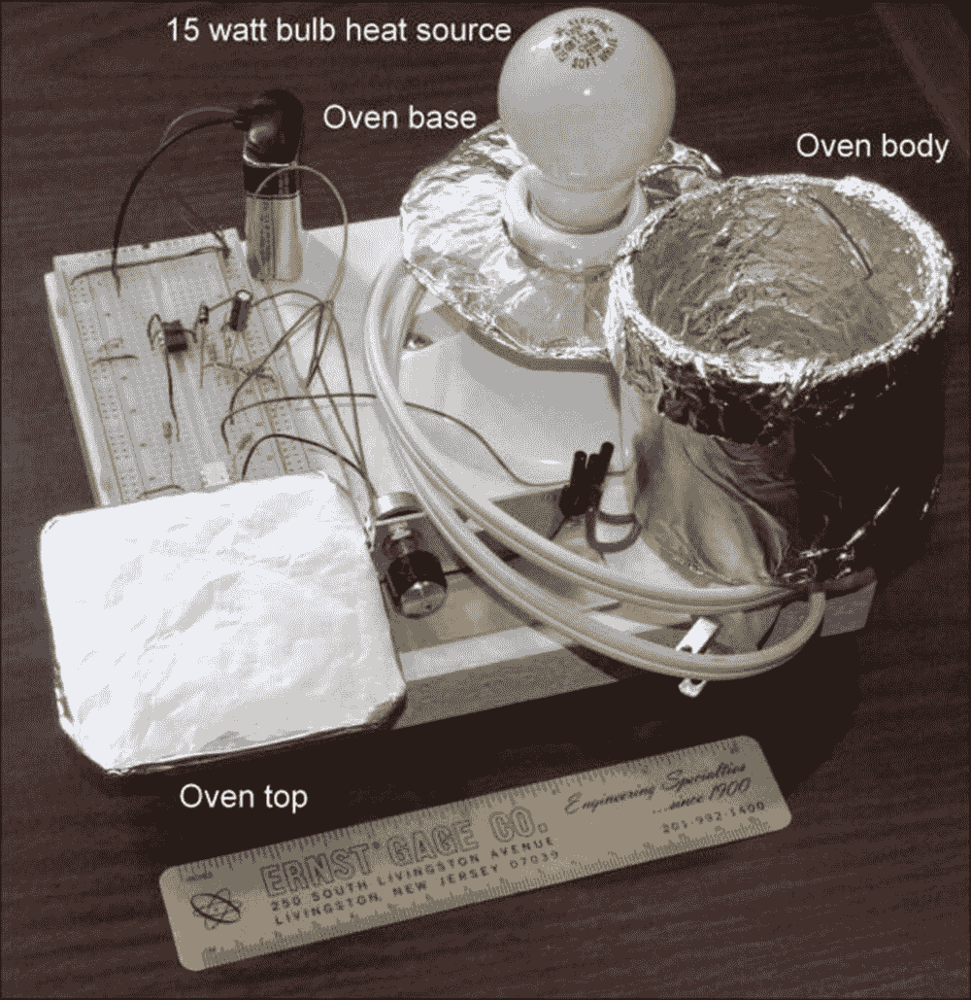

**图 3-22** 灯泡烤箱

图 3-24 至 3-27 描述了一系列描述使用 `AD594/5` IC 测量热电偶温度的变体电路图。
要测量超过使用 `U3-HV` 提供的 +5 V 电源（见图 3-24 和 3-26）所施加的 300°C 限制的温度，必须使用如图 3-25 所示的双极性非对称电源。可以使用三个 9 V 电池，方法是将一对串联电池的负极引线连接到第三个 9 V 电池的正极引线上。这样，公共的正-负连接就建立了比“地”或公共点高 +18 V 的电位，以及比地低 –9 V 的电位。因此，非对称电源允许 `AD595` 和 K 型热电偶测量从 –200°C 到 1350°C 的温度。组合的这三个电池总共产生 27 V 的电位，比芯片最大 30 伏低三伏。
图 3-26 中的电路显示了用于接线 LED 连续性指示器的连接方式，该指示器应安装在所有热电偶实现方案中。
图 3-27 说明了一种配置，其中 `595/4` 芯片本身可用作温度传感器。

### 硬件

典型的 K 型热电偶器件可能会产生 41 μV/°C 的信号，而 J 型则产生 55 μV/°C。测量如此微小的信号需要一种不会从传感器汲取任何可观电流的“仪表放大器”器件。专用的高阻抗仪表放大器可在专用集成电路中获取，例如用于 J 型和 K 型热电偶的 `Analog Devices 594` 和 `595` 芯片。
由温度因素以及制造热电偶所用不同合金的化学性质引起的焊接问题，通过使用机械连接将传感器连接到电子器件来规避。将 Omega Engineering 公司生产的商用带插座公头的铬镍-铝镍硅 K 型热电偶插入一个 K 型母插座中，该母插座配有一对双绞线，用于接入原型面包板。原型板承载了双列直插式封装（DIP）的 `AD595`、来自 `LabJack` 的 5 V 电源以及 LED 连续性指示器，同时方便连接到 `U3-HV` 接口。
图 3-24、3-25、3-26 是电路原理图。

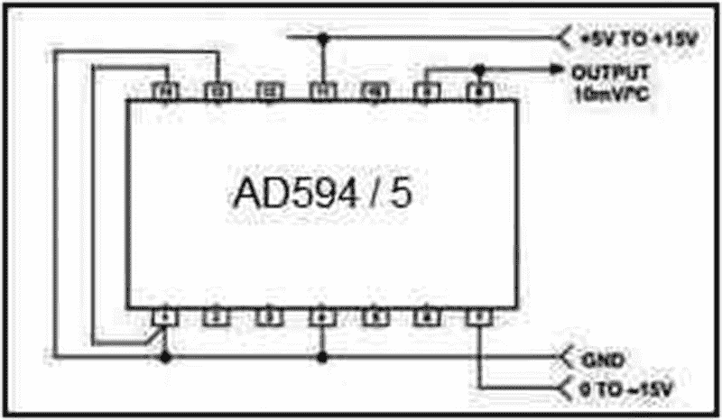

**图 3-27** 配置为独立摄氏温度计的 `ADC594/5`

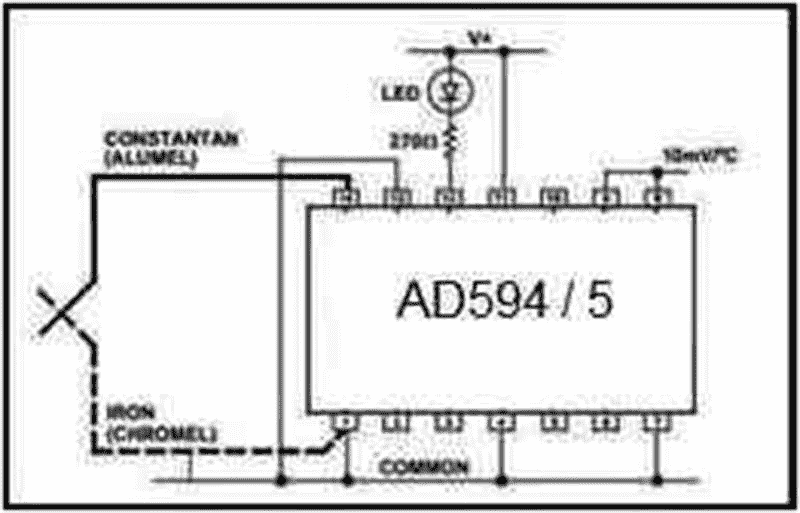

**图 3-26** 带 LED 的报警配置

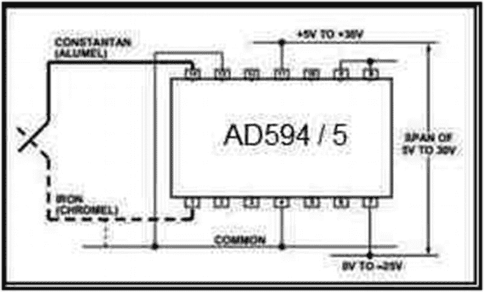

**图 3-25** 双电源供电操作

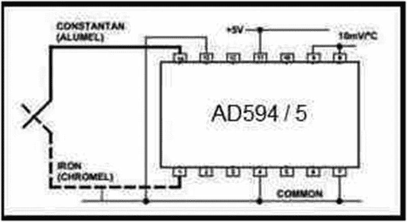

**图 3-24** 基本连接，单电源供电操作

## 软件

根据制造商的数据手册，这些集成电路在出厂时已针对标称 25°C 下的固定增益操作进行了校准，以生成与 ANSI 值相对应的电压。为了记录 `AD595` 的热电偶温度、输出电压、面包板安装及 USB 供电组合的情况，用于跟踪 `AD595` 输出的通道，其图形输出可以通过向图形显示器的绘图函数添加补偿值来进行调整，以符合 ANSI 标准。对于温度-电压关系的 J 型和 K 型曲线，其线性度对大多数实验而言已经足够。如果需要更精确的温度数据，建议在感兴趣的温度范围内进行校准。
在 `DAQFactory` 中创建了一个名为 `thrmoCplU3` 的通道，用于读取 `LabJack U3-HV` 接口上的第一个模拟输入通道。结果以黑色绘制在二维图形显示器上。右轴上以红色绘制的第二张图用于在开发阶段跟踪实际电压值。
虽然不需要编写脚本，但在 Y 表达式框中，只需将 `AD595` 以伏特为单位的输出电压乘以 100，即可绘制热电偶温度。该通道测量的是 595 的输出电压。当转换为毫伏并除以 10mV/°C 后，得出一个 100 的乘数因子，用于将观测到的放大后热电偶电压转换为摄氏度以便绘图。

## 观察结果

使用 `AD595` 热电偶放大器可测量的温度范围，由为该集成电路供电的电源电压决定。图 3-28 显示了一个简单负载灯炉中观测到的温度记录，即热电偶放大器输出在 0 到 3.5 V 和 0 到 300°C 范围内的数据。该负载灯炉的设计目的是在 USB +5 V 电源所施加的约 300°C 限制以下，产生可调节的、可变的温度。

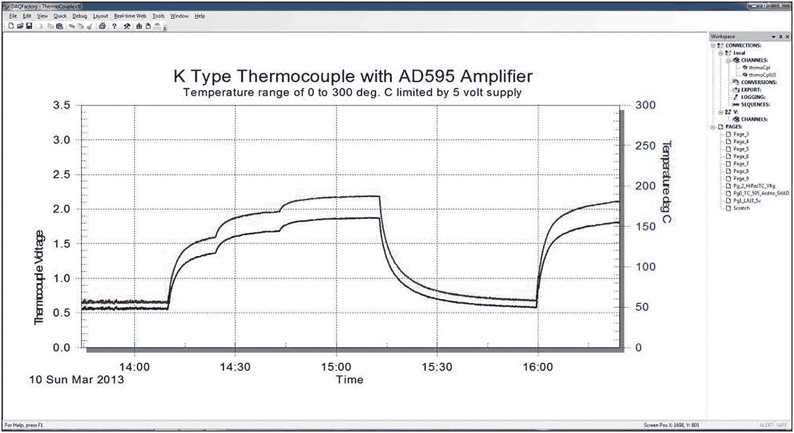

**图 3-28** 白炽灯泡的表面温度

图 3-28 中的温度曲线显示了在简易负载灯炉中，当负载灯的开启/关闭时间随 PWM 功率控制器变化时所观测到的温度波动。
使用双极非对称电源时，热电偶既可以测量低于环境温度的温度，也可以测量远高于环境温度的温度，其温度上限由所涉及金属的熔点决定。在图 3-29 中，对烙铁测量的不同温度揭示了测量较高温度时遇到的一个问题：腐蚀产物干扰了热传递。

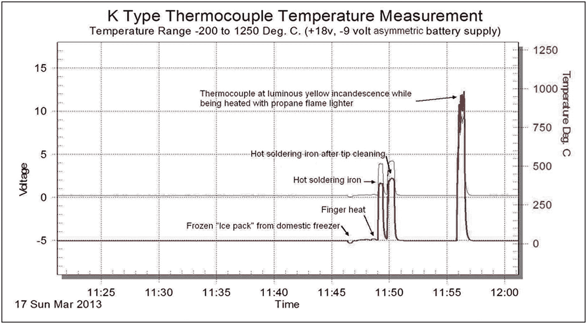

**图 3-29** 热电偶电压与较高温度测量

## 讨论

热电偶提供了一种温度测量手段，其测量范围超过了热敏电阻所能达到的范围。大多数热电偶可以在接近其熔点的温度下提供数据。
科学史指出，热电效应最初是在发现浸没在热梯度中的导体周围存在磁场时被发现的。通常认为热电效应是由异种金属接触产生的，但无论是熔焊、基于焊剂的钎焊，还是螺钉或螺栓等机械紧固件，在对热电偶进行测试或验证时都会产生相同的结果。热电效应是沿着导线热梯度的长度方向产生的，而不是在异种金属的接触点处产生，接触点只需要可靠的电气接触来闭合电路即可。
达到超过 650°C (1300°F) 的温度，会使设备进入一个温度范围，在此范围内，典型的构建材料（如锡铅焊料、镀锌涂层、锡、铅和铝金属、塑料、钠钙玻璃和硼硅玻璃以及许多其他材料）会软化或熔化。在较低温度下绝缘的大功率电导体可能会突然短路，可能导致熔融材料的爆炸性气化。为了达到更高温度而开发的装置或辅助设备，其从规划、制造到投入运行温度的整个过程，都必须经过仔细监控并缓慢递增步骤，以确保所有相关人员的安全。
热电偶、RTD 或光学方法是测量超过 650°C 温度的仅有手段。热电偶可能是监测较高温度的最简单方法。K 型和 J 型传感器在实验工作中很受欢迎，因为它们价格低廉、坚固耐用，并且能产生较高的热电偶结电压（分别为 41 μV/°C 和 55 μV/°C）。
由铬镍-铝镍热电偶结组成的 K 型热电偶灵敏度较低，但由于其合金中镍、铬和铝成分形成的铝和氧化铬层，其温度范围更宽且具有化学惰性。J 型传感器虽然能产生热电偶传感器中最高的电压，但由铁-康铜组成。铁的活性特性，加上温度-电压相关性中 770°C 居里点的不连续性，限制了该传感器的可用范围。
在选择用于封闭环境中测量高温的热电偶时必须小心，因为被加热材料可能会释放出腐蚀性气体。K 型热电偶受到铬和铝的耐火氧化物的保护，能在空气中完全覆盖传感器量程。J 型和 T 型热电偶含有铁和铜，两者都是具有反应活性的天然金属。
含有大量或少量反应性和还原性气体（如氨、氢气、卤化氢、硫化氢、氮氧化物、氧气或硫氧化物）的气氛，需要您查阅相关文献，以了解其化学相容性和温度限制。
低温测量应用通常处于低温大大抑制了化学反应活性的环境中，因此在传感器选择方面问题较少。
升高的温度会按比例提高化学反应速率，这包括了被称为腐蚀的反应。虽然异种金属之间的接触在机械结构中因腐蚀作用而臭名昭著，但热电偶金属的情况要好得多，然而高温和高热会对几乎所有材料产生严苛的条件。建议在任何 TC 温度监测系统中，安装图 3-26 所示的 LED 连续性监测器。