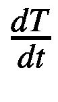
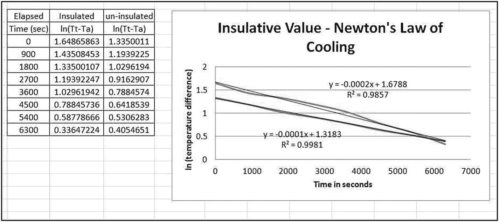
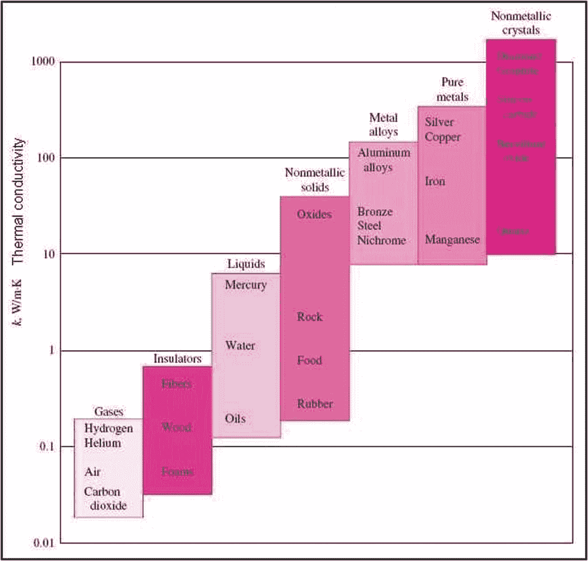
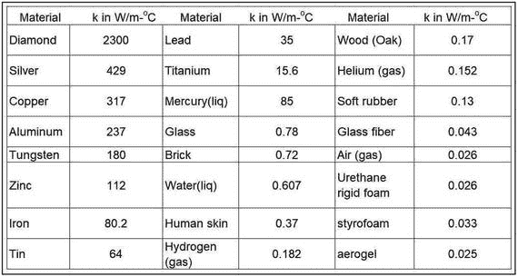

# 热传递与基础热力学

热能可视为特定温度下特定质量或系统中以运动或振动形式存在的分子动能。理论物理学将除零点分子运动之外的所有运动停止的点称为温标上的绝对零度。从绝对零度的概念出发，我们可以通过考虑两个质量块来进一步区分热量与温度：其中一个质量是另一个的两倍，两者具有相同水平的分子动能。这两个不等质量块的温度相同，但质量较大的块所包含的热量是较轻块的两倍。温度描述的是能量的水平，热量描述的是能量的数量。

热量是一种能量形式，可以凭借两个位置之间的温差从一个系统传递到另一个系统。能量从热的地方向冷的地方移动，以达到热力学平衡。对流、传导和辐射是传递热能的三种主要方式。艾萨克·牛顿爵士关于热的原始出版物论述了温度测量。傅里叶的著作描述了热能的运动。

通过模拟加热物体的冷却，对热运动进行热力学研究已成为科学或数学教育中的传统练习。牛顿冷却定律是一个应用，由此可以发展出指数衰减数学模型。

迄今为止，在涉及温度监测研究的先前实验中，使用了内部装有电加热器并设有特殊空腔以容纳温度传感器的绝缘金属块组件，这种传感器被称为*干井*。通过记录干井从较高温度冷却到较低温度时的温度变化，我们可以推导出冷却定律，并生成关于材料的特定信息以及预测性数学公式。

社会中广泛使用的金属、玻璃和塑料，通常是从其高温液态制成物品。当被加热材料保持在熔炉或烘箱中时，它处于液态或塑性状态，可以被塑造或挤压成有用的形状，然后通过冷却固定成所需的最终形状。冷却过程通过将热成型产品移至较冷的环境，使其自由散热或按受控程序散热来启动。

就一个有用的数学模型而言，你可以写成：

```
 = `–k(T[i] – T[e])` -- 1
```

*   `–k` 是比例常数，`dT/dt` 是一阶导数，即温度随时间的变化率
*   `T[i]` 是物体的初始温度
*   `T[e]` 是物体向其散失热量的环境温度。

为了求解微分方程并找到任意所需时刻的温度 `T`，将时间和温度变量分离。对等式两边进行积分以得出表达式。

`–kt = log(T[i] – T[e]) + ln C`  或

`T[i] – T[e] = Ce^(-kt)` ，根据零时刻的初始条件，当

`C = T[i] – T[e]` 时，我们可以代入 `C` 并写成

`T = T[e] + (T[i] – T[e]) e^(-kt)`，以关联物体温度和时间流逝。

如果在固定时间内连续记录温度的下降，可以使用该衰减曲线作为数据源来评估参数，例如隔热材料的有效性以及实验装置的热容量。

一种称为*欧拉法*的技术将记录到的时间和温度曲线的各个点转换成一种格式，从中可以推导出牛顿定律公式中比例常数的数值。

牛顿冷却定律被用作微分方程的教学示例，因为与大多数微分方程不同，它可以求出精确解。欧拉法是一种技术，它既能对可能没有精确解的微分方程在小范围内生成近似解，也能对确实有精确解的微分方程（如牛顿冷却定律中的方程）求出其中的常数。

## 实验

对于化学家、生物学家和工程师来说，许多实验研究都需要监测封闭系统中热量的产生或散失。本书前面的章节中，使用了一种简单的“封闭系统”近似，即铝制*干井*，用于创建可重复的固定温度和可变温度曲线。将干井封装在泡沫聚苯乙烯盒内作为隔热，但留有加热器电源线的开口以及进入金属块中干井腔体的通道，这样就近似构成了一个封闭系统。通过在温度升高扰动后，记录干井冷却到环境条件时其温度随时间下降的数据，可以收集评估方程 1 中比例常数 `k` 所需的数据。如果在有和没有隔热层的情况下对干井进行定时供电，则可以推导出该隔热层隔热效果的数值。使用如图 3-15 所示惠斯通电桥中的 SiC 热敏电阻，记录了有隔热和无隔热情况下干井的冷却曲线。

### 观测结果

图 3-30 展示了从观测到的冷却曲线中读取的、有和没有泡沫聚苯乙烯隔热层的 22.6 Ω 干井的时间和温度测量数据表格。蓝色代表有隔热层冷却，红色代表无隔热层冷却。



图 3-30

泡沫聚苯乙烯隔热对铝制干井块冷却速率的影响

## 讨论

热量可以简单分为两种形式：*显热*和*潜热*。显热是指当向某物质添加或移除能量时，导致该物质温度发生变化的能量。潜热则是为改变物质物理状态而必须向该物质添加或从中移除的能量，且不表现为温度变化。水的比热容为`4.186 J/g °C`（80 cal/g °C），但在 0°C 时，其熔化潜热为`334 kJ/Kg`（80 cal/g）。在 100°C 时，其汽化潜热为`2260 kJ/Kg`（540 cal/g）。我们利用潜热现象，通过测量热敏电阻浸入水/冰混合物时的电阻来校准它们。如果液体浴槽中存在冰块，温度将保持在 0°C，直到所有冰块融化，此时任何流入浴槽的热量都会导致系统温度升高（见图 3-49）。在另一种极端情况下，当使用水作为校准流体时，一容器沸腾或冒蒸汽的水，在根据海拔或大气压进行校正后，只要容器内仍有液态水，其温度就会保持在 100°C。

在水沸点和冰点之间的温度下，向一克水添加一卡路里热能，会使水温升高一摄氏度。比热容是将单位质量的物质升高一摄氏度所需的热能。

水是比热容的标准参照物，其值为每摄氏度一卡路里。文献中包含了许多关于元素、化合物以及液体和固体形态建筑材料的比热容表格。气体的比热容定义则需要更加谨慎。

除了比热容，热导率在设计控制热流系统方面也很有价值。测量加热块冷却速率的变化，可以作为衡量泡沫聚苯乙烯隔热效果以及系统封闭性的一项指标。表 3-7 列出了各种材料在室温下的热导率，其中热导率`k`的单位是瓦特每米摄氏度。



图 3-31

选定材料热导率的图形表示（参见 [`what-when-how.com/energy-engineering/heat-transfer-energy-engineering/`](http://what-when-how.com/energy-engineering/heat-transfer-energy-engineering/)）

表 3-7

各种材料在室温下的热导率

| - |