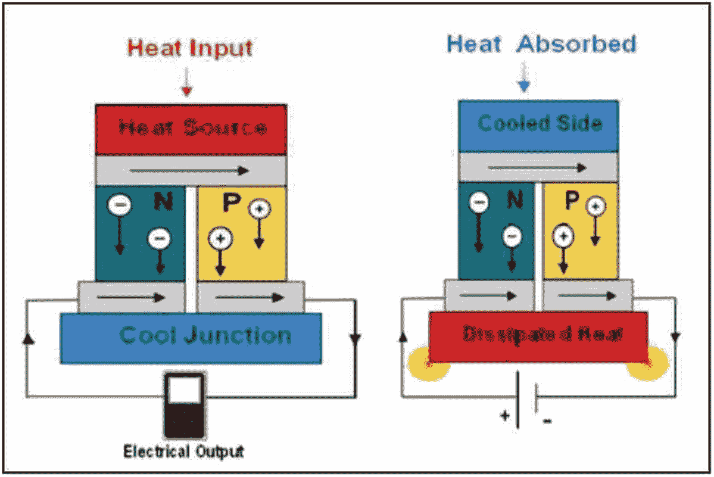
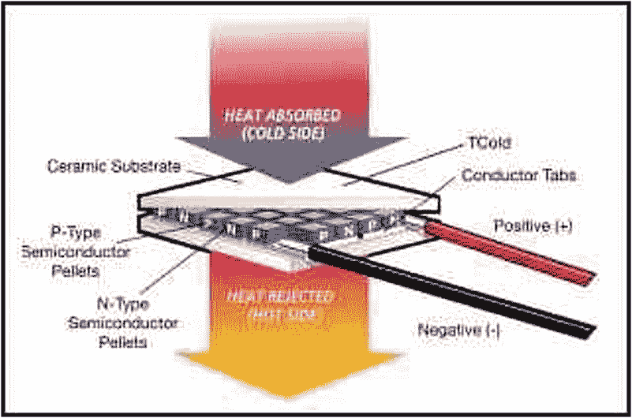

# 热电效应

人们很早就知道，通过在磁场中移动线圈导线导体可以将机械能转换为电能。但鲜为人知的是，沿着导体的温度梯度也会在该导体内产生一个微弱的电场。通过使用另一种金属导体来完成测量回路，可以测量出驱动载流子穿过温度梯度的电压，这样就形成了常用于测量梯度一端温度的热电偶。

热电偶是一种广为人知且常用的温度测量系统。热电偶结点是由两种不同的金属导线电气连接而成，当这些导线组合成适当、具有双结点的电路时，就能将温差转换为微弱、可测量的电压。热电偶利用的是 18 世纪发现的热电效应（塞贝克效应），同时发现的还有珀尔帖效应，该效应阐述了电流与不同金属结点处加热或冷却之间的关系。

随着对电能、金属导体和温差之间关系的认识加深，人们逐渐意识到，与电磁感应力相比，热电现象本质上非常微弱。

热量、电流和功率通过欧姆定律以及功率表达式`P = I²R`相关联。电流在金属导体中克服电阻移动时，会产生热量。

尽管最初的热电现象是在金属导体界面发现的，但同样的热-电转换也可以在半导体中实现。如今，大多数热电设备中使用的半导体是碲化铋（`Bi[2]Te[3]`）。

在图 3-32 中，现代热电设备的可逆性质通过热量或电能流动的方向得以说明。如果存在温度梯度或热梯度，单个设备可以发电。如果有电能可用，则可以移动或“泵送”热能。

图 3-32

一种可逆的热电设备

图 3-33 描绘了一个典型的尺寸为`40 mm² × 4 mm²`的陶瓷封装热电板的构造。

图 3-33

一个典型的陶瓷封装热电板

