# 热电加热与制冷

热电设备是商业制造的，用于实现电能和热能之间的相互转换。固态热电设备可以认为是可逆的，因为它们没有移动部件，既可以利用电能泵送热量，也可以利用热能发电。

通过使用半导体优化微弱的热电效应，创造了一种热移动技术，该技术具有同样微弱、有限但仍然可用的能力。除了这种效应本身的微弱性质外，温差还受到用于组装传热设备的建筑材料和已建立梯度上的辐射传热的热导率的限制。与电阻加热组件一样，必须小心谨慎，避免过近地接近或无意中超过热操纵系统中用于制造电气连接的焊料的熔化温度。几乎所有类型的半导体设备都对热敏感，并且倾向于在环境温度和更低温度下运行得更好。`Tellurex` 是一家`40 mm²`、碲化铋、氧化铝陶瓷板热电设备的制造商，其数据手册建议最高使用温度为 100°C。

## 实验

平板热电热传导元件需要低压、大电流的直流激励才能在其表面传递热量。使用微控制器和`MOSFET`器件可以方便地实现对低电压下大直流电流的控制。图 3-34 电路中所用的微控制器代码，是一个简单的、通过脉冲宽度调制（PWM）应用手动增加或减少供电功率的模块，用于调制或驱动高电流`MOSFET`的栅极。因此，栅极调制可调节由线路供电电源提供的 12 V、8.5 A 直流电源。

一个热电热泵演示单元由木制底座和一系列成形堆叠的木制板构成，这些板形成一个双腔测试单元，中间由一块 40 mm²（1½英寸）× 4 mm（英寸）厚的热电板隔开。一个大电流电源、接线端子板、一个`Arduino`微控制器和两个 30 KΩ热敏电阻温度探头均牢固地安装在组件底座上，以便在改变热电冷却（TEC）板的功率时，安全地供电并监测产生的温差。

图 3-34 是一个综合示意图，展示了与`Arduino`的连接，用于温度监测以及高电流`MOSFET`栅极的脉冲宽度调制（PWM）控制。两个 30 KΩ热敏电阻安装在测试单元两侧形成的热室和冷室中，TEC 板将这两个腔室分隔开。

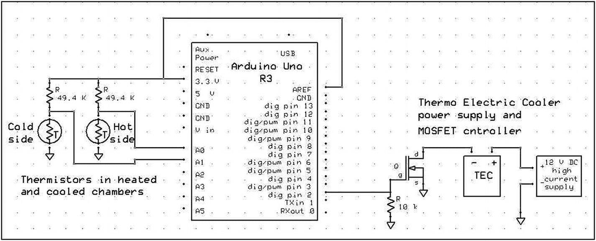

**图 3-34**

Arduino TEC 电源控制与温度监测原理图

如图 3-34 原理图所示，对 TEC 的功率控制以及 TEC 板产生的温差，由编程了清单 3-4 中代码的`Arduino`进行控制和显示。这段代码控制一个 PWM 引脚，其输出宽度通过从串口发送`"i"`或`"d"`来增加或减少，从而改变高电流`MOSFET`开关栅极的导通和关断时间。使用了一个安装在 2 英寸×2 英寸（50 mm × 50 mm）带散热片散热器上的`FQP33N10` 100 V、33 A、52 mΩ导通电阻、N 沟道、增强型功率`MOSFET`，用于控制流向 TEC 的电流。TEC 产生的温差由安装在测试单元内 TEC 板两侧两个腔室中的两个 30 KΩ环氧树脂珠热敏电阻进行监测。

通过在温度监测中使用`Arduino`上的 3.3 V 电源、5 倍数据平均值以及描述电阻与热敏电阻温度关系的 Steinhart-Hart 近似公式，可以获得更高的稳定性和精度。

用于监测由 TEC 板将主腔室一分为二所形成的每个隔间相对温度的两个热敏电阻，均安装在手工绘制的小型电路板（见图 RE-2）上，然后将这些电路板固定在测试组件顶板和底板中心钻孔的检修孔旁。

清单 3-4 会将控制和监测算法中使用的几个中间值打印到串口，以协助系统配置。一旦测试单元功能令人满意，您可以根据需要注释掉打印中间诊断值的代码行，以清理串口显示。

在图 3-35 和图 3-36 中，TEC 测试装置以组装形式以及部分拆卸状态展示，以显示其简单的构造。各个组件由数字标注标识，这些数字在图后的文字中予以说明。

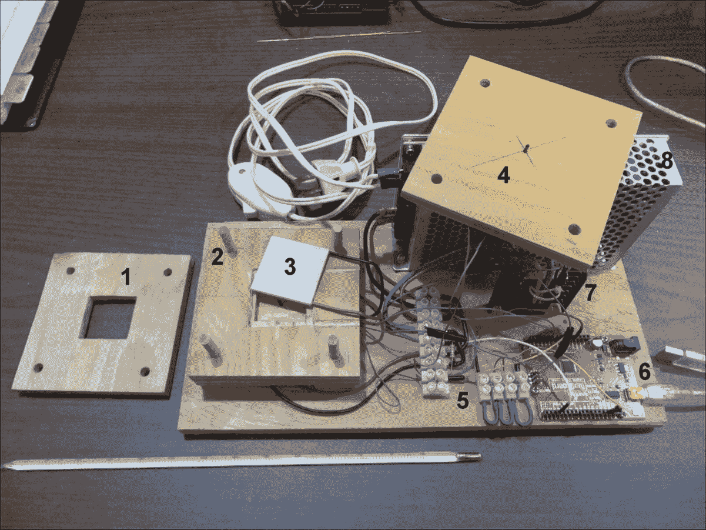

**图 3-35**

Arduino TEC 测试腔室（部分拆卸状态）

图 3-35 展示了用于制作 4 平方英寸（10 cm²）双腔测试单元的部分拆卸状态的组件，该单元使用四块 3/8 英寸（9.5 mm）厚的胶合板。板 I 和板 II 在 1-5/16 英寸（3.3 cm）的方形开口周围有 1/8 英寸（3 mm）宽、1/16 英寸（1.5 mm）深的凹槽台阶，用于容纳 1-9/16 英寸（40 mm）的 TEC 板（组件 3）。

与该板的电气连接通过冷却板右侧的两个凹槽通道引出。单元的底板与顶板（标注 4）相同，在板的几何中心钻有一个 3/32 英寸（2.4 mm）的孔，用于容纳安装有 PCB 的热敏电阻组件，如图 3-36 所示。

四个木制定位销对齐测试单元组件，并定位 4 平方英寸（10.1 cm²）的垫片，这些垫片将整个堆叠件抬高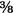英寸（9.5 mm），使其离开½英寸（12.2 mm）厚胶合板底座的顶面。在标注 5 两侧可见的两个接线端子板安装在底座上，为连接 USB 的微控制器（标注 6）、安装有散热器的`MOSFET`（标注 7）以及边缘安装的大电流 12 V 电源（标注 8）的接线提供牢固的安装点。

图 3-36 显示了安装在顶板上的、手工绘制的分压电路 PCB，其上装有热敏电阻和固定值电阻。这个顶板 PCB 与安装在大电流测试装置底板上的第二个 PCB 组件完全相同。

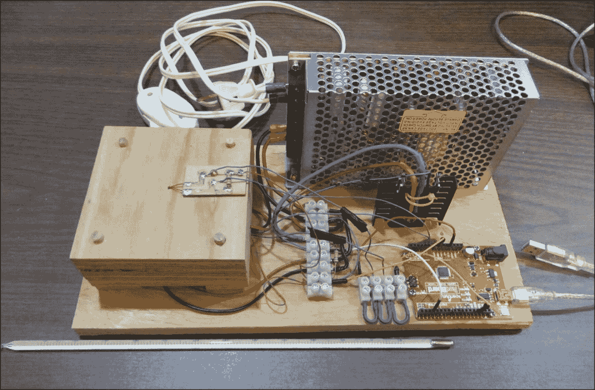

**图 3-36**

Arduino TEC 测试系统（完全组装状态）

进行 TEC 测试时，将微控制器连接到装有 Arduino IDE 的计算机，并为 12 V 电源供电。将清单 3-4 加载到微控制器中。通过从串口监视器发送一个`"i"`，以 5 个单位为增量增加施加到 TEC 板的所需功率。由`"i"`调用的 5 单位增量被映射到一个 0 到 255 的脉冲宽度调制范围，该范围调整栅极导通时间，从而每调用或使用一个 5 单位增量，就将可用功率的 12.5%施加到 TEC。

## 观察结果

对木质双腔单元中 TEC 的初步测试表明，腔室整体有冷却效果。对 Arduino 代码进行一个 5 单位的增量（对应于 12%的 PWM 功率输送至负载）后，一个小时内，板冷侧的热敏电阻读数从初始的 26°C 降至 1°C。

在图 3-34 的电路图中，电源的正极连接到板的红色或正极端子。施加较低功率水平会使板冷却，一侧的冷却速度比另一侧快 5 或 6 度。如果施加的电流反向，则另一侧冷却得更快，但在反向电流配置下仅进行了有限的实验。

在图 3-37 中，施加到 TEC 的功率大小决定了从冷却板获得的冷却程度。

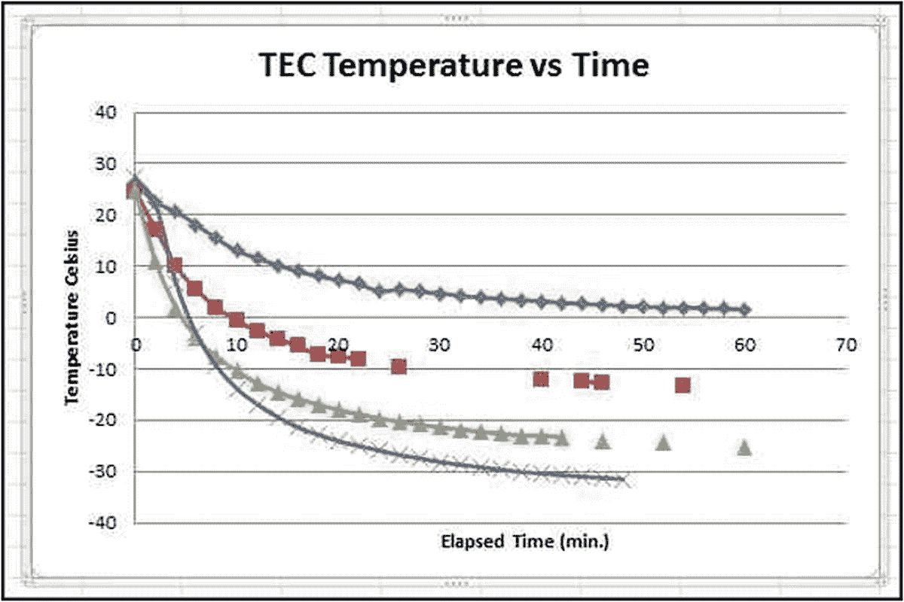

**图 3-37**

在四种施加功率水平下，Arduino TEC 温度随时间的变化

## 讨论

热电热传递需要在相对较低的电压水平下控制大电流。测试单元的`TEC`电热冷却片由一款线路供电的 12 V 电源供电，其输出能力为 8.5 A。为了使用`PWM`技术控制该电流，将一个`FQP 33N10` MOSFET 安装在 2 in × 2 in (5 cm × 5 cm)的带翅片散热器上，以满足`TEC`电热冷却片的电流需求。

我们选用干燥木材作为基本结构材料，因为它易于获取、便于加工，并且兼具电绝缘和热绝缘特性。

代码清单 3-4 是一个允许对`TEC`电热冷却片进行功率控制并将腔体温度打印到串口的 Arduino 程序。该代码使用 Steinhart-Hart 方程来生成每个腔体的摄氏度温度。此处仅绘制了冷却腔体的数据，作为`TEC`电热冷却片提供的热传递能力的一个示例。

为了充分利用`TEC`电热冷却片的热传递特性，必须在使用保温或隔热的绝缘材料方面格外小心。例如，如果实验需要温度与环境温度有显著差异，那么双腔体测试装置的设计并不理想，因为被泵送的热量无法消散，会在相邻的接收腔体中积聚，从而为热量回流到温度不足的腔体提供一个近距离的热源。作为制冷功能的最低设计参数，`TEC`电热冷却片的热端应暴露于环境大气中，以便被泵送的热量得以消散。

# 使用 Raspberry Pi 和 Python 测量热量与温度

高灵敏度或高精度的温度测量可以通过 Arduino 微控制器实现，该控制器在 555 定时器芯片的输出端（其 RC 定时网络中使用了一个热敏电阻）实施脉宽差分测量技术。由热敏电阻温度变化产生的脉宽差分变化，随后可通过运行在`RPi`上的 Python `Matplotlib`带状图表记录器（`SCR`）显示进行记录和显示。

正如在`DAQFactory`实现的高精度高分辨率温度测量方法中所介绍的，通过利用 Arduino 微控制器的脉冲计数能力，来测量通过一个固定电阻和一个负温度系数热敏电阻的串联电阻对高质量、低漏电电容充电所需的时间，从而扩展了热敏电阻测量的灵敏度。

该方法与最初发表的技术有所不同。脉宽差分时间被用作温度变化的指标，而不是计算热敏电阻的电阻值并将其转换为绝对温度（参见[`www.st.com/resource/en/application_note/cd00010962-a-high-resolutionprecision-thermometer-using-st7-and-ne555-stmicroelectronics.pdf`](http://www.st.com/resource/en/application_note/cd00010962-a-high-resolutionprecision-thermometer-using-st7-and-ne555-stmicroelectronics.pdf)）。

以脉宽差分数值形式连续记录和绘制温度数据，要求绘图程序能够接受不同位数的数值，本练习的实验部分对此进行了说明。

在代码清单 3-2 中开发了 Python 代码，用于接收并评估由 Arduino 微控制器广播后到达串口的、具有不同数字位宽度的变量值。然而，除了解析传输的数字值之外，有时还需要清除 Python 串行输入缓冲区（如代码清单 3-2 所示），以防止串口缓冲区中累积的垃圾数据导致 Python 代码在后续的绘图例程中抛出错误。您还必须确保所使用的 Python 输入缓冲区清除命令和切片符号与用于绘图程序的 Python 版本兼容。

本练习作为代码清单 3-2 发布到编程列表中的绘图代码，主要是通过试错过程，从原始的 Matplotlib 带状图表记录器或示波器程序修改而来的。需要注意使用`len()`函数来确定字符串的长度，以及使用`slice()`函数来隔离所需部分的字符串。Arduino 输出的字符串可能包含几个 ASCII 转义字符，例如`\r`（“回车”）和`\n`（“换行”），`len()`和`slice()`函数将这些字符视为单个字符处理。串行读取行函数会读取直到`\r\n`序列（表示当前行结束）的所有字符。`len()`和`slice()`函数将这四个字符视为两个单独的单元`\r`和`\n`。

Matplotlib 绘图程序提供了为显示轴添加标签的功能。它允许实验者通过颠倒 y 轴最大值和最小值的指定顺序，来选择随数据值变化而上升或下降的轨迹（见图 3-38 和 3-39）。通过为目标量程指定正负最大值，可以在零轴上方和下方绘制正数和负数。

确保操作系统保持更新、仔细关注向后兼容性，并愿意为获得一个可运行的程序而进行代码实验，是使用免费开源系统所必需的前提条件。

## 实验

图 3-1 是实现高分辨率或精密热敏电阻温度测量装置的电路原理图。

为了进行高分辨率或精密温度测量实验，需要选择要使用的设备组件。无焊面包板可以快速准备一个用于一两次测量或应用演示的装置。假设要进行大量不同热敏电阻、电阻或电容值的实验，则应考虑使用印刷电路板，或在带螺丝接线端子的洞洞板上进行硬接线配置，以便更换组件（见图 3-42）。

在图 3-42 中，用于演示在 555 定时器 RC 振荡器的热敏电阻-电容定时网络中使用不同元件值效果的装置，由一块洞洞板、焊接的导线连接以及三组双端子螺丝连接器组成。

完成 RPi 的电气配置、555 定时器-热敏电阻-Arduino 组合的连接、绝缘干井的供电，并加载 Arduino 的移动平均数字信号处理软件和 RPi 的带状图记录仪程序后，就可以开始装置验证过程。

将热敏电阻珠浸入已稳定在室温的干井块中后，Arduino 上的串行监视器应生成一系列逐渐上升至稳定数值的数字。这些上升的数字是移动平均数字信号处理算法填充平均矩阵的结果，并确认了 Arduino 软件的正常运行。

一旦串行端口输出得到验证，就可以加载并启动 Python SCR 绘图程序，以显示由热敏电阻引起的 555 定时器高、低脉冲宽度变化所对应的脉冲宽度差分计数。

为了校准绘图程序的显示，应使用秒表测量图形显示的时间宽度；或者，可以使用 Python 的`asctime()`函数（[`https://docs.python.org/3/library/time.html`](https://docs.python.org/3/library/time.html)）为控制台显示的温度添加时间戳。然后，如第 10 章所述，可将带时间戳的温度记录存储在 SD 卡上。

为了对系统进行热校准，向干井块中的加热元件施加一个定时功率脉冲。脉冲的持续时间和所施加功率的电压应通过实验确定，因为块的大小、加热器的功率以及可用电源功率在实验工作中都是变量。我使用了图 3-2 中所示的干井，并配有一个 12V、3A 的电源，对于 2 至 3 分钟的功率脉冲，该电源能够产生 2 至 5 度的温升。精确的温度差值是通过读取占据块中三个井之一的水银玻璃温度计获得的。

在装置验证过程中，RPi 显示同时调用了控制台输出和绘图仪跟踪结果，以便轻松确认正在接收、处理和显示的值。通过将 Matplotlib 代码中的打印语句转换为注释来移除它们，则对于不需要存档数据存储的重复性实验，仅显示 SCR 轨迹。

## 观察结果

总共进行了四次校准实验，在 555 定时器的 RC 网络中使用了两种不同数值的高质量、低漏电聚酯薄膜电容。图 3-38 和图 3-39 中控制台记录或绘图仪轨迹的 y 值刻度显示，PWD 计数在 5000 至 6000 范围内。图 3-40 的 PWD 计数低了一个数量级，在数百范围内。图 3-38 和图 3-39 中的数据是使用 1 μF 电容收集的。图 3-40 中的记录数据则是使用 150 nF 电容生成的。

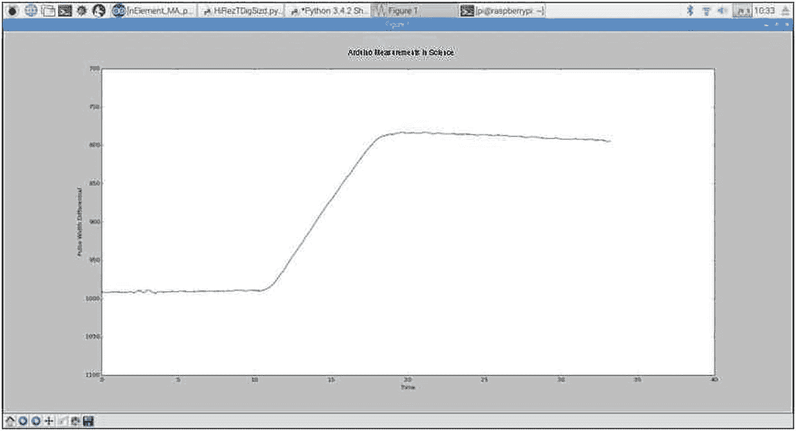

**图 3-40**

Matplotlib SCR 绘图程序的全屏显示选项

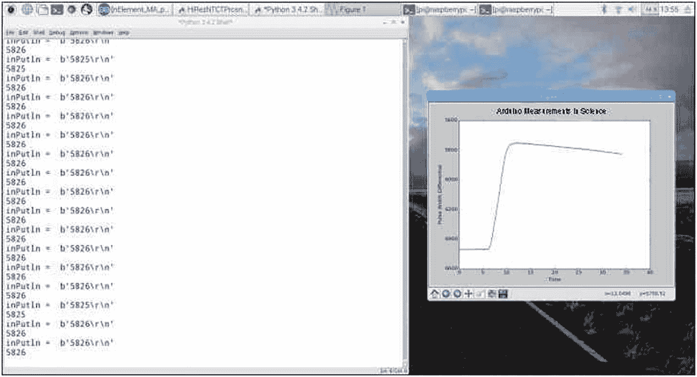

**图 3-39**

带有倒置 PWD 计数刻度的控制台日志和 SCR 绘图

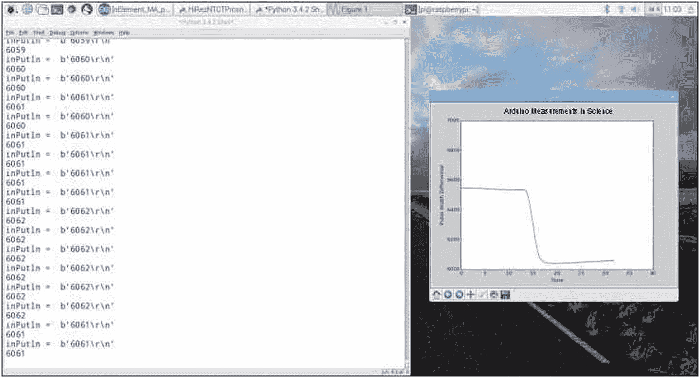

**图 3-38**

已知温度变化期间脉冲宽度差分计数的 Python 控制台日志和 SCR 绘图

表 3-8 列出了一组重复的温度校准实验，实验使用了一个 10 kΩ环氧树脂珠热敏电阻，并在 555 IC 定时器网络的`R2`位置放置了一个 10 kΩ 1%精度的电阻。

**表 3-8**

10K Ω环氧树脂珠热敏电阻的高分辨率温度校准

| -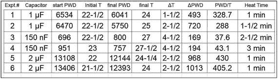 |

# 讨论

基于 Linux 的操作系统中的计时存在不一致性。为确保准确性，`Matplotlib` 的 `SCR` 绘图显示上的时间刻度应使用秒表进行校准，或者可以将带有时间戳的数据保存到 `SD` 卡并在控制台上显示。

通过使用热敏电阻和电容器构成 `555` 定时器的 `RC` 定时网络，可以将热敏电阻阻值的微小变化转换为 `555` 定时器方波输出高低电平时间比的变化。通过以微秒级分辨率监测该比率的变化，热敏电阻阻值的微小变化可以用较大的数值来表示，从而大大提高了监测温度的分辨率或精细度。与所有灵敏或高分辨率的测量系统一样，应验证探测器在其预期使用范围内的响应校准，以确保其准确性和可重复性。

表 3-8 表明，当使用 `10 kΩ` 热敏电阻、`10 kΩ` 电阻器和 `1 μF` 电容器构成 `RC` 网络时，每经历 1 度的温度变化，大约会记录 300 个计数。如果绘图仪可以读取基线上方 30 个计数，那么温度监测精度可达 `1/10` 度。如果可以看到 3 个计数，则实验正在测量 `1/100` 度的温度变化。在电子定时应用中，`RC` 时间常数的大小是各个元件大小的线性函数。在高分辨率热敏电阻温度测量电路中使用各种容量的低漏电电容器时，对于恒定的热敏电阻-R2 组合，`PWD` 计数与电容值成线性函数关系，如图 3-41 所示。图 3-41 中直线的方程为 `y = 6689.7x + 13.157`。

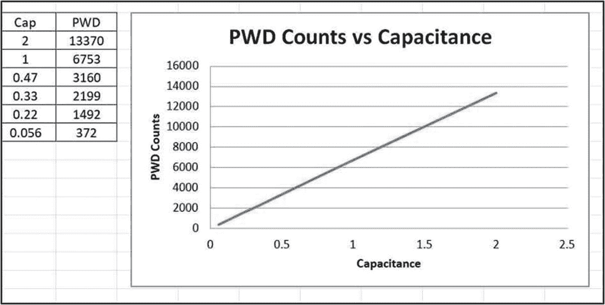

**图 3-41**
电容大小在高分辨率温度测量电路中的影响

对于高灵敏度测量，需要注意细节。必须最大限度地减少电源噪声，或使用电池供电，安装所有金属部件的电磁屏蔽，并考虑使用足够的隔热措施以防止热漂移。为了最大化特定应用中该技术的灵敏度，需要对 `RC` 组合进行优化。这最好在装置中实施了降噪和热稳定技术后，通过实验来完成。作为任何优化程序的一部分，热敏电阻的阻值可以超出本书中使用的 `10 kΩ` 和 `30 kΩ` 的范围进行改变。

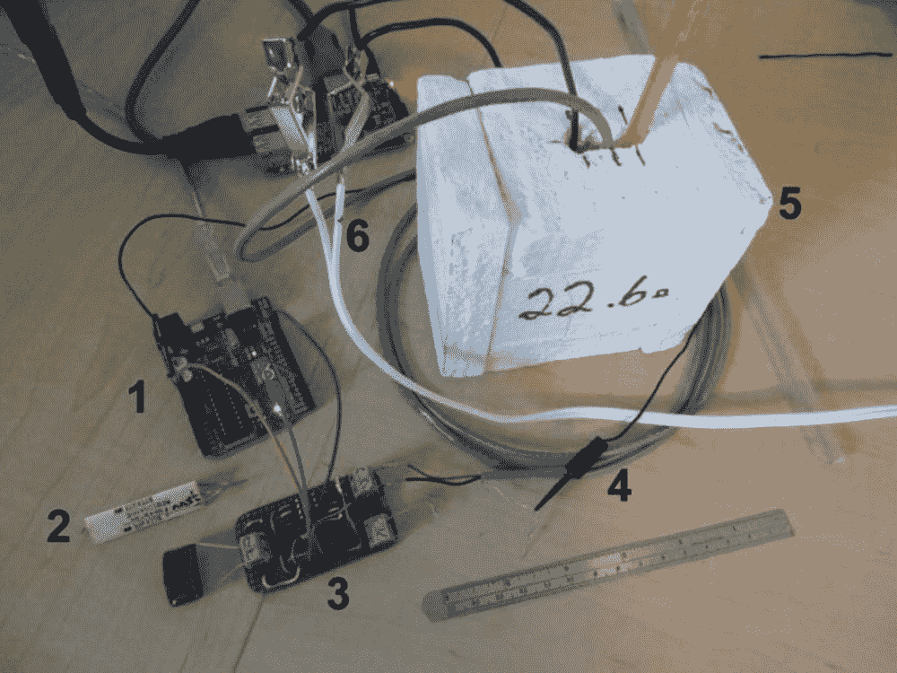

**图 3-42**
高分辨率或精密热敏电阻温度测量装置

1.  `Arduino` 微控制器板
2.  `1 μF` 聚苯乙烯电容器
3.  高分辨率热敏电阻 `555` 定时器面包板，带有三个用于更换元件的双线螺旋端子连接器
4.  带有接地屏蔽引线（灰色）的热敏电阻绞合引线电缆和接地黑色夹子
5.  用于温差测试的带有玻璃水银温度计的干井
6.  加热器电源引线和夹子，背景为 `RPi`

# 非接触式温度测量

红外传感器可用于测量更强烈的 `0.7` 至 `14` 微米（`10^(-6)` 米）红外辐射波段。由于红外线是一种光学测量，必须遵循所有光学测量中的注意事项。必须优化反射率、透射率、视场角和视角，以确保测量具有可重复性和准确性。

使用 `Melexis 90614` 热电堆探测器可测量 –70°C 至 380°C 的温度，单个探测器可测量其 45 度视场内物体发出的 `5.5` 至 `10` 微米红外波段。

## 实验

使用 `Arduino` 控制的探测器进行红外温度测量，然后通过 `Matplotlib` 带状图表记录器程序和 `Python` 控制台进行记录。数据通过绘图仪以图形方式记录，并通过控制台以数字方式输出。数字数据可以根据后续分析的需要打印或存储在 `SD` 卡上。

传感器按照图 3-19 所示连接到 `Arduino` 微控制器。微控制器使用通过 `Arduino IDE` 访问的标准 `MLX90614` 库集合中的一个库进行编程。

与所有多硬件平台一样，您应该将微控制器连接到传感器，将适当的软件加载到微控制器中，并验证 `Arduino` 正在读取 `IR` 传感器并将所需数据发送到串行端口。标准库可能包含包含串行端口显示标签和值的文本代码行或部分。该库可能包含打印语句和输出，用于第一行以摄氏度为单位的环境温度和传感器目标温度，第二行以华氏度为单位。端口会打印第三行空行，以便将输出间隔成更易读的格式。

我注释掉了 `Arduino` 代码中的华氏度和空行输出打印语句，以获取单行输出，从而更轻松地在 `Python` 绘图程序中解析数据。

一旦配置并验证了 `Arduino` 传感器数据流，就可以将 `Python` 绘图代码加载到 `RPi` 中，并监测红外温度（参见代码清单 3-5）。

如果要将数据记录下来供后续解释和分析，可以配置一个采集系统，将带有时间戳的控制台输出存储到 `SD` 卡上，如第 10 章所述。

## 观察结果

图 3-43 是 `IR` 探测器对一系列加热物体的响应曲线图，这些物体被放置在距离桌面原型板上安装的传感器上方 `2` 到 `3` 英寸处。最左侧是传感器对上方开阔视场（`FOV`）的“基线”响应。第一个向下的偏转来自一个装满冷冻乙二醇水的新鲜聚乙烯冰袋，其记录温度为 –7.5°C。

下一个向上的偏转来自我的手温，记录为 29°C。而下一个大的偏转来自一个热饮杯的底部，记录为 47°C。接着向上偏转到 32°C 是我在热饮杯侧面暖手后的结果。曲线上最后两次向下的偏转（–1°C 到 –0.75°C）和一次向上的偏转（40°C）是冰袋和热饮杯底在桌面上放置几分钟后记录的温度。

先前用微波炉容器装热水的实验表明，容器底部表面温度为 44°C。玻璃水银温度计显示内部液体温度为 58°C。

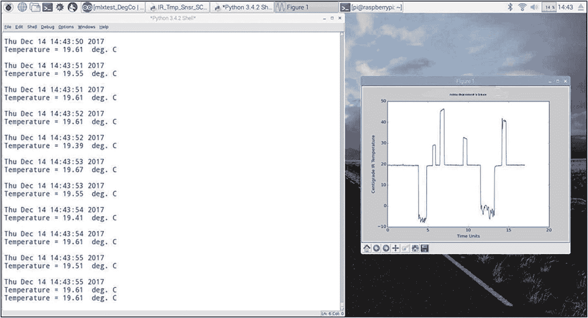

**图 3-43**
`Melexis 90614` 红外温度测量

传感器的响应似乎很快是瞬时的。

## 讨论

如在演示读数及内部与外部容器测量中所见，测得的是表面温度。

若加热物体的温度远高于环境温度，辐射热可能导致读数漂移。传感器与物体的距离足够小，辐射热便会提升传感器外壳及其周围环境的温度（距离在数英寸或 `15` 厘米以内）。

总视场是围绕垂直轴的一个 90°或 45°锥体。传感器读取视场内物体辐射出的所有表面热量。如果物体很小而传感器距离很远，则传感器可能成比例地读取物体背景的热量。

有关传感器构造、不同型号或可选配置、可用电子配置以及光学特性的更多信息，请参阅制造商数据手册。

# 使用树莓派进行热电偶测量

金属热电偶因其坚固耐用和宽泛的温度测量范围，是一种常见的工业技术。诸如`DAQFactory`和`LabJack HMI`之类的 `SCADA` 系统，正是为配合热电偶测量系统而设计。大多数集成电路制造商都提供用于热电偶温度测量仪器的专用集成电路(`ASIC`)选择。

热电偶每摄氏度大约产生 `40` 至 `50` 微伏的电压，并需要一个放大器将该微伏信号放大到能与`Arduino`及其 `5` 伏 `ADC` 等设备兼容的水平。使用`Arduino`微控制器、`AD 595`集成电路和`RPi`，可以测量、图形化显示并记录 0°C 到 500°C 的温度范围。制造商提供了采用表面贴装技术集成电路的专用微电路分线板，使`RPi`能够访问 `K` 型热电偶可测量的-200°C 至 1250°C 温度范围（参见 `Adafruit Industries` 公司 `Max31855`，产品编号 `269`；加拿大元售价约 `25` 元，网址为[`www.adafruit.com`](http://www.adafruit.com)）。

`AD595 DIP IC`可由`Arduino`提供的 `5V` 电源供电，从而直接从 `K` 型热电偶产生一个直接、简单的、与`Arduino ADC`兼容的信号，该信号随后可转换为温度值，传输至`RPi`用于绘图和时间戳数据存储。

请记住，导线尺寸决定电阻，因此，对于所产生的小电压，使用可用的最大尺寸导线可提供最小电阻（响应时间请参见表 3-6）。我建议对于较长的热电偶延长线使用双绞线，进行 `LED` 通断检查，并记录热电偶电阻日志。在电气“嘈杂”的环境中，可能需要在热电偶线两端并联一个 `0.01` 至 `0.1μF` 的电容器以最大程度地降低噪声。在恶劣环境中，可能需要为热电偶导线配备适当的护套。

## 实验

`AD595 DIP IC`可安装于原型板上，并连接到 `K` 型热电偶。将集成电路连接到`Arduino`上的 `5V` 电源，将地线连接以为集成电路供电，并将`AD595`的输出端连接到`Arduino ADC`的`A0`输入端，即可完成测量操作的电路连接（参见图 3-24 和图 3-25）。

完成系统布线后，应按照正常组装流程，首先加载 `Arduino` 代码（清单 3-6），并通过观察 `Arduino` 串行监视器的串行总线上数据流的采集和传输来进行验证。

一旦确认数据传输正常，即可启动 `Python` 绘图代码（清单 3-7），并在 `RPi` 监视器上验证控制台输出和绘图图形。

为了规避使用`AD595`集成电路时`Arduino`的 `5V` 电源供电所带来的测量限制，可以改用 `Maxim MAX31855` 芯片来监测 `K` 型热电偶。该芯片是一种表面贴装技术器件，可从制造商处购得已制成微型分线板且与`Arduino`微控制器兼容的版本（可在[`www.sparkfun.com`](http://www.sparkfun.com)和[`www.adafruit.com`](http://www.adafruit.com)获取）。此分线板包含电源连接和串行外设接口(`SPI`)连接，`SPI` 用于将热电偶电压传送至微控制器，以便在控制器的串行监视器中显示。两家制造商均提供与 `Arduino` 兼容的库，其中包含连续进行热电偶温度测量所需的所有代码。（请确保 `RPi` 已更新至最新版本的 `Arduino IDE`，因为较旧版本的 `SPI` 协议与 `MAX31855` 库不兼容。）

## 观察结果

### `AD595`/`Arduino`/`RPi` 温度监测

图 3-44 展示了系统对环境室温建立基线的响应（最左侧轨迹）、我的手指热量（第一个小波峰）、将热电偶置于两个刚冷冻的冰袋之间（第一个下降至 0°C 的波谷）以及在蜡烛火焰附近移动热电偶时所记录的温度变化。

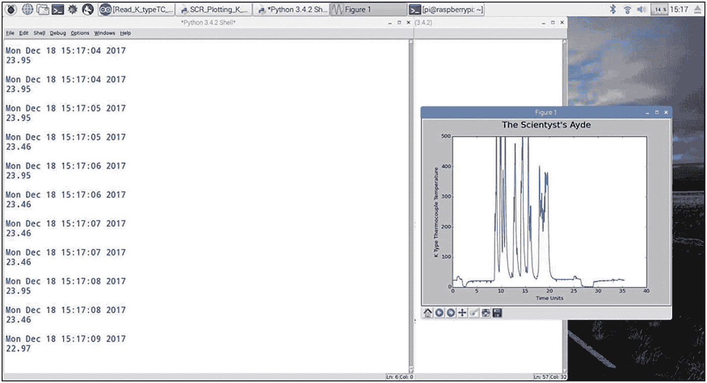

**图 3-44**

`K` 型热电偶对不同热源的响应

在从蜡烛火焰附近测得的高温冷却后，基线虽然看起来比受高热影响前略高，但对手指热量和冰袋仍提供正常响应。

### `MAX31855`/`Arduino`/`RPi` 温度监测

要使用 `MAX31855` 芯片上的 `SPI` 协议，`Arduino IDE` 版本需高于 `1.6.6`。较新版本的 `IDE` 具有与 `Arduino` 串口联动的有限图形数据显示能力。

图 3-45 展示了热电偶在桌面环境温度下串口输出的数据。串口显示两行数据，分别由芯片所在晶圆的温度以及热电偶的温度组成。

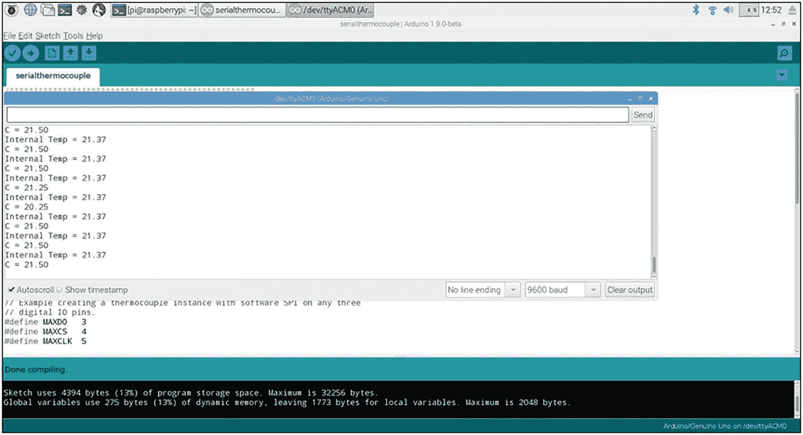

**图 3-45**
`MAX31855` 对 `K` 型热电偶环境温度响应的串口数据输出

`MAX31855` 可测量铬镍-铝镍 `K` 型热电偶所能触及的整个温度范围，即 –200°C 至 1200°C，并采用 `Arduino` 提供的 `5V` 电源供电。

当热电偶被置于两个刚从冰箱取出的新鲜乙二醇冰袋之间时，测得的温度为 –10.5°C。当一小团蜡烛火焰靠近热电偶至八分之一英寸（3mm）以内时，测得温度为 930°C，并产生了图 3-46 所示的 `Arduino` 串口图形记录。

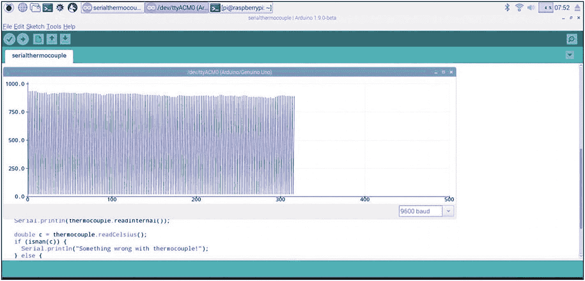

**图 3-46**
`Arduino` 串口图形记录 `K` 型热电偶对蜡烛火焰热源的响应

图 3-47 展示了热电偶冷却回环境温度，并被我 32°C 的手指热量再次加热时的部分响应记录。

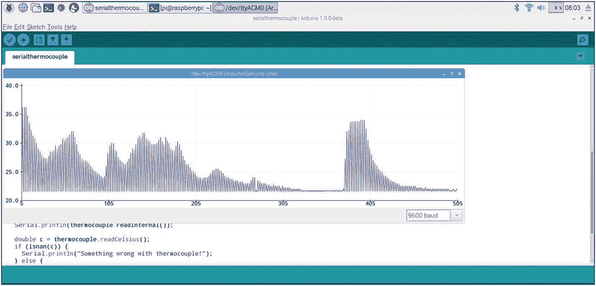

**图 3-47**
`K` 型热电偶冷却至环境温度及手指加热效果

图 3-48 展示了 `y` 轴刻度自动调整为较低温度范围。

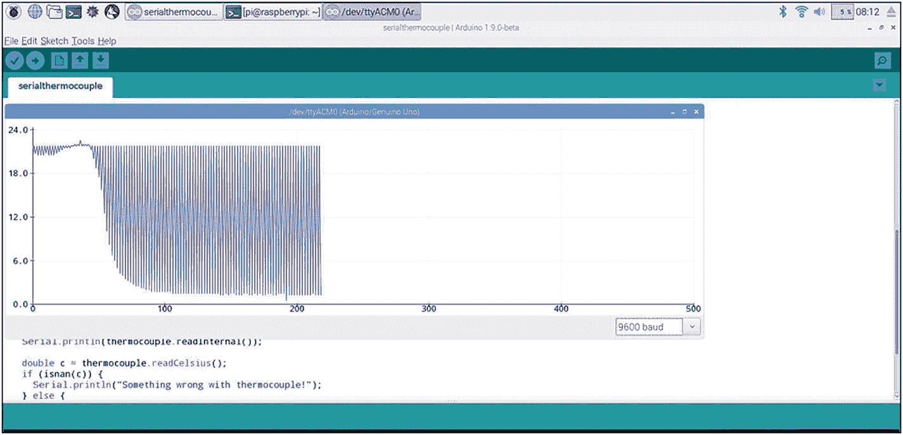

**图 3-48**
串口绘图仪对较低温度响应的自动调整

`Arduino` 的串口绘图仪对于图形化记录和显示数据趋势非常有用。要使用更灵活的 `Matplotlib` 带状图记录程序及其缩放功能，必须修改板卡制造商提供的光电偶读数程序。与之前将串口字符串转换为数值以兼容 `Matplotlib` 的方法类似，需要注释掉 `Arduino` 草图（`sketch`）中的格式化和标签代码。仅将所需摄氏度或华氏度温标下的温度字符串打印到串口。

清单 3-8 仅是从 `Matplotlib SCR` 程序中提取的生成器函数，用于绘制来自 `MAX31855` 的 `Arduino` 数据。其余 `SCR` 代码已在之前使用热敏电阻、红外传感器和 `AD595` 模拟热电偶温度传感器的方法中复现。实验条件需要根据测量需求调整刻度范围和坐标轴标签。

清单 3-8 中的生成器代码在串口字符输入到数值绘图值解析与转换的代码周围包含了一个 `try/catch` 块，因为串口中的字符串经常被误读。热电偶可能存在噪声干扰，在大约 `25%` 的时间里，尝试启动绘图器会因 `ValueError` 异常而失败，导致程序在启动前或启动后不久终止。这些错误是由代码试图将损坏或不可转换的字符串转换为数值引起的。设置 `try/except` 块是为了捕获 `ValueError` 异常，然后强制 `readline()` 循环进行下一次迭代。

图 3-49 描绘了热电偶对低于零度温度测量响应的 `Matplotlib SCR` 绘图。

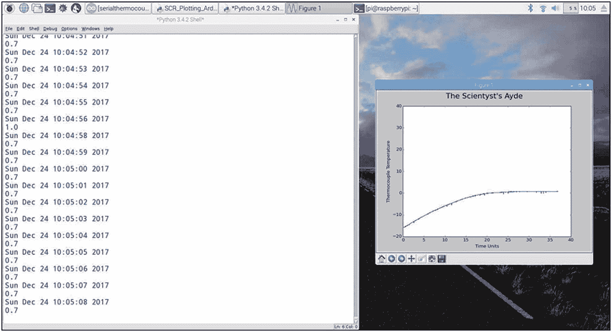

**图 3-49**
低于零度的热电偶响应及潜热效应

图 3-49 中的低温数据是通过将 `K` 型热电偶置于两个刚从冰柜取出的聚乙烯乙二醇-水填充冰袋之间获得的。与先前版本的 `SCR` 数值生成器绘图代码一样，包含了带时间戳的数据打印输出功能，可将带时间戳的数据流打印到控制台以供存档。

检查绘图仪轨迹和带时间戳的数据，可以直观地展示水体系中潜热的物理概念。

# 讨论

热电偶是一种自供电的温度传感器，具有较大的动态范围，并且在一阶近似下是线性的。某些热电偶在其温度-电压关系中存在不连续性，显示测量值的软件和仪器在某种程度上会忽略这些不连续性。如果需要进行精确的热测量工作，则必须根据标准表中的参数对热电偶使用的温度范围进行校准。

`AD595` 放大器具有内部固定增益，当连接 `K` 型热电偶时，可提供 `10 mV/°C` 的模拟输出。如果芯片由 `5V` 电源供电，则可测量的最高温度为 500°C。通过将 `AD595` 的电源电压提高到 `10V`，并在芯片输出与 `Arduino ADC` 输入之间施加一个 `2:1` 的分压器，以确保转换器看到的信号为 `5V` 或更低（`ADC` 允许的最大信号强度），可以测量更高的温度。当为放大器芯片使用更高的电源并在 `ADC` 输入上使用 `2:1` 分压器时，必须调整 `Arduino` 代码，将发送给绘图器的温度值加倍。

通过使用 `K` 型热电偶和 `MAX31855` 集成电路，仅需 `Arduino` 提供的 `5V` 电源即可进行低至低温、高至火焰温度范围的热电偶测量。`Maxim` 公司的 `IC` 是一种表面贴装器件，以小尺寸印刷电路板形式提供。该转接板可以安装在原型板上，用于临时实验或开发工作。

热电偶通常会产生噪声，因为它们通常具有较长的金属引线，用于高功率环境，并且需要大信号放大才能产生可驱动显示器的可用信号。在某些环境中，可能需要在两根导线之间并联一个电容器，以抑制测量系统中产生的一些杂散信号。

`Matplotlib` 绘图器的串口转换代码中存在的噪声信号问题，通过一个用于错误捕获的 `Python` 函数得以最小化，该函数利用 `try/except` 块忽略误读的数据。

尽管具有固定刻度的 `Arduino` 串口绘图仪很有用，但 `Matplotlib SCR` 更加灵活，因为它可以适应显示刻度放大、压缩，或数据在正负数值域之间变化的情况。

图 3-49 直观地展示了潜热这一物理现象。冰袋将热电偶冷却至约 –17°C 的初始温度，然后温度开始线性上升。该绘图的时间尺度在时间单位刻度上显示为四十分钟的窗口。温度以线性方式稳定上升，直到大约 `12.5` 分钟时，潜热效应开始对温度上升产生调节作用。`20` 分钟后，温度变化速率停止。温度在 0.7°C 区域附近持续了数小时，因为冰袋内融化的冰吸收了固液相变所需的热量。