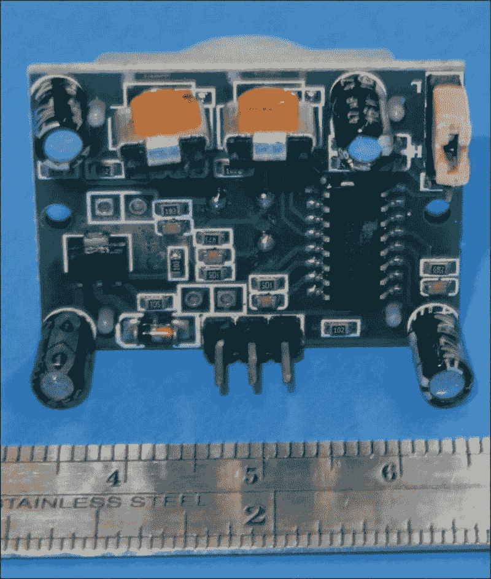
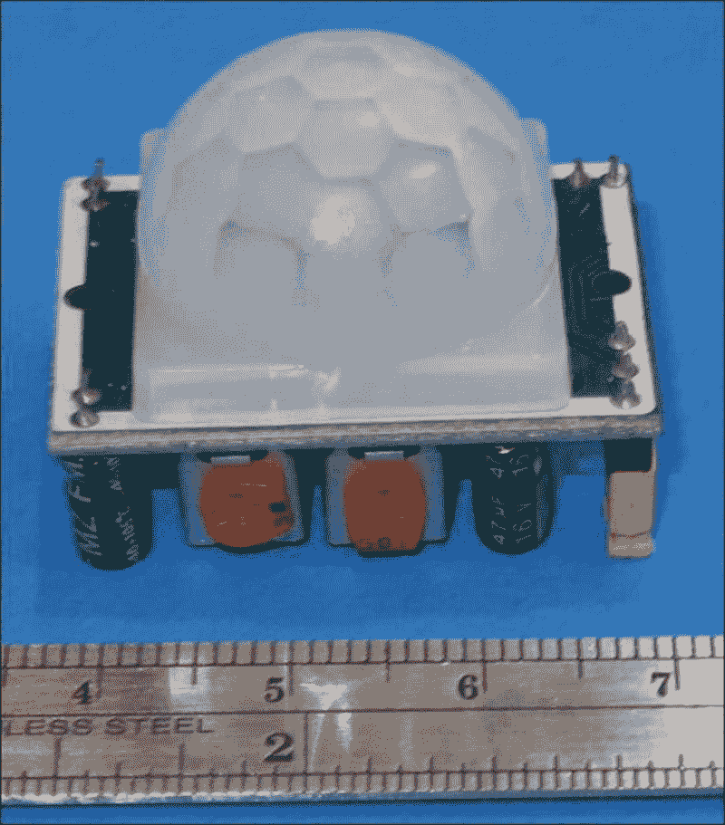

# 被动红外（PIR）热传感器

市面上存在可被描述为数字热传感器的设备。热感应`HC-501` PIR 模块广泛用于安防和人员检测系统（售价约 5 加元）。该设备配备了一个塑料穹顶菲涅尔透镜，能够将红外光聚焦在热敏材料上，例如氮化镓 (GaN)、硝酸铯 (CsNO[3])、聚偏氟乙烯 (–CH[2]-CF[2]-)[n]、有机吡啶和酞菁钴络合物。照射在探测器上的红外辐射变化会引起监测电路中的电压波动，从而改变模块的高/低输出状态。

## 实验

PIR 模块如图 3-50 和图 3-51 所示。图 3-51 中可见的三个连接引脚，从左到右分别是电源、中间的模块数字输出端和右侧的地线。我将模块输出端连接到 Arduino 的数字引脚 2，用于测试、演示、验证和应用开发。我在数字引脚 7 上连接了一个红色 LED 和 330 Ω 的限流电阻。在引脚 8 上连接了一个绿色 LED 和限流电阻。

`清单 3-9` 跟踪了 PIR 模块输出端的活动，并根据视场内的活动水平激活红-绿二极管阵列，同时将文字信息打印到串行监视器上。

PIR 模块有两个电位器，在图 3-50 中表现为砖红色的圆盘；还有一个位置可通过跳线选择的黄色矩形（电路板右上角）如图 3-51 所示，用于控制设备的操作。这些控制元件的作用将在本节的“观察”和“讨论”部分进行介绍和探讨。


图 3-51
HC-SR501 PIR 传感器的电路板


图 3-50
HC-SR501 PIR 传感器的菲涅尔透镜顶部

### 观察

制造商的数据手册指出，该设备在通电后需要一分钟才能稳定下来。

透镜的视场是一个 110–120 度的锥体，其景深可在 3 到 7 米（9 英尺到 21 英尺）之间调节，由右侧的电位器控制。在图 3-50 和图 3-51 中，顺时针旋转可增加监控距离。

左侧电位器控制延时，顺时针旋转可在 5 秒到 300 秒（5 秒到 5 分钟）之间调节。

触发选项通过黄色跳线的位置来选择。在顶部位置（即单次触发模式）下，延时定时器在接收到第一个运动感应信号时启动。在下方位置（即多次触发模式）下，每次检测到运动检测信号时都会重新启动延时定时器。

## 讨论

要有效使用 PIR 探测器，必须将传感器置于正确的方向，以检测视场内红外辐射的差异。该探测器由两个平行的矩形表面组成，表面涂有热释电材料。在静止状态下，这两个表面看到的来自透镜监控区域的红外辐射相同。当热源以任何不平行于探测器元件间中心线的角度进入视场时，会先激活其中一个元件。于是，一个差分信号被记录为背景红外辐射中的扰动。传感器是矩形的，其敏感轴平行于较长的一边。

Arduino 程序中使用的测试电路和彩色二极管仅用于演示传感器的特性，并让实验者熟悉其控制元件、响应模式、传感器的物理方向，以及在日光和极端天气条件下评估传感器的性能。

一旦为某个问题找到了最佳的工作条件，就可以用固态继电器替换 LED，以便在检测到发热物体运动时，激活夜间摄像头、照明光源或机械继电器。

## 代码清单

```cpp
/*
* PIR 传感器演示与验证
* 当视场中的红外辐射较低或无活动时，
* 点亮绿色 LED。当红外辐射增加时，
* 关闭绿色 LED 并点亮红色 LED。
*/
int pirPin = 2;              // 选择 PIR 传感器的引脚
int ledPinAct = 7;           // 红色 LED 指示视场内有活动
int ledPinInact = 8;         // 绿色引脚指示视场内无活动
//
int val = 0;                    // 用于读取引脚状态的变量
void setup() {
pinMode(ledPinAct, OUTPUT);      // 将活动 LED 设为输出
pinMode(ledPinInact, OUTPUT);    // 将非活动 LED 设为输出
pinMode(pirPin, INPUT);          // 将传感器设为输入
//
Serial.begin(9600);   // 启动串口
}
void loop(){
val = digitalRead(pirPin);  // 读取输入值
if (val == HIGH) {            // 检查输入是否为高电平
digitalWrite(ledPinAct, HIGH);  // 点亮红色 LED
digitalWrite(ledPinInact, LOW); // 关闭绿色 LED
Serial.println("视场内有活动。");
}
if (val == LOW) {
//
Serial.println("未检测到活动！");
// 点亮绿色 LED 并关闭红色 LED
digitalWrite(ledPinInact, HIGH);
digitalWrite(ledPinAct, LOW);
}
delay(10);
}
```
清单 3-8
Arduino 的 PIR 程序

```python
#
ser = serial.Serial("/dev/ttyACM0", 9600)
#
def rd_data():
while True:
inPutln = ser.readline()
if (len(inPutln )  9):     # 长字符串片段
continue
#
try:
if (len(inPutln) == 6):    # 单个无符号数字的长度
line = float(str(inPutln)[slice(2,5)])
print(time.asctime()) # 用于控制台/数据存储的归档时间戳
print (line)          # 控制台显示/归档数据存储
yield (line)
#
if (len(inPutln) == 7):    # 单个无符号数字的长度
line = float(str(inPutln)[slice(2,6)])
print(time.asctime()) # 用于控制台/数据存储的归档时间戳
print (line)          # 控制台显示/归档数据存储
yield (line)
#
if (len(inPutln) == 8):    # 单个无符号数字的长度
line = float(str(inPutln)[slice(2,7)])
print(time.asctime()) # 用于控制台/数据存储的归档时间戳
print (line)          # 控制台显示/归档数据存储
yield (line)
#
if (len(inPutln) == 9):    # 单个无符号数字的长度
line = float(str(inPutln)[slice(2,8)])
print(time.asctime()) # 用于控制台/数据存储的归档时间戳
print (line)          # 控制台显示/归档数据存储
yield (line)
except ValueError:
continue
```
清单 3-7
用于绘制 MAX31855 热电偶数据的生成器代码


```python
## RPi Python Strip Chart Recorder of Arduino Output
## SCR Plotting of serial data from Arduino output over serial port
## Arduino serial output must be numerical values only.
#
import matplotlib
import numpy as np
from matplotlib.lines import Line2D
import matplotlib.pyplot as plt
import matplotlib.animation as animation
import time
import serial

class Scope:
    def __init__(self, ax, maxt=40, dt=0.02):
        """maxt time width of display"""
        self.ax = ax
        self.dt = dt
        self.maxt = maxt
        self.tdata = [0]
        self.ydata = [0]
        self.line = Line2D(self.tdata, self.ydata)
        self.ax.add_line(self.line)
        self.ax.set_ylim(0, 500)  # y axis scale
        self.ax.set_xlim(0, self.maxt)

    def update(self, y):
        lastt = self.tdata[-1]
        if lastt > self.tdata[0] + self.maxt: # reset the arrays
            self.tdata = [self.tdata[-1]]
            self.ydata = [self.ydata[-1]]
            self.ax.set_xlim(self.tdata[0], self.tdata[0] + self.maxt)
            self.ax.figure.canvas.draw()
        t = self.tdata[-1] + self.dt
        self.tdata.append(t)
        self.ydata.append(y)
        self.line.set_data(self.tdata, self.ydata)
        return self.line,

ser = serial.Serial("/dev/ttyACM0", 9600, timeout=1)

def rd_data():
    while True:
        inPutln = ser.readline()
        if (len(inPutln) < 6):
            continue
        if (len(inPutln) == 6):               # convert Arduino single digit output stream
            line = float(str(inPutln)[slice(2, 6)])
        if (len(inPutln) == 7):               # convert double digit
            line = float(str(inPutln)[slice(2, 7)])
        if (len(inPutln) == 8):               # convert triple digit output
            line = float(str(inPutln)[slice(2, 8)])
        if (len(inPutln) == 9):
            line = float(str(inPutln)[slice(2, 9)]) # convert 4 digit output
        print(time.asctime())                   # time stamp data
        print(line)                             # print data
        print(" ")                              # format print out with blank line
        yield (line)

fig = plt.figure()
fig.suptitle("The Scientyst's Ayde", fontsize = 20)
ax = fig.add_subplot(111)
ax.set_xlabel("Time Units")
ax.set_ylabel("K Type Thermocouple Temperature")
scope = Scope(ax)
## uses rd_data() as a generator to produce data for the update func, the
## Arduino LDC value is read by the plotting code in 10 minute windows for
## the animated screen display. Software overhead limits response speed
## of display.
ani = animation.FuncAnimation(fig, scope.update, rd_data, interval=50, blit=False)
plt.show()
```

*代码清单 3-6 K 型热电偶（< 500°C）的 Python SCR 绘图程序*

```cpp
/*
Read a K type thermocouple from an AD 594 IC
Pgm reads an analog input on pin 0, converts it to voltage and for voltages < 5.00 directly
converts the observed voltage into a Celsius temperature by x100 factor.
Thermocouple voltages from temperatures over 500 C must be scaled down.
*/
// the setup routine runs once when you press reset:
void setup() {
  // initialize serial communication at 9600 bits per second:
  Serial.begin(9600);
}

// the loop routine runs over and over again forever:
void loop() {
  // read the input on analog pin 0:
  int sensorValue = analogRead(A0);
  // Convert the analog reading (which goes from 0 - 1023) to a voltage (0 - 5V):
  float voltage = sensorValue * (5.0 / 1023.0);
  float TempInDegC = voltage * 100;
  // print out the temperature
  delay(500);
  Serial.println(TempInDegC);
}
```

*代码清单 3-5 K 型热电偶监测的 Arduino 代码*

```python
## RPi Python Strip Chart Recorder of Arduino Output
## SCR Plotting of serial data from Arduino output over serial port
## Arduino serial output must be numerical values only.
#
import matplotlib
import numpy as np
from matplotlib.lines import Line2D
import matplotlib.pyplot as plt
import matplotlib.animation as animation
import time
import serial

class Scope:
    def __init__(self, ax, maxt=20, dt=0.02):
        """maxt time width of display"""
        self.ax = ax
        self.dt = dt
        self.maxt = maxt
        self.tdata = [0]
        self.ydata = [0]
        self.line = Line2D(self.tdata, self.ydata)
        self.ax.add_line(self.line)
        self.ax.set_ylim(-10, 50)  # y axis scale
        self.ax.set_xlim(0, self.maxt)

    def update(self, y):
        lastt = self.tdata[-1]
        if lastt > self.tdata[0] + self.maxt: # reset the arrays
            self.tdata = [self.tdata[-1]]
            self.ydata = [self.ydata[-1]]
            self.ax.set_xlim(self.tdata[0], self.tdata[0] + self.maxt)
            self.ax.figure.canvas.draw()
        t = self.tdata[-1] + self.dt
        self.tdata.append(t)
        self.ydata.append(y)
        self.line.set_data(self.tdata, self.ydata)
        return self.line,

ser = serial.Serial("/dev/ttyACM0", 9600)

def rd_data():
    while True:
        line = ser.readline()
        ln_Ln = len(line)  #determines # digits in temp
        if (ln_Ln < 4):
            continue
        if (ln_Ln == 14):               # single digit temp values outside
            line = float((line)[slice(10, 14)])
        if (ln_Ln == 15):               # double digit temp values
            line = float((line)[slice(10, 15)])
        if (ln_Ln == 16):               # triple digit temp values
            line = float((line)[slice(10, 16)])
        if (ln_Ln == 17):               # 4 digit temperatures
            line = float((line)[slice(10, 17)])
        if (ln_Ln > 100):
            line = float((line)[slice(27, 33)])
        # decimal and single digit temperature values are processed by the code
        # double digit minus value may require additional processing code.
        print(time.asctime())                   # console print out of
        print("Temperature =", line," deg. C")   # timestamped data with a
        print()                                 # formatting blank line
        yield (line)

fig = plt.figure()
fig.suptitle("The Scientyst's Ayde", fontsize = 18)
ax = fig.add_subplot(111)
ax.set_xlabel("Time Units")
ax.set_ylabel("Centigrade IR Temperature ")
scope = Scope(ax)
## uses rd_data() as a generator to produce data for the update func, the
## Arduino IR value is read by the plotting code in 40 time unit windows
## for the animated screen display. Software overhead limits response speed
## of display.
ani = animation.FuncAnimation(fig, scope.update, rd_data, interval=50, blit=False)
plt.show()
```

*代码清单 3-4 RPi 红外温度测量与绘图程序*


```c
// 一款带温差监控功能的热电功率控制器
//
// 本程序利用 Arduino 的#3 号 PWM 引脚调节供给珀尔帖板的功率。
// Arduino 控制一个高功率 MOSFET 栅极，以调节流向热传导板的电流。
// 从串口发送 i 或 d 可增大或减小 TEC 板的功率。
// 两个热敏电阻温度传感器分别监测 TEC 板两侧隔热腔内的热泵效应。
//
int peltier = 3; // N 沟道 MOSFET 的栅极连接至 Arduino 的 3 号引脚
int power = 0;  // 功率等级从 0 变化至 99%
int peltier_level = map(power, 0, 99, 0, 255);  // 功率百分比与 0-255 之间的映射
//
////定义热敏电阻的模拟引脚连接
#define THERMISTORPIN A0
#define THERMISTORPIN1 A1
// 25 摄氏度时的电阻值
#define THERMISTORNOMINAL 30000
// 标称电阻对应的温度（通常为 25°C）
#define TEMPERATURENOMINAL 25
// 对读数取平均可提高信噪比，改善幅度为采样数的平方根
#define NUMSAMPLES 5
// 热敏电阻的 Beta 系数（通常为 3000-4000）
#define BCOEFFICIENT 3899
// 分压电路中固定电阻的阻值
#define SERIESRESISTOR 33000
int samples[NUMSAMPLES];
void setup(void) {
Serial.begin(9600);
analogReference(EXTERNAL);
pinMode(peltier, OUTPUT); // 将珀尔帖或 MOSFET 栅极控制引脚设置为输出模式
}
void loop(void) {
uint8_t i;
float average;
float average1;
char option;  // 待执行的操作；"i"增大功率，"d"减小功率输入
//
if(Serial.available() > 0)
{
option = Serial.read();
if (option == 'i') // 从串口发送'i'可增大负载功率
power += 5;
else if(option == 'd') // 从串口发送'd'可减小负载功率
power -= 5;
//
if(power > 99) power = 99;
if(power < 0) power = 0;
//
peltier_level = map(power, 0, 99, 0, 255);
}
//
Serial.print("Power = ");
Serial.print(power);
Serial.print(" PLevel = ");
Serial.println(peltier_level);
//
analogWrite(peltier, peltier_level); // 将新的百分比及 0-255 对应的电平值写入端口
//
//
// 采集热敏电阻#1 的数据
//
// 连续采集 N 个样本，每次采集间隔短暂延时
for (i=0; i< NUMSAMPLES; i++) {
samples[i] = analogRead(THERMISTORPIN);
delay(10);
}
// 对所有样本取平均
average = 0;
for (i=0; i< NUMSAMPLES; i++) {
average += samples[i];
}
average /= NUMSAMPLES;
Serial.print("Average analog reading ");
Serial.println(average);
// 将数值转换为电阻值
average = (1023/average) - 1;
average = SERIESRESISTOR / average;
Serial.print("Thermistor resistance ");
Serial.println(average);
float steinhart;
steinhart = average / THERMISTORNOMINAL;     // (R/Ro)
steinhart = log(steinhart);                  // ln(R/Ro)
steinhart /= BCOEFFICIENT;                   // 1/B * ln(R/Ro)
steinhart += 1.0 / (TEMPERATURENOMINAL + 273.15); // + (1/To)
steinhart = 1.0 / steinhart;                 // 取倒数
steinhart -= 273.15;                         // 转换为摄氏度
Serial.print("Temperature ");
Serial.print(steinhart);
Serial.println(" *C");
// 采集热敏电阻#2 的数据
// 连续采集 N 个样本，每次采集间隔短暂延时
for (i=0; i< NUMSAMPLES; i++) {
samples[i] = analogRead(THERMISTORPIN1);
delay(10);
}
// 对第二组所有数据取平均
average1 = 0;
for (i=0; i< NUMSAMPLES; i++) {
average1 += samples[i];
}
average1 /= NUMSAMPLES;
Serial.print("Average analog reading #2 ");
Serial.println(average1);
// 将数值转换为电阻值
average1 = (1023 / average1) - 1;
average1 = SERIESRESISTOR / average1;
Serial.print("Thermistor resistance #2 ");
Serial.println(average1);
// 已在单设备代码中声明浮点型变量 steinhart
steinhart = average1 / THERMISTORNOMINAL;     // (R/Ro)
steinhart = log(steinhart);                  // ln(R/Ro)
steinhart /= BCOEFFICIENT;                   // 1/B * ln(R/Ro)
steinhart += 1.0 / (TEMPERATURENOMINAL + 273.15); // + (1/To)
steinhart = 1.0 / steinhart;                 // 取倒数
steinhart -= 273.15;                         // 转换为摄氏度
Serial.print("Temperature #2 ");
Serial.print(steinhart);
Serial.println(" *C");
delay(1000);
}
```
清单 3-3  
Arduino TEC 功率控制程序


## 树莓派 Python 条带图记录工具：用于 Arduino 输出的串口数据
该工具用于绘制来自 Arduino 通过串口输出的数值数据序列图  

Arduino 串口输出必须只包含数值。

```python
import matplotlib
import numpy as np
from matplotlib.lines import Line2D
import matplotlib.pyplot as plt
import matplotlib.animation as animation
import time
import serial

class Scope:
    def __init__(self, ax, maxt=40, dt=0.02):
        """maxt: 显示的时间宽度"""
        self.ax = ax
        self.dt = dt
        self.maxt = maxt
        self.tdata = [0]
        self.ydata = [0]
        self.line = Line2D(self.tdata, self.ydata)
        self.ax.add_line(self.line)
        self.ax.set_ylim(1100, 700)  # y 轴范围，根据应用调整大小和顺序
        self.ax.set_xlim(0, self.maxt)

    def update(self, y):
        lastt = self.tdata[-1]
        if lastt > self.tdata[0] + self.maxt: # 重置数组
            self.tdata = [self.tdata[-1]]
            self.ydata = [self.ydata[-1]]
            self.ax.set_xlim(self.tdata[0], self.tdata[0] + self.maxt)
            self.ax.figure.canvas.draw()
        t = self.tdata[-1] + self.dt
        self.tdata.append(t)
        self.ydata.append(y)
        self.line.set_data(self.tdata, self.ydata)
        return self.line,

ser = serial.Serial("/dev/ttyACM0", 9600, timeout=None)

def rd_data():
    ser.flushInput()  # 刷新输入缓冲区
    while True:
        inPutln = ser.readline()
        print("inPutln = ", inPutln)
        nbr_digs = len(inPutln) # 获取字符串长度
        print("nbr_digs = ", nbr_digs)
        if (nbr_digs) == 5:     # 存在 3 位数字
            line = int(str(inPutln)[slice(2,5)]) # 截取 3 位数字
        if (nbr_digs) == 6:     # 存在 4 位数字
            line = int(str(inPutln)[slice(2,6)]) # 截取 4 位数字
        if (nbr_digs) == 7:     # 存在 5 位数字
            line = int(str(inPutln)[slice(2,7)]) # 截取 5 位数字
        print(line)
        yield (line)

fig = plt.figure()
fig.suptitle("科学家的辅助工具", fontsize = 12)
ax = fig.add_subplot(111)
ax.set_xlabel("时间")
ax.set_ylabel("脉冲宽度差值")
scope = Scope(ax)

## 使用 rd_data()作为生成器，为更新函数提供数据，
## 动态屏幕显示的绘图代码每半秒读取一次 Arduino LCD 值。
## 软件开销限制了显示的响应速度。
ani = animation.FuncAnimation(fig, scope.update, rd_data, interval=50,
                              blit=False)
plt.show()
```

*清单 3-2 — 用于 HiRezTempMonitor 的 Matplotlib SCR 代码*

---

```cpp
// n 元素移动平均双脉冲宽度差值测量，2012 年 4 月 19 日
// 使用 pulseIn(pn#,HI/LOW)读取高低脉冲宽度。计算差值，
// 该差值代表热敏电阻的ΔT，因为低电平时间恒定。
// 将差值累加到 n 元素移动平均中，以便通过串口输出数据

unsigned long duration;                // 第 1 个脉冲宽度
unsigned long duration_L;              // 第 2 个脉冲宽度
unsigned long pwDiff;                  // 脉冲宽度差值
int const numReadings = 16;            // 平均的读数数量，必须声明为"const"
unsigned long readings[numReadings];   // 各个读数
int index = 0;                         // 读数数组索引
unsigned long total = 0;               // 累计总值
unsigned long average = 0;             // 平均值

int inputPin = 2;                      // 用于脉冲计数的数字 PWM 引脚 2 号

void setup()
{
  Serial.begin(9600);                  // 设置串口通信
  for (int thisReading = 0; thisReading = numReadings)           // 如果到达数组末尾，则绕回
  {
    index = 0;
  }
  average = total/numReadings;       // 计算平均值

  //Serial.print("average  ");
  Serial.println(average, DEC);
  //Serial.print("duration_L  ");
  //Serial.println(duration_L, DEC); // 使用 DAQFactory 时注释掉
  //Serial.print("duration   ");
  //Serial.println(duration, DEC);
  delay(50);                        // 降低速率？
}
```

*清单 3-1 — Arduino 脉冲宽度差值热敏电阻监视器*

---

## 摘要

本章区分了热和温度，讨论了常规科学工作中通常遇到的极端情况，以及校准和验证温标的一些方法。

还介绍多种温度传感器，包括它们的灵敏度范围、输出信号和成本。

介绍了使用热敏电阻、热电偶和非接触式红外传感器实现高分辨率和常规分辨率温度监测的方法。

对热电热传递、绝缘、数学冷却模型和红外安全应用进行了适度的详细研究。

商用以及成本较低的组件组装的 SCADA 系统均可实现热与温度的监测与控制。

以红外辐射形式存在的热能是第 4 章的一部分，该章探讨了光、光学和光电效应的科学。


