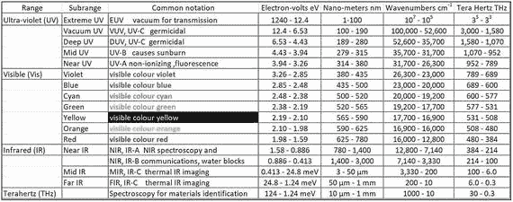
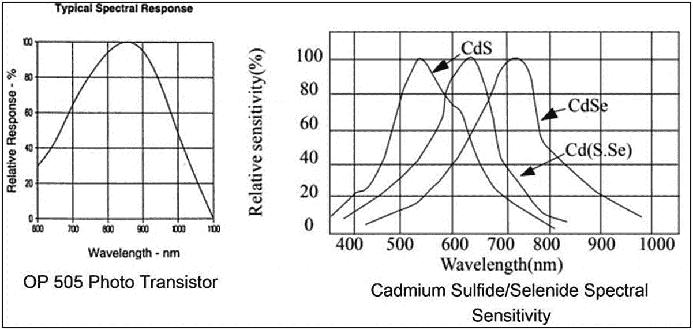
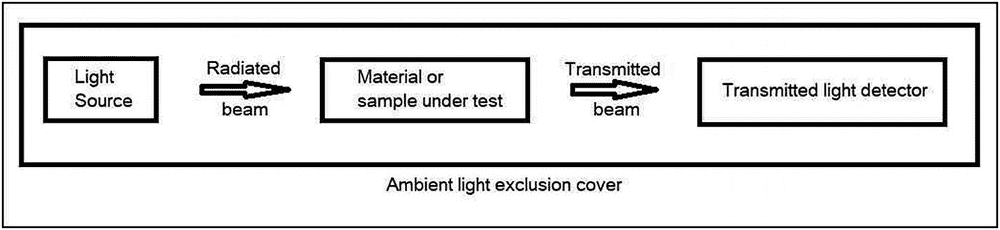
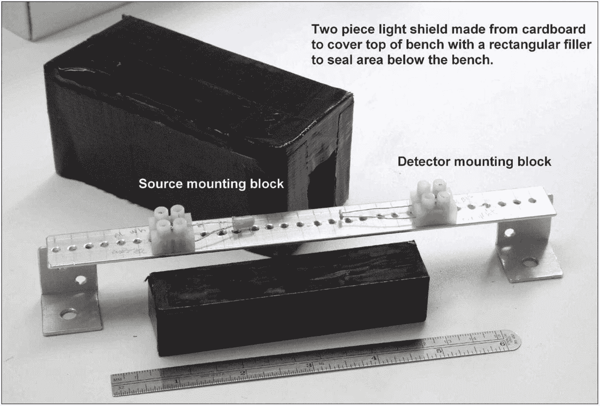
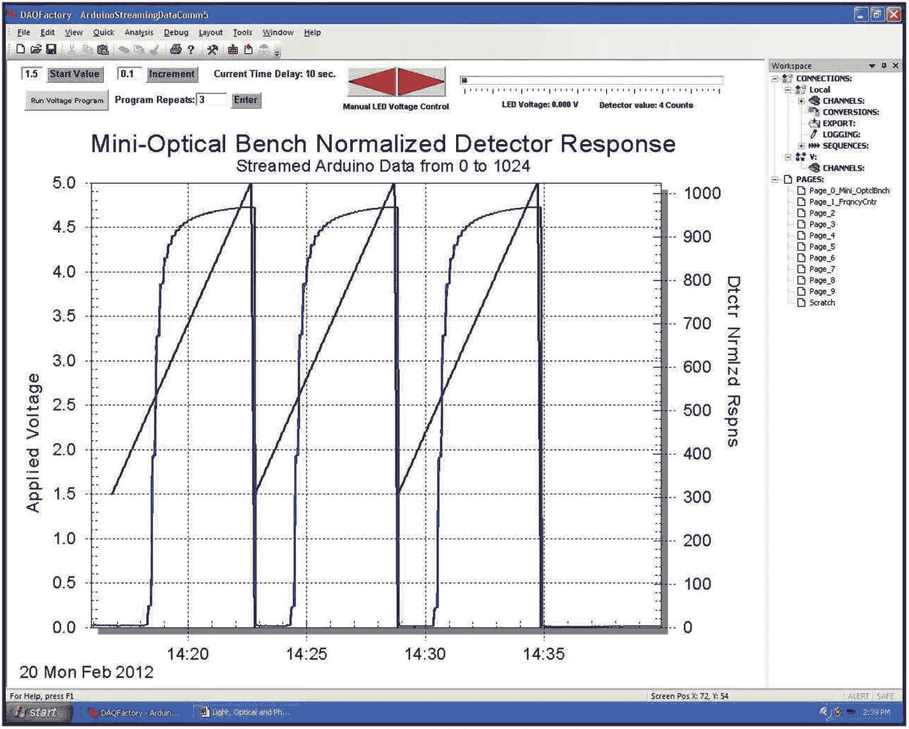
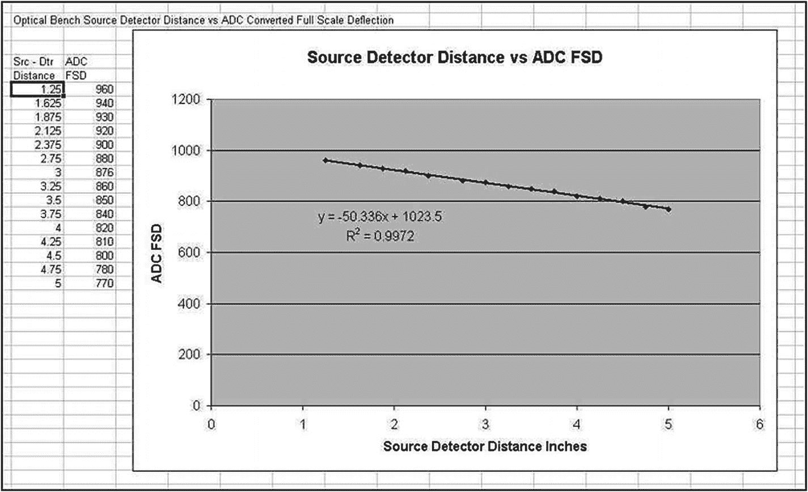

# 4. 光、光学与光电效应

人类的视觉在文明出现之前的白昼中进化，因此需要人工照明来在夜晚看清事物，并照亮封闭的居所。最初基于碳的不完全燃烧的人工照明，产生了木柴炊火、动物油脂和蜡烛特有的红黄色光线。后来，人们开发出了预混氧气燃料气体火焰，可以调节出更明亮、更洁净的光线。最终，电能通过电弧、白炽灯丝以及后来的电子跃迁产生的热量，生成了白光。

物理学建立了黑体被加热至白炽状态时发出的光线颜色与温度之间的关系，从而能够根据热辐射体的温度（以开尔文度为单位）来定义颜色。可见光的颜色介于 `1000°K` 和 `10,000°K` 之间。

尽管人工照明已经发展到使用白炽灯丝、碳弧、石英碘化学循环、气体放电激发和固态发光等技术，但所有这些照明技术都无法复现人眼在日光下所见到的颜色。

除了照明之外，光还可以用作科学测量工具、视觉记录介质、数据传输媒介或能源。来自太阳的光线，随着与太阳的轨道距离变化以及地球的自转，产生了季节性的气候变化和每天的天气。日光和人工光被用于农业和温室作业。光合作用将二氧化碳和水转化为生物质和氧气。

本章讨论光、光学和光电效应。它探讨了光在简单光谱测量应用中的使用，并介绍了基础量子物理学、简单计算机成像、计算机视觉以及能量收集与转换。

关于人眼可见的电磁频谱范围（即颜色）的讨论，通常以其波长来衡量，该波长通常介于电磁频谱的 `390 nm` 至 `700 nm`（纳米，即 `10^(–9)` 米）部分之间。在较长波长处，该电磁辐射区域被称为红外线。在较短波长处，该辐射被称为紫外线。鸟类、鱼类和夜行动物能够部分看到红外线和紫外线区域，而这些区域对于人类来说，只有通过光电光度测量仪器才能看见。

对电磁频谱的研究以及新技术的发展，不断推动着电磁频谱应用的进步。因此，针对电磁频谱不同部分所蕴含的能量，出现了许多不同的术语。

表 4-1 列出了电磁频谱中各个已命名部分的名称，以及用于定量描述光子能量的测量单位。

**表 4-1**
**电磁频谱各部分的能量表达**

| - |

表 4-1 仅涵盖了电磁频谱的一小部分。科学与工程领域已经发展出众多技术，用于制造仪器来监测和使用所列波长的电磁辐射。当以纳米表示时，这些波长的差异可达六个数量级。

从可见光和紫外光的利用发展而来的定量和定性光谱学方法，传统上以其测量波长（单位为纳米，`10^(–9)` 米，写作 `nm`）来指定这些应用中使用的辐射。红外光谱及其“指纹区”（`1500 cm^(–1)` 到 `500 cm^(–1)`）使用每厘米长度内的波数作为单位，称为波数（`cm^(–1)`）。在指纹区，红外辐射会被构成有机分子的分子结构所吸收。

碳基有机化合物的许多结构特征都会在指纹区产生独特、可识别的红外辐射吸收模式。波数用于理解有机分子结构特征与入射红外辐射光子能量之间的物理化学相互作用。波数越高，表示能量越高。

通过测量红外光子吸收的能量，可以将有机分子振动模式中的伸缩、弯曲和摇摆等振动方式归属于特定的振动模式。`nm` 与 `cm^(–1)` 之间的换算系数是 `10⁷`，这使得红外光谱中一位数和两位数的波数值更易于使用。

质谱学、半导体物理学和固态物理学主要关注那些通过磁场或电势进行物理操控或加速的电子的能量；这些能量以电子伏特（`electron-volts`）为单位进行评估和衡量。以电子伏特为单位测量或评估的高能紫外光光子，会从气体分子中移除电子以产生离子，然后可以通过静电计检测这些离子，并以收集到的离子流形式进行物质质量的定量测量。超过特定阈值的收集电流可以触发警报。使用光电离检测器（`PID`）的电池供电手持式仪表，能够在极低相对丰度水平下检测和定量危险或有毒气体。

利用太赫兹波段辐射的仪器，正被开发为一种用于 X 射线扫描和材料识别的非电离、低能量的替代技术。

对光的行为及其与物质相互作用的研究，构成了实验科学的一大部分。各种各样的固态器件可用于光能与电能之间的相互转换，从而实现对各种物理和化学参数的测量。`LED`、光电晶体管、光电二极管、光敏电阻和光电管，能够以不同的灵敏度与不同光谱波长的光进行电子交互，可用于定性和定量的光测量。

利用大面积固态`PN`结，可以将太阳光转化为电能，为电网补充电力，或为离网的独立电力负载供电。

秉承本书简化的宗旨，我们只考察在环境条件下使用现成电子元件即可触及的电磁频谱部分。在环境条件下，有源器件的工作光谱范围从较长波长的红外线（`IR`），穿过可见光区的各种颜色，到较短波长的紫外线（`UV`）。

本节将简要探讨光伏电池或太阳能电池对人工光源的敏感度。它们作为太阳能电源的应用将在第 11 章中介绍。

## 光电元件

### 光敏电阻（LDR）

`LDR`（光敏电阻）是一种半导体，在黑暗环境中仅有少数自由电子可移动，因此呈现高电阻——通常为数百、数千或数兆欧姆。当有光照射时，其晶体结构会吸收光能。部分晶格电子被激发到足以挣脱束缚并移动的能级（即晶格的导带），从而降低器件电阻，降幅常达数千欧姆。

常见的`LDR`器件是硫化镉（`CdS`），它对波长为 `545` 纳米（`nm`）的绿光敏感。硒化镉（`CdSe`）器件则对 `725` 纳米的红光敏感。还可购得混合型`CdS-CdSe`器件，其对约 `640` 纳米的红橙光敏感。

从开始吸收光到电阻下降之间，存在约 `10` 毫秒的时间延迟。然而，当高强度的入射光停止后，导电电流衰减、电阻回升的过程可能长达一秒钟。光敏电阻具有温度敏感性，且光通量与电阻之间的关系是非线性的。器件电阻与光通量之间的关系可用如下指数公式描述：

```
R = A × e^a -- (1)
```

其中，`R`是器件电阻。`A`是与材料受光面积成正比的常数，`e`是自然对数底数 `2.718`。`a`也是一个与材料有关的常数，对于`CdS`，其值在 `0.7` 至 `0.8` 之间。（为便于设计或计算，应测量并绘制出该器件电阻对数与照度对数的关系图，并用直线近似表示。）

`LDR`不适用于高速监测光照变化，且其工作范围局限于可见光和近红外辐射波段。硫化铅和硒化铅则是适用于电磁波谱中远红外波段的电阻敏感型器件。

### 光电二极管

光电二极管具有一个反向偏置的`PN`结，在器件未被适当能量光子照射前，仅有漏电流或“暗电流”通过。暗电流或漏电流通常处于纳安级。部分光电二极管采用`PIN`结结构制造，该结构在`P`结和`N`结之间特意形成了一层厚而宽的本征区域。增大本征区域面积会降低整流性能，但会增强光敏性能。

撞击本征区域的光子会按入射光子数量成比例地产生电子-空穴对。所产生的电流几乎与光子通量成线性比例响应。其响应速度非常快，频率响应通常可达低两位数吉赫兹范围（`1,000,000,000` 或 `10⁹ Hz`）。

根据是否存在偏置电压，`PN`结可作为光导器件或光伏器件使用。太阳能电池就是具有大表面积的光电二极管（见第 11 章）。

### 光电晶体管

光电晶体管类似于普通的双极晶体管，但其基极电接触点被一个光敏表面所取代。器件受光照后，会激发基极电流，进而控制更大的集电极-发射极电流。许多光电晶体管仅有两个引脚，因为基极本身即为光敏表面。（光电晶体管的发射极引脚通常有一侧是平的，或者其引脚长度较短。）其`PN`结对可见光辐射的响应范围从 `400` 纳米波长一直延伸到近红外区域，在约 `840` 纳米处灵敏度最高。光电晶体管利用光敏基极结构来产生与入射光强度成正比的基极电流，从而在器件内部激活普通晶体管的电流放大作用。光电晶体管对光的灵敏度比光电二极管高多个数量级。

图 4-1 显示了基于镉的`LDR`和光电晶体管的光谱灵敏度。硫化镉器件在可见光谱的 `550` 纳米范围（即绿光区域）表现出最高灵敏度。光电晶体管的最高灵敏度则在可见光谱的 `850` 纳米（即红光/近红外）部分。与光电晶体管类似，光电二极管呈现出较宽的光谱灵敏度，其最大值范围在 `800` 纳米至 `1000` 纳米之间。



**图 4-1** 基于镉的 LDR 与光电晶体管的光谱灵敏度

### 电光应用

`LED`（发光二极管）通常用作视觉指示灯或光源中的耗能元件，也可用于计数和定时事件。`IR`（红外）光电二极管已被用于光学断开式光束系统，作为高速事件的指示器/探测器。`LDR`（光敏电阻）和光电二极管是安防系统的核心部件。

对实验科学尤其有价值的是发光二极管（`LED`）在多种颜色和波长能力上的发展。借助一系列体积小巧、成本低廉、易于使用且随处可得的器件，实验者能够生成并测量覆盖从近红外到紫外范围的电磁波谱离散段。许多传统的比色仪器需要棱镜或笨重的滤光片，以及沉重的大功率光源来分离所需颜色或辐射能量波段以进行实验。而`LED`、光敏电阻或光电二极管、低电压电源和简单的遮光箱体，能够利用现成的材料和组件轻松组装成低成本、可正常工作的光谱和光度测量仪器。

许多物质具有与可见光谱部分相互作用的分子或原子结构，从而呈现出颜色。许多与光相互作用的物质可溶解在溶剂中，形成有色液体溶液；早在 19 世纪末，人们就发现这些溶液的物理和化学性质遵循明确的数学关系。多项科学出版物最终推导出了今天被称为稀溶液比尔-朗伯定律的公式。其表达式为：

```
A = ɛcl -- (2)
```

`A` 是吸光度，衡量被吸收的入射辐射量。`ɛ` 是吸收物质的摩尔消光系数。`l` 是有色溶液的光程长度。`c` 是有色物质的浓度，单位为摩尔/升。

当阳光穿过玻璃棱镜或因雨滴折射时，会分散成构成可见光的各色彩虹。如果来自单色光源（如红色`LED`）的光线穿过稀释的甜菜汁溶液，根据比尔-朗伯定律，会发生若干物理化学过程。

甜菜及其汁液的红色源于名为`甜菜红素`的复杂分子，它是甜菜红苷（一种红色色素）和甜菜黄素（一种黄色色素）的混合物。红色甜菜红苷可吸收波长为 `535 nm` 的红色光，其摩尔消光系数为 `60,000 L/(mol-cm)`。（吸光度是一个无量纲概念，`ɛ`的量纲必须为`1/c-l`。）

溶液中部分甜菜红苷分子位于入射红光光子的路径上，光线因此被吸收。部分入射光子则完全穿过溶液。随着单位体积溶液中甜菜红苷分子数量的增加，吸收概率成比例增加。随着光子必须穿过的溶液层厚度增加，吸收概率也会增加。

比尔-朗伯定律描述了溶液中光的吸光度如何受三个因素控制：溶液中有色物质的浓度、光线必须穿过的光程长度，以及由引起吸收的有色物质性质决定的常数因子。红色甜菜红苷的摩尔消光系数很大，为 `60,000 L/(mol-cm)`。这个大的常数值表明该分子具有很强的红光吸收倾向。为保持该定律描述的数学关系有效，它只能应用于非常稀释的溶液。

比色分析法广泛应用于众多需要定性和定量识别与测量物质的科学学科中。比色分析法最常以液体形式应用，需要设备精确称量样品、稀释溶剂体积并测量溶液吸光度。为演示溶液吸光度分析，本书设计了一个干膜固态系统和一个基于简单水体积的实验。

图 4-2 是光吸收实验的基本框图。



图 4-2
光吸收实验

对于使用可见光吸收的实验，通常需要一个环境光屏蔽箱以避免外部辐射干扰。红外和紫外实验通常在人工照明条件下进行，但可能需要避免阳光或含有长波和短波辐射的荧光灯照射。

在进行定性或定量光吸收实验所需的电学、光学和机械配置方面，会使用一种称为`光学平台`的装置。光学平台为安装和调节图 4-2 中的三个基本组件提供了手段，这些组件可以在桌面上或实验室工作台上于环境条件下组装，也可放置在避光、温控的封闭箱体中。

## 实验

### 简易微型光学实验台

基于图 4-2 所示通用流程配置的光吸收实验，需要使用图 4-3 所示的微型简易光学实验台，这就要求同时开发有源光源和透射光量测定方法。

一套基础入门级的光源与探测器组合，由恒流驱动的 `LED` 构成，可提供带宽极窄、近乎单色的光源。微控制器或人机界面可为光敏电阻供电或偏置，同时监测其输出来量化透射光量。下文介绍的基本装置，是一个能够测量多种电光器件实际光电特性的简易设备示例。

“微型光学实验台”可用一条刚性材料小条、两个螺丝接线端子排和若干导线制成，如图 4-3 所示。我的系统采用挤压铝角材制成，这种材料易得、便宜、轻质、耐腐蚀且相对易于加工。两个双连接器端子排面对面安装在实验台上，可在光源与探测器之间形成可调共线配置。

使用实验台时，将探测器和光源安装到相应的端子排中。通过螺丝端子固定元件并对准，调整器件使其共线。

尽管装置简单，但只要仔细对准并重现光源与探测器之间的距离，它就能产生可靠且有用的数据。通过改变光源与探测器之间的距离，或控制施加给发射光源的功率，均可调节照射到探测器上的辐射光能量。

我制作的组装件，其 `LED` 光源顶端与光敏电阻光电探测器上表面之间的间距（如图所示）可延伸至约六英寸（`153` 毫米）。

由于每个 `LED` 产生单一波长的可见光，且探测器响应本质上由微处理器或 `LabJack` 的 `10` 位模数转换器量化，因此探测器计数可作为所研究系统简单量化测量的依据。

本练习中的简易装置能对可见和不可见 `LED` 光源生成经验性数值测量值，这些测量值展示了典型光敏电阻器件的光谱波长灵敏度，如图 4-1 所示。



**图 4-3**  
简易微型光学实验台

利用图 4-2 和图 4-3 所示的基本系统，可以对 `CdS` 光敏电阻对入射光波长或颜色的典型灵敏度进行粗略评估。

一个 `DAQFactory` SCADA 软件图形用户界面程序可实现测量 `LDR` 颜色灵敏度的实际数据生成、采集和图形显示过程。图 4-4 展示了一个正在运行的 GUI 控制页面示例。图 4-4 所示的控制面板可通过清单 4-2 中的 `DAQFactory` 代码和一个 `U12 LabJack` 激活。（注意：所有代码清单均附于本章末尾。）`DAQFactory` 绘图器可配置为接收 `LabJack` 或 `Arduino` 的流式数据进行绘图。

在简易设置中，光源功率由 `LabJack` 上的 `AO 0`（模拟输出端子 `0`）控制。探测器输出由 `Arduino` 微控制器监测，并对探测器信号应用数字信号处理（`DSP`）程序。清单 4-1 包含一个简单的十元素平均代码，理论上，该代码可将探测器信号流式输出到连接串口的设备时，其信噪比提升约三倍。`DAQFactory` 图形显示程序和 `Raspberry Pi` 绘图器可进行适配，以提供基于时间的图形化显示，展示到达串口的增强数据。

最初，实验台的探测器是硫化镉光敏电阻与一个 `10 kΩ`、`1%`精度的金属膜电阻串联。该分压器由 `Arduino` 微控制器提供 `5.0 V` 偏置，微控制器在通过串口将数据流式传输到运行速度较低的 `DAQFactory` 图形显示主机之前，运行了一个十元素平均 `DSP` 程序。在图 4-3 中，一个黄色 `LED` 安装在光源端子排中，一个 `1/8` 英寸（`3` 毫米）见方的硫化镉（`CdS`）光敏电阻安装在探测器端子排中。

### 硬件

光学实验台可用任何足够坚硬的材料制成，以牢固固定端子条，使光源和探测器器件保持共线配置。金属、木材、塑料，甚至刚性较重纤维板都可使用。

为了在可见光测量中从所用光源和探测器获得最大灵敏度和选择性，最好用实验台盖或遮光罩排除干扰环境光。罩盖可用任何足够坚硬或刚度足够的非透明材料制成，以承受实验搭建或拆卸过程中的机械操作。无光黑色涂层有助于减少杂散光泄漏和反射的影响。

#### 电路原理图

如果使用指示灯二极管，如 `5 mm T-1¾`（见图 4-3 中的黄色 `LED`）或 `3 mm T1`  `LED` 器件作为光源，则通过二极管的电流通常限制在 `20 mA` 至 `50 mA` 范围内。`LabJack` 或微控制器的模拟输出可编程为在 `0` 到 `5 V` 之间变化，因此应安装一个合适的限流电阻值，以确保实验过程中任何电压编程时，二极管电流仍保持在制造商规格范围内。限流电阻还能确保 `LabJack` 或微控制器不会抽取过大或启动浪涌电流（通常小于 `30` 至 `40 mA`）。一个典型的分压电路，使用硫化镉光敏电阻作为上拉电阻，并使用 `10 kΩ` 电阻接地，可为 `Arduino` 的模数转换器提供可测量的信号进行处理。

### 软件

为了进行光电测量，必须对发射源、辐射能量探测器以及控制用个人电脑进行适当的编程。

为演示此处介绍的光学平台的实现，我同时使用了`LabJack`和`Arduino`微控制器来提供双向交互式控制系统。光源由清单 4-2 中的`DAQFactory`脚本控制，该脚本改变`LabJack`上`AO 0`输出的电压以驱动光源。探测器由`Arduino`提供偏置并进行监测，该`Arduino`负责模数转换（ADC），并运行一个数字信号处理（DSP）的 10 元素移动平均程序，如清单 4-1 所示。

`Arduino`通过串口将数据流式输出，以便在主机 PC 上的`DAQFactory`二维图形屏幕组件上进行采集和显示。`DAQFactory`绘图仪同时显示施加到光源的`LabJack`电压和从`Arduino`转换器接收的 ADC 值。（`LabJack`的模拟输出信号与`Arduino`的模拟输出信号之间存在显著差异。`LabJack U12`的模拟输出具有 10 位分辨率，并经过一个截止频率约为 22 Hz 的一阶低通滤波器。

`Arduino`上的`analogWrite(m,n)`指令未经滤波，微处理器会向引脚`m`施加一个频率为 488 Hz、占空比为`n`的 PWM 方波信号，其中`n`是 0 到 255 的 8 位分辨率值。在比色测量中，由`LabJack`产生的阶梯模拟信号与`Arduino`产生的脉冲方波之间的差异，可能会导致高速光电探测器测量到不稳定的数值。在某些分光光度测量中，可能需要采用信号平均 DSP 来获得稳定的读数。）

图 4-4 展示了在实验模式下操作光学平台的主显示屏幕。

我的光学平台主 GUI 控制面板屏幕包含以下内容。

-   一个基于时间的二维图形显示，其中施加到光源的电压绘制在左侧轴上，满量程偏转（FSD）范围为 0 至 5 V；探测器输出绘制在右侧轴上，满量程偏转范围为 0 至 1025，这是由`Arduino`微控制器上的 10 位 ADC 产生的。
-   三个编辑框，用于输入要施加到光源的电压起始值、每次迭代电压斜坡的增量值以及程序循环的重复次数。
-   一个用于启动光源功率程序的启动按钮。
-   一个显示功率施加间隔时间的文本。
-   一个用于手动控制施加到光源电压的旋转控件和文本。
-   一个用于跟踪光源电压值的进度条。
-   两个用于数字显示光源电压和探测器响应的变量值显示区。

旋转控件、进度条和两个变量值显示组件并非原始控制面板的一部分，而是后来为其他工作添加的，并且对于评估组件电气特性很有用。

#### 必要的脚本编写与微控制器编程

清单 4-2 是当按下`运行电压程序`按钮时启动的自动测试`DAQFactory`脚本。清单 4-1 是一个可根据需要调整以处理探测器信号的`Arduino`移动平均程序。



**图 4-4**：典型的`DAQFactory`光学平台 GUI 控制面板及数据记录

### 观测结果

在光源探测器距离为 1.25 英寸（32 mm）时，自动测试程序通过一个 180 Ω的金属膜 1%精度电阻将二极管电压递增至 5.0 V。硫化镉光敏电阻（LDR）信号由一个与 LDR 串联的 10 kΩ 1%精度金属膜电阻产生，该电阻由微控制器的 5 V 电压偏置，并由`Arduino`的 ADC 监测。信号经过一个十元素移动平均程序处理后，以数据流形式输出到主机 PC，主机 PC 上显示归一化的 1024 ADC 单位图形界面。各种光源二极管产生了表 4-2 中列出的数据。

**表 4-2**：CdS LDR 对 LED 颜色的响应

| LED 颜色 | 典型波长 | 响应描述 |
| :------- | :------- | :------- |
| 红色     | 620-630 nm | 较高响应 |
| 绿色     | 520-530 nm | 中等响应 |
| 蓝色     | 470-480 nm | 较低响应 |

二极管功率的电流限制限制了器件的光输出，从而限制了可监测光束的实用距离。使用一颗明亮的纯绿色 8000 mcd LED 作为光学平台光源，以及一个正面表面积为 1/8 英寸 × 1/8 英寸（3 mm × 3 mm）的 CdS LDR 进行的实验，为图 4-5 提供了数据。



**图 4-5**：强度随 LED 探测器距离的衰减

## 讨论

为了演示如何使用现成且易于构建的机械设备，通过 SCADA 软件 GUI 实现变量的基本管理，我们测量了典型 CdS 光敏电阻在可见光光谱范围内的灵敏度。观测到的数据已整理在表 4-2 中。根据表中的数据可以看出，该探测器对可见光谱的各个成分及其上下波长的边缘区域均表现出较好的灵敏度。

图 4-4 中的`DAQFactory` GUI 屏幕配置了手动可调的数字调节旋钮和关联的进度条，允许您在对二极管和电路（例如遮断光束中断电路等配置）进行测试时调整施加的电压。对于简单的定量测量，例如使用亮绿色 LED 测量信号随光源-探测器距离的衰减情况，可以在进行实际实验时使用遮光罩排除杂散可见光。

编辑框条目允许在屏幕上方便地改变测试程序的参数。如有需要，可以修改序列代码，以改变电压斜坡循环之间的默认延时。默认时间在`AutoTest`序列（见代码清单 4-2）第 23 行的`delay(10)`代码中设置为 10 秒，可根据需要手动更改。

控制屏幕还同时以进度条和数值的形式显示施加在被测器件（DUT）上的电压。在程序周期的任何时刻，都可以根据限流电阻的阻值和图形输出记录中的电压迹线，计算出流过 DUT 的电流。

如图 4-4 显示的迹线所示，光输出-探测器响应是施加到二极管及其限流电阻上的电压的线性函数。除了良好的可重复性外，对三次重复测量的仔细检查表明，亮绿色 LED 仅在电压斜坡升至约 2.25 V 时才会点亮。LED 亮度可以通过将电压设置为与所需 LED 输出相对应的期望水平来控制，或者也可以通过`Arduino`的 PWM 或 555 定时器电路来控制。使用`Arduino`微控制器的 PWM 控制可将功率范围划分为 255 个增量，而使用 555 IC 的电位器则可以在整个占空比范围内提供连续可变的脉冲宽度（参见 [`www.electronics-tutorials.ws/waveforms/555-circuits-part-1.html`](https://www.electronics-tutorials.ws/waveforms/555-circuits-part-1.html)）。

`Arduino`和`LabJack`上的 ADC 均为 10 位器件（2¹⁰ = 1024），理论上可提供 1/1024 的测量能力。千分之一的精度通常足以在图形显示中跟踪大多数物理现象，使观察者能够捕捉到记录信号中的任何显著变化。通过精心选择图形记录和 DSP 条件，可以实现量程扩展，从而大幅提高灵敏度，例如，可用于监测信号输出中的噪声。

图 4-5 中的图形展示了大功率亮色 LED 集中的光功率。在测量的短距离内，探测器响应呈平缓的线性下降趋势，强度随分离距离的增加而降低。这种高度集中的 LED 光束是可以预料的，因为其透明透镜以及二极管阳极和阴极的物理布局设计旨在将发射的光尽可能紧密地聚焦成一束。通常，点辐射源的强度会随着光源与探测器之间距离的增加而呈平方反比指数衰减。

已有研究表明，LED 是不遵循欧姆定律的二极管。它们需要施加约 1.5 V 至 3 V 或 4 V 的电压才能导通电流并以特征颜色发光。同时，也已证实，通过对 LED 施加 PWM 功率技术，可以利用电源提供的全电压的可变占空比应用来克服最小激活电压。然而，某些光电探测器的响应可能会受到变化的脉冲波信号的影响。

对于差分比色分析，对探测器信号进行时间平均可以减轻 PWM 信号对收集到的光谱数据的影响。另一种简单易行的解决 PWM 影响探测器输出的方法是使用直流信号为 LED 光源供电。

图 4-18 展示了一种使用可变电阻器来改变施加于二极管的电压的技术，调节范围介于所用有色二极管所需的导通电压与电源可提供的最大电压之间。如果在最低亮度下，二极管发出的光对于所使用的光源来说仍然太亮，则可以在光学平台上增加二极管到探测器的距离，如图 4-5 所示，直至探测器输出恢复到可用值。虽然使用可变直流电源可以显著提高探测器输出信号的稳定性，但可能需要一些信号平均处理来减少电噪声和漂移。

文献中讨论了发光度、辐射度和色温的概念，在处理可见光和不可见辐射单位时必须谨慎。表 4-2 将所有不同波长的 LED 辐射转换为任意单位的 1024 ADC 计数。LED 强度以毫坎德拉（mcd 或 cd/1000）为单位指定，其中坎德拉是国际单位制中亮度或明度的基本单位。流明和坎德拉之间的关系并非一个简单问题。两者之间的换算需要定义视角、波长和其他因素，如果当前的实验工作需要用到这些单位，则研究人员最好查阅相关文献进行审阅。

LED 是典型的二极管，它们是不遵循欧姆定律的器件。通常，随着二极管颜色从红色向蓝色移动，发光的起始电压从大约 1.5 V 增加到 4 V。除非制造商另有规定，电流应限制在 20 mA 到 30 mA 之间。

带有微控制器-计算机读数与绘图仪显示的简易光学平台，是测量单个电光器件电学特性和光谱波长相对灵敏度测量的基础。通过将半透明材料放置在光源和探测器之间的光束中，该光学平台就构成了一个实验性光吸收测量仪器的框架。吸收仪器在定性和定量的理化实验测量中都扮演着重要角色。