# 一种采用硫化镉或光电晶体管探测器的固态比色计

顾名思义，比色计是一种能够测量颜色变化的光谱设备。大量文献详细阐述了针对天文学、生物学、化学、工程学、地质学和医学领域中目标分析物的比色测量技术的发展。为了开发更灵活的比色计，可以用单个红绿蓝三色 LED 替代分立波长二极管，从而形成连续可变的颜色光源。可以为光学实验平台开发一个图形用户界面控制屏幕，将光源的三原色配置成几乎任何可见光颜色。这里开发的流程可应用于为任何实验科学研究或调查开发比色分析法。

能够发出红、绿、蓝三色的复合发光二极管，可以与微控制器的脉冲宽度调制功能（例如`Arduino`所具备的功能）配合使用，充当可变波长的比色光谱光源。一个已发表的视觉实验表明，当三束强度相等的彩色聚光灯斜向照射白色屏幕上的同一区域时，会形成图 4-6 所示的三种原色重叠效果。通过生成三原色，`RGB` `LED` 可以提供广泛分布的合成色光。这些颜色可通过原色的重叠或混合获得。图 4-11 展示了将标称 0–255 的 `PWM` 功率设置应用于 `RGB` 单个二极管元件时预期产生的近似颜色。


**图 4-6** 原色光组合的效果（来源：[`https://en.wikipedia.org/wiki/Image:RGB_illumination.jpg`](https://en.wikipedia.org/wiki/Image:RGB_illumination.jpg)）

二极管的三种原色各自由不同波长的电磁波组成。一个三色 `LED` 的典型 `RGB` 波长分别为 624 纳米、525 纳米和 470 纳米，正向电压分别为 2.25 伏、3.5 伏和 3.5 伏，采用透明环氧树脂封装，视角为 20 度。如果在同一光源中同时产生两束或三束波长不同但振幅恒定的波，这些波会组合成独特的和，形成新的波长。图 4-6 中的重叠区域显示了将各个原色辐射等量混合后产生的各种组合颜色。为了用肉眼看到这些不同的颜色，通常使用漫射器来“混合”颜色以便显示。从短距离观察多色 `LED` 时，人眼通常只能看到被点亮的单个二极管颜色。

为了获得可能的全部可见光颜色范围，三种原色中的每一种强度都必须能从零变化到全亮度（见图 4-11）。

尽管图 4-2 中描述的概念在理论上很简单，但要制造出一台能够利用 `PWM` 控制光源照明、并使用光敏电阻或光电晶体管进行光探测来测量光强度的仪器，需要考虑并适应若干额外的因素。

`PWM`是一种成熟的控制功率技术，大多数电子学参考资料中都有讨论，包括霍洛维茨和希尔的《电子学艺术》（剑桥大学出版社，2015 年）以及《发明家实用电子学》（麦格劳-希尔出版社，2013 年）。

`Arduino`引脚的`PWM`频率为 488 赫兹。施加到 `RGB` 二极管引脚上的 5 伏 `PWM` 脉冲，远高于该器件中每个单独彩色 `LED` 的最低典型“开启”电压。在 488 赫兹的频率下，二极管会在选定的脉冲宽度时间内导通，然后关闭。`RGB` `LED` 中各个颜色光源以 488 赫兹的频率循环变化，对于人眼来说太快而无法察觉，但对于光敏电阻或光电晶体管探测器则不然。

硫化镉/硒化镉光敏电阻的规格书通常会报告“延迟”时间。光敏电阻可能对入射光在 10 毫秒内做出响应，电阻急剧下降，但在暴露于高强度光照后，重新建立高电阻状态所需的时间要长得多。光电晶体管的频率响应特性在几千赫兹范围内，这取决于器件所驱动的负载大小。硫化镉/硒和光电晶体管器件都具有足够快的响应速度，足以受到`Arduino`的`PWM`频率影响。

解决光电探测器跟随脉冲宽度变化曲线的简单方法是，对探测器响应进行时间平均，或使用可调值的直流电压为光源供电。一个大型滑动平均窗口（例如列表 4-1 中通用的`Arduino`代码）可以生成平滑的探测器平均数值输出。

为了测量透射光强度的差异，需要两个稳定的数值来获得数值差。列表 4-1 和 4-5 是针对`Arduino`微控制器的数字信号处理代码，分别采用通用（列表 4-1）和特定应用格式。

## 实验：硫化镉或光电晶体管比色计

可以使用基于 Windows 系统的`DAQFactory`图形用户界面和小型光学实验平台，或者稍加改进的封闭式仪器来进行可见光实验，所有这些都可以用现成的材料制作。在以下练习中，将为简单型和封闭型颜色测量设备开发基于 Windows 和 Linux 计算平台的软件管理系统。

### 硬件：小型光学实验平台

为了使用图 4-3 中的光学实验平台，并获取图 4-11 中所有可用的颜色，可以使用红绿蓝（`RGB`）`LED` 作为仪器光源。为了适配 `RGB` 二极管，光学实验平台上的光源模块必须扩展，以容纳典型的四引脚共阴极器件。如果单个 `LED` 就能提供进行吸收实验所需的颜色，则无需对光学实验平台进行改动。可能需要调整遮光罩，以确保排除来自环境光的杂散光。

`LED` 的每个颜色引脚都可以串联一个合适的限流电阻，并连接到`Arduino`的 `PWM` 输出引脚上。（或者，为了进行精度稍低的颜色强度控制，可以在公共引脚和电源地之间串联一个合适的电阻。）所需的最小限流电阻值，可根据用作光源的 `RGB` 或单个 `LED` 数据手册中列出的安全运行推荐最大工作电流计算得出。

硫化镉探测器无需对其原始的分压器配置做任何改动。如果使用诸如`OP-505`之类的光电晶体管作为探测器，则 5 伏偏置电压必须通过一个 10 千欧的“上拉”电阻和光电晶体管降到地。光电晶体管的发射极接地，用于`Arduino` `A0`引脚的模数转换器信号从集电极与 10 千欧电阻的连接点取出（见图 4-18）。

### 软件：DAQFactory – Arduino

要选择单一或复合颜色，`RGB` 二极管的每个元件都需要独立控制。串行通信链路在设备与主机显示屏之间来回传输控制信息和观测数据。

`Arduino` 微控制器在色度计配置中扮演多重角色，既作为智能编程的源控制器、`DSP` 计算器，又作为串行通信终端。`Arduino` 的草图代码如代码清单 4-5 所示。

在完全控制每种基色强度的同时，`Arduino` 的 `PWM` 功能通过向光源施加 5V 定时宽度脉冲，避免了单个二极管的“导通电压”要求。

图 4-8 所示的 `GUI` 控制面板屏幕主区域，以条图记录仪的形式显示 `CdS` 或 `OP505` 探测器响应，显示内容从右向左移动。需注意，左侧的探测器响应量程可通过在 `DAQFactory` 软件的二维图形组件配置窗口的迹线选项卡中，从轴下拉列表选择所需位置来移至右侧，如图 4-7 所示。

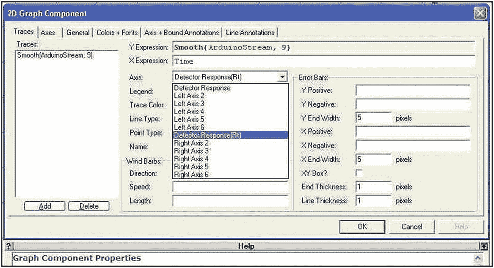
**图 4-7** `DAQFactory` 轴选择

图 4-8 描绘了 `DAQFactory` `GUI` `OP505` 色度计控制面板屏幕。从 `GUI` 控制面板的左上角开始，有三个带标签的编辑框和按钮，用于将复合 `LED` 光源 `RGB` 二极管的期望功率值输入到 `DAQFactory` 软件中。需注意，用于向 `Arduino` 传输 `RGB` 值的三个变量，必须在任何脚本编写中使用前声明。图 4-8 中的控制屏幕使用了编辑框、变量值显示、按钮、图形显示和静态文本显示来提供和接收信息。

一旦所需信息输入控制屏幕，按下“`RGB` 传输”按钮将激活序列代码，通过串行端口传输所需的红、绿、蓝数据值，供微控制器读取并执行所请求的功率级别。代码清单 4-2a 包含了用于按钮激活传输的 `DAQFactory` 代码。

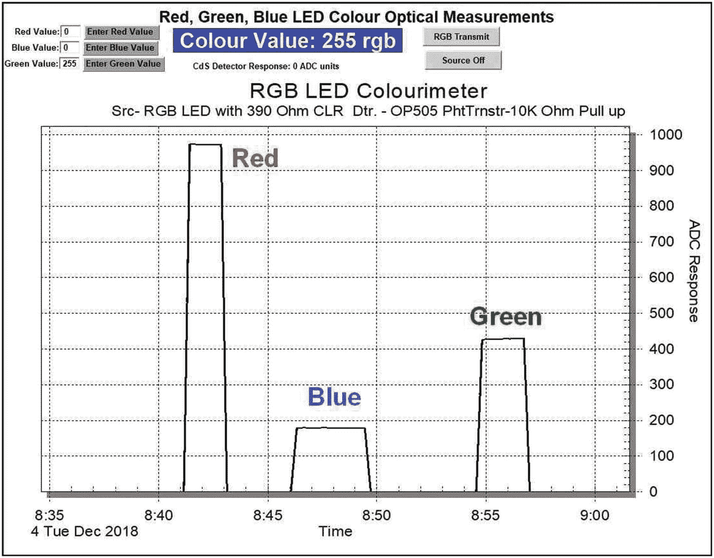
**图 4-8** 色度计 `GUI` 及 `OP505` 探测器在 `RGB` `LED` 全 `PWM` 功率下的响应

控制面板的使用本身并不涉及脚本编写。已编写并驱动操作的脚本，在按下 `RGB` 传输按钮时，期望接收三个数值。所有编辑框必须包含一个从 0 到 255 的数值。必须使用脚本页面和代码的自动启动功能（类似于图 4-9），以确保变量已被声明。

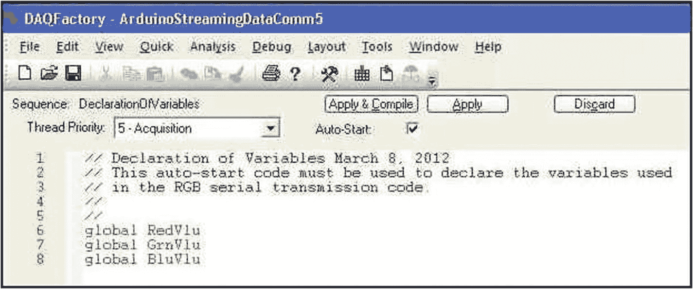
**图 4-9** 声明所需变量的自动运行 `DAQFactory` 代码

图 4-8 显示了标记为“`RGB` 传输”和“光源关闭”的按钮，这些按钮被配置为激活代码清单 4-2a 和 4-2b 中的序列代码。

代码清单 4-5 是 `Arduino` 的草图代码，用于接收并执行 `DAQFactory` 控制面板的串行传输。

#### 观察

如果不小心忽略了自动启动选项和声明代码，使用色度计时可能会出现一些奇怪的错误。

图 4-8 描绘了 `OP505` 探测器对标称颜色以及输入到 `GUI` 的 `RGB` 编辑框中的全 `PWM` 功率级别的响应。如表格 4-2 所观察到，与 `CdS` 探测器对明亮 `LED` 颜色的响应相比，不同的颜色会对 `OP505` 产生不同的响应。

在图 4-10 中，使用 `OP-505` 光电晶体管探测器获得的 `ADC` 计数数据已与 `Arduino` `PWM` 标称值进行了对比绘制。

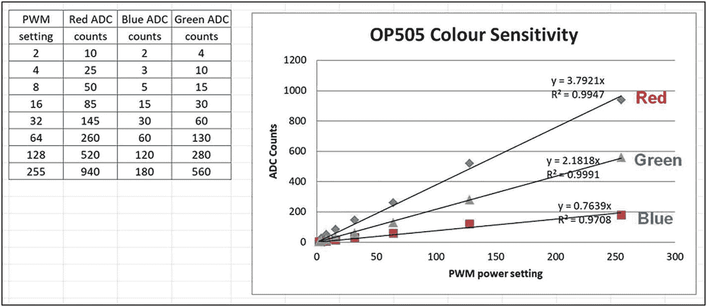
**图 4-10** `OP505` 光电晶体管在 `RGB`-`PWM` 功率级别下的响应

### 讨论

`Auto-Start`复选框的作用是，当`DAQFactory`程序创建 `GUI` 页面时，让短序列代码自动加载并运行。几乎所有包含变量的编程语言都必须在内存中预留空间来存放数值变量。通常，在编写程序、脚本或草图时，语言中会包含用于声明和可能初始化代码中符号变量的规定。在`DAQFactory`等 `SCADA` 软件中，数据的主要容器是存储带时间戳数值的通道。通道通过通道表来创建和激活。脚本页面的`Auto-Start`功能允许编写和运行代码序列，在控制屏幕组件的软件代码使用变量之前，声明并初始化这些变量。

硫化镉探测器具有广泛的电阻值范围，从受光时的数千欧姆到黑暗中的数千万欧姆不等。请回顾，如果将传感器配置为分压器以获得最佳性能，实验者应选择一个固定电阻值，该值应近似等于传感器在其工作范围中点处的电阻值。

使用 `PWM` 进行 `LED` 功率控制会导致光源设备产生的光出现一定程度的“闪烁”。由供电加热引起的局部温度波动以及 `USB` 总线上的电子噪声，都会增加信号传输中的噪声。

在所有定量光谱学方法和应用中，可重复性至关重要。为了在比较光测量中获得所需的可重复性，通常需要对 `ADC` 信号进行时间平均，以平滑电子干扰和杂散光干扰。时间平均会增加连续监测显示的响应时间。静态比色测量不会影响实验结果。

一张使用成比例 `PWM` 功率的粗略 `RGB` `LED` 颜色生成图已经发布，该图以十六进制表示了产生相应光所需的比例，如图 4-11 所示。

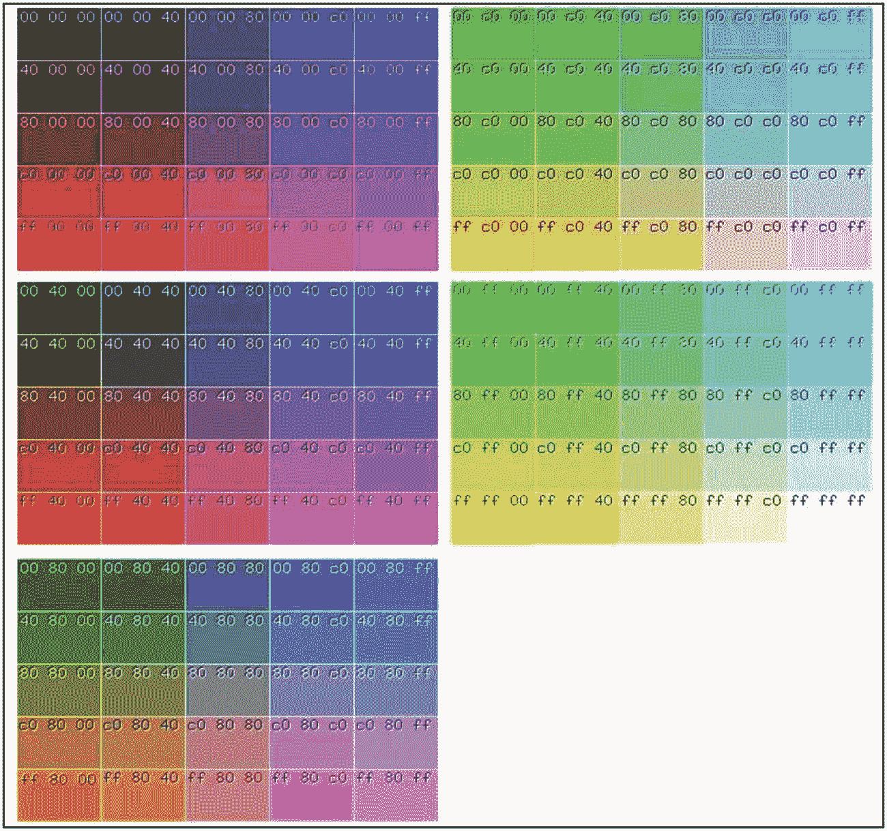
**图 4-11** 通过对各个 `RGB` `LED` 二极管施加 `PWM` 功率而产生的典型颜色（参见[`en.wikipedia.org/wiki/RGB_color_model`](https://en.wikipedia.org/wiki/RGB_color_model)）

颜色及其感知通常严格地用黑体辐射来表示，其中色温以开尔文为单位，对于可见光来说，通常在数千开尔文量级。颜色图表和 `PWM` 设置并非对最终颜色的严格定义，当从图表中选取相应的数值输入`DAQFactory`控制面板时，最终颜色便得以确定。`RGB` 二极管中三个发光源各自发出的光的波长和强度都可能因器件而异。

在比色比较的许多实验应用中，并不要求光源的光谱与待分析样品的完全匹配。一种黄色材料或溶液，可以在略有不同的黄色色调下使用比尔-朗伯定律来检测其颜色深度。通过在略有不同的黄色色调下，对不同样品厚度或浓度进行多次测量，只要光源发出的黄色的色调或色度不改变，就能获得准确的数据。光源与样品颜色之间的任何微小差异，都会通过差分比较技术而被抵消。

## 使用 Raspberry Pi 和 Arduino 实现光具座技术

一个 `Arduino`-`RPi` 组合可用于搭建一个装置，该装置为 `LED` 光源和光电探测器组合供电，这些组件可以安装在一个简单的光具座上，既可以暴露在环境光照条件下（如图 4-3 所示），也可以封装在一个不透明的外壳内（如图 4-12 至 4-17 所示）。

一个由 `RPi` 托管的 `Arduino` `IDE` 可以为当前的实验工作提供图形或数值显示选项。反应动力学通常通过跟踪光活性化合物的衰变速率来研究。过去 100 年间，在生物学、化学、地质学和医学领域，已经发表了大量描述定量比色分析方法的文献。

市面上有可发射窄带可见光的 `LED`，其波长范围从可见光谱的深红色端一直到蓝色端。各个彩色 `LED` 可以作为定量吸收测量的光源，用于确定溶液中以及某些半透明固相中有色材料的相对含量。

将 `RPi` 强大的计算能力和图形数据展示能力，与 `Arduino` 微控制器的光源功率控制、数据采集、转换及数字信号处理能力相结合，可以构建一个廉价、简单且易于组装的比色分析系统。

请回想一下，如果有色可见光的光束穿过颜色相同的溶液或固体时，一部分光子会被吸收，另一部分则会穿过。入射光强度与穿过吸收介质后的透射光强度之比，称为*透射率*。透射率与研究介质中吸收的光量之间通过以下关系式关联。

```
透射率 = I[i] / I[t] 并且 吸光度 = – log(T) = – log( I[i] / I[t] )
```
或
```
吸光度 = log 1/T -- (3)
```

`I[i]` 是入射到介质上的光强度。`I[t]` 是穿过待研究介质（即透射出的）的光强度。

吸光度常被称为光密度，可以看出，随着吸光度的增加，穿过有色介质的光量必然减少，这导致了吸光度与透射率之间的反比对数关系。

透射率可以被测量，而吸光度则必须计算得出。比尔-朗伯定律将恒定光程下稀溶液的吸光度与浓度联系起来。如果吸光度和浓度成正比，那么针对一系列已知浓度测量得到的吸光度绘制出的图形应该是一条直线。对于严格的定量分析分光光度法，必须建立吸光度与浓度之间的线性校准关系。然而，半定量的比色分析可以使用能够测量光透射的简单基础设备来实现，只需在溶液浓度与透射光强度之间建立线性关系即可。

一个像本项目中开发的这样简单、基础的比色分光光度计，可以测量光穿过待测样品后照射到光电探测器上的光量。监控光电探测器的微处理器的 `ADC` 会产生一个数字值，该值与样品透射的光量成正比，如果已经建立了线性关系，那么这个值就可以与浓度相关联。

对于更高级的研究人员，可以对本项目中开发的仪器中的微处理器进行编程，使其计算并显示吸光度单位，以进行更严格、更定量的研究。

## 实验环境与光学实验台准备

在使用光电晶体管作为光敏探测器的光学测量系统中，为获得真实的零读数，测量实验期间必须排除环境光或杂散光。应使用不透明外壳将容纳光源和探测器组件的光学实验台完全封闭。该外壳还必须能在光源与探测器之间的光路中放置吸收样品，并允许电信号进入被封闭的系统有源组件。

为光强度测量提供暗室环境，我们使用了一个带铰链盖的金属糖果罐，尺寸为 3½ × 11¼ × 2½ 英寸（86 × 276 × 61 毫米）（见图 4-12 至 4-17）。一块 3/8 英寸（9 毫米）厚的胶合板被切割成与罐底紧密配合的尺寸。底板的中心线被标记出来，同时在中心线两侧各画一条相距 ½ 英寸（12 毫米）的平行线。外侧的两排孔从底板底部钻入。这些孔经过沉孔和攻丝处理，以接纳 1 英寸 #6 平头机用螺钉（25 × 3 毫米），这些螺钉交替分布在右侧和左侧偏离中心线 ½ 英寸（12 毫米）的线上，间距为 ½ 英寸（见图 4-13）。当将底板装回避光盒后，底板上便有了两排孔，每排孔的间距均为 ½ 英寸（12 毫米）。这种交替定位孔位的技术使得对于定位在中心线上的组件而言，安装柱的孔位间距变为 ¼ 英寸（6 毫米）。

## 光学组件安装与布局

注意图 4-12 中的以下内容。

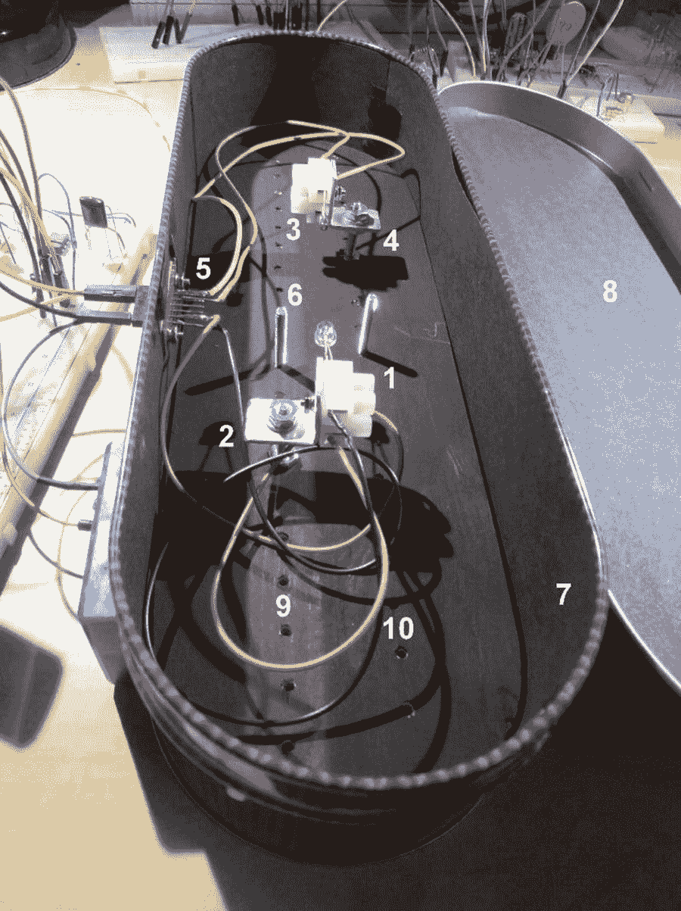

图 4-12 比色计的内部组件

- 标注 1 为 LED 光源（另见图 4-17），由一个双端子螺丝连接条组成，该连接条螺栓固定在一个直角支架上，能够接彩色二极管的阳极和阴极。
- 标注 2 为安装柱，位于中心线铰链对侧那排孔中的一个孔内，其上用一对六角螺母固定了一个直角支架，以确保光源组件的高度正确，并与探测器光电管保持共线性。
- 标注 3 为探测器光电管，安装在一个双螺丝端子连接条内，同样螺栓固定在一个直角支架上，以保持与光源的共线性。
- 标注 4 为带螺纹的安装柱，位于中心线铰链侧的那排孔内，其上装有一个直角支架，可调节至所需高度，以保持光源-探测器的共线性。
- 标注 5 为电气“穿通件”，用于将光源和探测器的接线连接到各自的微控制器输入和输出端（另见图 4-14 和 4-15）。
- 标注 6 为一对安装柱中左侧的一根，用于安装样品架（另见图 4-16）。
- 标注 7 为用于使外壳内壁变黑的哑光黑纸或纸板衬里。
- 标注 8 为用于顶盖内部的黑色纸或纸板衬里。
- 标注 9 为左侧安装孔排，位于中心线铰链对侧，孔距为 ½ 英寸（12 毫米）（另见图 4-13）。
- 标注 10 为右侧安装孔排，位于中心线铰链侧，孔距交替为 ½ 英寸（12 毫米）（另见图 4-13）。

探测器和各种光源安装在螺丝端子连接器中，这些连接器固定在铝制支架上，支架上钻有孔以套在 #6 机用螺钉上。一个锁定螺母将安装柱固定在底板的所需高度上。第二个螺母旋入安装柱下方，以便光源或探测器能够与其对应组件进行共线性调整。第三个螺母将支架组件锁定到位。

图 4-13 展示了我在避光容器内组装光学实验台所采用的技术。钻出适合 #6 平头（3 毫米）机用螺钉的孔（#35 钻头或 7/64 英寸），并进行沉孔和攻丝，以接纳预设的螺钉，这些螺钉位于平行于中心线的两条线上，间距为 ½ 英寸（12 毫米）。各个孔以 ½ 英寸（12 毫米）的间距交替钻出，这样组件便可调整到光学实验台上分辨率可达 ¼ 英寸（6 毫米）的距离。用于光源、探测器的十字槽头单螺钉安装柱，以及用于样品架的一对安装柱，可见于下排左起第七个位置、上排右起第五个孔位，以及上排和下排左起第十个位置。

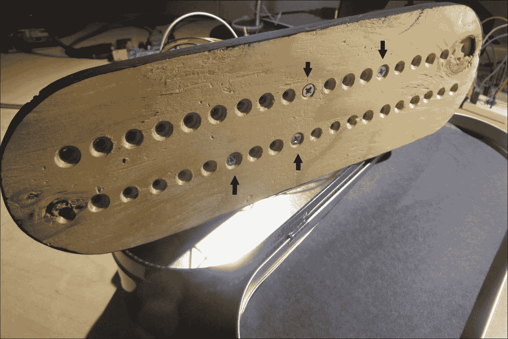

图 4-13 底板底部视图，展示了已就位的光源、探测器和样品架安装柱

## 电气连接与信号接口

图 4-14 和 4-15 描绘了电气穿通件的内部和外部视图，用于提供进入盒子内部的隔离电子接口。在避光盒侧面切割一个槽，以容纳一个四位或六位的堆叠式接头连接器。该连接器块用环氧树脂粘合在一小块万能板上，该板上钻有两个小孔以容纳两颗小螺栓，从而将组件固定在盒子侧面，为光源和探测器连接形成电气穿通件。

最初，堆叠式接头引脚被焊接到光源和探测器的连接线上。后来版本的仪器使用了标准的 0.1 英寸（2.5 毫米）间距堆叠式接头，该接头可接纳 Arduino 和原型开发板上常用的标准跳线（见图 4-19、4-20 和 4-21）。

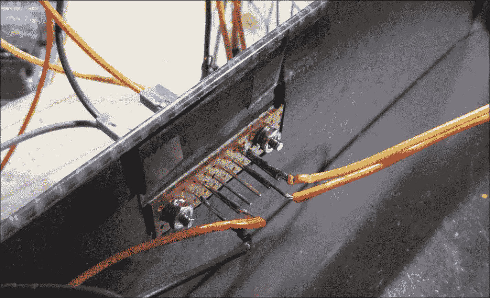

图 4-14 避光电子连接器的内部视图

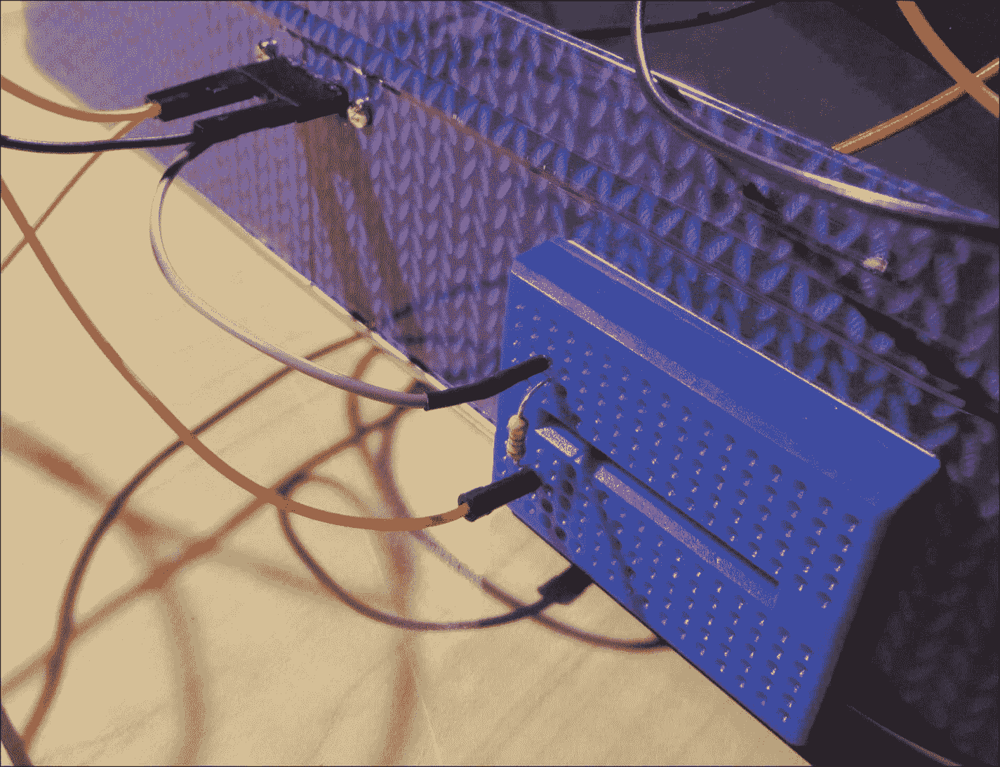

图 4-15 不透明电子连接器和辅助面包板的外观视图

盒子的内部以及底板的顶面全部用黑色纸衬里或涂料变黑，以阻止任何内部反射。

## 样品架安装

一对安装柱用于定位样品架。样品架由一个 ½ 英寸（12 毫米）的铝制角件构成，其上钻有一对偏置孔，以便套在安装柱上，并将固体玻璃纸片固定在光路中。样品纸片用 5/8 英寸（15 毫米）的弹簧夹（鳄鱼夹）固定，如图 4-16 所示。

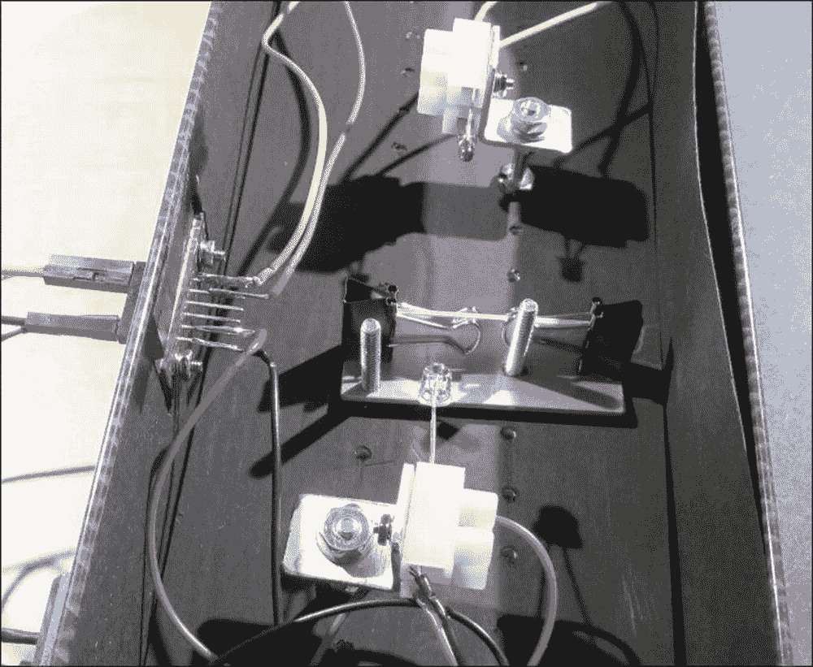

图 4-16 带夹子的样品架

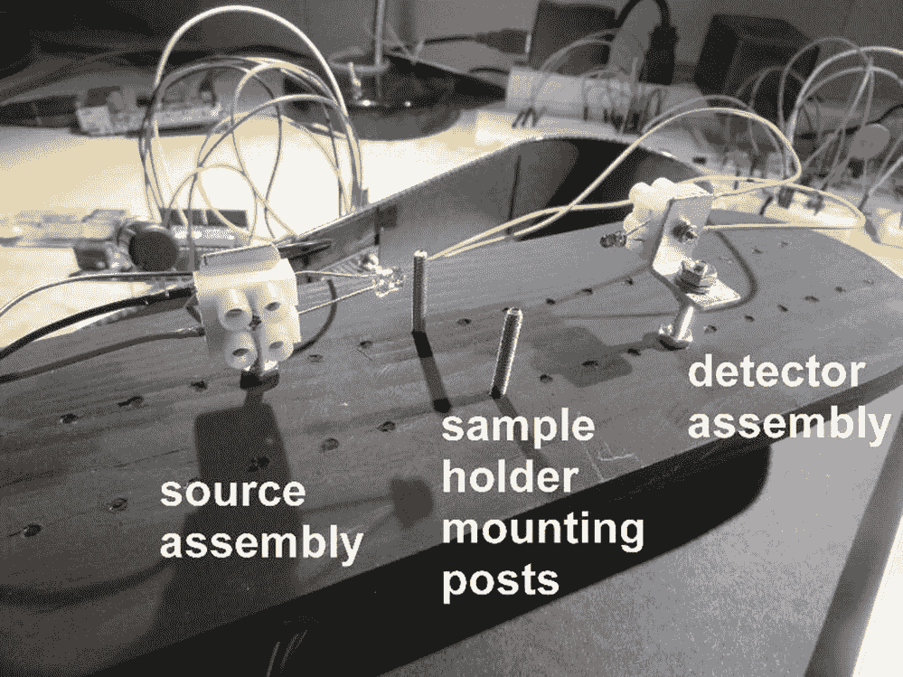

图 4-17 光学实验台的基本组件

## 电路与测量系统

Arduino 与 RPi 的组合可控制并为 LED 光源供电。Arduino 上的 ADC 能够确定照射在检测器上的光量。Arduino 的 5 V 电源为装置上的 LED 和检测器供电。5 V 电源、OP-505 的集电极、发射极以及 10 kΩ 电阻器按照图 4-18 所示串联连接。通过 `A0` 连接至 Arduino 上的 ADC，记录下 10 kΩ 电阻器两端的电压降，并通过串口监视器读取。

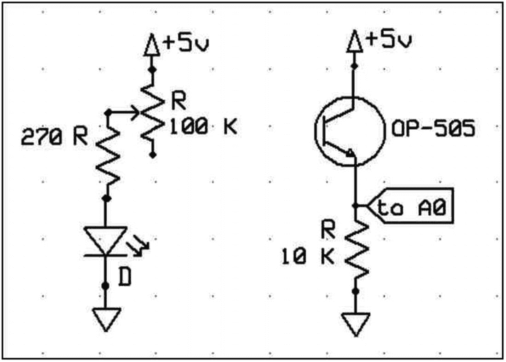

图 4-18 比色计的光源和检测电路

光源由 Arduino 的 5 V 电源供电。电流流经一个 270 Ω 的限流电阻和一个 100 kΩ 电位器的一半。通过调节电位器上的滑片位置，可以改变施加在二极管上的电压。加入 270 Ω 限流电阻可确保保护二极管。

要开始吸光度实验，您有几种选择。清单 4-3 中的光敏晶体管读数 —— 该清单最初是为本章 DAQFactory 控制面板的静态显示而编写 —— 或清单 4-3a 可与 RPi 的 PIXEL 主屏幕配合使用，以显示静态吸光度读数。从 PIXEL 屏幕上的 Arduino 图标可以启动 Arduino IDE。在“工具”菜单中，串口监视器可以直接显示 Arduino ADC 的吸光度或透射率值。更高级的研究人员也可以使用第 1 章清单 1-3、第 2 章清单 2-1，以及第 3 章清单 3-2、3-5、3-7 或 3-8 中的任何 Python 串口绘图程序，来记录适用于可见光光学监测的动力学数据。

在光路中放置空的样品架并关闭遮光盒后，调节电位器，使红色玻璃纸实验中的 ADC 计数近似达到 900 个单位。接近 900 的 ADC 计数代表 100% 透射率。将一个适当尺寸的不透明材料片插入样品架，应能完全阻挡光路，从而确定 0% 透射点。

然后，可以对红色玻璃纸等样品进行透射光测量。通过从 RPi 上 Arduino 的串口监视器显示中读取不同厚度材料的数值，可以确定层数或模拟液体中的浓度变化。

完成所需数量的测量后，应检查 100% 透射率的 ADC 值，以确定系统设置是否已偏离其原始设定点。

## 液体样品改装

为了适应有色液体样品，仪器内部可以改装，以容纳外径 3/4 英寸、高 2 英寸（2 厘米 × 5 厘米）的透明玻璃瓶，如图 4-19、4-20 和 4-21 所示。

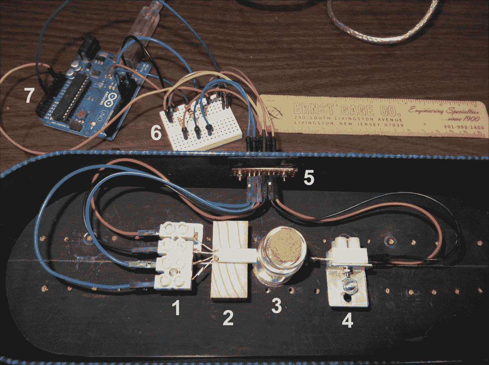

图 4-19 用于液体样品的光源、准直器、样品瓶和检测器改装

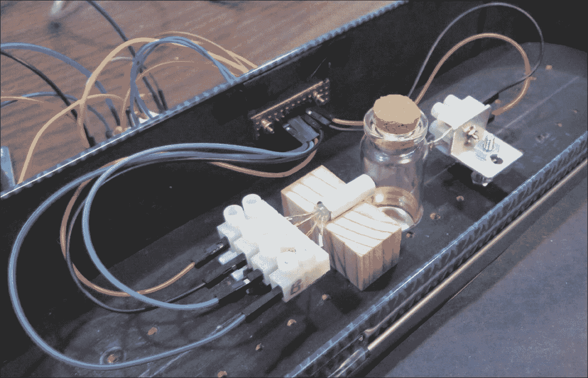

图 4-20 液体样品改装

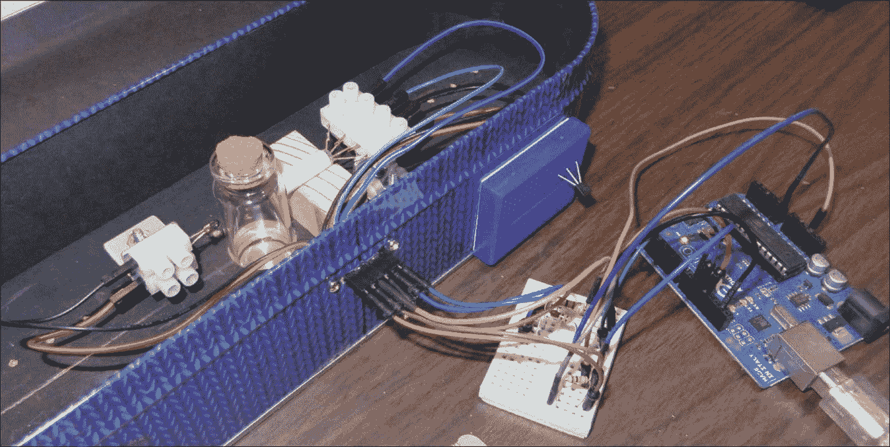

图 4-21 液体样品改装视图 2

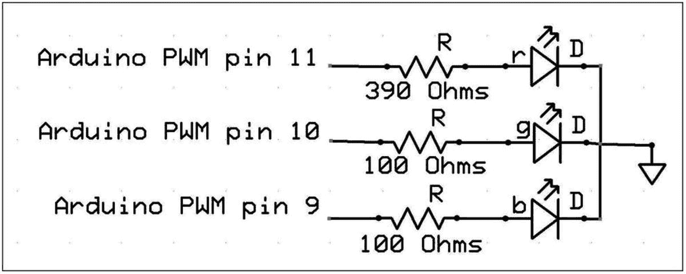

图 4-22 用于大型液体池比色计的 RGB LED 光源的优化电流源

下文描述了图 4-19 中的组件。

- 组件 1 是一个四端子螺钉连接器块，由标准的 12 单元端子排切割而成，用于连接公母跳线的公头端。该端子块安装在一个螺纹柱上，如图 4-12、4-16 和 4-17 所示。该块用螺栓固定在一个铝制支架上，该支架可容纳电气连接，并在进行共线性调整时将 RGB LED 牢固地固定到位。
- 组件 2 是一个木质块，支撑着一个直径为 5 毫米（1/4 英寸）的铝箔准直器，该准直器将 LED 发出的光汇聚成大致与样品瓶另一侧的检测器（4）共线的一束光。（3）（准直器支撑块在投入使用前已被涂成黑色。）
- 组件 3 是一个钠钙玻璃瓶，直径 3/4 英寸（20 毫米），高 2 英寸（50 毫米）。该样品瓶通过在其中心位置的光学平台底座上切割出的一个直径为 3/4 英寸（20 毫米）的孔固定。
- 组件 4 是检测器组件，由一个安装在铝制支架上的 2 端子聚乙烯螺钉连接器块组成。同样，端子排提供了两个电气连接，并将 OP-505 光电晶体管检测器牢固地固定在与光源和样品瓶共线的位置。
- 组件 5 是一个 6 引脚排针，已用环氧树脂/氰基丙烯酸酯胶粘剂粘合到一块万用板上，用于安装在遮光盒的侧壁上。排针通常用于将分线板安装到原型实验板上，其两侧均有公针（参见第 10 章的图 10-2）。一条双排公针可以为承载电流和检测器信号的母跳线提供遮光的电气连接。
- 组件 6 是一块小型原型实验板，用于容纳优化的限流电阻，以便为大型液体池仪器中的光源供电（参见图 4-22）。
- 组件 7 是 Arduino，它根据输入到串口监视器并通过 Arduino 串口屏幕上的“发送”按钮读入 Arduino 代码的数值，提供 PWM 信号以提供所需的 RGB 二极管电流。该微处理器使用 10 位 ADC 监测 OP-505 光电晶体管的输出，并将 0 到 1023 的数值发送到串口，以供 Python 处理。