# 比色法光强度测定

使用图 4-20 和图 4-21 所示的仪器，可以进行一系列基于 `LDR`、光电晶体管或 `OPT101` 单片光电二极管跨阻放大器 IC 探测器的基本比色测量。为验证该技术，可使用浓缩食用色素或由甜菜、蓝莓等高色素食物加工而成的水基制备液，配制一系列红色、绿色和蓝色溶液。

能够滴出单滴液体的工具，例如一体式塑料滴管、分体式玻璃管橡胶球滴管或眼药水滴瓶，可用于制备一系列已知浓度的体积比有色溶液。一种简便技术是：统计填充已知体积所需的液滴数量，然后通过除法计算出每滴液体的平均体积。价格实惠的玻璃或塑料量筒以及 3 mL 移液管（巴斯德吸管）可从在线零售商处购得，有各种尺寸和材质可选。图 4-23 展示了一个典型的 10 mL 量筒和一根塑料巴斯德吸管，这些是常用于测量药液的小体积分液工具。

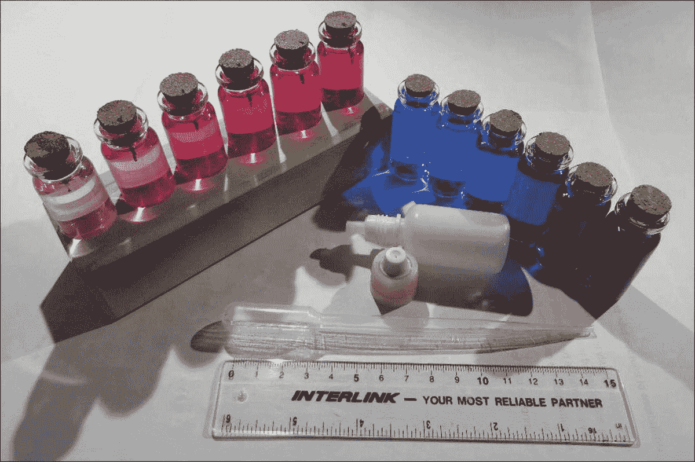

*图 4-24：滴液工具、稀释甜菜提取物及食用色素校准溶液*

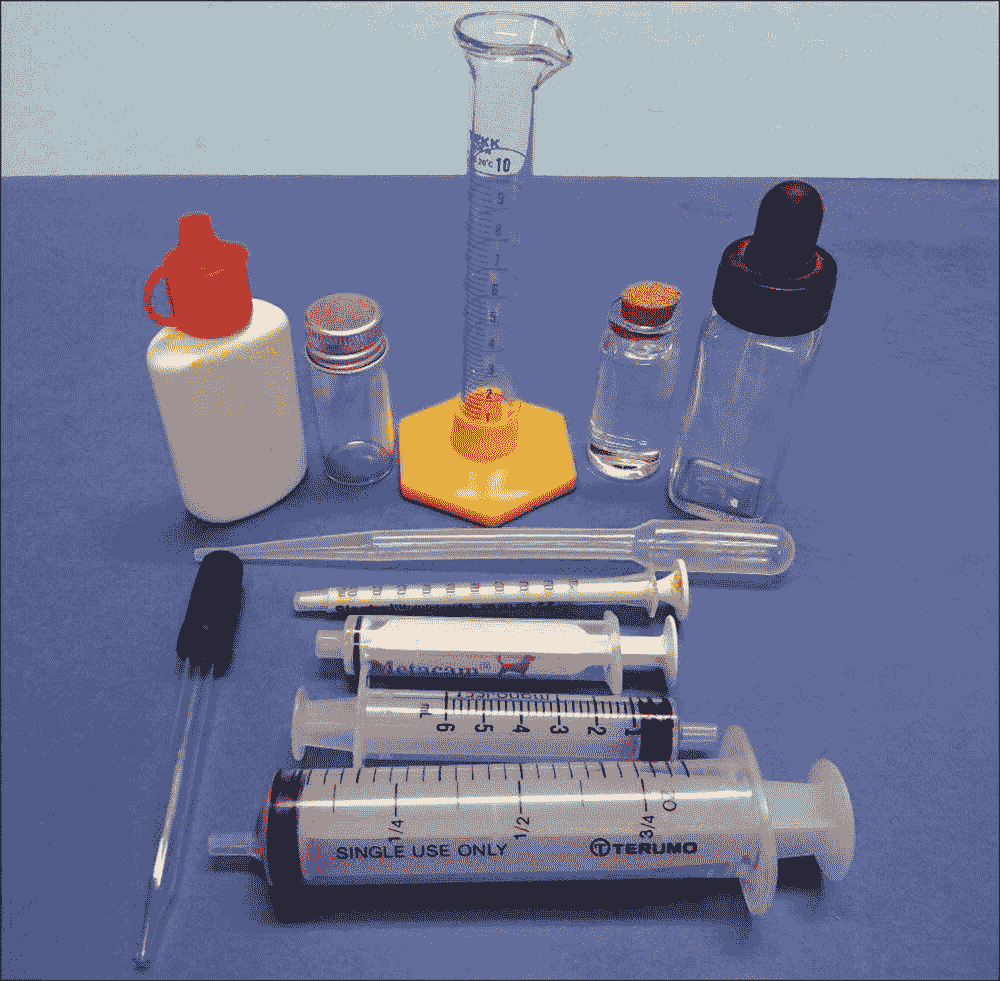

*图 4-23：用于体积校准的常用工具*

在利用简单有色固体引入有色材料吸收光的概念后，可以进一步探讨使用灵敏探测器测量溶液中颜色的方法。尽管目前搭建的仪器尚未涉及主动光学（即光的方向被折射），但使用装满水的圆柱形玻璃瓶作为样品池会产生透镜效应，这一效应必须被识别并加以考虑。弯曲的样品瓶必须精确放置在光学平台的中心线上，以确保最大量的折射光均匀地落在探测器上。

在图 4-24 中，支架上盛放红色溶液的样品瓶已用黑线标记，以确保每次读取吸收/透射读数时，样品瓶都能放置在样品固定块的同一位置。每个样品瓶均装满水后放入仪器中，记录样品瓶每旋转 45 度位置时的 `ADC` 值。然后对样品瓶进行标记，以确保在使用时，当指示标记指向与电气馈通相反的一侧时，各样品瓶的 `ADC` 值尽可能接近。

德州仪器（Texas Instruments）生产了一款专用于可见光和近红外光强度测量的特定集成电路，芯片型号为 `OPT101`（13 美元）。图 4-25 包含了来自制造商数据手册的框图，说明了构成该器件内部电路的组件。光电导模式下的光电二极管（输出电流与入射光强度成正比）与跨阻放大器配合使用，产生与落在二极管窗口上的光强度成正比的输出电压。入射光的光谱响应范围可延伸至约 400 nm 至 10000 nm，并在近红外区 850 nm 处达到最大灵敏度峰值。

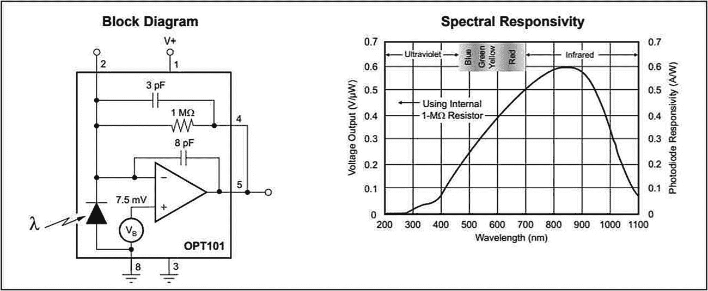

*图 4-25：德州仪器 `OPT101` IC 的内部配置与光谱响应*

图 4-26 展示了该 IC 的机械布局，并标明了用于电路实现的电气引脚连接。用于将探测器与 Arduino 连接的电路如图 4-27 所示。在电路实现中，引脚 2、6 和 7 未被使用。Arduino 提供电源和模数转换器，为 `OPT101` 跨阻放大器提供数值读数。电源连接中的 100 Ω电阻用于保护集成电路，两个电容器用于最大限度地减少电源线上的噪声。由于需要手动读取和记录单个 `ADC` 吸光度/透射率值，Arduino 还提供了移动平均数字信号平滑功能。

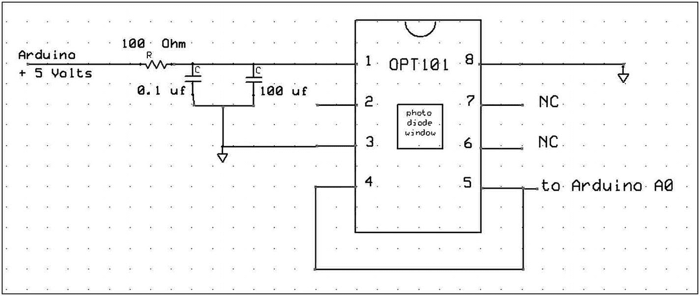

*图 4-27：用 Arduino 读取 `OPT101` 的电路图*

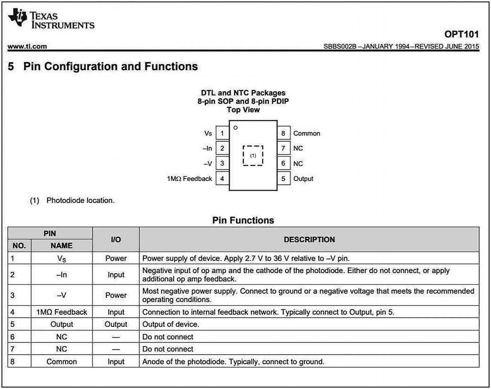

*图 4-28：`OPT101` 引脚分配*

在图 4-28 和图 4-29 中，数字编号标识了为使仪器适配 `OPT101` 探测器而进行的各项更改。

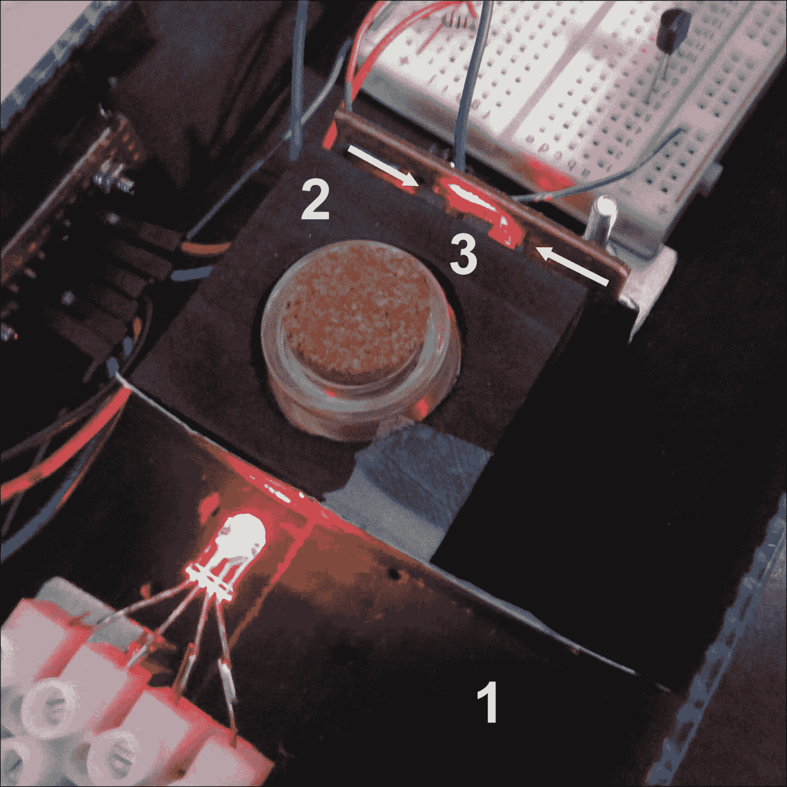

*图 4-31：光源穿过装有样品的样品瓶后光被汇聚*

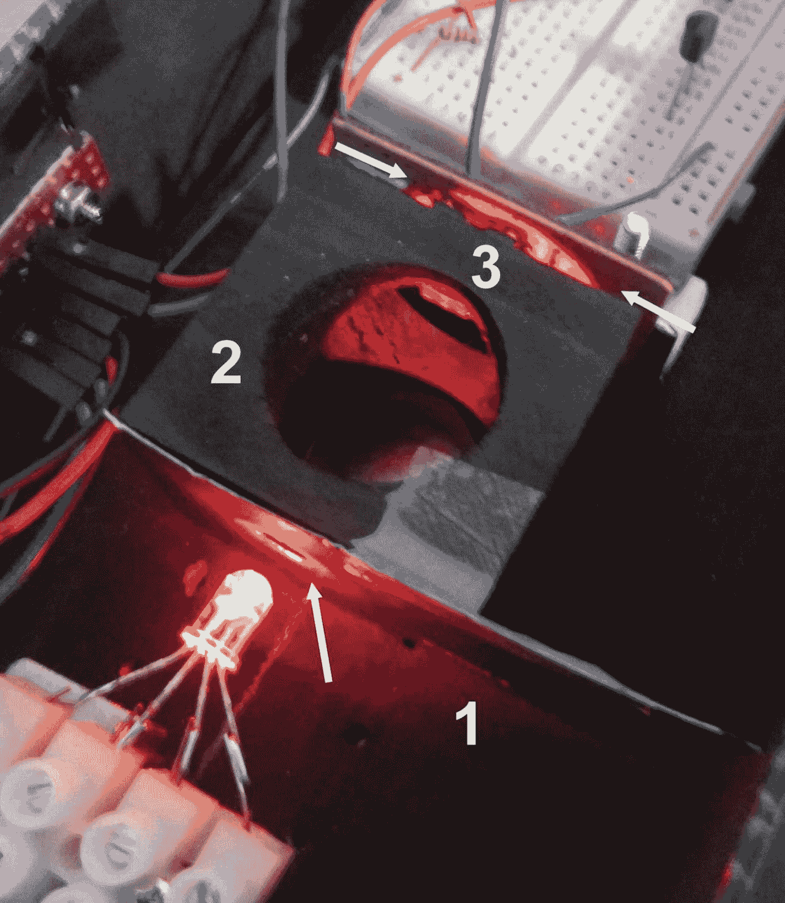

*图 4-30：光路中无玻璃样品瓶时光源光发散*

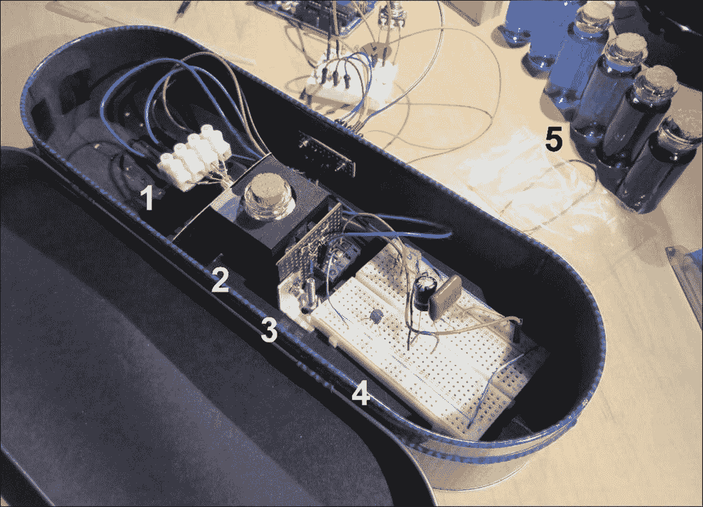

*图 4-29：`OPT101` 安装——探测器端视图*

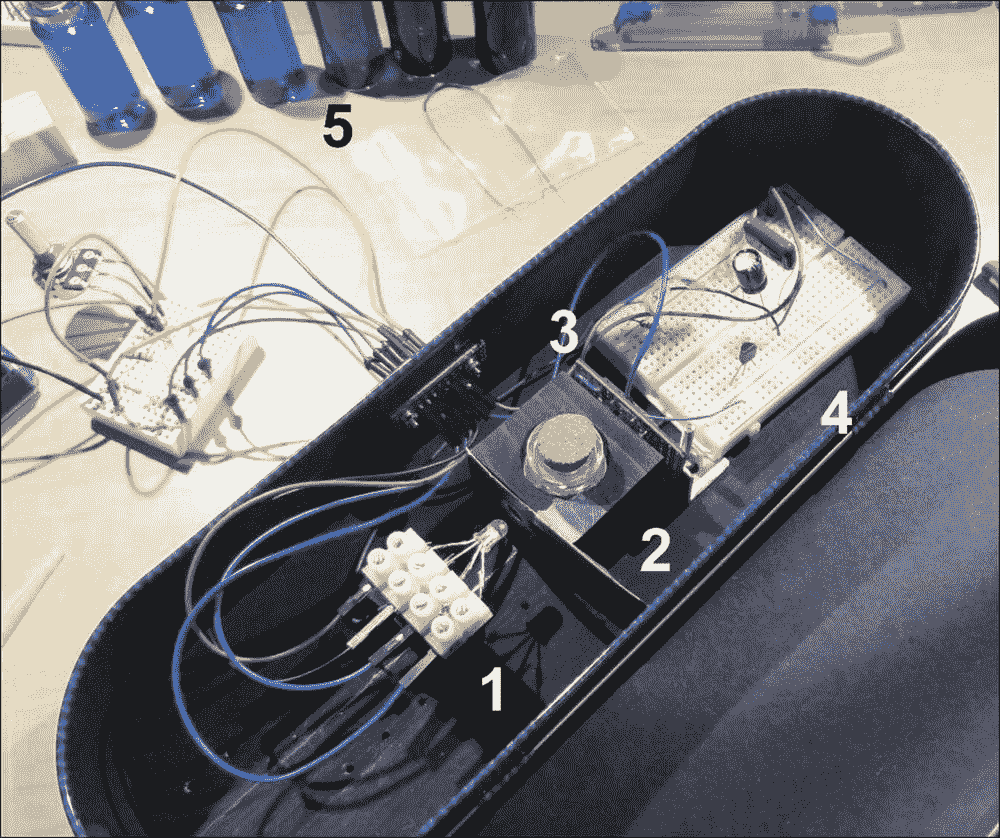

*图 4-28：`OPT101` 安装——光源端视图*

-   标号 1 标识了 RGB LED 光源支架，在图 4-28 中，一块不透明板上有一个直径为 1/4 英寸（6 毫米）的孔径，紧挨在 LED 透镜盖前方。
-   标号 2 是一个涂漆的木块，上面钻孔用于牢固固定样品瓶。木块底部有两个销钉，可紧密嵌入仪器底部的定位孔中（见图 4-13）。
-   标号 3 是一块小型洞洞板，上面安装了一个 8 引脚 DIP 插座，用于容纳 `OPT101` 芯片。图 4-29 显示了探测器板的背面，左侧是螺纹可调支架，右下角是探测器板的绿色端子连接器。
-   标号 4 是一个用于电源连接和元件安装的小型面包板。
-   标号 5 是蓝色食用色素染料的二元浓度梯度。

图 4-30 和图 4-31 展示了样品瓶在装满水性溶液时的透镜效应。在图 4-30 中，光源孔径位于白色箭头尖端处，位于标号 1 标识的不透明板上。在图 4-30 中，当样品架内没有玻璃样品池时，由标号 2 标识的样品固定块内部似乎被从光源孔径扩散出的光线完全照亮。当放入样品池后，光束似乎被汇聚成图 4-31 中可见的较小椭圆形，如标号 3 标识的双箭头所示。

测量工作通过组装待用的 LED 光源和探测器，并将两者与合适的样品支架对准来完成。机械部件安装完毕后，即可进行电气连接。使用 `Arduino IDE` 配合相应的软件和电源连接，可以点亮并测试光源。当光源发出测量所需的正确颜色光后，即可关闭外壳，并检查 `Arduino ADC` 的读数。需要获得稳定的读数，并且可能需要调整 `Arduino` 软件所平均的读数次数，以达到所需的稳定性。在这类光强度对比测量中，因使用更大的移动平均窗口而导致探测器响应时间增加的问题并不需要特别关注。

为了获得稳定的探测器响应，可能需要进行一定的开发调试。当装有水溶剂的样品瓶置于样品支架中时，探测器响应应尽可能接近但小于 `1024`。如有必要，可以通过调整二极管功率、光源与探测器的距离，或两者同时调整，以达到稳定、可测量的 `0%` 吸光度/`100%` 透光率的基线状态。在完成了针对低端吸光度测量的仪器配置后，可将一个不透明物体放入样品支架中，以建立 `100%` 吸光度/`0%` 透光率的读数。

`ADC` 值之间的差异需要足够大，以便从有色标准品梯度液中测得的各个吸光度/透射率值能够在感兴趣的浓度范围内形成一条线性校准曲线。

## 观察结果

在图 4-32 和 4-33 中，简单的有色干玻璃纸系统在测量的 `ADC` 计数值与四层红色聚合物之间建立了线性关系。随着玻璃纸层数的增加而进行的额外实验开始偏离线性，这是因为偏离了正常应用比尔-朗伯定律所需的稀溶液条件。

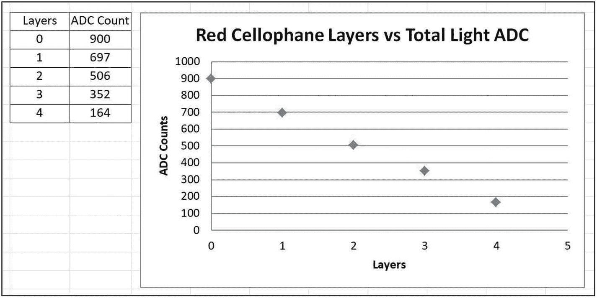

图 4-32

`ADC` 计数值与红色玻璃纸层数的关系

图 4-33 绘制了使用八层半透明红色玻璃纸测量得到的完整数据集。如曲线所示，当超过四层厚度后，由于过度吸收，线性开始变差。

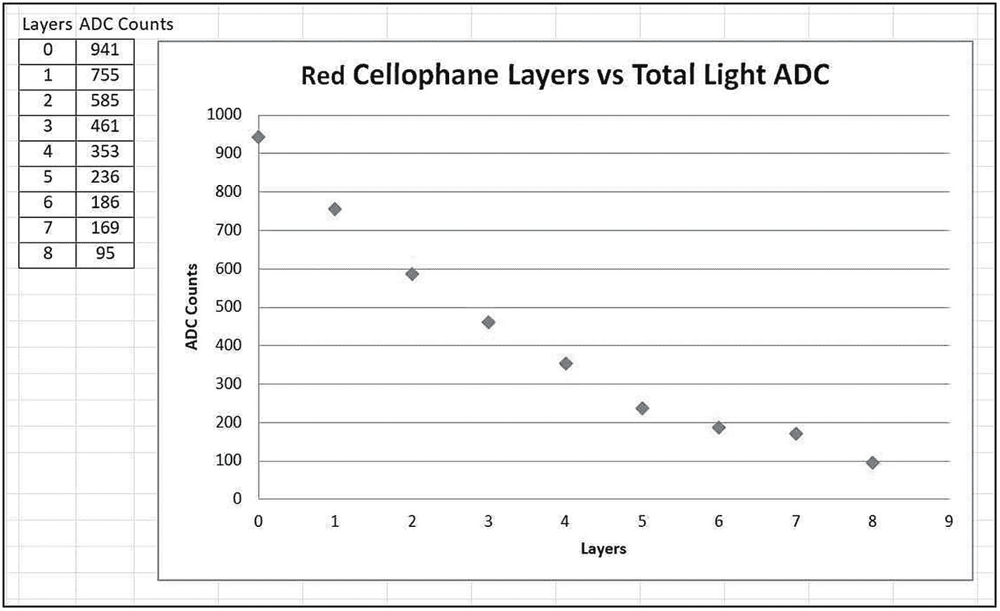

图 4-33

因颜色密度过大导致的线性损失

红色、绿色和蓝色 LED 光源被安装在仪器的单二极管配置中，所有光源都与 `CdS LDR` 产生了足够的响应，将 `100%` 透光率时的 `ADC` 计数值设定在接近 `900` 的稳定值，从而生成了图 4-34 至 4-37。

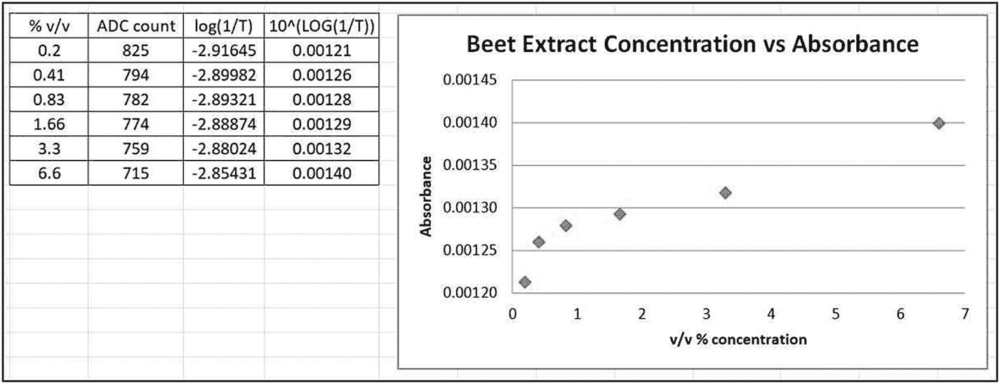

图 4-37

使用 `CdS LDR` 探测器及信号平均的 RGB 二元稀释吸光度校准

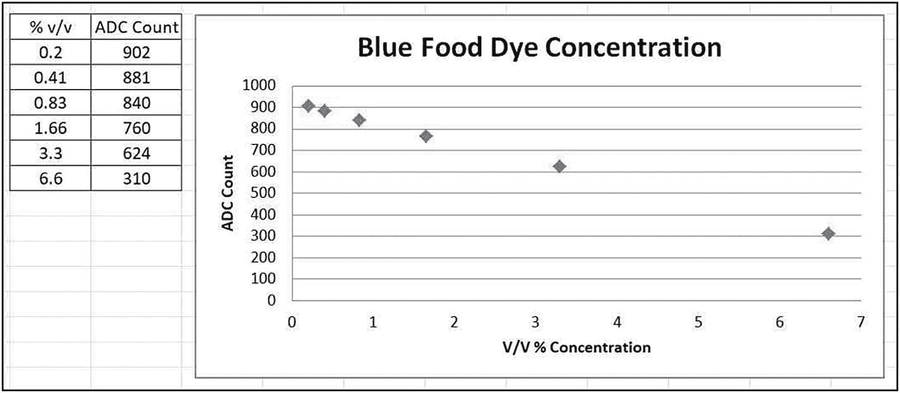

图 4-36

使用 `CdS LDR` 探测器及信号平均的 RGB 二元稀释校准

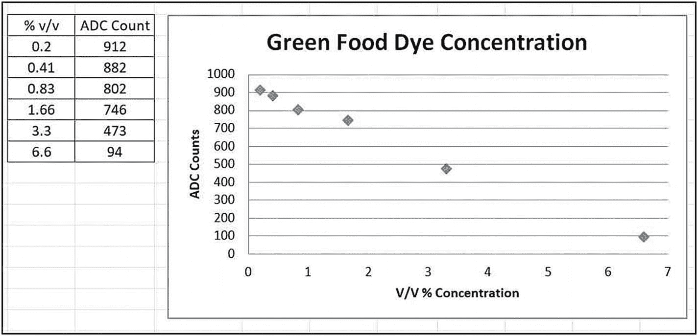

图 4-35

使用 `CdS LDR` 探测器及信号平均的 RGB 二元稀释校准

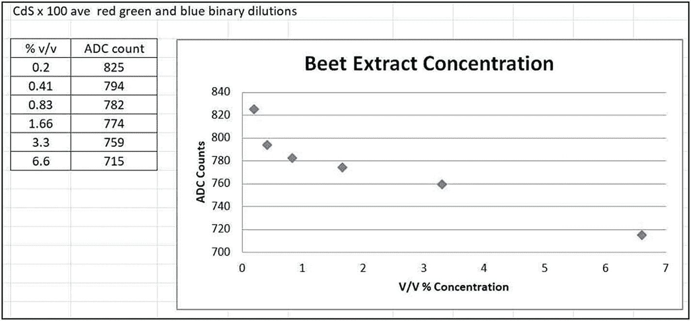

图 4-34

使用 `CdS LDR` 探测器及信号平均的 RGB 二元稀释校准

在图 4-34 中，红甜菜提取物的光密度过高，无法形成探测器 `ADC` 计数值或透光率与浓度之间的线性图。在图 4-37 中，尝试将透光率转换为吸光度以改善线性，但效果不佳，因为溶液浓度过高，且物理化学参数引起次要光学问题，这些问题只能通过稀释来消除。

在图 4-38 和 4-39 中，仪器已重新配置，使用高灵敏度的 `OPT101` IC 光电探测器来测量作为蓝色食用色素浓度函数的光透射率。

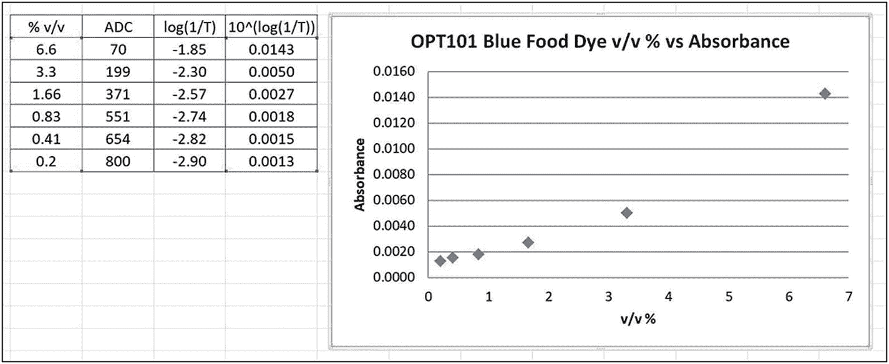

图 4-39

使用 `OPT101` 探测器的蓝色食用色素二元浓度与吸光度校准

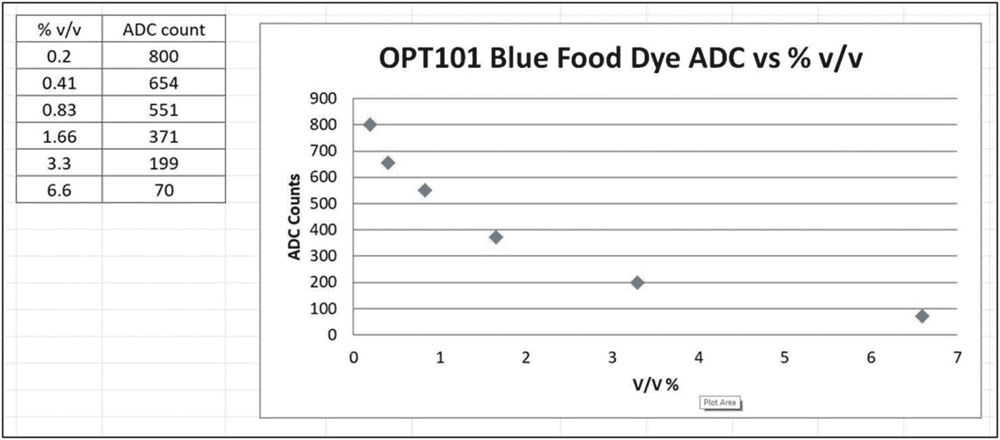

图 4-38

使用 `OPT101` 探测器的蓝色食用色素二元浓度与 `ADC` 校准

图 4-38 和 4-39 展示了当测量光密度的方法或技术改变时，线性度可以得到改善。

图 4-40 是使用直流供电的单色蓝色 LED 光源，在比色计中测量已知标称体积浓度的稀释甜菜提取物时，`OPT101` 探测器以 `ADC` 单位计的响应。图 4-42 是对一份经体积校准的库存蔬菜烹饪提取物（三滴等分试样）进行二元稀释的结果。测量了三个低增量浓度稀释液，其中第三个显示了图 4-40 中描述的系统响应。浓度低至 `50` 百万分之一（`ppm`）的范围是可以测量的。

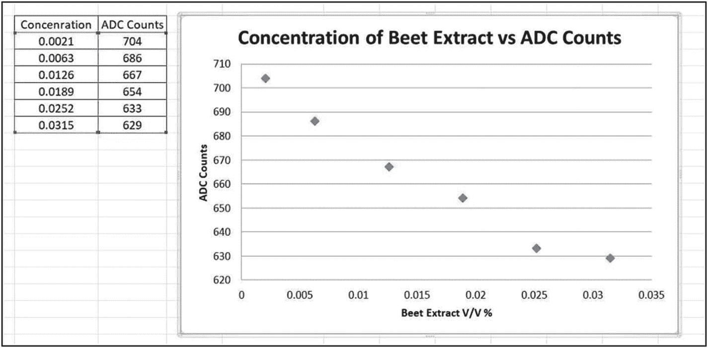

图 4-40

使用 `OPT101` 探测器对甜菜提取物进行三次连续浓度的校准

## 讨论

为了降低本入门级工作的成本和复杂性，我们对传统的比色分析法实验室方法进行了一些改进，形成了一种没那么严格的半定量分光光度技术。将浓缩溶液通过校准的滴量体积进行分配，用于系列体积稀释或稀释至已知体积，以生成已知体积比稀释浓度颜色梯度。

标准溶液的制备，首先需要数出所选用的分液器具填充一个已知体积所需的滴数。例如，图 4-23 和图 4-24 所示的塑料聚乙烯一体式移液管，向 10 ml 量筒中滴液至 9 ml 刻度线处需要 350 滴。该移液管每滴为 0.025 ml。一旦分液装置校准完毕，应加标记以避免错误。从实验室购买的同一批次散装塑料移液管中取出的另一支移液管，其滴液大小为：280 滴占据 9.6 ml 体积，即每滴为 0.034 ml。

为配合电子吸光度测量系统的实验工作，我们制备了两个系列的彩色溶液。从工艺品商店获得了金属螺帽和窄颈软木塞密封瓶（见图 4-23 和图 4-24）。它们的内腔体积为 12 ml。窄颈瓶更易于操作，因为瓶颈收缩处的肩部可作为恒定的填充标记，类似于实验室的容量瓶。（一系列标称体积相同的实验室级容量瓶，其窄颈上的填充标记高度也各不相同。假设这些 12 ml 瓶子的体积相等是随机误差或系统误差的来源之一。）

用于确定线性校准存在的浓度范围的溶液，可以通过向六个瓶中依次加入二进制递增滴数的有色浓缩液来制备。图 4-24 中的蓝色溶液代表一个浓度梯度：第一个瓶中加入 1 滴市售食品染料，第二个瓶中加入 2 滴，第三个瓶中加入 4 滴，依此类推，直至第六个瓶中含有 32 滴染料。染料浓度与通过溶液的蓝光递减值之间的关系图，如图 4-34 和图 4-35 所示。

在一个如此大的浓度范围内，光透射的 `ADC` 值对 `V/V`% 的简单作图并非线性。绘制透射率倒数的对数（称为*吸光度*）与浓度的关系图可以改善线性。在某些情况下，轻微的平滑曲线也是可以接受的。对于需要线性关系的调查研究，可以使用更小的颜色梯度来进行浓度测量。

对于稀溶液，比尔-朗伯定律被假定为吸光度、分析物浓度和溶液光程之间的线性关系模型。然而，在许多实验测量系统中，校准曲线并非线性而是略微弯曲的。如果校准结果可重现，那么只要浓度随测量的吸光度没有剧烈变化，测量参数之间相关性的形状或曲率并不重要。

`LED` 不是激光器。其光线虽然有方向性，但却是以锥形向外辐射的。对简单系统的测试表明，在光源与探测器（`OP-505` 光电晶体管）之间大约 2 英寸（50mm）的距离处，绿色、蓝色和紫外光产生的功率足以将 `Arduino` 的 `ADC` 稳定在约 900 值，这足以进行一系列吸光度测量。

尽管 `OP-505` 光电晶体管的峰值光谱灵敏度（如同大多数 `PN` 结一样）位于红外区域（如图 4-1 所示），但高亮度输出可见光的 5 mm 直径 `LED` 所产生的辐射足以利用 `Arduino` 10 位 `ADC` 的大部分范围来进行吸光度测量（见图 4-10）。

对三种探测器类型的光谱灵敏度曲线进行考察表明，`LDR` 在可见光谱的绿色区域最为敏感。基于 `PN` 结的器件在近红外区域具有最大灵敏度。`OPT101` 可以在光谱的蓝色区域工作（见图 4-38），并且在红色区域也相当灵敏（见图 4-40）。

`LDR` 的光敏面积为 1/4 英寸 × 5/16 英寸（6 mm × 9 mm），`OP-505` 的直径为 1/8 英寸（3 mm），而 `OPT101` 光电导二极管的面积为 0.090 英寸（2.29 mm）见方。使用 `LED` 作为光源，凭借其亮度和集中的定向输出，使得实验者可以组装一个仪器，其中各组件应对准成一直线以获得最佳性能。

图 4-32 和图 4-33 展示了当标称波长处的光密度增加时存在的非线性现象，这会产生固体玻璃纸片效应——与液体溶液中分析物浓度增加时发生的那种偏差效应相同。

图 4-34 至图 4-37 所示的校准曲线说明了目标有色物质浓度过高的影响。在所有四张图中，红色、绿色和蓝色的灵敏度都足以生成校准曲线，但只有绿色和蓝色两者是线性的。红色系列稀释液浓度过高，因此在透射率或吸光度数据绘图模式中均不呈现线性关系。

图 4-38 和图 4-39 说明了通过将数据呈现模式从透射率改为吸光度可能获得的线性度改善。

可以制备这样的溶液：其浓度梯度标准液是通过在连续的瓶中依次加入线性递增数量的滴数来创建的。尝试通过在连续的瓶中依次加入单滴和双滴来制备校准液，未能产生甜菜提取物观测到的 `ADC` 值的可靠、可重复的下降。当使用三滴增量时，得到了图 4-40 所示的校准曲线。该校准曲线在浓度低至约 0.025% `V/V`时似乎仍是线性的。该红色植物提取物校准曲线的可用跨度涵盖了 20 至 250 ppm（百万分之一体积比）的浓度范围。

尽管所组装的系统没有使用任何有源光学元件，但如果使用一个简单的手持放大镜收集通过样品的光（见图 4-31）并将其聚焦在探测器上，灵敏度应该会有显著提高。