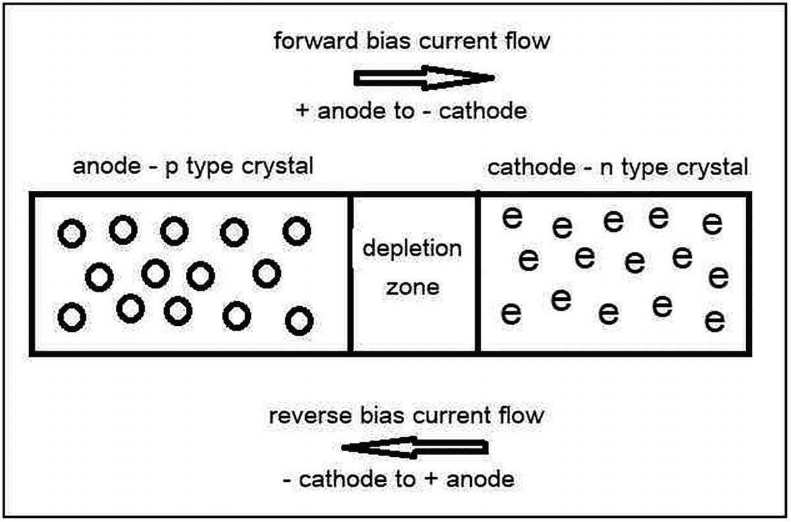
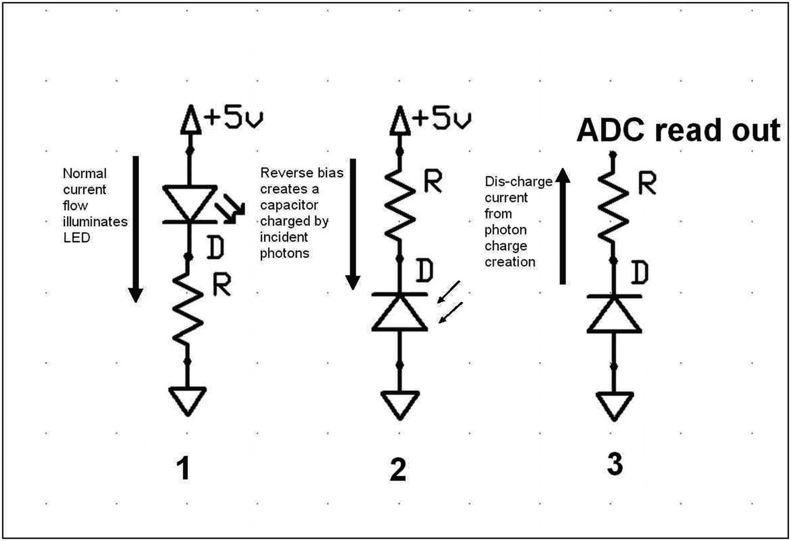
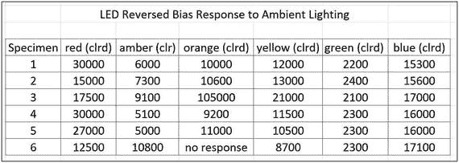
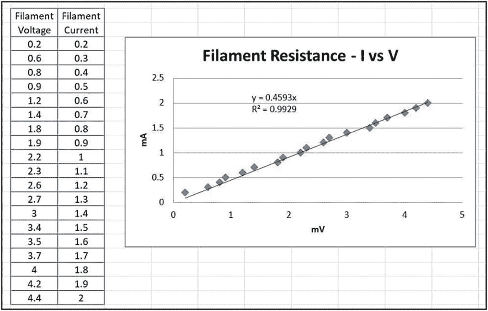
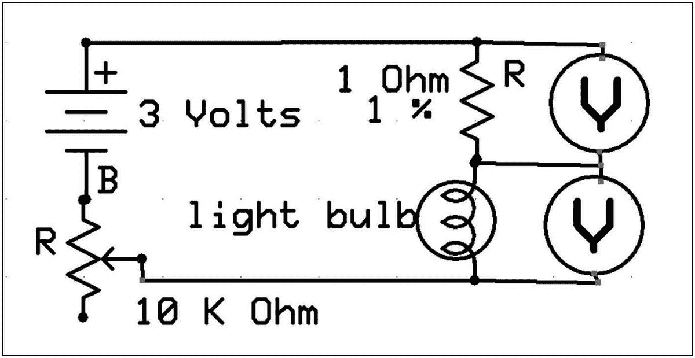

# 一种使用反向偏置 LED 的六波长光谱仪

LED 是由 crystalline 硅或锗制成的首批固态信号或整流二极管的进一步发展。金属和绝缘体由那些在形成固体时，其多原子晶体结构会形成部分填充（允许电子移动）或完全填充（禁止导电）的能带的元素制成。某些元素可以混合形成在受控条件下能像金属导体一样行为的材料。

诸如硼（`B`）、铝（`Al`）和镓（`Ga`）等元素，其最外层只有三个电子。诸如碳（`C`）、硅（`Si`）和锗（`Ge`）等元素则有四个。磷（`P`）、砷（`As`）和锑（`Sb`）则有五个。如果将硅或锗这类材料与少量硼、铝或镓混合并结晶，就会形成 P 型半导体。P 型材料由一种体基质构成，其中由四个外层电子组成的连续原子结构会零散地被晶体原子只有三个电子的位点打断。在体晶体基质中，一个缺电子的位点可以被视为一个带正电的空穴。

如果将一种四电子材料与少量外层有五个电子的元素混合并结晶，就会形成 N 型半导体。N 型材料由一种体基质构成，其中原子结构中由四个外层电子组成的连续结构会零散地被晶体原子有五个电子的位点打断。一个具有多余电子的位点可以被视为一个带负电的实体。

通过将 P 型半导体材料与 N 型材料的晶体熔合在一起，就形成了一个 PN 结。

图 4-41

一个 PN 结

这两种晶体的熔合导致沿接触界面的空穴和多余电子相结合，从而形成一个没有可移动载流子的区域，称为*耗尽区*。只有当在结的 P 侧施加一个强度足以克服耗尽区能隙（根据制造材料的不同，在 0.3 V 到 0.7 V 之间）的正电压时，电流才能被迫流过该结。

作为固态电路的基本构建块，单个 PN 结形成只允许电流单向流动的二极管，仅起整流器的作用。两个 PN 结可以形成诸如 PNP 或 NPN 型晶体管来控制电流。四个 PN 结串联形成晶闸管或可控硅整流器。反向偏置的 PN 结则形成光电池和光电二极管。

正常电流流过 PN 结时，空穴和电子载流子越过耗尽区会以红外辐射的形式释放能量。由体半导体材料和微量元素（如镓（`Ga`）、砷（`As`）、磷（`P`）、氮（`N`）、铟（`In`）和铝（`Al`））制成的 PN 结二极管，可以被制造为在可见光、近红外和紫外光范围内产生辐射。

LED 在正向偏置时光致发光，在反向偏置时光电导。在光电导模式下，该器件通过的电流与照射到其 PN 结上的光量成正比，前提是光能量小于 PN 结的带隙能量。

已经开发出一种固态比色计，它利用正向偏置的 LED 作为单色光源用于吸收测量。这些相同的二极管也可以用作光谱检测器，来测量它们自身标称颜色的强度。

自 1988 年以来，F. W. Mimms 一直使用普通 LED 中的反向偏置 PN 结进行光感测，用于太阳监测。这是目前正在开发的可见光通信（VLS）系统的基础。M. Cook 博士于 2008 年提出了一种在 Arduino 上实现 LED 感测用于实验的方法（参见 [`www.thebox.myzen.co.uk/Workshop/Introduction.html`](http://www.thebox.myzen.co.uk/Workshop/Introduction.html)）。

图 4-42 包含了三个带有标题的简单原理图，以便更好地理解将 Arduino 编程为使用普通 LED 的光传感器的算法和代码。

图 4-42

作为颜色传感器的 LED 偏置

通过反转 LED 上的偏置，可以使得 PN 结具备电容器的特性和能力，其结电荷由两个半导体材料面之间的绝缘体维持。该结的电容通常在皮法量级（10^(-12) F）。如果一个反向偏置的发光二极管暴露在能量大于 PN 结带隙的入射光下，则电子被拉入导带，在原位留下空穴。放松结两端的反向偏置电压会导致空穴和电子迁移，从而产生一个与收集到的入射光强度成正比的电流。

通过让累积的电荷流过已知电阻并测量电流流动的时间，可以测量累积电荷的量。计时计数可以用微控制器来确定，即由 PN 结形成的电容器两端的标称 5 V 偏置电压通过已知电阻衰减回标称 0 V 或逻辑 0 所需的时间。回想一下，电压随时间变化的积分是电流或电荷的度量（参见第 1 章公式 3）。

已有几篇发表的报告，其中来自放电二极管的定时电压衰减/电流流动已被归一化为 ADC 计数，作为环境光照的度量，方法是测量放电前后二极管两端的电压。Arduino 草图列表 4-5 测量单个反向偏置 LED 上累积的电荷。此外，测量的放电时间已被反转，以表示为黑暗程度的度量，从而根据环境光照条件按比例表示二极管的发射情况。

由于二极管的颜色由其 PN 结带隙的能量差决定，因此可以预期该结对其自身波长的入射光敏感。

随着电磁辐射波长变短，光子能量增加。原本为较长波长制造的反向偏置 PN 结，应对其自身波长及更短的波长敏感。

有两种技术使用反向偏置的 LED 作为微处理器的光传感器。这两种技术都将反向偏置的 PN 结暴露于入射光，使其收集电荷，然后通过一个电阻将二极管放电到地，测量电压差或对放电进行计时。实验表明，使用电压差作为入射光的度量适用于单个 LED，但不适用于监测多个二极管。

大多数微处理器都有一个 ADC 和六个或更多多路复用测量通道。当在单个 ADC 上使用多个二极管时进行的观察表明，一个通道的变化通常会在其他通道中反映出来。有人提出，多路复用器通道中的残余电荷可能是造成这种效应（通常称为*串扰*）的原因。

在 Arduino 微处理器的两个数字引脚上串联一个`LED`和一个限流电阻，可以避免使用`ADC`多路复用器，并通过清单 4-4 中的代码独立监控各`LED`。编写一个相对简单的程序，即可测量照射到二极管结上的、波长短于其发光波长的入射光量。由于 Arduino 拥有 12 个易于访问的数字 I/O 引脚，最多可使用清单 4-4 中的代码，通过测量放电时间来监控多达六种不同波长的`LED`。

在图 4-10 中，`OP-505`光电晶体管对三种原色的响应各不相同。可以合理预期，制造过程中存在差异，使得同一批次中每个二极管的耗尽区尺寸略有不同，其`PN`结上的电压差也略有不同。除了微小的制造电压差异外，由于制造不同颜色`PN`结使用了不同材料，还会产生更大的数值差异。要在任何定量或定性应用中使用感光`LED`，最好在入射光收集量最小的黑暗环境中开始任何实验测量。

表 4-3 列出了在反向偏置感光模式下，以放电时间计数作为入射照度指标时，`LED`中测得的响应变化（有色器件标为(clrd)，透明二极管标为(clr)）。

**表 4-3** 反向偏置`LED`的定时响应变化

| - |

利用反向偏置`LED`进行波长选择性感光，可用于组装一个廉价的演示装置，展示两项重要的科学概念：一项涉及理论物理学，另一项涉及天文学。感光`LED`可以选择性地监控热物体发出的量子化黑体辐射。来自加热物体的量子化辐射演示，被用作理论物理学中量子力学基本概念的支持证据之一。对恒星物体可见光颜色发射的天文观测，常被用来确定物体的温度。

颜色通常被描述为与炽热或热黑体在特定温度（以开尔文度表示）下发出的辐射相对应。一种易于获得且能加热到特定温度的黑体，就是白炽灯泡的钨丝。

一个易于管理、小巧、安全、便于使用的带灯丝灯泡，可以从任何汽车供应商处获得，例如 12 V 车辆尾灯，如 Sylvania/Osram 1156（加元 3 元；最大电压 12.8，额定功率 26.9 瓦），以及相应的带引线灯座（称为`pig tail`，加元 2.50 元）。这种小灯泡在全功率下通常消耗略低于 2 A 的电流，这通常完全在大多数套件构建的 30 V 直流稳压电源的能力范围内，并且小灯泡尺寸只需极少的屏蔽即可防止被热玻璃外壳烫伤。

关于温度与可见光、红外和紫外范围内辐射电磁能量之间关联的研究，已通过白炽钨丝灯泡进行了广泛研究。钨丝的白炽是通过对金属元件施加`DC`或`AC`电能进行电阻加热而产生的。钨丝温度是通过将金属元件的电阻变化与已知的温度变化相关联来测量的。

为了使用感光`LED`进行实验，用于定性和定量测量的简单仪器系统的构建和组装可分为两个阶段：光源的创建和选定光色的检测。

### 实验：光源组装与校准

为了使用钨丝/电阻温度关系（表示为

`T = T[0] + (R/R[0] – 1)/α` -- (4)

），必须在环境或定义的`T[0]`条件下测量的室温电阻`R[0]`，与根据钨丝收集的电流和电压数据计算出的灯丝电阻`R`值一起使用。`α`是钨的电阻温度系数，报道值为 0.004403。

检查用于计算钨丝温度的温度电阻关系，需要测量环境条件下的导线电阻值`R[0]`。通常，低功率 12 V 灯丝的电阻值接近半欧姆，需要仔细测量。

该技术的低电流适应方法可用于精确测量灯丝的低质量和小分数欧姆电阻（参见[`www.semanticscholar.org/paper/The-Ohmic-Region-of-a-Lightbulb-Grasel-Mudd/38ae1fbdf536b916adbc2965e3ad93eb6c79dbf7?p2df`](http://www.semanticscholar.org/paper/The-Ohmic-Region-of-a-Lightbulb-Grasel-Mudd/38ae1fbdf536b916adbc2965e3ad93eb6c79dbf7%253Fp2df)）。

为了最大限度地减少螺旋灯丝中低质量材料的热效应和电阻扰动，并充分利用成本合理的仪表，仅测量电路元件上的电压降。

在图 4-43 中，一个低压电源（3 V）与一个 10 KΩ可变电阻器、一个高精度 1% 1 Ω功率电阻器以及灯泡灯丝串联。两个价格合理的仪表随后测量灯丝和精密电阻器上的电压降，同时调整可变电阻器以逐渐增加电路中的电流。在一个典型实验中，可变电阻器以 0.1 mV 的增量进行调整，使灯丝两端的电压从 0 增至 5.0 mV，并记录每个增量下精密电阻器两端的毫伏压降。

**图 4-44** 由电流-电压曲线得出的灯丝电阻

**图 4-43** 低质量钨丝灯泡灯丝电阻测量电路

图 4-43 和图 4-44 展示了在这些实验中，为 Sylvania 1156 灯泡灯丝供电的电路以及灯丝电阻的图形化测定方法。一台高灵敏度 Siglent SDM3055 数字台式仪表使用低欧姆量程测得的灯丝电阻为 0.46 Ω。低功率图形化程序得出的值为 0.4593 Ω。

### 实验：利用反向偏置`LED`进行选择性色光感测

