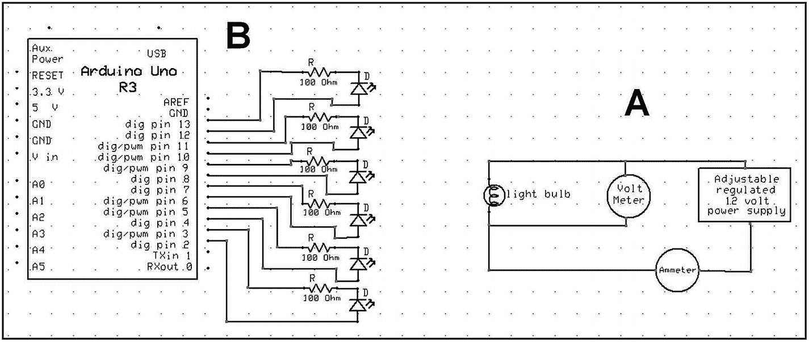
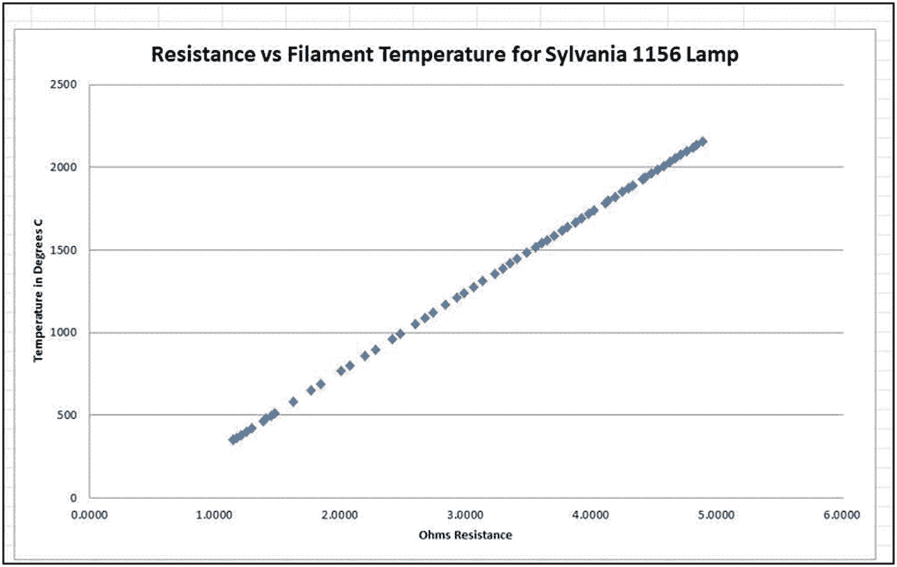
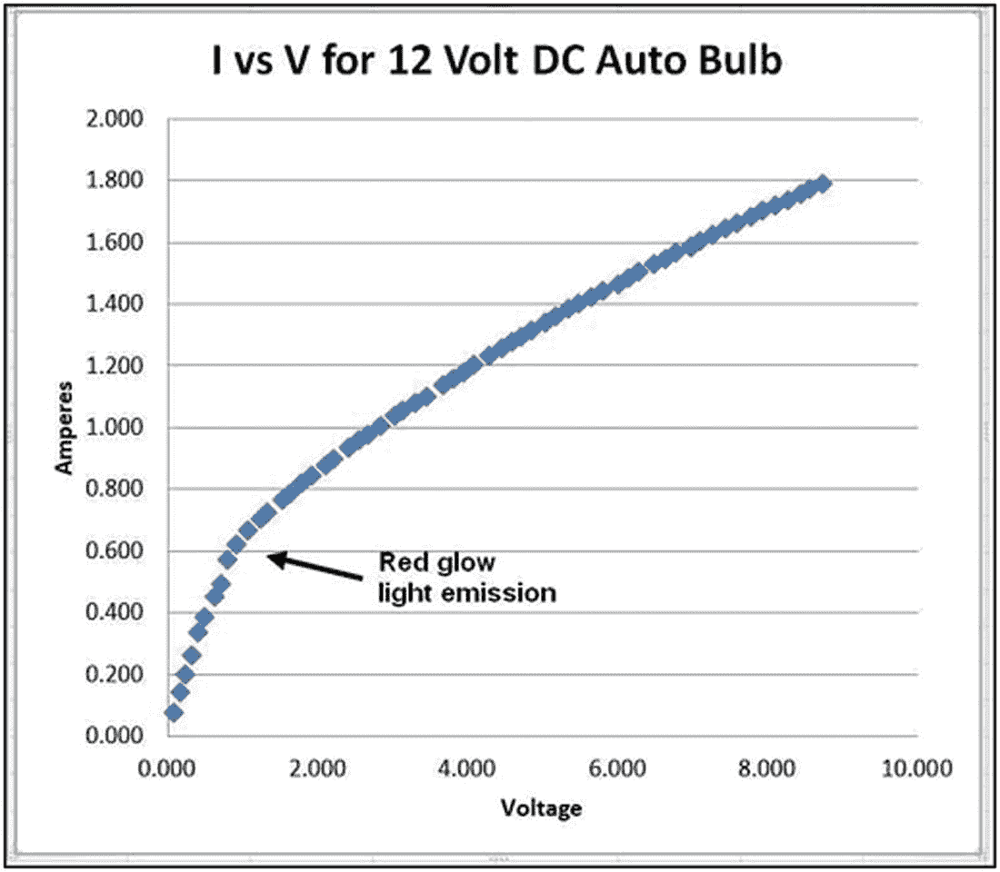

# 确定温度：钨丝灯丝的电阻相关性

一个 12V 的小型钨丝灯泡，例如 26.9W 的 Sylvania/Osram 1156 汽车尾灯，由可调电压 2A 电源供电，是一个极好的白炽光源。图 4-45 中的电路 A 描述了用于测量输送至灯丝的电流和电压的电路配置，从而能够确定每个灯丝功率设置下的灯丝电阻。

**图 4-45** 选定光感应实验的源电路和检测电路

使用图 4-45A 所示的电路，并将灯泡安装在合适的支架上，当电源电压从 0 V 以 0.2 V 的增量升至 12 V 时，记录了观察到的仪表读数。在灯泡灯丝中心部分开始发光的时刻，对灯丝功率设置做了特别标注。

表 4-4 列出了在电源设置从 0.2 V 到 12.0 V 以 0.2 V 增量变化时，测得的灯丝电压和电流。该表格还包含了通过简单应用欧姆定律计算出的电阻值，以及根据钨丝电阻值近似估计的温度（关于电阻温度系数或 TCR 的更多信息，请参见`方程式 4`和第 7 章）。

> **注意：** 校准常数：钨(W) α系数 = 0.0045，室温灯丝电阻 = 0.46 Ω，室温 = 20.2°C。

**图 4-47** Sylvania 1156 灯泡的电阻与温度关系

**图 4-46** Sylvania 1156 钨丝灯丝电阻随施加功率的变化

**表 4-4** 钨丝灯丝电阻与温度校准

| 参数 | 值 |
| :--- | :--- |
| 校准常数 | 钨(W) α系数 = 0.0045 |
| 室温灯丝电阻 | 0.46 Ω |
| 室温 | 20.2°C |