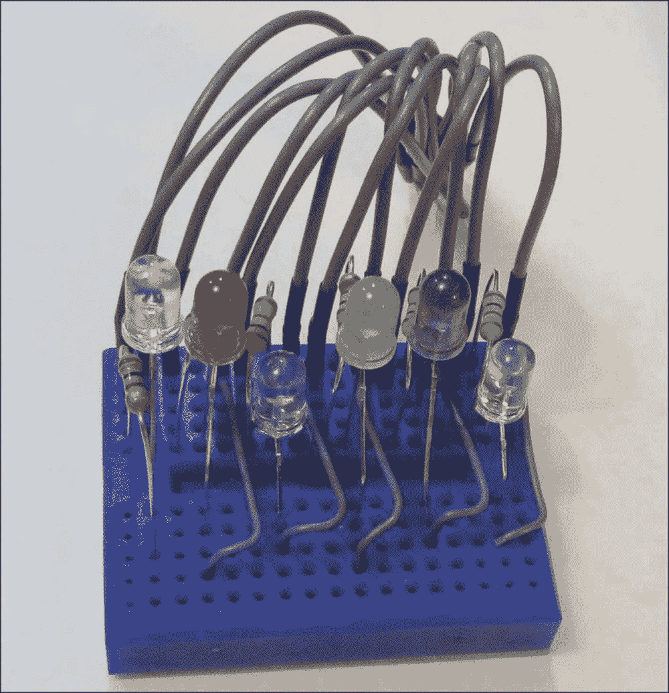
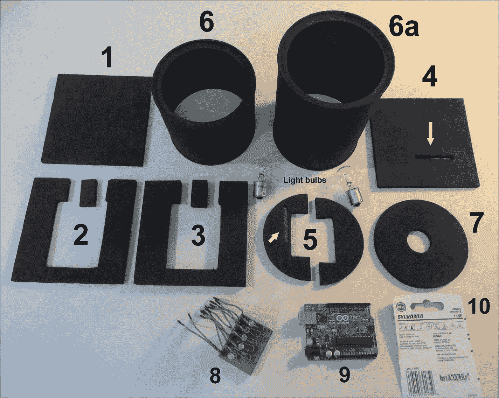
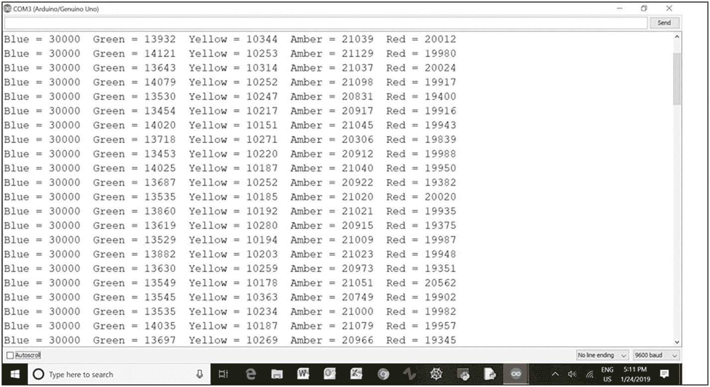

# 使用反向偏置 LED 进行选择性色彩光感应

为了独立测量由排列成阵列的不同颜色反向偏置二极管（见图 4-49）所感应到的光，可以组装一个遮光外壳来封装光源和传感器。图 4-45 中的光源和检测电路可以封装在一个由易得组件制成的遮光箱内，如图 4-48 所示。

图 4-48 中描绘的组件由易得且易于加工的材料制成，例如 1/4 英寸（6 毫米）胶合板和纤维鼓食品容器，所有这些都涂有哑光黑色丙烯酸涂料以减少内部光线反射。

组件 1 是装置的基板，如果在实验过程中移动组装单元，它为 Arduino 微处理器提供支撑。组件 2 和 3 是垫片，为微处理器提供足够的空间，并与小矩形块一起，很大程度上阻止了杂散光渗入微处理器腔室。组件 4 是微处理器隔间的顶板，也是圆柱形曝光室的底板。

组件 4 和组件 5 的左半部分都有一个 1/8 英寸（3 毫米）宽、1½英寸（40 毫米）长的槽，用于容纳微处理器排针与二极管阵列之间的电气连接。组件 1、4、2、5 和 7 由 1/4 英寸（6 毫米）胶合板切割而成。标为组件 3 的一对组件由 3/8 英寸（9 毫米）胶合板切割而成，以便为 Arduino 排针阵列提供足够的间隙。构成曝光室底座的所有木质组件均为 4½英寸（11.5 厘米）见方。

**图 4-49** 彩色 LED 二极管阵列

**图 4-48** 曝光室组件

组件 5 由两块板组成，这两块板经过切割以贴合 1¾英寸（45 毫米）x 1¼英寸（34 毫米）原型板的底部，如图 4-9 所示。这两块板安装在内径为 4 英寸的纤维板圆筒内，使得原型板和组件 7 中的孔口在长度不同的圆筒 6 和 6a 内保持同心。组件 6 和 6a 是直径为 4 英寸（10.2 厘米）、长度分别为 3¾英寸（95 毫米）和 5½英寸（14 厘米）的纤维板圆筒，由带金属边圈的食品包装桶切割而成。组件 4 和 5 上的白色箭头指示了用于容纳二极管引线与 Arduino 数字引脚访问排针之间电气连接的槽口。该图还描绘了二极管阵列、Arduino 微处理器，以及显示两个备用光源规格数据的包装背面。

一旦遮光箱组装完成，并且 Arduino 加载了清单 4-4 中的五元件或六元件光感应草图，Arduino 串行监视器应显示指定二极管的流式列表（见图 4-50）。

**图 4-50** 五元件反向偏置二极管阵列串行监视器输出

请记住，串行监视器输出的默认选项是实时流式传输数据，并手动记录或检查单个数值。可以激活屏幕窗口左下角的 `autoscroll` 复选框来“冻结”显示并停止滚动。（使用 `Ctrl+C` 将选中的数据复制到剪贴板。）

一个 4 英寸（10.2 厘米）高的圆筒是大约 30W 灯泡和 1/4 英寸（5 毫米）反向偏置 LED 光传感器的合适曝光长度，如图 4-49 所示。请记住，点光源的辐射强度遵循距离的平方反比定律。

最初，在灯泡灯丝未通电的情况下，所有二极管元件的最大时间计数值应为 30,000 或更少（取决于器件）。按照灯丝电阻-温度数据收集实验中的方式，以电压增量向灯丝供电。随着源电压和电流的升高，可以使用串行监视器找出每个反向偏置二极管开始响应由加热灯丝产生的光子时的功率设置。表 4-5 列出了观察到标称颜色敏感 PN 结开始响应灯丝辐射时的功率设置。

好的，作为一名高级文档工程师和翻译员，我已理解您的要求和格式规范。以下是严格遵循指南完成的翻译。

