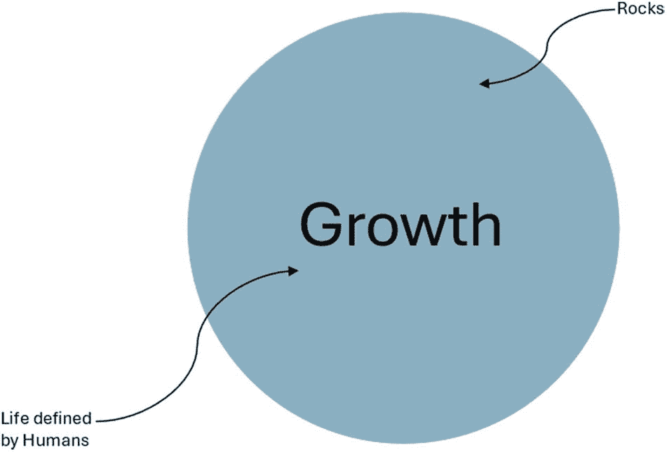
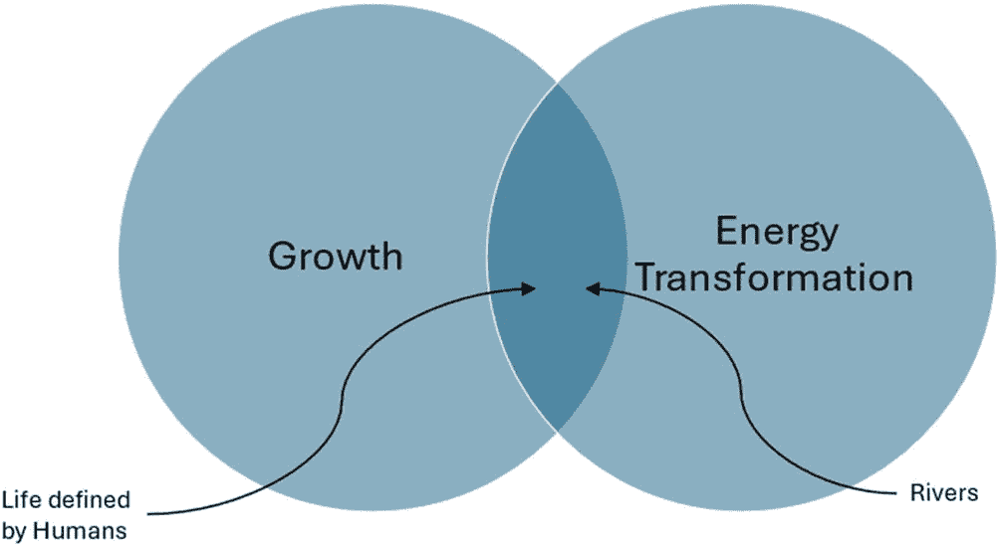
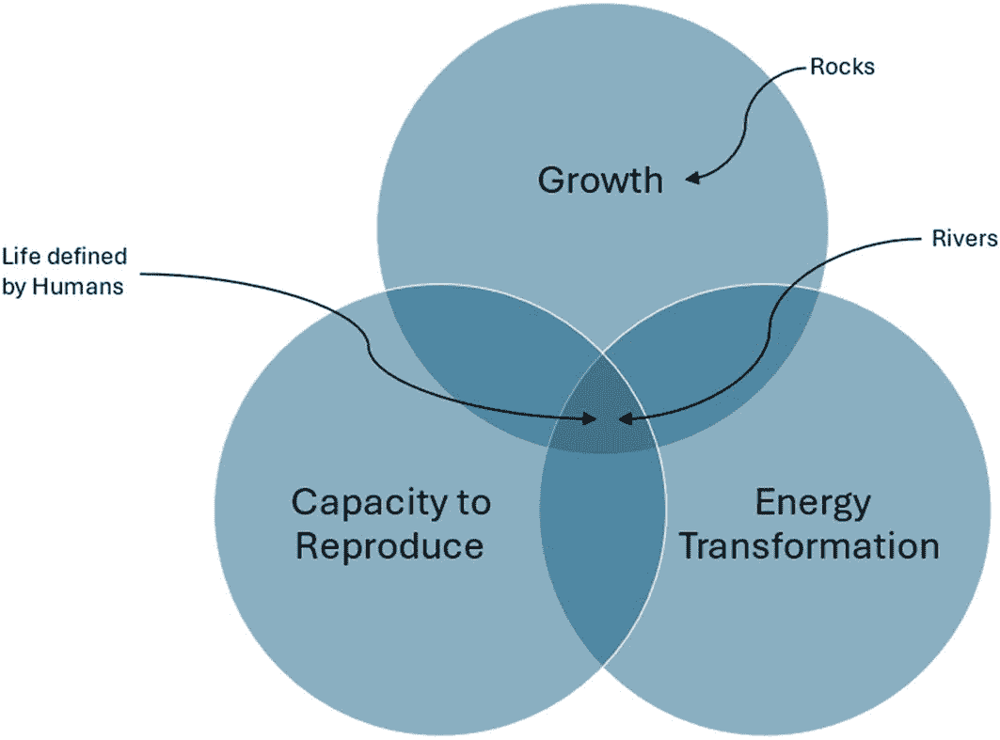
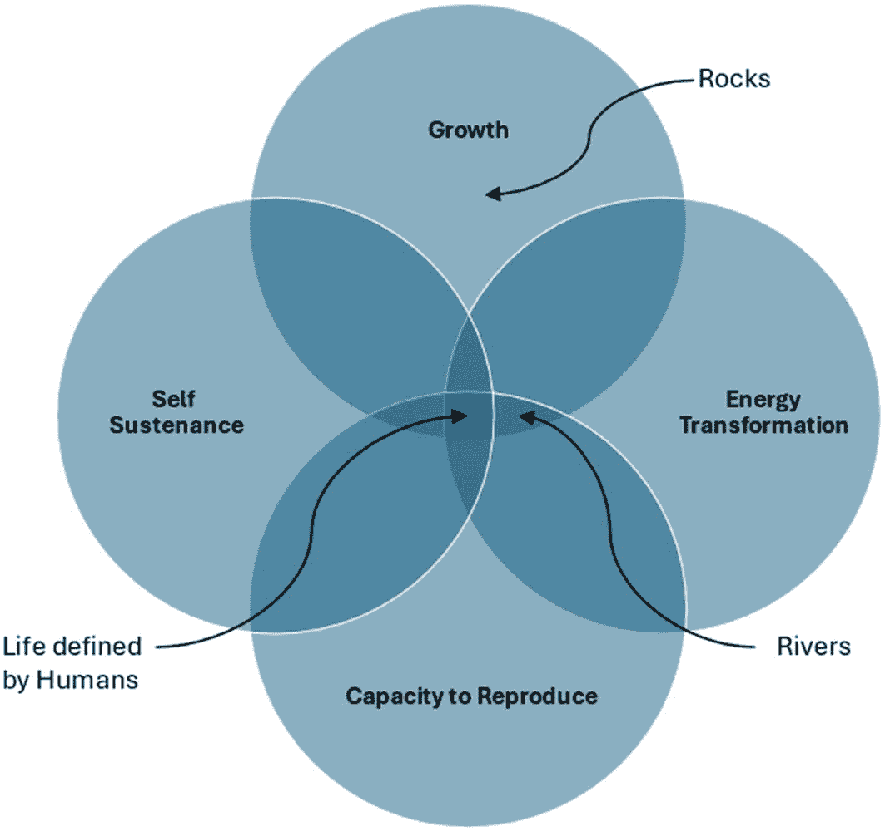
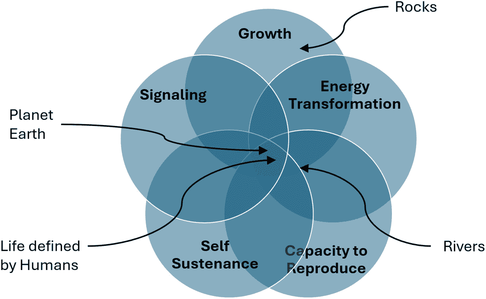
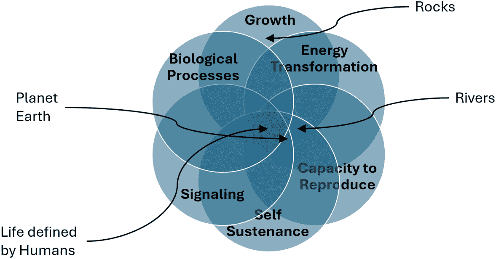

# 2. 生命的起源

人工智能，或者说智能本身，在其最深的层次上关乎生命。宇宙中存在大量物体，小到原子和分子，大到巨大的行星、恒星和星系，它们始终以某种形式活跃着，相互影响、改变形态、彼此融合，甚至经历诞生，但它们未必具有生命或智能。根据当前的宇宙起源理论，所有物体以及能量来源都始于大约 138 亿年前的“大爆炸”，自此之后，所有这些实体在每一瞬间都在发挥作用。大爆炸究竟为何以及如何启动，或者大爆炸之前的宇宙由什么构成，我们不得而知，也可能永远无法完全确信地知晓。然而，如果我们假定某种力量促成了它的发生，那么我们就可以理解，至少是推测出之后的所有活动。更重要的是，我们可以更详细、更确信地理解宇宙的当前状态。我们知道地球是一颗行星，它与其他七颗行星一起围绕太阳公转。我们了解每颗行星的轨道、它们自转及公转的速度如何由其自身质量以及它们与太阳之间、彼此之间的距离所决定。我们可以根据牛顿万有引力定律（或更精确地，利用爱因斯坦的广义相对论和时空曲率）来计算这些指标。我们甚至在一定程度上了解太阳本身如何受限于我们银河系（即银河）的中心并围绕其旋转，以及银河系本身如何与我们的邻近星系仙女座星系相互作用，等等。我们还可以根据大小和距离观测并预测各种小行星和彗星的运动。然而，从具备智能的角度来看，这些物体中没有任何一个展现出真正的智能。这些物体只是遵循物理的基本定律，并没有产生任何新东西。尽管在极其微观的层面，量子力学定律可能暗示着一些随机且不可预测的事件；但在宏观层面，这些物体中没有一个展现出任何不可预测的行为，或者会为了达成某些隐藏目标而主动改变其行动的行为。例如，我们看不到火星因为感到寒冷而主动改变形状试图靠近太阳以获取更多热量；也看不到某颗小行星为了避免与地球相撞（这次碰撞必将导致该小行星永久毁灭）而改变方向。这便是我们划清界限、将生命与非生命、智能物体与非智能物体区分开来的地方。总之，就我们通常所理解的方式而言，“智能”这个词与生命的概念有着内在的联系。因此，我们将从生命的概念开始我们的旅程。在本章中，我们将探讨生命是什么，以及究竟是什么将生命与其他一切区分开来。

## 何为生命？

“何为生命？”这是哲学和科学领域中最为本质的问题之一。即便生命的定义本身可能令人望而生畏，我们绝大多数人却十分擅长将某个物体归类为“有生命的”或“无生命的”。例如，我们知道岩石没有生命，水没有生命，空气没有生命，但狗有生命，鸟有生命，甚至鱼也有生命。当谈到树木时，情况就变得有点微妙了，因为它们不像大多数其他生物那样移动，但我们仍隐约知道它们与岩石、河流不同，也是有生命的。那么，究竟是什么将生命形态与非生命形态区分开来的呢？

对生命的不同哲学定义版本进行比较，其话题之广泛足以成书。在本书中，我们将主要关注生命的科学或逻辑解释。在各种百科全书和词典中，一种被广泛接受的生命解释认为，生命包含了生物过程、某种形式的信号传导和自我维持、繁殖能力、能量转换以及生长。这个定义可能显得过于复杂，以至于即使按照一些宽松的标准，也显得牵强。它试图捕捉的是一系列能够区分生命与非生命的参数。这似乎暗示着类似维恩图¹(#fn1)的东西，即试图通过绘制重叠的圆圈，把我们周围看到的所有有生命的事物与我们认为是无生命的事物分离开来。让我们逐一审视定义中列出的每一个属性，并绘制这些圆圈来创建维恩图。

我们从最后一个属性开始：生长。生长的特征体现在体积和质量的物理性增加，以及形状的改变。让我们试着将这个概念应用于周围看到的各种物体。我们显然知道所有生物体都会生长，但一些非生物体呢，比如岩石？我们可以看到，当岩石随风滚动并粘附更多土壤，或者随水流移动并与其他岩石合并时，某些岩石可以“生长”，这本质上表现出生长的迹象。山顶的冰盖呢？它们每个冬天都会因降雪而生长。这些物体有生命吗？我们认为不是！因此，如果仅将生长作为区分生命与非生命的单一规则，那是不够的。我们需要更多的规则或更多的圆圈。让我们开始在图 2-1 所示的维恩图中添加更多圆圈。

一张维恩图。两个箭头分别指向标记为“生长”的圆的右上区域（岩石）和左下区域（人类定义的生命）。

*图 2-1* – 包含生命定义中一个参数的维恩图

我们来探讨定义中的第二个属性——“能量转换”。同样，我们知道所有生物体都能消耗某种形式的能量以维持其生命活动，从而将一种能量形式转换为另一种。回顾一下岩石和冰盖，我们并没有看到明确的迹象表明岩石和冰盖能够主动地将能量从一种形式转换为另一种。因此，我们确实可以将它们与生物区分开来。但其他一些非生物物体呢，比如河流？我们可以看到，河流从一处流向另一处，它们携带着卵石、土壤和岩石。这些物体随水流动时，通过摩擦产生热量。因此，它们表现出将动能转化为热能的明确能力。除了能量转换，河流在每年雨季时体积也会增大。那么，河流现在有生命了吗？我们仍然认为不是！！因此，如图图 2-2 所示，这两个圆圈或规则并不足以区分生命和非生命，我们需要再引入一个规则。我们可以继续我们的维恩图，从之前的定义中再添加一个规则。

一张维恩图，包含“生长”和“能量转换”两个圆圈。两圆的共同区域标记为“河流”和“人类定义的生命”。

*图 2-2* – 包含生命定义中两个参数的维恩图

让我们添加繁殖能力，如图图 2-3 所示。我们非常确定，所有生物，从单细胞生物到复杂的哺乳动物，都能够繁殖。但是河流呢？通常，繁殖的概念是在生物学背景下定义的，因此不能直接应用于非生命体。然而，我们可以采取一些文学和哲学上的自由，使用更通用、更宽泛的繁殖定义：即一个实体创造出一个与原实体相似的新实体的能力。带着这种对繁殖的新解释，让我们重新审视满足前两个条件的河流。当一条河流遇到一座山丘或某种障碍物时，它可以分流成两条或更多条支流。这些较小的支流都拥有与原始河流相似的所有属性，可以被视作河流的后代，这实质上证明了河流确实能够繁殖。因此，根据我们对繁殖的宽泛定义，河流可以被认为是有生命的。但它们真的是吗？我们仍然认为不是！我们需要继续我们的定义，向维恩图中添加更多规则或圆圈。

一张维恩图，包含“生长”、“能量转换”和“繁殖能力”三个圆圈。生长圆的独有区域标记为“岩石”。生长、能量转换和繁殖能力三者的共同区域标记为“河流”和“人类定义的生命”。

*图 2-3* – 包含生命定义中三个参数的维恩图

现在，随着我们开始引入更多专业化的生物学概念，情况变得愈发有趣。`Self-sustenance`（自维持）的定义指出，一个实体能够无需外部帮助即可维持自身存在。这可以有多种解读方式，而根据最通用的定义，任何有生命或无生命的物体都可以被认为是自维持的。例如，只要源头有持续的水源供应，河流就能一直作为河流存在。如果水源因某种方式枯竭或蒸发，河流便会消失。但类似的情况也可以发生在生物身上。如果一只老虎一周没有吃到任何东西，它就会死亡并消失。相比之下，一条河流可能存在得久远得多。因此，`self-sustenance`（自维持）加上之前的所有规则，仍然不足以区分生命与非生命，如图 2-4 所示。所以，我们继续完善定义，添加更多规则或圆圈，看看是否能在维恩图中将河流归类为非生命。

一个维恩图，包含四个圆圈：生长、能量转化、繁殖能力和自维持。非重叠区域标记为“岩石”。能量转化和繁殖能力的重叠区域标记为“河流”。所有圆圈的共同重叠区域标记为“人类定义的生命”。

**图 2-4**
基于生命定义的四个参数绘制的维恩图

下一个特征是执行某种信号传递的能力，如图 2-5 所示。这是一个有趣的特征。在生物体中，细胞可以向其他细胞发出信号以传输/接收信息或消息。在河流的情况下，我们能看到这样的信号传递吗？大多数情况下是不会的。在极少数情况下，我们可能会看到闪电从天空的云层击中河流，这可能将某种电信号从云层传递到河流。这能被视为信号传递吗？这个问题的答案是否定的。根据信号传递的定义，其中隐含了一个前提：发送方主动发送信息，并且接收方能够理解并回应所接收到的信号。云层通过闪电真的在传递什么信息吗？即使它们在传递，河流能理解这些信号并通过向云层回传信号来回应吗？绝对不行。因此，这种随机的闪电现象肯定不是一种信号传递形式。于是，我们可以将河流移出维恩图中为生命实体保留的中心区域。那么，我们是否已经彻底将生命与非生命分开了呢？我们还需要再考虑几个例子。手机信号塔怎么样？它们是人造的，并非天然存在，但无论如何它们是非生命的，并且它们一直在与成百上千的设备进行信号传递。它们是活的吗？当然不是，并且用之前的规则很容易将它们区分开，因为这些塔没有任何生长的迹象，也无法繁殖。

一个维恩图，包含五个圆圈：生长、能量转化、繁殖能力、自维持和信号传递。共同重叠区域标记为“行星地球”和“人类定义的生命”。

**图 2-5**
基于生命定义的五个参数绘制的维恩图

至此，我们似乎已经排除了大多数我们认为非生命的实体。那么我们的维恩图最终完成了吗？还不完全是！让我们离开地球，看看一些更大的天体。行星怎么样，甚至，看看我们自己的行星地球，怎么样？让我们看看它如何符合维恩图。我们可以认为，地球通过引力不断与月球进行信号传递，以使其保持在轨道上，而月球则通过保持在轨道上来回应。地球当然可以增大体积，就像它自太阳系形成以来，被数百万颗小行星和彗星撞击，吸收它们的质量那样。地球绝对有能力自维持。如果地球被一颗非常大的小行星撞击，撞出一小块质量，地球甚至有可能像“繁殖”那样创造出一个较小的类行星天体。已经有理论认为，我们现在的月球就是以这种方式从地球分离出来的！此外，地球上时时刻刻都在发生着数百万次的能量转化。似乎地球可以和所有生物体一样，位于所有圆圈的中心。那么，地球是生命体吗？嗯，不！！绝对不是！！这引导我们来到维恩图中的最后一个圆圈，如图 2-6 所示！

`生物过程`：生物过程被定义为生物体内发生的一系列事件或作用，以达到特定结果。这些过程对于生物体的生长、繁殖、维持稳态（稳定的内部环境）以及响应环境至关重要。本质上，生物过程是生物体细胞协同工作以支持生命的方式。这是最后一个圆圈，我们用它将宇宙中所有我们认为非生命的东西排除在外！有人可能会说，这条规则涉及循环论证^(²)，即因为我们使用了“生物”这个词，所以本质上是在说非生命物体不具备生命物体的特性。然而，这并不一定是正确的。所有的生物过程都可以完美且完整地使用纯化学和物理规则与定律来定义，这些规则和定律所采用的逻辑陈述同等适用于生命体和非生命体，而无需明确使用生命或生物学的概念。

尽管地球是所有生物的家园，但它本身主要由岩石、矿物和水构成，其自身不具备细胞结构，也不展现上述的生物过程。因此，地球作为一个独立物体，并不满足这个条件。有了这最后一条规则，我们得到了一个维恩图，其中我们可以将所有生命体与非生命体区分开来，如下图所示。

一个维恩图，包含六个圆圈：生长、能量转化、繁殖能力、自维持、信号传递和生物过程。共同重叠区域标记为“人类定义的生命”。

**图 2-6**
包含所有六个参数的最终维恩图。人类定义的生命现在成为唯一一个位于所有圆圈共同重叠中心的项

因此，我们成功地将人类定义的生命形式与宇宙中所有其他实体完全区分开来。如果我们深入思考一下，有人可能会质疑，有了维恩图中的最后一条规则，我们真的还需要所有其他规则吗？似乎仅凭这一条规则就有可能区分生命与非生命。那么，我们为什么还需要包括所有这些规则呢？这个问题的答案在于生命与死亡之间的区别。死亡的生物体确实拥有所有的生物过程和细胞结构（至少在组织和细胞完全分解前的一段时间内是这样），但它们不再“运作”。它们不再进行信号传递、移动或繁殖等等。因此，我们本质上需要所有其他参数来区分生命体与死亡体，但仅凭第一条参数（`生物过程`）就足以区分生命体与非生命体。

## 生命是如何起源的？

现在，既然我们已经掌握了生命的完整定义，以及真正区分生物、非生物和死亡物体的关键，那么让我们来看看这一切是如何开始的。生命起源于地球，还是从其他星球、小行星甚至恒星来到地球的？基于地球上大多数物种所需的大气和温度条件，很难想象有生命形式能从外太空来到地球。但这真的不可能吗？事实证明，并非如此！！

外星生命的想法并不新鲜，它构成了科幻文学的一个完整流派。但随着该领域的一些最新进展，这个想法已接近现实，不再是纯粹的科幻了。让我们仔细看看生命起源于外太空这一可能性。

### 极端微生物

很明显，所有“大型物种”，或者说我们无需显微镜就能看到的物种，都无法在地球之外存活超过几分钟（如果它们能存活的话）。原因是缺乏氧气、极度寒冷、来自太阳和/或其他恒星的过度辐射、缺乏重力等等。所有大型物种如果遇到这些因素中的任何一个，都会在短时间内死亡。当所有这些因素共同作用时，这些物种根本没有现实的生存机会。然而，科学家在地球上发现了几种单细胞生物，它们有可能承受极端温度、压力或大气条件，它们被称为`极端微生物`。这些微生物可以在深海热液喷口等地方生存，那里的温度可高达 120 摄氏度或 250 华氏度，同时伴有极高的压力。还有一些微生物可以承受极端寒冷的温度，例如埋在冰层中的-25 摄氏度或-13 华氏度。有些微生物可以承受极端的酸性或碱性条件，或极高的盐度。还存在一些可以完全在黑暗中生存的微生物，以及一些可以承受危险辐射（如宇宙射线、X 射线和来自放射性物质的辐射）的微生物。这些条件中的任何一种，即使适度，也足以杀死全人类，更不用说其他动物了。然而，这些微生物不仅能在这种极端条件下生存，还能在这种条件下生长和繁殖。

这些微生物能在地球上的严酷环境中生存，这相当令人鼓舞，但在地球之外呢？它们能否利用这些能力在外太空中存活？那里没有阳光，没有重力，所有邻近恒星都会持续不断地释放出不受阻碍的宇宙辐射。由于地球大气的吸收和地球磁场的偏转，这种宇宙辐射在地球表面仅剩微量。

为了回答这个问题，来自日本希望号实验室和日本宇宙航空研究开发机构（`JAXA`）的一个研究团队^(³)在国际空间站上进行了一项实验。他们的实验包含了多种不同的细菌，但特别是，一种名为`耐辐射奇球菌`的细菌表现出最强的适应力，能够在国际空间站外的太空中存活多年。当研究人员检查一组存活下来的细菌时，他们发现外层暴露区域的细胞已经死亡，这些死细胞形成了一种保护层，其下的内层细胞得以存活。这项研究确凿地证明，微生物确实有可能长时间承受外太空的严酷环境，并以休眠状态继续存活。

然而，从寻找地球生命可能来自外太空这一可能性的角度来看，承受太空的严酷性只是方程式的一部分。其他部分包括：承受携带这些细菌的陨石或彗星撞击地球表面时的冲击力的能力，以及直接或间接利用太阳能生长和繁殖的能力。目前尚未进行针对性的实验来验证`耐辐射奇球菌`是否能承受这种冲击，因此目前的答案更多是推测性质的。`耐辐射奇球菌`需要氧气和有机化合物的存在来产生生长和繁殖所需的能量。它们不具备直接消耗太阳能的能力，因此不能被视为完全独立的物种。然而，这类物种的出现提供了一条路径，即可能存在另一种类型的物种，它已在另一个星球上演化，能够更进一步，既能承受撞击，又能通过直接吸收太阳能实现自给自足，同时还具备在太空中存活多年的能力。

即使我们认同生命起源于地球之外的理论，一个事实依然存在：从外太空来到地球的物种必定起源于别处。可能是我们银河系中某个其他恒星系统的行星，甚至来自另一个星系。但这又不可避免地引发了另一个问题：生命在那个星球上又是如何起源的呢？因此，除非我们能回答从非生命物质中产生生命这一终极问题，否则问题的链条就不会真正终止。

现在，让我们看看另一种可能性：生命完全是在地球上从无到有地起源的！这种选择通常也更受青睐。

让我们尝试探索这可能是如何发生的。我们的太阳系大约在 46 亿年前形成，当时太阳首次形成。又过了 1 亿年，其他行星才形成，太阳系才完整。有许多理论被提出来解释我们太阳系的形成。它们在很多方面有所不同，但大多数都同意，一切始于一个被称为`太阳星云`的巨大气体云。它相当寒冷，主要包含氢气，以及极少量的一些较重的元素。要么是自发地，要么是借助可能来自遥远超新星爆发的扰动，一部分气体聚集在一起，形成了恒星形成的“种子”。一旦质量开始在聚集区域集中，该区域增强的引力就加速了其增长，该区域迅速成长为星云中最主要的天体。随着尺寸和相应引力的增加，聚集区域的中心开始变暖，最终达到足够高的温度（约 1 亿摄氏度），从而启动了核聚变过程。于是，我们的太阳首先形成了。太阳形成后，它迅速吸收了周围所有轻质气体，只在其邻近区域留下重元素。这些重元素在接下来的 1 亿年里聚集在一起，形成了前四颗行星：水星、金星、地球和火星。在距离太阳足够远、大约相当于木星当前位置的地方，太阳的引力没那么强，轻质气体仍然可以存在。它们开始聚集在一起，形成了像木星和土星这样的气态巨行星。

## 太阳系的起源

将注意力聚焦于地球的形成，地球的第一代形态主要由被太阳引力排除在外的较重元素构成，例如碳、氮、氧以及更重的金属等。随着地球体积的增大，它开始拥有自身的引力，并因此在太阳系中形成了自己独特的身份。这一时期从 45 亿年前持续到 41 亿年前，大约延续了 4 亿年。这个时期被称为冥古宙，地球在其形成后的这个阶段开始冷却。紧随其后的是通常被称为后期重轰炸期（`LHB`）的阶段。`LHB`期始于大约 41 亿年前，又持续了 3 亿年，直至大约 38 亿年前。在此期间，木星、土星、天王星和海王星等较大行星的形成及其增强的引力，对存在于太阳系外围的小行星带造成了扰动。这种扰动引发了来自陨石、彗星及其他太空碎片的猛烈撞击。尽管过程相当剧烈，但从地球生命起源的角度来看，这是一个极其关键的时期。这些陨石和彗星为地球带来了关键成分，其中包括水。由于持续不断的撞击，地球的温度再次上升到高于水的沸点，相当数量的水必定也流失了。然而，剩余的水分足以满足生命形成的需要。值得注意的是，所有邻近的行星，包括水星、金星和火星，在此期间也遭遇了类似的撞击，并可能接收了相似数量的陨石和彗星。然而，由于距离太阳较近、引力较小等各种因素，它们最终失去了大部分水和其他元素。不过，火星的地质结构与地球非常相似，大小也相近，它留住水和其他元素的时间可能比水星和金星更长，并且有相当合理的可能性表明，那里也可能独立诞生了生命。然而，我们至今仍未找到确凿的证据。

大约在`LHB`期结束时，即大约 38 亿年前，地球再次开始冷却。据美国国家科学基金会称，在加拿大哈德逊湾附近发现的一些地球上最古老的岩石可以追溯到这一时期。^(⁴) 然而，对于在此之前地球上存在什么，我们没有任何确凿的证据。

关于生命究竟何时在地球上起源，存在着不同的观点。一些理论认为，生命可能早在 43 亿年前就已开始，甚至是在`LHB`期本身之前；而另一些理论则认为，生命起源于`LHB`期，或大约 41 亿年前。然而，迄今为止发现的最古老的、能够证明生命存在的化石，其年代仅能追溯到`LHB`期，因此，我们实际上无法证实或反驳其他理论。

### 原始汤

根据对生命定义的早期讨论，为了证明生命起源于地球，我们需要证明能够展现生长、信号传导、繁殖等功能的生物结构，是从完全非生物的物质中创造出来的。有许多理论试图解释这如何可能发生。所有这些理论都始于一种原始有机化合物的混合物，这些化合物包含碳、氮、氢和氧，例如甲烷和氨，并与水和溶解的氢、氧混合，通常被称为`原始汤`。`原始`一词意指自万物初始便已存在的事物。在这种情况下，原始汤指的是地球上自然存在的、最终导致生命创造的所有有机化合物的混合物。所有将地球生命起源基于自然发生的化学反应的不同理论，都被统称为原始汤理论。

其中一种最有说服力的原始汤理论被称为`RNA世界假说`。根据`RNA`世界假说，最早的微生物完全基于`RNA`结构。`RNA`是能够执行信号传导、繁殖、生长等大多数生物功能的最小实体。单个`RNA`分子是活细胞的最基本组成部分，包含一条呈螺旋结构排列的长链原子。碳原子连同氢、氧、氮和磷原子构成了`RNA`分子链的中心部分。在大多数生物体中发现的`DNA`或脱氧核糖核酸是一个双链分子，其单链与`RNA`相似。`DNA`通常具有双螺旋结构。

我们今天观察到的大多数活细胞都是基于`DNA`分子的，而只有一些病毒含有`RNA`。这一观察结果使得我们必然认为`DNA`分子应该是在某些化学反应中自然形成的。`DNA`分子比`RNA`分子复杂得多，并且`DNA`分子通过随机化学反应形成的可能性要小得多。然而，最近发表在《自然》^(⁵)杂志上的一项研究支持了这样一种理论，即地球上起源的早期生命可以完全基于`RNA`。

`RNA`分子中的长链原子可以分解为四个不同的原子群，分别称为腺嘌呤、鸟嘌呤、胞嘧啶和尿嘧啶。（`DNA`分子共享其中三个基团，区别在于尿嘧啶被胸腺嘧啶取代。）这些化合物被称为含氮碱基或核苷酸碱基。`RNA`分子的独特属性包括：能够以链中原子的序列形式编码信息，以及能够作为催化剂启动生物过程。研究还表明，`RNA`能够进行繁殖，并将其包含的信息传递给后代。

## 大约 43 亿年前

大约 43 亿年前，地球上的环境条件被认为达到了一个关键阶段，具备了诱导 RNA 类分子生成化学反应所需的所有必要条件。这些条件包括：

1. `地壳的形成。` 早期陨石撞击的所有余波都已平息，地球表面开始凝固，形成了我们所说的地壳。
2. `地球表面温度适中。` 此时地球的平均温度降至 100 摄氏度以下，使得液态水成为可能。温度范围可能涵盖极地附近的零下温度，但总体而言，这种环境有利于生命起源所需的化学反应。
3. `液态水的形成。` 适中的温度为此时期液态水的存在铺平了道路。在后期重轰炸期期间积累的水量足以形成覆盖地球表面 70%以上的海洋。
4. `存在复杂的有机化合物。` 地球含有大量的碳、氢、氮和氧，以及微量的硫和磷。
5. `最后但同样重要的是，浓厚的大气层`能够引发强烈的闪电。这样的雷击能够触发与复杂有机化合物的化学反应，从而产生 RNA 类分子。

### 米勒-尤里实验

米勒-尤里实验为这一过程提供了关键证据。1953 年，芝加哥大学的两位教授斯坦利·米勒和哈罗德·尤里进行了这项实验。实验装置非常简单。他们将两种复杂的有机化合物——甲烷和氨，连同水和氢气一起密封在一个烧瓶中。研究表明，当基本元素暴露于紫外线辐射时，这些化合物很容易产生。然后，他们将一对电极连接到烧瓶上，并反复施加电火花。仅仅运行了几个小时，就观察到烧瓶中形成了多种氨基酸分子。这些氨基酸分子是核苷酸碱基的构建模块，而核苷酸碱基最终构成了 RNA 和 DNA 分子。

### 近期进展

为了进一步发展这一概念，德国路德维希马克西米利安大学的托马斯·卡雷尔^(⁶)最近展示了一系列化学过程，这些过程在概念上不仅可以从水和氮等基本原料中制造出氨基酸，还能制造出 RNA 的所有四种核苷酸碱基（腺嘌呤、尿嘧啶、胞嘧啶和鸟嘌呤），而这些原料在大约 43 亿年前的地球大气条件下是现成可得的。随着这些构建 RNA 的原始原料的出现，在接下来的数千年或数百万年里，它们逐渐组合在一起，形成了第一个 RNA 分子。

### 其他理论

还有其他一些理论认为生命起源于深水之下。具体来说，在海洋底部的海底热液喷口附近，存在着有趣的条件组合，例如足以引发化学反应的高温、通过喷口排放的气体提供的必要元素，以及液态水。即使海洋深处没有阳光，来自热液喷口的热量也足以提供生命生存和生长所需的能量。其想法是，RNA 类分子首先在这些喷口周围产生，然后在数千到数百万年的时间里，它们不断结合形成具有细胞结构的微生物。已知的一些最古老的生物确实来自水下，这一事实支持了这种生命起源理论。然而，这种理论缺乏像米勒-尤里实验或卡雷尔实验为陆地生命起源理论所提供的类似的实验支持。

还有其他一些理论声称生命可能起源于厚厚的冰层之下、黏土或土壤内部等。但大多数这些理论缺乏足够的实验支持，并且不被许多科学家所青睐。

### 更高力量的作用

最后，但并非最不重要的一点是，关于生命起源的讨论，如果不考虑某种更高力量（如上帝）的参与，就永远不会完整。当有人声称地球或宇宙中的生命是由上帝创造时，如果我们走信仰之路，几乎没有什么论点可以反驳。然而，如果我们本着逻辑的精神看待这一说法，我们当然可以提出一些探究性的问题。如果上帝或更高的实体确实创造了生命，为什么它要从微小的微生物开始创造？为什么它不直接创造人类或`智人`？为什么要经历漫长的进化过程？如果上帝创造了地球上的生命，上帝还创造了什么？为什么生命只在地球上被创造，而没有在太阳系的其他行星上被创造？如果上帝创造了地球上的生命，那么上帝也一定创造了太阳系，再延伸一下，整个宇宙也是如此。如果上帝创造了整个宇宙，为什么他/她在创造宇宙之后要等待数十亿年才创造地球和生命？我们可以提出的问题简直没有穷尽，而除了“上帝想这样做”之外，对这些问题的回答也都不尽如人意。所以，如果上帝想按照某种方式、某种顺序，以一种遵循明确定义的物理和化学定律的方式来做所有这些事情，那么我们仍然可以尝试研究我们对这些定律的理解，根据我们看到的证据改进方程式，并能够预测我们如何来到这里以及我们下一步将走向何方。因此，无论上帝是否创造了我们，我们都需要尽到自己的责任，了解宇宙，了解我们的太阳系，了解地球，并找出这一切是如何开始的！

## 结论

正如我们所知，生命确实与宇宙中的其他概念截然不同。然而，正如我们在本章中所看到的，它的客观定义可能并不显而易见。当我们看到周围（包括我们自己）有如此多不同形式的生命时，我们认为生命是理所当然的，但一开始，情况远非如此。从统计学的角度来看，这反而是最不可能发生的事情之一。然而，这并非不可能，而且它确实发生了。原始的“原始汤”是真正的答案吗？也许是，也许不是！但可以肯定的是，一些化学反应利用地球上现成的原子和分子发生了，这些反应导致了第一个生物结构的形成。在下一章中，我们将探讨生命如何随着时间的推移而演进。

脚注 1   2   3   4   5   6