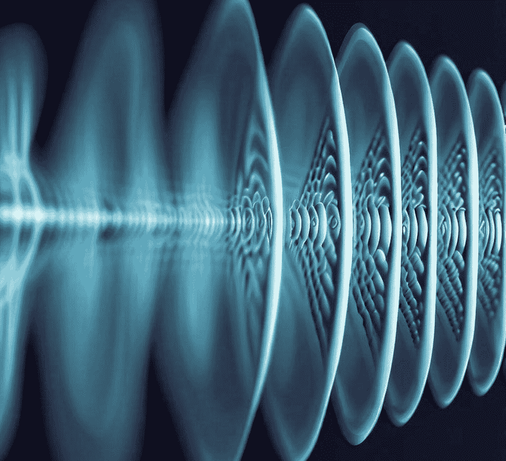
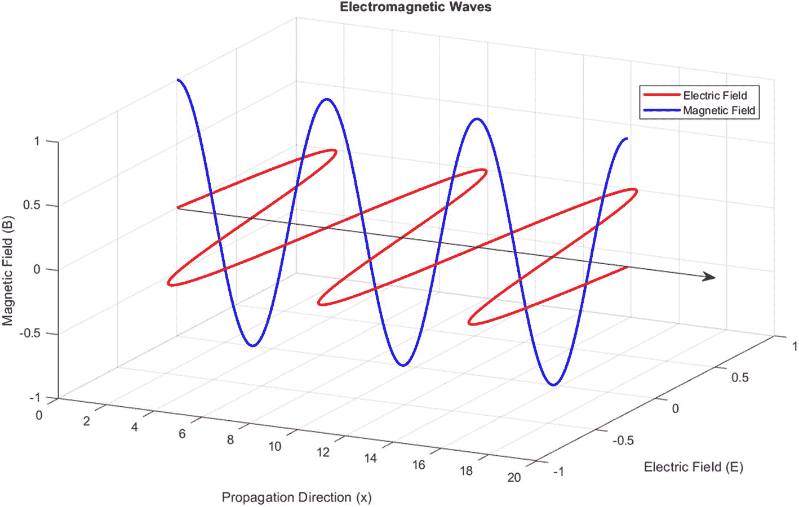

# 4. 人类智能

从非洲起伏的草原到我们现代城市的广阔延伸，生命的叙事远不止是单纯的生物进化。物种通过与环境和其它物种的互动而适应，导致了它们身体结构以及信息处理方式的进化。随着地球经历了无数次的变迁，自然的力量精心雕琢着我们的祖先，引导他们从原始汤中走出，学会直立行走，从基本的生存本能走向内省与创造的复杂领域。本章将深入探讨人类智能的起源、演化及其深刻的内涵。我们将探索那些使我们成为如今这样具有思考能力和想象力的存在的事件和适应过程的细节。理解人类智能将为理解我们如何通过使用计算设备来模拟它、进而发展人工智能铺平道路。

## 什么是人类智能？

人类无疑是地球上最聪明、最卓越的物种，这一点已通过我们的全面主宰得到证明，但我们并非唯一具有智能的物种。所有生物有机体，直至单细胞生物，都表现出一些明确的智能迹象。它们或许无法交谈或解释自己在做什么以及为什么这样做，但尽管如此，它们通过体内稳态的方式，以及在恶劣环境中生存并繁衍，实践着相当复杂的生物过程；而这正是智能！对智能的总体定义是多方面的，也是争议不断且理论层出不穷的温床。然而，定义“类人智能”的最广泛接受的特征包括：从经验中学习的能力、适应新环境的能力、理解和处理抽象概念的能力，以及运用知识操控环境的能力。然而，抽象概念的概念与人类大脑紧密相连，我们无法将其有意义地与其他动物联系起来。因此，我们需要扩展智能的概念，使其能应用于地球上所有物种，以便进行同类比较。经过适当修正后，智能的定义性特征可简化为：感知环境、处理信息，并以最大化成功或生存几率的方式做出反应的能力。

根据这个更宽泛的定义，智能并不一定与大脑的处理能力挂钩，因为地球上有成千上万种物种，它们甚至没有大脑这一独立器官，却依然能够生存甚至繁衍。智能也不与纯粹的体力挂钩，因为有许多动物体型远大于人类，但在生存竞争中却无法与人类匹敌。猛犸象（比人类大 100 倍）的例子在这里很贴切，因为人类在其灭绝中扮演了主要角色。那么，究竟是什么造成了这种差异？是什么让一个物种比另一个物种更聪明？

对智能的早期定义侧重于“是什么”或智能的效果问题，并未阐明“如何”或智能的原因。因此，让我们从另一个角度来审视智能。从这个角度看，智能被定义为“获取并应用知识和技能的能力”。这一过程的最终目标仍然是最大化成功和生存的几率，但现在我们可以观察不同物种是如何实现这一目标的。“知识”和“技能”这两个词仍然相当宽泛，并不一定能传达出显而易见且清晰的信息。然而，遵循这一定义，无疑比早期定义更能有助于揭开智能之谜。这里涉及两组不同的概念：知识的获取以及以技能展示形式对其的应用。知识获取指的是各种感官器官及其获取周围环境信息的方式。知识应用是利用这些信息解决问题、做出决策并更好地对环境做出反应的过程。技能的获取和应用都属于后一个过程的一部分，我们将一起讨论它们。

## 知识的获取

在本章接下来的部分，我们将考察人类的感官系统，并将其与其他生物体进行比较和对比，旨在找出是否有任何能将人类与所有其他生物体区分开来、使我们卓越非凡的特征。人类有五种主要感觉：听觉、视觉、味觉、嗅觉和触觉。大多数其他物种拥有类似（若非完全相同）的感官器官。然而，确实存在一些物种拥有某些不同或全新的感官器官。基于这一特征，可以认为，与其它物种相比，智商更高的物种能够获取更多或更好的知识和技能。让我们看看人类在更好地从环境中获取知识方面是否拥有明显优势。

### 听觉

人类的听觉通常被认为受限于每秒 20 次到 20,000 次的声音频率范围。“次”是空气分子压缩和稀疏的一个序列，如图 4-1 所示。

声波示意图，展示了压缩和稀疏。

`图 4-1` 声波中压缩和稀疏的序列

每秒次数也称为赫兹或 `Hz`。因此，`20 Hz` 意味着每秒产生 20 个这样的周期，`20 kHz` 意味着每秒产生 20,000 个这样的周期。因此，只要声音波的频率落在可听范围内，人耳就能感知到它们。人类的听觉范围会随着年龄增长而衰退，一个 30 岁成年人的实际范围会从 `20 Hz` 下降到仅约 `15 kHz`。听觉范围的最大值大约在 8 岁时达到。我们的声道能够发出的声音频率实际上只是可听范围中非常小的一部分，大约从 `50 Hz` 到 `3 kHz`。因此，即使听觉范围有所缩减，人类也能感知到与其他人类进行的所有语言交流。我们在日常生活中遇到的大多数对我们重要的声音，如乐器声、动物声、风声、雨声、海浪声等自然之声，或汽车行驶、火车轰鸣、飞机飞行等机器声，都完全落在缩减后的听觉范围内，所有年龄段的人都能感知到它们。

许多其他物种也具有感知声波的能力，其能力范围与人类相当，甚至在很多情况下远远超过人类。例如，狗可以感知 `40 Hz` 到 `60 kHz` 的音频，猫可以听到大约 `50 Hz` 到 `85 kHz`，大象可以听到低至 `1 Hz`、高至类人的 `20 kHz` 的声音。频率超过 `20 kHz` 的声音统称为超声波。蝙蝠能够感知 `1 kHz` 到 `200 kHz` 的频率，可以利用超声波，根据其嘴巴发出的复杂反射声波模式来对周围环境进行回声定位。即使使用的是类似的声波，这也代表了一种几乎全新的感官能力。甚至像海豚这样的水生生物也能感知 `75 Hz` 到 `150 kHz` 的声波，而鲸鱼可以感知 `10 Hz` 到 `100 kHz`。简而言之，人类在这一类别中根本不具备任何特殊能力，他们拥有的能力在其它生物所能感知的整个声音范围中，其实是相当平庸的一部分。

### 视觉

与听觉类似，人类的视觉也仅限于一定频率范围，从惊人的 `400,000,000,000,000 Hz`（即 `400 TeraHz` 或 `400 THz`）到 `750,000,000,000,000 Hz`（即 `750 THz`）。重要的是要记住，这些频率属于电磁领域，不能直接与声音频率相比较。电磁波由相互垂直的电场和磁场的交替波峰和波谷构成，如图 4-2 所示，且它们不需要像声波那样的传播介质。

一张三维图分别表示电场和磁场的两个正弦波，它们相对于传播方向，起点分别为 (0, 1) 和 (0, 0)。

`图 4-2` 显示电场和磁场相互垂直的电磁波

接近 `400 THz` 的频率被人眼感知为红色，而接近 `750 THz` 的频率则被感知为紫色。所有中间频率构成一个色板，大致分为七种颜色：红、橙、黄、绿、蓝、靛、紫。低于 `400 THz` 的频率称为红外频率，高于 `750 THz` 的频率称为紫外线，这两种类型的波人眼均不可见。尽管我们的眼睛对红外波完全视而不见，但人体可以通过触觉将其感知为热量，然而我们无法像对可见光那样获得关于热量来源方向的任何信息。其他一些物种则具备将红外光作为可见信号进行感知的能力。例如，青蛙或蛇能够感知来自周围环境的红外线，这种关键能力使它们能够捕猎猎物。鹰也拥有高度发达的视觉系统，它们甚至可以通过眼睛感知紫外线。鸽子同样拥有非常先进的视觉系统，其可见范围从红色一直延伸到紫外线。它们还具有更好的运动检测能力，对光线变化反应更快。它们或许还能看到磁场，这有助于它们长距离导航，但关于这方面的能力尚不完全清楚。即使在 aquatic 物种中，也存在某些类型的虾，称为螳螂虾，它们能比人眼多检测出 10 倍的颜色，包括紫外线。

就视觉能力而言，光谱范围只描绘了其中一个方面，还有许多其他方面需要考察。例如，视觉的清晰度或分辨率。这一特性指的是我们的眼睛在观察微小物体时的分辨能力。在这方面，鹰的分辨率比人类高约 8 倍，使它们能够从数公里外发现猎物。此外，还有在弱光环境下的视觉能力。猫、狗以及鸽子拥有先进的夜视能力，使它们能够在人类几乎看不见的极弱光线下，以高分辨率看清物体。

还有另一个方面：眼睛的数量及其位置。大多数动物、鸟类甚至水生生物都有两只眼睛，但也有一些例外，比如有八只眼睛的蜘蛛、有十只眼睛的鲎，或者有着惊人 24 只眼睛的箱型水母。在拥有两只眼睛的物种中，眼睛的位置也对周围图像的感知方式产生关键影响。一种位置类型是每只眼睛的视野不重叠，眼睛彼此间距很远，指向不同方向。这种视觉称为单眼视觉。通过这种设置，生物通常无需转动头部就能获得更广阔的视野。具有单眼视觉的物种例子有兔子、鹿、马、青蛙、大多数鱼类和鸟类。需要注意的是，眼睛形成的图像是二维的，而我们周围的世界是三维的。因此，仅通过观察一幅图像，无法辨别视野中物体的相对距离。由于单眼视觉中两只眼睛看到的是完全不同的东西，具有这种视觉的物种缺乏对深度的理解。另一种设置称为双眼视觉或立体视觉。在这种设置中，两只眼睛相对靠近，指向前方。通过立体视觉，双眼的视野会重叠。这种设置的缺点是单个位置捕获的周围环境宽度会减小。因此，为了获得更宽的视野，这类物种需要转动头部。然而，这种设置有一个巨大的优势。当两只眼睛从略微不同的角度观察同一物体时，基于每只眼睛感知到的形状和阴影的细微差异，大脑可以处理这些信息以生成有关周围环境的深度信息。这个过程称为立体视觉。大脑计算出的深度信息仍然是一个估计值，可能存在一些误差。周围环境照明越好，深度估计就越准确。如果生物属于捕食者类别，关于深度的信息至关重要。地球上所有的捕食性生物都具有立体或双眼视觉，而所有属于猎物类别的生物则拥有单眼视觉。人类属于捕食者类别，双眼视野的水平重叠部分大约为 75%。这种高度的重叠使得人类能够相当准确地感知景深。总的来说，立体视觉是在所有物种中观察到的最先进的视觉设置之一。人类确实属于这一类别，但同样，他们远未达到顶端。诸如鹰、隼、猫头鹰等鸟类，甚至像狗和猫这样的陆生动物，都在某些方面具备更强大的立体视觉能力。

### 味觉

与我们所讨论的其他感觉系统相比，味觉系统的工作方式有所不同。当食物或任何其他物体中的分子直接与味觉传感器或味蕾接触时，会发生化学反应，产生某些神经信号，这些信号随后被传输到大脑，并被解读为味道。人类的味觉系统已经进化出检测多种味道的能力，这在历史上通过帮助区分安全物质和潜在有害物质，起到了生存机制的作用。人类大约有 `2000 到 10,000 个`味蕾，主要位于舌头上，但也分布在口腔上颚和喉咙中。每个味蕾包含 `50 到 100 个`味觉受体细胞。凭借这些，人类可以尝到五种基本味觉：甜、咸、酸、苦和鲜。大多数陆地、水生生物以及鸟类，都拥有某种形式的味蕾，起着类似的作用。味觉感知相当主观，有人可能会认为某些动物的味觉比人类少或多，但从味蕾数量的客观比较来看，有大量例子显示某些生物的味蕾数量明显多于人类。鲶鱼拥有异常多的味蕾，超过 100,000 个遍布其全身；而牛大约有 25,000 个味蕾，兔子有 17,000 个。其他一些生物，如果蝇，拥有复杂的味觉系统，其受体神经元分布在腿部和口器上，使它们能够在口腔之外尝到味道。再一次，从味觉获取能力的角度来看，人类并非特例或占主导地位的物种。

### 嗅觉

嗅觉或嗅觉系统使生物体能够感知环境中另一类信息，这类信息与从听觉、视觉和味觉获取的信息完全不同，尽管它与味觉有一定相似性和关联性。气味源于环境中物质所包含的化学成分。这些化学物质中的部分分子在室温下蒸发，并通过空气传播。当它们与嗅觉感受器接触时，就产生了嗅觉。人类的嗅觉系统负责我们的嗅觉，在从食物选择到情感体验的日常生活中诸多方面都扮演着至关重要的角色。

与其他感知模式相比，测量嗅觉检测能力相当复杂。我们总能计算嗅觉感受器的数量，但这并不能描绘出全貌。有时会使用另一种指标来衡量嗅觉能力，即生物体能够检测到的特定物质的最低浓度。这被称为检测阈值。阈值越低，嗅觉系统越敏感。另一种方法测试生物体区分不同气味的能力。除了区分气味的能力，记住气味是衡量嗅觉能力的另一个维度。根据这些参数比较人类与其他生物，人类大约有 `5 到 6 百万`个嗅觉感受器，并且基于基因分析，我们可以识别大约 `400 种`不同的气味。然而，狗拥有惊人的 `3 亿`个嗅觉感受器以及大约 `1000 个`嗅觉基因，使它们能够检测到范围更广得多的气味，灵敏度高出数个数量级。同样地，大象有超过 `2000 个`嗅觉基因，老鼠有超过 `1500 个`嗅觉基因，这赋予了它们更强的嗅觉能力。因此，人类的嗅觉能力再次显得平庸。

### 触觉

最后但同样重要的是，触觉或触觉系统是我们的第五感官系统，也是最容易理解的系统之一。触觉感受器遍布生物体的整个皮肤。虽然表面上看起来简单，但其运作相当复杂，包含多种对不同类型刺激作出反应的感觉器。这些感受器将机械能、温度、压力和各种其他刺激转化为电信号，并将其发送到大脑。主要的触觉感受器包括：(1) 机械感受器，能够检测压力、振动和拉伸。其中包括：负责持续压力和纹理的默克尔细胞、检测轻触和抓握控制的迈斯纳小体、感知深压和振动的帕西尼小体，以及检测拉伸和扭转的鲁菲尼末梢。(2) 温度感受器，能够检测温度变化。其中包括温热感受器和冷觉感受器。(3) 伤害感受器，能够检测由过度压力、温度或化学物质引起的疼痛。(4) 本体感受器，位于肌肉、肌腱和关节中，提供身体位置和运动的感觉。

虽然人类拥有适用于精细任务和感知环境的精致触觉，但许多动物已经进化出适应其特定生态位的特化触觉系统。星鼻鼹鼠的超敏感鼻子、猫的胡须或鱼类的侧线系统，都是动物王国中触觉感受系统多样化适应的例证。

### 其他感官系统

此外，还有一些物种拥有扩展范围的感官器官，这些器官在人类身上完全缺失，还有许多生物拥有类似的感官系统，但能力高出一个数量级。例如，狗的嗅觉比人类灵敏近 20 倍，这使得它们成为检测毒品的最佳能手，或在搜寻个人或动物时成为无价之宝。这种能力几乎使它们的嗅觉相比人类成为了一种全新的感知通道。鲨鱼和其他一些鱼类拥有称为“洛伦兹尼壶腹”的特化器官，可以检测猎物运动产生的微弱电场或生物电场。这有助于在浑浊的水域中捕猎。有些鸟类可以感知地球磁场的变化，帮助它们在大陆迁徙时更好地导航，等等。

因此，纵观所有生物体普遍拥有的感官系统，人类处于中等水平，并没有什么真正非凡之处。然而，仍然可以争论说，即使人类在某一感官领域获取知识方面没有明显优势，但作为所有领域或模式的结合，人类可能具有优势。这仍然是一个高度主观的方面，因此并不完全具有决定性。

## 知识与技能的应用

正如我们在前一部分看到的，不同生物体拥有多样的感官能力，以适应它们在各自环境中的生存。人类在任何类别中都没有表现出特别的优势。让我们在本节中看看人类如何处理这些信息以产生熟练的行动，并将其与其他生物进行比较和对比，看看我们是否能观察到人类优越性的任何迹象。尽管感受器遍布全身，但感官信息的处理大部分在人类以及其它物种的大脑中完成。那么，人类是否拥有异常大的大脑？或者数量异常多的神经元被塞进了小小的空间？这一直是长期活跃的研究领域。一个典型的人类大脑重约 `1.2 到 1.4 公斤`，包含约 `860 亿`个神经元。相比之下，大象大脑重约 5 公斤，拥有约 `2570 亿`个神经元。因此，在原始神经元数量上，人类并不位居榜首。看看近亲，典型的黑猩猩大脑仅重 `350 到 450 克`，只包含 `280 亿`个神经元。那么，看看另一种衡量标准，即单位体重的神经元数量呢？这个指标通常被称为脑化商数，或简称 `EQ`（不要与情商混淆）。人类的 `EQ` 相当高，大约在 `7.4 到 7.8` 之间，相比许多动物和灵长类动物。相比之下，大多数哺乳动物的 `EQ` 大约为 1。同样因其智力而被高度评价的宽吻海豚，其 `EQ` 约为 `6.3 到 6.7`，而领航鲸的 `EQ` 也超过 6.0。总体而言，`EQ` 指标显示人类具有一些明显优势，但它并不被视为一个决定性和可靠的特征。一些像鸟类和啮齿类动物这样的小动物可能显示出更高的 `EQ` 数值（尚未明确证实），但这并不能使它们变得聪明。除了大脑本身的尺寸，其组成、密度和复杂性也在决定生物体的智力水平方面起着关键作用。

因此，没有确凿的指标将人类置于金字塔顶端，我们再次需要更深入的研究。让我们来看看人类如何借助中等大小的、平平无奇的大脑和感官系统，仍能展现出非凡的特性和技能。

### 人脑的延伸可塑性

尽管人脑并非异常巨大，也不拥有数量最多的神经元，但其运作方式与许多其他物种并不完全相同。人类在基因上就倾向于拥有更具可塑性的大脑发育过程。用专业术语来说，人脑比大多数其他生物体拥有更高的神经可塑性，这意味着人脑能够比任何其他生物体更能根据经验改变和调整其结构和功能。正是由于这种能力，人类才能在整个生命过程中学习新事物并适应新环境，而其他生物的这种适应能力则严重受限。此外，人脑相对较大的体积及其复杂性，使得人类在适应能力上比其他物种高出一个数量级。人类更长的寿命进一步促进了这种适应能力。

从实际角度来看，与其他物种相比，人类大脑结构中直接遗传自父母的部分要少得多。每个人都被赋予了一份礼物，即构建自己大脑结构的能力，这种结构可能与其父母的大脑结构存在显著差异。其他物种则没有这种特权，它们大脑的结构和由此产生的功能在很大程度上是由其 `DNA` 和基因构成预先设定好的。只有极少数变化能通过突变发生，并且只能在出生时创造新特征，但与人脑在一代人中所能实现的改变相比，这些变化微乎其微。因此，人脑很大一部分的发育是在出生后完成的，而在大多数其他物种中，大脑的发育在出生时就已基本完成。正因如此，环境在塑造人类儿童大脑方面所起的作用，要远大于其对其他物种后代的影响。这一特点的一个缺点是，在这个过程中，人类婴儿比其它物种的婴儿更容易受到周围环境的影响，因为人类婴儿在出生时甚至不具备其他生物婴儿天生就拥有的某些基本生存技能。然而，这一特点的优势在于，人类儿童在适应特定环境方面可以比他们的父母做得更好、更不同。这赋予人类婴儿一种前所未有的能力，去学习那些他们父母甚至都不知道的新事物。地球上所有其他物种几乎完全不具备这一特性。因此，当所有这些因素综合在一起时，人类凭借其卓越的适应能力，以及一套相当引人注目的生物和感官能力，开始展现出作为一个优越物种的特质。

### 技能

现在，让我们来看看技能的习得与应用。“技能”本身是一个通用术语，旨在概括完成一项任务的所有方面。为了让这个概念更具体，让我们思考一些技能的例子：技能可以是爬树，能够快速奔跑，能够咀嚼和消化肉类，或者能够在不折断周围树枝的情况下摘下一朵花，等等。技能的范围可以从极其普通、看似无关紧要，到对生存至关重要。当一个物种特别擅长后一类技能时，它们就更有可能活得更久、繁衍得更兴旺。然而，在大多数情况下，一个物种拥有的所有技能都以某种方式对其福祉至关重要。我们在本章前面讨论过的感官能力有助于更好地执行技巧性任务。为了将人类与其他物种进行比较，我们首先要确定关键的生存技能。对于任何能够生存的物种来说，首要且最重要的技能是能够从环境中找到并消耗提供能量的物质。通常，在地球上，这意味着能够从大气中呼吸氧气，能够找到、吃掉和消化食物，以及饮水。第二重要的技能是能够繁殖并能够养育后代，直到其能够自给自足并执行第一项技能。任何具备这两项技能的物种，如果它们是特定环境中唯一的居住者，就应该能够在该环境中生存和繁衍。然而，当我们审视全貌时，会发现许多其他物种也生活在同一环境中，它们争夺自然资源或依赖其他物种获取资源。在这种情况下，还需要一项额外的技能，那就是保护自己免受其他物种伤害的能力。如果一个物种无法保护自己免受其他竞争物种或可能将其作为食物的捕食物种的侵害，它很可能在短时间内灭绝。具备了这三项基本技能，任何物种都有机会在生存和繁衍的竞争中取胜。然而，我们在地球上看到的所有物种几乎都拥有这三项技能，而人类并不能声称在这方面具有优势。任何一个物种，如果因环境变化或周围物种的变化而在其中任何一项技能上变弱，很可能在几代之内就会灭绝。地球上存在着数百万个物种，其中数千种正因周围环境的变化而面临灭绝。除此之外，在我们有记录的过去几百年里，已有数千个物种已经灭绝。看看一些在近代已经灭绝的物种的例子将会很有趣。

### 近代灭绝物种

#### 渡渡鸟

毛里求斯是印度洋上一个美丽的岛国，位于马达加斯加以东。它以原始的海滩、清澈的海水和多样化的野生动物而闻名。渡渡鸟在毛里求斯生活了数千年。它们是独特而迷人的生物，它们的灭绝是一个令人非常悲伤的损失。渡渡鸟的灭绝是由多种因素共同作用造成的，例如人类的捕猎、栖息地丧失，以及非自然引入的捕食性物种。渡渡鸟是一种行动缓慢、不会飞的鸟，很容易被杀死。人类为了食物和娱乐而捕杀渡渡鸟。此外，人类导致的森林砍伐和新物种的引入破坏了渡渡鸟的栖息地。渡渡鸟需要特定类型的森林才能生存，当这种森林被破坏后，渡渡鸟便无处可居。更糟糕的是，渡渡鸟也无法与人类以相当不自然和剧烈的方式引入毛里求斯的外来入侵物种（如老鼠、狗、牛、猪和猴子）竞争。这些物种的加入使得渡渡鸟难以找到所需的食物，从而影响了第一项必要技能。随后，人类的捕猎又影响了它们保护自己的第三项技能。当环境以自然速度发生变化时，物种通常有足够的时间来适应/进化以应对这些变化。这是我们在前一章中看到的自然选择进化的基本前提。然而，人类在此扮演了关键角色，他们改变事物的速度太快，没有给渡渡鸟足够的时间去进化。结果，到十七世纪末，渡渡鸟便完全灭绝了。

### 思科淡水产鱼

现在，让我们来看一个完全不同栖息地的例子——深水区域。`Cisco`鱼是一种鲑科鱼类，分布于北美五大湖及其他水域，是一种受欢迎的“游钓鱼类”。^(¹⁰) `Cisco`鱼以其银白色和修长的身体而闻名，与鲑鱼和鳟鱼等其他鲑科鱼类有亲缘关系。`Cisco`鱼是五大湖生态系统的重要组成部分，曾是许多其他动物（包括鸟类、鱼类和哺乳动物）的食物来源。它们也是具有商业价值的鱼类，被用于生产鱼油、鱼粉和熏鱼等多种产品。然而，某些`Cisco`鱼品种并未完全灭绝。尽管环境不同，它们灭绝的主要原因与渡渡鸟十分相似，例如人类过度捕捞、外来物种入侵以及栖息地丧失。由于商业价值高，这些鱼类的捕捞速度超过了其繁殖周期所能承受的可持续水平，导致其种群数量开始大幅下降。更糟糕的是，一种新的入侵物种被引入同一栖息地。与渡渡鸟的情况不同，人类并非有意引入它们，这更多是一种间接影响。19 世纪初，一条名为“威兰运河”的水道建成，连接了安大略湖和伊利湖。修建这条运河是为了让船只绕过尼亚加拉瀑布，否则船只无法在两个湖泊之间通行并运输大宗货物，这成为了运输的关键瓶颈。威兰运河的初版于 1829 年建成，此后经过多次扩建。在这条运河出现之前，五大湖系统中的大部分湖泊彼此隔绝，尤其与大西洋隔绝，只有安大略湖与大西洋相连。随着威兰运河的出现，大西洋直接连通了所有湖泊，其副作用是一种全新的入侵物种——海七鳃鳗被引入了湖泊生态系统。这些物种让本就因过度捕捞而数量减少的`Cisco`鱼生存更加艰难。此外，运河还影响了湖泊水域内部的栖息地，而森林砍伐、修建水坝和污染则使情况进一步恶化。结果，某些`Cisco`鱼物种走向了灭绝。

### 早期灭绝事件

在过去的几十年里，人类在许多物种的灭绝中扮演了主导角色。然而，在地球数十亿年的历史中，人类并非导致一再发生的灭绝的唯一原因。地球共发生过大约五次重大事件，导致数千甚至数百万物种灭绝。这些事件被称为“大灭绝事件”，并根据它们所分隔的地质年代来命名。以下是这些大灭绝事件的列表：奥陶纪-志留纪、泥盆纪、二叠纪-三叠纪、三叠纪-侏罗纪，以及白垩纪-古近纪。这些灭绝是基于地球各地发现的化石年代确定的。在这些灭绝事件的时间线附近，我们可以清楚地观察到，大多数物种在很短的时间内灭绝了。

奥陶纪-志留纪大灭绝发生在约 4.45 亿年前。这是地球历史上五次大灭绝中的第一次，也是已知的第二大灭绝事件。这场灭绝事件估计消灭了约 85%的海洋物种和 70%的陆地物种。奥陶纪-志留纪灭绝的原因尚不完全清楚，但最广为接受的理论认为，冰川作用和全球变冷是其根本原因。与此次事件相关的冰河时代显著降低了地球温度，增加了极地冰盖，并导致全球水位下降。结果，许多海洋生态系统，尤其是海岸生态系统被彻底摧毁。大气层的变化被认为导致了氧气含量下降，使得许多陆地动物难以生存。海洋的变化则被认为导致了盐度降低，使得许多海洋动物难以存活。奥陶纪-志留纪灭绝对地球生命的进化产生了深远影响。许多在灭绝事件中消失的动物群体再未恢复，而所有幸存群体都通过快速进化经历了显著变化。这场灭绝事件也导致了新动物群体的崛起，例如现代鱼类和两栖动物。

泥盆纪大灭绝是五次大灭绝中的第二次，发生在约 3.75 亿年前的泥盆纪时期。这场灭绝事件估计消灭了 70%至 80%的海洋物种以及泥盆纪动物 20%的科。泥盆纪大灭绝的原因同样尚未完全明了。小行星撞击或大规模火山喷发被认为是主要原因。然而，无论哪种原因，最终都表现为一系列类似的复合因素，包括温度骤降、大气层变化以及海洋变化，最终导致了大规模灭绝。

二叠纪-三叠纪灭绝事件是第三次大灭绝，消灭了超过 90%的海洋物种和 70%的陆地脊椎动物物种。这是迄今为止已知最严重的灭绝事件，发生在大约 2.52 亿年前。与前两次灭绝不同，科学家们普遍认为，这次灭绝的根本原因是由于现今俄罗斯西伯利亚暗色岩区域的大规模火山喷发，导致大气中二氧化碳含量大幅增加。

第四次大灭绝，即三叠纪-侏罗纪灭绝，同样由约 2 亿年前广泛的火山喷发引发，并导致了类似的条件：二氧化碳升高、全球变暖，并消灭了超过 75%的海洋和陆地物种。

### 最终大灭绝与人类工具的崛起

最近一次也是最晚发生的大灭绝事件发生在约 6600 万年前，导致了恐龙的消失。这次大灭绝的根本原因几乎可以确认为小行星撞击。我们不仅知道原因，还确定了撞击地点——位于现今墨西哥尤卡坦半岛海湾下的海底陨石坑，名为希克苏鲁伯陨石坑。小行星撞击引发了巨大的爆炸，产生的冲击波席卷地球。冲击波引发了一场巨大的海啸，摧毁了墨西哥和加勒比海沿岸地区。撞击还将爆炸产生的尘埃和碎片覆盖了整个地球大气层，遮蔽了阳光长达数月之久。大多数物种无法在这些严酷条件下生存数月，最终灭绝。

大灭绝清除了地球上几乎全部的生物种群，重置了进化进程，并为一个全新物种的诞生创造了新的起点。然而，人类在过去几十年、几个世纪甚至几千年里，对物种有选择性地灭绝所扮演的角色，是前所未有的。这表明人类在某种程度上已经变得远比地球上所有其他物种加起来还要先进，而这本身就是一种不公平。

那么，鉴于人类和地球上大多数其他物种一样拥有三项基本技能：寻找食物/水源的能力、繁殖能力、自我保护能力，以及与其他大多数物种相似的感觉能力，我们优越的大脑能够做一些其他物种无法企及的特别之事。在本章的下一部分，我们将探讨人类创造的这个秘密武器。

### 工具

除了人类之外，大多数物种都使用它们的自然身体来执行生存所需的熟练操作；然而，人类已经开始用工具来增强他们的自然身体，以扩展他们可执行操作的范围。这看起来可能只是一个微小的差异，但随着时间的推移，它已成为人类与其他所有物种的主要区别特征。在过去数千年里，人类并未通过潜在的进化过程来适应自身自然身体，而是不断地适应并进化他们的工具！

提到工具，人们通常会想到由岩石或金属制成的人造器物，例如斧头或剑，但它们未必需要如此先进。一个基本的工具可以简单到只是一根从断树上取下的树枝、一块从地上捡起的石头，或一片从树上摘下的叶子等等。环境中某个物体被使用的目的，使该物体成为工具。这个物体如今标志着人类身体的延伸，帮助人们完成赤手空拳无法做到的事情。一根树枝可以帮助一个人爬得更远，扔出一块从地上捡起的石头可以吓走一只鸟，一片从树上摘下的叶子可以帮助一个人遮盖脚上的划伤，等等。

使用诸如树枝和树叶这类基本工具并不仅限于人类，许多其他物种也被观察到使用某种形式的工具。最基本的工具形式是那些随手可得的人造物，比如荆棘或形状便利的树枝。已知许多鸟类会利用这些自然形成的工具来捕获猎物或辅助进食。更高级的使用工具方式涉及对自然存在的物体进行定制改造或组装，以达到特定目标。例如，许多鸟类使用小树枝和树叶筑巢产卵。巢穴是一种明确形式的先进工具，有助于更好地保护鸟蛋免受环境影响以及其他捕食者的侵害。许多灵长类动物已被观察到广泛使用工具。已知黑猩猩会使用树枝来“钓”取白蚁和蚂蚁等昆虫。它们也被发现使用石头来砸开坚果和种子。猩猩使用树枝去够取够不到的水果。黑猩猩还使用树枝和石头互相打斗，以及防御其他捕食者。

使用工具不仅限于陆生动物和鸟类，海洋物种也展现出相当创新的工具使用方式。已知某些种类的虎鲸会使用死鱼作为诱饵来吸引其他鱼类，从而将死鱼用作工具。章鱼被已知会使用岩石和树枝来打开蛤蜊，以及逃避捕食者。

尽管其他物种使用工具的定义如此宽泛，但在这些工具的使用方式上存在一个关键差异。如果我们回顾历史，所有这些物种使用工具的方式在数百年或数千年间都没有改变。基于栖息地的变化确实存在一些适应，但原则上，所有其他物种使用工具仅限于找到自然存在的人造物并直接使用。我们可能会看到生活在城市的鸟类使用一些看起来像树枝的建筑施工废料，但几乎没有证据表明鸟类从根本上改变了其巢穴的结构以更好地适应变化的栖息地。我们从未见过黑猩猩开始改进树枝的设计，明确地将它们磨尖，或者用它们配合弓弩来远程狩猎其他物种，即便它们拥有完全有能力做到这一点的臂膀。早期人类最初使用像树枝和石头这样简单工具的方式，正如我们看到其他灵长类动物使用它们一样。最古老的灵长类化石^(¹¹)可追溯到 5500 多万年前，远早于人类。然而，尽管拥有时间上的优势，它们仍然使用者相同的基本工具，而人类却在相对较短的时间内（尽管仍有数十万年）能够在此基础上进一步构建，并逐步改进这些工具，使其更高效。

总的来说，大多数物种在已有自然条件基础上所能进行的改造程度非常有限，而且大多是随机的。这意味着所有这类物种对工具的使用是**进化**的一部分，**而非适应**，并且深深烙印在它们的 DNA 中，代代相传。并非亲鸟教幼鸟如何筑巢，或者鸟类尝试不同的选择，筑巢的技能是通过经过数千或数十万年进化的基因代代相传的。与适应的速度相比，这种进化速度相当缓慢。这正是人类开始展现出显著差异的地方，而人类大脑出生后所具备的延伸可塑性（如前文所述）起到了关键作用。与其等待进化显现其效果，人类只需改进工具，就能在短短一代人的时间内适应变化的情况。凭借改进工具的空前速度，人类已成为一个强大且占统治地位的物种，随着时间的推移变得如此先进和强大，以至于其他物种根本无法匹敌。然而，人类也并非一日或一年就造出了自动驾驶汽车或哈利法塔，人类花费了数万年的时间才达到如今的复杂程度。但进步的速度仍然比进化所能展现的快好几个数量级，更有趣的是，不仅工具技术在改进，其改进的速度本身也在不断加快。

### 人类的概念

此处“人类”一词的概念，并非特指被称为`智人`的现代人类，而是指如今已灭绝的`人属`中所有更早期的成员。它始于生活在约 260 万至 180 万年前非洲的`能人`。`能人`进化成了`直立人`。这是`人属`中第一个开始迁徙至现今欧洲和亚洲等其他地区的物种。他们生活在约 180 万至 11.7 万年前。

随后还有多个物种，例如生活在约 40 万年至 4 万年前欧洲和亚洲西北部的`尼安德特人`（或称尼安德特人），以及`弗洛勒斯人`，后者仅在大约 10 万至 5 万年前发现于印度尼西亚弗洛勒斯小岛上。科学家还识别出许多其他不太知名的`人属`物种，但它们的存续仍存争议。

有时，诸如`乍得沙赫人`（约 700 万至 600 万年前的非洲）、`图根原人`（约 600 万年前的非洲）等物种，一直到`南方古猿阿法种`（约 400 万至 300 万年前的非洲），也被归入`人属`家族。`南方古猿阿法种`在整个列表中占有特殊地位，因为它们被认为是`能人`的近亲，甚至可能与之杂交。它们是完全的双足行走和杂食性动物，生活在多种栖息地。`南方古猿阿法种`最古老、最完整的化石之一是在埃塞俄比亚发现的，名为“露西”。露西生活在大约 320 万年前，身高 3 英尺 6 英寸。本章中关于`人类`的概念，指的是这整个`人属`物种家族。

### 偶然的发现与创新

想象一下大约三百万年前的某一天，一群人正用他们多年来一直使用的普通钝木棍，追猎着一群野山羊。其中一位成员（我们称她为玛雅）的棍子撞到一棵树后折断了。断掉的那一截稍短，但边缘却比原来的棍子锋利得多。当玛雅想用手检查断棍的部分时，感到一阵剧痛，手被割破了。她突然意识到，这根断掉的棍子反而成了一件更好的武器。她把这根断棍展示给团队中的所有其他成员看。大家都尝试折断自己的棍子，以制造出更强大的武器。那天之后的狩猎行动取得了前所未有的成功。他们没费多大力气就猎到了许多山羊。从那天起，在玛雅的偶然发现带领下，这个群体将狩猎提升到了一个新水平！他们都更新了自己用于狩猎的棍子，提升了狩猎能力。然而，保持棍子边缘锋利很困难，使用几次就会变钝，所以寻找新棍子并保持边缘锋利成了他们的日常任务。

许多年过去，甚至几代人之后，使用削尖的棍子已成为所有群体的标准做法。而今天，另一个猎人群正在追逐一群驯鹿。奔跑中，他们的首领阿琼被一块从地面突起、边缘锋利的石头绊倒，立刻摔倒了。当阿琼想看看发生了什么时，他发现自己脚上有一道很深的伤口。血迹一直延伸到嵌在地里、锋利边缘朝上的那块石头。他从各个角度观察它，然后开始挖掘它周围的泥土。最后，他终于把整块石头挖了出来。石头显然比棍子重，但能造成更大的伤害。奇怪的是，石头的另一端有一个孔。阿琼顺手把自己的棍子插进那个孔里——瞧！它严丝合缝地卡住了！！现在，阿琼拥有了一件比仅仅削尖的棍子强大得多的工具，而且不需要每天打磨。这标志着下一代工具的开端，也就是石器时代！！石头的优势在于，它们不会变形，并且能更快、更精确地杀死猎物。虽然为所有成员找到类似的石头并不容易，但他们很快就凑齐了足够的供应。

当不同的群体之间进行友好访问或是在战场上相遇时，石器工具的概念便传播到了所有其他群体。然而，这些工具仍然有局限性，即仅在近身距离内有效。当目标超出直接接触范围时，它们就基本没用了。接着，又出现了一个偶然的发现：死动物皮或筋腱的弹性，或者树上某种线的柔韧特性。有了这些材料，人类就能制造出下一代工具，比如弓箭或投石索，它们能从比直接接触远得多的距离攻击猎物。这种偶然的创新及其传播就这样持续了下去。

### 人类学习的独特性

现在，我们可以问一个问题：为什么这种“意外”只发生在人类身上？难道他们天生幸运？是某种自然超能力偏心于他们吗？很可能不是！所有其他物种肯定也遇到过此类意外，但它们并没有真正从中学习；即便某个个体生物确实学到了一些东西，它也无法将知识传递给同伴，更不用说传给后代了。然而，只有人类能够从这些偶然事件中学习，记住这些经验，并将这些知识从一个人传递给另一个人，甚至代代相传，从而随着时间的推移不断改进这些经验。是什么让其他物种无法做到这一点？这个问题的答案为我们带来了最后一块拼图，即人类拥有的、超越所有其他物种的另一项技能，那就是我们人类与其他物种相比，极其卓越的沟通能力。

人类展现出一种不可思议的能力，能够以其他物种无法想象的方式，与其他人类进行复杂的思维交流。人类高度发达的声道能够产生大量复杂的声音模式，从而使人类能够为每种模式赋予大量不同的含义，这本质上使他们能够创造语言。除了口头交流，人类还发明了以书面形式捕捉思想的工具，使他们能够保存并将经验代代相传。将沟通的技巧与建造和改进工具的能力相结合，真正将人类推向了一个全新的境界。现在，我们可以清楚地看到，为什么人类比所有其他物种都先进得多。恐龙用数千万甚至数亿年所取得的成就，人类仅用了数万年就实现了，他们占据了整个地球，并在各处占据统治地位。

### 结论

凭借着这种捕捉和传递信息的特殊能力，人类在数百万年的时间里，一直在他们积累的集体经验（尽管是偶然的）和智慧基础上不断发展，这是任何其他物种都未能取得的壮举。同样令人着迷的是，随着人类集体智慧的不断增长，他们的进步速度也在加快，从而带来了指数级的进步。如果我们比较过去一个世纪所取得的进步与过去十万年所取得的成就，其差异是惊人的。当我们展望未来时，想象前方将会发生什么，绝对令人难以置信。

---
^(¹⁰)  ³