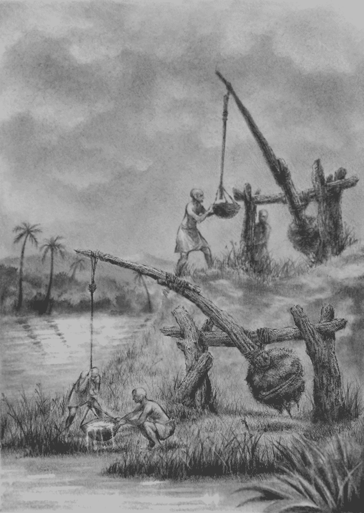
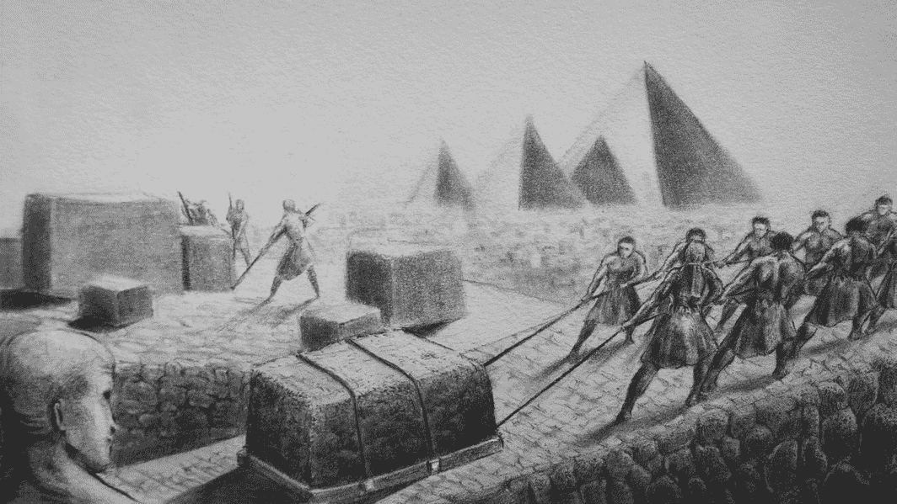
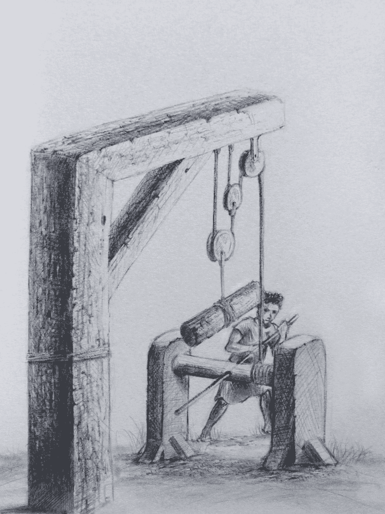
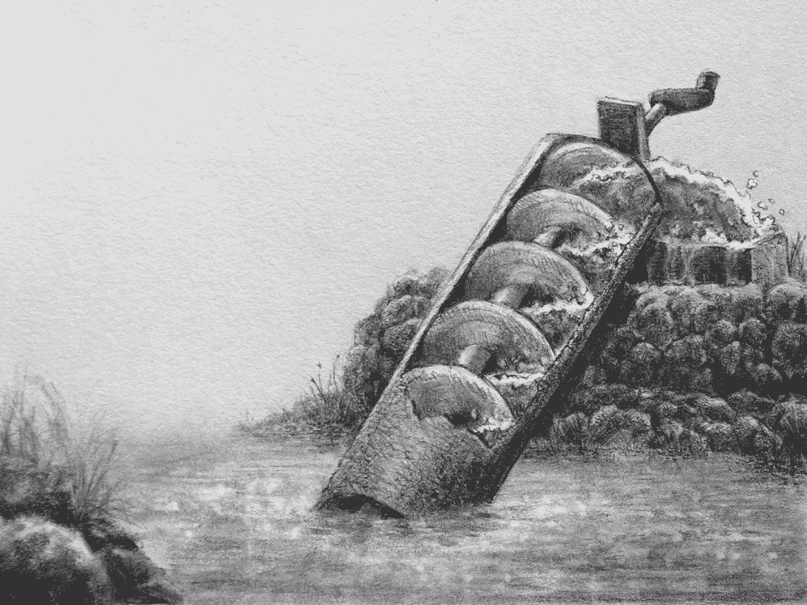
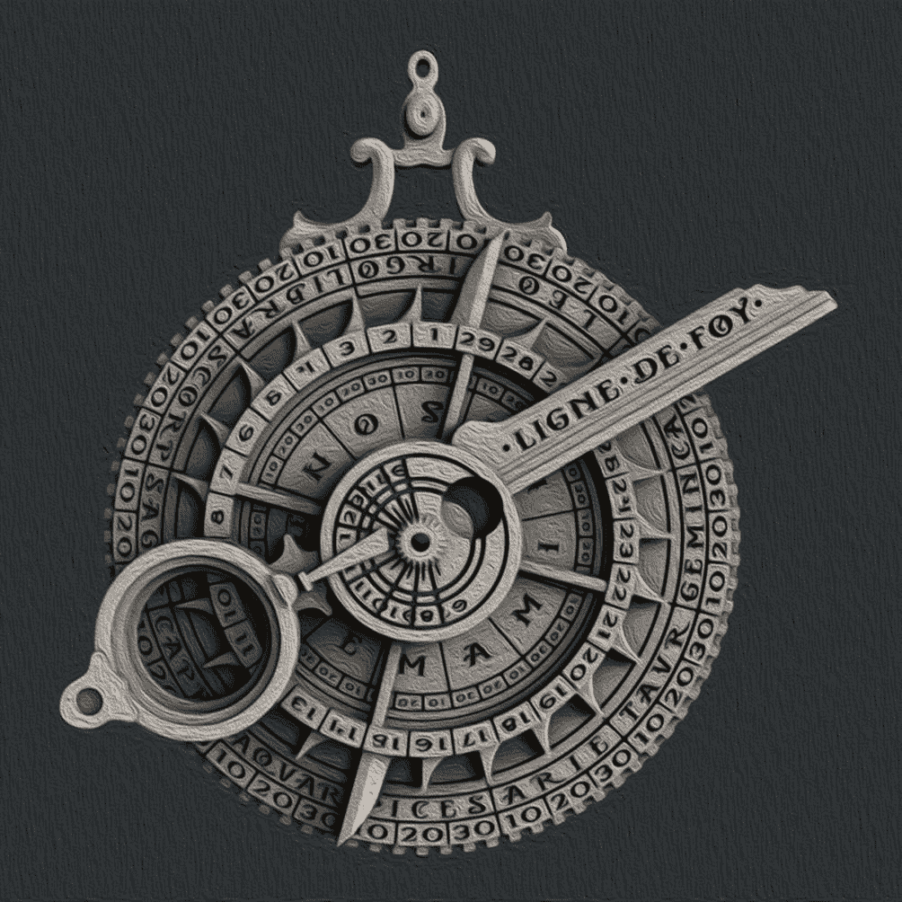
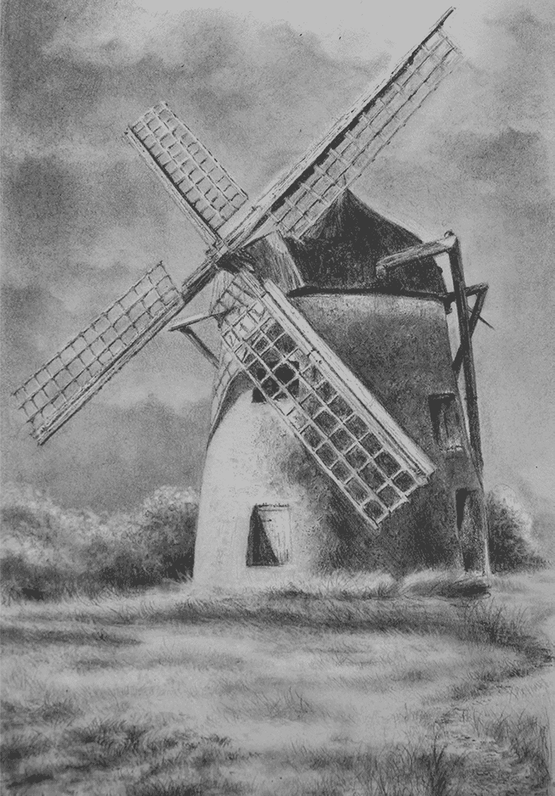
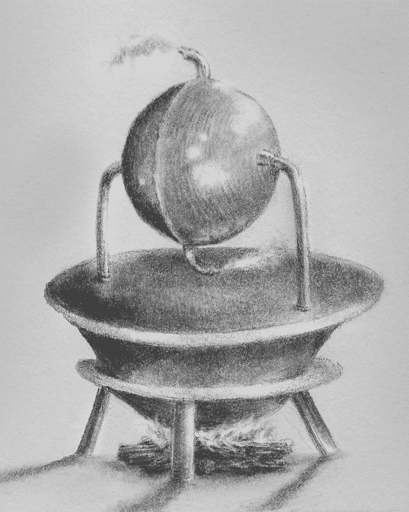
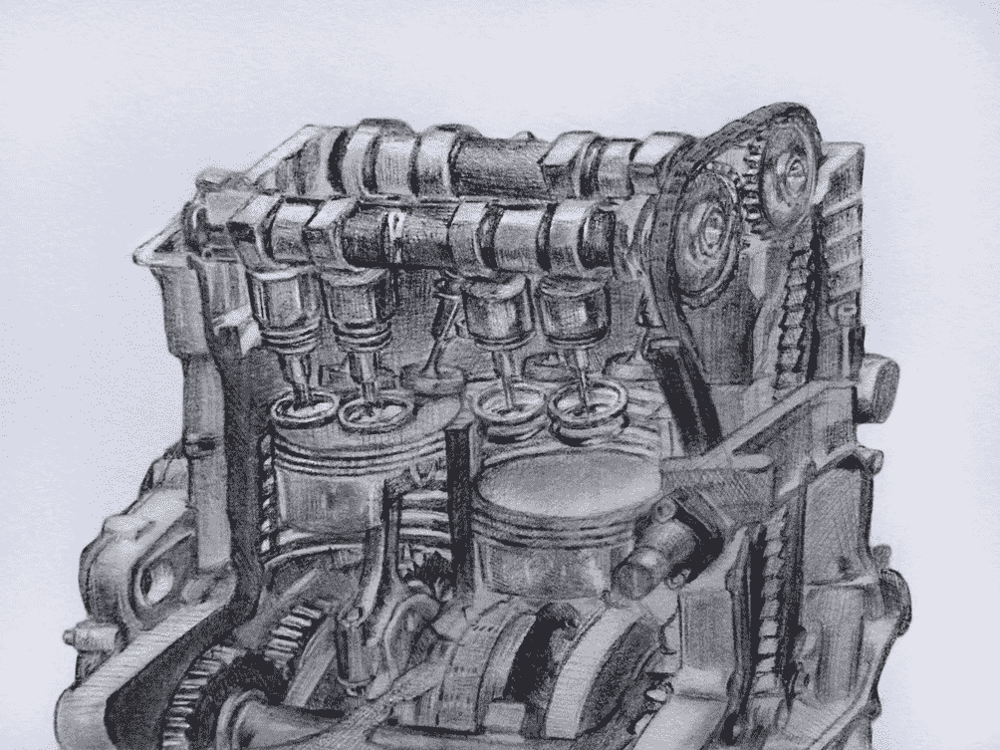

# 5. 机器的起源

“机器没有灵魂，但它有目的。”阿瑟·C·克拉克在 1962 年的著作《未来的轮廓》中精辟地指出。或者，用艾萨克·阿西莫夫在 1950 年的小说《我，机器人》中更具戏剧性的措辞来表达：“机器是我们自身欲望与恐惧的映射。它是一种工具，我们可以用它创造一个更美好的世界，也可以用它来毁灭它。”这些引言试图描述机器在我们生活中的作用。自发明以来，机器已成为人类生活不可或缺的一部分。机器赋予人类超能力；机器使人类能够做到他们能够想象却无法实现的事情。这是一项真正将人类与地球上所有其他物种区分开来的、最重要的发明。除了人类，没有其他物种能够创造和使用机器！

在上一章中，我们探讨了工具的使用如何开始将人类与其他生物区分开来。机器标志着工具改进过程中的自然演进。然而，机器本身是一个相当宽泛的术语，因此其含义可能显得相当模糊。它可以用来描述一大类物体。通常，当我们称某个物体为机器时，它包含一些运动部件，并且被制造出来以执行特定功能。工具只是一种手持式且手动操作的装置，用于执行一项或多项任务；而机器则是由多个部件组成的复杂装配体，由某种能源驱动，以执行特定但相当复杂的任务。虽然工具通常由单个部件（或以刚性方式连接的多个部件）组成，但根据定义，机器由多个组件以及运动部件构成。现代机器的例子包括引擎、马达和电子设备。

## 早期机器的例子

### 轮子

虽然我们当前对机器的认知围绕着这些先进的概念，但机器在定义上并不需要那么复杂。`轮子`^(¹²)可以被认为是人类建造的早期机器之一。人类使用它的最早证据大约可追溯到公元前 3500 年。一个由辐条和圆形主体组成的非常简单的装配体，将人类带入了一个新时代，将所有其他物种远远抛在身后。机器的创造和使用标志着人类与所有其他物种之间的根本分界线。存在大量其他物种使用工具的证据，但绝没有任何证据表明有任何其他物种使用机器。即使我们考虑其中最简单的例子——轮子，除了人类之外，也没有观察到任何其他物种使用它。人们可能会观察到一些猴子或爬行动物在天然的圆形物体上滑行，但它们并不理解其性质，也无法从零开始建造一个。你可能会看到一只经过训练的黑猩猩骑自行车，但它并非自学成才，而是由人类专门训练的，并且制造自行车远超它们的能力范围。

谁是人类第一个使用轮子的人，这可能有待商榷，但普遍认为，大约在公元前 3500 年，现今埃及、伊拉克（美索不达米亚）、俄罗斯（北高加索地区）和中国的人们已经熟悉这一概念并经常使用它。一些最早的化石证据指向使用粘土来制造轮子。这些轮子被用于陶器制造。后来，木头和石头被用于制造轮子，这些轮子被用来建造某种用于运输的推车或手拉车。然后，人类使用强壮的动物，如牛和驴，来拉动这些装载着重物的手拉车。这种手拉车的使用将货物运输提升到了一个新的水平，实现了不同地区之间的货物交换。随着时间的推移，轮子的设计不断演变，例如增加了辐条以使其更轻便耐用。轮子和手拉车的使用遍布整个古代世界，最终被广泛用于从农业、战争到商业的各种用途。

### 沙杜夫

古人类开发的另一种有趣的机器称为`沙杜夫`，如图 5-1 所示。沙杜夫的起源尚不确切，但据估计，自公元前 4000 年起，埃及、美索不达米亚和印度次大陆的古代文明就已开始使用它。

**图 5-1** 古人类使用沙杜夫帮助从河中取水

沙杜夫，如附图所示，包含一根带支点或枢轴点的长杆或横梁。我们也称这种装配体为杠杆。支点将杆子分为较长段和较短段。一个重物绑在较短段的末端，而一个空水桶则用绳子绑在较长段的末端。这种简单的装置巧妙地利用了由臂长差异产生的机械效益^(¹³)。然后可以用手拉动绑在水桶上的绳子，将水桶浸入水中。一旦水装满，另一端的重物会自动将装满水的水桶拉出水面，然后可以将水倒进农田灌溉庄稼或用于其它目的。如果没有沙杜夫，拉起这样的水桶会非常费力，如果水桶太大，或者农田的水平面远高于水面，甚至可能无法做到，但这个简单的装置在当时提供了超人的能力，并将从河中取水的效率提高了几个数量级。沙杜夫在古代文明中的使用是农业技术的一个重要里程碑，并在早期文明的发展中发挥了关键作用。能够灌溉大片农田使得粮食产量增加，满足了人口增长的需求。这是迈向城市和文明发展的垫脚石。它也被用来移动重物，例如石块，以及在建筑过程中将建筑材料提升到更高的高度。

### 斜面

古代发明的另一种奇特的机械例子是斜面，如图 5-2 所示。斜面可能看起来不像机器，因为它没有自己的运动部件，但它便于改变其上物体的运动方向。当一个人沿水平方向在斜面上推动一个物体时，由于斜面的特性，该物体也会被沿垂直方向推动。尽管听起来简单，但这种机械对古代文明产生了巨大影响。如果没有斜面，公元前 2600 年左右埃及金字塔的建造将不可能实现。斜面通过将所需的力分散到更长的距离上，从而减少了提升重物所需的力。埃及人使用由泥砖制成的长斜坡，将巨大的石块从采石场运到建筑工地。与直接尝试提升石块（这几乎不可能）相比，斜面使他们能够用更少的力气将石块向上移动。斜面的使用也在其他建筑方面变得流行，用于移动木材和泥土等重型材料。在中世纪的欧洲，斜面被用来在山丘上下运输货物。早期铁路的轨道也采用了斜面原理，由马匹（后来由蒸汽机）牵引着货车或车厢沿轨道上下移动。如今，斜面仍然应用于许多场景，从轮椅坡道到装卸码头。现代斜面的设计经过改进，使其更高效、更易于使用，但其原理保持不变。

**图 5-2** 古埃及人利用斜面移动巨石建造金字塔

### 滑轮

`滑轮`是早期机械发明宝库中的又一颗明珠。滑轮是一种简单的机械，由一个带槽的轮子和一根绳索或缆绳组成，如图 5-3 所示。它被认为是古代人类为了用更少的力气提升重物而发明的。滑轮的确切起源尚不清楚，因为它随时间在不同文化中独立发展。然而，有证据表明，滑轮早在 4000 到 5000 年前（即公元前 2000 年到公元前 3000 年左右）就在古代美索不达米亚、埃及和希腊被使用了。滑轮的概念可能源于观察如何通过将绳索缠绕在固定点（如树干或横梁）上来提升物体。通过将带槽的轮子固定在那个点上，并将绳索穿过凹槽，轮子可以用来改变施加在负载上的力的方向，从而更容易提升重物。早期的滑轮可能由木材制成，带槽的轮子由一块实心木头雕刻而成，或者由多块木头通过绑带或木钉固定在一起构成。与滑轮一起使用的绳索或绳子通常由天然材料制成，如植物纤维或动物筋腱。滑轮被用于各种用途，例如建筑、运输和农业。在古埃及，滑轮与斜面一起被用于建造金字塔等纪念性建筑，以提升巨大的石块。在希腊，滑轮也被用于剧院和神庙，将沉重的道具或装饰品吊到舞台或屋顶上。滑轮还用于船舶上升降船帆，以及用于井中打水。随着时间的推移，滑轮的设计和制造材料不断演进。金属滑轮被引入，与木制滑轮相比，它们更加耐用和高效。开发出了具有多个凹槽或滑轮的滑轮组，从而增加了机械效益，即用更少的力提升更重负载的能力。还发明了不同类型的滑轮，如定滑轮、动滑轮和滑轮组，以适应不同的目的。在 18 世纪和 19 世纪的工业革命期间，滑轮成为机械中的关键部件，是制造过程中不可或缺的一部分。如今，滑轮应用广泛，从电梯和起重机到传送带和家用健身器材。

**图 5-3** 古代文明利用滑轮提升重物

### 螺旋

另一种在古代发明的重要机械，尽管比`桔槔`的发明晚了数千年，并且也用于从天然水库中汲取水源的类似目的，被称为`螺旋`，或者根据其发明者命名为`阿基米德螺旋泵`。阿基米德是来自希腊叙拉古的一位杰出的数学家和工程师，他大约在公元前 300 年创造了这个巧妙的装置。该装置由一个螺旋形的管子构成，通过手柄或曲柄转动，如图 5-4 所示。当将管子插入水中时，螺旋将水从较低水位提升到较高水位。阿基米德的原始设计很可能用于灌溉目的，使农民能够从河流或水井中提水，并将其输送到田地里浇灌作物。随着时间的推移，`螺旋`被改造用于其他用途，例如从船舶和矿井中抽水，以及排干沼泽。`阿基米德螺旋泵`的使用传遍了古代世界，后来被罗马人采用，他们在其著名的引水渠和矿井中广泛使用了该装置。在中世纪，伊斯兰世界也使用了`螺旋`，用于灌溉和提水。在文艺复兴时期，`阿基米德螺旋泵`被欧洲工程师重新发现，并改造用于多种用途。`螺旋`被用来驱动水磨，后来在工业革命期间被整合到蒸汽机中。即使在今天，`阿基米德螺旋泵`仍然应用于各种场景，包括废水处理、水力发电，甚至一些现代灌溉系统。`螺旋`的设计随着时间的推移不断被修改和改进，但其基本原理保持不变。正是其巧妙的设计和多功能性，使其成为机器史上永恒的杰作。

**图 5-4** 展示阿基米德螺旋泵的内部结构，它通过从河中抽水来帮助灌溉

机器的使用并不仅限于提供机械效益，它还被用于科学，特别是天文学乃至观星领域。在古代，由于没有城市灯光，晴朗的夜空总是布满星辰和其他天体。这些天体位置的变化为大量学科提供了深刻的见解。

### 星盘

观星对古人而言意义深远，它在实际应用、文化传承和精神寄托等多个方面丰富了他们的生活。在先进导航工具问世之前，恒星和行星等天体的位置与运动是重要的导航指引。古代水手和旅行者将星辰作为天空中的路标，在陆地与海洋上航行，使他们能够规划路线并相对精确地抵达遥远的目的地。星星在夜空中有节奏地运行，为早期人类提供了一种基本的时间计量方式。通过观察特定恒星的位置及其运动模式，他们可以追踪时间的流逝，例如在太阳消失的夜晚确定时辰。长期观测还帮助他们识别季节的更替。古代农业社会严重依赖对天象的观察来确定季节变化，寻找播种和收获的最佳时机。星星规律且可预测的运动模式帮助他们预判季节变换，确保了农业生产的成功和食物的供给。此外，对于许多古代文明而言，天界还具有深刻的宗教与文化意义。星辰和天象通常在宗教仪式、神话和宇宙观中扮演核心角色。它们与神灵、创世故事以及生死轮回相关联，丰富了社会的文化图景。观星还影响了建筑和城市规划。一些古代建筑和城市与夏至、冬至和春分、秋分等天象事件对齐，反映了人造环境与天体之间的深刻联系。观测天象使古人能够预测某些自然事件，如日食、月食和流星雨。尽管这些事件可能带来惊叹甚至恐惧，但理解并预测它们展示了古人的科学洞察力。鉴于天空中天体位置所扮演的这种根深蒂固的角色，人们也发明了机器来提高这些预测的准确性。其中一种仪器称为星盘，如图 5-5 所示。

**图 5-5** 星盘

星盘用于解决与时间及天体位置相关的问题。其历史同样可追溯至古希腊人，他们在公元前 150 年左右发明了这种仪器的原始形式。然而，随着星盘传播到世界其他文化和地区，其设计和用途在几个世纪中不断演变和改进。在公元八世纪的伊斯兰黄金时代，穆斯林天文学家开发出了更先进的星盘版本。他们使用这种改进版本来高精度测量恒星和行星的位置，以便更精确地在海上航行。到了中世纪时期，星盘已成为欧洲天文学家和航海者的常用工具，其用途从确定白天的时间到绘制恒星位置，不一而足。随着时间的推移，星盘不断发展，其设计中增加了新的特性和改良。到了文艺复兴时期，它已成为天文学和航海领域最重要的仪器之一，并被当时一些最伟大的思想家所使用，包括哥白尼和伽利略。如今，星盘已不再用于科研目的，但它仍然是天文学和航海史的重要组成部分。其优雅的设计和精巧的结构持续吸引着学者和爱好者，在世界各地的博物馆和私人收藏中都可以找到许多该仪器的复制品。

### 计时机器

除了星盘这类复杂机器，人类也从日晷等相对简单的机器中受益匪浅，它们在日常生活中用于计时。计时是最受追捧的技术之一，它使我们保持生活节奏。我们在时间测量的准确性方面取得了巨大进步，但这一切都始于观察太阳投下的影子如何在一整天中移动。日晷随后与漏壶（水钟）结合使用，后者通过测量流经预定管道的水量来计时。这些时钟可以在无法利用太阳的阴雨天以及夜间使用。漏壶的准确性取决于水温、机械部件的可靠性、维护等因素，但总体而言，它标志着计时技术的重大进步。计时领域的下一个里程碑出现在公元十三世纪左右，随着机械钟的发明而到来。机械钟由齿轮、重物和弹簧组成的复杂装置构成。随着精密度的不断提高，这些机械钟在当时达到了卓越的准确性。公元十七世纪摆锤的发明进一步提升了机械钟的计时精度。由于摆锤的周期具有极高的恒定性（仅取决于地球重力和摆长），基于这一原理的时钟极其精确。根据制作摆锤的材料不同，温度变化导致其长度改变可能会引入误差。但使用不随温度改变尺寸的特种合金或玻璃摆钟，代表了直至二十世纪计时技术的巅峰。下一个巨大的精度飞跃出现在 20 世纪 20 年代，随着石英钟的发明而来。这些时钟基于石英晶体的振动频率。由于这些振动不像摆锤那样受温度影响，它们进一步将计时精度提高到了每月正负 15 秒的程度。但它仍然在一定程度上依赖于温度以及为时钟供电的电池所使用的石英晶体类型等其他因素。计时机器领域的下一个也是最新的发明，是通过使用原子钟实现的，其精度可达一亿年以上的误差不超过正负 1 秒！这些时钟基于原子（通常是铯原子）的自然共振频率。然而，这些时钟体积庞大，无法制成手表。手表仍然采用石英技术或机械技术制造。

仔细审视所有这些机器的设计过程与发明历程，可以发现一个贯穿始终的共同点：它们都能够执行我们所能思考、想象或构想，甚至在一定程度上能够“亲自”去做的事情。机器并非在做人完全无法做到的事情，但它们使人类能够更轻松、在更大规模上、用更少的精力去完成这些事情。另一个值得注意的重要方面是，机器所做的所有任务，并非它们自己能独立完成。人类始终参与其中。人类要么在操作它们、管理它们，要么在以某种方式为它们提供动力。

机器运行所需的能量始终（直接或间接）来自人类，并且这些机器所完成的工作在原理上并非全新。诚然，如果没有这些机器，我们能够举起的重量或移动重物的距离将大幅减少；或者，预测恒星位置的精确度也会相当低下；然而，重要的是要指出，这些机器并未真正让人类做到那些没有它们就无从下手的事情。这其中并无魔法，它们只是遵循基本的物理原理，为人类提供了可调节的机械优势。此外，使用这些机器完成的任何任务，所需的总能量与不使用它们时完全相同；但是，使用机器改变了能量被引导或调节的方式，仅凭这一点，就足以实现人类借助它们完成的所有惊人的工程壮举。所有这些古代机器都可以归类为纯机械机器。它们不仅只利用机械能，而且完全由人类或其他动物提供动力。

## 风车

一个偏离这一趋势的例证便是风车的出现，如图 5-6 所示。风车是人类创造的第一台利用人类或任何其他生物体之外能源的机器。它利用了风中的能量。这堪称一项不可思议的壮举。风能基本上是免费可用的，利用这种能量来驱动机器在当时无异于魔术。第一台风车的发明归功于大约 2000 年前希腊亚历山大的赫伦。他巧妙的设计包括一组垂直安装的齿轮链，当风吹动顶部的轴时，齿轮便会旋转。风能最终被用来研磨谷物，而这项工作此前是由人力完成的。该设计效率不高，在随后的几个世纪里经历了多次改进才趋于完善。真正现代意义上的水平轴风车设计，是在大约 1300 年前，即公元九世纪，在波斯（今伊朗）发现的。这些风车用于研磨谷物以及从井中提水。

**图 5-6** 利用风力研磨谷物的古代风车

## 水车

机器利用自然能源的另一个有趣例子见于水车的发明。这些水轮被放置于流经斜坡的河流或溪流中。水流使轮子旋转，从而产生能量。这种能量也被用于类似的应用，如研磨谷物和提水。水车的起源不像风车那样明确，但最早的使用记录可追溯到大约 2000 年前的古罗马和古希腊。这项技术很可能在世界多个地方独立发明。

# 热能

热能是另一种可以从太阳获取或通过燃烧木材、煤炭等获得的自然能源。人类对热能的首次利用可追溯到史前时期，当时早期人类发现了火，并学会了利用其热量进行烹饪、取暖和照明。发现火的确切日期和地点已不可考，但据信发生在大约 170 万年前。那时，现代人类或`智人`甚至尚未诞生。这些早期人类属于我们现在称为`直立人`的物种。这些早期人类主要用火烹饪食物，并在寒冷的天气里取暖。随着他们控制火的能力日益精进，他们还用火来照明、抵御其他物种以及狩猎。火的发现和对其热量的利用是早期人类重大的技术进步，使他们不仅能在恶劣环境中生存，还能蓬勃发展。然而，在很长一段时间里，人类除了直接利用热能的自然用途外，无法从热能中获益。换句话说，人类无法驾驭热能来驱动任何类型的机器。快进超过 160 万年，大约在 2000 年前，即公元一世纪，在古希腊，发明了一种奇特的小装置，名为`aeolipile`（汽转球）。该装置由一个球体和安装在圆形结构上的两根管子组成，如图 5-7 所示。

汽转球的草图：一个带有两个蒸汽出口的球状部件，连接到一个三脚支撑上的碗状部件。底部正在被加热。

图 5-7：汽转球可能是最早将热能转化为运动的发明之一

球体内装满水并在火上加热，使水变成蒸汽并通过管子逸出，导致球体快速旋转。虽然没有证据表明这个`aeolipile`曾被用于任何实际应用，但这台机器确实证明了人类能够通过将水加热成蒸汽这个中间步骤，间接利用热能来移动物体。然而，直到公元十八世纪的英国，这一概念才得到进一步完善，最终发展出了蒸汽机，我们成功地以运动的形式将热能转化为本质上不同的东西。十八世纪初，蒸汽机首次成功应用于抽排煤矿中的积水以防止水淹。这项发明的功劳归于托马斯·纽科门，他最初的蒸汽机概念后来由詹姆斯·瓦特进一步改进。詹姆斯·瓦特改进后的蒸汽机设计效率大大提高，为纺织厂、钢铁厂和其他工厂提供了动力。它们还被用于驱动交通工具，如蒸汽机车和蒸汽船。蒸汽机的发明是英国工业革命中的一个关键里程碑。

### 历史上的能源

早在数百万年前的`直立人`时代，人们就开始使用木头等天然材料来生热，但过了很久人们才发现煤等化石燃料是更强大的能源。最早的文献证据表明，大约 5000 年前，中国人就开始开采和使用煤炭来生热；而另一项证据表明，在约 2300 年前的古希腊，沥青煤^(¹⁴)被用作取暖和烹饪的燃料。古希腊哲学家泰奥弗拉斯托斯在公元前三世纪撰写的著作《论石头》中将煤描述为一种有用的燃料。中华文明在其他化石燃料的使用方面也处于领先地位，例如大约 4000 年前（即公元前 2000 年），人们便将天然石油和天然气用作能源。他们甚至更进一步，巧妙地利用天然竹茎作为管道，将天然气直接输送到家中。同样地，所有这些燃料的使用仍然局限于生热，并直接用于烹饪、取暖等。直到 18 世纪的英国，机械技术的进步才与煤及其他化石燃料等替代热源的使用相结合，共同推动了工业革命。

天然石油是一种更强大的天然能源，其能量密度大约是煤炭的两倍。人类在多个世纪前就已经知道天然石油的存在。最早使用天然石油的记录可追溯到公元前 600 年的中国，当时它被用作灯油。更大规模的应用出现在 9 世纪的欧亚交界处，即今天的阿塞拜疆地区，那里开凿了第一批油井，并开采天然石油作为燃料。然而，天然石油的首次商业使用要到 19 世纪初才出现，当时美国人开始钻井，石油和天然气工业由此诞生。不同类型能源的使用对机械技术的进步起到了重要作用。随着技术的进步，人们开始将重点放在使用更强大的能源上。

## 电力

机械能或热能的使用无疑将我们推上了快速发展的轨道，但电力标志着使用能源驱动机器的一个全新时代。这是人类首次无法用肉眼直接看到这种能量。早些时候，我们可以看到机械装置在运转，可以看到火焰和物体被加热，但电力却是一个全新的存在。电力对现代人类来说并非完全陌生，但它作为能源是最不为人所理解的。有证据可以追溯到约公元前 600 年的古代，当时希腊哲学家米利都的泰勒斯观察到，摩擦琥珀（一种化石化的树脂）可以吸引羽毛等轻质物体。尽管这直接应用了我们今天所说的静电，但在当时，这无异于魔法。此外，我们当时也无法以任何有意义的方式利用这一观察作为能源。过了两千多年，直到 17 世纪，我们才开始慢慢理解电的本质。大约在公元 1600 年，威廉·吉尔伯特和奥托·冯·居里克等科学家进行了有关静电的实验。他们探索了电的吸引和排斥特性。吉尔伯特还因创造了“电”（electricity）这个术语来描述这种力而受到赞誉。到了 18 世纪，才华横溢的科学家本杰明·富兰克林进行了一项相当大胆的实验，加深了我们对电的理解。他是第一个直接从雷暴中获取电力的人。这是一个既迷人又令人敬畏的故事。

### 本杰明·富兰克林的故事

在 1752 年暴风雨的天空下，本杰明·富兰克林开始了一次大胆的探索，以揭开天空的秘密。凭借他的智慧和一个由丝绸制成的坚固风筝，他踏上了一段改变我们对大自然最独特力量理解的冒险之旅。空气中充满了期待，富兰克林仔细地组装着他的装置。他的风筝上系着一条丝绸手帕，在风筝的顶端，一根细金属丝指向天空，准备捕捉狂暴天空的精髓。他一只手握住丝线，另一只手抓着一条丝带来使自己绝缘，走出庇护所，踏入暴风雨的混沌怀抱。富兰克林没有被周围的喧嚣所阻挡，将他的风筝放飞到狂暴的天空中。风筝在黑暗中翱翔，像一艘航行在自然愤怒中的小船，连接着凡间与未知世界。当闪电划破天空时，富兰克林的眼睛里闪烁着兴奋和不安。他多少意识到所涉及的风险，但对知识的渴望促使他前进。他屏住呼吸等待着，感觉到整个宇宙的重量都压在他的肩上。然后，在一道光芒中，事情发生了。一道强大而可怖的闪电劈开了黑暗的天空，伴随着一声巨响冲向地球。富兰克林的风筝成为了流经天空的天堂力量的导体。当富兰克林观察到他大胆实验的显著效果时，世界似乎都屏住了呼吸。然后，仿佛命运在召唤，富兰克林小心翼翼地伸出手，将一根手指伸向悬挂的钥匙。一股电能涌来，一个火花从钥匙跃到富兰克林等待的手指上。电击贯穿他的身体，这是他结合了科学与勇气的惊心动魄的一刻，永远将他的名字铭刻在历史的篇章中。在那场雷雨中，在倾盆大雨中，本杰明·富兰克林揭示了一个深刻的真理：闪电，这个毁灭与奇迹的先兆，正是我们现在称之为电的这种迷人力量的一个令人敬畏的体现。

实验的细节可能存在争议，但实验结果无可争议，它确立了电力作为一种明确的能源。利用电能的下一步关键进展来自亚历山德罗·伏特的发明，他在 1800 年发明了第一个电池。这一发展提供了一种稳定的电力来源，可以在任何需要的时间和地点使用。在 19 世纪，科学家们在理解电的本质方面取得了巨大进步。托马斯·爱迪生发明了白炽灯泡，使得用电照明成为可能。尼古拉·特斯拉开发了交流电，也就是今天家庭和企业中使用的电的类型。所有这些发明极大地改变了我们为机器提供动力的方式，从而改变了世界。

## 电磁学的发现与发展

早期的电力被发现和使用时，严格来说是通过电线传输的。然而，人类也在尝试观察一些无需电线即可看到的电力效应。具体来说，公元 1666 年，英国物理学家罗伯特·玻意耳首次观察到，静电火花可以在几英尺外对一束光产生干扰。他无法解释这种现象是如何发生或为何发生，但他记录下了自己的观察结果。该领域的另一项关键发现出现在 18 世纪初，当时丹麦物理学家汉斯·克里斯蒂安·奥斯特发现电与磁在某种程度上是相关的。在他的实验中，他观察到，如果拿一根通电的导线，它可以使附近的磁针移动。这一发现为电磁学领域的出现铺平了道路。大约在同一时期，法国物理学家安德烈-玛丽·安培揭示了这种相互作用的更多细节。他是第一个通过创立著名的“安培定律”来建立电场与磁场之间定量关系的人。后来在 19 世纪，另一位著名的英国物理学家迈克尔·法拉第证明了电与磁之间的另一种相互作用：变化的磁场可以通过感应现象在导线中产生电流。他的工作为电磁原理的实际应用奠定了坚实的基础。利用水坝或风力涡轮机发电，只有通过感应原理才能实现。感应还导致了电动机的发现，使电力成为我们生活中最易获取且最清洁的能源。发电不会产生任何令人不快的副作用，例如烟雾。苏格兰数学家兼物理学家詹姆斯·克拉克·麦克斯韦真正整合了所有关于电与磁相互作用的实验信息，并发表了他在电磁学方面的著名理论著作，从而将其确立为一个正式的科学学科。大约在 19 世纪 60 年代，他制定了一组深深植根于微积分数学的方程组，为定量理解和预测所有电磁相互作用的影响建立了终极参考标准。当时科学家们研究的大多数电磁相互作用都是无线的，但仅限于物体附近，通常范围从几厘米到几英寸。然而，麦克斯韦方程组也预测了电磁波的存在，理论上这些电磁波可以传播更远的距离。在 19 世纪 80 年代末，另一位德国物理学家海因里希·赫兹进行了一系列实验，他演示了一种我们现在称之为“无线电波”的电磁波，这种波可以传播几米的距离。他的实验为远距离无线通信奠定了基础，后来的研究人员，如古列尔莫·马可尼，在此基础上将无线电波传输的范围扩展到更远的距离，使无线电通信成为可能。

电力作为一种极为复杂的能源的发明，加上利用电磁波进行无线传输，将人类推入了机器技术的新纪元。这些发明的影响如此巨大且具有开创性，以至于 18 世纪到 19 世纪人类生活的差异，比从 18 世纪一直追溯到公元前古代的人类生活差异还要大。电磁学及其精准控制的能力，与我们之前使用过的任何其他能源都截然不同。

### 印刷机

几个世纪以来，机器的使用及其动力源（能源）的改进是相辅相成的。另一种位于人类进步核心地位的机器是大规模书写的能力，换言之，即印刷技术。印刷技术的演进是一段非凡的旅程，它改变了人类沟通、分享信息和传播知识的方式。通过印刷手段有效分享信息的能力，一直是推动人类技术进步的关键因素。从古代的木板印刷到现代的数字印刷，这一演进塑造了社会、文化以及全球思想的交流。

木板印刷起源于古代中国，其过程是将文字或图像雕刻在木板上。将油墨涂在雕刻好的表面上，然后将木板压到纸张或其他材料上。这种方法被使用了几个世纪来制作书籍、手稿和艺术品。它是一种相当刻板的技术，无法快速适应内容的变化。这一改进是通过可移动的粘土活字印刷实现的。它同样是在 11 世纪的中国被发明的，其中单个字符可以被排列和重新排列以进行印刷。约翰内斯·古腾堡在 15 世纪中期引入的金属活字印刷彻底改变了这项技术。古腾堡的机械印刷机标志着人类历史的一个转折点。新的印刷机比手工方法能更高效地生产书籍。这项创新在标准化语言、传播思想和加速信息扩散方面发挥了至关重要的作用。工业革命为印刷带来了机械化。蒸汽驱动的印刷机使得报纸、书籍和其他印刷材料的大规模生产成为可能。这一时期见证了出版业和大众传媒的兴起。胶印的发明使得油墨可以从印版转移到橡皮滚筒上，然后再转移到纸上。这项技术提高了印刷质量并实现了更快的生产速度，成为许多印刷类型的标准方法。20 世纪，照相制版技术将摄影引入了印刷流程。图像可以利用光敏化学物质转移到金属印版上，从而提升了印刷质量和视觉表现力。“一幅图胜过千言万语”的概念随着这项技术成为了现实。20 世纪末，数字时代彻底改变了印刷。数字打印机可以直接使用计算机文件进行复制，从而消除了对传统印版的需求。这种方法允许定制、按需打印并减少浪费。这项技术将打印机带入了我们的家庭，而在早期，人们需要一个巨大的建筑来容纳一台印刷机。计算机的不断进步带来了印刷技术的另一个里程碑式的变革——3D 打印技术。它允许根据数字模型逐层创建物理对象。现在，我们不仅可以复制文本和图像，还可以根据模型实际创建出完整的物体。随着印刷所用材料（超越了传统油墨，例如塑料、金属、陶瓷甚至生物材料）的进步，印刷与工程之间的界限几乎消失了。

## 印刷技术到纺织工业的革命

与印刷技术使得书面材料的大规模生产成为可能类似，纺织工业革命实现了服装的大规模生产，从而解决了为不断增长的人口制造衣物的挑战。自远古以来，制作防护性衣物一直是人类的基本需求之一。它始于使用天然存在的材料，如树叶和死动物的皮毛。这些材料被用于制作手工服装制品数千年之久。使用纤维以及诸如纺锤和织布机之类的机器，标志着纺织工业的开端。这些机器的首次使用可以追溯到古代，但在那时，这些机器严格来说是手持设备，其可制造的数量范围相当有限。纺织工业一直停滞在这些方法上，直到工业革命和蒸汽机的诞生。然而，自那时起，它以诸如珍妮纺纱机、水力纺纱机和动力织布机之类的发明形式迈出了巨大步伐，这些发明将服装生产提升到复杂图案的制作，并加速了生产效率。二十世纪见证了纺织工业的又一个里程碑，即缝纫机及其各种进步，最终导致了计算机辅助纺织生产。机器和制造技术上的这些发展也创造了生产流水线或装配线的新概念，其中制造过程涉及一系列复杂的操作，需要快速连续地一个接一个执行，以实现商品的高效大规模生产。这个过程将极其复杂的操作分解为一组专门的微观操作，这些操作可以由不同的机器在不同个体的辅助下执行。这一概念后来被进一步优化，用于汽车、飞机等的生产。

## 车轮运输的顶峰与汽车革命

为运输目的而发明的车轮，其顶峰在二十世纪随着汽车的大规模生产而得以实现。一些早期的汽车装置使用蒸汽机作为动力核心，但很快就被内燃机所取代，如图`[5-8]`所示，其使用天然油作为燃料。内燃机在首次发明时，确实是技术创新的标志。其运行的复杂性和效率是超乎寻常的。第一台内燃机于 1860 年由一位名叫让·约瑟夫·艾蒂安·勒努瓦的工程师发明。它是一台四冲程发动机，使用氢气和氧气的混合物来驱动。在随后的几年里，内燃机有许多改进。1876 年，尼古拉斯·奥托发明了四冲程发动机，如今大多数车辆仍在使用。1885 年，卡尔·本茨发明了第一辆汽油动力汽车。1897 年，鲁道夫·狄塞尔发明了柴油发动机。天然油在能源效率上要高得多，并且可以更好地控制其燃烧，以便调节运动速度。尽管第一辆内燃机动力汽车是由卡尔·本茨在十九世纪末以`Motorwagen`的形式创造的，但亨利·福特通常与第一辆汽油动力汽车的大规模生产以及装配线的引入联系在一起。从那时起，汽车的演变非常显著。二十世纪带来了更多的设计创新，如更好的空气动力学性能、更好的燃油效率、更好的悬架、刹车、变速箱等等。后来，电子设备和计算机也被整合进来，以实现车载音乐、导航和驾驶辅助功能等。随着速度的提高，事故风险也增加了，这推动了技术发展，以制造更好的安全功能，例如自适应安全带、安全气囊（这些基本上是在汽车感应到撞击、表明发生事故时，部署在战略位置以保护车内人员的充气袋）、防抱死制动系统、稳定性控制系统等。汽车成为一种展示人类在机器技术方面全部进步的单一工具。尽管处于技术前沿，但汽车从电力获取动力却花了相当长的时间。原因在于缺乏足够紧凑、可以安装在汽车上的电力存储设备。然而，在二十一世纪，电池技术已经发展到足以支持汽车完全依靠其动力运行一个合理里程的水平。这标志着汽车历史上最大的里程碑之一，全球所有制造商正在从长期使用的汽油或柴油内燃机转向电力驱动的汽车。

### 图例：内燃机结构

一个发动机的裁剪草图，包含活塞、曲轴、凸轮轴和齿轮等部件。

**图 5-8** 内燃机

### 核能

二十世纪初，人类在寻找新能源的过程中，另一项重要发现便是核能。核能提供了人类已知的最强大、最集中的能源。从本质上讲，核能是在少量质量转化为纯能量时产生的。尽管爱因斯坦著名的方程 `E=mc²` 在二十世纪初就确立了质量与能量之间的理论关系，但他未能展示出实际完成这一转化的任何直接机制。要理解这种转化的细节，我们需要回顾一下原子的物理学。
欧内斯特·卢瑟福、玛丽·居里等科学家的开创性研究，彻底改变了我们对原子的理解。卢瑟福的实验导致了原子核的发现——原子中心一个微小而致密的区域，包含带正电荷的质子和不带电荷的中子。这个原子模型为进一步研究原子过程奠定了基础。另一项关键进展是放射性的发现。在十九世纪末和二十世纪初，亨利·贝克勒尔、玛丽·居里和皮埃尔·居里等科学家研究了某些元素（如铀和镭）发射辐射的现象。他们发现这些放射性物质会自发地发射出亚原子粒子和能量。随着研究人员开始揭开原子核的奥秘，从原子过程中释放能量的想法变得越来越重要。爱因斯坦的方程指明了在这个过程中可能释放的能量大小。另一个突破出现在 20 世纪 30 年代，当时发现了核裂变。1938 年，奥托·哈恩、弗里茨·斯特拉斯曼、莉泽·迈特纳和奥托·弗里施进行了实验，他们用中子轰击铀原子，观察到了原子核的分裂。这个过程被称为核裂变，释放出巨大的能量，远超过自然发生的放射性衰变。随着核裂变的发现，我们真正开始了对质量能量的利用。恩里科·费米、利奥·西拉德等科学家的进一步研究，促成了 1942 年 12 月第一次受控核链式反应的发生，这是曼哈顿计划的一部分。这个在受控环境中发生的链式反应，展示了核能作为一种新的、可持续且合法的能源的潜力。裂变产生的热量可用于发电。它比水坝发电等其他成熟能源强大得多，但同时也带来了自身的问题，即放射性废料的处理。利用水和风发电仍然是最清洁的能源形式，不产生有害副产品。

### 计算机与机器人

随着电力成为最易获取的能源，以及水坝、风力涡轮机和核电站成为其生产者，二十世纪见证了以电力和电磁为动力的机器的迅速崛起。首先是白炽灯泡取代了古老的蜡烛，照亮了千家万户；随后电风扇、电暖器和空调设备帮助管理了我们居所的温度。然而，机器技术的真正巅峰出现在二十世纪下半叶，随着计算机的发明而到来。一场名为信息时代的工业革命新纪元开始了。20 世纪 50 年代，计算机最初是占据整栋大楼的巨型机器，计算能力相当平庸，但很快，随着硅芯片的微型化和微处理器技术的进步，计算机的尺寸变得越来越小，而计算性能却越来越高。很快，所有基于纸张的信息收集和存储系统都被计算机取代了。计算机提供了极其精确可靠且易于访问的基础设施。诸如信息搜索、根据一个或多个标准对信息排序、分类和归档等需要大量人工努力的功能，几乎变得自动化。只需输入几个关键词，点击几次鼠标，结果就会在几秒钟内显示在屏幕上。计算机最初的影响主要体现在需要读写文字处理的领域，但随后一项严重依赖计算机技术的发明改变了这一状况。机器人的发明是一项重大的技术成就，对各个行业和社会各个方面都产生了深远的影响。机器人的历史可以追溯到二十世纪中期，当时能够自主或半自主执行任务的机器这一概念首次成为现实。
“机器人（robot）”一词由捷克剧作家卡雷尔·恰佩克在其 1920 年的戏剧《罗素姆万能机器人》中创造，描述了通过制造而成的人造类人生物。然而，现代机器人的概念是在 20 世纪 50 年代和 60 年代开始形成的。第一台工业机器人，名为“Unimate”，由乔治·德沃尔和约瑟夫·恩格尔伯格在 20 世纪 50 年代末开发。它于 1961 年被安装在一家通用汽车工厂，用于执行焊接和搬运重型材料等任务。这标志着机器人开始在制造业中使用。同样有趣的是，这台机器人看起来一点也不像人类。它由一个巨大的单臂组件和一个承载所有必要机械和电子元件的大箱子组成。

### 机器人的影响

机器人改变了早期制造业的运作方式。在生产线上使用机器人，使装配、焊接、喷涂和包装等任务的效率、精度和速度得到了数量级的提升。这带来了生产成本的降低、产品质量的提升以及制造复杂产品的能力。在某些行业，机器人已接管重复性、危险性或高强度体力的工作，使人类工人能够专注于工作中更复杂和更具创造性的方面。机器人在医疗保健领域也得到了应用，例如在外科手术中。机器人手术系统使外科医生能够以更高的精度和控制力进行微创手术，从而减少患者创伤并加快康复速度。机器人使人类能够探索那些对人类具有挑战性或危险的环境。像火星车这样的太空探测器为我们提供了对火星表面的宝贵见解，而水下机器人则探索深海环境并为科学研究收集数据。机器人技术也改变了我们过去的耕作方式。农业机器人，通常被称为农用机器人或农业机器人，正被开发用于执行种植、收割和作物监测等所有主要农事任务。这些机器有潜力提高农业效率、减少浪费并解决劳动力短缺问题。机器人还可以帮助残障或有行动不便的人士，改善他们的生活质量。
随着硅制造工艺的进步，遵循摩尔定律，^(15)所有计算机乃至机器人基础设施在二十世纪下半叶经历了微型化进程，并在二十一世纪初以更强劲的势头继续发展。计算机的尺寸从占据整层楼的巨型机器，缩小到尺寸不超过几英尺的台式机矩形盒子，再到笔记本电脑这种大号书本的形态，最终缩小到仅有几英寸的手持设备。在尺寸缩小的同时，计算能力却在提升，使得更小的设备变得更加强大，同时运行所需的能量也越来越少。智能手机的发明是二十世纪最后十年左右计算机技术的真正巅峰之作。这款可以放在任何人手中和口袋里的设备，能够拍摄高质量的照片和视频，能够进行全球无线通话，能够收发多媒体电子邮件，能够玩高清 3D 图形视频游戏，能够执行复杂的神经处理，功能不胜枚举。二十一世纪的智能手机取代了上个世纪的汽车，成为展示所有最新技术的实际载体。它们以光速开启了计算和社交网络的新纪元。

## 结论

人类智能创造了工具，随后是机器，这使我们与其他所有生物区分开来。在过去的几章中，我们看到了这些创新是如何发展进步的，并引领我们走向技术日益复杂化的道路。所有的创新让我们的生活更轻松、更幸福、更安全。它们也带来了自身的缺点，而人类一直在学习如何避免这些缺点。机器增强了人类天生的能力，使其变得超人，但尽管如此，它们仍无法自主运作。在下一章中，我们将探讨人类是如何能够激发机器的主动智能，并将技术提升到新水平的。

脚注 1   2   3   4