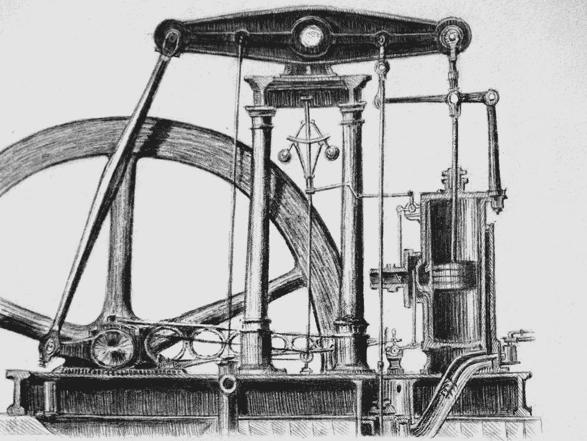
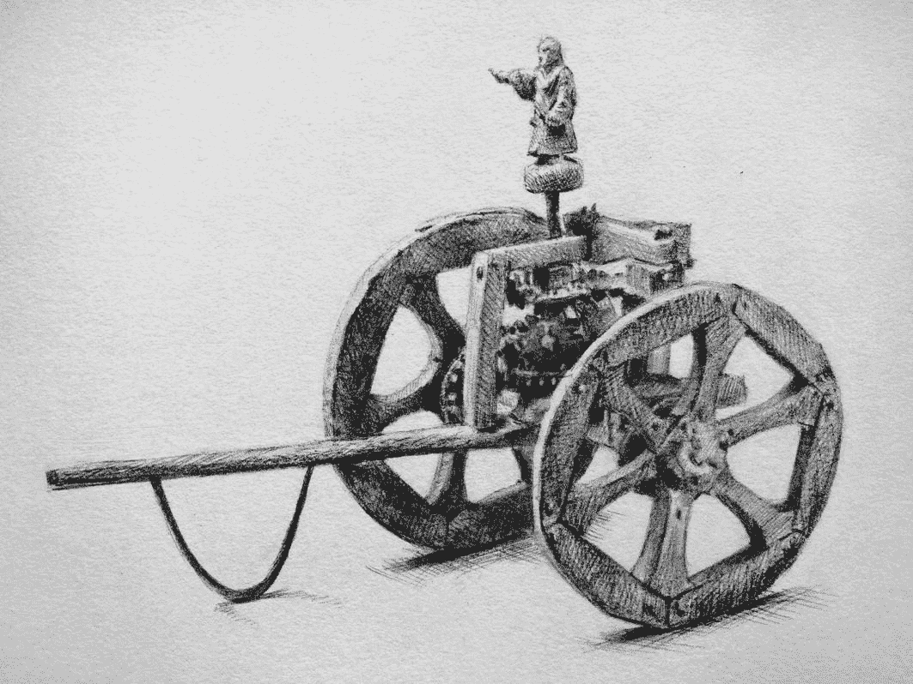
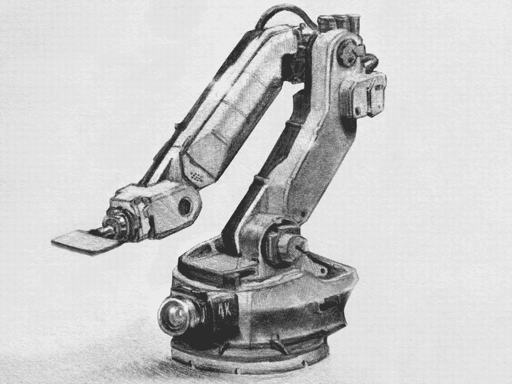
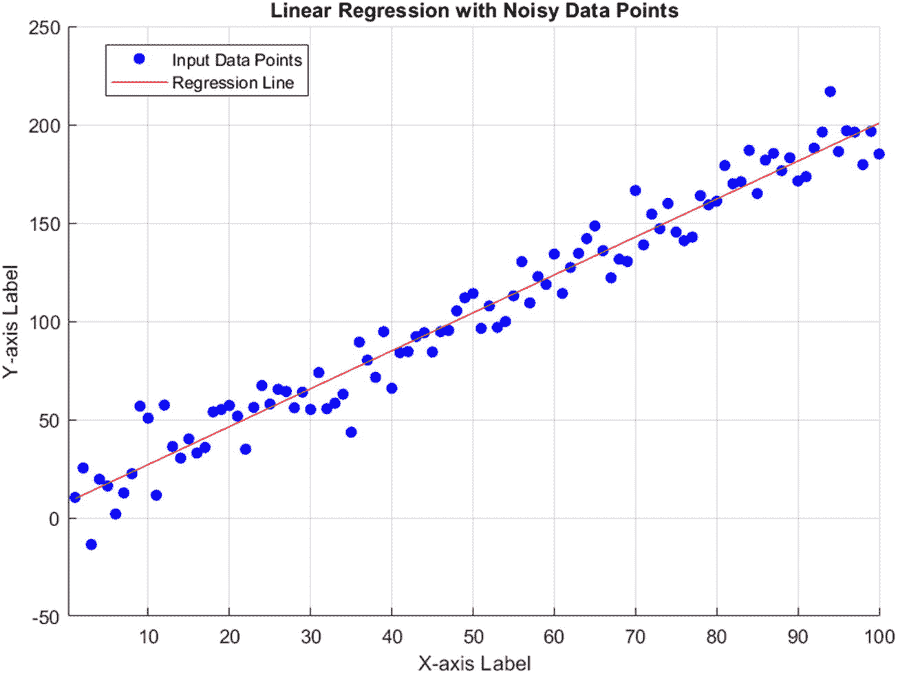
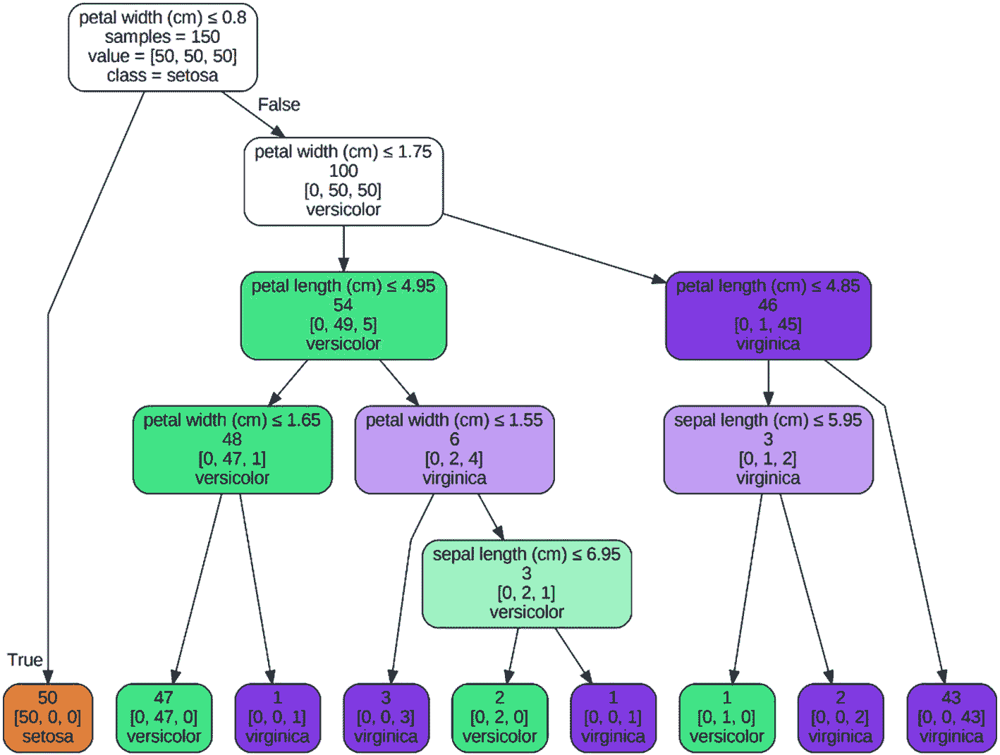
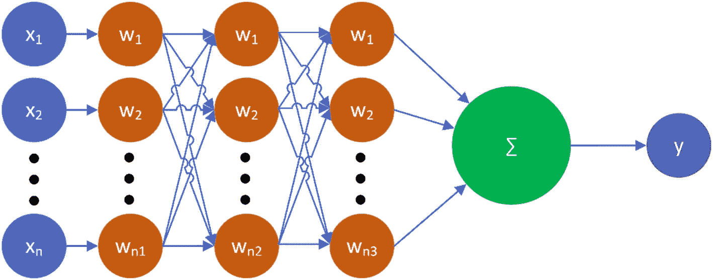

# 6. 机器智能

正如我们在上一章所见，机器与人类一起，作为棍棒等初级工具的升级版开始了它们的旅程。它们很快成为人类日常生活中不可或缺的伙伴。它们减少了人类生活中的艰辛，减少了人类生活中危险工作的数量，使人类能够完成仅凭身体无法做到的事情，从而使人类的生活更安全、更轻松、更有收获、更和平，最终也更幸福。然而，这些好处并非没有挑战和伴随的危险。这些机器也可能被人类用来相互对抗，它们帮助创造了以难以想象的规模毁灭人类生命的方式，正如它们在世界大战中的使用所证明的那样。节省劳力的机器也可能创造更多工作；赋予我们更多力量的机器也可能夺走我们的控制权；帮助我们活得更久的机器也可能成为毁灭我们自己的工具。机器实际上在几乎所有可能的方面都创造了人类的极端版本。在之前的章节中，我们看到了机器的出现；在本章中，我们将看到它们是如何获得智能的。

过去数千年间的技术进步使机器获得了越来越强大的能力和技能；然而，当它们独立运行或在相对狭窄的操作范围之外使用时，它们仍然像石头一样愚钝。机器的智能作为一个全新的概念，直到二十世纪末才出现。从那时起，机器智能就一直是我们极其感兴趣和着迷的主题。为了真正理解机器智能的起源，我们将稍作偏离，探讨机器运作的核心是什么。

## 经典机器

我们以风车为例¹⁶。当风吹动风车的扇叶时，与之相连的转轴开始旋转，带动金属飞轮转动，从而研磨谷物。风越大，转轴转动越快，飞轮旋转也越快，谷物研磨效率就越高。风越小，研磨速度就越慢。而当完全无风时，风车就会静止不动，谷物也无法被研磨。这种运作方式相当直接。但假如有石块误入谷物并卡在飞轮中会发生什么？此时整个风车都会停止运转。解决这个问题有一个非常简便的方法——取出石块，这比整套研磨工序所需耗费的精力要少得多。然而机器自身无法意识到这一点。反过来，如果是一名人类（我们称他为亚当）进行同样的操作，当飞轮被石块卡住时，亚当会迅速察觉、取出石块，然后继续研磨。诚然，亚当的工作速度会慢得多，但即使遇到无法预见的干扰，他也不会停摆。而像风车这般体积与复杂度的机器，只要遇到设计时未被预见的微小干扰，就会彻底宕机。亚当在此过程中究竟做了哪些不同的事情？让我们分解亚当的行为。这里包含三个清晰步骤：（1）第一步，亚当用眼睛观察卡在飞轮中的石块。（2）第二步，亚当停止用手研磨，转而用手取出卡在飞轮中的石块。这些手原本正在转动飞轮，但取出石块的操作截然不同，需要不同的技能组合。（3）第三步，亚当切换手部的技能组合，恢复磨坊的正常运作。这个三步流程蕴含了我们所说的**反馈机制**。人类乃至所有生物物种，自出生以来无时无刻不在通过与环境互动运用这一反馈概念，几乎完全意识不到其复杂性。这种反馈贯穿人类所有感官与反应器官，人类通过眼睛、耳朵或触觉获取反馈，再用手、脚、嘴等器官做出反应，这是与生俱来的本能。然而，机器在这方面远落后于人类。首先，像风车这样的机器没有任何能感知环境的感官部件，通常只由反应部件构成。在过去数千年里，建造能感应环境并做出反应的机器，其难度远超建造更复杂的机器。

### 机械反馈

在制造能对环境做出反应并自我调节的机器领域，首个突破性成就出现在 18 世纪末——工业革命时期的英国，詹姆斯·瓦特制造了他的蒸汽机版本。这不仅是蒸汽机技术的重大改进，更是人类文明的里程碑式飞跃，带领我们进入内置反馈与自我调节机制的智能机器新时代。

其基本构造如图 6-1 所示，蒸汽机将燃烧煤炭产生的热能转化为机械能，为各种机器提供动力，最终驱动交通工具。

包含大轮子及其他机械部件的发动机示意图。

**图 6-1**
詹姆斯·瓦特的机械反馈系统蒸汽机

如图所示，左下方的锅炉加热水产生蒸汽，蒸汽在气缸中膨胀推动活塞。活塞的往复运动传递到顶部的曲轴，转化为旋转运动。这种旋转动力被应用于工厂、运输和采矿等领域。然而，加热过程的波动会导致蒸汽生成量变化，使发动机输出变得不可预测。为解决这一问题，瓦特引入了一种称为离心调速器的反馈机制（如图中曲轴正下方位置所示），实现了发动机转速的自动调节。调速器由一个与发动机驱动轴相连的旋转主轴构成，主轴上装着两个配重臂。当调速器运行时，轴的旋转带动调速器主轴转动。配重臂垂直于主轴安装，会根据发动机转速向外或向内移动。转速增加时，离心力使配重臂向外移动；转速降低时，配重臂向内移动。配重臂的运动连接到一个控制发动机节流阀的机构上。节流阀调节蒸汽进入发动机的流量，从而控制功率输出。配重臂与节流阀之间通常通过包含杠杆和拉杆的连杆系统实现连接。以下四个步骤构成了反馈机制：

*   **步骤 1**：当发动机转速超过设定值时，离心力使调速器配重臂向外移动。这一运动通过连杆系统传递至节流阀。

*   **步骤 2**：配重臂向外运动导致节流阀部分或完全关闭。通过减少蒸汽流量，发动机功率输出降低，转速随之减慢。

*   **步骤 3**：反之，若发动机转速低于设定值，配重臂因离心力减小而向内移动。这一向内运动同样传递至节流阀。

*   **步骤 4**：配重臂向内运动使节流阀开启，允许更多蒸汽进入发动机。这增加了功率输出，帮助恢复发动机转速。

遵循这样一套系统化的方法，离心调速器便提供了一个自动反馈回路，能够根据发动机转速持续调节节流阀。若转速偏离了期望设定值，调速器会通过改变蒸汽流量来做出响应，从而维持相对恒定的速度。离心调速器是瓦特蒸汽机的一项关键创新，因为它提供了一种用于控制发动机转速的自我调节机制。这种反馈机制确保了发动机能够适应负载变化，保持稳定高效的运行，为瓦特蒸汽机在工业革命期间的整体成功和广泛采用做出了贡献。

该反馈机制中所使用的传感器远不如人类现今所拥有的那样先进；然而，这些以离心调速器臂形式存在的原始且纯机械的传感器，却是朝着制造能够响应环境变化并调整自身过程的机器迈出的最初几步之一。

严格来说，瓦特蒸汽机并非最早使用某种反馈形式的机器。在历史上，有一些可以追溯到数千年前的例子，这些机制曾得到应用。大约在公元前 200 年的中国汉代，人们制造了一辆战车，车上有一个使用精密机械齿轮装置的人偶，如图 6-2 所示。某种形式的机械反馈系统被用于确保战车上的人偶无论战车如何转弯，始终指向南方。

一幅草图：一辆带有两个大轮子和一个位于中央、连接着一根长杆的齿轮系统的战车。齿轮系统顶部有一个人偶，其右手向外伸出。

**图 6-2**
人偶始终指向南方的中国古战车

另一个著名的例子是古希腊的安提基特拉机械装置。该装置建造于公元前 100 年左右，使用复杂的机械组件进行天文计算和预测。它被用来模拟天体的运动并追踪天文现象。然而，这些都只是相当孤立的例子，为这些装置开发的技术并没有在创造对人类生活产生重大影响的机器方面取得进展。列奥纳多·达·芬奇被认为是有史以来最伟大的科学家、工程师、建筑师和艺术家之一，毫不意外地，他也在创造具有反馈功能的机器方面发挥了作用。他发明了一种改进型水车，该水车利用反馈机制，能够在水流速度变化的情况下保持其旋转速度。这种水车配有一系列铰接的桨叶或水斗，当它们浸入水流时会充满水。随着水斗充满水，其重量增加导致它们向下倾斜。这种运动进而激活了一套杠杆和齿轮系统，调整水车的位置以补偿增加的负载。通过这种方式，该机制调节了水车的速度，并在水流变化的情况下维持了相对恒定的旋转速度。这种机制在原理上与瓦特的蒸汽机非常接近；然而，没有证据表明瓦特复制了达·芬奇的设计。达·芬奇设计的自调节水车是他大量草图和创意集锦的一部分，展现了他发明创造的天赋。然而，没有证据表明自调节水车的具体设计曾实际建造或投入实用。值得注意的是，达·芬奇对工程的贡献以及他超前的设计对后来的发明家和工程师产生了深远影响。尽管他的所有设计并非都在他那个时代得以实现，但它们为后续各个领域的进步和创新提供了灵感。从现代工程学的角度来看，瓦特的实现仍然标志着反馈驱动机器的真正开端。后来，这项技术在二十世纪及二十一世纪绝大多数汽油或柴油动力汽车所使用的内燃机中达到了顶峰。

尽管像瓦特蒸汽机这样的机器确实利用了反馈来改进或自我调整其自身功能，但这一过程在机器构思之时就已预先设定。机器的所有运行模式以及机器可能遇到的所有响应变化都已事先考虑周全，反馈机制的设计就是为了应对这些变化并按期望做出响应。真正重要的是机器创造者的天才智慧，一旦设计得以实现，机器在其整个使用寿命期间都会按预期持续运行。然而，如果机器面临创造者未曾预料到的变化，它仍然会失效。例如，对于瓦特蒸汽机，如果齿轮被污垢堵塞，调速器机制将无法按预期工作，发动机就会失效；或者，如果发动机承受了未曾预料到的过大应力，发动机也仍然会失效。

为了在机器预定义的效率与人类非凡的适应性之间进行一场关键的对比，让我们深入一个真实场景，其展开方式富有引人入胜的深度。想象一下，一支由真实个体组成的团队被委以一项通常交由发动机完成的任务，这段经历所展现的叙事与人类奋斗的本质产生了共鸣。

在一个坐落于雄伟山脉山麓的宁静村庄里，住着一个以团结和足智多谋而闻名的紧密社区。翠绿的风景和蜿蜒的小路，为一场涉及该村居民的趣味实验提供了背景。认识一下`Jacob`，一位体格健壮、和蔼可亲的男子，以力量和友情著称。他被选为队长，带领一队村民用马车拉着装满必需品的货物前往邻村。通常，这类任务会委托给一台机械化发动机，它拥有无与伦比的原始力量和速度。然而，这一次，村议会提出了一个独特的提议——探索人类适应性的动态。

与`Jacob`同行的是`Emily`，一位年轻活泼、以创新思维闻名的女子；以及`Benjamin`，一位以智慧和韧性著称的长者智者。这三个人，各自代表着人类潜能的不同侧面，怀着兴奋与不确定交织的心情踏上了旅程。出发时，这支三人小队对他们需要覆盖的距离和将要穿越的地形有了基本的了解。他们的旅程在阳光照亮前方道路中开始，投射出一种乐观的气息。然而，自然的变幻莫测正考验着他们的勇气，其方式几乎超出了他们的预料。

行进了几英里后，天气的骤变让他们措手不及。乌云不祥地聚集，暴雨倾盆而下，这是村庄从未见过的景象。曾经坚实的道路变成了危险的泥沼，严重拖慢了他们的进度。在这种出乎意料的困境中，人类团队的原始力量与发动机的威力相比相形见绌，但人类创新的力量却是无与伦比的。在倾盆大雨中，`Emily`的创造性思维迅速行动。她意识到必须迅速适应，便开始扫视周围寻找遮蔽处。她的目光落在一棵巨大的橡树上，它的枝条向外伸展，如同保护伞。在`Benjamin`睿智的认可下，他们蜷缩在坚固的树冠下，躲避风雨。

时间流逝，雨势终于减弱，为三人继续旅程铺平了道路。然而，他们最初规划的路径现在已被泥土和泥浆所掩盖。在这里，合作精神被推到了最前沿。`Jacob`强健的臂膀与`Emily`的战略洞察力以及`Benjamin`不屈不挠的决心协同运作，引导他们在改变后的地形中前行。怀着坚定不移的精神，团队继续前进。他们的谈话充满了笑声、故事和共享的智慧，建立了一种超越所遇挑战的纽带。尽管变幻莫测的天气造成了挫折，但他们集体的韧性闪耀着光芒。虽然他们比预期稍晚到达目的地，但他们成就的意义是不可否认的。观察他们旅程的村民们不仅惊叹于他们带来的补给，更惊叹于他们所体现的不可战胜的人类精神。`Jacob`、`Emily`和`Benjamin`的旅程成了一个代代相传的故事，见证了人类多元化的本质。

在常规和可预见天气的条件下，一辆蒸汽动力火车本可以比人类三人小队更高效地完成这段旅程，但当事态超出可预测的范围并恶化时，机器便相形见绌了。这个故事提醒我们，虽然机器拥有卓越的效率和力量，但它们缺乏人类在未知面前进行适应、合作和创新的独特能力。

那么，是什么让人类群体优于设计精良的机器呢？那就是通过跨模态交互进行持续学习的过程！在深入探讨跨模态或多模态交互的概念之前，让我们先关注学习的各个方面。学习是一个基本过程，人类通过它获取知识、技能、行为或态度，从而在行为或心理过程上产生持久的变化。它是一个复杂而多方面的现象，贯穿我们的一生，使我们能够适应环境、解决问题并提高对世界的理解。学习可以通过多种机制和在不同情境中发生。

## 学习的概念

尽管学习的范畴相当复杂，但其赖以建立的基本前提却十分简单。让我们用直接且简便的方法来定义学习过程。首先需要建立几个要素。第一个要素是试图学习的实体，第二个要素是该实体周围的一切，我们称之为环境。这个试图学习的实体必须能够执行六项操作：（1）产生行动的能力；（2）感知环境反馈的能力；（3）利用某种形式的关联记忆来记住行动与反馈的能力；（4）拥有需要实现的目标或指标的能力；（5）将感知到的环境反馈与目标进行比较的能力；（6）利用目标与实际行动反馈之间的差异来指导行动改进的能力。

基于这样的设定，让我们来看学习过程中的具体步骤：

1. 实体产生一个行动。这个行动对环境产生一定影响。
2. 环境对此作出反馈，实体感知到这一反馈。
3. 实体随后根据其试图实现的目标，将反馈归类为积极、消极或中性。它甚至可能为反馈生成一个与优劣程度相关的数值，以便在积极和消极反馈中进行排序。
4. 实体将步骤 1 至 3 这一系列事件存入记忆。
5. 然后，实体利用其记忆以及感知到的反馈与目标之间的差异，生成一个更有可能成功实现目标的改进行动。
6. 重复步骤 2 至 5，直至目标达成。

这些步骤可能让人联想到本章前文讨论过的反馈机制概念。反馈机制确实始于这一序列中的前两个步骤，但随后缺乏涉及记忆、比较、反馈排序以及生成新行动的步骤 3 至 6。取而代之的是，它只会针对感知到的环境反馈，以预定义的行动作出响应。此外，在采用反馈的机器中，反馈机制是由机器创建者根据对环境反馈变化的预判而明确设计的。而学习机制并不做这样的假设。环境反馈无需事先知晓，并且随着每次新行动和新反馈的出现，学习实体的记忆也在不断更新。

大多数生物从出生起就在经历某种形式的学习过程。每个步骤中所用器官的复杂程度和先进性，决定了不同生物在技能习得和智力水平上的高低差异。这种学习方式也被称为实时学习、在线学习或持续学习。对于所有生物物种而言，这是唯一可行的学习方式。对我们来说，学习过程几乎就像呼吸空气和消化食物一样自然，我们甚至意识不到它在清醒生命的每一刻都在发生。

### 多模态学习

这里涉及的另一个重要概念是：感知到的反馈如何与引起它的行动协同处理。我们的身体中有许多能产生行动的不同部位，以及如前面章节所述的五种感官器官。人类大脑在将耳朵和眼睛等感官器官接收到的反馈，与通过手脚等行动生成器官产生的行动相连接方面，效率极高。更深入地看，手脚产生的行动本质上是机械性的，会导致环境中的物理运动或位置变化；而从眼睛和耳朵接收到的信号则本质上是光学和听觉性的。这是两种截然不同的交互类型或模式，将它们以有意义的方式融合起来绝非易事，而是一项极其困难的任务。为了说明这一过程中的挑战，我们将其与瓦特设计的蒸汽机调速器进行比较。在这种设计中，调速器的行动是机械性的，并作为对发动机转速机械反馈的响应。没有任何摄像头监控运行，也没有任何麦克风监听发动机的声音。我们之前看到的所有其他反馈机械也是如此，从古代中国的战车到达芬奇设计的自调节水车，直至内燃机。能够结合两种不同类型媒介反馈与行动的机器，属于完全不同的层级。将来自不同模式的两种交互结合起来的关键缺失环节，是存在一个中间媒介，所有其他模式的信息都可以在其中被转换或映射。所有生物体内的大脑通过神经系统实现了这一点。神经系统的一部分将所有行动和感官信息转换为电信号。所有行动生成器官和感觉器官通过一个庞大的神经网络与大脑相连，在普通人体中，这种网络的总长度可达 45 英里！有了这个神经系统，所有到达大脑的信息现在都以电信号的形式存在。大脑随后能够以流水线方式共同处理这些信息，而这些信息实际上可能源自机械动作、视觉图像、触觉、声音、味觉等。人类在数千年间不断改进机械反馈装置的设计，但多模态学习的成就却迟迟未能实现。直到 20 世纪，人类掌握了电磁学概念并发明了计算机之后，才在技术条件上达到与模拟有机体或人类学习相匹配的水平。

在学习过程中，我们先前有意忽略了一个重要方面，以使理解更加容易。但现在我们可以来审视它。值得注意的是，定义中所考虑的学习实体并非总是预先编程来执行明确定义的动作，而是一个通用实体（我们也可称之为通用机器），它配备了一些能产生动作的配件。例如，一只可以在一定角度范围内移动的`arm`（臂），或一个可以以一定速度范围向特定方向移动的`wheel`（轮子），或一个可以燃烧燃料产生旋转的`engine`（引擎）。但无论哪种情况，机器的预期功能都没有被定义。`arm`可以用于在建筑中推动方块，也可以用于握持另一工具来砍树。`wheel`可以用于驱动马车，也可以用于制作陶罐。即使`engine`的功能更为固定，驱动它的动力也可以被控制和操纵，并用于各种应用，例如将一列大火车从一个位置移动到另一个位置，或让电梯上下移动。在每种情况下，通用机器的操作都可能显著不同。这些机器在制造时，这些应用都未知。为了促进多模态学习，这些机器随后配备了一组传感器，并使用前面概述的标准学习步骤进行训练。

在如此开放的开端下，机器最初如何产生新动作？显而易见的答案是随机生成！然而，即使我们在生成随机数，也需要知道可接受数字的范围。换句话说，我们需要知道随机生成数字的下限和上限。在给定的情况下，这由通用机器的局限性提供。例如，考虑`arm`的例子。它可能对其可旋转的最大和最小角度，或移动时可施加的力有局限性。因此，利用对机器局限性的了解，它可以在其有形范围内开始随机产生动作。然后，假设我们为这个`arm`配备了一个作为视觉传感器的摄像头来模拟多模态，如图 6-3 所示。

图 6-3
带有视觉传感器（摄像头形式）的机械臂

摄像头可以观察`arm`的运动。在`arm`组件上有一个中央处理单元，我们可以称之为机器的大脑。大脑正在以电信号的形式生成这些动作，同时从摄像头接收电信号作为感官信息。这种设置处理了学习过程概述的前两步。接下来的步骤需要由机器的大脑来处理。首先，我们需要定义一个目标。假设目标是将放置在`arm`前方的物体向左移动一英尺。系统的大脑能够感知来自摄像头的信息，并将其与这一目标进行比较，生成一个标签，形式为`good`（好）、`bad`（坏）或`neutral`（中性）。例如，如果`arm`将方块移向正确方向，它会生成一个正向标签；如果它试图将其移向相反方向，会生成负向标签；如果它完全不移动或沿垂直方向移动，会生成中性标签。它甚至可以更进一步，根据结果的好坏程度生成一个数值。现在，在线学习范式中的所有六个步骤都已就绪，我们拥有了一台准备好开始学习的通用机器。

大脑可以开始在自身限制内随机产生`arm`的运动，并根据摄像头输入捕获标签。这个过程也称为探索，其中系统只是在探索动作空间。如果相同过程持续很长时间，比如一周，大脑将在其记忆中记录大量带标签的动作，但`arm`的操作不会有任何改善。现在，为了改善`arm`的操作并更接近将物体向左移动一英尺的预期目标，我们需要引入利用的概念。我们的大脑在记录带标签的动作时会交替进行探索和利用。探索意味着在不使用任何已记录记忆的情况下生成随机动作，而利用意味着创建它已知能产生良好或正向标签或反馈的动作。当机器首次启动时，记忆几乎是空的，没有什么可以利用。然而，随着它持续探索更多，记忆开始获得一些与正向反馈或标签相关的动作。然后，它可以开始利用这些预先记录的动作，并可能尝试对其稍作调整，以观察反馈是变好还是变差。在此种操作持续足够长的时间后，`arm`将非常接近将物体向左移动一英尺的预期目标。随着机器获得越来越多的正向样本，它可以逐渐切换到仅使用利用阶段，因为不再需要探索随机动作。我们用于训练机器的目标相当简单，动作空间也非常小，因此这样的系统可以相当快地收敛到期望目标。然而，在现实生活中，目标可能非常复杂，动作空间也极其广阔，这使得学习变得缓慢。探索和利用各有其优点和缺点。没有探索，机器无法找到新动作，从根本上无法学习。然而，没有利用，它就无法以确定性的方式产生期望的动作。因此，在这两种操作之间保持微妙的平衡至关重要。这些操作在我们的生活中也相当相关。我们在童年时期处于强烈的探索阶段，如饥似渴地学习；然而，我们也极其不可预测。但随着年龄增长，我们开始收敛于所学的东西，并越来越倾向于使用利用阶段。过分强调利用也会使我们变得僵化，从根本上阻止任何进一步的成长。诸如苏格拉底、柏拉图、亚里士多德、孔子，甚至佛陀等伟大的哲学家和宗教领袖，早在古代就已意识到这个概念（尽管更多是从哲学角度而非机器学习角度）。源于他们的教诲和名言，如“终生保持学生心态”、“学无止境”或“质疑一切”，本质上是在要求读者和追随者即使在你觉得可以安于只利用已学知识时，也要继续探索。总会有新事物可以找到，使你的生活更加充实。

在现代机器学习的背景下，探索与利用的概念构成了强化学习范式的基础。强化学习与深度学习相结合，已被证明是一种极其强大的工具，推动了机器人技术、金融预测、游戏、医疗保健等众多领域的发展。开创性的 ChatGPT 技术也使用强化学习来生成既连贯又信息丰富的文本。然而，对于机器而言，强化学习并非唯一可用的工具。还可以利用其他类型的学习范式，这些范式本质上是离线的，被称为批量学习。

在批量学习中，包含多种动作及其对应响应的标记数据会预先收集成训练集，并一次性馈入学习算法，从而将在线学习中的第 1-2 步重复数千次。然后，算法针对训练数据中的所有样本，执行前面描述的第 3-4 步，完成学习过程。在此学习过程（也称为训练过程）结束时，算法创建了我们所谓的训练模型。这个模型现在可以在现实世界中运行，它能够产生有助于实现预期目标的动作。

让我们看一个例子来说明批量学习的概念。我们想构建一个能够识别已知个体人脸的人脸检测系统。已知个体可能成千上万，甚至数百万。我们已经收集了这些人脸从多个角度拍摄的照片作为训练数据。普通人类大约能记住 5000 张面孔。这个数字会因年龄、记忆容量、接触人群的多少等因素而变化。但这大致给出了一个范围。我们不会期望一个人能记住比如 10 万张面孔。然而，我们可以使用前面概述的步骤，利用包含一百万人照片的训练数据来训练一个机器学习算法。一旦训练完成，我们有了一个训练好的模型，只要人物的照片具有足够的分辨率和清晰度，它就能以高达 99%^(17) 甚至更高的准确率开始识别面孔。有多种因素会使这项任务更具挑战性，例如如果此人戴着太阳镜、帽子，或者蓄了胡须、剃了光头等。光线和阴影也会增加任务的难度。然而，即使考虑了所有现实中的限制，这类算法也能表现得极其出色，以至于在刑事和司法程序中被视为决定性工具。当然，算法需要辅以必要的计算硬件，如强大的处理器和大量内存，但机器有能力在短短几个小时内，在这样定义明确的任务上超越人类。

到目前为止描述的例子展示了机器学习如何执行的高级概览。在本章的下一节中，我们将介绍一些用于训练机器使其变得智能的领先技术。

## 机器学习

机器学习这一主题涵盖了构建能够基于训练数据进行学习的智能系统过程中，所有数学、统计学和计算机科学的发展成果。该领域研究的所有技术都至少涉及两个操作阶段：训练以及测试或应用。这些技术的应用范围非常广泛，并且当然不限于计算机科学。通常，这个领域被认为是非常技术性和抽象的。这种说法部分正确，但大多数使机器能够学习的技术都可以纯粹作为概念来解释，而这正是我们在这里要做的。我们将完全避开理论中的数学部分，而着眼于那些让机器通过像人类一样学习从而变得智能的概念。

### 线性回归

线性回归是机器学习理论中最简单的技术之一。如图 6-4 所示，样本的分布方式如图所示。X 轴代表模型的输入，Y 轴代表模型准备好后要预测的值。这些样本可以表示广告支出相对于业务收入的分布，或者汽车燃油消耗相对于其速度的分布。

图 6-4
用于拟合一组输入数据的线性回归示例

这些关系通常遵循线性趋势，红线通过一条直线近似了这些实体之间的趋势。需要注意的是，并非所有样本都恰好落在直线上，这意味着预测中会存在一些误差。但只要误差在可接受的范围内，该模型就被认为是良好的。当 X 轴上的值增加时，Y 轴上的值也倾向于增加——这种关系的本质被这条直线所捕捉。在所有的机器学习应用中，误差总是存在的，零误差的情况极为罕见。更确切地说，当观察到零误差时，可能表明某些地方出现了严重问题。在训练模型时，需要控制的是误差的余量。

所有的机器学习过程都需要两组数据：训练数据和测试数据。训练数据包含成对的输入以及相应的输出或标签。在前述例子的上下文中，每个训练数据将包含成对的值，例如速度作为输入，燃油消耗作为输出；或者广告支出作为输入，收入作为输出，等等。测试数据则只包含输入，例如速度和广告支出，利用线性回归预测出的直线，我们可以预测每种情况下的输出，即燃油消耗或收入。

机器学习技术（也称为算法）是一系列数学运算步骤。这些步骤首先对带有标签的训练数据进行运算，以学习输入与输出/标签之间的关系模式，然后对测试数据进行运算以预测输出。然而，在大多数现实情况下，关系是非线性的，因此线性回归算法可能误差很大，但它有助于理解学习的过程。

### 决策树

机器学习中历史最悠久且应用最广泛的技术之一便是决策树。该技术与线性回归有着本质区别，它采用更接近人类决策的方式，更适合于将给定对象分类到一组标签中，而非预测趋势的问题。它通过构建一个树状决策结构来工作，可用于预测目标变量的值或类型。

决策树的构建从根节点开始，根节点代表整个带标签的训练数据集。我们以水果分类为例来说明这一概念。在这种情况下，根节点代表所有水果。随后，通过提出一个问题，根节点被分割成多个子节点。这里，我们可以问：“水果是什么颜色？”这个问题的答案将创建一个对应所有颜色的子节点列表，并且所有水果会被划分到这些子节点中。每个水果只能属于一个节点。然后，每个子节点可以通过询问关于它们大小、形状、纹理等问题，进一步分割成更多的子节点。每当我们提出一个新问题，决策树的深度就会增加。我们需要根据需要尽可能深地探索，直到最终达到一个阶段：在该深度下，所有子节点恰好只包含一种水果。这一深度的子节点被称为叶节点。一旦达到这个阶段，训练就完成了。

现在，我们可以通过提出一系列问题来遍历这棵树，并识别出数据库中的所有水果。需要注意，通向识别水果的树中所有路径长度可能并不相同。这个解释是决策树最简单的应用之一。在更复杂和数值化的问题中，分割过程基于一种不纯度度量（称为基尼指数），它衡量特定节点中数据的异质性或不相似程度。分割过程的目标是创建尽可能同质或彼此相似的子节点。这是通过选择能够最小化子节点不纯度的分割属性来实现的。决策树构建完成后，可以通过从根节点遍历到叶节点来进行预测。最终到达的叶节点将包含目标变量的预测值。

再考虑一个流行的鸢尾花分类问题作为例子。鸢尾花有三种：Setosa、Versicolor 和 Virginica。在实验中，我们测量了每种花的四个属性：花瓣长度、花瓣宽度、萼片长度和萼片宽度。使用这些测量值构建的决策树模型如图 6-5 所示。注意，树在不同分支上的深度不同，但所有分支都终止于包含单一分类类别的叶节点。在每个区块的顶部，我们可以看到用于将数据分成两组的决策规则。第二个数值显示每个桶中的样本数量。第三个数值以有序列表的形式给出该桶中每个类别的样本数量，格式为 `[Setosa 样本数, Versicolor 样本数, Virginica 样本数]`。第四个数值给出类别标签。非叶节点中的类别标签可以忽略。从决策树来看，仅根据花瓣宽度就能很容易地分离出 Setosa，但 Versicolor 和 Virginica 在属性上存在大量重叠。此外，你可以注意到“萼片宽度”值在分类中完全没有被使用，因为它们可能不具有足够的区分特性。

图 6-5 – 三种花卉（Setosa、Versicolor 和 Virginica）的决策树分类

决策树模型相对易于理解和解释，这使得它们成为可解释性至关重要任务的不错选择。它们训练起来也相对高效，因此非常适合处理大型数据集。然而，决策树模型可能对过拟合敏感，这意味着当数据包含噪声（不准确的标签）时，它们可能会变得过于复杂。一旦我们学习了所有不同的机器学习模型，就必须针对特定问题做出明智的模型选择，因为并没有硬性规定哪种模型在特定情况下效果更好。

### K-近邻算法

另一个简单机器学习算法的例子是“k-近邻算法”，即 `k-NN`。该算法类似于通过询问 `k` 个朋友的意见来做决定。顾名思义，我们需要为每个模型定义 `k` 的值。假设我们将 `k` 定义为 5，问题是估算房地产的价值。作为训练数据的一部分，我们收集了某个区域内几百套房子的价值。当我们想用这些数据来预测不在训练集中的新房子的价值时，我们遵循以下步骤：(1) 首先，我们找出目标房屋的不同属性，例如房间数量、面积、建造年份等。(2) 然后，我们根据这些属性，在训练数据中找到与目标房屋最相似的 5 套房子。这 5 套房子被称为 5 个近邻。(3) 最后，我们通过对上一步识别出的 5 个近邻的价值取平均值，来估算目标房屋的价值。这正是房地产经纪人用来评估房产价值的过程。银行在批准贷款前会使用这些信息。它们都在使用一种经典的机器学习算法——`k` 近邻（`k-NN`）。

### 人工神经网络

另一种早期被发明但因复杂性而未取得足够成功的机器学习模型，被称为人工神经网络（ANN）或简称为神经网络（NN）。顾名思义，这种机器学习技术源于人脑的工作方式。图 6-6 展示了一个神经网络系统的简单示意图。

图 6-6 – 神经网络示意图

就像人脑通过所有感觉器官接收电信号形式的输入一样，计算机神经网络以数据形式（在计算机芯片内以电信号形式传输）接收其输入（`x[1]`、`x[2]`、…、`x[n]`）。图中的每个圆圈代表一个数字版本的神经元，每个垂直的神经元组代表神经网络中的一个层。每个神经元会聚合输入给它的信号，然后对聚合结果应用激活函数。激活函数将输入集合中的值映射到输出集合中的值^((18))。所有神经元的映射过程相似，但在每个神经元中，通过为每个输入赋予不同的重要性或权重，聚合过程会有所不同。因此，即使所有神经元接收相同的输入，它们的输出也不同。神经网络中每个层的每个神经元持续处理输入并生成输出。在最后阶段，前一层的所有输出被聚合以生成最终输出，该输出可以表现为行动或预测的形式。这个过程称为神经网络的前馈操作，其中信号持续向前流动，最终将所有感官信息转化为行动的产生。行动产生后，会与根据神经网络期望行为预设的预期结果进行比较。生成行动与预期结果之间的差异被称为误差。现在，我们需要改进神经网络的功能以某种方式减少这个误差，理想情况下收敛到零误差。为了实现这一点，神经网络中使用了反馈操作。在反馈操作中，来自输出层的误差被依次反馈到前一层。在这一步中，不是向后方向生成输出，而是调整每个神经元在聚合输入时给出的权重，使它们能在前向方向上更好地生成行动。该过程从最终层一直持续到输入层。调整网络中所有神经元的权重后，重复前向操作。通常，经过此类调整后，误差会减小。然后将这个新的、更小的误差再次向后反馈，以调整每个神经元的聚合权重，进一步减少误差。重复这个前向和后向操作的序列，直到达到所需的性能水平。一旦神经网络被训练到能产生所需的性能水平，就可以停止反馈操作，仅使用前馈操作来生成行动。然而，在生物体的大脑内部，反馈操作永远不会停止，因为环境条件总是在变化，生物体需要在其整个生命周期中不断适应这些变化的条件。

刚刚概述的过程代表了任何基于生物以及计算机的学习系统中所使用的最基本的逻辑步骤。每个逻辑步骤都被转化为数学形式，然后使用 `python` 或其他合适的编程语言来实现。一个典型用于图像分类或语言处理的神经网络，可能需要从几百到几千乃至数百万个神经元。因此，这涉及非常高的计算量，并且需要强大的硬件才能成功实现基于神经网络的系统。神经网络的大小取决于需要解决问题的复杂性。越复杂的问题通常需要更复杂的神经网络。

## 深度神经网络

这种神经网络架构已经使用了 70 多年。然而，自 20 世纪 50 年代末被发现以来，它经历了多次迭代和修订。从网络的规模和复杂程度可以看出，要成功实现这样一个网络，需要非常强大的计算机硬件。在神经网络发现的早期，硬件严重滞后，该架构无法充分发挥其潜力。到了 20 世纪 90 年代，人们提出了各种不同的算法，如决策树、支持向量机等，它们在解决类似问题时比神经网络快几个数量级，且准确率更高。所有这些算法都是针对特定目标设计的，并且在有限的计算机硬件条件下进行了高度优化以解决这些问题。结果，神经网络在该领域失去了 popularity。然而，随着计算机硬件按照摩尔定律变得越来越强大，到了 21 世纪初，它已接近实现神经网络的全部潜力。为了辅助计算机中的中央处理器（CPU），图形处理器（GPU）也被重新编程以辅助这种计算，将最先进的技术水平提升到一个新的层次。结果，神经网络开始重新流行起来，并成为机器学习系统武器库中的顶级竞争者。随着系统复杂性的增加，它们现在被称为深度神经网络或简称为深度网络。然而，从根本上讲，它们都具有如前所述的类似架构和训练机制。为了应对 21 世纪更具挑战性的问题，原始结构进行了一些修改，增加了具有不同类型处理元素的层。其中两种架构最为常用。一种称为卷积神经网络（CNN），另一种称为循环神经网络（RNN）。

CNN 在网络中包含一个或多个卷积运算层。卷积是一种通常用于信号或图像处理的数学运算。它涉及将一个小矩阵（称为核或滤波器）应用于输入图像或数据，以提取特定特征。想象你有一个由像素组成的网格状图像，每个像素代表一个颜色或强度值。卷积运算涉及将一个小矩阵（通常是 3x3 或更大），即核，滑过这个图像。在每一步，核被放置在图像的一个小区域上，通常从左上角开始。核的值与区域中对应的像素值逐元素相乘。然后将这些相乘后的值求和。这个求和的结果被放置在一个新的网格中，通常称为特征图或输出图，它代表了原始图像的变换版本。然后，核被移动到下一个区域，重复这个过程，直到覆盖整个图像。此操作的目的是检测和强调图像中存在的某些模式或特征。可以使用不同的核来突出显示图像中的特定特征，如边缘、角点或纹理。卷积运算在图像识别任务中特别有用，因为它们允许网络专注于相关的局部特征，同时保留空间关系。通过重复应用不同核的卷积，深度神经网络可以学习识别图像中的复杂模式和对象。

另一方面，RNN 采用不同的方法来修改结构。在 RNN 中，输入数据被假定为序列数据，例如时间序列、语音或文本。与原始神经网络仅在正向方向（训练期间除外）处理数据的前馈操作不同，RNN 的节点之间具有连接，即使在预测阶段也允许信息循环流动（即向前和向后），从而使它们能够保留并利用序列中先前步骤的信息。想象你有一个需要逐词分析的句子。在前馈神经网络中，每个词会被独立处理，但在 RNN 中，先前词的信息也会作为上下文被考虑进来。在序列的每一步，RNN 接收一个输入（比如一个词），并将其与一个隐藏状态（充当网络的记忆）一起处理。隐藏状态包含来自先前步骤的信息。RNN 计算两样东西：一个输出和一个更新的隐藏状态。输出代表网络基于当前输入和先前隐藏状态的预测或解释。隐藏状态通过整合当前输入和先前隐藏状态的信息进行更新，从而使网络能够跨不同时间步保留信息。这个更新隐藏状态和生成输出的过程对于序列的每一步都会重复，从而允许 RNN 捕捉数据中随时间变化的依赖关系和模式。RNN 背后的关键思想是，它可以学会利用其记忆来理解上下文，并基于数据的序列性质进行预测。例如，在语言任务中，RNN 可以考虑先前词的上下文来预测句子中的下一个词。需要注意的是，虽然 RNN 可以有效地处理序列数据，但它们在捕捉长期依赖关系方面可能面临技术挑战。^(¹⁹) 为了解决这个问题，RNN 的变体，如长短期记忆网络（LSTM）和门控循环单元（GRU），已经被开发出来，它们具有专门的机制来更好地处理长程依赖关系。然而，RNN 理论中最大的改进是以 Transformer 的形式提出的。

Transformer 在 RNN 架构中引入了自注意力机制这一新概念。该机制允许模型在做出预测时权衡输入序列不同部分的重要性。这种架构超越了仅使用 RNN 中相邻的隐藏词或词元，能够识别整个句子中最有影响力的词或词元。这使得模型能够捕捉句子中所有词元之间的关系，无论它们的位置如何。为了说明其影响，让我们考虑句子中主语和谓语的语法概念。根据主语和谓语的数量以及它们在句子中的相对位置，有许多不同类型的句子，如简单句、并列句、复合句等等。一个简单的 RNN 可能无法解析所有这些细微差别，但 Transformer 不受此类限制，可以使模型学习任何扔给它的结构。然而，它们需要大量的训练数据才能区分所有不同的类型。Transformer 的另一个巨大优势是其并行处理能力。当模型在给定的序列句子中搜索所有可能的关系时，这些搜索可以并行运行，这与仅以顺序方式学习的 RNN 不同。并行处理能力使得基于 Transformer 的模型更具吸引力，因为所有更新的基于 GPU 的高性能计算（HPC）硬件将这些模型的训练速度提高了几个数量级。

## 生成式模型

目前为止我们见到的大多数机器学习算法，主要都用于根据输入数据进行预测或估算。它们更多是推理生成模型，输出的是分类标签或数值量，用于推断输入数据。然而，机器学习算法也可以反向运用，根据给定的标签生成数据。这类模型被称为生成式模型。尽管生成式模型的概念因 ChatGPT 的问世而备受瞩目，但这些模型的研究已有数十年历史。马尔可夫模型，特别是隐马尔可夫模型，是最早的生成式 AI 模型之一。它们被用于根据预定义的概率模式创建数字序列。从计算机的角度来看，一切都可以用数字形式表示，因此这些模型也可用于生成文本、语音甚至音乐。当神经网络以编码器-解码器配对的形式使用时，也可以作为生成式模型。这类模型包含一组编码器，能够将输入模式编码成一种被称为嵌入向量的抽象数字形式。这些嵌入向量可被视为网络学习到的抽象内容。随后，解码器部分执行反向操作，从嵌入向量中重新生成输入模式。我们来举一个简单的例子来说明编码器-解码器的行为。当我们听任何歌曲时，我们的耳朵会将声音模式转换成电信号并发送到大脑。大脑中的神经元感知到这些信号并创建它们自己的编码。这就是我们大脑中持续进行的抽象过程。然后这些编码被存储到我们的记忆中。当我们听到一首以前听过的歌曲时，大脑中当前的编码器输出会与之前存储的编码相匹配，并基于我们喜欢还是讨厌这种音乐类型产生一个强烈的正面或负面信号。现在，当我们在脑海中跟着歌曲哼唱并尝试自己唱出来时，我们就是在尝试解码我们听到的内容。我们大脑中的解码器部分与声道和嘴巴相连（而非耳朵），但解码器与编码器紧密协作，因为我们在聆听自己尝试模仿的声音，并判断自己唱得好不好。需要注意的是，解码器并非编码器的自动逆过程，因为我们无法精确重现听到的一切，并且需要经过陡峭的学习曲线，才能使解码器产生的声音与记忆中通过编码器输出所听到的内容相匹配。这就是为什么需要投入一生的时间和专注练习，才能完美演奏各种乐器，或者以完美的频率和音调唱歌。然而，对机器而言，在几乎无限资源的支持下，学习可以以惊人的速度发生，编码器-解码器操作可以在几分钟或几小时内学会产生完美的逆过程。因此，机器要复制它们听到或感知到的东西非常容易，但创造全新、优秀且富有类人特色的内容则要困难得多。

编码器-解码器架构通过生成对抗网络（GANs）得到了进一步的改进。GANs 包含两个独立的神经网络：一个以生成模式运作，创建信息序列；另一个网络扮演鉴别器的角色，将第一个网络的输出与真实世界数据进行比较，并输出差异。这些差异随后被反馈给第一个网络，使其学会生成接近真实世界的数据。这两个网络持续协作（也称为相互竞争）以减少误差，从而生成超逼真的数据。

尽管 ChatGPT 是首个被广泛使用的语言生成模型，但机器生成语言模型的历史可以追溯到 20 世纪 60 年代，当时麻省理工学院创建了一个名为 Eliza 的简单模型，它通过简单的匹配和替换技术模拟对话。随后在 20 世纪 90 年代，一个名为 ALICE 的 Eliza 改进版被创造出来。ALICE 是一个基于规则的聊天机器人，它使用预定义的模式和规则库来生成自然语言回复。ALICE 真正确立了自己作为现代聊天机器人主要先驱的地位。然后在 2020 年左右，OpenAI 推出了第一代 GPT（生成式预训练变换器）模型，剩下的就是历史了。这些新型变换器模型也被称为大语言模型，它们经过数十亿条在线资源的训练，涵盖了整个维基百科以及更多内容。同样重要的是，它们是预训练模型，在与人类交互时并不会主动学习。为了对其运作规模有所了解，让我们看看它们所用参数数量的演变过程。2018 年推出的第一个 GPT 模型包含约 1.17 亿个参数，真正展示了大规模变换器模型在语言生成任务中的有效性。第二个模型 GPT-2 于 2019 年左右问世，拥有超过 15 亿个参数，较第一版有了显著改进，使 OpenAI 稳居生成式 AI 技术的前沿。第三个版本 GPT-3 于 2020 年问世，拥有惊人的 1750 亿个参数，性能实现了又一次巨大飞跃，也是支撑 ChatGPT 的核心模型。ChatGPT 是 GPT-3（严格来说是 GPT-3.5）的一个精简版本，向公众开放使用。GPT 的第四个版本大约在 2023 年发布，拥有超乎想象的 170 万亿参数。GPT-4 在更大的训练数据上进行训练，使其预测更加准确。新的架构更高效、更具可扩展性，尽管体积更大，但在生成文本方面更具成本效益。它还被证明能够生成更具创造性的文本格式，如诗歌、代码、脚本、音乐片段、电子邮件和信件。它能以更高的准确度进行语言间翻译，能更高效地编写代码，等等。

所有这些 GPT 模型，尽管展示了 AI 颠覆性的能力，但仍局限于文本。而在 2020 年代左右发布了一系列全新的模型，例如 DALL-E2、Midjourney 等，它们可以根据输入的提示词生成图像。下面是一个使用提示词“Elephant wearing superman clothes and riding a bicycle along an ocean in rain”创建的示例图像，如图 6-7 所示：

*一只大象戴着披风和帽子，在雨中沿着海岸骑着自行车的插图。*

图 6-7  
穿着超人服装、在海边雨中骑自行车的大象

这显示了技术在理解提示词含义并将其完美地转化为真实画面方面取得了多大的进步。这确实是编码器-解码器共舞的巅峰之作。这些模型使用了一种名为 Stable Diffusion 的新技术，它基于 GANs 的概念，而非 GPT 中使用的变换器架构。

## 结论

随着当今机器学习技术的进步，地平线近在咫尺。每一天都有新的应用被解锁。你想为特定场景创作一段音乐？没问题！你想设计一座桥梁，使其承载特定重量，并用能抵御特定环境条件的材料建造？办得到！你想把计算机代码从一种语言转换成另一种语言？遵命，先生！你想验证 3D 打印某件物品时的某些假设是否成立？尽管问吧！

在接下来的几章中，我们将探讨借助这项技术我们能走多远。

脚注 1 \2 \3 \4